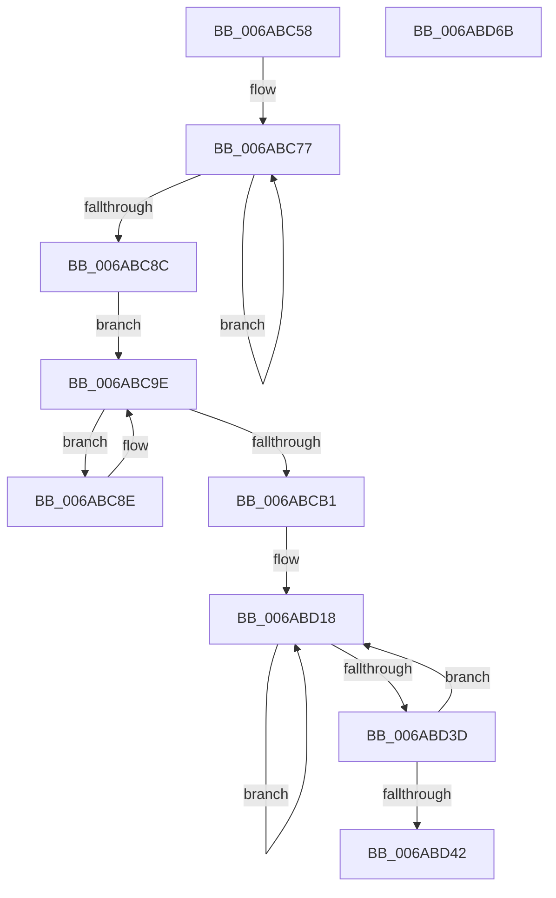

# SpiInit

- RVA: `0x006ABC58`–`0x006ABD6C` (길이 `276` bytes)
- VA: `0x00000001406ABC58`
- 실행 섹션: `.text`
- PDB 이름 있음: `예`; PDB Function 태그: `아니요`
- unwind 정보 RVA: `0x0005C954`
- 디코드: `68`개 명령, `276/276` bytes 표시
- 미해석 바이트: `0` (있으면 어셈블리에 `.byte`로 보존)

> 이 문서는 커널 이미지의 기계어와 PDB 기호를 분석해 생성했습니다. 4번과 5번은 함수 원형과 자료형을 바이너리 사용 방식에서 추정한 C 해석이며 원본 소스 복구 결과는 아닙니다.

## 1. Dependencies

- 직접 호출 지점: **11**; 고유 호출 대상: **1**
- 직접 호출자로 확인된 함수: **1**
- RIP 상대 이미지 참조: **2**

### Outgoing calls
- `0x006ABC81` → [guard_dispatch_icall](../6B/guard_dispatch_icall_function_006BAAD0.md) (function, `0x006BAAD0`)
- `0x006ABC99` → [guard_dispatch_icall](../6B/guard_dispatch_icall_function_006BAAD0.md) (function, `0x006BAAD0`)
- `0x006ABCA8` → [guard_dispatch_icall](../6B/guard_dispatch_icall_function_006BAAD0.md) (function, `0x006BAAD0`)
- `0x006ABCBE` → [guard_dispatch_icall](../6B/guard_dispatch_icall_function_006BAAD0.md) (function, `0x006BAAD0`)
- `0x006ABCD3` → [guard_dispatch_icall](../6B/guard_dispatch_icall_function_006BAAD0.md) (function, `0x006BAAD0`)
- `0x006ABCE7` → [guard_dispatch_icall](../6B/guard_dispatch_icall_function_006BAAD0.md) (function, `0x006BAAD0`)
- `0x006ABCF9` → [guard_dispatch_icall](../6B/guard_dispatch_icall_function_006BAAD0.md) (function, `0x006BAAD0`)
- `0x006ABD0B` → [guard_dispatch_icall](../6B/guard_dispatch_icall_function_006BAAD0.md) (function, `0x006BAAD0`)
- `0x006ABD22` → [guard_dispatch_icall](../6B/guard_dispatch_icall_function_006BAAD0.md) (function, `0x006BAAD0`)
- `0x006ABD33` → [guard_dispatch_icall](../6B/guard_dispatch_icall_function_006BAAD0.md) (function, `0x006BAAD0`)
- `0x006ABD51` → [guard_dispatch_icall](../6B/guard_dispatch_icall_function_006BAAD0.md) (function, `0x006BAAD0`)

### Direct callers
- [SpiSend16](SpiSend16_function_006AC0F8.md) at `0x006AC118`

### Static image references
- `0x006ABC77` → RVA `0x00E039E0` (`.data`; read)
- `0x006ABCB1` → RVA `0x00E039E8` (`.data`; read)

## 2. Other-region calls and transfers

- 다른 실행 섹션으로 향하는 call: **0**
- 별도 외부 분기/꼬리 이동을 확인하지 못했습니다.

## 3. Assembly (complete function range)

```asm
006ABC58  48 89 5C 24 08                  mov qword ptr [rsp + 8], rbx
006ABC5D  48 89 6C 24 10                  mov qword ptr [rsp + 0x10], rbp
006ABC62  48 89 74 24 18                  mov qword ptr [rsp + 0x18], rsi
006ABC67  57                              push rdi
006ABC68  48 83 EC 20                     sub rsp, 0x20
006ABC6C  41 0F B7 E9                     movzx ebp, r9w
006ABC70  48 8D 79 28                     lea rdi, [rcx + 0x28]
006ABC74  48 8B D9                        mov rbx, rcx
006ABC77  48 8B 05 62 7D 75 00            mov rax, qword ptr [rip + 0x757d62]
006ABC7E  48 8B CF                        mov rcx, rdi
006ABC81  E8 4A EE 00 00                  call 0x1406baad0
006ABC86  24 05                           and al, 5
006ABC88  3C 04                           cmp al, 4
006ABC8A  75 EB                           jne 0x1406abc77
006ABC8C  EB 10                           jmp 0x1406abc9e
006ABC8E  48 8B 05 4B 7D 75 00            mov rax, qword ptr [rip + 0x757d4b]
006ABC95  48 8D 4B 60                     lea rcx, [rbx + 0x60]
006ABC99  E8 32 EE 00 00                  call 0x1406baad0
006ABC9E  48 8B 05 3B 7D 75 00            mov rax, qword ptr [rip + 0x757d3b]
006ABCA5  48 8B CF                        mov rcx, rdi
006ABCA8  E8 23 EE 00 00                  call 0x1406baad0
006ABCAD  A8 08                           test al, 8
006ABCAF  75 DD                           jne 0x1406abc8e
006ABCB1  48 8B 05 30 7D 75 00            mov rax, qword ptr [rip + 0x757d30]
006ABCB8  48 8D 4B 10                     lea rcx, [rbx + 0x10]
006ABCBC  33 D2                           xor edx, edx
006ABCBE  E8 0D EE 00 00                  call 0x1406baad0
006ABCC3  48 8B 05 1E 7D 75 00            mov rax, qword ptr [rip + 0x757d1e]
006ABCCA  48 8D 7B 08                     lea rdi, [rbx + 8]
006ABCCE  48 8B CF                        mov rcx, rdi
006ABCD1  33 D2                           xor edx, edx
006ABCD3  E8 F8 ED 00 00                  call 0x1406baad0
006ABCD8  48 8B 05 09 7D 75 00            mov rax, qword ptr [rip + 0x757d09]
006ABCDF  BA 0F 00 00 00                  mov edx, 0xf
006ABCE4  48 8B CB                        mov rcx, rbx
006ABCE7  E8 E4 ED 00 00                  call 0x1406baad0
006ABCEC  48 8B 05 F5 7C 75 00            mov rax, qword ptr [rip + 0x757cf5]
006ABCF3  48 8D 4B 04                     lea rcx, [rbx + 4]
006ABCF7  33 D2                           xor edx, edx
006ABCF9  E8 D2 ED 00 00                  call 0x1406baad0
006ABCFE  48 8B 05 E3 7C 75 00            mov rax, qword ptr [rip + 0x757ce3]
006ABD05  48 8D 4B 14                     lea rcx, [rbx + 0x14]
006ABD09  8B D5                           mov edx, ebp
006ABD0B  E8 C0 ED 00 00                  call 0x1406baad0
006ABD10  48 8D 73 34                     lea rsi, [rbx + 0x34]
006ABD14  48 8D 6B 30                     lea rbp, [rbx + 0x30]
006ABD18  48 8B 05 C1 7C 75 00            mov rax, qword ptr [rip + 0x757cc1]
006ABD1F  48 8B CE                        mov rcx, rsi
006ABD22  E8 A9 ED 00 00                  call 0x1406baad0
006ABD27  8B D8                           mov ebx, eax
006ABD29  48 8B CD                        mov rcx, rbp
006ABD2C  48 8B 05 AD 7C 75 00            mov rax, qword ptr [rip + 0x757cad]
006ABD33  E8 98 ED 00 00                  call 0x1406baad0
006ABD38  66 85 DB                        test bx, bx
006ABD3B  75 DB                           jne 0x1406abd18
006ABD3D  66 85 C0                        test ax, ax
006ABD40  75 D6                           jne 0x1406abd18
006ABD42  48 8B 05 9F 7C 75 00            mov rax, qword ptr [rip + 0x757c9f]
006ABD49  BA 01 00 00 00                  mov edx, 1
006ABD4E  48 8B CF                        mov rcx, rdi
006ABD51  E8 7A ED 00 00                  call 0x1406baad0
006ABD56  48 8B 5C 24 30                  mov rbx, qword ptr [rsp + 0x30]
006ABD5B  48 8B 6C 24 38                  mov rbp, qword ptr [rsp + 0x38]
006ABD60  48 8B 74 24 40                  mov rsi, qword ptr [rsp + 0x40]
006ABD65  48 83 C4 20                     add rsp, 0x20
006ABD69  5F                              pop rdi
006ABD6A  C3                              ret
006ABD6B  CC                              int3
```

## 4. C-style interpretation (structured pseudocode)

```c
__int64 __fastcall SpiInit(__int64 a1, int a2, __int64 a3, unsigned __int16 a4)
{
    __int64 result;
    __int64 v_rsp;
    unsigned __int64 v_stack_p10;
    unsigned __int64 v_stack_p18;
    unsigned __int64 v_stack_p8;

    v_stack_p8 = v_rbx;
    v_stack_p10 = v_rbp;
    v_stack_p18 = v_rsi;
    v_rsp = (v_rsp) - (32);
loc_006ABC77:
    result = guard_dispatch_icall(a1 + 40, a2, a3, a4);
    result = (unsigned __int8)((result) & (5));
    if (((unsigned __int8)(result)) != 4) goto loc_006ABC77;
    goto loc_006ABC9E;
loc_006ABC8E:
    result = guard_dispatch_icall(a1 + 96, a2, a3, a4);
loc_006ABC9E:
    result = guard_dispatch_icall(a1 + 40, a2, a3, a4);
    if ((((unsigned __int8)(result)) & (8)) != 0) goto loc_006ABC8E;
    a2 = 0;
    result = guard_dispatch_icall(a1 + 16, a2, a3, a4);
    a2 = 0;
    result = guard_dispatch_icall(a1 + 8, a2, a3, a4);
    result = guard_dispatch_icall(a1, 15, a3, a4);
    a2 = 0;
    result = guard_dispatch_icall(a1 + 4, a2, a3, a4);
    result = guard_dispatch_icall(a1 + 20, (unsigned int)(a4), a3, a4);
loc_006ABD18:
    result = guard_dispatch_icall(a1 + 52, (unsigned int)(a4), a3, a4);
    result = guard_dispatch_icall(a1 + 48, (unsigned int)(a4), a3, a4);
    if ((unsigned __int16)((unsigned int)((unsigned int)(result))) != 0) goto loc_006ABD18;
    if ((unsigned __int16)(result) != 0) goto loc_006ABD18;
    result = guard_dispatch_icall(a1 + 8, 1, a3, a4);
    v_rsp = (v_rsp) + (32);
    return result;
}
```

## 5. (Beta) C Style

```c
int64_t SpiInit(void *Arg1, int32_t Arg2, int64_t Arg3, uint16_t Arg4)
{
    uint8_t *arg1 = (uint8_t *)Arg1;

    int64_t result;
    int64_t local_rsp;
    uint64_t v_stack_p10;
    uint64_t v_stack_p18;
    uint64_t v_stack_p8;

    v_stack_p8 = local_rbx;
    v_stack_p10 = local_rbp;
    v_stack_p18 = local_rsi;
    local_rsp = (local_rsp) - (32);
loc_006ABC77:
    result = guard_dispatch_icall(Arg1 + 40, Arg2, Arg3, Arg4);
    result = (uint8_t)((result) & (5));
    if (((uint8_t)(result)) != 4) goto loc_006ABC77;
    goto loc_006ABC9E;
loc_006ABC8E:
    result = guard_dispatch_icall(Arg1 + 96, Arg2, Arg3, Arg4);
loc_006ABC9E:
    result = guard_dispatch_icall(Arg1 + 40, Arg2, Arg3, Arg4);
    if ((((uint8_t)(result)) & (8)) != 0) goto loc_006ABC8E;
    Arg2 = 0;
    result = guard_dispatch_icall(Arg1 + 16, Arg2, Arg3, Arg4);
    Arg2 = 0;
    result = guard_dispatch_icall(Arg1 + 8, Arg2, Arg3, Arg4);
    result = guard_dispatch_icall(Arg1, 15, Arg3, Arg4);
    Arg2 = 0;
    result = guard_dispatch_icall(Arg1 + 4, Arg2, Arg3, Arg4);
    result = guard_dispatch_icall(Arg1 + 20, (uint32_t)(Arg4), Arg3, Arg4);
loc_006ABD18:
    result = guard_dispatch_icall(Arg1 + 52, (uint32_t)(Arg4), Arg3, Arg4);
    result = guard_dispatch_icall(Arg1 + 48, (uint32_t)(Arg4), Arg3, Arg4);
    if ((uint16_t)((uint32_t)((uint32_t)(result))) != 0) goto loc_006ABD18;
    if ((uint16_t)(result) != 0) goto loc_006ABD18;
    result = guard_dispatch_icall(Arg1 + 8, 1, Arg3, Arg4);
    local_rsp = (local_rsp) + (32);
    return result;
}
```

### 관측된 메모리 오프셋

구조체 형식이 확인되지 않은 접근은 인자 기준의 오프셋으로만 기록했습니다.

| 기준 인자 | 오프셋 표현 | 폭 (bit) | 접근 |
|---|---:|---:|---|
| `Arg1` | `+ 0x4` | `64` | `R` |
| `Arg1` | `+ 0x8` | `64` | `R` |
| `Arg1` | `+ 0x10` | `64` | `R` |
| `Arg1` | `+ 0x14` | `64` | `R` |
| `Arg1` | `+ 0x28` | `64` | `R` |
| `Arg1` | `+ 0x30` | `64` | `R` |
| `Arg1` | `+ 0x34` | `64` | `R` |
| `Arg1` | `+ 0x60` | `64` | `R` |

## 6. Execution-region graph

[열기: 2D/3D 그래프와 함수 탐색 컨트롤 패널](../../../control-panel.html?section=text&rva=0x006ABC58&view=graph)

- 2D 그래프는 위에서 아래로 흐르고, 3D 그래프는 빈 공간을 드래그해 회전합니다. Shift+드래그는 이동, 휠은 확대·축소, 함수 노드 선택은 대상 보고서 이동입니다.

### Static fallback


