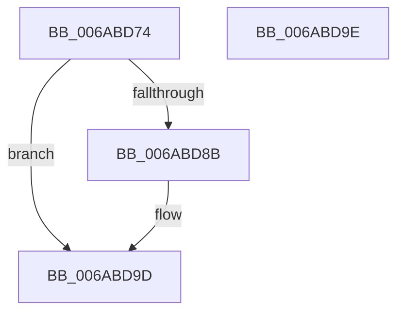

# SpiMax311BufferRxData

- RVA: `0x006ABD74`–`0x006ABD9F` (길이 `43` bytes)
- VA: `0x00000001406ABD74`
- 실행 섹션: `.text`
- PDB 이름 있음: `예`; PDB Function 태그: `아니요`
- unwind 정보 RVA: `0x000DB714`
- 디코드: `10`개 명령, `43/43` bytes 표시
- 미해석 바이트: `0` (있으면 어셈블리에 `.byte`로 보존)

> 이 문서는 커널 이미지의 기계어와 PDB 기호를 분석해 생성했습니다. 4번과 5번은 함수 원형과 자료형을 바이너리 사용 방식에서 추정한 C 해석이며 원본 소스 복구 결과는 아닙니다.

## 1. Dependencies

- 직접 호출 지점: **0**; 고유 호출 대상: **0**
- 직접 호출자로 확인된 함수: **3**
- RIP 상대 이미지 참조: **4**

### Outgoing calls
- 직접 디코드된 call 명령이 없습니다.

### Direct callers
- [SpiMax311PutByte](SpiMax311PutByte_function_006ABE80.md) at `0x006ABECA`
- [SpiMax311RxReady](SpiMax311RxReady_function_006ABF10.md) at `0x006ABF37`
- [SpiMax311TxEmpty](SpiMax311TxEmpty_function_006AC0C0.md) at `0x006AC0CB`

### Static image references
- `0x006ABD74` → RVA `0x00E651A0` (`.data`; read)
- `0x006ABD83` → RVA `0x00E651A4` (`.data`; read)
- `0x006ABD8B` → RVA `0x00E651AA` (`.data`; read)
- `0x006ABD97` → RVA `0x00E651A0` (`.data`; write)

## 2. Other-region calls and transfers

- 다른 실행 섹션으로 향하는 call: **0**
- 별도 외부 분기/꼬리 이동을 확인하지 못했습니다.

## 3. Assembly (complete function range)

```asm
006ABD74  8B 05 26 94 7B 00               mov eax, dword ptr [rip + 0x7b9426]
006ABD7A  8D 50 01                        lea edx, [rax + 1]
006ABD7D  81 E2 FF 03 00 00               and edx, 0x3ff
006ABD83  3B 15 1B 94 7B 00               cmp edx, dword ptr [rip + 0x7b941b]
006ABD89  74 12                           je 0x1406abd9d
006ABD8B  4C 8D 05 18 94 7B 00            lea r8, [rip + 0x7b9418]
006ABD92  66 41 89 0C 40                  mov word ptr [r8 + rax*2], cx
006ABD97  89 15 03 94 7B 00               mov dword ptr [rip + 0x7b9403], edx
006ABD9D  C3                              ret
006ABD9E  CC                              int3
```

## 4. C-style interpretation (structured pseudocode)

```c
__int64 __fastcall SpiMax311BufferRxData(unsigned __int16 a1)
{
    a2 = (unsigned int)(((unsigned int)(*(unsigned int *)(v_rip + 8098854)) + 1) & (0x3FFULL));
    if (((unsigned int)(a2)) != (*(unsigned int *)(v_rip + 8098843))) {
        a3 = v_rip + 8098840;
        *(unsigned __int16 *)(a3 + (unsigned int)(*(unsigned int *)(v_rip + 8098854)) * 2) = a1;
        *(unsigned int *)(v_rip + 8098819) = (unsigned int)(a2);
    }
    return (unsigned int)(*(unsigned int *)(v_rip + 8098854));
}
```

## 5. (Beta) C Style

```c
int64_t SpiMax311BufferRxData(uint16_t Arg1)
{
    a2 = (uint32_t)(((uint32_t)(*(uint32_t *)(v_rip + 0x7B9426)) + 1) & (0x3FFULL));
    if (((uint32_t)(a2)) != (*(uint32_t *)(v_rip + 0x7B941B))) {
        a3 = v_rip + 8098840;
        *(uint16_t *)(a3 + (uint32_t)(*(uint32_t *)(v_rip + 0x7B9426)) * 2) = Arg1;
        *(uint32_t *)(v_rip + 0x7B9403) = (uint32_t)(a2);
    }
    return (uint32_t)(*(uint32_t *)(v_rip + 0x7B9426));
}
```

## 6. Execution-region graph

[열기: 2D/3D 그래프와 함수 탐색 컨트롤 패널](../../../control-panel.html?section=text&rva=0x006ABD74&view=graph)

- 2D 그래프는 위에서 아래로 흐르고, 3D 그래프는 빈 공간을 드래그해 회전합니다. Shift+드래그는 이동, 휠은 확대·축소, 함수 노드 선택은 대상 보고서 이동입니다.

### Static fallback


