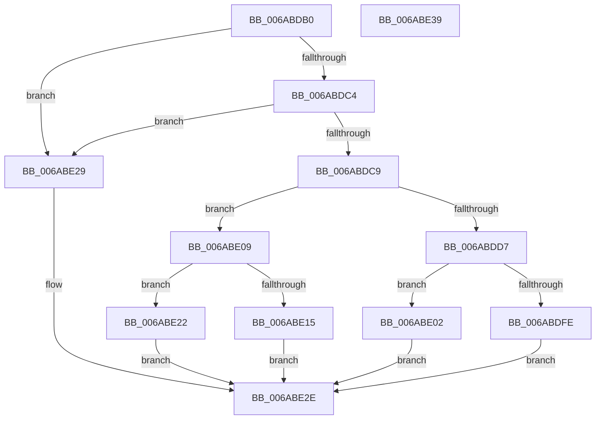

# SpiMax311GetByte

- RVA: `0x006ABDB0`–`0x006ABE3A` (길이 `138` bytes)
- VA: `0x00000001406ABDB0`
- 실행 섹션: `.text`
- PDB 이름 있음: `예`; PDB Function 태그: `아니요`
- unwind 정보 RVA: `0x0005CAAC`
- 디코드: `42`개 명령, `138/138` bytes 표시
- 미해석 바이트: `0` (있으면 어셈블리에 `.byte`로 보존)

> 이 문서는 커널 이미지의 기계어와 PDB 기호를 분석해 생성했습니다. 4번과 5번은 함수 원형과 자료형을 바이너리 사용 방식에서 추정한 C 해석이며 원본 소스 복구 결과는 아닙니다.

## 1. Dependencies

- 직접 호출 지점: **1**; 고유 호출 대상: **1**
- 직접 호출자로 확인된 함수: **0**
- RIP 상대 이미지 참조: **4**

### Outgoing calls
- `0x006ABE0B` → [SpiSend16](SpiSend16_function_006AC0F8.md) (function, `0x006AC0F8`)

### Direct callers
- 이 함수 시작 RVA로 연결되는 직접 call은 확인되지 않았습니다. 간접 호출은 완전히 역산할 수 없습니다.

### Static image references
- `0x006ABDC9` → RVA `0x00E651A4` (`.data`; read)
- `0x006ABDCF` → RVA `0x00E651A0` (`.data`; read)
- `0x006ABDD7` → RVA `0x00E651AA` (`.data`; read)
- `0x006ABDF6` → RVA `0x00E651A4` (`.data`; write)

## 2. Other-region calls and transfers

- 다른 실행 섹션으로 향하는 call: **0**
- 별도 외부 분기/꼬리 이동을 확인하지 못했습니다.

## 3. Assembly (complete function range)

```asm
006ABDB0  48 89 5C 24 08                  mov qword ptr [rsp + 8], rbx
006ABDB5  57                              push rdi
006ABDB6  48 83 EC 20                     sub rsp, 0x20
006ABDBA  33 FF                           xor edi, edi
006ABDBC  48 8B DA                        mov rbx, rdx
006ABDBF  48 85 C9                        test rcx, rcx
006ABDC2  74 65                           je 0x1406abe29
006ABDC4  48 39 39                        cmp qword ptr [rcx], rdi
006ABDC7  74 60                           je 0x1406abe29
006ABDC9  8B 05 D5 93 7B 00               mov eax, dword ptr [rip + 0x7b93d5]
006ABDCF  3B 05 CB 93 7B 00               cmp eax, dword ptr [rip + 0x7b93cb]
006ABDD5  74 32                           je 0x1406abe09
006ABDD7  48 8D 0D CC 93 7B 00            lea rcx, [rip + 0x7b93cc]
006ABDDE  0F B7 0C 41                     movzx ecx, word ptr [rcx + rax*2]
006ABDE2  88 0A                           mov byte ptr [rdx], cl
006ABDE4  8B 05 BA 93 7B 00               mov eax, dword ptr [rip + 0x7b93ba]
006ABDEA  FF C0                           inc eax
006ABDEC  25 FF 03 00 00                  and eax, 0x3ff
006ABDF1  66 0F BA E1 0A                  bt cx, 0xa
006ABDF6  89 05 A8 93 7B 00               mov dword ptr [rip + 0x7b93a8], eax
006ABDFC  72 04                           jb 0x1406abe02
006ABDFE  33 C0                           xor eax, eax
006ABE00  EB 2C                           jmp 0x1406abe2e
006ABE02  B8 02 00 00 00                  mov eax, 2
006ABE07  EB 25                           jmp 0x1406abe2e
006ABE09  33 D2                           xor edx, edx
006ABE0B  E8 E8 02 00 00                  call 0x1406ac0f8
006ABE10  66 85 C0                        test ax, ax
006ABE13  79 0D                           jns 0x1406abe22
006ABE15  88 03                           mov byte ptr [rbx], al
006ABE17  0F B7 C0                        movzx eax, ax
006ABE1A  C1 E8 09                        shr eax, 9
006ABE1D  83 E0 02                        and eax, 2
006ABE20  EB 0C                           jmp 0x1406abe2e
006ABE22  B8 01 00 00 00                  mov eax, 1
006ABE27  EB 05                           jmp 0x1406abe2e
006ABE29  B8 03 00 00 00                  mov eax, 3
006ABE2E  48 8B 5C 24 30                  mov rbx, qword ptr [rsp + 0x30]
006ABE33  48 83 C4 20                     add rsp, 0x20
006ABE37  5F                              pop rdi
006ABE38  C3                              ret
006ABE39  CC                              int3
```

## 4. C-style interpretation (structured pseudocode)

```c
__int64 __fastcall SpiMax311GetByte(__int64 a1, __int64 a2)
{
    __int64 result;
    __int64 v_rdi;
    __int64 v_rsp;
    unsigned __int64 v_stack_p8;

    v_stack_p8 = v_rbx;
    v_rsp = (v_rsp) - (32);
    v_rdi = 0;
    if (a1 == 0) goto loc_006ABE29;
    if ((*(unsigned __int64 *)(a1)) == 0) goto loc_006ABE29;
    if (((unsigned int)((unsigned int)(*(unsigned int *)(v_rip + 8098773)))) == (*(unsigned int *)(v_rip + 8098763))) goto loc_006ABE09;
    *(unsigned __int8 *)(a2) = (unsigned __int8)(*(unsigned __int16 *)(v_rip + 8098764 + (unsigned int)(*(unsigned int *)(v_rip + 8098773)) * 2));
    result = (unsigned int)(((unsigned int)(*(unsigned int *)(v_rip + 8098746))) + 1);
    result = (unsigned int)((result) & (0x3FFULL));
    *(unsigned int *)(v_rip + 8098728) = (unsigned int)(result);
    if (condition_is_below) goto loc_006ABE02;
    result = 0;
    goto loc_006ABE2E;
loc_006ABE02:
    goto loc_006ABE2E;
loc_006ABE09:
    a2 = 0;
    result = SpiSend16(*(unsigned __int16 *)(v_rip + 8098764 + (unsigned int)(*(unsigned int *)(v_rip + 8098773)) * 2), a2, a3, a4);
    if (!sign_flag) goto loc_006ABE22;
    *(unsigned __int8 *)(a2) = (unsigned __int8)(result);
    result = (unsigned int)(((unsigned __int16)(result)) >> (9));
    result = (unsigned int)((result) & (2));
    goto loc_006ABE2E;
loc_006ABE22:
    goto loc_006ABE2E;
loc_006ABE29:
loc_006ABE2E:
    v_rsp = (v_rsp) + (32);
    return 3;
}
```

## 5. (Beta) C Style

```c
int64_t SpiMax311GetByte(int64_t Arg1, void *Arg2)
{
    uint8_t *arg2 = (uint8_t *)Arg2;

    int64_t result;
    int64_t local_rdi;
    int64_t local_rsp;
    uint64_t v_stack_p8;

    v_stack_p8 = local_rbx;
    local_rsp = (local_rsp) - (32);
    local_rdi = 0;
    if (Arg1 == 0) goto loc_006ABE29;
    if ((*(uint64_t *)(Arg1)) == 0) goto loc_006ABE29;
    if (((uint32_t)((uint32_t)(*(uint32_t *)(v_rip + 0x7B93D5)))) == (*(uint32_t *)(v_rip + 0x7B93CB))) goto loc_006ABE09;
    *(uint8_t *)(arg2) = (uint8_t)(*(uint16_t *)(v_rip + 0x7B93CC + (uint32_t)(*(uint32_t *)(v_rip + 0x7B93D5)) * 2));
    result = (uint32_t)(((uint32_t)(*(uint32_t *)(v_rip + 0x7B93BA))) + 1);
    result = (uint32_t)((result) & (0x3FFULL));
    *(uint32_t *)(v_rip + 0x7B93A8) = (uint32_t)(result);
    if (condition_is_below) goto loc_006ABE02;
    result = 0;
    goto loc_006ABE2E;
loc_006ABE02:
    goto loc_006ABE2E;
loc_006ABE09:
    Arg2 = 0;
    result = SpiSend16(*(uint16_t *)(v_rip + 0x7B93CC + (uint32_t)(*(uint32_t *)(v_rip + 0x7B93D5)) * 2), Arg2, a3, a4);
    if (!sign_flag) goto loc_006ABE22;
    *(uint8_t *)(arg2) = (uint8_t)(result);
    result = (uint32_t)(((uint16_t)(result)) >> (9));
    result = (uint32_t)((result) & (2));
    goto loc_006ABE2E;
loc_006ABE22:
    goto loc_006ABE2E;
loc_006ABE29:
loc_006ABE2E:
    local_rsp = (local_rsp) + (32);
    return 3;
}
```

### 관측된 메모리 오프셋

구조체 형식이 확인되지 않은 접근은 인자 기준의 오프셋으로만 기록했습니다.

| 기준 인자 | 오프셋 표현 | 폭 (bit) | 접근 |
|---|---:|---:|---|
| `Arg2` | `+ 0x0` | `8` | `W` |

## 6. Execution-region graph

[열기: 2D/3D 그래프와 함수 탐색 컨트롤 패널](../../../control-panel.html?section=text&rva=0x006ABDB0&view=graph)

- 2D 그래프는 위에서 아래로 흐르고, 3D 그래프는 빈 공간을 드래그해 회전합니다. Shift+드래그는 이동, 휠은 확대·축소, 함수 노드 선택은 대상 보고서 이동입니다.

### Static fallback


