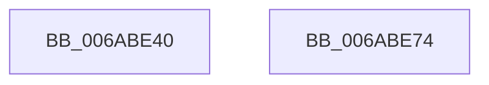

# SpiMax311InitializePort

- RVA: `0x006ABE40`–`0x006ABE75` (길이 `53` bytes)
- VA: `0x00000001406ABE40`
- 실행 섹션: `.text`
- PDB 이름 있음: `예`; PDB Function 태그: `아니요`
- unwind 정보 RVA: `0x0005C788`
- 디코드: `15`개 명령, `53/53` bytes 표시
- 미해석 바이트: `0` (있으면 어셈블리에 `.byte`로 보존)

> 이 문서는 커널 이미지의 기계어와 PDB 기호를 분석해 생성했습니다. 4번과 5번은 함수 원형과 자료형을 바이너리 사용 방식에서 추정한 C 해석이며 원본 소스 복구 결과는 아닙니다.

## 1. Dependencies

- 직접 호출 지점: **1**; 고유 호출 대상: **1**
- 직접 호출자로 확인된 함수: **0**
- RIP 상대 이미지 참조: **2**

### Outgoing calls
- `0x006ABE68` → [SpiMax311SetBaud](SpiMax311SetBaud_function_006ABF70.md) (function, `0x006ABF70`)

### Direct callers
- 이 함수 시작 RVA로 연결되는 직접 call은 확인되지 않았습니다. 간접 호출은 완전히 역산할 수 없습니다.

### Static image references
- `0x006ABE4D` → RVA `0x00E651A0` (`.data`; write)
- `0x006ABE5B` → RVA `0x00E651A8` (`.data`; write)

## 2. Other-region calls and transfers

- 다른 실행 섹션으로 향하는 call: **0**
- 별도 외부 분기/꼬리 이동을 확인하지 못했습니다.

## 3. Assembly (complete function range)

```asm
006ABE40  48 83 EC 28                     sub rsp, 0x28
006ABE44  33 C0                           xor eax, eax
006ABE46  4C 8B C2                        mov r8, rdx
006ABE49  66 89 42 0C                     mov word ptr [rdx + 0xc], ax
006ABE4D  48 89 05 4C 93 7B 00            mov qword ptr [rip + 0x7b934c], rax
006ABE54  48 8B 02                        mov rax, qword ptr [rdx]
006ABE57  0F B7 48 14                     movzx ecx, word ptr [rax + 0x14]
006ABE5B  66 89 0D 46 93 7B 00            mov word ptr [rip + 0x7b9346], cx
006ABE62  49 8B C8                        mov rcx, r8
006ABE65  8B 52 08                        mov edx, dword ptr [rdx + 8]
006ABE68  E8 03 01 00 00                  call 0x1406abf70
006ABE6D  B0 01                           mov al, 1
006ABE6F  48 83 C4 28                     add rsp, 0x28
006ABE73  C3                              ret
006ABE74  CC                              int3
```

## 4. C-style interpretation (structured pseudocode)

```c
__int64 __fastcall SpiMax311InitializePort(__int64 a1, __int64 a2)
{
    __int64 result;
    __int64 v_rsp;

    v_rsp = (v_rsp) - (40);
    result = 0;
    *(unsigned __int16 *)(a2 + 12) = 0;
    *(unsigned __int64 *)(v_rip + 8098636) = 0;
    *(unsigned __int16 *)(v_rip + 8098630) = (unsigned __int16)(*(unsigned __int16 *)(*(unsigned __int64 *)(a2) + 20));
    result = SpiMax311SetBaud(a2, (unsigned int)(*(unsigned int *)(a2 + 8)), a2, a4);
    v_rsp = (v_rsp) + (40);
    return 1;
}
```

## 5. (Beta) C Style

```c
int64_t SpiMax311InitializePort(int64_t Arg1, void *Arg2)
{
    uint8_t *arg2 = (uint8_t *)Arg2;

    int64_t result;
    int64_t local_rsp;

    local_rsp = (local_rsp) - (40);
    result = 0;
    *(uint16_t *)(arg2 + 0xC) = 0;
    *(uint64_t *)(v_rip + 0x7B934C) = 0;
    *(uint16_t *)(v_rip + 0x7B9346) = (uint16_t)(*(uint16_t *)(*(uint64_t *)(arg2) + 0x14));
    result = SpiMax311SetBaud(Arg2, (uint32_t)(*(uint32_t *)(arg2 + 0x8)), Arg2, a4);
    local_rsp = (local_rsp) + (40);
    return 1;
}
```

### 관측된 메모리 오프셋

구조체 형식이 확인되지 않은 접근은 인자 기준의 오프셋으로만 기록했습니다.

| 기준 인자 | 오프셋 표현 | 폭 (bit) | 접근 |
|---|---:|---:|---|
| `Arg2` | `+ 0x0` | `64` | `R` |
| `Arg2` | `+ 0x8` | `32` | `R` |
| `Arg2` | `+ 0xC` | `16` | `W` |

## 6. Execution-region graph

[열기: 2D/3D 그래프와 함수 탐색 컨트롤 패널](../../../control-panel.html?section=text&rva=0x006ABE40&view=graph)

- 2D 그래프는 위에서 아래로 흐르고, 3D 그래프는 빈 공간을 드래그해 회전합니다. Shift+드래그는 이동, 휠은 확대·축소, 함수 노드 선택은 대상 보고서 이동입니다.

### Static fallback


