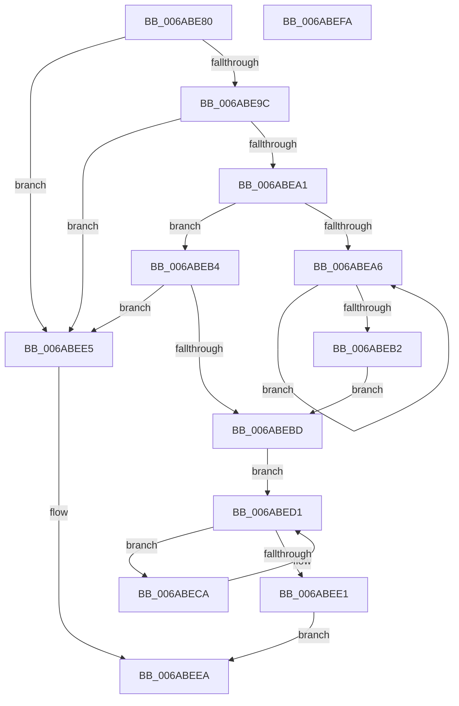

# SpiMax311PutByte

- RVA: `0x006ABE80`–`0x006ABEFB` (길이 `123` bytes)
- VA: `0x00000001406ABE80`
- 실행 섹션: `.text`
- PDB 이름 있음: `예`; PDB Function 태그: `아니요`
- unwind 정보 RVA: `0x00060BC4`
- 디코드: `41`개 명령, `123/123` bytes 표시
- 미해석 바이트: `0` (있으면 어셈블리에 `.byte`로 보존)

> 이 문서는 커널 이미지의 기계어와 PDB 기호를 분석해 생성했습니다. 4번과 5번은 함수 원형과 자료형을 바이너리 사용 방식에서 추정한 C 해석이며 원본 소스 복구 결과는 아닙니다.

## 1. Dependencies

- 직접 호출 지점: **4**; 고유 호출 대상: **3**
- 직접 호출자로 확인된 함수: **0**
- RIP 상대 이미지 참조: **0**

### Outgoing calls
- `0x006ABEA9` → [SpiMax311TxEmpty](SpiMax311TxEmpty_function_006AC0C0.md) (function, `0x006AC0C0`)
- `0x006ABEB4` → [SpiMax311TxEmpty](SpiMax311TxEmpty_function_006AC0C0.md) (function, `0x006AC0C0`)
- `0x006ABECA` → [SpiMax311BufferRxData](SpiMax311BufferRxData_function_006ABD74.md) (function, `0x006ABD74`)
- `0x006ABED4` → [SpiSend16](SpiSend16_function_006AC0F8.md) (function, `0x006AC0F8`)

### Direct callers
- 이 함수 시작 RVA로 연결되는 직접 call은 확인되지 않았습니다. 간접 호출은 완전히 역산할 수 없습니다.

### Static image references
- 디코드된 RIP-relative 메모리 참조가 없습니다.

## 2. Other-region calls and transfers

- 다른 실행 섹션으로 향하는 call: **0**
- 별도 외부 분기/꼬리 이동을 확인하지 못했습니다.

## 3. Assembly (complete function range)

```asm
006ABE80  48 89 5C 24 08                  mov qword ptr [rsp + 8], rbx
006ABE85  48 89 74 24 10                  mov qword ptr [rsp + 0x10], rsi
006ABE8A  57                              push rdi
006ABE8B  48 83 EC 20                     sub rsp, 0x20
006ABE8F  33 F6                           xor esi, esi
006ABE91  0F B6 FA                        movzx edi, dl
006ABE94  48 8B D9                        mov rbx, rcx
006ABE97  48 85 C9                        test rcx, rcx
006ABE9A  74 49                           je 0x1406abee5
006ABE9C  48 39 31                        cmp qword ptr [rcx], rsi
006ABE9F  74 44                           je 0x1406abee5
006ABEA1  45 84 C0                        test r8b, r8b
006ABEA4  74 0E                           je 0x1406abeb4
006ABEA6  48 8B CB                        mov rcx, rbx
006ABEA9  E8 12 02 00 00                  call 0x1406ac0c0
006ABEAE  84 C0                           test al, al
006ABEB0  74 F4                           je 0x1406abea6
006ABEB2  EB 09                           jmp 0x1406abebd
006ABEB4  E8 07 02 00 00                  call 0x1406ac0c0
006ABEB9  84 C0                           test al, al
006ABEBB  74 28                           je 0x1406abee5
006ABEBD  0F B7 D7                        movzx edx, di
006ABEC0  B8 00 80 00 00                  mov eax, 0x8000
006ABEC5  66 0B D0                        or dx, ax
006ABEC8  EB 07                           jmp 0x1406abed1
006ABECA  E8 A5 FE FF FF                  call 0x1406abd74
006ABECF  33 D2                           xor edx, edx
006ABED1  48 8B CB                        mov rcx, rbx
006ABED4  E8 1F 02 00 00                  call 0x1406ac0f8
006ABED9  0F B7 C8                        movzx ecx, ax
006ABEDC  66 85 C0                        test ax, ax
006ABEDF  78 E9                           js 0x1406abeca
006ABEE1  33 C0                           xor eax, eax
006ABEE3  EB 05                           jmp 0x1406abeea
006ABEE5  B8 03 00 00 00                  mov eax, 3
006ABEEA  48 8B 5C 24 30                  mov rbx, qword ptr [rsp + 0x30]
006ABEEF  48 8B 74 24 38                  mov rsi, qword ptr [rsp + 0x38]
006ABEF4  48 83 C4 20                     add rsp, 0x20
006ABEF8  5F                              pop rdi
006ABEF9  C3                              ret
006ABEFA  CC                              int3
```

## 4. C-style interpretation (structured pseudocode)

```c
__int64 __fastcall SpiMax311PutByte(__int64 a1, unsigned __int8 a2, unsigned __int8 a3)
{
    __int64 result;
    __int64 v_rsi;
    __int64 v_rsp;
    unsigned __int64 v_stack_p10;
    unsigned __int64 v_stack_p8;

    v_stack_p8 = v_rbx;
    v_stack_p10 = v_rsi;
    v_rsp = (v_rsp) - (32);
    v_rsi = 0;
    if (a1 == 0) goto loc_006ABEE5;
    if ((*(unsigned __int64 *)(a1)) == 0) goto loc_006ABEE5;
    if (a3 == 0) goto loc_006ABEB4;
loc_006ABEA6:
    result = SpiMax311TxEmpty(a1, a2, a3, a4);
    if ((unsigned __int8)(result) == 0) goto loc_006ABEA6;
    goto loc_006ABEBD;
loc_006ABEB4:
    result = SpiMax311TxEmpty(a1, a2, a3, a4);
    if ((unsigned __int8)(result) == 0) goto loc_006ABEE5;
loc_006ABEBD:
    a2 = (unsigned __int16)((a2) | ((unsigned __int16)((unsigned int)(0x8000ULL))));
    goto loc_006ABED1;
loc_006ABECA:
    result = SpiMax311BufferRxData(a1, a2, a3, a4);
    a2 = 0;
loc_006ABED1:
    result = SpiSend16(a1, a2, a3, a4);
    if (sign_flag) goto loc_006ABECA;
    result = 0;
    goto loc_006ABEEA;
loc_006ABEE5:
loc_006ABEEA:
    v_rsp = (v_rsp) + (32);
    return 3;
}
```

## 5. (Beta) C Style

```c
int64_t SpiMax311PutByte(int64_t Arg1, uint8_t Arg2, uint8_t Arg3)
{
    int64_t result;
    int64_t local_rsi;
    int64_t local_rsp;
    uint64_t v_stack_p10;
    uint64_t v_stack_p8;

    v_stack_p8 = local_rbx;
    v_stack_p10 = local_rsi;
    local_rsp = (local_rsp) - (32);
    local_rsi = 0;
    if (Arg1 == 0) goto loc_006ABEE5;
    if ((*(uint64_t *)(Arg1)) == 0) goto loc_006ABEE5;
    if (Arg3 == 0) goto loc_006ABEB4;
loc_006ABEA6:
    result = SpiMax311TxEmpty(Arg1, Arg2, Arg3, a4);
    if ((uint8_t)(result) == 0) goto loc_006ABEA6;
    goto loc_006ABEBD;
loc_006ABEB4:
    result = SpiMax311TxEmpty(Arg1, Arg2, Arg3, a4);
    if ((uint8_t)(result) == 0) goto loc_006ABEE5;
loc_006ABEBD:
    Arg2 = (uint16_t)((Arg2) | ((uint16_t)((uint32_t)(0x8000ULL))));
    goto loc_006ABED1;
loc_006ABECA:
    result = SpiMax311BufferRxData(Arg1, Arg2, Arg3, a4);
    Arg2 = 0;
loc_006ABED1:
    result = SpiSend16(Arg1, Arg2, Arg3, a4);
    if (sign_flag) goto loc_006ABECA;
    result = 0;
    goto loc_006ABEEA;
loc_006ABEE5:
loc_006ABEEA:
    local_rsp = (local_rsp) + (32);
    return 3;
}
```

## 6. Execution-region graph

[열기: 2D/3D 그래프와 함수 탐색 컨트롤 패널](../../../control-panel.html?section=text&rva=0x006ABE80&view=graph)

- 2D 그래프는 위에서 아래로 흐르고, 3D 그래프는 빈 공간을 드래그해 회전합니다. Shift+드래그는 이동, 휠은 확대·축소, 함수 노드 선택은 대상 보고서 이동입니다.

### Static fallback


