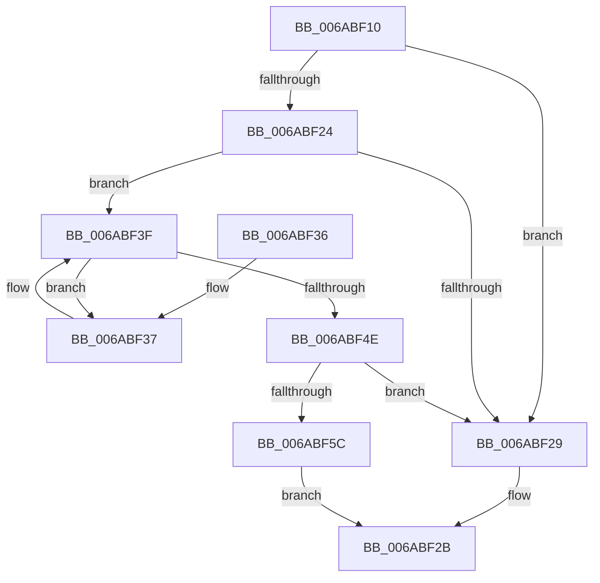

# SpiMax311RxReady

- RVA: `0x006ABF10`–`0x006ABF60` (길이 `80` bytes)
- VA: `0x00000001406ABF10`
- 실행 섹션: `.text`
- PDB 이름 있음: `예`; PDB Function 태그: `아니요`
- unwind 정보 RVA: `0x00068270`
- 디코드: `27`개 명령, `80/80` bytes 표시
- 미해석 바이트: `0` (있으면 어셈블리에 `.byte`로 보존)

> 이 문서는 커널 이미지의 기계어와 PDB 기호를 분석해 생성했습니다. 4번과 5번은 함수 원형과 자료형을 바이너리 사용 방식에서 추정한 C 해석이며 원본 소스 복구 결과는 아닙니다.

## 1. Dependencies

- 직접 호출 지점: **2**; 고유 호출 대상: **2**
- 직접 호출자로 확인된 함수: **0**
- RIP 상대 이미지 참조: **2**

### Outgoing calls
- `0x006ABF37` → [SpiMax311BufferRxData](SpiMax311BufferRxData_function_006ABD74.md) (function, `0x006ABD74`)
- `0x006ABF41` → [SpiSend16](SpiSend16_function_006AC0F8.md) (function, `0x006AC0F8`)

### Direct callers
- 이 함수 시작 RVA로 연결되는 직접 call은 확인되지 않았습니다. 간접 호출은 완전히 역산할 수 없습니다.

### Static image references
- `0x006ABF4E` → RVA `0x00E651A4` (`.data`; read)
- `0x006ABF54` → RVA `0x00E651A0` (`.data`; read)

## 2. Other-region calls and transfers

- 다른 실행 섹션으로 향하는 call: **0**
- 별도 외부 분기/꼬리 이동을 확인하지 못했습니다.

## 3. Assembly (complete function range)

```asm
006ABF10  48 89 5C 24 08                  mov qword ptr [rsp + 8], rbx
006ABF15  57                              push rdi
006ABF16  48 83 EC 20                     sub rsp, 0x20
006ABF1A  33 FF                           xor edi, edi
006ABF1C  48 8B D9                        mov rbx, rcx
006ABF1F  48 85 C9                        test rcx, rcx
006ABF22  74 05                           je 0x1406abf29
006ABF24  48 39 39                        cmp qword ptr [rcx], rdi
006ABF27  75 16                           jne 0x1406abf3f
006ABF29  32 C0                           xor al, al
006ABF2B  48 8B 5C 24 30                  mov rbx, qword ptr [rsp + 0x30]
006ABF30  48 83 C4 20                     add rsp, 0x20
006ABF34  5F                              pop rdi
006ABF35  C3                              ret
006ABF36  CC                              int3
006ABF37  E8 38 FE FF FF                  call 0x1406abd74
006ABF3C  48 8B CB                        mov rcx, rbx
006ABF3F  33 D2                           xor edx, edx
006ABF41  E8 B2 01 00 00                  call 0x1406ac0f8
006ABF46  0F B7 C8                        movzx ecx, ax
006ABF49  66 85 C0                        test ax, ax
006ABF4C  78 E9                           js 0x1406abf37
006ABF4E  8B 05 50 92 7B 00               mov eax, dword ptr [rip + 0x7b9250]
006ABF54  39 05 46 92 7B 00               cmp dword ptr [rip + 0x7b9246], eax
006ABF5A  74 CD                           je 0x1406abf29
006ABF5C  B0 01                           mov al, 1
006ABF5E  EB CB                           jmp 0x1406abf2b
```

## 4. C-style interpretation (structured pseudocode)

```c
__int64 __fastcall SpiMax311RxReady(__int64 a1, int a2)
{
    __int64 result;
    __int64 v_rdi;
    __int64 v_rsp;
    unsigned __int64 v_stack_p8;

    v_stack_p8 = v_rbx;
    v_rsp = (v_rsp) - (32);
    v_rdi = 0;
    if (a1 == 0) goto loc_006ABF29;
    if ((*(unsigned __int64 *)(a1)) != 0) goto loc_006ABF3F;
loc_006ABF29:
    result = 0;
loc_006ABF2B:
    v_rsp = (v_rsp) + (32);
    return result;
loc_006ABF37:
    result = SpiMax311BufferRxData(a1, a2, a3, a4);
loc_006ABF3F:
    a2 = 0;
    result = SpiSend16(v_stack_p8, a2, a3, a4);
    if (sign_flag) goto loc_006ABF37;
    if ((*(unsigned int *)(v_rip + 8098374)) == ((unsigned int)((unsigned int)(*(unsigned int *)(v_rip + 8098384))))) goto loc_006ABF29;
    goto loc_006ABF2B;
}
```

## 5. (Beta) C Style

```c
int64_t SpiMax311RxReady(int64_t Arg1, int32_t Arg2)
{
    int64_t result;
    int64_t local_rdi;
    int64_t local_rsp;
    uint64_t v_stack_p8;

    v_stack_p8 = local_rbx;
    local_rsp = (local_rsp) - (32);
    local_rdi = 0;
    if (Arg1 == 0) goto loc_006ABF29;
    if ((*(uint64_t *)(Arg1)) != 0) goto loc_006ABF3F;
loc_006ABF29:
    result = 0;
loc_006ABF2B:
    local_rsp = (local_rsp) + (32);
    return result;
loc_006ABF37:
    result = SpiMax311BufferRxData(Arg1, Arg2, a3, a4);
loc_006ABF3F:
    Arg2 = 0;
    result = SpiSend16(v_stack_p8, Arg2, a3, a4);
    if (sign_flag) goto loc_006ABF37;
    if ((*(uint32_t *)(v_rip + 0x7B9246)) == ((uint32_t)((uint32_t)(*(uint32_t *)(v_rip + 0x7B9250))))) goto loc_006ABF29;
    goto loc_006ABF2B;
}
```

## 6. Execution-region graph

[열기: 2D/3D 그래프와 함수 탐색 컨트롤 패널](../../../control-panel.html?section=text&rva=0x006ABF10&view=graph)

- 2D 그래프는 위에서 아래로 흐르고, 3D 그래프는 빈 공간을 드래그해 회전합니다. Shift+드래그는 이동, 휠은 확대·축소, 함수 노드 선택은 대상 보고서 이동입니다.

### Static fallback


