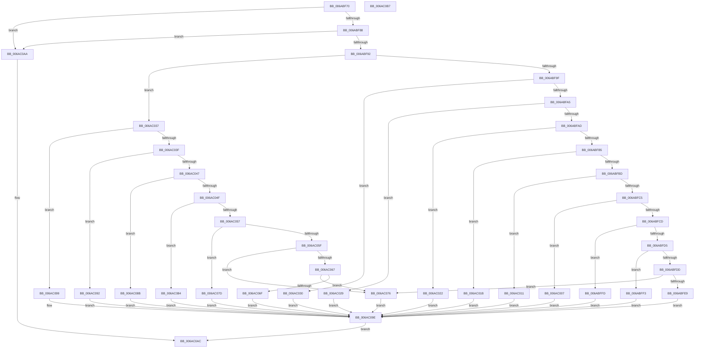

# SpiMax311SetBaud

- RVA: `0x006ABF70`–`0x006AC0B8` (길이 `328` bytes)
- VA: `0x00000001406ABF70`
- 실행 섹션: `.text`
- PDB 이름 있음: `예`; PDB Function 태그: `아니요`
- unwind 정보 RVA: `0x0005CAAC`
- 디코드: `84`개 명령, `328/328` bytes 표시
- 미해석 바이트: `0` (있으면 어셈블리에 `.byte`로 보존)

> 이 문서는 커널 이미지의 기계어와 PDB 기호를 분석해 생성했습니다. 4번과 5번은 함수 원형과 자료형을 바이너리 사용 방식에서 추정한 C 해석이며 원본 소스 복구 결과는 아닙니다.

## 1. Dependencies

- 직접 호출 지점: **1**; 고유 호출 대상: **1**
- 직접 호출자로 확인된 함수: **1**
- RIP 상대 이미지 참조: **0**

### Outgoing calls
- `0x006AC09E` → [SpiSend16](SpiSend16_function_006AC0F8.md) (function, `0x006AC0F8`)

### Direct callers
- [SpiMax311InitializePort](SpiMax311InitializePort_function_006ABE40.md) at `0x006ABE68`

### Static image references
- 디코드된 RIP-relative 메모리 참조가 없습니다.

## 2. Other-region calls and transfers

- 다른 실행 섹션으로 향하는 call: **0**
- 별도 외부 분기/꼬리 이동을 확인하지 못했습니다.

## 3. Assembly (complete function range)

```asm
006ABF70  48 89 5C 24 08                  mov qword ptr [rsp + 8], rbx
006ABF75  57                              push rdi
006ABF76  48 83 EC 20                     sub rsp, 0x20
006ABF7A  8B DA                           mov ebx, edx
006ABF7C  48 8B F9                        mov rdi, rcx
006ABF7F  48 85 C9                        test rcx, rcx
006ABF82  0F 84 22 01 00 00               je 0x1406ac0aa
006ABF88  48 83 39 00                     cmp qword ptr [rcx], 0
006ABF8C  0F 84 18 01 00 00               je 0x1406ac0aa
006ABF92  B8 40 38 00 00                  mov eax, 0x3840
006ABF97  3B D0                           cmp edx, eax
006ABF99  0F 87 98 00 00 00               ja 0x1406ac037
006ABF9F  0F 84 8B 00 00 00               je 0x1406ac030
006ABFA5  81 FA 58 02 00 00               cmp edx, 0x258
006ABFAB  74 7C                           je 0x1406ac029
006ABFAD  81 FA B0 04 00 00               cmp edx, 0x4b0
006ABFB3  74 6D                           je 0x1406ac022
006ABFB5  81 FA 08 07 00 00               cmp edx, 0x708
006ABFBB  74 5E                           je 0x1406ac01b
006ABFBD  81 FA 60 09 00 00               cmp edx, 0x960
006ABFC3  74 4C                           je 0x1406ac011
006ABFC5  81 FA 10 0E 00 00               cmp edx, 0xe10
006ABFCB  74 3A                           je 0x1406ac007
006ABFCD  81 FA C0 12 00 00               cmp edx, 0x12c0
006ABFD3  74 28                           je 0x1406abffd
006ABFD5  81 FA 20 1C 00 00               cmp edx, 0x1c20
006ABFDB  74 16                           je 0x1406abff3
006ABFDD  81 FA 80 25 00 00               cmp edx, 0x2580
006ABFE3  0F 85 8D 00 00 00               jne 0x1406ac076
006ABFE9  BA 0B C0 00 00                  mov edx, 0xc00b
006ABFEE  E9 AB 00 00 00                  jmp 0x1406ac09e
006ABFF3  BA 05 C0 00 00                  mov edx, 0xc005
006ABFF8  E9 A1 00 00 00                  jmp 0x1406ac09e
006ABFFD  BA 0C C0 00 00                  mov edx, 0xc00c
006AC002  E9 97 00 00 00                  jmp 0x1406ac09e
006AC007  BA 06 C0 00 00                  mov edx, 0xc006
006AC00C  E9 8D 00 00 00                  jmp 0x1406ac09e
006AC011  BA 0D C0 00 00                  mov edx, 0xc00d
006AC016  E9 83 00 00 00                  jmp 0x1406ac09e
006AC01B  BA 07 C0 00 00                  mov edx, 0xc007
006AC020  EB 7C                           jmp 0x1406ac09e
006AC022  BA 0E C0 00 00                  mov edx, 0xc00e
006AC027  EB 75                           jmp 0x1406ac09e
006AC029  BA 0F C0 00 00                  mov edx, 0xc00f
006AC02E  EB 6E                           jmp 0x1406ac09e
006AC030  BA 04 C0 00 00                  mov edx, 0xc004
006AC035  EB 67                           jmp 0x1406ac09e
006AC037  81 FB 00 4B 00 00               cmp ebx, 0x4b00
006AC03D  74 5A                           je 0x1406ac099
006AC03F  81 FB 80 70 00 00               cmp ebx, 0x7080
006AC045  74 4B                           je 0x1406ac092
006AC047  81 FB 00 96 00 00               cmp ebx, 0x9600
006AC04D  74 3C                           je 0x1406ac08b
006AC04F  81 FB 00 E1 00 00               cmp ebx, 0xe100
006AC055  74 2D                           je 0x1406ac084
006AC057  81 FB 00 2C 01 00               cmp ebx, 0x12c00
006AC05D  74 1E                           je 0x1406ac07d
006AC05F  81 FB 00 C2 01 00               cmp ebx, 0x1c200
006AC065  74 0F                           je 0x1406ac076
006AC067  81 FB 00 84 03 00               cmp ebx, 0x38400
006AC06D  75 07                           jne 0x1406ac076
006AC06F  BA 00 C0 00 00                  mov edx, 0xc000
006AC074  EB 28                           jmp 0x1406ac09e
006AC076  BA 01 C0 00 00                  mov edx, 0xc001
006AC07B  EB 21                           jmp 0x1406ac09e
006AC07D  BA 08 C0 00 00                  mov edx, 0xc008
006AC082  EB 1A                           jmp 0x1406ac09e
006AC084  BA 02 C0 00 00                  mov edx, 0xc002
006AC089  EB 13                           jmp 0x1406ac09e
006AC08B  BA 09 C0 00 00                  mov edx, 0xc009
006AC090  EB 0C                           jmp 0x1406ac09e
006AC092  BA 03 C0 00 00                  mov edx, 0xc003
006AC097  EB 05                           jmp 0x1406ac09e
006AC099  BA 0A C0 00 00                  mov edx, 0xc00a
006AC09E  E8 55 00 00 00                  call 0x1406ac0f8
006AC0A3  B0 01                           mov al, 1
006AC0A5  89 5F 08                        mov dword ptr [rdi + 8], ebx
006AC0A8  EB 02                           jmp 0x1406ac0ac
006AC0AA  32 C0                           xor al, al
006AC0AC  48 8B 5C 24 30                  mov rbx, qword ptr [rsp + 0x30]
006AC0B1  48 83 C4 20                     add rsp, 0x20
006AC0B5  5F                              pop rdi
006AC0B6  C3                              ret
006AC0B7  CC                              int3
```

## 4. C-style interpretation (structured pseudocode)

```c
__int64 __fastcall SpiMax311SetBaud(__int64 a1, int a2)
{
    __int64 result;
    __int64 v_rsp;
    unsigned __int64 v_stack_p8;

    v_stack_p8 = v_rbx;
    v_rsp = (v_rsp) - (32);
    if (a1 == 0) goto loc_006AC0AA;
    if ((*(unsigned __int64 *)(a1)) == 0) goto loc_006AC0AA;
    if (a2 > ((unsigned int)((unsigned int)(0x3840ULL)))) goto loc_006AC037;
    if (a2 == ((unsigned int)((unsigned int)(0x3840ULL)))) goto loc_006AC030;
    if (a2 == 600) goto loc_006AC029;
    if (a2 == 0x4B0ULL) goto loc_006AC022;
    if (a2 == 0x708ULL) goto loc_006AC01B;
    if (a2 == 0x960ULL) goto loc_006AC011;
    if (a2 == 0xE10ULL) goto loc_006AC007;
    if (a2 == 0x12C0ULL) goto loc_006ABFFD;
    if (a2 == 0x1C20ULL) goto loc_006ABFF3;
    if (a2 != 0x2580ULL) goto loc_006AC076;
    goto loc_006AC09E;
loc_006ABFF3:
    goto loc_006AC09E;
loc_006ABFFD:
    goto loc_006AC09E;
loc_006AC007:
    goto loc_006AC09E;
loc_006AC011:
    goto loc_006AC09E;
loc_006AC01B:
    goto loc_006AC09E;
loc_006AC022:
    goto loc_006AC09E;
loc_006AC029:
    goto loc_006AC09E;
loc_006AC030:
    goto loc_006AC09E;
loc_006AC037:
    if (((unsigned int)((unsigned int)(a2))) == 0x4B00ULL) goto loc_006AC099;
    if (((unsigned int)((unsigned int)(a2))) == 0x7080ULL) goto loc_006AC092;
    if (((unsigned int)((unsigned int)(a2))) == 0x9600ULL) goto loc_006AC08B;
    if (((unsigned int)((unsigned int)(a2))) == 0xE100ULL) goto loc_006AC084;
    if (((unsigned int)((unsigned int)(a2))) == 0x12C00ULL) goto loc_006AC07D;
    if (((unsigned int)((unsigned int)(a2))) == 0x1C200ULL) goto loc_006AC076;
    if (((unsigned int)((unsigned int)(a2))) != 0x38400ULL) goto loc_006AC076;
    goto loc_006AC09E;
loc_006AC076:
    goto loc_006AC09E;
loc_006AC07D:
    goto loc_006AC09E;
loc_006AC084:
    goto loc_006AC09E;
loc_006AC08B:
    goto loc_006AC09E;
loc_006AC092:
    goto loc_006AC09E;
loc_006AC099:
loc_006AC09E:
    result = SpiSend16(a1, (unsigned int)(0xC00AULL), a3, a4);
    *(unsigned int *)(a1 + 8) = (unsigned int)((unsigned int)(a2));
    goto loc_006AC0AC;
loc_006AC0AA:
    result = 0;
loc_006AC0AC:
    v_rsp = (v_rsp) + (32);
    return result;
}
```

## 5. (Beta) C Style

```c
int64_t SpiMax311SetBaud(void *Arg1, int32_t Arg2)
{
    uint8_t *arg1 = (uint8_t *)Arg1;

    int64_t result;
    int64_t local_rsp;
    uint64_t v_stack_p8;

    v_stack_p8 = local_rbx;
    local_rsp = (local_rsp) - (32);
    if (Arg1 == NULL) goto loc_006AC0AA;
    if ((*(uint64_t *)(arg1)) == 0) goto loc_006AC0AA;
    if (Arg2 > ((uint32_t)((uint32_t)(0x3840ULL)))) goto loc_006AC037;
    if (Arg2 == ((uint32_t)((uint32_t)(0x3840ULL)))) goto loc_006AC030;
    if (Arg2 == 600) goto loc_006AC029;
    if (Arg2 == 0x4B0ULL) goto loc_006AC022;
    if (Arg2 == 0x708ULL) goto loc_006AC01B;
    if (Arg2 == 0x960ULL) goto loc_006AC011;
    if (Arg2 == 0xE10ULL) goto loc_006AC007;
    if (Arg2 == 0x12C0ULL) goto loc_006ABFFD;
    if (Arg2 == 0x1C20ULL) goto loc_006ABFF3;
    if (Arg2 != 0x2580ULL) goto loc_006AC076;
    goto loc_006AC09E;
loc_006ABFF3:
    goto loc_006AC09E;
loc_006ABFFD:
    goto loc_006AC09E;
loc_006AC007:
    goto loc_006AC09E;
loc_006AC011:
    goto loc_006AC09E;
loc_006AC01B:
    goto loc_006AC09E;
loc_006AC022:
    goto loc_006AC09E;
loc_006AC029:
    goto loc_006AC09E;
loc_006AC030:
    goto loc_006AC09E;
loc_006AC037:
    if (((uint32_t)((uint32_t)(Arg2))) == 0x4B00ULL) goto loc_006AC099;
    if (((uint32_t)((uint32_t)(Arg2))) == 0x7080ULL) goto loc_006AC092;
    if (((uint32_t)((uint32_t)(Arg2))) == 0x9600ULL) goto loc_006AC08B;
    if (((uint32_t)((uint32_t)(Arg2))) == 0xE100ULL) goto loc_006AC084;
    if (((uint32_t)((uint32_t)(Arg2))) == 0x12C00ULL) goto loc_006AC07D;
    if (((uint32_t)((uint32_t)(Arg2))) == 0x1C200ULL) goto loc_006AC076;
    if (((uint32_t)((uint32_t)(Arg2))) != 0x38400ULL) goto loc_006AC076;
    goto loc_006AC09E;
loc_006AC076:
    goto loc_006AC09E;
loc_006AC07D:
    goto loc_006AC09E;
loc_006AC084:
    goto loc_006AC09E;
loc_006AC08B:
    goto loc_006AC09E;
loc_006AC092:
    goto loc_006AC09E;
loc_006AC099:
loc_006AC09E:
    result = SpiSend16(Arg1, (uint32_t)(0xC00AULL), a3, a4);
    *(uint32_t *)(arg1 + 0x8) = (uint32_t)((uint32_t)(Arg2));
    goto loc_006AC0AC;
loc_006AC0AA:
    result = 0;
loc_006AC0AC:
    local_rsp = (local_rsp) + (32);
    return result;
}
```

### 관측된 메모리 오프셋

구조체 형식이 확인되지 않은 접근은 인자 기준의 오프셋으로만 기록했습니다.

| 기준 인자 | 오프셋 표현 | 폭 (bit) | 접근 |
|---|---:|---:|---|
| `Arg1` | `+ 0x8` | `32` | `W` |

## 6. Execution-region graph

[열기: 2D/3D 그래프와 함수 탐색 컨트롤 패널](../../../control-panel.html?section=text&rva=0x006ABF70&view=graph)

- 2D 그래프는 위에서 아래로 흐르고, 3D 그래프는 빈 공간을 드래그해 회전합니다. Shift+드래그는 이동, 휠은 확대·축소, 함수 노드 선택은 대상 보고서 이동입니다.

### Static fallback


