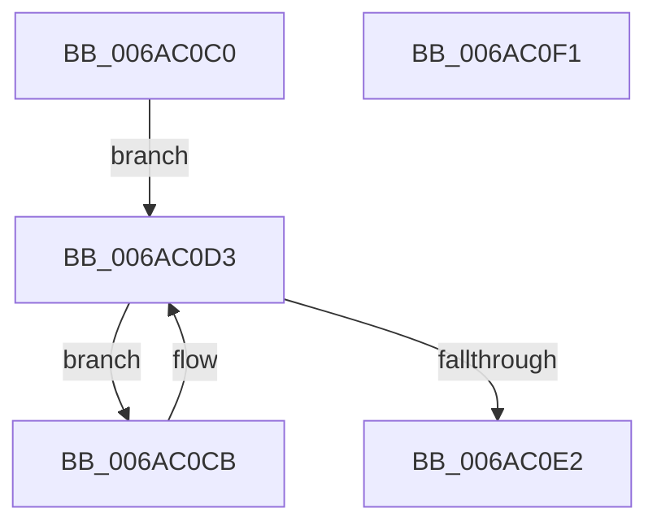

# SpiMax311TxEmpty

- RVA: `0x006AC0C0`–`0x006AC0F2` (길이 `50` bytes)
- VA: `0x00000001406AC0C0`
- 실행 섹션: `.text`
- PDB 이름 있음: `예`; PDB Function 태그: `아니요`
- unwind 정보 RVA: `0x0005CF00`
- 디코드: `18`개 명령, `50/50` bytes 표시
- 미해석 바이트: `0` (있으면 어셈블리에 `.byte`로 보존)

> 이 문서는 커널 이미지의 기계어와 PDB 기호를 분석해 생성했습니다. 4번과 5번은 함수 원형과 자료형을 바이너리 사용 방식에서 추정한 C 해석이며 원본 소스 복구 결과는 아닙니다.

## 1. Dependencies

- 직접 호출 지점: **2**; 고유 호출 대상: **2**
- 직접 호출자로 확인된 함수: **1**
- RIP 상대 이미지 참조: **0**

### Outgoing calls
- `0x006AC0CB` → [SpiMax311BufferRxData](SpiMax311BufferRxData_function_006ABD74.md) (function, `0x006ABD74`)
- `0x006AC0D5` → [SpiSend16](SpiSend16_function_006AC0F8.md) (function, `0x006AC0F8`)

### Direct callers
- [SpiMax311PutByte](SpiMax311PutByte_function_006ABE80.md) at `0x006ABEA9`
- [SpiMax311PutByte](SpiMax311PutByte_function_006ABE80.md) at `0x006ABEB4`

### Static image references
- 디코드된 RIP-relative 메모리 참조가 없습니다.

## 2. Other-region calls and transfers

- 다른 실행 섹션으로 향하는 call: **0**
- 별도 외부 분기/꼬리 이동을 확인하지 못했습니다.

## 3. Assembly (complete function range)

```asm
006AC0C0  40 53                           push rbx
006AC0C2  48 83 EC 20                     sub rsp, 0x20
006AC0C6  48 8B D9                        mov rbx, rcx
006AC0C9  EB 08                           jmp 0x1406ac0d3
006AC0CB  E8 A4 FC FF FF                  call 0x1406abd74
006AC0D0  48 8B CB                        mov rcx, rbx
006AC0D3  33 D2                           xor edx, edx
006AC0D5  E8 1E 00 00 00                  call 0x1406ac0f8
006AC0DA  0F B7 C8                        movzx ecx, ax
006AC0DD  66 85 C0                        test ax, ax
006AC0E0  78 E9                           js 0x1406ac0cb
006AC0E2  66 C1 E9 0E                     shr cx, 0xe
006AC0E6  80 E1 01                        and cl, 1
006AC0E9  8A C1                           mov al, cl
006AC0EB  48 83 C4 20                     add rsp, 0x20
006AC0EF  5B                              pop rbx
006AC0F0  C3                              ret
006AC0F1  CC                              int3
```

## 4. C-style interpretation (structured pseudocode)

```c
__int64 __fastcall SpiMax311TxEmpty(__int64 a1, int a2)
{
    __int64 result;
    __int64 v_rsp;

    v_rsp = (v_rsp) - (32);
    goto loc_006AC0D3;
loc_006AC0CB:
    result = SpiMax311BufferRxData(a1, a2, a3, a4);
loc_006AC0D3:
    a2 = 0;
    result = SpiSend16(a1, a2, a3, a4);
    if (sign_flag) goto loc_006AC0CB;
    a1 = (unsigned __int16)(((unsigned __int16)(result)) >> (14));
    a1 = (unsigned __int8)((a1) & (1));
    v_rsp = (v_rsp) + (32);
    return (unsigned __int8)(a1);
}
```

## 5. (Beta) C Style

```c
int64_t SpiMax311TxEmpty(int64_t Arg1, int32_t Arg2)
{
    int64_t result;
    int64_t local_rsp;

    local_rsp = (local_rsp) - (32);
    goto loc_006AC0D3;
loc_006AC0CB:
    result = SpiMax311BufferRxData(Arg1, Arg2, a3, a4);
loc_006AC0D3:
    Arg2 = 0;
    result = SpiSend16(Arg1, Arg2, a3, a4);
    if (sign_flag) goto loc_006AC0CB;
    Arg1 = (uint16_t)(((uint16_t)(result)) >> (14));
    Arg1 = (uint8_t)((Arg1) & (1));
    local_rsp = (local_rsp) + (32);
    return (uint8_t)(Arg1);
}
```

## 6. Execution-region graph

[열기: 2D/3D 그래프와 함수 탐색 컨트롤 패널](../../../control-panel.html?section=text&rva=0x006AC0C0&view=graph)

- 2D 그래프는 위에서 아래로 흐르고, 3D 그래프는 빈 공간을 드래그해 회전합니다. Shift+드래그는 이동, 휠은 확대·축소, 함수 노드 선택은 대상 보고서 이동입니다.

### Static fallback


