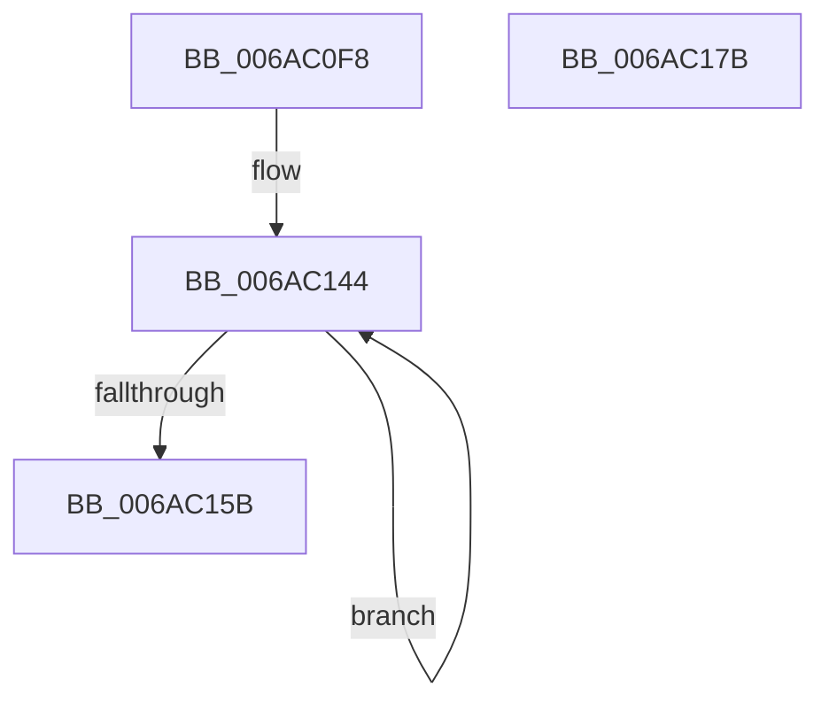

# SpiSend16

- RVA: `0x006AC0F8`–`0x006AC17C` (길이 `132` bytes)
- VA: `0x00000001406AC0F8`
- 실행 섹션: `.text`
- PDB 이름 있음: `예`; PDB Function 태그: `아니요`
- unwind 정보 RVA: `0x00060BC4`
- 디코드: `32`개 명령, `132/132` bytes 표시
- 미해석 바이트: `0` (있으면 어셈블리에 `.byte`로 보존)

> 이 문서는 커널 이미지의 기계어와 PDB 기호를 분석해 생성했습니다. 4번과 5번은 함수 원형과 자료형을 바이너리 사용 방식에서 추정한 C 해석이며 원본 소스 복구 결과는 아닙니다.

## 1. Dependencies

- 직접 호출 지점: **5**; 고유 호출 대상: **2**
- 직접 호출자로 확인된 함수: **5**
- RIP 상대 이미지 참조: **3**

### Outgoing calls
- `0x006AC118` → [SpiInit](SpiInit_function_006ABC58.md) (function, `0x006ABC58`)
- `0x006AC12D` → [guard_dispatch_icall](../6B/guard_dispatch_icall_function_006BAAD0.md) (function, `0x006BAAD0`)
- `0x006AC13F` → [guard_dispatch_icall](../6B/guard_dispatch_icall_function_006BAAD0.md) (function, `0x006BAAD0`)
- `0x006AC14F` → [guard_dispatch_icall](../6B/guard_dispatch_icall_function_006BAAD0.md) (function, `0x006BAAD0`)
- `0x006AC166` → [guard_dispatch_icall](../6B/guard_dispatch_icall_function_006BAAD0.md) (function, `0x006BAAD0`)

### Direct callers
- [SpiMax311GetByte](SpiMax311GetByte_function_006ABDB0.md) at `0x006ABE0B`
- [SpiMax311PutByte](SpiMax311PutByte_function_006ABE80.md) at `0x006ABED4`
- [SpiMax311RxReady](SpiMax311RxReady_function_006ABF10.md) at `0x006ABF41`
- [SpiMax311SetBaud](SpiMax311SetBaud_function_006ABF70.md) at `0x006AC09E`
- [SpiMax311TxEmpty](SpiMax311TxEmpty_function_006AC0C0.md) at `0x006AC0D5`

### Static image references
- `0x006AC10A` → RVA `0x00E651A8` (`.data`; read)
- `0x006AC11D` → RVA `0x00E039E8` (`.data`; read)
- `0x006AC144` → RVA `0x00E039E0` (`.data`; read)

## 2. Other-region calls and transfers

- 다른 실행 섹션으로 향하는 call: **0**
- 별도 외부 분기/꼬리 이동을 확인하지 못했습니다.

## 3. Assembly (complete function range)

```asm
006AC0F8  48 89 5C 24 08                  mov qword ptr [rsp + 8], rbx
006AC0FD  48 89 74 24 10                  mov qword ptr [rsp + 0x10], rsi
006AC102  57                              push rdi
006AC103  48 83 EC 20                     sub rsp, 0x20
006AC107  48 8B 39                        mov rdi, qword ptr [rcx]
006AC10A  44 0F B7 0D 96 90 7B 00         movzx r9d, word ptr [rip + 0x7b9096]
006AC112  48 8B CF                        mov rcx, rdi
006AC115  0F B7 DA                        movzx ebx, dx
006AC118  E8 3B FB FF FF                  call 0x1406abc58
006AC11D  48 8B 05 C4 78 75 00            mov rax, qword ptr [rip + 0x7578c4]
006AC124  48 8D 4F 10                     lea rcx, [rdi + 0x10]
006AC128  BA 02 00 00 00                  mov edx, 2
006AC12D  E8 9E E9 00 00                  call 0x1406baad0
006AC132  48 8B 05 AF 78 75 00            mov rax, qword ptr [rip + 0x7578af]
006AC139  48 8D 4F 60                     lea rcx, [rdi + 0x60]
006AC13D  8B D3                           mov edx, ebx
006AC13F  E8 8C E9 00 00                  call 0x1406baad0
006AC144  48 8B 05 95 78 75 00            mov rax, qword ptr [rip + 0x757895]
006AC14B  48 8D 4F 28                     lea rcx, [rdi + 0x28]
006AC14F  E8 7C E9 00 00                  call 0x1406baad0
006AC154  83 E0 0D                        and eax, 0xd
006AC157  3C 0C                           cmp al, 0xc
006AC159  75 E9                           jne 0x1406ac144
006AC15B  48 8B 05 7E 78 75 00            mov rax, qword ptr [rip + 0x75787e]
006AC162  48 8D 4F 60                     lea rcx, [rdi + 0x60]
006AC166  E8 65 E9 00 00                  call 0x1406baad0
006AC16B  48 8B 5C 24 30                  mov rbx, qword ptr [rsp + 0x30]
006AC170  48 8B 74 24 38                  mov rsi, qword ptr [rsp + 0x38]
006AC175  48 83 C4 20                     add rsp, 0x20
006AC179  5F                              pop rdi
006AC17A  C3                              ret
006AC17B  CC                              int3
```

## 4. C-style interpretation (structured pseudocode)

```c
__int64 __fastcall SpiSend16(__int64 a1, unsigned __int16 a2)
{
    __int64 result;
    __int64 v_rsp;
    unsigned __int64 v_stack_p10;
    unsigned __int64 v_stack_p8;

    v_stack_p8 = v_rbx;
    v_stack_p10 = v_rsi;
    v_rsp = (v_rsp) - (32);
    result = SpiInit(*(unsigned __int64 *)(a1), a2, a3, *(unsigned __int16 *)(v_rip + 8097942));
    result = guard_dispatch_icall(*(unsigned __int64 *)(a1) + 16, 2, a3, *(unsigned __int16 *)(v_rip + 8097942));
    result = guard_dispatch_icall(*(unsigned __int64 *)(a1) + 96, (unsigned int)(a2), a3, *(unsigned __int16 *)(v_rip + 8097942));
loc_006AC144:
    result = guard_dispatch_icall(*(unsigned __int64 *)(a1) + 40, (unsigned int)(a2), a3, *(unsigned __int16 *)(v_rip + 8097942));
    result = (unsigned int)((result) & (13));
    if (((unsigned __int8)(result)) != 12) goto loc_006AC144;
    result = guard_dispatch_icall(*(unsigned __int64 *)(a1) + 96, (unsigned int)(a2), a3, *(unsigned __int16 *)(v_rip + 8097942));
    v_rsp = (v_rsp) + (32);
    return result;
}
```

## 5. (Beta) C Style

```c
int64_t SpiSend16(void *Arg1, uint16_t Arg2)
{
    uint8_t *arg1 = (uint8_t *)Arg1;

    int64_t result;
    int64_t local_rsp;
    uint64_t v_stack_p10;
    uint64_t v_stack_p8;

    v_stack_p8 = local_rbx;
    v_stack_p10 = local_rsi;
    local_rsp = (local_rsp) - (32);
    result = SpiInit(*(uint64_t *)(arg1), Arg2, a3, *(uint16_t *)(v_rip + 0x7B9096));
    result = guard_dispatch_icall(*(uint64_t *)(arg1) + 16, 2, a3, *(uint16_t *)(v_rip + 0x7B9096));
    result = guard_dispatch_icall(*(uint64_t *)(arg1) + 96, (uint32_t)(Arg2), a3, *(uint16_t *)(v_rip + 0x7B9096));
loc_006AC144:
    result = guard_dispatch_icall(*(uint64_t *)(arg1) + 40, (uint32_t)(Arg2), a3, *(uint16_t *)(v_rip + 0x7B9096));
    result = (uint32_t)((result) & (13));
    if (((uint8_t)(result)) != 12) goto loc_006AC144;
    result = guard_dispatch_icall(*(uint64_t *)(arg1) + 96, (uint32_t)(Arg2), a3, *(uint16_t *)(v_rip + 0x7B9096));
    local_rsp = (local_rsp) + (32);
    return result;
}
```

### 관측된 메모리 오프셋

구조체 형식이 확인되지 않은 접근은 인자 기준의 오프셋으로만 기록했습니다.

| 기준 인자 | 오프셋 표현 | 폭 (bit) | 접근 |
|---|---:|---:|---|
| `Arg1` | `+ 0x0` | `64` | `R` |

## 6. Execution-region graph

[열기: 2D/3D 그래프와 함수 탐색 컨트롤 패널](../../../control-panel.html?section=text&rva=0x006AC0F8&view=graph)

- 2D 그래프는 위에서 아래로 흐르고, 3D 그래프는 빈 공간을 드래그해 회전합니다. Shift+드래그는 이동, 휠은 확대·축소, 함수 노드 선택은 대상 보고서 이동입니다.

### Static fallback


