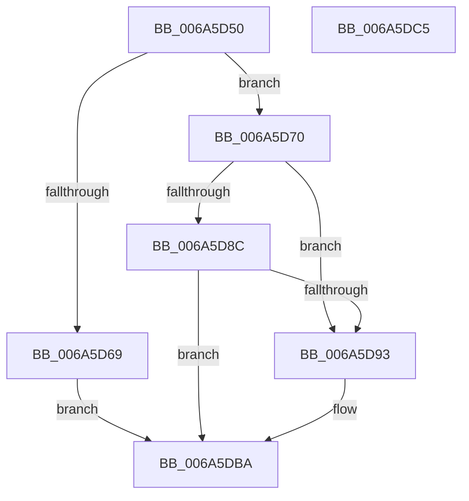

# StRtlIoStorInfoSetNvCachePriority

- RVA: `0x006A5D50`–`0x006A5DC6` (길이 `118` bytes)
- VA: `0x00000001406A5D50`
- 실행 섹션: `.text`
- PDB 이름 있음: `예`; PDB Function 태그: `아니요`
- unwind 정보 RVA: `0x0005CAAC`
- 디코드: `35`개 명령, `118/118` bytes 표시
- 미해석 바이트: `0` (있으면 어셈블리에 `.byte`로 보존)

> 이 문서는 커널 이미지의 기계어와 PDB 기호를 분석해 생성했습니다. 4번과 5번은 함수 원형과 자료형을 바이너리 사용 방식에서 추정한 C 해석이며 원본 소스 복구 결과는 아닙니다.

## 1. Dependencies

- 직접 호출 지점: **2**; 고유 호출 대상: **2**
- 직접 호출자로 확인된 함수: **1**
- RIP 상대 이미지 참조: **0**

### Outgoing calls
- `0x006A5D7B` → [IoGetGenericIrpExtension](../43/IoGetGenericIrpExtension_function_0043E970.md) (function, `0x0043E970`)
- `0x006A5DB5` → [IoSetGenericIrpExtension](../47/IoSetGenericIrpExtension_function_004715E0.md) (function, `0x004715E0`)

### Direct callers
- [IoAsynchronousPageWrite](../29/IoAsynchronousPageWrite_function_00299C08.md) at `0x00299DEC`

### Static image references
- 디코드된 RIP-relative 메모리 참조가 없습니다.

## 2. Other-region calls and transfers

- 다른 실행 섹션으로 향하는 call: **0**
- 별도 외부 분기/꼬리 이동을 확인하지 못했습니다.

## 3. Assembly (complete function range)

```asm
006A5D50  48 89 5C 24 08                  mov qword ptr [rsp + 8], rbx
006A5D55  57                              push rdi
006A5D56  48 83 EC 20                     sub rsp, 0x20
006A5D5A  83 64 24 38 00                  and dword ptr [rsp + 0x38], 0
006A5D5F  8A DA                           mov bl, dl
006A5D61  48 8B F9                        mov rdi, rcx
006A5D64  80 FA 0F                        cmp dl, 0xf
006A5D67  76 07                           jbe 0x1406a5d70
006A5D69  B8 0D 00 00 C0                  mov eax, 0xc000000d
006A5D6E  EB 4A                           jmp 0x1406a5dba
006A5D70  41 B8 04 00 00 00               mov r8d, 4
006A5D76  48 8D 54 24 38                  lea rdx, [rsp + 0x38]
006A5D7B  E8 F0 8B D9 FF                  call 0x14043e970
006A5D80  BA 00 00 00 80                  mov edx, 0x80000000
006A5D85  8D 0C 10                        lea ecx, [rax + rdx]
006A5D88  85 CA                           test edx, ecx
006A5D8A  75 07                           jne 0x1406a5d93
006A5D8C  3D 25 02 00 C0                  cmp eax, 0xc0000225
006A5D91  75 27                           jne 0x1406a5dba
006A5D93  8A 44 24 38                     mov al, byte ptr [rsp + 0x38]
006A5D97  48 8D 54 24 38                  lea rdx, [rsp + 0x38]
006A5D9C  24 F0                           and al, 0xf0
006A5D9E  80 E3 0F                        and bl, 0xf
006A5DA1  0A C3                           or al, bl
006A5DA3  41 B8 04 00 00 00               mov r8d, 4
006A5DA9  0C 10                           or al, 0x10
006A5DAB  41 B1 01                        mov r9b, 1
006A5DAE  48 8B CF                        mov rcx, rdi
006A5DB1  88 44 24 38                     mov byte ptr [rsp + 0x38], al
006A5DB5  E8 26 B8 DC FF                  call 0x1404715e0
006A5DBA  48 8B 5C 24 30                  mov rbx, qword ptr [rsp + 0x30]
006A5DBF  48 83 C4 20                     add rsp, 0x20
006A5DC3  5F                              pop rdi
006A5DC4  C3                              ret
006A5DC5  CC                              int3
```

## 4. C-style interpretation (structured pseudocode)

```c
__int64 __fastcall StRtlIoStorInfoSetNvCachePriority(__int64 a1, unsigned __int8 a2)
{
    __int64 result;
    __int64 v_rbx;
    __int64 v_rsp;
    unsigned int v_stack_p10;
    unsigned __int64 v_stack_p8;

    v_stack_p8 = v_rbx;
    v_rsp = (v_rsp) - (32);
    if (a2 <= 15) goto loc_006A5D70;
    goto loc_006A5DBA;
loc_006A5D70:
    result = IoGetGenericIrpExtension(a1, v_stack_p10, 4, a4);
    if ((((unsigned int)((unsigned int)(0x80000000ULL))) & ((unsigned int)(result + (unsigned int)(0x80000000ULL) * 1))) != 0) goto loc_006A5D93;
    v_rbx = a2;
    if (((unsigned int)(result)) == 0xC0000225ULL) {
        result = v_stack_p10;
        a2 = v_stack_p10;
        result = (unsigned __int8)((result) & (240));
        v_rbx = (unsigned __int8)((a2) & (15));
        result = (unsigned __int8)((result) | ((unsigned __int8)(v_rbx)));
        a3 = 4;
        result = (unsigned __int8)((result) | (16));
        a4 = 1;
        a1 = a1;
        v_stack_p10 = (unsigned __int8)(result);
        result = IoSetGenericIrpExtension(a1, a2, a3, a4);
    }
    v_rsp = (v_rsp) + (32);
    return result;
}
```

## 5. (Beta) C Style

```c
int64_t StRtlIoStorInfoSetNvCachePriority(int64_t Arg1, uint8_t Arg2)
{
    int64_t result;
    int64_t local_rbx;
    int64_t local_rsp;
    uint32_t v_stack_p10;
    uint64_t v_stack_p8;

    v_stack_p8 = local_rbx;
    local_rsp = (local_rsp) - (32);
    if (Arg2 <= 15) goto loc_006A5D70;
    goto loc_006A5DBA;
loc_006A5D70:
    result = IoGetGenericIrpExtension(Arg1, v_stack_p10, 4, a4);
    if ((((uint32_t)((uint32_t)(0x80000000ULL))) & ((uint32_t)(result + (uint32_t)(0x80000000ULL) * 1))) != 0) goto loc_006A5D93;
    local_rbx = Arg2;
    if (((uint32_t)(result)) == 0xC0000225ULL) {
        result = v_stack_p10;
        Arg2 = v_stack_p10;
        result = (uint8_t)((result) & (240));
        local_rbx = (uint8_t)((Arg2) & (15));
        result = (uint8_t)((result) | ((uint8_t)(local_rbx)));
        a3 = 4;
        result = (uint8_t)((result) | (16));
        a4 = 1;
        Arg1 = Arg1;
        v_stack_p10 = (uint8_t)(result);
        result = IoSetGenericIrpExtension(Arg1, Arg2, a3, a4);
    }
    local_rsp = (local_rsp) + (32);
    return result;
}
```

## 6. Execution-region graph

[열기: 2D/3D 그래프와 함수 탐색 컨트롤 패널](../../../control-panel.html?section=text&rva=0x006A5D50&view=graph)

- 2D 그래프는 위에서 아래로 흐르고, 3D 그래프는 빈 공간을 드래그해 회전합니다. Shift+드래그는 이동, 휠은 확대·축소, 함수 노드 선택은 대상 보고서 이동입니다.

### Static fallback


