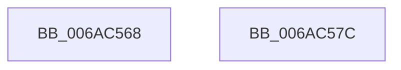

# SymCryptCallbackFree

- RVA: `0x006AC568`–`0x006AC57D` (길이 `21` bytes)
- VA: `0x00000001406AC568`
- 실행 섹션: `.text`
- PDB 이름 있음: `예`; PDB Function 태그: `아니요`
- unwind 정보 RVA: `0x0005C788`
- 디코드: `7`개 명령, `21/21` bytes 표시
- 미해석 바이트: `0` (있으면 어셈블리에 `.byte`로 보존)

> 이 문서는 커널 이미지의 기계어와 PDB 기호를 분석해 생성했습니다. 4번과 5번은 함수 원형과 자료형을 바이너리 사용 방식에서 추정한 C 해석이며 원본 소스 복구 결과는 아닙니다.

## 1. Dependencies

- 직접 호출 지점: **1**; 고유 호출 대상: **1**
- 직접 호출자로 확인된 함수: **13**
- RIP 상대 이미지 참조: **0**

### Outgoing calls
- `0x006AC572` → [MincryptFree](../../page/83/MincryptFree_function_0083A6FC.md) (function, `0x0083A6FC`)

### Direct callers
- [SymCryptRsakeyFree](../52/SymCryptRsakeyFree_function_00523844.md) at `0x00523858`
- [SymCryptRsakeySetValueInternal](../52/SymCryptRsakeySetValueInternal_function_005238D4.md) at `0x00523FA5`
- [SymCryptEcurveAllocate](../52/SymCryptEcurveAllocate_function_00524074.md) at `0x0052410E`
- [SymCryptEcurveAllocate](../52/SymCryptEcurveAllocate_function_00524074.md) at `0x0052411B`
- [SymCryptEcurveFree](../52/SymCryptEcurveFree_function_0052417C.md) at `0x00524190`
- [SymCryptEckeyFree](../52/SymCryptEckeyFree_function_00524AF8.md) at `0x00524B09`
- [SymCryptEckeySetValue](../52/SymCryptEckeySetValue_function_00524C34.md) at `0x005250E8`
- [SymCryptIntFree](../52/SymCryptIntFree_function_005255C8.md) at `0x005255DC`
- [SymCryptEcDsaSignEx](../52/SymCryptEcDsaSignEx_function_00525D6C.md) at `0x005262E1`
- [SymCryptEcDsaVerify](../52/SymCryptEcDsaVerify_function_00526400.md) at `0x00526992`
- [SymCryptRsaPkcs1Sign](../52/SymCryptRsaPkcs1Sign_function_005271A0.md) at `0x005272D4`
- [SymCryptRsaPkcs1Verify](../52/SymCryptRsaPkcs1Verify_function_005272FC.md) at `0x00527426`
- [SymCryptRsaSelftest](../52/SymCryptRsaSelftest_function_0052B638.md) at `0x0052B80A`
- [SymCryptEcDhSecretAgreement](../53/SymCryptEcDhSecretAgreement_function_00537798.md) at `0x0053795C`

### Static image references
- 디코드된 RIP-relative 메모리 참조가 없습니다.

## 2. Other-region calls and transfers

- 다른 실행 섹션으로 향하는 call: **1**
  - `0x006AC572` → [MincryptFree](../../page/83/MincryptFree_function_0083A6FC.md) (`.text` → `PAGE`)
- 별도 외부 분기/꼬리 이동을 확인하지 못했습니다.

## 3. Assembly (complete function range)

```asm
006AC568  48 83 EC 28                     sub rsp, 0x28
006AC56C  8B 41 FC                        mov eax, dword ptr [rcx - 4]
006AC56F  48 2B C8                        sub rcx, rax
006AC572  E8 85 E1 18 00                  call 0x14083a6fc
006AC577  48 83 C4 28                     add rsp, 0x28
006AC57B  C3                              ret
006AC57C  CC                              int3
```

## 4. C-style interpretation (structured pseudocode)

```c
__int64 __fastcall SymCryptCallbackFree(__int64 a1)
{
    __int64 result;
    __int64 v_rsp;

    v_rsp = (v_rsp) - (40);
    a1 = (a1) - ((unsigned int)(*(unsigned int *)(a1 - 4)));
    result = MincryptFree(a1, a2, a3, a4);
    v_rsp = (v_rsp) + (40);
    return result;
}
```

## 5. (Beta) C Style

```c
int64_t SymCryptCallbackFree(void *Arg1)
{
    uint8_t *arg1 = (uint8_t *)Arg1;

    int64_t result;
    int64_t local_rsp;

    local_rsp = (local_rsp) - (40);
    Arg1 = (Arg1) - ((uint32_t)(*(uint32_t *)(arg1 - 0x4)));
    result = MincryptFree(Arg1, a2, a3, a4);
    local_rsp = (local_rsp) + (40);
    return result;
}
```

### 관측된 메모리 오프셋

구조체 형식이 확인되지 않은 접근은 인자 기준의 오프셋으로만 기록했습니다.

| 기준 인자 | 오프셋 표현 | 폭 (bit) | 접근 |
|---|---:|---:|---|
| `Arg1` | `- 0x4` | `32` | `R` |

## 6. Execution-region graph

[열기: 2D/3D 그래프와 함수 탐색 컨트롤 패널](../../../control-panel.html?section=text&rva=0x006AC568&view=graph)

- 2D 그래프는 위에서 아래로 흐르고, 3D 그래프는 빈 공간을 드래그해 회전합니다. Shift+드래그는 이동, 휠은 확대·축소, 함수 노드 선택은 대상 보고서 이동입니다.

### Static fallback


