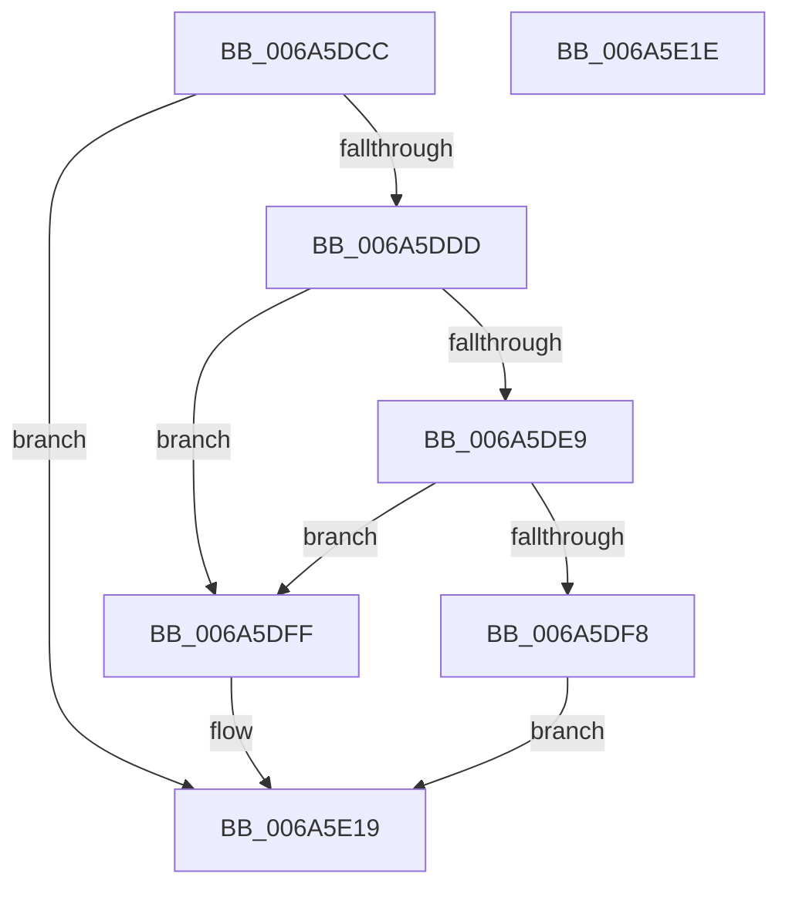

# TlgAggregateFlush

- RVA: `0x006A5DCC`–`0x006A5E1F` (길이 `83` bytes)
- VA: `0x00000001406A5DCC`
- 실행 섹션: `.text`
- PDB 이름 있음: `예`; PDB Function 태그: `아니요`
- unwind 정보 RVA: `0x0005C788`
- 디코드: `20`개 명령, `83/83` bytes 표시
- 미해석 바이트: `0` (있으면 어셈블리에 `.byte`로 보존)

> 이 문서는 커널 이미지의 기계어와 PDB 기호를 분석해 생성했습니다. 4번과 5번은 함수 원형과 자료형을 바이너리 사용 방식에서 추정한 C 해석이며 원본 소스 복구 결과는 아닙니다.

## 1. Dependencies

- 직접 호출 지점: **2**; 고유 호출 대상: **2**
- 직접 호출자로 확인된 함수: **2**
- RIP 상대 이미지 참조: **1**

### Outgoing calls
- `0x006A5DF8` → [LookUpTableFlushComplete](../../page/A6/LookUpTableFlushComplete_function_00A6957C.md) (function, `0x00A6957C`)
- `0x006A5E14` → [TlgAggregateInternalFlushTimerCallbackKernelMode](../4C/TlgAggregateInternalFlushTimerCallbackKernelMode_function_004C4240.md) (function, `0x004C4240`)

### Direct callers
- [CmFcShutdownSystem](../../page/7E/CmFcShutdownSystem_function_007E5BC4.md) at `0x007E5BF0`
- [CmpFlushTraceLoggingProvider](../../page/7E/CmpFlushTraceLoggingProvider_function_007E6138.md) at `0x007E6148`

### Static image references
- `0x006A5DD0` → RVA `0x00A69500` (`TlgAggregateInternalRegisteredProviderEtwCallback`; read)

## 2. Other-region calls and transfers

- 다른 실행 섹션으로 향하는 call: **1**
  - `0x006A5DF8` → [LookUpTableFlushComplete](../../page/A6/LookUpTableFlushComplete_function_00A6957C.md) (`.text` → `PAGE`)
- 별도 외부 분기/꼬리 이동을 확인하지 못했습니다.

## 3. Assembly (complete function range)

```asm
006A5DCC  48 83 EC 28                     sub rsp, 0x28
006A5DD0  48 8D 05 29 37 3C 00            lea rax, [rip + 0x3c3729]
006A5DD7  48 39 41 28                     cmp qword ptr [rcx + 0x28], rax
006A5DDB  75 3C                           jne 0x1406a5e19
006A5DDD  48 8B 49 30                     mov rcx, qword ptr [rcx + 0x30]
006A5DE1  44 0F 20 C0                     mov rax, cr8
006A5DE5  3C 02                           cmp al, 2
006A5DE7  73 16                           jae 0x1406a5dff
006A5DE9  65 8B 04 25 3C 3A 00 00         mov eax, dword ptr gs:[0x3a3c]
006A5DF1  A9 01 00 01 00                  test eax, 0x10001
006A5DF6  75 07                           jne 0x1406a5dff
006A5DF8  E8 7F 37 3C 00                  call 0x140a6957c
006A5DFD  EB 1A                           jmp 0x1406a5e19
006A5DFF  48 8B 91 08 01 00 00            mov rdx, qword ptr [rcx + 0x108]
006A5E06  C6 81 74 01 00 00 01            mov byte ptr [rcx + 0x174], 1
006A5E0D  48 8B 89 68 01 00 00            mov rcx, qword ptr [rcx + 0x168]
006A5E14  E8 27 E4 E1 FF                  call 0x1404c4240
006A5E19  48 83 C4 28                     add rsp, 0x28
006A5E1D  C3                              ret
006A5E1E  CC                              int3
```

## 4. C-style interpretation (structured pseudocode)

```c
__int64 __fastcall TlgAggregateFlush(__int64 a1)
{
    __int64 result;
    __int64 v_rsp;

    v_rsp = (v_rsp) - (40);
    if ((*(unsigned __int64 *)(a1 + 40)) != (v_rip + 3946281)) goto loc_006A5E19;
    if (((unsigned __int8)(v_cr8)) >= 2) goto loc_006A5DFF;
    if ((((unsigned int)((unsigned int)(*(unsigned int *)(gs_base + (0 + 14908))))) & (0x10001ULL)) != 0) goto loc_006A5DFF;
    result = LookUpTableFlushComplete(*(unsigned __int64 *)(a1 + 48), a2, a3, a4);
    goto loc_006A5E19;
loc_006A5DFF:
    *(unsigned __int8 *)(*(unsigned __int64 *)(a1 + 48) + 372) = 1;
    result = TlgAggregateInternalFlushTimerCallbackKernelMode(*(unsigned __int64 *)(*(unsigned __int64 *)(a1 + 48) + 360), *(unsigned __int64 *)(*(unsigned __int64 *)(a1 + 48) + 264), a3, a4);
loc_006A5E19:
    v_rsp = (v_rsp) + (40);
    return result;
}
```

## 5. (Beta) C Style

```c
int64_t TlgAggregateFlush(void *Arg1)
{
    uint8_t *arg1 = (uint8_t *)Arg1;

    int64_t result;
    int64_t local_rsp;

    local_rsp = (local_rsp) - (40);
    if ((*(uint64_t *)(arg1 + 0x28)) != (v_rip + 3946281)) goto loc_006A5E19;
    if (((uint8_t)(v_cr8)) >= 2) goto loc_006A5DFF;
    if ((((uint32_t)((uint32_t)(*(uint32_t *)(gs_base + (0 + 0x3A3C))))) & (0x10001ULL)) != 0) goto loc_006A5DFF;
    result = LookUpTableFlushComplete(*(uint64_t *)(arg1 + 0x30), a2, a3, a4);
    goto loc_006A5E19;
loc_006A5DFF:
    *(uint8_t *)(*(uint64_t *)(arg1 + 0x30) + 0x174) = 1;
    result = TlgAggregateInternalFlushTimerCallbackKernelMode(*(uint64_t *)(*(uint64_t *)(arg1 + 0x30) + 0x168), *(uint64_t *)(*(uint64_t *)(arg1 + 0x30) + 0x108), a3, a4);
loc_006A5E19:
    local_rsp = (local_rsp) + (40);
    return result;
}
```

### 관측된 메모리 오프셋

구조체 형식이 확인되지 않은 접근은 인자 기준의 오프셋으로만 기록했습니다.

| 기준 인자 | 오프셋 표현 | 폭 (bit) | 접근 |
|---|---:|---:|---|
| `Arg1` | `+ 0x28` | `64` | `R` |
| `Arg1` | `+ 0x30` | `64` | `R` |

## 6. Execution-region graph

[열기: 2D/3D 그래프와 함수 탐색 컨트롤 패널](../../../control-panel.html?section=text&rva=0x006A5DCC&view=graph)

- 2D 그래프는 위에서 아래로 흐르고, 3D 그래프는 빈 공간을 드래그해 회전합니다. Shift+드래그는 이동, 휠은 확대·축소, 함수 노드 선택은 대상 보고서 이동입니다.

### Static fallback


