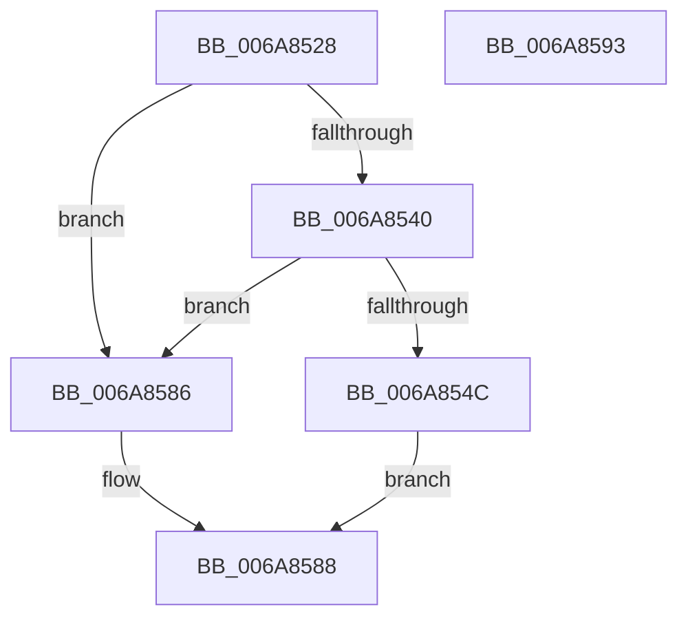

# TriageGetLoaderEntry

- RVA: `0x006A8528`–`0x006A8594` (길이 `108` bytes)
- VA: `0x00000001406A8528`
- 실행 섹션: `.text`
- PDB 이름 있음: `예`; PDB Function 태그: `아니요`
- unwind 정보 RVA: `0x0005CAAC`
- 디코드: `33`개 명령, `108/108` bytes 표시
- 미해석 바이트: `0` (있으면 어셈블리에 `.byte`로 보존)

> 이 문서는 커널 이미지의 기계어와 PDB 기호를 분석해 생성했습니다. 4번과 5번은 함수 원형과 자료형을 바이너리 사용 방식에서 추정한 C 해석이며 원본 소스 복구 결과는 아닙니다.

## 1. Dependencies

- 직접 호출 지점: **1**; 고유 호출 대상: **1**
- 직접 호출자로 확인된 함수: **1**
- RIP 상대 이미지 참조: **1**

### Outgoing calls
- `0x006A8537` → [TriagepVerifyDump](../../init/C6/TriagepVerifyDump_function_00C6FA80.md) (function, `0x00C6FA80`)

### Direct callers
- [ViTriageSameDriversFromDump](../../init/C4/ViTriageSameDriversFromDump_function_00C4D02C.md) at `0x00C4D08B`

### Static image references
- `0x006A8540` → RVA `0x00E0F1B0` (`.data`; read)

## 2. Other-region calls and transfers

- 다른 실행 섹션으로 향하는 call: **1**
  - `0x006A8537` → [TriagepVerifyDump](../../init/C6/TriagepVerifyDump_function_00C6FA80.md) (`.text` → `INIT`)
- 별도 외부 분기/꼬리 이동을 확인하지 못했습니다.

## 3. Assembly (complete function range)

```asm
006A8528  48 89 5C 24 08                  mov qword ptr [rsp + 8], rbx
006A852D  57                              push rdi
006A852E  48 83 EC 20                     sub rsp, 0x20
006A8532  8B FA                           mov edi, edx
006A8534  48 8B D9                        mov rbx, rcx
006A8537  E8 44 75 5C 00                  call 0x140c6fa80
006A853C  84 C0                           test al, al
006A853E  74 46                           je 0x1406a8586
006A8540  8B 05 6A 6C 76 00               mov eax, dword ptr [rip + 0x766c6a]
006A8546  3B 7C 18 34                     cmp edi, dword ptr [rax + rbx + 0x34]
006A854A  73 3A                           jae 0x1406a8586
006A854C  0F AE E8                        lfence
006A854F  8B 54 18 30                     mov edx, dword ptr [rax + rbx + 0x30]
006A8553  48 8D 0C FF                     lea rcx, [rdi + rdi*8]
006A8557  48 C1 E1 04                     shl rcx, 4
006A855B  48 03 D3                        add rdx, rbx
006A855E  44 8B 04 11                     mov r8d, dword ptr [rcx + rdx]
006A8562  48 8D 42 08                     lea rax, [rdx + 8]
006A8566  48 03 C1                        add rax, rcx
006A8569  41 0F B7 0C 18                  movzx ecx, word ptr [r8 + rbx]
006A856E  66 03 C9                        add cx, cx
006A8571  66 89 48 58                     mov word ptr [rax + 0x58], cx
006A8575  66 89 48 5A                     mov word ptr [rax + 0x5a], cx
006A8579  48 8D 4B 04                     lea rcx, [rbx + 4]
006A857D  49 03 C8                        add rcx, r8
006A8580  48 89 48 60                     mov qword ptr [rax + 0x60], rcx
006A8584  EB 02                           jmp 0x1406a8588
006A8586  33 C0                           xor eax, eax
006A8588  48 8B 5C 24 30                  mov rbx, qword ptr [rsp + 0x30]
006A858D  48 83 C4 20                     add rsp, 0x20
006A8591  5F                              pop rdi
006A8592  C3                              ret
006A8593  CC                              int3
```

## 4. C-style interpretation (structured pseudocode)

```c
__int64 __fastcall TriageGetLoaderEntry(__int64 a1, int a2)
{
    __int64 result;
    __int64 v_rsp;
    unsigned __int64 v_stack_p8;

    v_stack_p8 = v_rbx;
    v_rsp = (v_rsp) - (32);
    result = TriagepVerifyDump(a1, a2, a3, a4);
    if ((unsigned __int8)(result) == 0) goto loc_006A8586;
    if (((unsigned int)((unsigned int)(a2))) >= (*(unsigned int *)((unsigned int)(*(unsigned int *)(v_rip + 7761002)) + a1 * 1 + 52))) goto loc_006A8586;
    a1 = ((unsigned int)(a2) + (unsigned int)(a2) * 8) << (4);
    a2 = ((unsigned int)(*(unsigned int *)((unsigned int)(*(unsigned int *)(v_rip + 7761002)) + a1 * 1 + 48))) + (a1);
    result = (a2 + 8) + (a1);
    a1 = (unsigned __int16)((*(unsigned __int16 *)((unsigned int)(*(unsigned int *)(a1 + a2 * 1)) + a1 * 1)) + ((unsigned __int16)(*(unsigned __int16 *)((unsigned int)(*(unsigned int *)(a1 + a2 * 1)) + a1 * 1))));
    *(unsigned __int16 *)(result + 88) = (unsigned __int16)(a1);
    *(unsigned __int16 *)(result + 90) = (unsigned __int16)(a1);
    a1 = (a1 + 4) + ((unsigned int)(*(unsigned int *)(a1 + a2 * 1)));
    *(unsigned __int64 *)(result + 96) = a1;
    goto loc_006A8588;
loc_006A8586:
    result = 0;
loc_006A8588:
    v_rsp = (v_rsp) + (32);
    return result;
}
```

## 5. (Beta) C Style

```c
int64_t TriageGetLoaderEntry(void *Arg1, int32_t Arg2)
{
    uint8_t *arg1 = (uint8_t *)Arg1;

    int64_t result;
    int64_t local_rsp;
    uint64_t v_stack_p8;

    v_stack_p8 = local_rbx;
    local_rsp = (local_rsp) - (32);
    result = TriagepVerifyDump(Arg1, Arg2, a3, a4);
    if ((uint8_t)(result) == 0) goto loc_006A8586;
    if (((uint32_t)((uint32_t)(Arg2))) >= (*(uint32_t *)((uint32_t)(*(uint32_t *)(v_rip + 0x766C6A)) + arg1 * 1 + 0x34))) goto loc_006A8586;
    Arg1 = ((uint32_t)(Arg2) + (uint32_t)(Arg2) * 8) << (4);
    Arg2 = ((uint32_t)(*(uint32_t *)((uint32_t)(*(uint32_t *)(v_rip + 0x766C6A)) + arg1 * 1 + 0x30))) + (Arg1);
    result = (Arg2 + 8) + (Arg1);
    Arg1 = (uint16_t)((*(uint16_t *)((uint32_t)(*(uint32_t *)(arg1 + Arg2 * 1)) + arg1 * 1)) + ((uint16_t)(*(uint16_t *)((uint32_t)(*(uint32_t *)(arg1 + Arg2 * 1)) + arg1 * 1))));
    *(uint16_t *)(result + 0x58) = (uint16_t)(Arg1);
    *(uint16_t *)(result + 0x5A) = (uint16_t)(Arg1);
    Arg1 = (Arg1 + 4) + ((uint32_t)(*(uint32_t *)(arg1 + Arg2 * 1)));
    *(void **)(result + 0x60) = Arg1;
    goto loc_006A8588;
loc_006A8586:
    result = 0;
loc_006A8588:
    local_rsp = (local_rsp) + (32);
    return result;
}
```

### 관측된 메모리 오프셋

구조체 형식이 확인되지 않은 접근은 인자 기준의 오프셋으로만 기록했습니다.

| 기준 인자 | 오프셋 표현 | 폭 (bit) | 접근 |
|---|---:|---:|---|
| `Arg1` | `+ 0x4` | `64` | `R` |

## 6. Execution-region graph

[열기: 2D/3D 그래프와 함수 탐색 컨트롤 패널](../../../control-panel.html?section=text&rva=0x006A8528&view=graph)

- 2D 그래프는 위에서 아래로 흐르고, 3D 그래프는 빈 공간을 드래그해 회전합니다. Shift+드래그는 이동, 휠은 확대·축소, 함수 노드 선택은 대상 보고서 이동입니다.

### Static fallback


