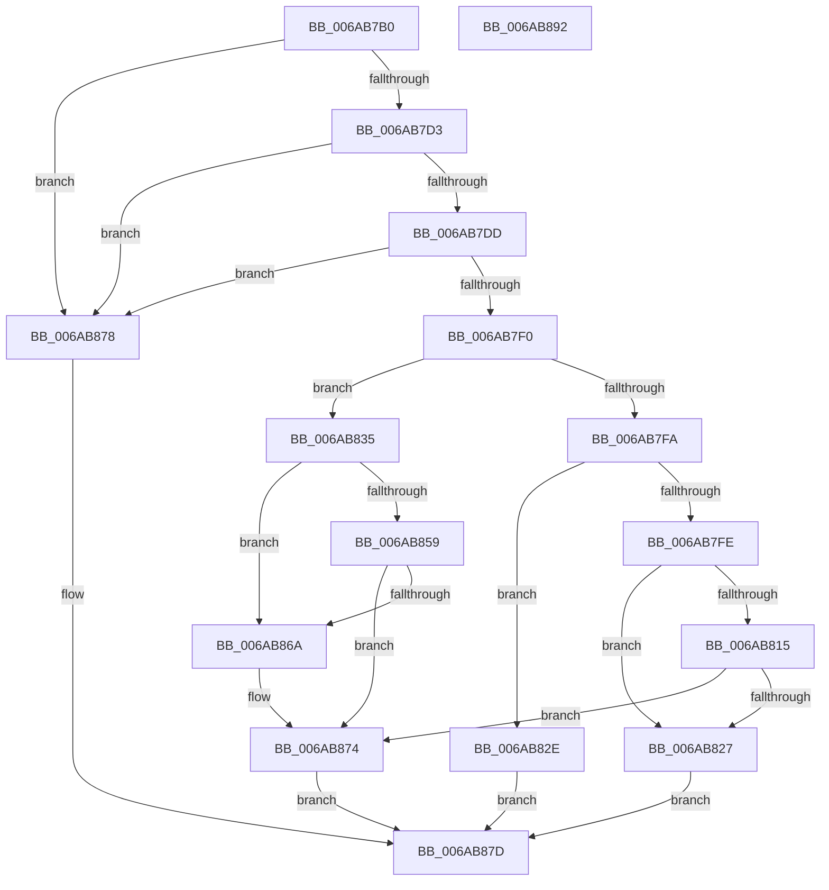

# Uart16550GetByte

- RVA: `0x006AB7B0`–`0x006AB893` (길이 `227` bytes)
- VA: `0x00000001406AB7B0`
- 실행 섹션: `.text`
- PDB 이름 있음: `예`; PDB Function 태그: `아니요`
- unwind 정보 RVA: `0x0005C954`
- 디코드: `68`개 명령, `227/227` bytes 표시
- 미해석 바이트: `0` (있으면 어셈블리에 `.byte`로 보존)

> 이 문서는 커널 이미지의 기계어와 PDB 기호를 분석해 생성했습니다. 4번과 5번은 함수 원형과 자료형을 바이너리 사용 방식에서 추정한 C 해석이며 원본 소스 복구 결과는 아닙니다.

## 1. Dependencies

- 직접 호출 지점: **4**; 고유 호출 대상: **1**
- 직접 호출자로 확인된 함수: **0**
- RIP 상대 이미지 참조: **0**

### Outgoing calls
- `0x006AB7E3` → [guard_dispatch_icall](../6B/guard_dispatch_icall_function_006BAAD0.md) (function, `0x006BAAD0`)
- `0x006AB807` → [guard_dispatch_icall](../6B/guard_dispatch_icall_function_006BAAD0.md) (function, `0x006BAAD0`)
- `0x006AB81E` → [guard_dispatch_icall](../6B/guard_dispatch_icall_function_006BAAD0.md) (function, `0x006BAAD0`)
- `0x006AB83E` → [guard_dispatch_icall](../6B/guard_dispatch_icall_function_006BAAD0.md) (function, `0x006BAAD0`)

### Direct callers
- 이 함수 시작 RVA로 연결되는 직접 call은 확인되지 않았습니다. 간접 호출은 완전히 역산할 수 없습니다.

### Static image references
- 디코드된 RIP-relative 메모리 참조가 없습니다.

## 2. Other-region calls and transfers

- 다른 실행 섹션으로 향하는 call: **0**
- 별도 외부 분기/꼬리 이동을 확인하지 못했습니다.

## 3. Assembly (complete function range)

```asm
006AB7B0  48 89 5C 24 08                  mov qword ptr [rsp + 8], rbx
006AB7B5  48 89 6C 24 10                  mov qword ptr [rsp + 0x10], rbp
006AB7BA  48 89 74 24 18                  mov qword ptr [rsp + 0x18], rsi
006AB7BF  57                              push rdi
006AB7C0  48 83 EC 20                     sub rsp, 0x20
006AB7C4  48 8B FA                        mov rdi, rdx
006AB7C7  48 8B D9                        mov rbx, rcx
006AB7CA  48 85 C9                        test rcx, rcx
006AB7CD  0F 84 A5 00 00 00               je 0x1406ab878
006AB7D3  48 83 39 00                     cmp qword ptr [rcx], 0
006AB7D7  0F 84 9B 00 00 00               je 0x1406ab878
006AB7DD  48 8B 41 10                     mov rax, qword ptr [rcx + 0x10]
006AB7E1  B2 05                           mov dl, 5
006AB7E3  E8 E8 F2 00 00                  call 0x1406baad0
006AB7E8  3C FF                           cmp al, 0xff
006AB7EA  0F 84 88 00 00 00               je 0x1406ab878
006AB7F0  BD 01 00 00 00                  mov ebp, 1
006AB7F5  40 84 C5                        test bpl, al
006AB7F8  74 3B                           je 0x1406ab835
006AB7FA  A8 0E                           test al, 0xe
006AB7FC  75 30                           jne 0x1406ab82e
006AB7FE  48 8B 43 10                     mov rax, qword ptr [rbx + 0x10]
006AB802  33 D2                           xor edx, edx
006AB804  48 8B CB                        mov rcx, rbx
006AB807  E8 C4 F2 00 00                  call 0x1406baad0
006AB80C  F6 43 0C 04                     test byte ptr [rbx + 0xc], 4
006AB810  40 8A F0                        mov sil, al
006AB813  74 12                           je 0x1406ab827
006AB815  48 8B 43 10                     mov rax, qword ptr [rbx + 0x10]
006AB819  B2 06                           mov dl, 6
006AB81B  48 8B CB                        mov rcx, rbx
006AB81E  E8 AD F2 00 00                  call 0x1406baad0
006AB823  84 C0                           test al, al
006AB825  79 4D                           jns 0x1406ab874
006AB827  40 88 37                        mov byte ptr [rdi], sil
006AB82A  33 C0                           xor eax, eax
006AB82C  EB 4F                           jmp 0x1406ab87d
006AB82E  B8 02 00 00 00                  mov eax, 2
006AB833  EB 48                           jmp 0x1406ab87d
006AB835  48 8B 43 10                     mov rax, qword ptr [rbx + 0x10]
006AB839  B2 06                           mov dl, 6
006AB83B  48 8B CB                        mov rcx, rbx
006AB83E  E8 8D F2 00 00                  call 0x1406baad0
006AB843  44 0F B7 43 0C                  movzx r8d, word ptr [rbx + 0xc]
006AB848  24 40                           and al, 0x40
006AB84A  0F 94 C2                        sete dl
006AB84D  66 41 0F A3 E8                  bt r8w, bp
006AB852  0F 92 C1                        setb cl
006AB855  84 D1                           test cl, dl
006AB857  75 11                           jne 0x1406ab86a
006AB859  84 C0                           test al, al
006AB85B  0F 95 C2                        setne dl
006AB85E  66 41 0F A3 E8                  bt r8w, bp
006AB863  0F 93 C1                        setae cl
006AB866  84 D1                           test cl, dl
006AB868  74 0A                           je 0x1406ab874
006AB86A  66 41 83 C8 04                  or r8w, 4
006AB86F  66 44 89 43 0C                  mov word ptr [rbx + 0xc], r8w
006AB874  8B C5                           mov eax, ebp
006AB876  EB 05                           jmp 0x1406ab87d
006AB878  B8 03 00 00 00                  mov eax, 3
006AB87D  48 8B 5C 24 30                  mov rbx, qword ptr [rsp + 0x30]
006AB882  48 8B 6C 24 38                  mov rbp, qword ptr [rsp + 0x38]
006AB887  48 8B 74 24 40                  mov rsi, qword ptr [rsp + 0x40]
006AB88C  48 83 C4 20                     add rsp, 0x20
006AB890  5F                              pop rdi
006AB891  C3                              ret
006AB892  CC                              int3
```

## 4. C-style interpretation (structured pseudocode)

```c
__int64 __fastcall Uart16550GetByte(__int64 a1, __int64 a2)
{
    __int64 result;
    __int64 v_rsp;
    unsigned __int64 v_stack_p10;
    unsigned __int64 v_stack_p18;
    unsigned __int64 v_stack_p8;

    v_stack_p8 = v_rbx;
    v_stack_p10 = v_rbp;
    v_stack_p18 = v_rsi;
    v_rsp = (v_rsp) - (32);
    if (a1 == 0) goto loc_006AB878;
    if ((*(unsigned __int64 *)(a1)) == 0) goto loc_006AB878;
    result = guard_dispatch_icall(a1, 5, a3, a4);
    if (((unsigned __int8)(result)) == 255) goto loc_006AB878;
    if (((1) & ((unsigned __int8)(result))) == 0) goto loc_006AB835;
    if ((((unsigned __int8)(result)) & (14)) != 0) goto loc_006AB82E;
    a2 = 0;
    result = guard_dispatch_icall(a1, a2, a3, a4);
    if (((*(unsigned __int8 *)(a1 + 12)) & (4)) == 0) goto loc_006AB827;
    result = guard_dispatch_icall(a1, 6, a3, a4);
    if (!sign_flag) goto loc_006AB874;
loc_006AB827:
    *(unsigned __int8 *)(a2) = (unsigned __int8)((unsigned __int8)(result));
    result = 0;
    goto loc_006AB87D;
loc_006AB82E:
    goto loc_006AB87D;
loc_006AB835:
    result = guard_dispatch_icall(a1, 6, a3, a4);
    result = (unsigned __int8)((result) & (64));
    a2 = (condition_is_equal) ? 1 : 0;
    a1 = (condition_is_below) ? 1 : 0;
    if ((((unsigned __int8)(a1)) & ((unsigned __int8)(a2))) != 0) goto loc_006AB86A;
    a2 = ((unsigned __int8)(result) != 0) ? 1 : 0;
    a1 = (condition_is_above_or_equal) ? 1 : 0;
    if ((((unsigned __int8)(a1)) & ((unsigned __int8)(a2))) != 0) {
        a3 = (unsigned __int16)((*(unsigned __int16 *)(a1 + 12)) | (4));
        *(unsigned __int16 *)(a1 + 12) = (unsigned __int16)(a3);
    }
    goto loc_006AB87D;
loc_006AB878:
loc_006AB87D:
    v_rsp = (v_rsp) + (32);
    return 3;
}
```

## 5. (Beta) C Style

```c
int64_t Uart16550GetByte(void *Arg1, void *Arg2)
{
    uint8_t *arg1 = (uint8_t *)Arg1;
    uint8_t *arg2 = (uint8_t *)Arg2;

    int64_t result;
    int64_t local_rsp;
    uint64_t v_stack_p10;
    uint64_t v_stack_p18;
    uint64_t v_stack_p8;

    v_stack_p8 = local_rbx;
    v_stack_p10 = local_rbp;
    v_stack_p18 = local_rsi;
    local_rsp = (local_rsp) - (32);
    if (Arg1 == NULL) goto loc_006AB878;
    if ((*(uint64_t *)(arg1)) == 0) goto loc_006AB878;
    result = guard_dispatch_icall(Arg1, 5, a3, a4);
    if (((uint8_t)(result)) == 255) goto loc_006AB878;
    if (((1) & ((uint8_t)(result))) == 0) goto loc_006AB835;
    if ((((uint8_t)(result)) & (14)) != 0) goto loc_006AB82E;
    Arg2 = 0;
    result = guard_dispatch_icall(Arg1, Arg2, a3, a4);
    if (((*(uint8_t *)(arg1 + 0xC)) & (4)) == 0) goto loc_006AB827;
    result = guard_dispatch_icall(Arg1, 6, a3, a4);
    if (!sign_flag) goto loc_006AB874;
loc_006AB827:
    *(uint8_t *)(arg2) = (uint8_t)((uint8_t)(result));
    result = 0;
    goto loc_006AB87D;
loc_006AB82E:
    goto loc_006AB87D;
loc_006AB835:
    result = guard_dispatch_icall(Arg1, 6, a3, a4);
    result = (uint8_t)((result) & (64));
    Arg2 = (condition_is_equal) ? 1 : 0;
    Arg1 = (condition_is_below) ? 1 : 0;
    if ((((uint8_t)(Arg1)) & ((uint8_t)(Arg2))) != 0) goto loc_006AB86A;
    Arg2 = ((uint8_t)(result) != 0) ? 1 : 0;
    Arg1 = (condition_is_above_or_equal) ? 1 : 0;
    if ((((uint8_t)(Arg1)) & ((uint8_t)(Arg2))) != 0) {
        a3 = (uint16_t)((*(uint16_t *)(arg1 + 0xC)) | (4));
        *(uint16_t *)(arg1 + 0xC) = (uint16_t)(a3);
    }
    goto loc_006AB87D;
loc_006AB878:
loc_006AB87D:
    local_rsp = (local_rsp) + (32);
    return 3;
}
```

### 관측된 메모리 오프셋

구조체 형식이 확인되지 않은 접근은 인자 기준의 오프셋으로만 기록했습니다.

| 기준 인자 | 오프셋 표현 | 폭 (bit) | 접근 |
|---|---:|---:|---|
| `Arg1` | `+ 0xC` | `8` | `R` |
| `Arg1` | `+ 0xC` | `16` | `R` |
| `Arg1` | `+ 0xC` | `16` | `W` |
| `Arg1` | `+ 0x10` | `64` | `R` |
| `Arg2` | `+ 0x0` | `8` | `W` |

## 6. Execution-region graph

[열기: 2D/3D 그래프와 함수 탐색 컨트롤 패널](../../../control-panel.html?section=text&rva=0x006AB7B0&view=graph)

- 2D 그래프는 위에서 아래로 흐르고, 3D 그래프는 빈 공간을 드래그해 회전합니다. Shift+드래그는 이동, 휠은 확대·축소, 함수 노드 선택은 대상 보고서 이동입니다.

### Static fallback


