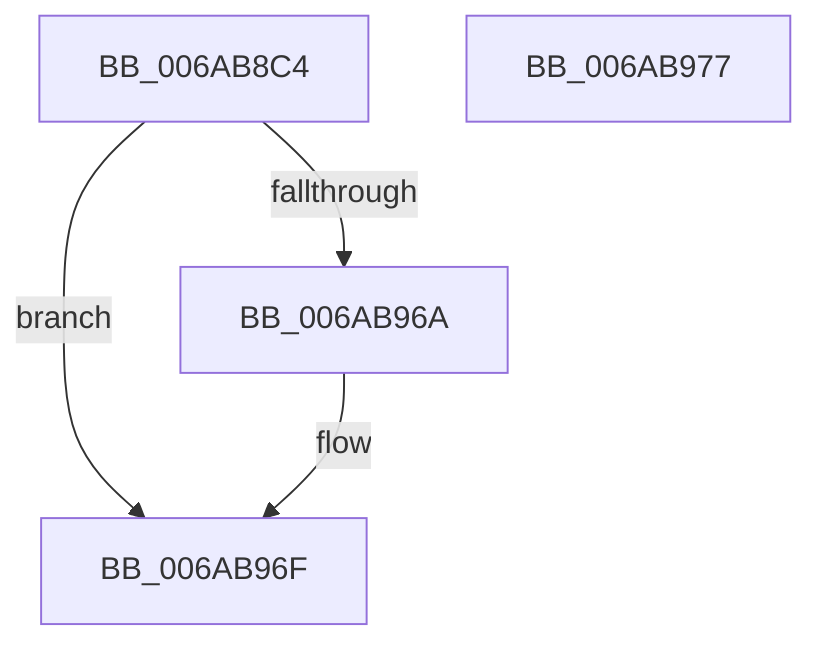

# Uart16550InitializePortCommon

- RVA: `0x006AB8C4`–`0x006AB978` (길이 `180` bytes)
- VA: `0x00000001406AB8C4`
- 실행 섹션: `.text`
- PDB 이름 있음: `예`; PDB Function 태그: `아니요`
- unwind 정보 RVA: `0x0005CF00`
- 디코드: `55`개 명령, `180/180` bytes 표시
- 미해석 바이트: `0` (있으면 어셈블리에 `.byte`로 보존)

> 이 문서는 커널 이미지의 기계어와 PDB 기호를 분석해 생성했습니다. 4번과 5번은 함수 원형과 자료형을 바이너리 사용 방식에서 추정한 C 해석이며 원본 소스 복구 결과는 아닙니다.

## 1. Dependencies

- 직접 호출 지점: **9**; 고유 호출 대상: **3**
- 직접 호출자로 확인된 함수: **5**
- RIP 상대 이미지 참조: **0**

### Outgoing calls
- `0x006AB8E1` → [UartpSetAccess](UartpSetAccess_function_006AC2DC.md) (function, `0x006AC2DC`)
- `0x006AB8EF` → [guard_dispatch_icall](../6B/guard_dispatch_icall_function_006BAAD0.md) (function, `0x006BAAD0`)
- `0x006AB904` → [guard_dispatch_icall](../6B/guard_dispatch_icall_function_006BAAD0.md) (function, `0x006BAAD0`)
- `0x006AB915` → [guard_dispatch_icall](../6B/guard_dispatch_icall_function_006BAAD0.md) (function, `0x006BAAD0`)
- `0x006AB926` → [guard_dispatch_icall](../6B/guard_dispatch_icall_function_006BAAD0.md) (function, `0x006BAAD0`)
- `0x006AB931` → [Uart16550SetBaud](Uart16550SetBaud_function_006ABB90.md) (function, `0x006ABB90`)
- `0x006AB942` → [guard_dispatch_icall](../6B/guard_dispatch_icall_function_006BAAD0.md) (function, `0x006BAAD0`)
- `0x006AB953` → [guard_dispatch_icall](../6B/guard_dispatch_icall_function_006BAAD0.md) (function, `0x006BAAD0`)
- `0x006AB961` → [guard_dispatch_icall](../6B/guard_dispatch_icall_function_006BAAD0.md) (function, `0x006BAAD0`)

### Direct callers
- [IaLpssInitializePort](IaLpssInitializePort_function_006AB300.md) at `0x006AB31E`
- [IaLpssSetPowerD0](IaLpssSetPowerD0_function_006AB5A0.md) at `0x006AB61F`
- [Uart16550InitializePort](Uart16550InitializePort_function_006AB8A0.md) at `0x006AB8B2`
- [Uart16550LegacyInitializePort](Uart16550LegacyInitializePort_function_006AB980.md) at `0x006AB9D6`
- [Uart16550MmInitializePort](Uart16550MmInitializePort_function_006AB9F0.md) at `0x006ABA02`

### Static image references
- 디코드된 RIP-relative 메모리 참조가 없습니다.

## 2. Other-region calls and transfers

- 다른 실행 섹션으로 향하는 call: **0**
- 별도 외부 분기/꼬리 이동을 확인하지 못했습니다.

## 3. Assembly (complete function range)

```asm
006AB8C4  40 53                           push rbx
006AB8C6  48 83 EC 20                     sub rsp, 0x20
006AB8CA  41 8A C1                        mov al, r9b
006AB8CD  45 8A D0                        mov r10b, r8b
006AB8D0  44 8A 4C 24 50                  mov r9b, byte ptr [rsp + 0x50]
006AB8D5  48 8B DA                        mov rbx, rdx
006AB8D8  44 8A C0                        mov r8b, al
006AB8DB  41 8A D2                        mov dl, r10b
006AB8DE  48 8B CB                        mov rcx, rbx
006AB8E1  E8 F6 09 00 00                  call 0x1406ac2dc
006AB8E6  48 8B 43 10                     mov rax, qword ptr [rbx + 0x10]
006AB8EA  B2 03                           mov dl, 3
006AB8EC  48 8B CB                        mov rcx, rbx
006AB8EF  E8 DC F1 00 00                  call 0x1406baad0
006AB8F4  44 8A C0                        mov r8b, al
006AB8F7  B2 03                           mov dl, 3
006AB8F9  48 8B 43 18                     mov rax, qword ptr [rbx + 0x18]
006AB8FD  41 80 E0 7F                     and r8b, 0x7f
006AB901  48 8B CB                        mov rcx, rbx
006AB904  E8 C7 F1 00 00                  call 0x1406baad0
006AB909  48 8B 43 18                     mov rax, qword ptr [rbx + 0x18]
006AB90D  45 33 C0                        xor r8d, r8d
006AB910  B2 01                           mov dl, 1
006AB912  48 8B CB                        mov rcx, rbx
006AB915  E8 B6 F1 00 00                  call 0x1406baad0
006AB91A  48 8B 43 18                     mov rax, qword ptr [rbx + 0x18]
006AB91E  41 B0 06                        mov r8b, 6
006AB921  B2 02                           mov dl, 2
006AB923  48 8B CB                        mov rcx, rbx
006AB926  E8 A5 F1 00 00                  call 0x1406baad0
006AB92B  8B 53 08                        mov edx, dword ptr [rbx + 8]
006AB92E  48 8B CB                        mov rcx, rbx
006AB931  E8 5A 02 00 00                  call 0x1406abb90
006AB936  48 8B 43 18                     mov rax, qword ptr [rbx + 0x18]
006AB93A  41 B0 01                        mov r8b, 1
006AB93D  B2 02                           mov dl, 2
006AB93F  48 8B CB                        mov rcx, rbx
006AB942  E8 89 F1 00 00                  call 0x1406baad0
006AB947  48 8B 43 18                     mov rax, qword ptr [rbx + 0x18]
006AB94B  41 B0 03                        mov r8b, 3
006AB94E  B2 04                           mov dl, 4
006AB950  48 8B CB                        mov rcx, rbx
006AB953  E8 78 F1 00 00                  call 0x1406baad0
006AB958  48 8B 43 10                     mov rax, qword ptr [rbx + 0x10]
006AB95C  B2 06                           mov dl, 6
006AB95E  48 8B CB                        mov rcx, rbx
006AB961  E8 6A F1 00 00                  call 0x1406baad0
006AB966  A8 40                           test al, 0x40
006AB968  74 05                           je 0x1406ab96f
006AB96A  66 83 4B 0C 02                  or word ptr [rbx + 0xc], 2
006AB96F  B0 01                           mov al, 1
006AB971  48 83 C4 20                     add rsp, 0x20
006AB975  5B                              pop rbx
006AB976  C3                              ret
006AB977  CC                              int3
```

## 4. C-style interpretation (structured pseudocode)

```c
__int64 __fastcall Uart16550InitializePortCommon(__int64 a1, __int64 a2, unsigned __int8 a3, unsigned __int8 a4, unsigned __int8 a5)
{
    __int64 result;
    __int64 v_rsp;

    v_rsp = (v_rsp) - (32);
    result = UartpSetAccess(a2, a3, a4, a5);
    result = guard_dispatch_icall(a2, 3, a4, a5);
    a3 = (unsigned __int8)(((unsigned __int8)(result)) & (127));
    result = guard_dispatch_icall(a2, 3, a3, a5);
    a3 = 0;
    result = guard_dispatch_icall(a2, 1, a3, a5);
    result = guard_dispatch_icall(a2, 2, 6, a5);
    result = Uart16550SetBaud(a2, (unsigned int)(*(unsigned int *)(a2 + 8)), 6, a5);
    result = guard_dispatch_icall(a2, 2, 1, a5);
    result = guard_dispatch_icall(a2, 4, 3, a5);
    result = guard_dispatch_icall(a2, 6, 3, a5);
    if ((((unsigned __int8)(result)) & (64)) != 0) {
    }
    v_rsp = (v_rsp) + (32);
    return 1;
}
```

## 5. (Beta) C Style

```c
int64_t Uart16550InitializePortCommon(int64_t Arg1, void *Arg2, uint8_t Arg3, uint8_t Arg4, uint8_t Arg5)
{
    uint8_t *arg2 = (uint8_t *)Arg2;

    int64_t result;
    int64_t local_rsp;

    local_rsp = (local_rsp) - (32);
    result = UartpSetAccess(Arg2, Arg3, Arg4, Arg5);
    result = guard_dispatch_icall(Arg2, 3, Arg4, Arg5);
    Arg3 = (uint8_t)(((uint8_t)(result)) & (127));
    result = guard_dispatch_icall(Arg2, 3, Arg3, Arg5);
    Arg3 = 0;
    result = guard_dispatch_icall(Arg2, 1, Arg3, Arg5);
    result = guard_dispatch_icall(Arg2, 2, 6, Arg5);
    result = Uart16550SetBaud(Arg2, (uint32_t)(*(uint32_t *)(arg2 + 0x8)), 6, Arg5);
    result = guard_dispatch_icall(Arg2, 2, 1, Arg5);
    result = guard_dispatch_icall(Arg2, 4, 3, Arg5);
    result = guard_dispatch_icall(Arg2, 6, 3, Arg5);
    if ((((uint8_t)(result)) & (64)) != 0) {
    }
    local_rsp = (local_rsp) + (32);
    return 1;
}
```

### 관측된 메모리 오프셋

구조체 형식이 확인되지 않은 접근은 인자 기준의 오프셋으로만 기록했습니다.

| 기준 인자 | 오프셋 표현 | 폭 (bit) | 접근 |
|---|---:|---:|---|
| `Arg2` | `+ 0x8` | `32` | `R` |
| `Arg2` | `+ 0xC` | `16` | `R/W` |
| `Arg2` | `+ 0x10` | `64` | `R` |
| `Arg2` | `+ 0x18` | `64` | `R` |

## 6. Execution-region graph

[열기: 2D/3D 그래프와 함수 탐색 컨트롤 패널](../../../control-panel.html?section=text&rva=0x006AB8C4&view=graph)

- 2D 그래프는 위에서 아래로 흐르고, 3D 그래프는 빈 공간을 드래그해 회전합니다. Shift+드래그는 이동, 휠은 확대·축소, 함수 노드 선택은 대상 보고서 이동입니다.

### Static fallback


