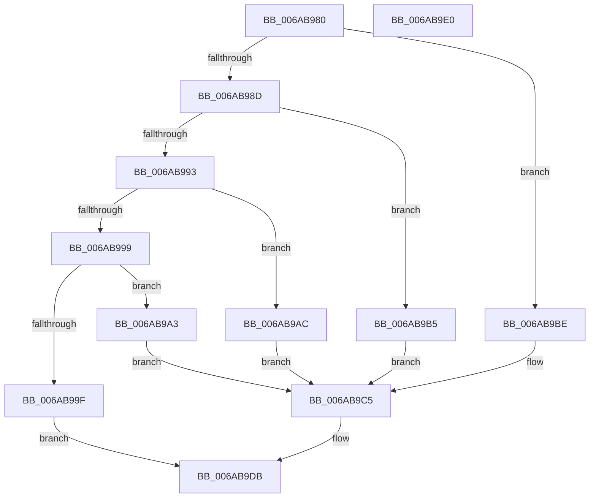

# Uart16550LegacyInitializePort

- RVA: `0x006AB980`–`0x006AB9E1` (길이 `97` bytes)
- VA: `0x00000001406AB980`
- 실행 섹션: `.text`
- PDB 이름 있음: `예`; PDB Function 태그: `아니요`
- unwind 정보 RVA: `0x0005D2F4`
- 디코드: `28`개 명령, `97/97` bytes 표시
- 미해석 바이트: `0` (있으면 어셈블리에 `.byte`로 보존)

> 이 문서는 커널 이미지의 기계어와 PDB 기호를 분석해 생성했습니다. 4번과 5번은 함수 원형과 자료형을 바이너리 사용 방식에서 추정한 C 해석이며 원본 소스 복구 결과는 아닙니다.

## 1. Dependencies

- 직접 호출 지점: **1**; 고유 호출 대상: **1**
- 직접 호출자로 확인된 함수: **0**
- RIP 상대 이미지 참조: **0**

### Outgoing calls
- `0x006AB9D6` → [Uart16550InitializePortCommon](Uart16550InitializePortCommon_function_006AB8C4.md) (function, `0x006AB8C4`)

### Direct callers
- 이 함수 시작 RVA로 연결되는 직접 call은 확인되지 않았습니다. 간접 호출은 완전히 역산할 수 없습니다.

### Static image references
- 디코드된 RIP-relative 메모리 참조가 없습니다.

## 2. Other-region calls and transfers

- 다른 실행 섹션으로 향하는 call: **0**
- 별도 외부 분기/꼬리 이동을 확인하지 못했습니다.

## 3. Assembly (complete function range)

```asm
006AB980  48 83 EC 38                     sub rsp, 0x38
006AB984  48 8B 02                        mov rax, qword ptr [rdx]
006AB987  48 83 E8 01                     sub rax, 1
006AB98B  74 31                           je 0x1406ab9be
006AB98D  48 83 E8 01                     sub rax, 1
006AB991  74 22                           je 0x1406ab9b5
006AB993  48 83 E8 01                     sub rax, 1
006AB997  74 13                           je 0x1406ab9ac
006AB999  48 83 F8 01                     cmp rax, 1
006AB99D  74 04                           je 0x1406ab9a3
006AB99F  32 C0                           xor al, al
006AB9A1  EB 38                           jmp 0x1406ab9db
006AB9A3  48 C7 02 E8 02 00 00            mov qword ptr [rdx], 0x2e8
006AB9AA  EB 19                           jmp 0x1406ab9c5
006AB9AC  48 C7 02 E8 03 00 00            mov qword ptr [rdx], 0x3e8
006AB9B3  EB 10                           jmp 0x1406ab9c5
006AB9B5  48 C7 02 F8 02 00 00            mov qword ptr [rdx], 0x2f8
006AB9BC  EB 07                           jmp 0x1406ab9c5
006AB9BE  48 C7 02 F8 03 00 00            mov qword ptr [rdx], 0x3f8
006AB9C5  33 C0                           xor eax, eax
006AB9C7  C6 44 24 20 08                  mov byte ptr [rsp + 0x20], 8
006AB9CC  41 B1 01                        mov r9b, 1
006AB9CF  66 89 42 0C                     mov word ptr [rdx + 0xc], ax
006AB9D3  45 33 C0                        xor r8d, r8d
006AB9D6  E8 E9 FE FF FF                  call 0x1406ab8c4
006AB9DB  48 83 C4 38                     add rsp, 0x38
006AB9DF  C3                              ret
006AB9E0  CC                              int3
```

## 4. C-style interpretation (structured pseudocode)

```c
__int64 __fastcall Uart16550LegacyInitializePort(__int64 a1, __int64 a2, int a3)
{
    __int64 result;
    __int64 v_rsp;
    unsigned __int8 v_stack_m18;

    v_rsp = (v_rsp) - (56);
    result = (*(unsigned __int64 *)(a2)) - (1);
    if (condition_is_equal) goto loc_006AB9BE;
    result = (result) - (1);
    if (condition_is_equal) goto loc_006AB9B5;
    result = (result) - (1);
    if (condition_is_equal) goto loc_006AB9AC;
    if (result == 1) goto loc_006AB9A3;
    result = 0;
    goto loc_006AB9DB;
loc_006AB9A3:
    *(unsigned __int64 *)(a2) = 744;
    goto loc_006AB9C5;
loc_006AB9AC:
    *(unsigned __int64 *)(a2) = 1000;
    goto loc_006AB9C5;
loc_006AB9B5:
    *(unsigned __int64 *)(a2) = 760;
    goto loc_006AB9C5;
loc_006AB9BE:
    *(unsigned __int64 *)(a2) = 0x3F8ULL;
loc_006AB9C5:
    result = 0;
    v_stack_m18 = 8;
    *(unsigned __int16 *)(a2 + 12) = 0;
    a3 = 0;
    result = Uart16550InitializePortCommon(a1, a2, a3, 1);
loc_006AB9DB:
    v_rsp = (v_rsp) + (56);
    return result;
}
```

## 5. (Beta) C Style

```c
int64_t Uart16550LegacyInitializePort(int64_t Arg1, void *Arg2, int32_t Arg3)
{
    uint8_t *arg2 = (uint8_t *)Arg2;

    int64_t result;
    int64_t local_rsp;
    uint8_t v_stack_m18;

    local_rsp = (local_rsp) - (56);
    result = (*(uint64_t *)(arg2)) - (1);
    if (condition_is_equal) goto loc_006AB9BE;
    result = (result) - (1);
    if (condition_is_equal) goto loc_006AB9B5;
    result = (result) - (1);
    if (condition_is_equal) goto loc_006AB9AC;
    if (result == 1) goto loc_006AB9A3;
    result = 0;
    goto loc_006AB9DB;
loc_006AB9A3:
    *(uint64_t *)(arg2) = 744;
    goto loc_006AB9C5;
loc_006AB9AC:
    *(uint64_t *)(arg2) = 1000;
    goto loc_006AB9C5;
loc_006AB9B5:
    *(uint64_t *)(arg2) = 760;
    goto loc_006AB9C5;
loc_006AB9BE:
    *(uint64_t *)(arg2) = 0x3F8ULL;
loc_006AB9C5:
    result = 0;
    v_stack_m18 = 8;
    *(uint16_t *)(arg2 + 0xC) = 0;
    Arg3 = 0;
    result = Uart16550InitializePortCommon(Arg1, Arg2, Arg3, 1);
loc_006AB9DB:
    local_rsp = (local_rsp) + (56);
    return result;
}
```

### 관측된 메모리 오프셋

구조체 형식이 확인되지 않은 접근은 인자 기준의 오프셋으로만 기록했습니다.

| 기준 인자 | 오프셋 표현 | 폭 (bit) | 접근 |
|---|---:|---:|---|
| `Arg2` | `+ 0x0` | `64` | `R` |
| `Arg2` | `+ 0x0` | `64` | `W` |
| `Arg2` | `+ 0xC` | `16` | `W` |

## 6. Execution-region graph

[열기: 2D/3D 그래프와 함수 탐색 컨트롤 패널](../../../control-panel.html?section=text&rva=0x006AB980&view=graph)

- 2D 그래프는 위에서 아래로 흐르고, 3D 그래프는 빈 공간을 드래그해 회전합니다. Shift+드래그는 이동, 휠은 확대·축소, 함수 노드 선택은 대상 보고서 이동입니다.

### Static fallback


