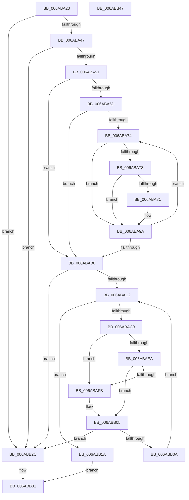

# Uart16550PutByte

- RVA: `0x006ABA20`–`0x006ABB48` (길이 `296` bytes)
- VA: `0x00000001406ABA20`
- 실행 섹션: `.text`
- PDB 이름 있음: `예`; PDB Function 태그: `아니요`
- unwind 정보 RVA: `0x0006F978`
- 디코드: `91`개 명령, `296/296` bytes 표시
- 미해석 바이트: `0` (있으면 어셈블리에 `.byte`로 보존)

> 이 문서는 커널 이미지의 기계어와 PDB 기호를 분석해 생성했습니다. 4번과 5번은 함수 원형과 자료형을 바이너리 사용 방식에서 추정한 C 해석이며 원본 소스 복구 결과는 아닙니다.

## 1. Dependencies

- 직접 호출 지점: **8**; 고유 호출 대상: **1**
- 직접 호출자로 확인된 함수: **0**
- RIP 상대 이미지 참조: **0**

### Outgoing calls
- `0x006ABA63` → [guard_dispatch_icall](../6B/guard_dispatch_icall_function_006BAAD0.md) (function, `0x006BAAD0`)
- `0x006ABA81` → [guard_dispatch_icall](../6B/guard_dispatch_icall_function_006BAAD0.md) (function, `0x006BAAD0`)
- `0x006ABA95` → [guard_dispatch_icall](../6B/guard_dispatch_icall_function_006BAAD0.md) (function, `0x006BAAD0`)
- `0x006ABAA3` → [guard_dispatch_icall](../6B/guard_dispatch_icall_function_006BAAD0.md) (function, `0x006BAAD0`)
- `0x006ABAB9` → [guard_dispatch_icall](../6B/guard_dispatch_icall_function_006BAAD0.md) (function, `0x006BAAD0`)
- `0x006ABACF` → [guard_dispatch_icall](../6B/guard_dispatch_icall_function_006BAAD0.md) (function, `0x006BAAD0`)
- `0x006ABB13` → [guard_dispatch_icall](../6B/guard_dispatch_icall_function_006BAAD0.md) (function, `0x006BAAD0`)
- `0x006ABB23` → [guard_dispatch_icall](../6B/guard_dispatch_icall_function_006BAAD0.md) (function, `0x006BAAD0`)

### Direct callers
- 이 함수 시작 RVA로 연결되는 직접 call은 확인되지 않았습니다. 간접 호출은 완전히 역산할 수 없습니다.

### Static image references
- 디코드된 RIP-relative 메모리 참조가 없습니다.

## 2. Other-region calls and transfers

- 다른 실행 섹션으로 향하는 call: **0**
- 별도 외부 분기/꼬리 이동을 확인하지 못했습니다.

## 3. Assembly (complete function range)

```asm
006ABA20  48 89 5C 24 08                  mov qword ptr [rsp + 8], rbx
006ABA25  48 89 74 24 10                  mov qword ptr [rsp + 0x10], rsi
006ABA2A  48 89 7C 24 18                  mov qword ptr [rsp + 0x18], rdi
006ABA2F  41 56                           push r14
006ABA31  48 83 EC 20                     sub rsp, 0x20
006ABA35  41 8A F0                        mov sil, r8b
006ABA38  40 8A FA                        mov dil, dl
006ABA3B  48 8B D9                        mov rbx, rcx
006ABA3E  48 85 C9                        test rcx, rcx
006ABA41  0F 84 E5 00 00 00               je 0x1406abb2c
006ABA47  48 83 39 00                     cmp qword ptr [rcx], 0
006ABA4B  0F 84 DB 00 00 00               je 0x1406abb2c
006ABA51  F6 41 0C 04                     test byte ptr [rcx + 0xc], 4
006ABA55  41 BE 01 00 00 00               mov r14d, 1
006ABA5B  74 53                           je 0x1406abab0
006ABA5D  48 8B 41 10                     mov rax, qword ptr [rcx + 0x10]
006ABA61  B2 06                           mov dl, 6
006ABA63  E8 68 F0 00 00                  call 0x1406baad0
006ABA68  8A C8                           mov cl, al
006ABA6A  8A D0                           mov dl, al
006ABA6C  80 E1 B0                        and cl, 0xb0
006ABA6F  80 F9 B0                        cmp cl, 0xb0
006ABA72  74 3C                           je 0x1406abab0
006ABA74  84 D2                           test dl, dl
006ABA76  78 22                           js 0x1406aba9a
006ABA78  48 8B 43 10                     mov rax, qword ptr [rbx + 0x10]
006ABA7C  B2 05                           mov dl, 5
006ABA7E  48 8B CB                        mov rcx, rbx
006ABA81  E8 4A F0 00 00                  call 0x1406baad0
006ABA86  44 84 73 0C                     test byte ptr [rbx + 0xc], r14b
006ABA8A  74 0E                           je 0x1406aba9a
006ABA8C  48 8B 43 10                     mov rax, qword ptr [rbx + 0x10]
006ABA90  33 D2                           xor edx, edx
006ABA92  48 8B CB                        mov rcx, rbx
006ABA95  E8 36 F0 00 00                  call 0x1406baad0
006ABA9A  48 8B 43 10                     mov rax, qword ptr [rbx + 0x10]
006ABA9E  B2 06                           mov dl, 6
006ABAA0  48 8B CB                        mov rcx, rbx
006ABAA3  E8 28 F0 00 00                  call 0x1406baad0
006ABAA8  8A D0                           mov dl, al
006ABAAA  24 B0                           and al, 0xb0
006ABAAC  3C B0                           cmp al, 0xb0
006ABAAE  75 C4                           jne 0x1406aba74
006ABAB0  48 8B 43 10                     mov rax, qword ptr [rbx + 0x10]
006ABAB4  B2 05                           mov dl, 5
006ABAB6  48 8B CB                        mov rcx, rbx
006ABAB9  E8 12 F0 00 00                  call 0x1406baad0
006ABABE  3C FF                           cmp al, 0xff
006ABAC0  74 6A                           je 0x1406abb2c
006ABAC2  48 8B CB                        mov rcx, rbx
006ABAC5  A8 20                           test al, 0x20
006ABAC7  75 51                           jne 0x1406abb1a
006ABAC9  48 8B 43 10                     mov rax, qword ptr [rbx + 0x10]
006ABACD  B2 06                           mov dl, 6
006ABACF  E8 FC EF 00 00                  call 0x1406baad0
006ABAD4  44 0F B7 43 0C                  movzx r8d, word ptr [rbx + 0xc]
006ABAD9  24 40                           and al, 0x40
006ABADB  0F 94 C2                        sete dl
006ABADE  66 45 0F A3 F0                  bt r8w, r14w
006ABAE3  0F 92 C1                        setb cl
006ABAE6  84 D1                           test cl, dl
006ABAE8  75 11                           jne 0x1406abafb
006ABAEA  84 C0                           test al, al
006ABAEC  0F 95 C1                        setne cl
006ABAEF  66 45 0F A3 F0                  bt r8w, r14w
006ABAF4  0F 93 C0                        setae al
006ABAF7  84 C8                           test al, cl
006ABAF9  74 0A                           je 0x1406abb05
006ABAFB  66 41 83 C8 04                  or r8w, 4
006ABB00  66 44 89 43 0C                  mov word ptr [rbx + 0xc], r8w
006ABB05  40 84 F6                        test sil, sil
006ABB08  74 22                           je 0x1406abb2c
006ABB0A  48 8B 43 10                     mov rax, qword ptr [rbx + 0x10]
006ABB0E  B2 05                           mov dl, 5
006ABB10  48 8B CB                        mov rcx, rbx
006ABB13  E8 B8 EF 00 00                  call 0x1406baad0
006ABB18  EB A8                           jmp 0x1406abac2
006ABB1A  48 8B 43 18                     mov rax, qword ptr [rbx + 0x18]
006ABB1E  44 8A C7                        mov r8b, dil
006ABB21  33 D2                           xor edx, edx
006ABB23  E8 A8 EF 00 00                  call 0x1406baad0
006ABB28  33 C0                           xor eax, eax
006ABB2A  EB 05                           jmp 0x1406abb31
006ABB2C  B8 03 00 00 00                  mov eax, 3
006ABB31  48 8B 5C 24 30                  mov rbx, qword ptr [rsp + 0x30]
006ABB36  48 8B 74 24 38                  mov rsi, qword ptr [rsp + 0x38]
006ABB3B  48 8B 7C 24 40                  mov rdi, qword ptr [rsp + 0x40]
006ABB40  48 83 C4 20                     add rsp, 0x20
006ABB44  41 5E                           pop r14
006ABB46  C3                              ret
006ABB47  CC                              int3
```

## 4. C-style interpretation (structured pseudocode)

```c
__int64 __fastcall Uart16550PutByte(__int64 a1, unsigned __int8 a2, unsigned __int8 a3)
{
    __int64 result;
    __int64 v_rsp;
    unsigned __int64 v_stack_p10;
    unsigned __int64 v_stack_p18;
    unsigned __int64 v_stack_p8;

    v_stack_p8 = v_rbx;
    v_stack_p10 = v_rsi;
    v_stack_p18 = v_rdi;
    v_rsp = (v_rsp) - (32);
    if (a1 == 0) goto loc_006ABB2C;
    if ((*(unsigned __int64 *)(a1)) == 0) goto loc_006ABB2C;
    if (((*(unsigned __int8 *)(a1 + 12)) & (4)) == 0) goto loc_006ABAB0;
    result = guard_dispatch_icall(a1, 6, a3, a4);
    a1 = (unsigned __int8)(((unsigned __int8)(result)) & (176));
    if (((unsigned __int8)(a1)) == 176) goto loc_006ABAB0;
loc_006ABA74:
    if (sign_flag) goto loc_006ABA9A;
    result = guard_dispatch_icall(a1, 5, a3, a4);
    if (((*(unsigned __int8 *)(a1 + 12)) & (1)) != 0) {
        result = *(unsigned __int64 *)(a1 + 16);
        a2 = 0;
        a1 = a1;
        result = guard_dispatch_icall(a1, a2, a3, a4);
    }
    result = guard_dispatch_icall(a1, 6, a3, a4);
    result = (unsigned __int8)((result) & (176));
    if (((unsigned __int8)(result)) != 176) goto loc_006ABA74;
loc_006ABAB0:
    result = guard_dispatch_icall(a1, 5, a3, a4);
    if (((unsigned __int8)(result)) == 255) goto loc_006ABB2C;
loc_006ABAC2:
    if ((((unsigned __int8)(result)) & (32)) != 0) goto loc_006ABB1A;
    result = guard_dispatch_icall(a1, 6, a3, a4);
    result = (unsigned __int8)((result) & (64));
    a2 = (condition_is_equal) ? 1 : 0;
    a1 = (condition_is_below) ? 1 : 0;
    if ((((unsigned __int8)(a1)) & (a2)) != 0) goto loc_006ABAFB;
    a1 = ((unsigned __int8)(result) != 0) ? 1 : 0;
    result = (condition_is_above_or_equal) ? 1 : 0;
    if ((((unsigned __int8)(result)) & ((unsigned __int8)(a1))) != 0) {
        a3 = (unsigned __int16)((*(unsigned __int16 *)(a1 + 12)) | (4));
        *(unsigned __int16 *)(a1 + 12) = a3;
    }
    if (a3 == 0) goto loc_006ABB2C;
    result = guard_dispatch_icall(a1, 5, a3, a4);
    goto loc_006ABAC2;
loc_006ABB1A:
    a2 = 0;
    result = guard_dispatch_icall(a1, a2, a2, a4);
    result = 0;
    goto loc_006ABB31;
loc_006ABB2C:
loc_006ABB31:
    v_rsp = (v_rsp) + (32);
    return 3;
}
```

## 5. (Beta) C Style

```c
int64_t Uart16550PutByte(void *Arg1, uint8_t Arg2, uint8_t Arg3)
{
    uint8_t *arg1 = (uint8_t *)Arg1;

    int64_t result;
    int64_t local_rsp;
    uint64_t v_stack_p10;
    uint64_t v_stack_p18;
    uint64_t v_stack_p8;

    v_stack_p8 = local_rbx;
    v_stack_p10 = local_rsi;
    v_stack_p18 = local_rdi;
    local_rsp = (local_rsp) - (32);
    if (Arg1 == NULL) goto loc_006ABB2C;
    if ((*(uint64_t *)(arg1)) == 0) goto loc_006ABB2C;
    if (((*(uint8_t *)(arg1 + 0xC)) & (4)) == 0) goto loc_006ABAB0;
    result = guard_dispatch_icall(Arg1, 6, Arg3, a4);
    Arg1 = (uint8_t)(((uint8_t)(result)) & (176));
    if (((uint8_t)(Arg1)) == 176) goto loc_006ABAB0;
loc_006ABA74:
    if (sign_flag) goto loc_006ABA9A;
    result = guard_dispatch_icall(Arg1, 5, Arg3, a4);
    if (((*(uint8_t *)(arg1 + 0xC)) & (1)) != 0) {
        result = *(uint64_t *)(arg1 + 0x10);
        Arg2 = 0;
        Arg1 = Arg1;
        result = guard_dispatch_icall(Arg1, Arg2, Arg3, a4);
    }
    result = guard_dispatch_icall(Arg1, 6, Arg3, a4);
    result = (uint8_t)((result) & (176));
    if (((uint8_t)(result)) != 176) goto loc_006ABA74;
loc_006ABAB0:
    result = guard_dispatch_icall(Arg1, 5, Arg3, a4);
    if (((uint8_t)(result)) == 255) goto loc_006ABB2C;
loc_006ABAC2:
    if ((((uint8_t)(result)) & (32)) != 0) goto loc_006ABB1A;
    result = guard_dispatch_icall(Arg1, 6, Arg3, a4);
    result = (uint8_t)((result) & (64));
    Arg2 = (condition_is_equal) ? 1 : 0;
    Arg1 = (condition_is_below) ? 1 : 0;
    if ((((uint8_t)(Arg1)) & (Arg2)) != 0) goto loc_006ABAFB;
    Arg1 = ((uint8_t)(result) != 0) ? 1 : 0;
    result = (condition_is_above_or_equal) ? 1 : 0;
    if ((((uint8_t)(result)) & ((uint8_t)(Arg1))) != 0) {
        Arg3 = (uint16_t)((*(uint16_t *)(arg1 + 0xC)) | (4));
        *(uint16_t *)(arg1 + 0xC) = Arg3;
    }
    if (Arg3 == 0) goto loc_006ABB2C;
    result = guard_dispatch_icall(Arg1, 5, Arg3, a4);
    goto loc_006ABAC2;
loc_006ABB1A:
    Arg2 = 0;
    result = guard_dispatch_icall(Arg1, Arg2, Arg2, a4);
    result = 0;
    goto loc_006ABB31;
loc_006ABB2C:
loc_006ABB31:
    local_rsp = (local_rsp) + (32);
    return 3;
}
```

### 관측된 메모리 오프셋

구조체 형식이 확인되지 않은 접근은 인자 기준의 오프셋으로만 기록했습니다.

| 기준 인자 | 오프셋 표현 | 폭 (bit) | 접근 |
|---|---:|---:|---|
| `Arg1` | `+ 0xC` | `8` | `R` |
| `Arg1` | `+ 0xC` | `16` | `R` |
| `Arg1` | `+ 0xC` | `16` | `W` |
| `Arg1` | `+ 0x10` | `64` | `R` |
| `Arg1` | `+ 0x18` | `64` | `R` |

## 6. Execution-region graph

[열기: 2D/3D 그래프와 함수 탐색 컨트롤 패널](../../../control-panel.html?section=text&rva=0x006ABA20&view=graph)

- 2D 그래프는 위에서 아래로 흐르고, 3D 그래프는 빈 공간을 드래그해 회전합니다. Shift+드래그는 이동, 휠은 확대·축소, 함수 노드 선택은 대상 보고서 이동입니다.

### Static fallback


