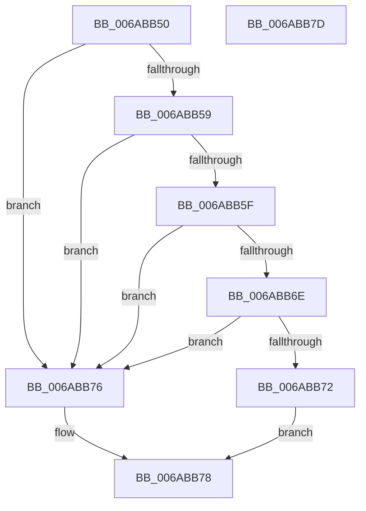

# Uart16550RxReady

- RVA: `0x006ABB50`–`0x006ABB7E` (길이 `46` bytes)
- VA: `0x00000001406ABB50`
- 실행 섹션: `.text`
- PDB 이름 있음: `예`; PDB Function 태그: `아니요`
- unwind 정보 RVA: `0x0005C788`
- 디코드: `18`개 명령, `46/46` bytes 표시
- 미해석 바이트: `0` (있으면 어셈블리에 `.byte`로 보존)

> 이 문서는 커널 이미지의 기계어와 PDB 기호를 분석해 생성했습니다. 4번과 5번은 함수 원형과 자료형을 바이너리 사용 방식에서 추정한 C 해석이며 원본 소스 복구 결과는 아닙니다.

## 1. Dependencies

- 직접 호출 지점: **1**; 고유 호출 대상: **1**
- 직접 호출자로 확인된 함수: **0**
- RIP 상대 이미지 참조: **0**

### Outgoing calls
- `0x006ABB65` → [guard_dispatch_icall](../6B/guard_dispatch_icall_function_006BAAD0.md) (function, `0x006BAAD0`)

### Direct callers
- 이 함수 시작 RVA로 연결되는 직접 call은 확인되지 않았습니다. 간접 호출은 완전히 역산할 수 없습니다.

### Static image references
- 디코드된 RIP-relative 메모리 참조가 없습니다.

## 2. Other-region calls and transfers

- 다른 실행 섹션으로 향하는 call: **0**
- 별도 외부 분기/꼬리 이동을 확인하지 못했습니다.

## 3. Assembly (complete function range)

```asm
006ABB50  48 83 EC 28                     sub rsp, 0x28
006ABB54  48 85 C9                        test rcx, rcx
006ABB57  74 1D                           je 0x1406abb76
006ABB59  48 83 39 00                     cmp qword ptr [rcx], 0
006ABB5D  74 17                           je 0x1406abb76
006ABB5F  48 8B 41 10                     mov rax, qword ptr [rcx + 0x10]
006ABB63  B2 05                           mov dl, 5
006ABB65  E8 66 EF 00 00                  call 0x1406baad0
006ABB6A  3C FF                           cmp al, 0xff
006ABB6C  74 08                           je 0x1406abb76
006ABB6E  A8 01                           test al, 1
006ABB70  74 04                           je 0x1406abb76
006ABB72  B0 01                           mov al, 1
006ABB74  EB 02                           jmp 0x1406abb78
006ABB76  32 C0                           xor al, al
006ABB78  48 83 C4 28                     add rsp, 0x28
006ABB7C  C3                              ret
006ABB7D  CC                              int3
```

## 4. C-style interpretation (structured pseudocode)

```c
__int64 __fastcall Uart16550RxReady(__int64 a1)
{
    __int64 result;
    __int64 v_rsp;

    v_rsp = (v_rsp) - (40);
    if (a1 == 0) goto loc_006ABB76;
    if ((*(unsigned __int64 *)(a1)) == 0) goto loc_006ABB76;
    result = guard_dispatch_icall(a1, 5, a3, a4);
    if (((unsigned __int8)(result)) == 255) goto loc_006ABB76;
    if ((((unsigned __int8)(result)) & (1)) == 0) goto loc_006ABB76;
    goto loc_006ABB78;
loc_006ABB76:
    result = 0;
loc_006ABB78:
    v_rsp = (v_rsp) + (40);
    return result;
}
```

## 5. (Beta) C Style

```c
int64_t Uart16550RxReady(int64_t Arg1)
{
    int64_t result;
    int64_t local_rsp;

    local_rsp = (local_rsp) - (40);
    if (Arg1 == 0) goto loc_006ABB76;
    if ((*(uint64_t *)(Arg1)) == 0) goto loc_006ABB76;
    result = guard_dispatch_icall(Arg1, 5, a3, a4);
    if (((uint8_t)(result)) == 255) goto loc_006ABB76;
    if ((((uint8_t)(result)) & (1)) == 0) goto loc_006ABB76;
    goto loc_006ABB78;
loc_006ABB76:
    result = 0;
loc_006ABB78:
    local_rsp = (local_rsp) + (40);
    return result;
}
```

## 6. Execution-region graph

[열기: 2D/3D 그래프와 함수 탐색 컨트롤 패널](../../../control-panel.html?section=text&rva=0x006ABB50&view=graph)

- 2D 그래프는 위에서 아래로 흐르고, 3D 그래프는 빈 공간을 드래그해 회전합니다. Shift+드래그는 이동, 휠은 확대·축소, 함수 노드 선택은 대상 보고서 이동입니다.

### Static fallback


