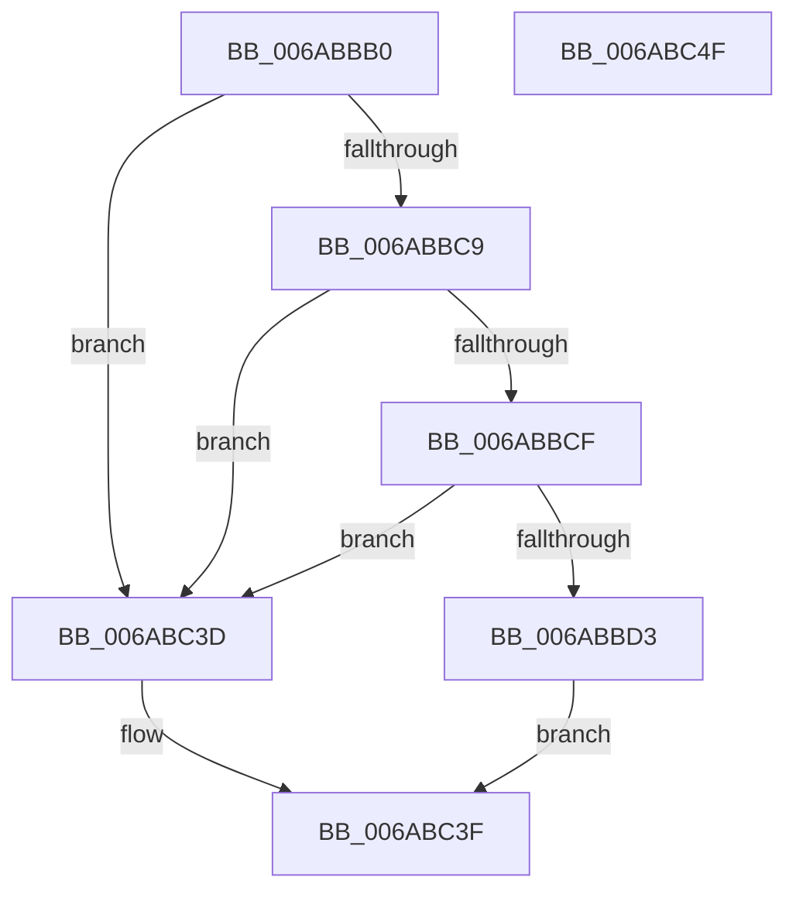

# Uart16550SetBaudCommon

- RVA: `0x006ABBB0`–`0x006ABC50` (길이 `160` bytes)
- VA: `0x00000001406ABBB0`
- 실행 섹션: `.text`
- PDB 이름 있음: `예`; PDB Function 태그: `아니요`
- unwind 정보 RVA: `0x00060BC4`
- 디코드: `51`개 명령, `160/160` bytes 표시
- 미해석 바이트: `0` (있으면 어셈블리에 `.byte`로 보존)

> 이 문서는 커널 이미지의 기계어와 PDB 기호를 분석해 생성했습니다. 4번과 5번은 함수 원형과 자료형을 바이너리 사용 방식에서 추정한 C 해석이며 원본 소스 복구 결과는 아닙니다.

## 1. Dependencies

- 직접 호출 지점: **5**; 고유 호출 대상: **1**
- 직접 호출자로 확인된 함수: **1**
- RIP 상대 이미지 참조: **0**

### Outgoing calls
- `0x006ABBE4` → [guard_dispatch_icall](../6B/guard_dispatch_icall_function_006BAAD0.md) (function, `0x006BAAD0`)
- `0x006ABBF9` → [guard_dispatch_icall](../6B/guard_dispatch_icall_function_006BAAD0.md) (function, `0x006BAAD0`)
- `0x006ABC0E` → [guard_dispatch_icall](../6B/guard_dispatch_icall_function_006BAAD0.md) (function, `0x006BAAD0`)
- `0x006ABC1F` → [guard_dispatch_icall](../6B/guard_dispatch_icall_function_006BAAD0.md) (function, `0x006BAAD0`)
- `0x006ABC31` → [guard_dispatch_icall](../6B/guard_dispatch_icall_function_006BAAD0.md) (function, `0x006BAAD0`)

### Direct callers
- [Uart16550SetBaud](Uart16550SetBaud_function_006ABB90.md) at `0x006ABB9E`

### Static image references
- 디코드된 RIP-relative 메모리 참조가 없습니다.

## 2. Other-region calls and transfers

- 다른 실행 섹션으로 향하는 call: **0**
- 별도 외부 분기/꼬리 이동을 확인하지 못했습니다.

## 3. Assembly (complete function range)

```asm
006ABBB0  48 89 5C 24 08                  mov qword ptr [rsp + 8], rbx
006ABBB5  48 89 74 24 10                  mov qword ptr [rsp + 0x10], rsi
006ABBBA  57                              push rdi
006ABBBB  48 83 EC 20                     sub rsp, 0x20
006ABBBF  8B F2                           mov esi, edx
006ABBC1  48 8B F9                        mov rdi, rcx
006ABBC4  48 85 C9                        test rcx, rcx
006ABBC7  74 74                           je 0x1406abc3d
006ABBC9  48 83 39 00                     cmp qword ptr [rcx], 0
006ABBCD  74 6E                           je 0x1406abc3d
006ABBCF  85 D2                           test edx, edx
006ABBD1  74 6A                           je 0x1406abc3d
006ABBD3  33 D2                           xor edx, edx
006ABBD5  B8 00 C2 01 00                  mov eax, 0x1c200
006ABBDA  F7 F6                           div esi
006ABBDC  B2 03                           mov dl, 3
006ABBDE  8B D8                           mov ebx, eax
006ABBE0  48 8B 41 10                     mov rax, qword ptr [rcx + 0x10]
006ABBE4  E8 E7 EE 00 00                  call 0x1406baad0
006ABBE9  44 8A C0                        mov r8b, al
006ABBEC  B2 03                           mov dl, 3
006ABBEE  48 8B 47 18                     mov rax, qword ptr [rdi + 0x18]
006ABBF2  41 80 C8 80                     or r8b, 0x80
006ABBF6  48 8B CF                        mov rcx, rdi
006ABBF9  E8 D2 EE 00 00                  call 0x1406baad0
006ABBFE  48 8B 47 18                     mov rax, qword ptr [rdi + 0x18]
006ABC02  44 8B C3                        mov r8d, ebx
006ABC05  41 C1 E8 08                     shr r8d, 8
006ABC09  B2 01                           mov dl, 1
006ABC0B  48 8B CF                        mov rcx, rdi
006ABC0E  E8 BD EE 00 00                  call 0x1406baad0
006ABC13  48 8B 47 18                     mov rax, qword ptr [rdi + 0x18]
006ABC17  44 8A C3                        mov r8b, bl
006ABC1A  33 D2                           xor edx, edx
006ABC1C  48 8B CF                        mov rcx, rdi
006ABC1F  E8 AC EE 00 00                  call 0x1406baad0
006ABC24  48 8B 47 18                     mov rax, qword ptr [rdi + 0x18]
006ABC28  41 B0 03                        mov r8b, 3
006ABC2B  41 8A D0                        mov dl, r8b
006ABC2E  48 8B CF                        mov rcx, rdi
006ABC31  E8 9A EE 00 00                  call 0x1406baad0
006ABC36  B0 01                           mov al, 1
006ABC38  89 77 08                        mov dword ptr [rdi + 8], esi
006ABC3B  EB 02                           jmp 0x1406abc3f
006ABC3D  32 C0                           xor al, al
006ABC3F  48 8B 5C 24 30                  mov rbx, qword ptr [rsp + 0x30]
006ABC44  48 8B 74 24 38                  mov rsi, qword ptr [rsp + 0x38]
006ABC49  48 83 C4 20                     add rsp, 0x20
006ABC4D  5F                              pop rdi
006ABC4E  C3                              ret
006ABC4F  CC                              int3
```

## 4. C-style interpretation (structured pseudocode)

```c
__int64 __fastcall Uart16550SetBaudCommon(__int64 a1, int a2)
{
    __int64 result;
    __int64 v_rsp;
    unsigned __int64 v_stack_p10;
    unsigned __int64 v_stack_p8;

    v_stack_p8 = v_rbx;
    v_stack_p10 = v_rsi;
    v_rsp = (v_rsp) - (32);
    if (a1 == 0) goto loc_006ABC3D;
    if ((*(unsigned __int64 *)(a1)) == 0) goto loc_006ABC3D;
    if (a2 == 0) goto loc_006ABC3D;
    a2 = 0;
    result = guard_dispatch_icall(a1, 3, a3, a4);
    a3 = (unsigned __int8)(((unsigned __int8)(result)) | (128));
    result = guard_dispatch_icall(a1, 3, a3, a4);
    a3 = (unsigned int)(((unsigned int)((unsigned int)((unsigned int)((unsigned int)((unsigned int)(0x1C200ULL)))))) >> (8));
    result = guard_dispatch_icall(a1, 1, a3, a4);
    a2 = 0;
    result = guard_dispatch_icall(a1, a2, (unsigned __int8)((unsigned int)((unsigned int)((unsigned int)(0x1C200ULL)))), a4);
    result = guard_dispatch_icall(a1, 3, 3, a4);
    *(unsigned int *)(a1 + 8) = (unsigned int)((unsigned int)(a2));
    goto loc_006ABC3F;
loc_006ABC3D:
    result = 0;
loc_006ABC3F:
    v_rsp = (v_rsp) + (32);
    return result;
}
```

## 5. (Beta) C Style

```c
int64_t Uart16550SetBaudCommon(void *Arg1, int32_t Arg2)
{
    uint8_t *arg1 = (uint8_t *)Arg1;

    int64_t result;
    int64_t local_rsp;
    uint64_t v_stack_p10;
    uint64_t v_stack_p8;

    v_stack_p8 = local_rbx;
    v_stack_p10 = local_rsi;
    local_rsp = (local_rsp) - (32);
    if (Arg1 == NULL) goto loc_006ABC3D;
    if ((*(uint64_t *)(arg1)) == 0) goto loc_006ABC3D;
    if (Arg2 == 0) goto loc_006ABC3D;
    Arg2 = 0;
    result = guard_dispatch_icall(Arg1, 3, a3, a4);
    a3 = (uint8_t)(((uint8_t)(result)) | (128));
    result = guard_dispatch_icall(Arg1, 3, a3, a4);
    a3 = (uint32_t)(((uint32_t)((uint32_t)((uint32_t)((uint32_t)((uint32_t)(0x1C200ULL)))))) >> (8));
    result = guard_dispatch_icall(Arg1, 1, a3, a4);
    Arg2 = 0;
    result = guard_dispatch_icall(Arg1, Arg2, (uint8_t)((uint32_t)((uint32_t)((uint32_t)(0x1C200ULL)))), a4);
    result = guard_dispatch_icall(Arg1, 3, 3, a4);
    *(uint32_t *)(arg1 + 0x8) = (uint32_t)((uint32_t)(Arg2));
    goto loc_006ABC3F;
loc_006ABC3D:
    result = 0;
loc_006ABC3F:
    local_rsp = (local_rsp) + (32);
    return result;
}
```

### 관측된 메모리 오프셋

구조체 형식이 확인되지 않은 접근은 인자 기준의 오프셋으로만 기록했습니다.

| 기준 인자 | 오프셋 표현 | 폭 (bit) | 접근 |
|---|---:|---:|---|
| `Arg1` | `+ 0x8` | `32` | `W` |
| `Arg1` | `+ 0x18` | `64` | `R` |

## 6. Execution-region graph

[열기: 2D/3D 그래프와 함수 탐색 컨트롤 패널](../../../control-panel.html?section=text&rva=0x006ABBB0&view=graph)

- 2D 그래프는 위에서 아래로 흐르고, 3D 그래프는 빈 공간을 드래그해 회전합니다. Shift+드래그는 이동, 휠은 확대·축소, 함수 노드 선택은 대상 보고서 이동입니다.

### Static fallback


