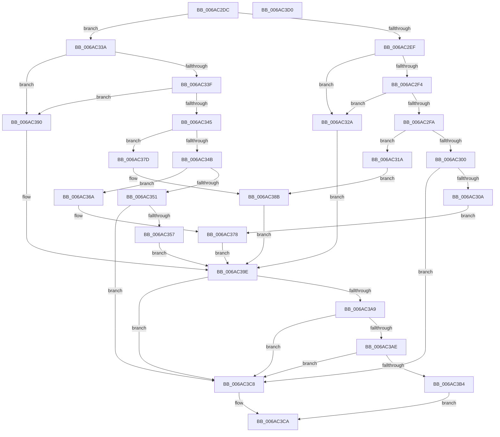

# UartpSetAccess

- RVA: `0x006AC2DC`–`0x006AC3D1` (길이 `245` bytes)
- VA: `0x00000001406AC2DC`
- 실행 섹션: `.text`
- PDB 이름 있음: `예`; PDB Function 태그: `아니요`
- unwind 정보 RVA: `0x00071750`
- 디코드: `65`개 명령, `245/245` bytes 표시
- 미해석 바이트: `0` (있으면 어셈블리에 `.byte`로 보존)

> 이 문서는 커널 이미지의 기계어와 PDB 기호를 분석해 생성했습니다. 4번과 5번은 함수 원형과 자료형을 바이너리 사용 방식에서 추정한 C 해석이며 원본 소스 복구 결과는 아닙니다.

## 1. Dependencies

- 직접 호출 지점: **0**; 고유 호출 대상: **0**
- 직접 호출자로 확인된 함수: **1**
- RIP 상대 이미지 참조: **14**

### Outgoing calls
- 직접 디코드된 call 명령이 없습니다.

### Direct callers
- [Uart16550InitializePortCommon](Uart16550InitializePortCommon_function_006AB8C4.md) at `0x006AB8E1`

### Static image references
- `0x006AC30A` → RVA `0x006AC410` (`WritePortWithIndex32`; read)
- `0x006AC311` → RVA `0x006AC1C0` (`ReadPortWithIndex32`; read)
- `0x006AC31A` → RVA `0x006AC3E0` (`WritePortWithIndex16`; read)
- `0x006AC321` → RVA `0x006AC190` (`ReadPortWithIndex16`; read)
- `0x006AC32A` → RVA `0x006AC440` (`WritePortWithIndex8`; read)
- `0x006AC331` → RVA `0x006AC1F0` (`ReadPortWithIndex8`; read)
- `0x006AC357` → RVA `0x006AC4D0` (`WriteRegisterWithIndex64`; read)
- `0x006AC361` → RVA `0x006AC280` (`ReadRegisterWithIndex64`; read)
- `0x006AC36A` → RVA `0x006AC4A0` (`WriteRegisterWithIndex32`; read)
- `0x006AC371` → RVA `0x006AC250` (`ReadRegisterWithIndex32`; read)
- `0x006AC37D` → RVA `0x006AC470` (`WriteRegisterWithIndex16`; read)
- `0x006AC384` → RVA `0x006AC220` (`ReadRegisterWithIndex16`; read)
- `0x006AC390` → RVA `0x006AC500` (`WriteRegisterWithIndex8`; read)
- `0x006AC397` → RVA `0x006AC2B0` (`ReadRegisterWithIndex8`; read)

## 2. Other-region calls and transfers

- 다른 실행 섹션으로 향하는 call: **0**
- 별도 외부 분기/꼬리 이동을 확인하지 못했습니다.

## 3. Assembly (complete function range)

```asm
006AC2DC  48 89 5C 24 08                  mov qword ptr [rsp + 8], rbx
006AC2E1  45 0F B6 D0                     movzx r10d, r8b
006AC2E5  48 8B D9                        mov rbx, rcx
006AC2E8  41 B3 08                        mov r11b, 8
006AC2EB  84 D2                           test dl, dl
006AC2ED  75 4B                           jne 0x1406ac33a
006AC2EF  45 84 C0                        test r8b, r8b
006AC2F2  74 36                           je 0x1406ac32a
006AC2F4  41 83 EA 01                     sub r10d, 1
006AC2F8  74 30                           je 0x1406ac32a
006AC2FA  41 83 EA 01                     sub r10d, 1
006AC2FE  74 1A                           je 0x1406ac31a
006AC300  41 83 FA 01                     cmp r10d, 1
006AC304  0F 85 BE 00 00 00               jne 0x1406ac3c8
006AC30A  48 8D 15 FF 00 00 00            lea rdx, [rip + 0xff]
006AC311  4C 8D 05 A8 FE FF FF            lea r8, [rip - 0x158]
006AC318  EB 5E                           jmp 0x1406ac378
006AC31A  48 8D 15 BF 00 00 00            lea rdx, [rip + 0xbf]
006AC321  4C 8D 05 68 FE FF FF            lea r8, [rip - 0x198]
006AC328  EB 61                           jmp 0x1406ac38b
006AC32A  48 8D 15 0F 01 00 00            lea rdx, [rip + 0x10f]
006AC331  4C 8D 05 B8 FE FF FF            lea r8, [rip - 0x148]
006AC338  EB 64                           jmp 0x1406ac39e
006AC33A  45 84 C0                        test r8b, r8b
006AC33D  74 51                           je 0x1406ac390
006AC33F  41 83 EA 01                     sub r10d, 1
006AC343  74 4B                           je 0x1406ac390
006AC345  41 83 EA 01                     sub r10d, 1
006AC349  74 32                           je 0x1406ac37d
006AC34B  41 83 EA 01                     sub r10d, 1
006AC34F  74 19                           je 0x1406ac36a
006AC351  41 83 FA 01                     cmp r10d, 1
006AC355  75 71                           jne 0x1406ac3c8
006AC357  48 8D 15 72 01 00 00            lea rdx, [rip + 0x172]
006AC35E  41 B3 40                        mov r11b, 0x40
006AC361  4C 8D 05 18 FF FF FF            lea r8, [rip - 0xe8]
006AC368  EB 34                           jmp 0x1406ac39e
006AC36A  48 8D 15 2F 01 00 00            lea rdx, [rip + 0x12f]
006AC371  4C 8D 05 D8 FE FF FF            lea r8, [rip - 0x128]
006AC378  41 B3 20                        mov r11b, 0x20
006AC37B  EB 21                           jmp 0x1406ac39e
006AC37D  48 8D 15 EC 00 00 00            lea rdx, [rip + 0xec]
006AC384  4C 8D 05 95 FE FF FF            lea r8, [rip - 0x16b]
006AC38B  41 B3 10                        mov r11b, 0x10
006AC38E  EB 0E                           jmp 0x1406ac39e
006AC390  48 8D 15 69 01 00 00            lea rdx, [rip + 0x169]
006AC397  4C 8D 05 12 FF FF FF            lea r8, [rip - 0xee]
006AC39E  41 0F B6 C9                     movzx ecx, r9b
006AC3A2  8D 41 FF                        lea eax, [rcx - 1]
006AC3A5  85 C1                           test ecx, eax
006AC3A7  75 1F                           jne 0x1406ac3c8
006AC3A9  45 3A CB                        cmp r9b, r11b
006AC3AC  72 1A                           jb 0x1406ac3c8
006AC3AE  41 80 F9 40                     cmp r9b, 0x40
006AC3B2  77 14                           ja 0x1406ac3c8
006AC3B4  41 C0 E9 03                     shr r9b, 3
006AC3B8  B0 01                           mov al, 1
006AC3BA  44 88 4B 0E                     mov byte ptr [rbx + 0xe], r9b
006AC3BE  48 89 53 18                     mov qword ptr [rbx + 0x18], rdx
006AC3C2  4C 89 43 10                     mov qword ptr [rbx + 0x10], r8
006AC3C6  EB 02                           jmp 0x1406ac3ca
006AC3C8  32 C0                           xor al, al
006AC3CA  48 8B 5C 24 08                  mov rbx, qword ptr [rsp + 8]
006AC3CF  C3                              ret
006AC3D0  CC                              int3
```

## 4. C-style interpretation (structured pseudocode)

```c
__int64 __fastcall UartpSetAccess(__int64 a1, unsigned __int8 a2, unsigned __int8 a3, unsigned __int8 a4)
{
    __int64 result;
    __int64 v_r10;
    unsigned __int64 v_stack_p8;

    v_stack_p8 = v_rbx;
    if (a2 != 0) goto loc_006AC33A;
    if (a3 == 0) goto loc_006AC32A;
    v_r10 = (unsigned int)((a3) - (1));
    if (condition_is_equal) goto loc_006AC32A;
    v_r10 = (unsigned int)((v_r10) - (1));
    if (condition_is_equal) goto loc_006AC31A;
    if (((unsigned int)(v_r10)) != 1) goto loc_006AC3C8;
    goto loc_006AC378;
loc_006AC31A:
    goto loc_006AC38B;
loc_006AC32A:
    goto loc_006AC39E;
loc_006AC33A:
    if ((unsigned __int8)(v_rip - 328) == 0) goto loc_006AC390;
    v_r10 = (unsigned int)((v_r10) - (1));
    if (condition_is_equal) goto loc_006AC390;
    v_r10 = (unsigned int)((v_r10) - (1));
    if (condition_is_equal) goto loc_006AC37D;
    v_r10 = (unsigned int)((v_r10) - (1));
    if (condition_is_equal) goto loc_006AC36A;
    if (((unsigned int)(v_r10)) != 1) goto loc_006AC3C8;
    goto loc_006AC39E;
loc_006AC36A:
loc_006AC378:
    goto loc_006AC39E;
loc_006AC37D:
loc_006AC38B:
    goto loc_006AC39E;
loc_006AC390:
loc_006AC39E:
    if (((a4) & ((unsigned int)(a4 - 1))) != 0) goto loc_006AC3C8;
    if (a4 < 16) goto loc_006AC3C8;
    if (a4 > 64) goto loc_006AC3C8;
    a4 = (unsigned __int8)((a4) >> (3));
    *(unsigned __int8 *)(a1 + 14) = a4;
    *(unsigned __int64 *)(a1 + 24) = v_rip + 361;
    *(unsigned __int64 *)(a1 + 16) = v_rip - 238;
    goto loc_006AC3CA;
loc_006AC3C8:
    result = 0;
loc_006AC3CA:
    return result;
}
```

## 5. (Beta) C Style

```c
int64_t UartpSetAccess(void *Arg1, uint8_t Arg2, uint8_t Arg3, void *Arg4)
{
    uint8_t *arg1 = (uint8_t *)Arg1;
    uint8_t *arg4 = (uint8_t *)Arg4;

    int64_t result;
    int64_t local_r10;
    uint64_t v_stack_p8;

    v_stack_p8 = local_rbx;
    if (Arg2 != 0) goto loc_006AC33A;
    if (Arg3 == 0) goto loc_006AC32A;
    local_r10 = (uint32_t)((Arg3) - (1));
    if (condition_is_equal) goto loc_006AC32A;
    local_r10 = (uint32_t)((local_r10) - (1));
    if (condition_is_equal) goto loc_006AC31A;
    if (((uint32_t)(local_r10)) != 1) goto loc_006AC3C8;
    goto loc_006AC378;
loc_006AC31A:
    goto loc_006AC38B;
loc_006AC32A:
    goto loc_006AC39E;
loc_006AC33A:
    if ((uint8_t)(v_rip - 328) == 0) goto loc_006AC390;
    local_r10 = (uint32_t)((local_r10) - (1));
    if (condition_is_equal) goto loc_006AC390;
    local_r10 = (uint32_t)((local_r10) - (1));
    if (condition_is_equal) goto loc_006AC37D;
    local_r10 = (uint32_t)((local_r10) - (1));
    if (condition_is_equal) goto loc_006AC36A;
    if (((uint32_t)(local_r10)) != 1) goto loc_006AC3C8;
    goto loc_006AC39E;
loc_006AC36A:
loc_006AC378:
    goto loc_006AC39E;
loc_006AC37D:
loc_006AC38B:
    goto loc_006AC39E;
loc_006AC390:
loc_006AC39E:
    if (((Arg4) & ((uint32_t)(Arg4 - 1))) != 0) goto loc_006AC3C8;
    if (Arg4 < 16) goto loc_006AC3C8;
    if (Arg4 > 64) goto loc_006AC3C8;
    Arg4 = (uint8_t)((Arg4) >> (3));
    *(uint8_t *)(arg1 + 0xE) = Arg4;
    *(uint64_t *)(arg1 + 0x18) = v_rip + 361;
    *(uint64_t *)(arg1 + 0x10) = v_rip - 238;
    goto loc_006AC3CA;
loc_006AC3C8:
    result = 0;
loc_006AC3CA:
    return result;
}
```

### 관측된 메모리 오프셋

구조체 형식이 확인되지 않은 접근은 인자 기준의 오프셋으로만 기록했습니다.

| 기준 인자 | 오프셋 표현 | 폭 (bit) | 접근 |
|---|---:|---:|---|
| `Arg1` | `+ 0xE` | `8` | `W` |
| `Arg1` | `+ 0x10` | `64` | `W` |
| `Arg1` | `+ 0x18` | `64` | `W` |
| `Arg4` | `- 0x1` | `32` | `R` |

## 6. Execution-region graph

[열기: 2D/3D 그래프와 함수 탐색 컨트롤 패널](../../../control-panel.html?section=text&rva=0x006AC2DC&view=graph)

- 2D 그래프는 위에서 아래로 흐르고, 3D 그래프는 빈 공간을 드래그해 회전합니다. Shift+드래그는 이동, 휠은 확대·축소, 함수 노드 선택은 대상 보고서 이동입니다.

### Static fallback


