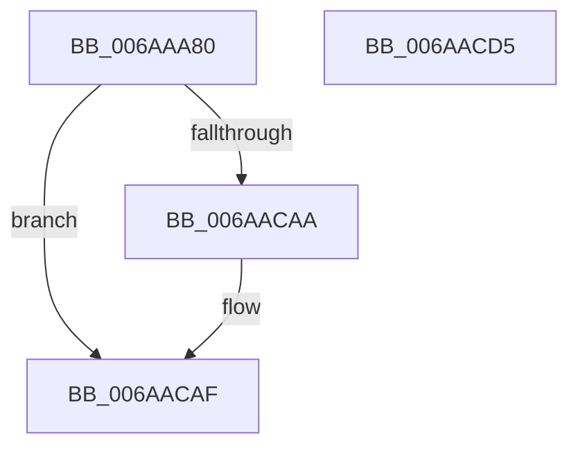

# VfIovPluginEntry

- RVA: `0x006AAA80`–`0x006AACD6` (길이 `598` bytes)
- VA: `0x00000001406AAA80`
- 실행 섹션: `.text`
- PDB 이름 있음: `예`; PDB Function 태그: `아니요`
- unwind 정보 RVA: `0x000D28D8`
- 디코드: `109`개 명령, `598/598` bytes 표시
- 미해석 바이트: `0` (있으면 어셈블리에 `.byte`로 보존)

> 이 문서는 커널 이미지의 기계어와 PDB 기호를 분석해 생성했습니다. 4번과 5번은 함수 원형과 자료형을 바이너리 사용 방식에서 추정한 C 해석이며 원본 소스 복구 결과는 아닙니다.

## 1. Dependencies

- 직접 호출 지점: **3**; 고유 호출 대상: **3**
- 직접 호출자로 확인된 함수: **0**
- RIP 상대 이미지 참조: **24**

### Outgoing calls
- `0x006AAC9F` → [DifRegisterPlugin](../61/DifRegisterPlugin_function_0061ABE0.md) (function, `0x0061ABE0`)
- `0x006AACAA` → [ViIovInitialization](../../pagevrfy/BB/ViIovInitialization_function_00BB4EC4.md) (function, `0x00BB4EC4`)
- `0x006AACBB` → [_security_check_cookie](_security_check_cookie_function_006AC640.md) (function, `0x006AC640`)

### Direct callers
- 이 함수 시작 RVA로 연결되는 직접 call은 확인되지 않았습니다. 간접 호출은 완전히 역산할 수 없습니다.

### Static image references
- `0x006AAA9A` → RVA `0x00E0A740` (`.data`; read)
- `0x006AAAB5` → RVA `0x006AADB0` (`ViIovPluginUnload`; read)
- `0x006AAAC1` → RVA `0x00EF0268` (`.data`; write)
- `0x006AAAC8` → RVA `0x006D1860` (` ?? ::FNODOBFM::`string'`; read)
- `0x006AAAD4` → RVA `0x00B93F80` (`VfMiscIoConnectInterruptEx_Entry`; read)
- `0x006AAAE0` → RVA `0x006D1840` (` ?? ::FNODOBFM::`string'`; read)
- `0x006AAAF8` → RVA `0x006D18A0` (` ?? ::FNODOBFM::`string'`; read)
- `0x006AAB10` → RVA `0x006D1880` (` ?? ::FNODOBFM::`string'`; read)
- `0x006AAB26` → RVA `0x006CE2E0` (` ?? ::FNODOBFM::`string'`; read)
- `0x006AAB31` → RVA `0x006AAD50` (`ViIovExFreePool_Entry`; read)
- `0x006AAB3C` → RVA `0x006CE2C0` (` ?? ::FNODOBFM::`string'`; read)
- `0x006AAB47` → RVA `0x006AAD30` (`ViIovExFreePoolWithTag_Entry`; read)
- `0x006AAB52` → RVA `0x006D18E0` (` ?? ::FNODOBFM::`string'`; read)
- `0x006AAB5D` → RVA `0x00BB52C0` (`ViIovIoBuildAsynchronousFsdRequest_Exit`; read)
- `0x006AAB68` → RVA `0x006D18C0` (` ?? ::FNODOBFM::`string'`; read)
- `0x006AAB73` → RVA `0x006AAD70` (`ViIovIoBuildDeviceIoControlRequest_Exit`; read)
- `0x006AAB7E` → RVA `0x006D1910` (` ?? ::FNODOBFM::`string'`; read)
- `0x006AAB89` → RVA `0x006AAD90` (`ViIovIoBuildSynchronousFsdRequest_Exit`; read)
- `0x006AAB94` → RVA `0x006CF880` (` ?? ::FNODOBFM::`string'`; read)
- `0x006AABAA` → RVA `0x006D1900` (` ?? ::FNODOBFM::`string'`; read)
- `0x006AABC0` → RVA `0x006D1940` (` ?? ::FNODOBFM::`string'`; read)
- `0x006AABCE` → RVA `0x006AACE0` (`ViIoInitializeTimer_Entry`; read)
- `0x006AABDC` → RVA `0x006D1930` (` ?? ::FNODOBFM::`string'`; read)
- `0x006AAC8C` → RVA `0x00EF0260` (`.data`; read)

## 2. Other-region calls and transfers

- 다른 실행 섹션으로 향하는 call: **1**
  - `0x006AACAA` → [ViIovInitialization](../../pagevrfy/BB/ViIovInitialization_function_00BB4EC4.md) (`.text` → `PAGEVRFY`)
- 별도 외부 분기/꼬리 이동을 확인하지 못했습니다.

## 3. Assembly (complete function range)

```asm
006AAA80  48 89 5C 24 08                  mov qword ptr [rsp + 8], rbx
006AAA85  48 89 7C 24 10                  mov qword ptr [rsp + 0x10], rdi
006AAA8A  55                              push rbp
006AAA8B  48 8D AC 24 30 FF FF FF         lea rbp, [rsp - 0xd0]
006AAA93  48 81 EC D0 01 00 00            sub rsp, 0x1d0
006AAA9A  48 8B 05 9F FC 75 00            mov rax, qword ptr [rip + 0x75fc9f]
006AAAA1  48 33 C4                        xor rax, rsp
006AAAA4  48 89 85 C0 00 00 00            mov qword ptr [rbp + 0xc0], rax
006AAAAB  33 FF                           xor edi, edi
006AAAAD  C7 44 24 28 4A 01 00 00         mov dword ptr [rsp + 0x28], 0x14a
006AAAB5  48 8D 05 F4 02 00 00            lea rax, [rip + 0x2f4]
006AAABC  48 89 7C 24 38                  mov qword ptr [rsp + 0x38], rdi
006AAAC1  48 89 05 A0 57 84 00            mov qword ptr [rip + 0x8457a0], rax
006AAAC8  48 8D 05 91 6D 02 00            lea rax, [rip + 0x26d91]
006AAACF  48 89 44 24 20                  mov qword ptr [rsp + 0x20], rax
006AAAD4  48 8D 05 A5 94 4E 00            lea rax, [rip + 0x4e94a5]
006AAADB  48 89 44 24 30                  mov qword ptr [rsp + 0x30], rax
006AAAE0  48 8D 05 59 6D 02 00            lea rax, [rip + 0x26d59]
006AAAE7  48 89 44 24 40                  mov qword ptr [rsp + 0x40], rax
006AAAEC  48 8D 05 8D 94 4E 00            lea rax, [rip + 0x4e948d]
006AAAF3  48 89 44 24 50                  mov qword ptr [rsp + 0x50], rax
006AAAF8  48 8D 05 A1 6D 02 00            lea rax, [rip + 0x26da1]
006AAAFF  48 89 44 24 60                  mov qword ptr [rsp + 0x60], rax
006AAB04  48 8D 05 75 94 4E 00            lea rax, [rip + 0x4e9475]
006AAB0B  48 89 44 24 70                  mov qword ptr [rsp + 0x70], rax
006AAB10  48 8D 05 69 6D 02 00            lea rax, [rip + 0x26d69]
006AAB17  48 89 45 80                     mov qword ptr [rbp - 0x80], rax
006AAB1B  48 8D 05 5E 94 4E 00            lea rax, [rip + 0x4e945e]
006AAB22  48 89 45 90                     mov qword ptr [rbp - 0x70], rax
006AAB26  48 8D 05 B3 37 02 00            lea rax, [rip + 0x237b3]
006AAB2D  48 89 45 A0                     mov qword ptr [rbp - 0x60], rax
006AAB31  48 8D 05 18 02 00 00            lea rax, [rip + 0x218]
006AAB38  48 89 45 B0                     mov qword ptr [rbp - 0x50], rax
006AAB3C  48 8D 05 7D 37 02 00            lea rax, [rip + 0x2377d]
006AAB43  48 89 45 C0                     mov qword ptr [rbp - 0x40], rax
006AAB47  48 8D 05 E2 01 00 00            lea rax, [rip + 0x1e2]
006AAB4E  48 89 45 D0                     mov qword ptr [rbp - 0x30], rax
006AAB52  48 8D 05 87 6D 02 00            lea rax, [rip + 0x26d87]
006AAB59  48 89 45 E0                     mov qword ptr [rbp - 0x20], rax
006AAB5D  48 8D 05 5C A7 50 00            lea rax, [rip + 0x50a75c]
006AAB64  48 89 45 F8                     mov qword ptr [rbp - 8], rax
006AAB68  48 8D 05 51 6D 02 00            lea rax, [rip + 0x26d51]
006AAB6F  48 89 45 00                     mov qword ptr [rbp], rax
006AAB73  48 8D 05 F6 01 00 00            lea rax, [rip + 0x1f6]
006AAB7A  48 89 45 18                     mov qword ptr [rbp + 0x18], rax
006AAB7E  48 8D 05 8B 6D 02 00            lea rax, [rip + 0x26d8b]
006AAB85  48 89 45 20                     mov qword ptr [rbp + 0x20], rax
006AAB89  48 8D 05 00 02 00 00            lea rax, [rip + 0x200]
006AAB90  48 89 45 38                     mov qword ptr [rbp + 0x38], rax
006AAB94  48 8D 05 E5 4C 02 00            lea rax, [rip + 0x24ce5]
006AAB9B  48 89 45 40                     mov qword ptr [rbp + 0x40], rax
006AAB9F  48 8D 05 DA 93 4E 00            lea rax, [rip + 0x4e93da]
006AABA6  48 89 45 50                     mov qword ptr [rbp + 0x50], rax
006AABAA  48 8D 05 4F 6D 02 00            lea rax, [rip + 0x26d4f]
006AABB1  48 89 45 60                     mov qword ptr [rbp + 0x60], rax
006AABB5  48 8D 05 C4 93 4E 00            lea rax, [rip + 0x4e93c4]
006AABBC  48 89 45 70                     mov qword ptr [rbp + 0x70], rax
006AABC0  48 8D 05 79 6D 02 00            lea rax, [rip + 0x26d79]
006AABC7  48 89 85 80 00 00 00            mov qword ptr [rbp + 0x80], rax
006AABCE  48 8D 05 0B 01 00 00            lea rax, [rip + 0x10b]
006AABD5  48 89 85 90 00 00 00            mov qword ptr [rbp + 0x90], rax
006AABDC  48 8D 05 4D 6D 02 00            lea rax, [rip + 0x26d4d]
006AABE3  48 89 85 A0 00 00 00            mov qword ptr [rbp + 0xa0], rax
006AABEA  48 8D 05 8F 93 4E 00            lea rax, [rip + 0x4e938f]
006AABF1  48 89 85 B0 00 00 00            mov qword ptr [rbp + 0xb0], rax
006AABF8  C7 44 24 48 73 01 00 00         mov dword ptr [rsp + 0x48], 0x173
006AAC00  48 89 7C 24 58                  mov qword ptr [rsp + 0x58], rdi
006AAC05  C7 44 24 68 3C 01 00 00         mov dword ptr [rsp + 0x68], 0x13c
006AAC0D  48 89 7C 24 78                  mov qword ptr [rsp + 0x78], rdi
006AAC12  C7 45 88 3D 01 00 00            mov dword ptr [rbp - 0x78], 0x13d
006AAC19  48 89 7D 98                     mov qword ptr [rbp - 0x68], rdi
006AAC1D  C7 45 A8 91 01 00 00            mov dword ptr [rbp - 0x58], 0x191
006AAC24  48 89 7D B8                     mov qword ptr [rbp - 0x48], rdi
006AAC28  C7 45 C8 90 01 00 00            mov dword ptr [rbp - 0x38], 0x190
006AAC2F  48 89 7D D8                     mov qword ptr [rbp - 0x28], rdi
006AAC33  C7 45 E8 6A 01 00 00            mov dword ptr [rbp - 0x18], 0x16a
006AAC3A  48 89 7D F0                     mov qword ptr [rbp - 0x10], rdi
006AAC3E  C7 45 08 69 01 00 00            mov dword ptr [rbp + 8], 0x169
006AAC45  48 89 7D 10                     mov qword ptr [rbp + 0x10], rdi
006AAC49  C7 45 28 68 01 00 00            mov dword ptr [rbp + 0x28], 0x168
006AAC50  48 89 7D 30                     mov qword ptr [rbp + 0x30], rdi
006AAC54  C7 45 48 6E 01 00 00            mov dword ptr [rbp + 0x48], 0x16e
006AAC5B  48 89 7D 58                     mov qword ptr [rbp + 0x58], rdi
006AAC5F  C7 45 68 6F 01 00 00            mov dword ptr [rbp + 0x68], 0x16f
006AAC66  48 89 7D 78                     mov qword ptr [rbp + 0x78], rdi
006AAC6A  C7 85 88 00 00 00 49 01 00 00   mov dword ptr [rbp + 0x88], 0x149
006AAC74  48 89 BD 98 00 00 00            mov qword ptr [rbp + 0x98], rdi
006AAC7B  C7 85 A8 00 00 00 54 01 00 00   mov dword ptr [rbp + 0xa8], 0x154
006AAC85  48 89 BD B8 00 00 00            mov qword ptr [rbp + 0xb8], rdi
006AAC8C  4C 8D 0D CD 55 84 00            lea r9, [rip + 0x8455cd]
006AAC93  8D 57 0D                        lea edx, [rdi + 0xd]
006AAC96  44 8D 47 04                     lea r8d, [rdi + 4]
006AAC9A  48 8D 4C 24 20                  lea rcx, [rsp + 0x20]
006AAC9F  E8 3C FF F6 FF                  call 0x14061abe0
006AACA4  8B D8                           mov ebx, eax
006AACA6  85 C0                           test eax, eax
006AACA8  78 05                           js 0x1406aacaf
006AACAA  E8 15 A2 50 00                  call 0x140bb4ec4
006AACAF  8B C3                           mov eax, ebx
006AACB1  48 8B 8D C0 00 00 00            mov rcx, qword ptr [rbp + 0xc0]
006AACB8  48 33 CC                        xor rcx, rsp
006AACBB  E8 80 19 00 00                  call 0x1406ac640
006AACC0  4C 8D 9C 24 D0 01 00 00         lea r11, [rsp + 0x1d0]
006AACC8  49 8B 5B 10                     mov rbx, qword ptr [r11 + 0x10]
006AACCC  49 8B 7B 18                     mov rdi, qword ptr [r11 + 0x18]
006AACD0  49 8B E3                        mov rsp, r11
006AACD3  5D                              pop rbp
006AACD4  C3                              ret
006AACD5  CC                              int3
```

## 4. C-style interpretation (structured pseudocode)

```c
__int64 __fastcall VfIovPluginEntry(void)
{
    __int64 result;
    __int64 v_rdi;
    __int64 v_rsp;
    unsigned __int64 v_stack_m100;
    unsigned __int64 v_stack_m108;
    unsigned int v_stack_m110;
    unsigned __int64 v_stack_m118;
    unsigned __int64 v_stack_m120;
    unsigned __int64 v_stack_m128;
    unsigned int v_stack_m130;
    unsigned __int64 v_stack_m138;
    unsigned __int64 v_stack_m140;
    unsigned __int64 v_stack_m148;
    unsigned int v_stack_m150;
    unsigned __int64 v_stack_m158;
    unsigned __int64 v_stack_m160;
    unsigned __int64 v_stack_m168;
    unsigned int v_stack_m170;
    unsigned __int64 v_stack_m178;
    unsigned __int64 v_stack_m18;
    unsigned __int64 v_stack_m180;
    unsigned __int64 v_stack_m188;
    unsigned int v_stack_m190;
    unsigned __int64 v_stack_m198;
    unsigned __int64 v_stack_m1A0;
    unsigned __int64 v_stack_m1A8;
    unsigned int v_stack_m1B0;
    unsigned __int64 v_stack_m1B8;
    unsigned __int64 v_stack_m20;
    unsigned __int64 v_stack_m28;
    unsigned int v_stack_m30;
    unsigned __int64 v_stack_m38;
    unsigned __int64 v_stack_m40;
    unsigned __int64 v_stack_m48;
    unsigned int v_stack_m50;
    unsigned __int64 v_stack_m58;
    unsigned __int64 v_stack_m60;
    unsigned __int64 v_stack_m68;
    unsigned int v_stack_m70;
    unsigned __int64 v_stack_m78;
    unsigned __int64 v_stack_m8;
    unsigned __int64 v_stack_m80;
    unsigned __int64 v_stack_m88;
    unsigned int v_stack_m90;
    unsigned __int64 v_stack_m98;
    unsigned __int64 v_stack_mA0;
    unsigned __int64 v_stack_mA8;
    unsigned int v_stack_mB0;
    unsigned __int64 v_stack_mB8;
    unsigned __int64 v_stack_mC0;
    unsigned __int64 v_stack_mC8;
    unsigned int v_stack_mD0;
    unsigned __int64 v_stack_mD8;
    unsigned __int64 v_stack_mE0;
    unsigned __int64 v_stack_mE8;
    unsigned int v_stack_mF0;
    unsigned __int64 v_stack_mF8;
    unsigned __int64 v_stack_p10;
    unsigned __int64 v_stack_p8;

    v_stack_p8 = v_rbx;
    v_stack_p10 = v_rdi;
    v_rsp = (v_rsp) - (464);
    result = (*(unsigned __int64 *)(v_rip + 7732383)) ^ (v_rsp);
    v_stack_m18 = result;
    v_rdi = 0;
    v_stack_m1B0 = 330;
    v_stack_m1A0 = 0;
    *(unsigned __int64 *)(v_rip + 8673184) = v_rip + 756;
    v_stack_m1B8 = v_rip + 159121;
    v_stack_m1A8 = v_rip + 5149861;
    v_stack_m198 = v_rip + 159065;
    v_stack_m188 = v_rip + 5149837;
    v_stack_m178 = v_rip + 159137;
    v_stack_m168 = v_rip + 5149813;
    v_stack_m158 = v_rip + 159081;
    v_stack_m148 = v_rip + 5149790;
    v_stack_m138 = v_rip + 145331;
    v_stack_m128 = v_rip + 536;
    v_stack_m118 = v_rip + 145277;
    v_stack_m108 = v_rip + 482;
    v_stack_mF8 = v_rip + 159111;
    v_stack_mE0 = v_rip + 5285724;
    v_stack_mD8 = v_rip + 159057;
    v_stack_mC0 = v_rip + 502;
    v_stack_mB8 = v_rip + 159115;
    v_stack_mA0 = v_rip + 512;
    v_stack_m98 = v_rip + 150757;
    v_stack_m88 = v_rip + 5149658;
    v_stack_m78 = v_rip + 159055;
    v_stack_m68 = v_rip + 5149636;
    v_stack_m58 = v_rip + 159097;
    v_stack_m48 = v_rip + 267;
    v_stack_m38 = v_rip + 159053;
    v_stack_m28 = v_rip + 5149583;
    v_stack_m190 = 371;
    v_stack_m180 = 0;
    v_stack_m170 = 316;
    v_stack_m160 = 0;
    v_stack_m150 = 317;
    v_stack_m140 = 0;
    v_stack_m130 = 401;
    v_stack_m120 = 0;
    v_stack_m110 = 400;
    v_stack_m100 = 0;
    v_stack_mF0 = 362;
    v_stack_mE8 = 0;
    v_stack_mD0 = 361;
    v_stack_mC8 = 0;
    v_stack_mB0 = 360;
    v_stack_mA8 = 0;
    v_stack_m90 = 366;
    v_stack_m80 = 0;
    v_stack_m70 = 367;
    v_stack_m60 = 0;
    v_stack_m50 = 329;
    v_stack_m40 = 0;
    v_stack_m30 = 340;
    v_stack_m20 = 0;
    result = DifRegisterPlugin(v_stack_m1B8, v_rdi + 13, v_rdi + 4, v_rip + 8672717);
    if (!(sign_flag)) {
        result = ViIovInitialization(v_stack_m1B8, v_rdi + 13, v_rdi + 4, v_rip + 8672717);
    }
    a1 = (v_stack_m18) ^ (v_rsp);
    result = _security_check_cookie(a1, v_rdi + 13, v_rdi + 4, v_rip + 8672717);
    return result;
}
```

## 5. (Beta) C Style

```c
void VfIovPluginEntry(void)
{
    int64_t result;
    int64_t local_rdi;
    int64_t local_rsp;
    uint64_t v_stack_m100;
    uint64_t v_stack_m108;
    uint32_t v_stack_m110;
    uint64_t v_stack_m118;
    uint64_t v_stack_m120;
    uint64_t v_stack_m128;
    uint32_t v_stack_m130;
    uint64_t v_stack_m138;
    uint64_t v_stack_m140;
    uint64_t v_stack_m148;
    uint32_t v_stack_m150;
    uint64_t v_stack_m158;
    uint64_t v_stack_m160;
    uint64_t v_stack_m168;
    uint32_t v_stack_m170;
    uint64_t v_stack_m178;
    uint64_t v_stack_m18;
    uint64_t v_stack_m180;
    uint64_t v_stack_m188;
    uint32_t v_stack_m190;
    uint64_t v_stack_m198;
    uint64_t v_stack_m1A0;
    uint64_t v_stack_m1A8;
    uint32_t v_stack_m1B0;
    uint64_t v_stack_m1B8;
    uint64_t v_stack_m20;
    uint64_t v_stack_m28;
    uint32_t v_stack_m30;
    uint64_t v_stack_m38;
    uint64_t v_stack_m40;
    uint64_t v_stack_m48;
    uint32_t v_stack_m50;
    uint64_t v_stack_m58;
    uint64_t v_stack_m60;
    uint64_t v_stack_m68;
    uint32_t v_stack_m70;
    uint64_t v_stack_m78;
    uint64_t v_stack_m8;
    uint64_t v_stack_m80;
    uint64_t v_stack_m88;
    uint32_t v_stack_m90;
    uint64_t v_stack_m98;
    uint64_t v_stack_mA0;
    uint64_t v_stack_mA8;
    uint32_t v_stack_mB0;
    uint64_t v_stack_mB8;
    uint64_t v_stack_mC0;
    uint64_t v_stack_mC8;
    uint32_t v_stack_mD0;
    uint64_t v_stack_mD8;
    uint64_t v_stack_mE0;
    uint64_t v_stack_mE8;
    uint32_t v_stack_mF0;
    uint64_t v_stack_mF8;
    uint64_t v_stack_p10;
    uint64_t v_stack_p8;

    v_stack_p8 = local_rbx;
    v_stack_p10 = local_rdi;
    local_rsp = (local_rsp) - (464);
    result = (*(uint64_t *)(v_rip + 0x75FC9F)) ^ (local_rsp);
    v_stack_m18 = result;
    local_rdi = 0;
    v_stack_m1B0 = 330;
    v_stack_m1A0 = 0;
    *(uint64_t *)(v_rip + 0x8457A0) = v_rip + 756;
    v_stack_m1B8 = v_rip + 159121;
    v_stack_m1A8 = v_rip + 5149861;
    v_stack_m198 = v_rip + 159065;
    v_stack_m188 = v_rip + 5149837;
    v_stack_m178 = v_rip + 159137;
    v_stack_m168 = v_rip + 5149813;
    v_stack_m158 = v_rip + 159081;
    v_stack_m148 = v_rip + 5149790;
    v_stack_m138 = v_rip + 145331;
    v_stack_m128 = v_rip + 536;
    v_stack_m118 = v_rip + 145277;
    v_stack_m108 = v_rip + 482;
    v_stack_mF8 = v_rip + 159111;
    v_stack_mE0 = v_rip + 5285724;
    v_stack_mD8 = v_rip + 159057;
    v_stack_mC0 = v_rip + 502;
    v_stack_mB8 = v_rip + 159115;
    v_stack_mA0 = v_rip + 512;
    v_stack_m98 = v_rip + 150757;
    v_stack_m88 = v_rip + 5149658;
    v_stack_m78 = v_rip + 159055;
    v_stack_m68 = v_rip + 5149636;
    v_stack_m58 = v_rip + 159097;
    v_stack_m48 = v_rip + 267;
    v_stack_m38 = v_rip + 159053;
    v_stack_m28 = v_rip + 5149583;
    v_stack_m190 = 371;
    v_stack_m180 = 0;
    v_stack_m170 = 316;
    v_stack_m160 = 0;
    v_stack_m150 = 317;
    v_stack_m140 = 0;
    v_stack_m130 = 401;
    v_stack_m120 = 0;
    v_stack_m110 = 400;
    v_stack_m100 = 0;
    v_stack_mF0 = 362;
    v_stack_mE8 = 0;
    v_stack_mD0 = 361;
    v_stack_mC8 = 0;
    v_stack_mB0 = 360;
    v_stack_mA8 = 0;
    v_stack_m90 = 366;
    v_stack_m80 = 0;
    v_stack_m70 = 367;
    v_stack_m60 = 0;
    v_stack_m50 = 329;
    v_stack_m40 = 0;
    v_stack_m30 = 340;
    v_stack_m20 = 0;
    result = DifRegisterPlugin(v_stack_m1B8, local_rdi + 13, local_rdi + 4, v_rip + 8672717);
    if (!(sign_flag)) {
        result = ViIovInitialization(v_stack_m1B8, local_rdi + 13, local_rdi + 4, v_rip + 8672717);
    }
    a1 = (v_stack_m18) ^ (local_rsp);
    result = _security_check_cookie(a1, local_rdi + 13, local_rdi + 4, v_rip + 8672717);
    return result;
}
```

## 6. Execution-region graph

[열기: 2D/3D 그래프와 함수 탐색 컨트롤 패널](../../../control-panel.html?section=text&rva=0x006AAA80&view=graph)

- 2D 그래프는 위에서 아래로 흐르고, 3D 그래프는 빈 공간을 드래그해 회전합니다. Shift+드래그는 이동, 휠은 확대·축소, 함수 노드 선택은 대상 보고서 이동입니다.

### Static fallback


