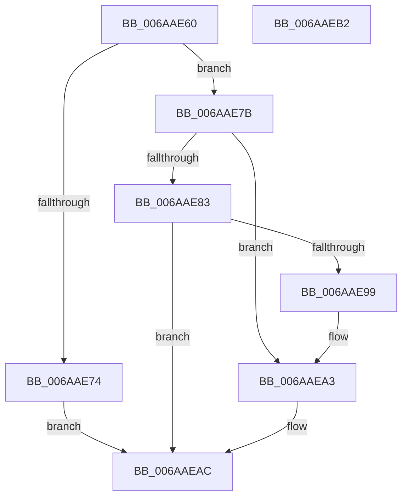

# VfIrpTrackingPluginEntry

- RVA: `0x006AAE60`–`0x006AAEB3` (길이 `83` bytes)
- VA: `0x00000001406AAE60`
- 실행 섹션: `.text`
- PDB 이름 있음: `예`; PDB Function 태그: `아니요`
- unwind 정보 RVA: `0x0005CF00`
- 디코드: `27`개 명령, `83/83` bytes 표시
- 미해석 바이트: `0` (있으면 어셈블리에 `.byte`로 보존)

> 이 문서는 커널 이미지의 기계어와 PDB 기호를 분석해 생성했습니다. 4번과 5번은 함수 원형과 자료형을 바이너리 사용 방식에서 추정한 C 해석이며 원본 소스 복구 결과는 아닙니다.

## 1. Dependencies

- 직접 호출 지점: **4**; 고유 호출 대상: **4**
- 직접 호출자로 확인된 함수: **0**
- RIP 상대 이미지 참조: **2**

### Outgoing calls
- `0x006AAE6B` → [VfIsRuleClassEnabled](../../pagevrfy/BB/VfIsRuleClassEnabled_function_00BB7540.md) (function, `0x00BB7540`)
- `0x006AAE8E` → [DifRegisterPlugin](../61/DifRegisterPlugin_function_0061ABE0.md) (function, `0x0061ABE0`)
- `0x006AAE99` → [VfIrpLogInit](../../pagevrfy/BA/VfIrpLogInit_function_00BAB62C.md) (function, `0x00BAB62C`)
- `0x006AAE9E` → [VfDdiInit](../../pagevrfy/B9/VfDdiInit_function_00B94364.md) (function, `0x00B94364`)

### Direct callers
- 이 함수 시작 RVA로 연결되는 직접 call은 확인되지 않았습니다. 간접 호출은 완전히 역산할 수 없습니다.

### Static image references
- `0x006AAE7B` → RVA `0x00EF0240` (`.data`; read)
- `0x006AAEA3` → RVA `0x00EF0240` (`.data`; write)

## 2. Other-region calls and transfers

- 다른 실행 섹션으로 향하는 call: **3**
  - `0x006AAE6B` → [VfIsRuleClassEnabled](../../pagevrfy/BB/VfIsRuleClassEnabled_function_00BB7540.md) (`.text` → `PAGEVRFY`)
  - `0x006AAE99` → [VfIrpLogInit](../../pagevrfy/BA/VfIrpLogInit_function_00BAB62C.md) (`.text` → `PAGEVRFY`)
  - `0x006AAE9E` → [VfDdiInit](../../pagevrfy/B9/VfDdiInit_function_00B94364.md) (`.text` → `PAGEVRFY`)
- 별도 외부 분기/꼬리 이동을 확인하지 못했습니다.

## 3. Assembly (complete function range)

```asm
006AAE60  40 53                           push rbx
006AAE62  48 83 EC 20                     sub rsp, 0x20
006AAE66  33 DB                           xor ebx, ebx
006AAE68  8D 4B 04                        lea ecx, [rbx + 4]
006AAE6B  E8 D0 C6 50 00                  call 0x140bb7540
006AAE70  84 C0                           test al, al
006AAE72  75 07                           jne 0x1406aae7b
006AAE74  B8 BB 00 00 C0                  mov eax, 0xc00000bb
006AAE79  EB 31                           jmp 0x1406aaeac
006AAE7B  38 1D BF 53 84 00               cmp byte ptr [rip + 0x8453bf], bl
006AAE81  75 20                           jne 0x1406aaea3
006AAE83  45 33 C9                        xor r9d, r9d
006AAE86  33 D2                           xor edx, edx
006AAE88  33 C9                           xor ecx, ecx
006AAE8A  45 8D 41 0A                     lea r8d, [r9 + 0xa]
006AAE8E  E8 4D FD F6 FF                  call 0x14061abe0
006AAE93  8B D8                           mov ebx, eax
006AAE95  85 C0                           test eax, eax
006AAE97  78 13                           js 0x1406aaeac
006AAE99  E8 8E 07 50 00                  call 0x140bab62c
006AAE9E  E8 C1 94 4E 00                  call 0x140b94364
006AAEA3  C6 05 96 53 84 00 01            mov byte ptr [rip + 0x845396], 1
006AAEAA  8B C3                           mov eax, ebx
006AAEAC  48 83 C4 20                     add rsp, 0x20
006AAEB0  5B                              pop rbx
006AAEB1  C3                              ret
006AAEB2  CC                              int3
```

## 4. C-style interpretation (structured pseudocode)

```c
__int64 __fastcall VfIrpTrackingPluginEntry(__int64 a1, int a2, __int64 a3, int a4)
{
    __int64 result;
    __int64 v_rbx;
    __int64 v_rsp;

    v_rsp = (v_rsp) - (32);
    v_rbx = 0;
    result = VfIsRuleClassEnabled(v_rbx + 4, a2, a3, a4);
    if ((unsigned __int8)(result) != 0) goto loc_006AAE7B;
    goto loc_006AAEAC;
loc_006AAE7B:
    if ((*(unsigned __int8 *)(v_rip + 8672191)) != 0) goto loc_006AAEA3;
    a4 = 0;
    a2 = 0;
    a1 = 0;
    result = DifRegisterPlugin(a1, a2, a4 + 10, a4);
    if (sign_flag) goto loc_006AAEAC;
    result = VfIrpLogInit(a1, a2, a4 + 10, a4);
    result = VfDdiInit(a1, a2, a4 + 10, a4);
loc_006AAEA3:
    *(unsigned __int8 *)(v_rip + 8672150) = 1;
loc_006AAEAC:
    v_rsp = (v_rsp) + (32);
    return (unsigned int)((unsigned int)((unsigned int)((unsigned int)(result))));
}
```

## 5. (Beta) C Style

```c
int64_t VfIrpTrackingPluginEntry(int64_t Arg1, int32_t Arg2, int64_t Arg3, int32_t Arg4)
{
    int64_t result;
    int64_t local_rbx;
    int64_t local_rsp;

    local_rsp = (local_rsp) - (32);
    local_rbx = 0;
    result = VfIsRuleClassEnabled(local_rbx + 4, Arg2, Arg3, Arg4);
    if ((uint8_t)(result) != 0) goto loc_006AAE7B;
    goto loc_006AAEAC;
loc_006AAE7B:
    if ((*(uint8_t *)(v_rip + 0x8453BF)) != 0) goto loc_006AAEA3;
    Arg4 = 0;
    Arg2 = 0;
    Arg1 = 0;
    result = DifRegisterPlugin(Arg1, Arg2, Arg4 + 10, Arg4);
    if (sign_flag) goto loc_006AAEAC;
    result = VfIrpLogInit(Arg1, Arg2, Arg4 + 10, Arg4);
    result = VfDdiInit(Arg1, Arg2, Arg4 + 10, Arg4);
loc_006AAEA3:
    *(uint8_t *)(v_rip + 0x845396) = 1;
loc_006AAEAC:
    local_rsp = (local_rsp) + (32);
    return (uint32_t)((uint32_t)((uint32_t)((uint32_t)(result))));
}
```

## 6. Execution-region graph

[열기: 2D/3D 그래프와 함수 탐색 컨트롤 패널](../../../control-panel.html?section=text&rva=0x006AAE60&view=graph)

- 2D 그래프는 위에서 아래로 흐르고, 3D 그래프는 빈 공간을 드래그해 회전합니다. Shift+드래그는 이동, 휠은 확대·축소, 함수 노드 선택은 대상 보고서 이동입니다.

### Static fallback


