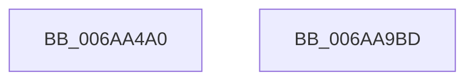

# VfSpecialPoolEntry

- RVA: `0x006AA4A0`–`0x006AA9BE` (길이 `1,310` bytes)
- VA: `0x00000001406AA4A0`
- 실행 섹션: `.text`
- PDB 이름 있음: `예`; PDB Function 태그: `아니요`
- unwind 정보 RVA: `0x000DB69C`
- 디코드: `199`개 명령, `1,310/1,310` bytes 표시
- 미해석 바이트: `0` (있으면 어셈블리에 `.byte`로 보존)

> 이 문서는 커널 이미지의 기계어와 PDB 기호를 분석해 생성했습니다. 4번과 5번은 함수 원형과 자료형을 바이너리 사용 방식에서 추정한 C 해석이며 원본 소스 복구 결과는 아닙니다.

## 1. Dependencies

- 직접 호출 지점: **2**; 고유 호출 대상: **2**
- 직접 호출자로 확인된 함수: **0**
- RIP 상대 이미지 참조: **41**

### Outgoing calls
- `0x006AA9A0` → [DifRegisterPlugin](../61/DifRegisterPlugin_function_0061ABE0.md) (function, `0x0061ABE0`)
- `0x006AA9AF` → [_security_check_cookie](_security_check_cookie_function_006AC640.md) (function, `0x006AC640`)

### Direct callers
- 이 함수 시작 RVA로 연결되는 직접 call은 확인되지 않았습니다. 간접 호출은 완전히 역산할 수 없습니다.

### Static image references
- `0x006AA4B1` → RVA `0x00E0A740` (`.data`; read)
- `0x006AA4CC` → RVA `0x006CE390` (` ?? ::FNODOBFM::`string'`; read)
- `0x006AA4DD` → RVA `0x00B93F80` (`VfMiscIoConnectInterruptEx_Entry`; read)
- `0x006AA4E9` → RVA `0x006CE3B0` (` ?? ::FNODOBFM::`string'`; read)
- `0x006AA501` → RVA `0x006CE3A0` (` ?? ::FNODOBFM::`string'`; read)
- `0x006AA519` → RVA `0x006CE330` (` ?? ::FNODOBFM::`string'`; read)
- `0x006AA52F` → RVA `0x006CE310` (` ?? ::FNODOBFM::`string'`; read)
- `0x006AA545` → RVA `0x006CE370` (` ?? ::FNODOBFM::`string'`; read)
- `0x006AA55B` → RVA `0x006CE350` (` ?? ::FNODOBFM::`string'`; read)
- `0x006AA571` → RVA `0x006CE2E0` (` ?? ::FNODOBFM::`string'`; read)
- `0x006AA587` → RVA `0x006CE2C0` (` ?? ::FNODOBFM::`string'`; read)
- `0x006AA59D` → RVA `0x006D17D0` (` ?? ::FNODOBFM::`string'`; read)
- `0x006AA5A8` → RVA `0x00BB4DB0` (`ViSpRtlAnsiStringToUnicodeString_Exit`; read)
- `0x006AA5B3` → RVA `0x006D1820` (` ?? ::FNODOBFM::`string'`; read)
- `0x006AA5C9` → RVA `0x006D17F0` (` ?? ::FNODOBFM::`string'`; read)
- `0x006AA5E5` → RVA `0x006D1650` (` ?? ::FNODOBFM::`string'`; read)
- `0x006AA601` → RVA `0x006D1630` (` ?? ::FNODOBFM::`string'`; read)
- `0x006AA6BB` → RVA `0x006D16A0` (` ?? ::FNODOBFM::`string'`; read)
- `0x006AA6D7` → RVA `0x006D1670` (` ?? ::FNODOBFM::`string'`; read)
- `0x006AA6F3` → RVA `0x006D1700` (` ?? ::FNODOBFM::`string'`; read)
- `0x006AA70F` → RVA `0x006D16D0` (` ?? ::FNODOBFM::`string'`; read)
- `0x006AA72B` → RVA `0x006D1750` (` ?? ::FNODOBFM::`string'`; read)
- `0x006AA747` → RVA `0x006D1730` (` ?? ::FNODOBFM::`string'`; read)
- `0x006AA763` → RVA `0x006D1790` (` ?? ::FNODOBFM::`string'`; read)
- `0x006AA771` → RVA `0x00BB4DE0` (`ViSpRtlCreateUnicodeString_Exit`; read)
- `0x006AA77F` → RVA `0x006D1770` (` ?? ::FNODOBFM::`string'`; read)
- `0x006AA78D` → RVA `0x00BB4E10` (`ViSpRtlDuplicateUnicodeString_Exit`; read)
- `0x006AA79B` → RVA `0x006CF880` (` ?? ::FNODOBFM::`string'`; read)
- `0x006AA7B7` → RVA `0x006CE300` (` ?? ::FNODOBFM::`string'`; read)
- `0x006AA7D3` → RVA `0x006CF910` (` ?? ::FNODOBFM::`string'`; read)
- `0x006AA7E1` → RVA `0x00BB4A00` (`ViSpIoSetCompletionRoutineEx_Exit`; read)
- `0x006AA7EF` → RVA `0x006CF950` (` ?? ::FNODOBFM::`string'`; read)
- `0x006AA7FD` → RVA `0x00BB4D00` (`ViSpMmProbeAndLockPages_Entry`; read)
- `0x006AA80B` → RVA `0x006CF980` (` ?? ::FNODOBFM::`string'`; read)
- `0x006AA819` → RVA `0x006AA9F0` (`ViSpMmProbeAndLockProcessPages_Entry`; read)
- `0x006AA904` → RVA `0x006D17B0` (` ?? ::FNODOBFM::`string'`; read)
- `0x006AA919` → RVA `0x00BB4CE0` (`ViSpMmMapLockedPagesSpecifyCache_Entry`; read)
- `0x006AA927` → RVA `0x006CF970` (` ?? ::FNODOBFM::`string'`; read)
- `0x006AA935` → RVA `0x00BB4A80` (`ViSpMmMapIoSpace_Entry`; read)
- `0x006AA943` → RVA `0x006CF8F0` (` ?? ::FNODOBFM::`string'`; read)
- `0x006AA951` → RVA `0x006AA9D0` (`ViSpMmMapLockedPages_Entry`; read)

## 2. Other-region calls and transfers

- 다른 실행 섹션으로 향하는 call: **0**
- 별도 외부 분기/꼬리 이동을 확인하지 못했습니다.

## 3. Assembly (complete function range)

```asm
006AA4A0  40 55                           push rbp
006AA4A2  48 8D AC 24 10 FD FF FF         lea rbp, [rsp - 0x2f0]
006AA4AA  48 81 EC F0 03 00 00            sub rsp, 0x3f0
006AA4B1  48 8B 05 88 02 76 00            mov rax, qword ptr [rip + 0x760288]
006AA4B8  48 33 C4                        xor rax, rsp
006AA4BB  48 89 85 E0 02 00 00            mov qword ptr [rbp + 0x2e0], rax
006AA4C2  33 C9                           xor ecx, ecx
006AA4C4  C7 44 24 28 9D 01 00 00         mov dword ptr [rsp + 0x28], 0x19d
006AA4CC  48 8D 05 BD 3E 02 00            lea rax, [rip + 0x23ebd]
006AA4D3  48 89 4C 24 38                  mov qword ptr [rsp + 0x38], rcx
006AA4D8  48 89 44 24 20                  mov qword ptr [rsp + 0x20], rax
006AA4DD  48 8D 05 9C 9A 4E 00            lea rax, [rip + 0x4e9a9c]
006AA4E4  48 89 44 24 30                  mov qword ptr [rsp + 0x30], rax
006AA4E9  48 8D 05 C0 3E 02 00            lea rax, [rip + 0x23ec0]
006AA4F0  48 89 44 24 40                  mov qword ptr [rsp + 0x40], rax
006AA4F5  48 8D 05 84 9A 4E 00            lea rax, [rip + 0x4e9a84]
006AA4FC  48 89 44 24 50                  mov qword ptr [rsp + 0x50], rax
006AA501  48 8D 05 98 3E 02 00            lea rax, [rip + 0x23e98]
006AA508  48 89 44 24 60                  mov qword ptr [rsp + 0x60], rax
006AA50D  48 8D 05 6C 9A 4E 00            lea rax, [rip + 0x4e9a6c]
006AA514  48 89 44 24 70                  mov qword ptr [rsp + 0x70], rax
006AA519  48 8D 05 10 3E 02 00            lea rax, [rip + 0x23e10]
006AA520  48 89 45 80                     mov qword ptr [rbp - 0x80], rax
006AA524  48 8D 05 55 9A 4E 00            lea rax, [rip + 0x4e9a55]
006AA52B  48 89 45 90                     mov qword ptr [rbp - 0x70], rax
006AA52F  48 8D 05 DA 3D 02 00            lea rax, [rip + 0x23dda]
006AA536  48 89 45 A0                     mov qword ptr [rbp - 0x60], rax
006AA53A  48 8D 05 3F 9A 4E 00            lea rax, [rip + 0x4e9a3f]
006AA541  48 89 45 B0                     mov qword ptr [rbp - 0x50], rax
006AA545  48 8D 05 24 3E 02 00            lea rax, [rip + 0x23e24]
006AA54C  48 89 45 C0                     mov qword ptr [rbp - 0x40], rax
006AA550  48 8D 05 29 9A 4E 00            lea rax, [rip + 0x4e9a29]
006AA557  48 89 45 D0                     mov qword ptr [rbp - 0x30], rax
006AA55B  48 8D 05 EE 3D 02 00            lea rax, [rip + 0x23dee]
006AA562  48 89 45 E0                     mov qword ptr [rbp - 0x20], rax
006AA566  48 8D 05 13 9A 4E 00            lea rax, [rip + 0x4e9a13]
006AA56D  48 89 45 F0                     mov qword ptr [rbp - 0x10], rax
006AA571  48 8D 05 68 3D 02 00            lea rax, [rip + 0x23d68]
006AA578  48 89 45 00                     mov qword ptr [rbp], rax
006AA57C  48 8D 05 FD 99 4E 00            lea rax, [rip + 0x4e99fd]
006AA583  48 89 45 10                     mov qword ptr [rbp + 0x10], rax
006AA587  48 8D 05 32 3D 02 00            lea rax, [rip + 0x23d32]
006AA58E  48 89 45 20                     mov qword ptr [rbp + 0x20], rax
006AA592  48 8D 05 E7 99 4E 00            lea rax, [rip + 0x4e99e7]
006AA599  48 89 45 30                     mov qword ptr [rbp + 0x30], rax
006AA59D  48 8D 05 2C 72 02 00            lea rax, [rip + 0x2722c]
006AA5A4  48 89 45 40                     mov qword ptr [rbp + 0x40], rax
006AA5A8  48 8D 05 01 A8 50 00            lea rax, [rip + 0x50a801]
006AA5AF  48 89 45 58                     mov qword ptr [rbp + 0x58], rax
006AA5B3  48 8D 05 66 72 02 00            lea rax, [rip + 0x27266]
006AA5BA  48 89 45 60                     mov qword ptr [rbp + 0x60], rax
006AA5BE  48 8D 05 EB A7 50 00            lea rax, [rip + 0x50a7eb]
006AA5C5  48 89 45 78                     mov qword ptr [rbp + 0x78], rax
006AA5C9  48 8D 05 20 72 02 00            lea rax, [rip + 0x27220]
006AA5D0  48 89 85 80 00 00 00            mov qword ptr [rbp + 0x80], rax
006AA5D7  48 8D 05 D2 A7 50 00            lea rax, [rip + 0x50a7d2]
006AA5DE  48 89 85 98 00 00 00            mov qword ptr [rbp + 0x98], rax
006AA5E5  48 8D 05 64 70 02 00            lea rax, [rip + 0x27064]
006AA5EC  48 89 85 A0 00 00 00            mov qword ptr [rbp + 0xa0], rax
006AA5F3  48 8D 05 B6 A7 50 00            lea rax, [rip + 0x50a7b6]
006AA5FA  48 89 85 B8 00 00 00            mov qword ptr [rbp + 0xb8], rax
006AA601  48 8D 05 28 70 02 00            lea rax, [rip + 0x27028]
006AA608  48 89 85 C0 00 00 00            mov qword ptr [rbp + 0xc0], rax
006AA60F  C7 44 24 48 A3 01 00 00         mov dword ptr [rsp + 0x48], 0x1a3
006AA617  48 89 4C 24 58                  mov qword ptr [rsp + 0x58], rcx
006AA61C  C7 44 24 68 A2 01 00 00         mov dword ptr [rsp + 0x68], 0x1a2
006AA624  48 89 4C 24 78                  mov qword ptr [rsp + 0x78], rcx
006AA629  C7 45 88 9E 01 00 00            mov dword ptr [rbp - 0x78], 0x19e
006AA630  48 89 4D 98                     mov qword ptr [rbp - 0x68], rcx
006AA634  C7 45 A8 9F 01 00 00            mov dword ptr [rbp - 0x58], 0x19f
006AA63B  48 89 4D B8                     mov qword ptr [rbp - 0x48], rcx
006AA63F  C7 45 C8 A0 01 00 00            mov dword ptr [rbp - 0x38], 0x1a0
006AA646  48 89 4D D8                     mov qword ptr [rbp - 0x28], rcx
006AA64A  C7 45 E8 A1 01 00 00            mov dword ptr [rbp - 0x18], 0x1a1
006AA651  48 89 4D F8                     mov qword ptr [rbp - 8], rcx
006AA655  C7 45 08 91 01 00 00            mov dword ptr [rbp + 8], 0x191
006AA65C  48 89 4D 18                     mov qword ptr [rbp + 0x18], rcx
006AA660  C7 45 28 90 01 00 00            mov dword ptr [rbp + 0x28], 0x190
006AA667  48 89 4D 38                     mov qword ptr [rbp + 0x38], rcx
006AA66B  C7 45 48 A9 00 00 00            mov dword ptr [rbp + 0x48], 0xa9
006AA672  48 89 4D 50                     mov qword ptr [rbp + 0x50], rcx
006AA676  C7 45 68 9C 00 00 00            mov dword ptr [rbp + 0x68], 0x9c
006AA67D  48 89 4D 70                     mov qword ptr [rbp + 0x70], rcx
006AA681  C7 85 88 00 00 00 98 00 00 00   mov dword ptr [rbp + 0x88], 0x98
006AA68B  48 89 8D 90 00 00 00            mov qword ptr [rbp + 0x90], rcx
006AA692  C7 85 A8 00 00 00 A0 00 00 00   mov dword ptr [rbp + 0xa8], 0xa0
006AA69C  48 89 8D B0 00 00 00            mov qword ptr [rbp + 0xb0], rcx
006AA6A3  48 8D 05 06 A7 50 00            lea rax, [rip + 0x50a706]
006AA6AA  C7 85 C8 00 00 00 9A 00 00 00   mov dword ptr [rbp + 0xc8], 0x9a
006AA6B4  48 89 85 D8 00 00 00            mov qword ptr [rbp + 0xd8], rax
006AA6BB  48 8D 05 DE 6F 02 00            lea rax, [rip + 0x26fde]
006AA6C2  48 89 85 E0 00 00 00            mov qword ptr [rbp + 0xe0], rax
006AA6C9  48 8D 05 E0 A6 50 00            lea rax, [rip + 0x50a6e0]
006AA6D0  48 89 85 F8 00 00 00            mov qword ptr [rbp + 0xf8], rax
006AA6D7  48 8D 05 92 6F 02 00            lea rax, [rip + 0x26f92]
006AA6DE  48 89 85 00 01 00 00            mov qword ptr [rbp + 0x100], rax
006AA6E5  48 8D 05 C4 A6 50 00            lea rax, [rip + 0x50a6c4]
006AA6EC  48 89 85 18 01 00 00            mov qword ptr [rbp + 0x118], rax
006AA6F3  48 8D 05 06 70 02 00            lea rax, [rip + 0x27006]
006AA6FA  48 89 85 20 01 00 00            mov qword ptr [rbp + 0x120], rax
006AA701  48 8D 05 A8 A6 50 00            lea rax, [rip + 0x50a6a8]
006AA708  48 89 85 38 01 00 00            mov qword ptr [rbp + 0x138], rax
006AA70F  48 8D 05 BA 6F 02 00            lea rax, [rip + 0x26fba]
006AA716  48 89 85 40 01 00 00            mov qword ptr [rbp + 0x140], rax
006AA71D  48 8D 05 8C A6 50 00            lea rax, [rip + 0x50a68c]
006AA724  48 89 85 58 01 00 00            mov qword ptr [rbp + 0x158], rax
006AA72B  48 8D 05 1E 70 02 00            lea rax, [rip + 0x2701e]
006AA732  48 89 85 60 01 00 00            mov qword ptr [rbp + 0x160], rax
006AA739  48 8D 05 70 A6 50 00            lea rax, [rip + 0x50a670]
006AA740  48 89 85 78 01 00 00            mov qword ptr [rbp + 0x178], rax
006AA747  48 8D 05 E2 6F 02 00            lea rax, [rip + 0x26fe2]
006AA74E  48 89 85 80 01 00 00            mov qword ptr [rbp + 0x180], rax
006AA755  48 8D 05 54 A6 50 00            lea rax, [rip + 0x50a654]
006AA75C  48 89 85 98 01 00 00            mov qword ptr [rbp + 0x198], rax
006AA763  48 8D 05 26 70 02 00            lea rax, [rip + 0x27026]
006AA76A  48 89 85 A0 01 00 00            mov qword ptr [rbp + 0x1a0], rax
006AA771  48 8D 05 68 A6 50 00            lea rax, [rip + 0x50a668]
006AA778  48 89 85 B8 01 00 00            mov qword ptr [rbp + 0x1b8], rax
006AA77F  48 8D 05 EA 6F 02 00            lea rax, [rip + 0x26fea]
006AA786  48 89 85 C0 01 00 00            mov qword ptr [rbp + 0x1c0], rax
006AA78D  48 8D 05 7C A6 50 00            lea rax, [rip + 0x50a67c]
006AA794  48 89 85 D8 01 00 00            mov qword ptr [rbp + 0x1d8], rax
006AA79B  48 8D 05 DE 50 02 00            lea rax, [rip + 0x250de]
006AA7A2  48 89 85 E0 01 00 00            mov qword ptr [rbp + 0x1e0], rax
006AA7A9  48 8D 05 D0 97 4E 00            lea rax, [rip + 0x4e97d0]
006AA7B0  48 89 85 F8 01 00 00            mov qword ptr [rbp + 0x1f8], rax
006AA7B7  48 8D 05 42 3B 02 00            lea rax, [rip + 0x23b42]
006AA7BE  48 89 85 00 02 00 00            mov qword ptr [rbp + 0x200], rax
006AA7C5  48 8D 05 B4 97 4E 00            lea rax, [rip + 0x4e97b4]
006AA7CC  48 89 85 18 02 00 00            mov qword ptr [rbp + 0x218], rax
006AA7D3  48 8D 05 36 51 02 00            lea rax, [rip + 0x25136]
006AA7DA  48 89 85 20 02 00 00            mov qword ptr [rbp + 0x220], rax
006AA7E1  48 8D 05 18 A2 50 00            lea rax, [rip + 0x50a218]
006AA7E8  48 89 85 38 02 00 00            mov qword ptr [rbp + 0x238], rax
006AA7EF  48 8D 05 5A 51 02 00            lea rax, [rip + 0x2515a]
006AA7F6  48 89 85 40 02 00 00            mov qword ptr [rbp + 0x240], rax
006AA7FD  48 8D 05 FC A4 50 00            lea rax, [rip + 0x50a4fc]
006AA804  48 89 85 50 02 00 00            mov qword ptr [rbp + 0x250], rax
006AA80B  48 8D 05 6E 51 02 00            lea rax, [rip + 0x2516e]
006AA812  48 89 85 60 02 00 00            mov qword ptr [rbp + 0x260], rax
006AA819  48 8D 05 D0 01 00 00            lea rax, [rip + 0x1d0]
006AA820  48 89 85 70 02 00 00            mov qword ptr [rbp + 0x270], rax
006AA827  48 89 8D D0 00 00 00            mov qword ptr [rbp + 0xd0], rcx
006AA82E  C7 85 E8 00 00 00 96 00 00 00   mov dword ptr [rbp + 0xe8], 0x96
006AA838  48 89 8D F0 00 00 00            mov qword ptr [rbp + 0xf0], rcx
006AA83F  C7 85 08 01 00 00 A1 00 00 00   mov dword ptr [rbp + 0x108], 0xa1
006AA849  48 89 8D 10 01 00 00            mov qword ptr [rbp + 0x110], rcx
006AA850  C7 85 28 01 00 00 9B 00 00 00   mov dword ptr [rbp + 0x128], 0x9b
006AA85A  48 89 8D 30 01 00 00            mov qword ptr [rbp + 0x130], rcx
006AA861  C7 85 48 01 00 00 97 00 00 00   mov dword ptr [rbp + 0x148], 0x97
006AA86B  48 89 8D 50 01 00 00            mov qword ptr [rbp + 0x150], rcx
006AA872  C7 85 68 01 00 00 99 00 00 00   mov dword ptr [rbp + 0x168], 0x99
006AA87C  48 89 8D 70 01 00 00            mov qword ptr [rbp + 0x170], rcx
006AA883  C7 85 88 01 00 00 A3 00 00 00   mov dword ptr [rbp + 0x188], 0xa3
006AA88D  48 89 8D 90 01 00 00            mov qword ptr [rbp + 0x190], rcx
006AA894  C7 85 A8 01 00 00 A5 00 00 00   mov dword ptr [rbp + 0x1a8], 0xa5
006AA89E  48 89 8D B0 01 00 00            mov qword ptr [rbp + 0x1b0], rcx
006AA8A5  C7 85 C8 01 00 00 A2 00 00 00   mov dword ptr [rbp + 0x1c8], 0xa2
006AA8AF  48 89 8D D0 01 00 00            mov qword ptr [rbp + 0x1d0], rcx
006AA8B6  C7 85 E8 01 00 00 6E 01 00 00   mov dword ptr [rbp + 0x1e8], 0x16e
006AA8C0  48 89 8D F0 01 00 00            mov qword ptr [rbp + 0x1f0], rcx
006AA8C7  C7 85 08 02 00 00 6D 01 00 00   mov dword ptr [rbp + 0x208], 0x16d
006AA8D1  48 89 8D 10 02 00 00            mov qword ptr [rbp + 0x210], rcx
006AA8D8  C7 85 28 02 00 00 3A 01 00 00   mov dword ptr [rbp + 0x228], 0x13a
006AA8E2  48 89 8D 30 02 00 00            mov qword ptr [rbp + 0x230], rcx
006AA8E9  C7 85 48 02 00 00 D9 00 00 00   mov dword ptr [rbp + 0x248], 0xd9
006AA8F3  48 89 8D 58 02 00 00            mov qword ptr [rbp + 0x258], rcx
006AA8FA  C7 85 68 02 00 00 D8 00 00 00   mov dword ptr [rbp + 0x268], 0xd8
006AA904  48 8D 05 A5 6E 02 00            lea rax, [rip + 0x26ea5]
006AA90B  48 89 8D 78 02 00 00            mov qword ptr [rbp + 0x278], rcx
006AA912  48 89 85 80 02 00 00            mov qword ptr [rbp + 0x280], rax
006AA919  48 8D 05 C0 A3 50 00            lea rax, [rip + 0x50a3c0]
006AA920  48 89 85 90 02 00 00            mov qword ptr [rbp + 0x290], rax
006AA927  48 8D 05 42 50 02 00            lea rax, [rip + 0x25042]
006AA92E  48 89 85 A0 02 00 00            mov qword ptr [rbp + 0x2a0], rax
006AA935  48 8D 05 44 A1 50 00            lea rax, [rip + 0x50a144]
006AA93C  48 89 85 B0 02 00 00            mov qword ptr [rbp + 0x2b0], rax
006AA943  48 8D 05 A6 4F 02 00            lea rax, [rip + 0x24fa6]
006AA94A  48 89 85 C0 02 00 00            mov qword ptr [rbp + 0x2c0], rax
006AA951  48 8D 05 78 00 00 00            lea rax, [rip + 0x78]
006AA958  48 89 85 D0 02 00 00            mov qword ptr [rbp + 0x2d0], rax
006AA95F  C7 85 88 02 00 00 DB 00 00 00   mov dword ptr [rbp + 0x288], 0xdb
006AA969  48 89 8D 98 02 00 00            mov qword ptr [rbp + 0x298], rcx
006AA970  C7 85 A8 02 00 00 DD 00 00 00   mov dword ptr [rbp + 0x2a8], 0xdd
006AA97A  48 89 8D B8 02 00 00            mov qword ptr [rbp + 0x2b8], rcx
006AA981  C7 85 C8 02 00 00 DC 00 00 00   mov dword ptr [rbp + 0x2c8], 0xdc
006AA98B  48 89 8D D8 02 00 00            mov qword ptr [rbp + 0x2d8], rcx
006AA992  8D 51 1E                        lea edx, [rcx + 0x1e]
006AA995  45 33 C9                        xor r9d, r9d
006AA998  48 8D 4C 24 20                  lea rcx, [rsp + 0x20]
006AA99D  45 33 C0                        xor r8d, r8d
006AA9A0  E8 3B 02 F7 FF                  call 0x14061abe0
006AA9A5  48 8B 8D E0 02 00 00            mov rcx, qword ptr [rbp + 0x2e0]
006AA9AC  48 33 CC                        xor rcx, rsp
006AA9AF  E8 8C 1C 00 00                  call 0x1406ac640
006AA9B4  48 81 C4 F0 03 00 00            add rsp, 0x3f0
006AA9BB  5D                              pop rbp
006AA9BC  C3                              ret
006AA9BD  CC                              int3
```

## 4. C-style interpretation (structured pseudocode)

```c
__int64 __fastcall VfSpecialPoolEntry(int a1, __int64 a2, int a3, int a4)
{
    __int64 result;
    __int64 v_rsp;
    unsigned __int64 v_stack_m100;
    unsigned __int64 v_stack_m108;
    unsigned int v_stack_m110;
    unsigned __int64 v_stack_m118;
    unsigned __int64 v_stack_m120;
    unsigned __int64 v_stack_m128;
    unsigned int v_stack_m130;
    unsigned __int64 v_stack_m138;
    unsigned __int64 v_stack_m140;
    unsigned __int64 v_stack_m148;
    unsigned int v_stack_m150;
    unsigned __int64 v_stack_m158;
    unsigned __int64 v_stack_m160;
    unsigned __int64 v_stack_m168;
    unsigned int v_stack_m170;
    unsigned __int64 v_stack_m178;
    unsigned __int64 v_stack_m18;
    unsigned __int64 v_stack_m180;
    unsigned __int64 v_stack_m188;
    unsigned int v_stack_m190;
    unsigned __int64 v_stack_m198;
    unsigned __int64 v_stack_m1A0;
    unsigned __int64 v_stack_m1A8;
    unsigned int v_stack_m1B0;
    unsigned __int64 v_stack_m1B8;
    unsigned __int64 v_stack_m1C0;
    unsigned __int64 v_stack_m1C8;
    unsigned int v_stack_m1D0;
    unsigned __int64 v_stack_m1D8;
    unsigned __int64 v_stack_m1E0;
    unsigned __int64 v_stack_m1E8;
    unsigned int v_stack_m1F0;
    unsigned __int64 v_stack_m1F8;
    unsigned __int64 v_stack_m20;
    unsigned __int64 v_stack_m200;
    unsigned __int64 v_stack_m208;
    unsigned int v_stack_m210;
    unsigned __int64 v_stack_m218;
    unsigned __int64 v_stack_m220;
    unsigned __int64 v_stack_m228;
    unsigned int v_stack_m230;
    unsigned __int64 v_stack_m238;
    unsigned __int64 v_stack_m240;
    unsigned __int64 v_stack_m248;
    unsigned int v_stack_m250;
    unsigned __int64 v_stack_m258;
    unsigned __int64 v_stack_m260;
    unsigned __int64 v_stack_m268;
    unsigned int v_stack_m270;
    unsigned __int64 v_stack_m278;
    unsigned __int64 v_stack_m28;
    unsigned __int64 v_stack_m280;
    unsigned __int64 v_stack_m288;
    unsigned int v_stack_m290;
    unsigned __int64 v_stack_m298;
    unsigned __int64 v_stack_m2A0;
    unsigned __int64 v_stack_m2A8;
    unsigned int v_stack_m2B0;
    unsigned __int64 v_stack_m2B8;
    unsigned __int64 v_stack_m2C0;
    unsigned __int64 v_stack_m2C8;
    unsigned int v_stack_m2D0;
    unsigned __int64 v_stack_m2D8;
    unsigned __int64 v_stack_m2E0;
    unsigned __int64 v_stack_m2E8;
    unsigned int v_stack_m2F0;
    unsigned __int64 v_stack_m2F8;
    unsigned int v_stack_m30;
    unsigned __int64 v_stack_m300;
    unsigned __int64 v_stack_m308;
    unsigned int v_stack_m310;
    unsigned __int64 v_stack_m318;
    unsigned __int64 v_stack_m320;
    unsigned __int64 v_stack_m328;
    unsigned int v_stack_m330;
    unsigned __int64 v_stack_m338;
    unsigned __int64 v_stack_m340;
    unsigned __int64 v_stack_m348;
    unsigned int v_stack_m350;
    unsigned __int64 v_stack_m358;
    unsigned __int64 v_stack_m360;
    unsigned __int64 v_stack_m368;
    unsigned int v_stack_m370;
    unsigned __int64 v_stack_m378;
    unsigned __int64 v_stack_m38;
    unsigned __int64 v_stack_m380;
    unsigned __int64 v_stack_m388;
    unsigned int v_stack_m390;
    unsigned __int64 v_stack_m398;
    unsigned __int64 v_stack_m3A0;
    unsigned __int64 v_stack_m3A8;
    unsigned int v_stack_m3B0;
    unsigned __int64 v_stack_m3B8;
    unsigned __int64 v_stack_m3C0;
    unsigned __int64 v_stack_m3C8;
    unsigned int v_stack_m3D0;
    unsigned __int64 v_stack_m3D8;
    unsigned __int64 v_stack_m40;
    unsigned __int64 v_stack_m48;
    unsigned int v_stack_m50;
    unsigned __int64 v_stack_m58;
    unsigned __int64 v_stack_m60;
    unsigned __int64 v_stack_m68;
    unsigned int v_stack_m70;
    unsigned __int64 v_stack_m78;
    unsigned __int64 v_stack_m80;
    unsigned __int64 v_stack_m88;
    unsigned int v_stack_m90;
    unsigned __int64 v_stack_m98;
    unsigned __int64 v_stack_mA0;
    unsigned __int64 v_stack_mA8;
    unsigned int v_stack_mB0;
    unsigned __int64 v_stack_mB8;
    unsigned __int64 v_stack_mC0;
    unsigned __int64 v_stack_mC8;
    unsigned int v_stack_mD0;
    unsigned __int64 v_stack_mD8;
    unsigned __int64 v_stack_mE0;
    unsigned __int64 v_stack_mE8;
    unsigned int v_stack_mF0;
    unsigned __int64 v_stack_mF8;

    v_rsp = (v_rsp) - (0x3F0ULL);
    result = (*(unsigned __int64 *)(v_rip + 7733896)) ^ (v_rsp);
    v_stack_m18 = result;
    a1 = 0;
    v_stack_m3D0 = 413;
    v_stack_m3C0 = 0;
    v_stack_m3D8 = v_rip + 147133;
    v_stack_m3C8 = v_rip + 5151388;
    v_stack_m3B8 = v_rip + 147136;
    v_stack_m3A8 = v_rip + 5151364;
    v_stack_m398 = v_rip + 147096;
    v_stack_m388 = v_rip + 5151340;
    v_stack_m378 = v_rip + 146960;
    v_stack_m368 = v_rip + 5151317;
    v_stack_m358 = v_rip + 146906;
    v_stack_m348 = v_rip + 5151295;
    v_stack_m338 = v_rip + 146980;
    v_stack_m328 = v_rip + 5151273;
    v_stack_m318 = v_rip + 146926;
    v_stack_m308 = v_rip + 5151251;
    v_stack_m2F8 = v_rip + 146792;
    v_stack_m2E8 = v_rip + 5151229;
    v_stack_m2D8 = v_rip + 146738;
    v_stack_m2C8 = v_rip + 5151207;
    v_stack_m2B8 = v_rip + 160300;
    v_stack_m2A0 = v_rip + 5285889;
    v_stack_m298 = v_rip + 160358;
    v_stack_m280 = v_rip + 5285867;
    v_stack_m278 = v_rip + 160288;
    v_stack_m260 = v_rip + 5285842;
    v_stack_m258 = v_rip + 159844;
    v_stack_m240 = v_rip + 5285814;
    v_stack_m238 = v_rip + 159784;
    v_stack_m3B0 = 419;
    v_stack_m3A0 = 0;
    v_stack_m390 = 418;
    v_stack_m380 = 0;
    v_stack_m370 = 414;
    v_stack_m360 = 0;
    v_stack_m350 = 415;
    v_stack_m340 = 0;
    v_stack_m330 = 416;
    v_stack_m320 = 0;
    v_stack_m310 = 417;
    v_stack_m300 = 0;
    v_stack_m2F0 = 401;
    v_stack_m2E0 = 0;
    v_stack_m2D0 = 400;
    v_stack_m2C0 = 0;
    v_stack_m2B0 = 169;
    v_stack_m2A8 = 0;
    v_stack_m290 = 156;
    v_stack_m288 = 0;
    v_stack_m270 = 152;
    v_stack_m268 = 0;
    v_stack_m250 = 160;
    v_stack_m248 = 0;
    v_stack_m230 = 154;
    v_stack_m220 = v_rip + 5285638;
    v_stack_m218 = v_rip + 159710;
    v_stack_m200 = v_rip + 5285600;
    v_stack_m1F8 = v_rip + 159634;
    v_stack_m1E0 = v_rip + 5285572;
    v_stack_m1D8 = v_rip + 159750;
    v_stack_m1C0 = v_rip + 5285544;
    v_stack_m1B8 = v_rip + 159674;
    v_stack_m1A0 = v_rip + 5285516;
    v_stack_m198 = v_rip + 159774;
    v_stack_m180 = v_rip + 5285488;
    v_stack_m178 = v_rip + 159714;
    v_stack_m160 = v_rip + 5285460;
    v_stack_m158 = v_rip + 159782;
    v_stack_m140 = v_rip + 5285480;
    v_stack_m138 = v_rip + 159722;
    v_stack_m120 = v_rip + 5285500;
    v_stack_m118 = v_rip + 151774;
    v_stack_m100 = v_rip + 5150672;
    v_stack_mF8 = v_rip + 146242;
    v_stack_mE0 = v_rip + 5150644;
    v_stack_mD8 = v_rip + 151862;
    v_stack_mC0 = v_rip + 5284376;
    v_stack_mB8 = v_rip + 151898;
    v_stack_mA8 = v_rip + 5285116;
    v_stack_m98 = v_rip + 151918;
    v_stack_m88 = v_rip + 464;
    v_stack_m228 = 0;
    v_stack_m210 = 150;
    v_stack_m208 = 0;
    v_stack_m1F0 = 161;
    v_stack_m1E8 = 0;
    v_stack_m1D0 = 155;
    v_stack_m1C8 = 0;
    v_stack_m1B0 = 151;
    v_stack_m1A8 = 0;
    v_stack_m190 = 153;
    v_stack_m188 = 0;
    v_stack_m170 = 163;
    v_stack_m168 = 0;
    v_stack_m150 = 165;
    v_stack_m148 = 0;
    v_stack_m130 = 162;
    v_stack_m128 = 0;
    v_stack_m110 = 366;
    v_stack_m108 = 0;
    v_stack_mF0 = 365;
    v_stack_mE8 = 0;
    v_stack_mD0 = 314;
    v_stack_mC8 = 0;
    v_stack_mB0 = 217;
    v_stack_mA0 = 0;
    v_stack_m90 = 216;
    v_stack_m80 = 0;
    v_stack_m78 = v_rip + 159397;
    v_stack_m68 = v_rip + 5284800;
    v_stack_m58 = v_rip + 151618;
    v_stack_m48 = v_rip + 5284164;
    v_stack_m38 = v_rip + 151462;
    v_stack_m28 = v_rip + 120;
    v_stack_m70 = 219;
    v_stack_m60 = 0;
    v_stack_m50 = 221;
    v_stack_m40 = 0;
    v_stack_m30 = 220;
    v_stack_m20 = 0;
    a4 = 0;
    a3 = 0;
    result = DifRegisterPlugin(v_stack_m3D8, a1 + 30, a3, a4);
    a1 = (v_stack_m18) ^ (v_rsp);
    result = _security_check_cookie(a1, a1 + 30, a3, a4);
    v_rsp = (v_rsp) + (0x3F0ULL);
    return result;
}
```

## 5. (Beta) C Style

```c
int64_t VfSpecialPoolEntry(int32_t Arg1, int64_t Arg2, int32_t Arg3, int32_t Arg4)
{
    int64_t result;
    int64_t local_rsp;
    uint64_t v_stack_m100;
    uint64_t v_stack_m108;
    uint32_t v_stack_m110;
    uint64_t v_stack_m118;
    uint64_t v_stack_m120;
    uint64_t v_stack_m128;
    uint32_t v_stack_m130;
    uint64_t v_stack_m138;
    uint64_t v_stack_m140;
    uint64_t v_stack_m148;
    uint32_t v_stack_m150;
    uint64_t v_stack_m158;
    uint64_t v_stack_m160;
    uint64_t v_stack_m168;
    uint32_t v_stack_m170;
    uint64_t v_stack_m178;
    uint64_t v_stack_m18;
    uint64_t v_stack_m180;
    uint64_t v_stack_m188;
    uint32_t v_stack_m190;
    uint64_t v_stack_m198;
    uint64_t v_stack_m1A0;
    uint64_t v_stack_m1A8;
    uint32_t v_stack_m1B0;
    uint64_t v_stack_m1B8;
    uint64_t v_stack_m1C0;
    uint64_t v_stack_m1C8;
    uint32_t v_stack_m1D0;
    uint64_t v_stack_m1D8;
    uint64_t v_stack_m1E0;
    uint64_t v_stack_m1E8;
    uint32_t v_stack_m1F0;
    uint64_t v_stack_m1F8;
    uint64_t v_stack_m20;
    uint64_t v_stack_m200;
    uint64_t v_stack_m208;
    uint32_t v_stack_m210;
    uint64_t v_stack_m218;
    uint64_t v_stack_m220;
    uint64_t v_stack_m228;
    uint32_t v_stack_m230;
    uint64_t v_stack_m238;
    uint64_t v_stack_m240;
    uint64_t v_stack_m248;
    uint32_t v_stack_m250;
    uint64_t v_stack_m258;
    uint64_t v_stack_m260;
    uint64_t v_stack_m268;
    uint32_t v_stack_m270;
    uint64_t v_stack_m278;
    uint64_t v_stack_m28;
    uint64_t v_stack_m280;
    uint64_t v_stack_m288;
    uint32_t v_stack_m290;
    uint64_t v_stack_m298;
    uint64_t v_stack_m2A0;
    uint64_t v_stack_m2A8;
    uint32_t v_stack_m2B0;
    uint64_t v_stack_m2B8;
    uint64_t v_stack_m2C0;
    uint64_t v_stack_m2C8;
    uint32_t v_stack_m2D0;
    uint64_t v_stack_m2D8;
    uint64_t v_stack_m2E0;
    uint64_t v_stack_m2E8;
    uint32_t v_stack_m2F0;
    uint64_t v_stack_m2F8;
    uint32_t v_stack_m30;
    uint64_t v_stack_m300;
    uint64_t v_stack_m308;
    uint32_t v_stack_m310;
    uint64_t v_stack_m318;
    uint64_t v_stack_m320;
    uint64_t v_stack_m328;
    uint32_t v_stack_m330;
    uint64_t v_stack_m338;
    uint64_t v_stack_m340;
    uint64_t v_stack_m348;
    uint32_t v_stack_m350;
    uint64_t v_stack_m358;
    uint64_t v_stack_m360;
    uint64_t v_stack_m368;
    uint32_t v_stack_m370;
    uint64_t v_stack_m378;
    uint64_t v_stack_m38;
    uint64_t v_stack_m380;
    uint64_t v_stack_m388;
    uint32_t v_stack_m390;
    uint64_t v_stack_m398;
    uint64_t v_stack_m3A0;
    uint64_t v_stack_m3A8;
    uint32_t v_stack_m3B0;
    uint64_t v_stack_m3B8;
    uint64_t v_stack_m3C0;
    uint64_t v_stack_m3C8;
    uint32_t v_stack_m3D0;
    uint64_t v_stack_m3D8;
    uint64_t v_stack_m40;
    uint64_t v_stack_m48;
    uint32_t v_stack_m50;
    uint64_t v_stack_m58;
    uint64_t v_stack_m60;
    uint64_t v_stack_m68;
    uint32_t v_stack_m70;
    uint64_t v_stack_m78;
    uint64_t v_stack_m80;
    uint64_t v_stack_m88;
    uint32_t v_stack_m90;
    uint64_t v_stack_m98;
    uint64_t v_stack_mA0;
    uint64_t v_stack_mA8;
    uint32_t v_stack_mB0;
    uint64_t v_stack_mB8;
    uint64_t v_stack_mC0;
    uint64_t v_stack_mC8;
    uint32_t v_stack_mD0;
    uint64_t v_stack_mD8;
    uint64_t v_stack_mE0;
    uint64_t v_stack_mE8;
    uint32_t v_stack_mF0;
    uint64_t v_stack_mF8;

    local_rsp = (local_rsp) - (0x3F0ULL);
    result = (*(uint64_t *)(v_rip + 0x760288)) ^ (local_rsp);
    v_stack_m18 = result;
    Arg1 = 0;
    v_stack_m3D0 = 413;
    v_stack_m3C0 = 0;
    v_stack_m3D8 = v_rip + 147133;
    v_stack_m3C8 = v_rip + 5151388;
    v_stack_m3B8 = v_rip + 147136;
    v_stack_m3A8 = v_rip + 5151364;
    v_stack_m398 = v_rip + 147096;
    v_stack_m388 = v_rip + 5151340;
    v_stack_m378 = v_rip + 146960;
    v_stack_m368 = v_rip + 5151317;
    v_stack_m358 = v_rip + 146906;
    v_stack_m348 = v_rip + 5151295;
    v_stack_m338 = v_rip + 146980;
    v_stack_m328 = v_rip + 5151273;
    v_stack_m318 = v_rip + 146926;
    v_stack_m308 = v_rip + 5151251;
    v_stack_m2F8 = v_rip + 146792;
    v_stack_m2E8 = v_rip + 5151229;
    v_stack_m2D8 = v_rip + 146738;
    v_stack_m2C8 = v_rip + 5151207;
    v_stack_m2B8 = v_rip + 160300;
    v_stack_m2A0 = v_rip + 5285889;
    v_stack_m298 = v_rip + 160358;
    v_stack_m280 = v_rip + 5285867;
    v_stack_m278 = v_rip + 160288;
    v_stack_m260 = v_rip + 5285842;
    v_stack_m258 = v_rip + 159844;
    v_stack_m240 = v_rip + 5285814;
    v_stack_m238 = v_rip + 159784;
    v_stack_m3B0 = 419;
    v_stack_m3A0 = 0;
    v_stack_m390 = 418;
    v_stack_m380 = 0;
    v_stack_m370 = 414;
    v_stack_m360 = 0;
    v_stack_m350 = 415;
    v_stack_m340 = 0;
    v_stack_m330 = 416;
    v_stack_m320 = 0;
    v_stack_m310 = 417;
    v_stack_m300 = 0;
    v_stack_m2F0 = 401;
    v_stack_m2E0 = 0;
    v_stack_m2D0 = 400;
    v_stack_m2C0 = 0;
    v_stack_m2B0 = 169;
    v_stack_m2A8 = 0;
    v_stack_m290 = 156;
    v_stack_m288 = 0;
    v_stack_m270 = 152;
    v_stack_m268 = 0;
    v_stack_m250 = 160;
    v_stack_m248 = 0;
    v_stack_m230 = 154;
    v_stack_m220 = v_rip + 5285638;
    v_stack_m218 = v_rip + 159710;
    v_stack_m200 = v_rip + 5285600;
    v_stack_m1F8 = v_rip + 159634;
    v_stack_m1E0 = v_rip + 5285572;
    v_stack_m1D8 = v_rip + 159750;
    v_stack_m1C0 = v_rip + 5285544;
    v_stack_m1B8 = v_rip + 159674;
    v_stack_m1A0 = v_rip + 5285516;
    v_stack_m198 = v_rip + 159774;
    v_stack_m180 = v_rip + 5285488;
    v_stack_m178 = v_rip + 159714;
    v_stack_m160 = v_rip + 5285460;
    v_stack_m158 = v_rip + 159782;
    v_stack_m140 = v_rip + 5285480;
    v_stack_m138 = v_rip + 159722;
    v_stack_m120 = v_rip + 5285500;
    v_stack_m118 = v_rip + 151774;
    v_stack_m100 = v_rip + 5150672;
    v_stack_mF8 = v_rip + 146242;
    v_stack_mE0 = v_rip + 5150644;
    v_stack_mD8 = v_rip + 151862;
    v_stack_mC0 = v_rip + 5284376;
    v_stack_mB8 = v_rip + 151898;
    v_stack_mA8 = v_rip + 5285116;
    v_stack_m98 = v_rip + 151918;
    v_stack_m88 = v_rip + 464;
    v_stack_m228 = 0;
    v_stack_m210 = 150;
    v_stack_m208 = 0;
    v_stack_m1F0 = 161;
    v_stack_m1E8 = 0;
    v_stack_m1D0 = 155;
    v_stack_m1C8 = 0;
    v_stack_m1B0 = 151;
    v_stack_m1A8 = 0;
    v_stack_m190 = 153;
    v_stack_m188 = 0;
    v_stack_m170 = 163;
    v_stack_m168 = 0;
    v_stack_m150 = 165;
    v_stack_m148 = 0;
    v_stack_m130 = 162;
    v_stack_m128 = 0;
    v_stack_m110 = 366;
    v_stack_m108 = 0;
    v_stack_mF0 = 365;
    v_stack_mE8 = 0;
    v_stack_mD0 = 314;
    v_stack_mC8 = 0;
    v_stack_mB0 = 217;
    v_stack_mA0 = 0;
    v_stack_m90 = 216;
    v_stack_m80 = 0;
    v_stack_m78 = v_rip + 159397;
    v_stack_m68 = v_rip + 5284800;
    v_stack_m58 = v_rip + 151618;
    v_stack_m48 = v_rip + 5284164;
    v_stack_m38 = v_rip + 151462;
    v_stack_m28 = v_rip + 120;
    v_stack_m70 = 219;
    v_stack_m60 = 0;
    v_stack_m50 = 221;
    v_stack_m40 = 0;
    v_stack_m30 = 220;
    v_stack_m20 = 0;
    Arg4 = 0;
    Arg3 = 0;
    result = DifRegisterPlugin(v_stack_m3D8, Arg1 + 30, Arg3, Arg4);
    Arg1 = (v_stack_m18) ^ (local_rsp);
    result = _security_check_cookie(Arg1, Arg1 + 30, Arg3, Arg4);
    local_rsp = (local_rsp) + (0x3F0ULL);
    return result;
}
```

## 6. Execution-region graph

[열기: 2D/3D 그래프와 함수 탐색 컨트롤 패널](../../../control-panel.html?section=text&rva=0x006AA4A0&view=graph)

- 2D 그래프는 위에서 아래로 흐르고, 3D 그래프는 빈 공간을 드래그해 회전합니다. Shift+드래그는 이동, 휠은 확대·축소, 함수 노드 선택은 대상 보고서 이동입니다.

### Static fallback


