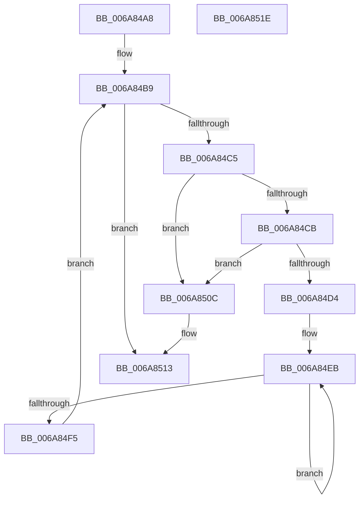

# VhdDeferredAutoAttachVirtualDisks

- RVA: `0x006A84A8`–`0x006A851F` (길이 `119` bytes)
- VA: `0x00000001406A84A8`
- 실행 섹션: `.text`
- PDB 이름 있음: `예`; PDB Function 태그: `아니요`
- unwind 정보 RVA: `0x0005CAAC`
- 디코드: `34`개 명령, `119/119` bytes 표시
- 미해석 바이트: `0` (있으면 어셈블리에 `.byte`로 보존)

> 이 문서는 커널 이미지의 기계어와 PDB 기호를 분석해 생성했습니다. 4번과 5번은 함수 원형과 자료형을 바이너리 사용 방식에서 추정한 C 해석이며 원본 소스 복구 결과는 아닙니다.

## 1. Dependencies

- 직접 호출 지점: **2**; 고유 호출 대상: **2**
- 직접 호출자로 확인된 함수: **1**
- RIP 상대 이미지 참조: **2**

### Outgoing calls
- `0x006A84FB` → [VhdiAutoAttachOneVhd](../../page/83/VhdiAutoAttachOneVhd_function_0083BCD4.md) (function, `0x0083BCD4`)
- `0x006A8505` → [ExFreePoolWithTag](../../poolcode/B8/ExFreePoolWithTag_function_00B82870.md) (function, `0x00B82870`)

### Direct callers
- [PipOobeCompleteAsyncCallback](../../page/72/PipOobeCompleteAsyncCallback_function_00723710.md) at `0x00723719`

### Static image references
- `0x006A84B2` → RVA `0x00E65188` (`.data`; read)
- `0x006A84D4` → RVA `0x00E65188` (`.data`; write)

## 2. Other-region calls and transfers

- 다른 실행 섹션으로 향하는 call: **2**
  - `0x006A84FB` → [VhdiAutoAttachOneVhd](../../page/83/VhdiAutoAttachOneVhd_function_0083BCD4.md) (`.text` → `PAGE`)
  - `0x006A8505` → [ExFreePoolWithTag](../../poolcode/B8/ExFreePoolWithTag_function_00B82870.md) (`.text` → `POOLCODE`)
- 별도 외부 분기/꼬리 이동을 확인하지 못했습니다.

## 3. Assembly (complete function range)

```asm
006A84A8  48 89 5C 24 08                  mov qword ptr [rsp + 8], rbx
006A84AD  57                              push rdi
006A84AE  48 83 EC 20                     sub rsp, 0x20
006A84B2  48 8D 3D CF CC 7B 00            lea rdi, [rip + 0x7bcccf]
006A84B9  48 8B 1D C8 CC 7B 00            mov rbx, qword ptr [rip + 0x7bccc8]
006A84C0  48 3B DF                        cmp rbx, rdi
006A84C3  74 4E                           je 0x1406a8513
006A84C5  48 39 7B 08                     cmp qword ptr [rbx + 8], rdi
006A84C9  75 41                           jne 0x1406a850c
006A84CB  48 8B 03                        mov rax, qword ptr [rbx]
006A84CE  48 39 58 08                     cmp qword ptr [rax + 8], rbx
006A84D2  75 38                           jne 0x1406a850c
006A84D4  48 89 05 AD CC 7B 00            mov qword ptr [rip + 0x7bccad], rax
006A84DB  48 8D 4B 24                     lea rcx, [rbx + 0x24]
006A84DF  48 89 78 08                     mov qword ptr [rax + 8], rdi
006A84E3  4C 8D 43 14                     lea r8, [rbx + 0x14]
006A84E7  48 83 CA FF                     or rdx, 0xffffffffffffffff
006A84EB  48 FF C2                        inc rdx
006A84EE  66 83 3C 51 00                  cmp word ptr [rcx + rdx*2], 0
006A84F3  75 F6                           jne 0x1406a84eb
006A84F5  44 8B 4B 10                     mov r9d, dword ptr [rbx + 0x10]
006A84F9  03 D2                           add edx, edx
006A84FB  E8 D4 37 19 00                  call 0x14083bcd4
006A8500  33 D2                           xor edx, edx
006A8502  48 8B CB                        mov rcx, rbx
006A8505  E8 66 A3 4D 00                  call 0x140b82870
006A850A  EB AD                           jmp 0x1406a84b9
006A850C  B9 03 00 00 00                  mov ecx, 3
006A8511  CD 29                           int 0x29
006A8513  48 8B 5C 24 30                  mov rbx, qword ptr [rsp + 0x30]
006A8518  48 83 C4 20                     add rsp, 0x20
006A851C  5F                              pop rdi
006A851D  C3                              ret
006A851E  CC                              int3
```

## 4. C-style interpretation (structured pseudocode)

```c
__int64 __fastcall VhdDeferredAutoAttachVirtualDisks(__int64 a1, __int64 a2)
{
    __int64 result;
    __int64 v_rsp;
    unsigned __int64 v_stack_p8;

    v_stack_p8 = v_rbx;
    v_rsp = (v_rsp) - (32);
loc_006A84B9:
    if ((*(unsigned __int64 *)(v_rip + 8113352)) == (v_rip + 8113359)) goto loc_006A8513;
    if ((*(unsigned __int64 *)(*(unsigned __int64 *)(v_rip + 8113352) + 8)) != (v_rip + 8113359)) goto loc_006A850C;
    if ((*(unsigned __int64 *)(*(unsigned __int64 *)(*(unsigned __int64 *)(v_rip + 8113352)) + 8)) != (*(unsigned __int64 *)(v_rip + 8113352))) goto loc_006A850C;
    *(unsigned __int64 *)(v_rip + 8113325) = *(unsigned __int64 *)(*(unsigned __int64 *)(v_rip + 8113352));
    *(unsigned __int64 *)(*(unsigned __int64 *)(*(unsigned __int64 *)(v_rip + 8113352)) + 8) = v_rip + 8113359;
    a2 = (a2) | (-1);
loc_006A84EB:
    a2 = (a2) + 1;
    if ((*(unsigned __int16 *)(*(unsigned __int64 *)(v_rip + 8113352) + 36 + a2 * 2)) != 0) goto loc_006A84EB;
    a2 = (unsigned int)((a2) + ((unsigned int)(a2)));
    result = VhdiAutoAttachOneVhd(*(unsigned __int64 *)(v_rip + 8113352) + 36, a2, *(unsigned __int64 *)(v_rip + 8113352) + 20, (unsigned int)(*(unsigned int *)(*(unsigned __int64 *)(v_rip + 8113352) + 16)));
    a2 = 0;
    result = ExFreePoolWithTag(*(unsigned __int64 *)(v_rip + 8113352), a2, *(unsigned __int64 *)(v_rip + 8113352) + 20, (unsigned int)(*(unsigned int *)(*(unsigned __int64 *)(v_rip + 8113352) + 16)));
    goto loc_006A84B9;
loc_006A850C:
loc_006A8513:
    v_rsp = (v_rsp) + (32);
    return result;
}
```

## 5. (Beta) C Style

```c
int64_t VhdDeferredAutoAttachVirtualDisks(int64_t Arg1, int64_t Arg2)
{
    int64_t result;
    int64_t local_rsp;
    uint64_t v_stack_p8;

    v_stack_p8 = local_rbx;
    local_rsp = (local_rsp) - (32);
loc_006A84B9:
    if ((*(uint64_t *)(v_rip + 0x7BCCC8)) == (v_rip + 8113359)) goto loc_006A8513;
    if ((*(uint64_t *)(*(uint64_t *)(v_rip + 0x7BCCC8) + 0x8)) != (v_rip + 8113359)) goto loc_006A850C;
    if ((*(uint64_t *)(*(uint64_t *)(*(uint64_t *)(v_rip + 0x7BCCC8)) + 0x8)) != (*(uint64_t *)(v_rip + 0x7BCCC8))) goto loc_006A850C;
    *(uint64_t *)(v_rip + 0x7BCCAD) = *(uint64_t *)(*(uint64_t *)(v_rip + 0x7BCCC8));
    *(uint64_t *)(*(uint64_t *)(*(uint64_t *)(v_rip + 0x7BCCC8)) + 0x8) = v_rip + 8113359;
    Arg2 = (Arg2) | (-1);
loc_006A84EB:
    Arg2 = (Arg2) + 1;
    if ((*(uint16_t *)(*(uint64_t *)(v_rip + 0x7BCCC8) + 0x24 + Arg2 * 2)) != 0) goto loc_006A84EB;
    Arg2 = (uint32_t)((Arg2) + ((uint32_t)(Arg2)));
    result = VhdiAutoAttachOneVhd(*(uint64_t *)(v_rip + 0x7BCCC8) + 36, Arg2, *(uint64_t *)(v_rip + 0x7BCCC8) + 20, (uint32_t)(*(uint32_t *)(*(uint64_t *)(v_rip + 0x7BCCC8) + 0x10)));
    Arg2 = 0;
    result = ExFreePoolWithTag(*(uint64_t *)(v_rip + 0x7BCCC8), Arg2, *(uint64_t *)(v_rip + 0x7BCCC8) + 20, (uint32_t)(*(uint32_t *)(*(uint64_t *)(v_rip + 0x7BCCC8) + 0x10)));
    goto loc_006A84B9;
loc_006A850C:
loc_006A8513:
    local_rsp = (local_rsp) + (32);
    return result;
}
```

## 6. Execution-region graph

[열기: 2D/3D 그래프와 함수 탐색 컨트롤 패널](../../../control-panel.html?section=text&rva=0x006A84A8&view=graph)

- 2D 그래프는 위에서 아래로 흐르고, 3D 그래프는 빈 공간을 드래그해 회전합니다. Shift+드래그는 이동, 휠은 확대·축소, 함수 노드 선택은 대상 보고서 이동입니다.

### Static fallback


