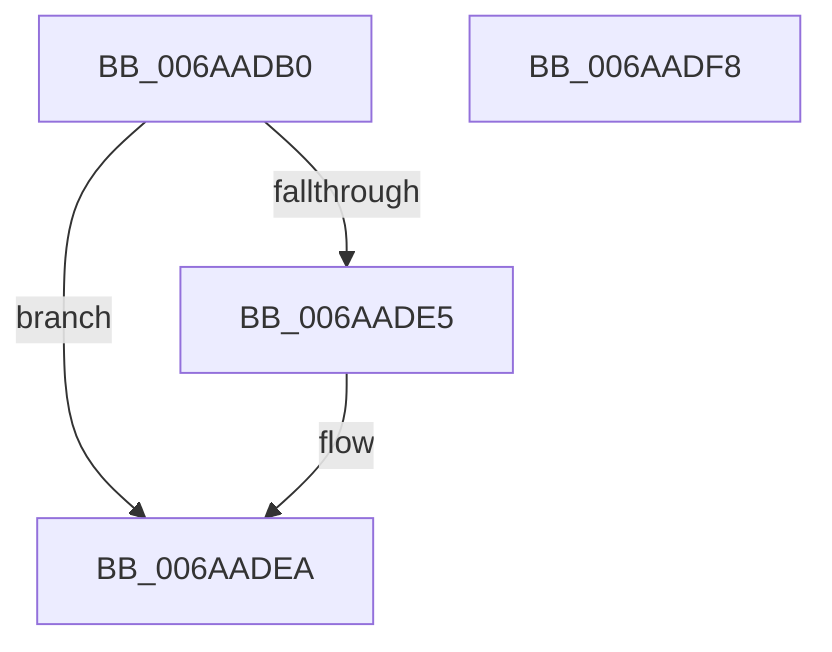

# ViIovPluginUnload

- RVA: `0x006AADB0`–`0x006AADF9` (길이 `73` bytes)
- VA: `0x00000001406AADB0`
- 실행 섹션: `.text`
- PDB 이름 있음: `예`; PDB Function 태그: `아니요`
- unwind 정보 RVA: `0x0005CF00`
- 디코드: `19`개 명령, `73/73` bytes 표시
- 미해석 바이트: `0` (있으면 어셈블리에 `.byte`로 보존)

> 이 문서는 커널 이미지의 기계어와 PDB 기호를 분석해 생성했습니다. 4번과 5번은 함수 원형과 자료형을 바이너리 사용 방식에서 추정한 C 해석이며 원본 소스 복구 결과는 아닙니다.

## 1. Dependencies

- 직접 호출 지점: **4**; 고유 호출 대상: **4**
- 직접 호출자로 확인된 함수: **0**
- RIP 상대 이미지 참조: **4**

### Outgoing calls
- `0x006AADC7` → [IopUpdateFunctionPointers](../59/IopUpdateFunctionPointers_function_0059762C.md) (function, `0x0059762C`)
- `0x006AADD2` → [IovUtilUninitialize](../../pagevrfy/BA/IovUtilUninitialize_function_00BA2D4C.md) (function, `0x00BA2D4C`)
- `0x006AADD7` → [VfMajorInit](../../pagevrfy/BA/VfMajorInit_function_00BA2F00.md) (function, `0x00BA2F00`)
- `0x006AADE5` → [VfIrpDatabaseUninitialize](../../pagevrfy/BB/VfIrpDatabaseUninitialize_function_00BB4100.md) (function, `0x00BB4100`)

### Direct callers
- 이 함수 시작 RVA로 연결되는 직접 call은 확인되지 않았습니다. 간접 호출은 완전히 역산할 수 없습니다.

### Static image references
- `0x006AADB6` → RVA `0x00E681A0` (`.data`; read/write)
- `0x006AADCC` → RVA `0x00E6621C` (`.data`; read/write)
- `0x006AADDC` → RVA `0x00F03FFC` (`.data`; read)
- `0x006AADEA` → RVA `0x00FC6BD0` (`ALMOSTRO`; read/write)

## 2. Other-region calls and transfers

- 다른 실행 섹션으로 향하는 call: **3**
  - `0x006AADD2` → [IovUtilUninitialize](../../pagevrfy/BA/IovUtilUninitialize_function_00BA2D4C.md) (`.text` → `PAGEVRFY`)
  - `0x006AADD7` → [VfMajorInit](../../pagevrfy/BA/VfMajorInit_function_00BA2F00.md) (`.text` → `PAGEVRFY`)
  - `0x006AADE5` → [VfIrpDatabaseUninitialize](../../pagevrfy/BB/VfIrpDatabaseUninitialize_function_00BB4100.md) (`.text` → `PAGEVRFY`)
- 별도 외부 분기/꼬리 이동을 확인하지 못했습니다.

## 3. Assembly (complete function range)

```asm
006AADB0  40 53                           push rbx
006AADB2  48 83 EC 20                     sub rsp, 0x20
006AADB6  83 0D E3 D3 7B 00 EF            or dword ptr [rip + 0x7bd3e3], 0xffffffef
006AADBD  33 D2                           xor edx, edx
006AADBF  45 33 C0                        xor r8d, r8d
006AADC2  8D 5A 01                        lea ebx, [rdx + 1]
006AADC5  8B CB                           mov ecx, ebx
006AADC7  E8 60 C8 EE FF                  call 0x14059762c
006AADCC  87 1D 4A B4 7B 00               xchg dword ptr [rip + 0x7bb44a], ebx
006AADD2  E8 75 7F 4F 00                  call 0x140ba2d4c
006AADD7  E8 24 81 4F 00                  call 0x140ba2f00
006AADDC  83 3D 19 92 85 00 00            cmp dword ptr [rip + 0x859219], 0
006AADE3  75 05                           jne 0x1406aadea
006AADE5  E8 16 93 50 00                  call 0x140bb4100
006AADEA  F0 83 25 DE BD 91 00 EF         lock and dword ptr [rip + 0x91bdde], 0xffffffef
006AADF2  48 83 C4 20                     add rsp, 0x20
006AADF6  5B                              pop rbx
006AADF7  C3                              ret
006AADF8  CC                              int3
```

## 4. C-style interpretation (structured pseudocode)

```c
__int64 __fastcall ViIovPluginUnload(__int64 a1, int a2, int a3)
{
    __int64 result;
    __int64 v_rsp;

    v_rsp = (v_rsp) - (32);
    a2 = 0;
    a3 = 0;
    result = IopUpdateFunctionPointers((unsigned int)((unsigned int)(a2 + 1)), a2, a3, a4);
    result = IovUtilUninitialize((unsigned int)((unsigned int)(a2 + 1)), a2, a3, a4);
    result = VfMajorInit((unsigned int)((unsigned int)(a2 + 1)), a2, a3, a4);
    if ((*(unsigned int *)(v_rip + 8753689)) == 0) {
        result = VfIrpDatabaseUninitialize((unsigned int)((unsigned int)(a2 + 1)), a2, a3, a4);
    }
    v_rsp = (v_rsp) + (32);
    return result;
}
```

## 5. (Beta) C Style

```c
int64_t ViIovPluginUnload(int64_t Arg1, int32_t Arg2, int32_t Arg3)
{
    int64_t result;
    int64_t local_rsp;

    local_rsp = (local_rsp) - (32);
    Arg2 = 0;
    Arg3 = 0;
    result = IopUpdateFunctionPointers((uint32_t)((uint32_t)(Arg2 + 1)), Arg2, Arg3, a4);
    result = IovUtilUninitialize((uint32_t)((uint32_t)(Arg2 + 1)), Arg2, Arg3, a4);
    result = VfMajorInit((uint32_t)((uint32_t)(Arg2 + 1)), Arg2, Arg3, a4);
    if ((*(uint32_t *)(v_rip + 0x859219)) == 0) {
        result = VfIrpDatabaseUninitialize((uint32_t)((uint32_t)(Arg2 + 1)), Arg2, Arg3, a4);
    }
    local_rsp = (local_rsp) + (32);
    return result;
}
```

## 6. Execution-region graph

[열기: 2D/3D 그래프와 함수 탐색 컨트롤 패널](../../../control-panel.html?section=text&rva=0x006AADB0&view=graph)

- 2D 그래프는 위에서 아래로 흐르고, 3D 그래프는 빈 공간을 드래그해 회전합니다. Shift+드래그는 이동, 휠은 확대·축소, 함수 노드 선택은 대상 보고서 이동입니다.

### Static fallback


