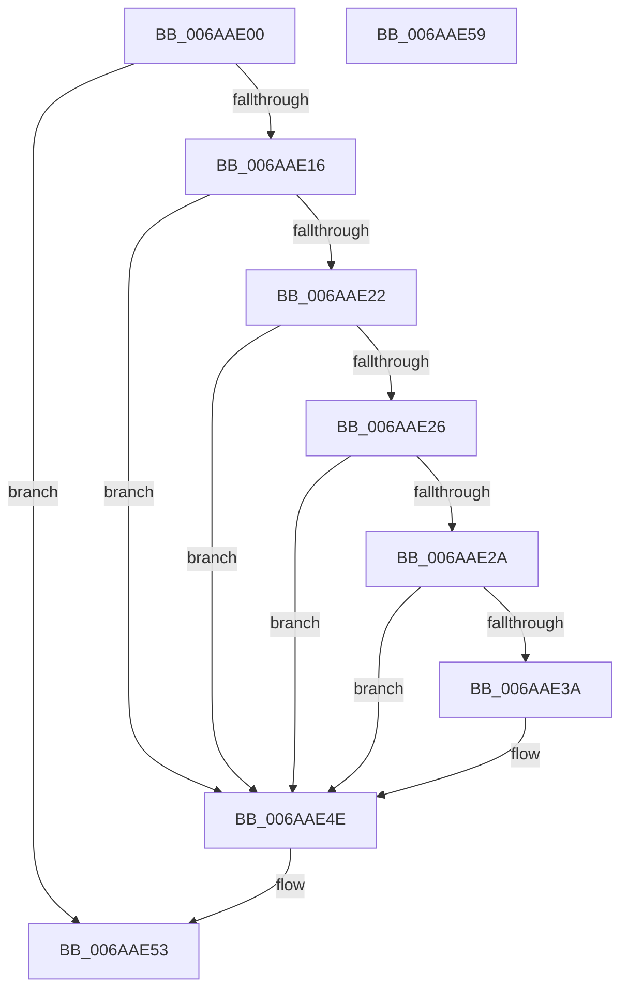

# ViSetIoBuildRequestFlag

- RVA: `0x006AAE00`–`0x006AAE5A` (길이 `90` bytes)
- VA: `0x00000001406AAE00`
- 실행 섹션: `.text`
- PDB 이름 있음: `예`; PDB Function 태그: `아니요`
- unwind 정보 RVA: `0x0005CF00`
- 디코드: `29`개 명령, `90/90` bytes 표시
- 미해석 바이트: `0` (있으면 어셈블리에 `.byte`로 보존)

> 이 문서는 커널 이미지의 기계어와 PDB 기호를 분석해 생성했습니다. 4번과 5번은 함수 원형과 자료형을 바이너리 사용 방식에서 추정한 C 해석이며 원본 소스 복구 결과는 아닙니다.

## 1. Dependencies

- 직접 호출 지점: **2**; 고유 호출 대상: **2**
- 직접 호출자로 확인된 함수: **3**
- RIP 상대 이미지 참조: **0**

### Outgoing calls
- `0x006AAE09` → [VfPacketFindAndLock](../../pagevrfy/BB/VfPacketFindAndLock_function_00BB6740.md) (function, `0x00BB6740`)
- `0x006AAE4E` → [VfPacketReleaseLock](../../pagevrfy/BA/VfPacketReleaseLock_function_00BAB500.md) (function, `0x00BAB500`)

### Direct callers
- [ViIovIoBuildDeviceIoControlRequest_Exit](ViIovIoBuildDeviceIoControlRequest_Exit_function_006AAD70.md) at `0x006AAD7D`
- [ViIovIoBuildSynchronousFsdRequest_Exit](ViIovIoBuildSynchronousFsdRequest_Exit_function_006AAD90.md) at `0x006AAD9D`
- [ViIovIoBuildAsynchronousFsdRequest_Exit](../../pagevrfy/BB/ViIovIoBuildAsynchronousFsdRequest_Exit_function_00BB52C0.md) at `0x00BB52CD`

### Static image references
- 디코드된 RIP-relative 메모리 참조가 없습니다.

## 2. Other-region calls and transfers

- 다른 실행 섹션으로 향하는 call: **2**
  - `0x006AAE09` → [VfPacketFindAndLock](../../pagevrfy/BB/VfPacketFindAndLock_function_00BB6740.md) (`.text` → `PAGEVRFY`)
  - `0x006AAE4E` → [VfPacketReleaseLock](../../pagevrfy/BA/VfPacketReleaseLock_function_00BAB500.md) (`.text` → `PAGEVRFY`)
- 별도 외부 분기/꼬리 이동을 확인하지 못했습니다.

## 3. Assembly (complete function range)

```asm
006AAE00  40 53                           push rbx
006AAE02  48 83 EC 20                     sub rsp, 0x20
006AAE06  48 8B D9                        mov rbx, rcx
006AAE09  E8 32 B9 50 00                  call 0x140bb6740
006AAE0E  48 8B C8                        mov rcx, rax
006AAE11  48 85 C0                        test rax, rax
006AAE14  74 3D                           je 0x1406aae53
006AAE16  0F BA 68 38 0C                  bts dword ptr [rax + 0x38], 0xc
006AAE1B  8B 43 10                        mov eax, dword ptr [rbx + 0x10]
006AAE1E  A8 10                           test al, 0x10
006AAE20  74 2C                           je 0x1406aae4e
006AAE22  A8 40                           test al, 0x40
006AAE24  74 28                           je 0x1406aae4e
006AAE26  A8 20                           test al, 0x20
006AAE28  74 24                           je 0x1406aae4e
006AAE2A  48 8B 93 B8 00 00 00            mov rdx, qword ptr [rbx + 0xb8]
006AAE31  8A 42 B8                        mov al, byte ptr [rdx - 0x48]
006AAE34  2C 0E                           sub al, 0xe
006AAE36  3C 01                           cmp al, 1
006AAE38  77 14                           ja 0x1406aae4e
006AAE3A  48 8B 43 18                     mov rax, qword ptr [rbx + 0x18]
006AAE3E  48 89 81 C8 00 00 00            mov qword ptr [rcx + 0xc8], rax
006AAE45  8B 42 C0                        mov eax, dword ptr [rdx - 0x40]
006AAE48  89 81 D0 00 00 00               mov dword ptr [rcx + 0xd0], eax
006AAE4E  E8 AD 06 50 00                  call 0x140bab500
006AAE53  48 83 C4 20                     add rsp, 0x20
006AAE57  5B                              pop rbx
006AAE58  C3                              ret
006AAE59  CC                              int3
```

## 4. C-style interpretation (structured pseudocode)

```c
__int64 __fastcall ViSetIoBuildRequestFlag(__int64 a1)
{
    __int64 result;
    __int64 v_rsp;

    v_rsp = (v_rsp) - (32);
    result = VfPacketFindAndLock(a1, a2, a3, a4);
    if (result == 0) goto loc_006AAE53;
    if ((((unsigned __int8)((unsigned int)(*(unsigned int *)(a1 + 16)))) & (16)) == 0) goto loc_006AAE4E;
    if ((((unsigned __int8)((unsigned int)(*(unsigned int *)(a1 + 16)))) & (64)) == 0) goto loc_006AAE4E;
    if ((((unsigned __int8)((unsigned int)(*(unsigned int *)(a1 + 16)))) & (32)) == 0) goto loc_006AAE4E;
    result = (unsigned __int8)((*(unsigned __int8 *)(*(unsigned __int64 *)(a1 + 184) - 72)) - (14));
    if (((unsigned __int8)(result)) <= 1) {
        result = *(unsigned __int64 *)(a1 + 24);
        *(unsigned __int64 *)(result + 200) = result;
        result = *(unsigned int *)(*(unsigned __int64 *)(a1 + 184) - 64);
        *(unsigned int *)(result + 208) = (unsigned int)(result);
    }
    result = VfPacketReleaseLock(result, *(unsigned __int64 *)(a1 + 184), a3, a4);
loc_006AAE53:
    v_rsp = (v_rsp) + (32);
    return result;
}
```

## 5. (Beta) C Style

```c
int64_t ViSetIoBuildRequestFlag(void *Arg1)
{
    uint8_t *arg1 = (uint8_t *)Arg1;

    int64_t result;
    int64_t local_rsp;

    local_rsp = (local_rsp) - (32);
    result = VfPacketFindAndLock(Arg1, a2, a3, a4);
    if (result == 0) goto loc_006AAE53;
    if ((((uint8_t)((uint32_t)(*(uint32_t *)(arg1 + 0x10)))) & (16)) == 0) goto loc_006AAE4E;
    if ((((uint8_t)((uint32_t)(*(uint32_t *)(arg1 + 0x10)))) & (64)) == 0) goto loc_006AAE4E;
    if ((((uint8_t)((uint32_t)(*(uint32_t *)(arg1 + 0x10)))) & (32)) == 0) goto loc_006AAE4E;
    result = (uint8_t)((*(uint8_t *)(*(uint64_t *)(arg1 + 0xB8) - 0x48)) - (14));
    if (((uint8_t)(result)) <= 1) {
        result = *(uint64_t *)(arg1 + 0x18);
        *(uint64_t *)(result + 0xC8) = result;
        result = *(uint32_t *)(*(uint64_t *)(arg1 + 0xB8) - 0x40);
        *(uint32_t *)(result + 0xD0) = (uint32_t)(result);
    }
    result = VfPacketReleaseLock(result, *(uint64_t *)(arg1 + 0xB8), a3, a4);
loc_006AAE53:
    local_rsp = (local_rsp) + (32);
    return result;
}
```

### 관측된 메모리 오프셋

구조체 형식이 확인되지 않은 접근은 인자 기준의 오프셋으로만 기록했습니다.

| 기준 인자 | 오프셋 표현 | 폭 (bit) | 접근 |
|---|---:|---:|---|
| `Arg1` | `+ 0x10` | `32` | `R` |
| `Arg1` | `+ 0x18` | `64` | `R` |
| `Arg1` | `+ 0xB8` | `64` | `R` |

## 6. Execution-region graph

[열기: 2D/3D 그래프와 함수 탐색 컨트롤 패널](../../../control-panel.html?section=text&rva=0x006AAE00&view=graph)

- 2D 그래프는 위에서 아래로 흐르고, 3D 그래프는 빈 공간을 드래그해 회전합니다. Shift+드래그는 이동, 휠은 확대·축소, 함수 노드 선택은 대상 보고서 이동입니다.

### Static fallback


