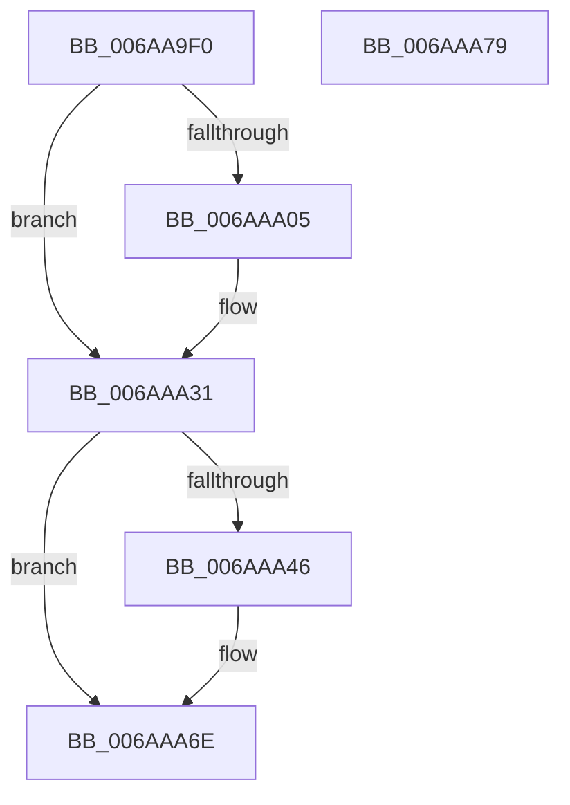

# ViSpMmProbeAndLockProcessPages_Entry

- RVA: `0x006AA9F0`–`0x006AAA7A` (길이 `138` bytes)
- VA: `0x00000001406AA9F0`
- 실행 섹션: `.text`
- PDB 이름 있음: `예`; PDB Function 태그: `아니요`
- unwind 정보 RVA: `0x00065960`
- 디코드: `37`개 명령, `138/138` bytes 표시
- 미해석 바이트: `0` (있으면 어셈블리에 `.byte`로 보존)

> 이 문서는 커널 이미지의 기계어와 PDB 기호를 분석해 생성했습니다. 4번과 5번은 함수 원형과 자료형을 바이너리 사용 방식에서 추정한 C 해석이며 원본 소스 복구 결과는 아닙니다.

## 1. Dependencies

- 직접 호출 지점: **2**; 고유 호출 대상: **1**
- 직접 호출자로 확인된 함수: **0**
- RIP 상대 이미지 참조: **0**

### Outgoing calls
- `0x006AAA2C` → [CarReportRuleViolationFromNt](../../pagevrfy/B9/CarReportRuleViolationFromNt_function_00B9D904.md) (function, `0x00B9D904`)
- `0x006AAA69` → [CarReportRuleViolationFromNt](../../pagevrfy/B9/CarReportRuleViolationFromNt_function_00B9D904.md) (function, `0x00B9D904`)

### Direct callers
- 이 함수 시작 RVA로 연결되는 직접 call은 확인되지 않았습니다. 간접 호출은 완전히 역산할 수 없습니다.

### Static image references
- 디코드된 RIP-relative 메모리 참조가 없습니다.

## 2. Other-region calls and transfers

- 다른 실행 섹션으로 향하는 call: **2**
  - `0x006AAA2C` → [CarReportRuleViolationFromNt](../../pagevrfy/B9/CarReportRuleViolationFromNt_function_00B9D904.md) (`.text` → `PAGEVRFY`)
  - `0x006AAA69` → [CarReportRuleViolationFromNt](../../pagevrfy/B9/CarReportRuleViolationFromNt_function_00B9D904.md) (`.text` → `PAGEVRFY`)
- 별도 외부 분기/꼬리 이동을 확인하지 못했습니다.

## 3. Assembly (complete function range)

```asm
006AA9F0  48 89 5C 24 08                  mov qword ptr [rsp + 8], rbx
006AA9F5  57                              push rdi
006AA9F6  48 83 EC 40                     sub rsp, 0x40
006AA9FA  48 8B F9                        mov rdi, rcx
006AA9FD  44 0F 20 C0                     mov rax, cr8
006AAA01  3C 02                           cmp al, 2
006AAA03  76 2C                           jbe 0x1406aaa31
006AAA05  48 0F BE 51 0C                  movsx rdx, byte ptr [rcx + 0xc]
006AAA0A  4C 8B 49 18                     mov r9, qword ptr [rcx + 0x18]
006AAA0E  44 0F B6 C0                     movzx r8d, al
006AAA12  48 8B 01                        mov rax, qword ptr [rcx]
006AAA15  48 89 44 24 30                  mov qword ptr [rsp + 0x30], rax
006AAA1A  83 64 24 28 00                  and dword ptr [rsp + 0x28], 0
006AAA1F  48 89 54 24 20                  mov qword ptr [rsp + 0x20], rdx
006AAA24  BA 71 00 00 00                  mov edx, 0x71
006AAA29  8D 4A 53                        lea ecx, [rdx + 0x53]
006AAA2C  E8 D3 2E 4F 00                  call 0x140b9d904
006AAA31  4C 8B 47 18                     mov r8, qword ptr [rdi + 0x18]
006AAA35  41 BA 13 08 00 00               mov r10d, 0x813
006AAA3B  49 0F BF 40 0A                  movsx rax, word ptr [r8 + 0xa]
006AAA40  66 41 85 C2                     test r10w, ax
006AAA44  74 28                           je 0x1406aaa6e
006AAA46  48 8B D0                        mov rdx, rax
006AAA49  4C 8B C8                        mov r9, rax
006AAA4C  48 8B 07                        mov rax, qword ptr [rdi]
006AAA4F  49 23 D2                        and rdx, r10
006AAA52  48 89 44 24 30                  mov qword ptr [rsp + 0x30], rax
006AAA57  83 64 24 28 00                  and dword ptr [rsp + 0x28], 0
006AAA5C  48 89 54 24 20                  mov qword ptr [rsp + 0x20], rdx
006AAA61  BA B1 00 00 00                  mov edx, 0xb1
006AAA66  8D 4A 13                        lea ecx, [rdx + 0x13]
006AAA69  E8 96 2E 4F 00                  call 0x140b9d904
006AAA6E  48 8B 5C 24 50                  mov rbx, qword ptr [rsp + 0x50]
006AAA73  48 83 C4 40                     add rsp, 0x40
006AAA77  5F                              pop rdi
006AAA78  C3                              ret
006AAA79  CC                              int3
```

## 4. C-style interpretation (structured pseudocode)

```c
__int64 __fastcall ViSpMmProbeAndLockProcessPages_Entry(__int64 a1)
{
    __int64 result;
    __int64 v_rsp;
    unsigned __int64 v_stack_m18;
    unsigned int v_stack_m20;
    unsigned __int64 v_stack_m28;
    unsigned __int64 v_stack_p8;

    v_stack_p8 = v_rbx;
    v_rsp = (v_rsp) - (64);
    result = v_cr8;
    if (((unsigned __int8)(v_cr8)) >= = 2) {
        a2 = (__int8)(*(unsigned __int8 *)(a1 + 12));
        a4 = *(unsigned __int64 *)(a1 + 24);
        a3 = (unsigned __int8)(v_cr8);
        result = *(unsigned __int64 *)(a1);
        v_stack_m18 = result;
        v_stack_m28 = a2;
        a2 = 113;
        a1 = a2 + 83;
        result = CarReportRuleViolationFromNt(a1, a2, a3, a4);
    }
    result = (__int16)(*(unsigned __int16 *)(*(unsigned __int64 *)(a1 + 24) + 10));
    if ((((unsigned __int16)((unsigned int)(0x813ULL))) & ((unsigned __int16)((__int16)(*(unsigned __int16 *)(*(unsigned __int64 *)(a1 + 24) + 10))))) != 0) {
        a2 = (__int16)(*(unsigned __int16 *)(*(unsigned __int64 *)(a1 + 24) + 10));
        a4 = (__int16)(*(unsigned __int16 *)(*(unsigned __int64 *)(a1 + 24) + 10));
        result = *(unsigned __int64 *)(a1);
        a2 = (a2) & ((unsigned int)(0x813ULL));
        v_stack_m18 = result;
        v_stack_m28 = a2;
        a2 = 177;
        a1 = a2 + 19;
        result = CarReportRuleViolationFromNt(a1, a2, *(unsigned __int64 *)(a1 + 24), a4);
    }
    v_rsp = (v_rsp) + (64);
    return result;
}
```

## 5. (Beta) C Style

```c
int64_t ViSpMmProbeAndLockProcessPages_Entry(void *Arg1)
{
    uint8_t *arg1 = (uint8_t *)Arg1;

    int64_t result;
    int64_t local_rsp;
    uint64_t v_stack_m18;
    uint32_t v_stack_m20;
    uint64_t v_stack_m28;
    uint64_t v_stack_p8;

    v_stack_p8 = local_rbx;
    local_rsp = (local_rsp) - (64);
    result = v_cr8;
    if (((uint8_t)(v_cr8)) >= = 2) {
        a2 = (int8_t)(*(uint8_t *)(arg1 + 0xC));
        a4 = *(uint64_t *)(arg1 + 0x18);
        a3 = (uint8_t)(v_cr8);
        result = *(uint64_t *)(arg1);
        v_stack_m18 = result;
        v_stack_m28 = a2;
        a2 = 113;
        Arg1 = a2 + 83;
        result = CarReportRuleViolationFromNt(Arg1, a2, a3, a4);
    }
    result = (int16_t)(*(uint16_t *)(*(uint64_t *)(arg1 + 0x18) + 0xA));
    if ((((uint16_t)((uint32_t)(0x813ULL))) & ((uint16_t)((int16_t)(*(uint16_t *)(*(uint64_t *)(arg1 + 0x18) + 0xA))))) != 0) {
        a2 = (int16_t)(*(uint16_t *)(*(uint64_t *)(arg1 + 0x18) + 0xA));
        a4 = (int16_t)(*(uint16_t *)(*(uint64_t *)(arg1 + 0x18) + 0xA));
        result = *(uint64_t *)(arg1);
        a2 = (a2) & ((uint32_t)(0x813ULL));
        v_stack_m18 = result;
        v_stack_m28 = a2;
        a2 = 177;
        Arg1 = a2 + 19;
        result = CarReportRuleViolationFromNt(Arg1, a2, *(uint64_t *)(arg1 + 0x18), a4);
    }
    local_rsp = (local_rsp) + (64);
    return result;
}
```

### 관측된 메모리 오프셋

구조체 형식이 확인되지 않은 접근은 인자 기준의 오프셋으로만 기록했습니다.

| 기준 인자 | 오프셋 표현 | 폭 (bit) | 접근 |
|---|---:|---:|---|
| `Arg1` | `+ 0x0` | `64` | `R` |
| `Arg1` | `+ 0xC` | `8` | `R` |
| `Arg1` | `+ 0x18` | `64` | `R` |

## 6. Execution-region graph

[열기: 2D/3D 그래프와 함수 탐색 컨트롤 패널](../../../control-panel.html?section=text&rva=0x006AA9F0&view=graph)

- 2D 그래프는 위에서 아래로 흐르고, 3D 그래프는 빈 공간을 드래그해 회전합니다. Shift+드래그는 이동, 휠은 확대·축소, 함수 노드 선택은 대상 보고서 이동입니다.

### Static fallback


