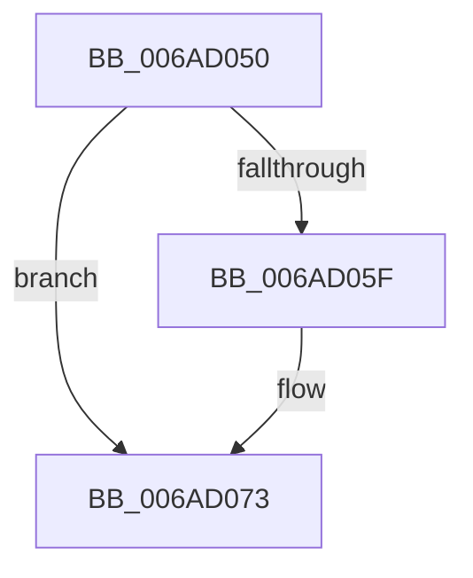

# VslpDispatchIumSyscall

- RVA: `0x006AD050`–`0x006AD096` (길이 `70` bytes)
- VA: `0x00000001406AD050`
- 실행 섹션: `.text`
- PDB 이름 있음: `예`; PDB Function 태그: `아니요`
- unwind 정보 RVA: `0x000BFE50`
- 디코드: `23`개 명령, `70/70` bytes 표시
- 미해석 바이트: `0` (있으면 어셈블리에 `.byte`로 보존)

> 이 문서는 커널 이미지의 기계어와 PDB 기호를 분석해 생성했습니다. 4번과 5번은 함수 원형과 자료형을 바이너리 사용 방식에서 추정한 C 해석이며 원본 소스 복구 결과는 아닙니다.

## 1. Dependencies

- 직접 호출 지점: **1**; 고유 호출 대상: **1**
- 직접 호출자로 확인된 함수: **1**
- RIP 상대 이미지 참조: **0**

### Outgoing calls
- `0x006AD082` → `indirect target` (indirect, 간접 대상)

### Direct callers
- [sub_002360DC](../23/Unknown_function_002360DC.md) at `0x00236178`

### Static image references
- 디코드된 RIP-relative 메모리 참조가 없습니다.

## 2. Other-region calls and transfers

- 다른 실행 섹션으로 향하는 call: **0**
- 별도 외부 분기/꼬리 이동을 확인하지 못했습니다.

## 3. Assembly (complete function range)

```asm
006AD050  56                              push rsi
006AD051  57                              push rdi
006AD052  48 83 EC 68                     sub rsp, 0x68
006AD056  48 8B C1                        mov rax, rcx
006AD059  49 83 E0 07                     and r8, 7
006AD05D  74 14                           je 0x1406ad073
006AD05F  48 8B F2                        mov rsi, rdx
006AD062  48 83 C6 20                     add rsi, 0x20
006AD066  48 8B FC                        mov rdi, rsp
006AD069  48 83 C7 20                     add rdi, 0x20
006AD06D  49 8B C8                        mov rcx, r8
006AD070  F3 48 A5                        rep movsq qword ptr [rdi], qword ptr [rsi]
006AD073  4C 8B 4A 18                     mov r9, qword ptr [rdx + 0x18]
006AD077  4C 8B 42 10                     mov r8, qword ptr [rdx + 0x10]
006AD07B  48 8B 0A                        mov rcx, qword ptr [rdx]
006AD07E  48 8B 52 08                     mov rdx, qword ptr [rdx + 8]
006AD082  FF D0                           call rax
006AD084  0F 1F 00                        nop dword ptr [rax]
006AD087  65 FF 04 25 B8 2E 00 00         inc dword ptr gs:[0x2eb8]
006AD08F  48 83 C4 68                     add rsp, 0x68
006AD093  5F                              pop rdi
006AD094  5E                              pop rsi
006AD095  C3                              ret
```

## 4. C-style interpretation (structured pseudocode)

```c
__int64 __fastcall VslpDispatchIumSyscall(__int64 a1, __int64 a2, __int64 a3)
{
    __int64 result;
    __int64 v_rdi;
    __int64 v_rsi;
    __int64 v_rsp;

    v_rsp = (v_rsp) - (104);
    a3 = (a3) & (7);
    if (!(condition_is_equal)) {
        v_rsi = a2;
        v_rsi = (v_rsi) + (32);
        v_rdi = v_rsp;
        v_rdi = (v_rdi) + (32);
        a1 = a3;
    }
    result = kernel_indirect_call(*(unsigned __int64 *)(a2), *(unsigned __int64 *)(a2 + 8), *(unsigned __int64 *)(a2 + 16), *(unsigned __int64 *)(a2 + 24));
    v_rsp = (v_rsp) + (104);
    return result;
}
```

## 5. (Beta) C Style

```c
int64_t VslpDispatchIumSyscall(int64_t Arg1, void *Arg2, int64_t Arg3)
{
    uint8_t *arg2 = (uint8_t *)Arg2;

    int64_t result;
    int64_t local_rdi;
    int64_t local_rsi;
    int64_t local_rsp;

    local_rsp = (local_rsp) - (104);
    Arg3 = (Arg3) & (7);
    if (!(condition_is_equal)) {
        local_rsi = Arg2;
        local_rsi = (local_rsi) + (32);
        local_rdi = local_rsp;
        local_rdi = (local_rdi) + (32);
        Arg1 = Arg3;
    }
    result = kernel_indirect_call(*(uint64_t *)(arg2), *(uint64_t *)(arg2 + 0x8), *(uint64_t *)(arg2 + 0x10), *(uint64_t *)(arg2 + 0x18));
    local_rsp = (local_rsp) + (104);
    return result;
}
```

### 관측된 메모리 오프셋

구조체 형식이 확인되지 않은 접근은 인자 기준의 오프셋으로만 기록했습니다.

| 기준 인자 | 오프셋 표현 | 폭 (bit) | 접근 |
|---|---:|---:|---|
| `Arg2` | `+ 0x0` | `64` | `R` |
| `Arg2` | `+ 0x8` | `64` | `R` |
| `Arg2` | `+ 0x10` | `64` | `R` |
| `Arg2` | `+ 0x18` | `64` | `R` |

## 6. Execution-region graph

[열기: 2D/3D 그래프와 함수 탐색 컨트롤 패널](../../../control-panel.html?section=text&rva=0x006AD050&view=graph)

- 2D 그래프는 위에서 아래로 흐르고, 3D 그래프는 빈 공간을 드래그해 회전합니다. Shift+드래그는 이동, 휠은 확대·축소, 함수 노드 선택은 대상 보고서 이동입니다.

### Static fallback


