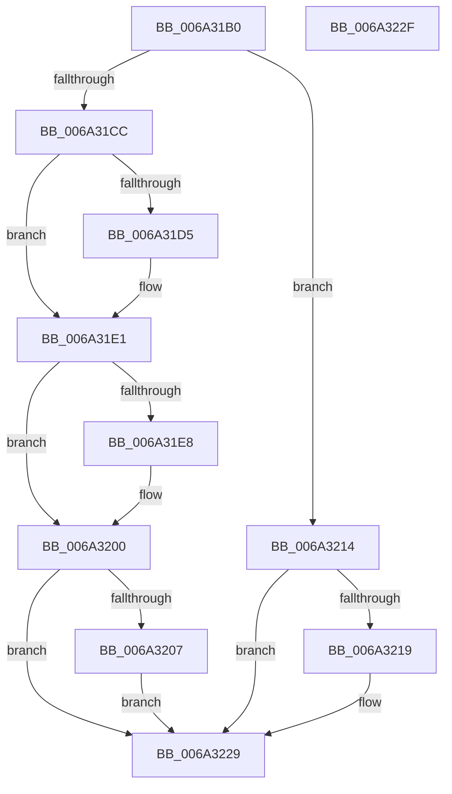

# WdtpTimerCallback

- RVA: `0x006A31B0`–`0x006A3230` (길이 `128` bytes)
- VA: `0x00000001406A31B0`
- 실행 섹션: `.text`
- PDB 이름 있음: `예`; PDB Function 태그: `아니요`
- unwind 정보 RVA: `0x0005CF00`
- 디코드: `37`개 명령, `128/128` bytes 표시
- 미해석 바이트: `0` (있으면 어셈블리에 `.byte`로 보존)

> 이 문서는 커널 이미지의 기계어와 PDB 기호를 분석해 생성했습니다. 4번과 5번은 함수 원형과 자료형을 바이너리 사용 방식에서 추정한 C 해석이며 원본 소스 복구 결과는 아닙니다.

## 1. Dependencies

- 직접 호출 지점: **5**; 고유 호출 대상: **4**
- 직접 호출자로 확인된 함수: **0**
- RIP 상대 이미지 참조: **0**

### Outgoing calls
- `0x006A31DC` → [guard_dispatch_icall](../6B/guard_dispatch_icall_function_006BAAD0.md) (function, `0x006BAAD0`)
- `0x006A31EC` → [KeResetEvent](../24/KeResetEvent_function_00248350.md) (function, `0x00248350`)
- `0x006A31FB` → [ExQueueWorkItem](../2F/ExQueueWorkItem_function_002F9520.md) (function, `0x002F9520`)
- `0x006A320D` → [WdtpArmTimer](../39/WdtpArmTimer_function_0039F230.md) (function, `0x0039F230`)
- `0x006A3224` → [guard_dispatch_icall](../6B/guard_dispatch_icall_function_006BAAD0.md) (function, `0x006BAAD0`)

### Direct callers
- 이 함수 시작 RVA로 연결되는 직접 call은 확인되지 않았습니다. 간접 호출은 완전히 역산할 수 없습니다.

### Static image references
- 디코드된 RIP-relative 메모리 참조가 없습니다.

## 2. Other-region calls and transfers

- 다른 실행 섹션으로 향하는 call: **0**
- 별도 외부 분기/꼬리 이동을 확인하지 못했습니다.

## 3. Assembly (complete function range)

```asm
006A31B0  40 53                           push rbx
006A31B2  48 83 EC 20                     sub rsp, 0x20
006A31B6  8B 82 88 00 00 00               mov eax, dword ptr [rdx + 0x88]
006A31BC  48 8B DA                        mov rbx, rdx
006A31BF  FF C0                           inc eax
006A31C1  89 82 88 00 00 00               mov dword ptr [rdx + 0x88], eax
006A31C7  83 F8 01                        cmp eax, 1
006A31CA  75 48                           jne 0x1406a3214
006A31CC  48 8B 42 10                     mov rax, qword ptr [rdx + 0x10]
006A31D0  48 85 C0                        test rax, rax
006A31D3  74 0C                           je 0x1406a31e1
006A31D5  48 8D 8A 8D 00 00 00            lea rcx, [rdx + 0x8d]
006A31DC  E8 EF 78 01 00                  call 0x1406baad0
006A31E1  48 83 7B 18 00                  cmp qword ptr [rbx + 0x18], 0
006A31E6  74 18                           je 0x1406a3200
006A31E8  48 8D 4B 60                     lea rcx, [rbx + 0x60]
006A31EC  E8 5F 51 BA FF                  call 0x140248350
006A31F1  F0 FF 43 58                     lock inc dword ptr [rbx + 0x58]
006A31F5  48 8D 4B 38                     lea rcx, [rbx + 0x38]
006A31F9  33 D2                           xor edx, edx
006A31FB  E8 20 63 C5 FF                  call 0x1402f9520
006A3200  8B 53 24                        mov edx, dword ptr [rbx + 0x24]
006A3203  85 D2                           test edx, edx
006A3205  74 22                           je 0x1406a3229
006A3207  2B 53 20                        sub edx, dword ptr [rbx + 0x20]
006A320A  48 8B CB                        mov rcx, rbx
006A320D  E8 1E C0 CF FF                  call 0x14039f230
006A3212  EB 15                           jmp 0x1406a3229
006A3214  83 F8 02                        cmp eax, 2
006A3217  75 10                           jne 0x1406a3229
006A3219  48 8B 42 28                     mov rax, qword ptr [rdx + 0x28]
006A321D  48 8D 8A 8D 00 00 00            lea rcx, [rdx + 0x8d]
006A3224  E8 A7 78 01 00                  call 0x1406baad0
006A3229  48 83 C4 20                     add rsp, 0x20
006A322D  5B                              pop rbx
006A322E  C3                              ret
006A322F  CC                              int3
```

## 4. C-style interpretation (structured pseudocode)

```c
__int64 __fastcall WdtpTimerCallback(__int64 a1, __int64 a2)
{
    __int64 result;
    __int64 v_rsp;

    v_rsp = (v_rsp) - (32);
    result = (unsigned int)(((unsigned int)(*(unsigned int *)(a2 + 136))) + 1);
    *(unsigned int *)(a2 + 136) = (unsigned int)(result);
    if (((unsigned int)(result)) != 1) goto loc_006A3214;
    result = *(unsigned __int64 *)(a2 + 16);
    if (*(unsigned __int64 *)(a2 + 16) != 0) {
        a1 = a2 + 141;
        result = guard_dispatch_icall(a1, a2, a3, a4);
    }
    if ((*(unsigned __int64 *)(a2 + 24)) != 0) {
        a1 = a2 + 96;
        result = KeResetEvent(a1, a2, a3, a4);
        a1 = a2 + 56;
        a2 = 0;
        result = ExQueueWorkItem(a1, a2, a3, a4);
    }
    if ((unsigned int)((unsigned int)(*(unsigned int *)(a2 + 36))) == 0) goto loc_006A3229;
    a2 = (unsigned int)(((unsigned int)(*(unsigned int *)(a2 + 36))) - (*(unsigned int *)(a2 + 32)));
    result = WdtpArmTimer(a2, a2, a3, a4);
    goto loc_006A3229;
loc_006A3214:
    if (((unsigned int)(result)) == 2) {
        result = *(unsigned __int64 *)(a2 + 40);
        a1 = a2 + 141;
        result = guard_dispatch_icall(a1, a2, a3, a4);
    }
    v_rsp = (v_rsp) + (32);
    return result;
}
```

## 5. (Beta) C Style

```c
int64_t WdtpTimerCallback(int64_t Arg1, void *Arg2)
{
    uint8_t *arg2 = (uint8_t *)Arg2;

    int64_t result;
    int64_t local_rsp;

    local_rsp = (local_rsp) - (32);
    result = (uint32_t)(((uint32_t)(*(uint32_t *)(arg2 + 0x88))) + 1);
    *(uint32_t *)(arg2 + 0x88) = (uint32_t)(result);
    if (((uint32_t)(result)) != 1) goto loc_006A3214;
    result = *(uint64_t *)(arg2 + 0x10);
    if (*(uint64_t *)(arg2 + 0x10) != 0) {
        Arg1 = Arg2 + 141;
        result = guard_dispatch_icall(Arg1, Arg2, a3, a4);
    }
    if ((*(uint64_t *)(arg2 + 0x18)) != 0) {
        Arg1 = Arg2 + 96;
        result = KeResetEvent(Arg1, Arg2, a3, a4);
        Arg1 = Arg2 + 56;
        Arg2 = 0;
        result = ExQueueWorkItem(Arg1, Arg2, a3, a4);
    }
    if ((uint32_t)((uint32_t)(*(uint32_t *)(arg2 + 0x24))) == 0) goto loc_006A3229;
    Arg2 = (uint32_t)(((uint32_t)(*(uint32_t *)(arg2 + 0x24))) - (*(uint32_t *)(arg2 + 0x20)));
    result = WdtpArmTimer(Arg2, Arg2, a3, a4);
    goto loc_006A3229;
loc_006A3214:
    if (((uint32_t)(result)) == 2) {
        result = *(uint64_t *)(arg2 + 0x28);
        Arg1 = Arg2 + 141;
        result = guard_dispatch_icall(Arg1, Arg2, a3, a4);
    }
    local_rsp = (local_rsp) + (32);
    return result;
}
```

### 관측된 메모리 오프셋

구조체 형식이 확인되지 않은 접근은 인자 기준의 오프셋으로만 기록했습니다.

| 기준 인자 | 오프셋 표현 | 폭 (bit) | 접근 |
|---|---:|---:|---|
| `Arg2` | `+ 0x10` | `64` | `R` |
| `Arg2` | `+ 0x18` | `64` | `R` |
| `Arg2` | `+ 0x20` | `32` | `R` |
| `Arg2` | `+ 0x24` | `32` | `R` |
| `Arg2` | `+ 0x28` | `64` | `R` |
| `Arg2` | `+ 0x38` | `64` | `R` |
| `Arg2` | `+ 0x58` | `32` | `R/W` |
| `Arg2` | `+ 0x60` | `64` | `R` |
| `Arg2` | `+ 0x88` | `32` | `R` |
| `Arg2` | `+ 0x88` | `32` | `W` |
| `Arg2` | `+ 0x8D` | `64` | `R` |

## 6. Execution-region graph

[열기: 2D/3D 그래프와 함수 탐색 컨트롤 패널](../../../control-panel.html?section=text&rva=0x006A31B0&view=graph)

- 2D 그래프는 위에서 아래로 흐르고, 3D 그래프는 빈 공간을 드래그해 회전합니다. Shift+드래그는 이동, 휠은 확대·축소, 함수 노드 선택은 대상 보고서 이동입니다.

### Static fallback


