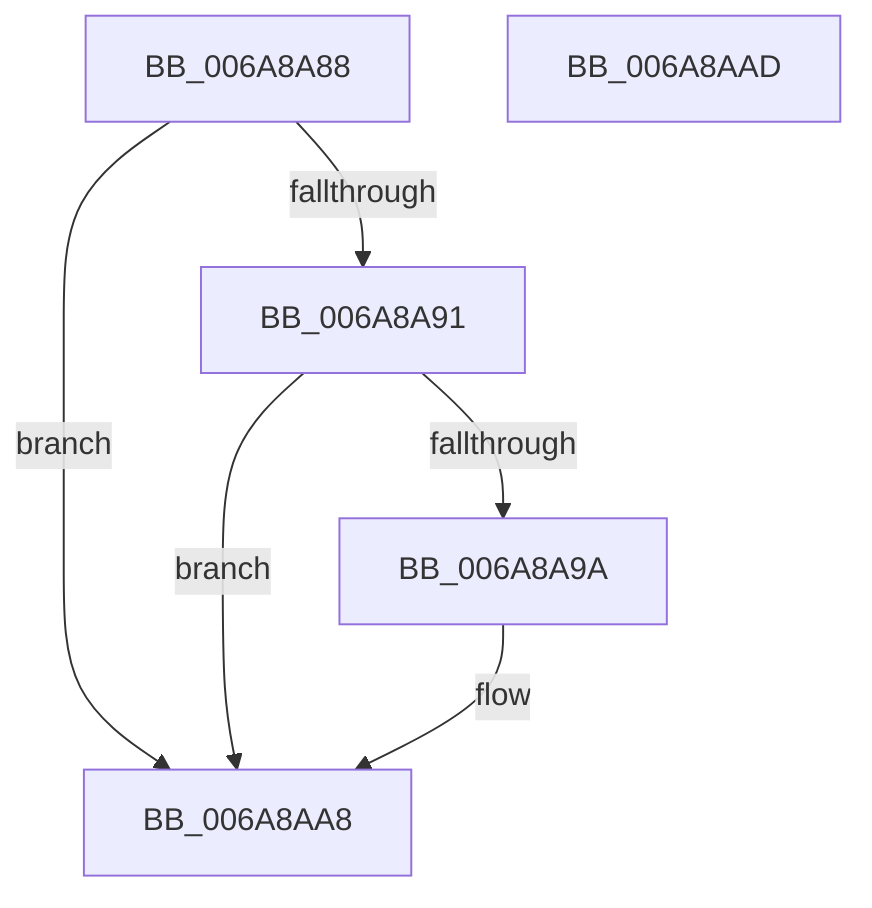

# XpressDecodeClose

- RVA: `0x006A8A88`–`0x006A8AAE` (길이 `38` bytes)
- VA: `0x00000001406A8A88`
- 실행 섹션: `.text`
- PDB 이름 있음: `예`; PDB Function 태그: `아니요`
- unwind 정보 RVA: `0x0005C788`
- 디코드: `12`개 명령, `38/38` bytes 표시
- 미해석 바이트: `0` (있으면 어셈블리에 `.byte`로 보존)

> 이 문서는 커널 이미지의 기계어와 PDB 기호를 분석해 생성했습니다. 4번과 5번은 함수 원형과 자료형을 바이너리 사용 방식에서 추정한 C 해석이며 원본 소스 복구 결과는 아닙니다.

## 1. Dependencies

- 직접 호출 지점: **1**; 고유 호출 대상: **1**
- 직접 호출자로 확인된 함수: **1**
- RIP 상대 이미지 참조: **0**

### Outgoing calls
- `0x006A8AA3` → [CMFFreeFn](../../page/AB/CMFFreeFn_function_00AB4E50.md) (function, `0x00AB4E50`)

### Direct callers
- [CMFReadCompressedSegment](../../page/7D/CMFReadCompressedSegment_function_007D3580.md) at `0x007D37FD`

### Static image references
- 디코드된 RIP-relative 메모리 참조가 없습니다.

## 2. Other-region calls and transfers

- 다른 실행 섹션으로 향하는 call: **1**
  - `0x006A8AA3` → [CMFFreeFn](../../page/AB/CMFFreeFn_function_00AB4E50.md) (`.text` → `PAGE`)
- 별도 외부 분기/꼬리 이동을 확인하지 못했습니다.

## 3. Assembly (complete function range)

```asm
006A8A88  48 83 EC 28                     sub rsp, 0x28
006A8A8C  48 85 C9                        test rcx, rcx
006A8A8F  74 17                           je 0x1406a8aa8
006A8A91  81 79 68 DE C0 DE 35            cmp dword ptr [rcx + 0x68], 0x35dec0de
006A8A98  75 0E                           jne 0x1406a8aa8
006A8A9A  83 61 68 00                     and dword ptr [rcx + 0x68], 0
006A8A9E  48 8B D1                        mov rdx, rcx
006A8AA1  33 C9                           xor ecx, ecx
006A8AA3  E8 A8 C3 40 00                  call 0x140ab4e50
006A8AA8  48 83 C4 28                     add rsp, 0x28
006A8AAC  C3                              ret
006A8AAD  CC                              int3
```

## 4. C-style interpretation (structured pseudocode)

```c
__int64 __fastcall XpressDecodeClose(__int64 a1)
{
    __int64 result;
    __int64 v_rsp;

    v_rsp = (v_rsp) - (40);
    if (a1 == 0) goto loc_006A8AA8;
    if ((*(unsigned int *)(a1 + 104)) == 0x35DEC0DEULL) {
        a2 = a1;
        a1 = 0;
        result = CMFFreeFn(a1, a2, a3, a4);
    }
    v_rsp = (v_rsp) + (40);
    return result;
}
```

## 5. (Beta) C Style

```c
int64_t XpressDecodeClose(int64_t Arg1)
{
    int64_t result;
    int64_t local_rsp;

    local_rsp = (local_rsp) - (40);
    if (Arg1 == 0) goto loc_006A8AA8;
    if ((*(uint32_t *)(Arg1 + 0x68)) == 0x35DEC0DEULL) {
        a2 = Arg1;
        Arg1 = 0;
        result = CMFFreeFn(Arg1, a2, a3, a4);
    }
    local_rsp = (local_rsp) + (40);
    return result;
}
```

## 6. Execution-region graph

[열기: 2D/3D 그래프와 함수 탐색 컨트롤 패널](../../../control-panel.html?section=text&rva=0x006A8A88&view=graph)

- 2D 그래프는 위에서 아래로 흐르고, 3D 그래프는 빈 공간을 드래그해 회전합니다. Shift+드래그는 이동, 휠은 확대·축소, 함수 노드 선택은 대상 보고서 이동입니다.

### Static fallback


