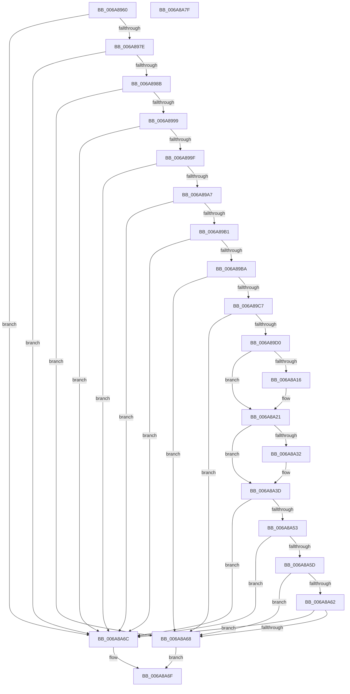

# XpressDecode

- RVA: `0x006A8960`–`0x006A8A80` (길이 `288` bytes)
- VA: `0x00000001406A8960`
- 실행 섹션: `.text`
- PDB 이름 있음: `예`; PDB Function 태그: `아니요`
- unwind 정보 RVA: `0x00060BC4`
- 디코드: `72`개 명령, `288/288` bytes 표시
- 미해석 바이트: `0` (있으면 어셈블리에 `.byte`로 보존)

> 이 문서는 커널 이미지의 기계어와 PDB 기호를 분석해 생성했습니다. 4번과 5번은 함수 원형과 자료형을 바이너리 사용 방식에서 추정한 C 해석이며 원본 소스 복구 결과는 아닙니다.

## 1. Dependencies

- 직접 호출 지점: **1**; 고유 호출 대상: **1**
- 직접 호출자로 확인된 함수: **1**
- RIP 상대 이미지 참조: **0**

### Outgoing calls
- `0x006A8A48` → [do_decode](do_decode_function_006A8ADC.md) (function, `0x006A8ADC`)

### Direct callers
- [CMFReadCompressedSegment](../../page/7D/CMFReadCompressedSegment_function_007D3580.md) at `0x007D3793`

### Static image references
- 디코드된 RIP-relative 메모리 참조가 없습니다.

## 2. Other-region calls and transfers

- 다른 실행 섹션으로 향하는 call: **0**
- 별도 외부 분기/꼬리 이동을 확인하지 못했습니다.

## 3. Assembly (complete function range)

```asm
006A8960  48 89 5C 24 08                  mov qword ptr [rsp + 8], rbx
006A8965  48 89 74 24 10                  mov qword ptr [rsp + 0x10], rsi
006A896A  57                              push rdi
006A896B  48 83 EC 20                     sub rsp, 0x20
006A896F  49 63 F9                        movsxd rdi, r9d
006A8972  48 8B D9                        mov rbx, rcx
006A8975  48 85 C9                        test rcx, rcx
006A8978  0F 84 EE 00 00 00               je 0x1406a8a6c
006A897E  81 79 68 DE C0 DE 35            cmp dword ptr [rcx + 0x68], 0x35dec0de
006A8985  0F 85 E1 00 00 00               jne 0x1406a8a6c
006A898B  48 63 4C 24 58                  movsxd rcx, dword ptr [rsp + 0x58]
006A8990  41 3B C8                        cmp ecx, r8d
006A8993  0F 84 CF 00 00 00               je 0x1406a8a68
006A8999  0F 8F CD 00 00 00               jg 0x1406a8a6c
006A899F  85 C9                           test ecx, ecx
006A89A1  0F 88 C5 00 00 00               js 0x1406a8a6c
006A89A7  41 83 F8 08                     cmp r8d, 8
006A89AB  0F 8E BB 00 00 00               jle 0x1406a8a6c
006A89B1  83 F9 08                        cmp ecx, 8
006A89B4  0F 8C B2 00 00 00               jl 0x1406a8a6c
006A89BA  41 81 F8 00 00 01 00            cmp r8d, 0x10000
006A89C1  0F 8F A1 00 00 00               jg 0x1406a8a68
006A89C7  45 85 C9                        test r9d, r9d
006A89CA  0F 8E 98 00 00 00               jle 0x1406a8a68
006A89D0  49 63 C0                        movsxd rax, r8d
006A89D3  4C 8D 1C 17                     lea r11, [rdi + rdx]
006A89D7  4C 8B 44 24 50                  mov r8, qword ptr [rsp + 0x50]
006A89DC  48 03 C2                        add rax, rdx
006A89DF  48 89 03                        mov qword ptr [rbx], rax
006A89E2  48 8B F1                        mov rsi, rcx
006A89E5  48 89 53 08                     mov qword ptr [rbx + 8], rdx
006A89E9  4C 89 5B 18                     mov qword ptr [rbx + 0x18], r11
006A89ED  48 89 53 10                     mov qword ptr [rbx + 0x10], rdx
006A89F1  4E 8D 0C 01                     lea r9, [rcx + r8]
006A89F5  4C 89 4B 28                     mov qword ptr [rbx + 0x28], r9
006A89F9  49 8D 49 FF                     lea rcx, [r9 - 1]
006A89FD  48 89 4B 40                     mov qword ptr [rbx + 0x40], rcx
006A8A01  49 8D 41 FD                     lea rax, [r9 - 3]
006A8A05  48 89 43 48                     mov qword ptr [rbx + 0x48], rax
006A8A09  48 89 4B 50                     mov qword ptr [rbx + 0x50], rcx
006A8A0D  48 81 FF 08 01 00 00            cmp rdi, 0x108
006A8A14  76 0B                           jbe 0x1406a8a21
006A8A16  49 8D 83 F8 FE FF FF            lea rax, [r11 - 0x108]
006A8A1D  48 89 43 10                     mov qword ptr [rbx + 0x10], rax
006A8A21  4C 89 43 30                     mov qword ptr [rbx + 0x30], r8
006A8A25  4C 89 43 38                     mov qword ptr [rbx + 0x38], r8
006A8A29  48 81 FE E8 00 00 00            cmp rsi, 0xe8
006A8A30  76 0B                           jbe 0x1406a8a3d
006A8A32  49 8D 81 18 FF FF FF            lea rax, [r9 - 0xe8]
006A8A39  48 89 43 38                     mov qword ptr [rbx + 0x38], rax
006A8A3D  83 63 60 00                     and dword ptr [rbx + 0x60], 0
006A8A41  48 8B CB                        mov rcx, rbx
006A8A44  83 63 64 00                     and dword ptr [rbx + 0x64], 0
006A8A48  E8 8F 00 00 00                  call 0x1406a8adc
006A8A4D  83 7B 60 00                     cmp dword ptr [rbx + 0x60], 0
006A8A51  74 19                           je 0x1406a8a6c
006A8A53  48 8B 43 18                     mov rax, qword ptr [rbx + 0x18]
006A8A57  48 39 43 20                     cmp qword ptr [rbx + 0x20], rax
006A8A5B  77 0F                           ja 0x1406a8a6c
006A8A5D  48 3B 03                        cmp rax, qword ptr [rbx]
006A8A60  75 06                           jne 0x1406a8a68
006A8A62  83 7B 64 00                     cmp dword ptr [rbx + 0x64], 0
006A8A66  74 04                           je 0x1406a8a6c
006A8A68  8B C7                           mov eax, edi
006A8A6A  EB 03                           jmp 0x1406a8a6f
006A8A6C  83 C8 FF                        or eax, 0xffffffff
006A8A6F  48 8B 5C 24 30                  mov rbx, qword ptr [rsp + 0x30]
006A8A74  48 8B 74 24 38                  mov rsi, qword ptr [rsp + 0x38]
006A8A79  48 83 C4 20                     add rsp, 0x20
006A8A7D  5F                              pop rdi
006A8A7E  C3                              ret
006A8A7F  CC                              int3
```

## 4. C-style interpretation (structured pseudocode)

```c
__int64 __fastcall XpressDecode(__int64 a1, __int64 a2, int a3, int a4, __int64 a5, unsigned int a6)
{
    __int64 result;
    __int64 v_rsp;
    unsigned __int64 v_stack_p10;
    unsigned __int64 v_stack_p8;

    v_stack_p8 = v_rbx;
    v_stack_p10 = v_rsi;
    v_rsp = (v_rsp) - (32);
    if (a1 == 0) goto loc_006A8A6C;
    if ((*(unsigned int *)(a1 + 104)) != 0x35DEC0DEULL) goto loc_006A8A6C;
    if (((unsigned int)((int)(a6))) == a3) goto loc_006A8A68;
    if (((unsigned int)((int)(a6))) > a3) goto loc_006A8A6C;
    if (sign_flag) goto loc_006A8A6C;
    if (a3 <= 8) goto loc_006A8A6C;
    if (((unsigned int)((int)(a6))) < 8) goto loc_006A8A6C;
    if (a3 > 0x10000ULL) goto loc_006A8A68;
    if (condition_is_less_or_equal) goto loc_006A8A68;
    result = ((int)(a3)) + (a2);
    *(unsigned __int64 *)(a1) = result;
    *(unsigned __int64 *)(a1 + 8) = a2;
    *(unsigned __int64 *)(a1 + 24) = (int)(a4) + a2 * 1;
    *(unsigned __int64 *)(a1 + 16) = a2;
    *(unsigned __int64 *)(a1 + 40) = (int)(a6) + a5 * 1;
    *(unsigned __int64 *)(a1 + 64) = (int)(a6) + a5 * 1 - 1;
    *(unsigned __int64 *)(a1 + 72) = (int)(a6) + a5 * 1 - 3;
    *(unsigned __int64 *)(a1 + 80) = (int)(a6) + a5 * 1 - 1;
    result = (int)(a6) + a5 * 1 - 3;
    if (((int)(a4)) >= = 264) {
        result = (int)(a4) + a2 * 1 - 264;
        *(unsigned __int64 *)(a1 + 16) = result;
    }
    *(unsigned __int64 *)(a1 + 48) = a5;
    *(unsigned __int64 *)(a1 + 56) = a5;
    if (((int)(a6)) >= = 232) {
        result = (int)(a6) + a5 * 1 - 232;
        *(unsigned __int64 *)(a1 + 56) = result;
    }
    result = do_decode(a1, a2, a5, (int)(a6) + a5 * 1);
    if ((*(unsigned int *)(a1 + 96)) == 0) goto loc_006A8A6C;
    if ((*(unsigned __int64 *)(a1 + 32)) > (*(unsigned __int64 *)(a1 + 24))) goto loc_006A8A6C;
    if ((*(unsigned __int64 *)(a1 + 24)) != (*(unsigned __int64 *)(a1))) goto loc_006A8A68;
    if ((*(unsigned int *)(a1 + 100)) == 0) goto loc_006A8A6C;
loc_006A8A68:
    goto loc_006A8A6F;
loc_006A8A6C:
    result = (unsigned int)(((unsigned int)((unsigned int)((int)(a4)))) | (0xFFFFFFFFULL));
loc_006A8A6F:
    v_rsp = (v_rsp) + (32);
    return result;
}
```

## 5. (Beta) C Style

```c
int64_t XpressDecode(void *Arg1, int64_t Arg2, int32_t Arg3, void *Arg4, int64_t Arg5, uint32_t Arg6)
{
    uint8_t *arg1 = (uint8_t *)Arg1;
    uint8_t *arg4 = (uint8_t *)Arg4;

    int64_t result;
    int64_t local_rsp;
    uint64_t v_stack_p10;
    uint64_t v_stack_p8;

    v_stack_p8 = local_rbx;
    v_stack_p10 = local_rsi;
    local_rsp = (local_rsp) - (32);
    if (Arg1 == NULL) goto loc_006A8A6C;
    if ((*(uint32_t *)(arg1 + 0x68)) != 0x35DEC0DEULL) goto loc_006A8A6C;
    if (((uint32_t)((int32_t)(Arg6))) == Arg3) goto loc_006A8A68;
    if (((uint32_t)((int32_t)(Arg6))) > Arg3) goto loc_006A8A6C;
    if (sign_flag) goto loc_006A8A6C;
    if (Arg3 <= 8) goto loc_006A8A6C;
    if (((uint32_t)((int32_t)(Arg6))) < 8) goto loc_006A8A6C;
    if (Arg3 > 0x10000ULL) goto loc_006A8A68;
    if (condition_is_less_or_equal) goto loc_006A8A68;
    result = ((int32_t)(Arg3)) + (Arg2);
    *(uint64_t *)(arg1) = result;
    *(uint64_t *)(arg1 + 0x8) = Arg2;
    *(uint64_t *)(arg1 + 0x18) = (int32_t)(Arg4) + Arg2 * 1;
    *(uint64_t *)(arg1 + 0x10) = Arg2;
    *(uint64_t *)(arg1 + 0x28) = (int32_t)(Arg6) + Arg5 * 1;
    *(uint64_t *)(arg1 + 0x40) = (int32_t)(Arg6) + Arg5 * 1 - 1;
    *(uint64_t *)(arg1 + 0x48) = (int32_t)(Arg6) + Arg5 * 1 - 3;
    *(uint64_t *)(arg1 + 0x50) = (int32_t)(Arg6) + Arg5 * 1 - 1;
    result = (int32_t)(Arg6) + Arg5 * 1 - 3;
    if (((int32_t)(Arg4)) >= = 264) {
        result = (int32_t)(Arg4) + Arg2 * 1 - 264;
        *(uint64_t *)(arg1 + 0x10) = result;
    }
    *(uint64_t *)(arg1 + 0x30) = Arg5;
    *(uint64_t *)(arg1 + 0x38) = Arg5;
    if (((int32_t)(Arg6)) >= = 232) {
        result = (int32_t)(Arg6) + Arg5 * 1 - 232;
        *(uint64_t *)(arg1 + 0x38) = result;
    }
    result = do_decode(Arg1, Arg2, Arg5, (int32_t)(Arg6) + Arg5 * 1);
    if ((*(uint32_t *)(arg1 + 0x60)) == 0) goto loc_006A8A6C;
    if ((*(uint64_t *)(arg1 + 0x20)) > (*(uint64_t *)(arg1 + 0x18))) goto loc_006A8A6C;
    if ((*(uint64_t *)(arg1 + 0x18)) != (*(uint64_t *)(arg1))) goto loc_006A8A68;
    if ((*(uint32_t *)(arg1 + 0x64)) == 0) goto loc_006A8A6C;
loc_006A8A68:
    goto loc_006A8A6F;
loc_006A8A6C:
    result = (uint32_t)(((uint32_t)((uint32_t)((int32_t)(Arg4)))) | (0xFFFFFFFFULL));
loc_006A8A6F:
    local_rsp = (local_rsp) + (32);
    return result;
}
```

### 관측된 메모리 오프셋

구조체 형식이 확인되지 않은 접근은 인자 기준의 오프셋으로만 기록했습니다.

| 기준 인자 | 오프셋 표현 | 폭 (bit) | 접근 |
|---|---:|---:|---|
| `Arg1` | `+ 0x0` | `64` | `R` |
| `Arg1` | `+ 0x0` | `64` | `W` |
| `Arg1` | `+ 0x8` | `64` | `W` |
| `Arg1` | `+ 0x10` | `64` | `W` |
| `Arg1` | `+ 0x18` | `64` | `R` |
| `Arg1` | `+ 0x18` | `64` | `W` |
| `Arg1` | `+ 0x20` | `64` | `R` |
| `Arg1` | `+ 0x28` | `64` | `W` |
| `Arg1` | `+ 0x30` | `64` | `W` |
| `Arg1` | `+ 0x38` | `64` | `W` |
| `Arg1` | `+ 0x40` | `64` | `W` |
| `Arg1` | `+ 0x48` | `64` | `W` |
| `Arg1` | `+ 0x50` | `64` | `W` |
| `Arg1` | `+ 0x60` | `32` | `R` |
| `Arg1` | `+ 0x60` | `32` | `R/W` |
| `Arg1` | `+ 0x64` | `32` | `R` |
| `Arg1` | `+ 0x64` | `32` | `R/W` |
| `Arg4` | `- 0x108` | `64` | `R` |
| `Arg4` | `+ 0x0 + rdx*1` | `64` | `R` |

## 6. Execution-region graph

[열기: 2D/3D 그래프와 함수 탐색 컨트롤 패널](../../../control-panel.html?section=text&rva=0x006A8960&view=graph)

- 2D 그래프는 위에서 아래로 흐르고, 3D 그래프는 빈 공간을 드래그해 회전합니다. Shift+드래그는 이동, 휠은 확대·축소, 함수 노드 선택은 대상 보고서 이동입니다.

### Static fallback


