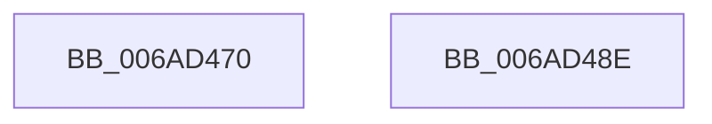

# ZwCreateKey

- RVA: `0x006AD470`–`0x006AD48F` (길이 `31` bytes)
- VA: `0x00000001406AD470`
- 실행 섹션: `.text`
- PDB 이름 있음: `예`; PDB Function 태그: `아니요`
- unwind 정보 RVA: `0x000BFFEC`
- 디코드: `11`개 명령, `31/31` bytes 표시
- 미해석 바이트: `0` (있으면 어셈블리에 `.byte`로 보존)

> 이 문서는 커널 이미지의 기계어와 PDB 기호를 분석해 생성했습니다. 4번과 5번은 함수 원형과 자료형을 바이너리 사용 방식에서 추정한 C 해석이며 원본 소스 복구 결과는 아닙니다.

## 1. Dependencies

- 직접 호출 지점: **0**; 고유 호출 대상: **0**
- 직접 호출자로 확인된 함수: **94**
- RIP 상대 이미지 참조: **1**

### Outgoing calls
- 직접 디코드된 call 명령이 없습니다.

### Direct callers
- [PopOpenKey](../4B/PopOpenKey_function_004B4330.md) at `0x004B4421`
- [BiZwCreateKey](../4B/BiZwCreateKey_function_004BAB44.md) at `0x004BAB66`
- [PopOpenThermalLoggingKey](../4C/PopOpenThermalLoggingKey_function_004CDBFC.md) at `0x004CDCEA`
- [IopLiveDumpPolicyChangeWnfCallback](../59/IopLiveDumpPolicyChangeWnfCallback_function_0059D6E0.md) at `0x0059D7BB`
- [DifZwCreateKeyWrapper](../63/DifZwCreateKeyWrapper_function_0063FE90.md) at `0x0063FFB4`
- [EtwpCreateKey](../65/EtwpCreateKey_function_006527D4.md) at `0x0065284B`
- [BapdpMarshallBootDataToRegistry](../65/BapdpMarshallBootDataToRegistry_function_006548A8.md) at `0x00654A8C`
- [BapdpMarshallBootDataToRegistry](../65/BapdpMarshallBootDataToRegistry_function_006548A8.md) at `0x00654B50`
- [WheaPersistBadPageToRegistry](../65/WheaPersistBadPageToRegistry_function_0065F58C.md) at `0x0065F632`
- [PopSetHiberPersistedRegValue](../../page/6F/PopSetHiberPersistedRegValue_function_006FE9F0.md) at `0x006FEA8E`
- [PopOpenHiberPersistedKey](../../page/70/PopOpenHiberPersistedKey_function_007024E0.md) at `0x00702583`
- [HalpRecordSecondaryGsivRange](../../page/70/HalpRecordSecondaryGsivRange_function_0070A4F8.md) at `0x0070A607`
- [HalpPutAcpiHacksInRegistry](../../page/70/HalpPutAcpiHacksInRegistry_function_0070BC04.md) at `0x0070BD3F`
- [ArbBuildAssignmentOrdering](../../page/70/ArbBuildAssignmentOrdering_function_0070E43C.md) at `0x0070E75C`
- [IopCrashDumpPolicyChangeWnfCallback](../../page/71/IopCrashDumpPolicyChangeWnfCallback_function_00719E40.md) at `0x00719F19`
- [PiCreateRegistryPath](../../page/72/PiCreateRegistryPath_function_00728B58.md) at `0x00728C20`
- [PiCreateRegistryPath](../../page/72/PiCreateRegistryPath_function_00728B58.md) at `0x00728D00`
- [PiCreateRegistryPath](../../page/72/PiCreateRegistryPath_function_00728B58.md) at `0x00728D8E`
- [PiCreateServiceKeyUnderPath](../../page/72/PiCreateServiceKeyUnderPath_function_00728DEC.md) at `0x00728FB4`
- [KsepRegistryCreateKey](../../page/74/KsepRegistryCreateKey_function_0074B008.md) at `0x0074B191`
- [KsepRegistryCreateKey](../../page/74/KsepRegistryCreateKey_function_0074B008.md) at `0x0074B1F0`
- [PfpParametersWatcher](../../page/75/PfpParametersWatcher_function_00753140.md) at `0x0075323E`
- [PopOpenPersistedRegistryKey](../../page/75/PopOpenPersistedRegistryKey_function_00754260.md) at `0x00754337`
- [PopDirectedDripsQueryRegistryValues](../../page/75/PopDirectedDripsQueryRegistryValues_function_00757B40.md) at `0x00757C43`
- [SmcCacheManagerStart](../../page/7A/SmcCacheManagerStart_function_007AB958.md) at `0x007ABA6A`
- [EtwpAddMicroarchitecturalPmcToPmcGroup](../../page/7B/EtwpAddMicroarchitecturalPmcToPmcGroup_function_007B5228.md) at `0x007B531B`
- [EtwpAddMicroarchitecturalPmcToRegistry](../../page/7B/EtwpAddMicroarchitecturalPmcToRegistry_function_007B5558.md) at `0x007B56E8`
- [EtwpFindMatchingPmcRegistryGroup](../../page/7B/EtwpFindMatchingPmcRegistryGroup_function_007B644C.md) at `0x007B6527`
- [EtwStartAutoLogger](../../page/7B/EtwStartAutoLogger_function_007BD2F8.md) at `0x007BD5D2`
- [EtwStartAutoLogger](../../page/7B/EtwStartAutoLogger_function_007BD2F8.md) at `0x007BD613`
- [ExpUpdateComPlusPackage](../../page/7C/ExpUpdateComPlusPackage_function_007C5580.md) at `0x007C55DB`
- [ExpGetLeapSecondDataRegistryKeyHandle](../../page/7C/ExpGetLeapSecondDataRegistryKeyHandle_function_007C5B30.md) at `0x007C5B95`
- [SpRegOpenKey](../../page/7C/SpRegOpenKey_function_007CAAA4.md) at `0x007CAB05`
- [CMFRegisterEventTime](../../page/7D/CMFRegisterEventTime_function_007D382C.md) at `0x007D38C3`
- [ExpWnfGetPermanentDataStoreHandleByScopeId](../../page/7D/ExpWnfGetPermanentDataStoreHandleByScopeId_function_007D65F8.md) at `0x007D66B6`
- [CmpFinishSystemHivesLoad](../../page/7D/CmpFinishSystemHivesLoad_function_007DA210.md) at `0x007DABDB`
- [CmpLinkKeyToHive](../../page/7D/CmpLinkKeyToHive_function_007DAF30.md) at `0x007DAFBA`
- [CmpSaveBootControlSet](../../page/7D/CmpSaveBootControlSet_function_007DC744.md) at `0x007DC917`
- [CmSetAcpiHwProfile](../../page/7E/CmSetAcpiHwProfile_function_007E2584.md) at `0x007E2ACD`
- [CmSetAcpiHwProfile](../../page/7E/CmSetAcpiHwProfile_function_007E2584.md) at `0x007E2D3A`
- [CmpAddAcpiAliasEntry](../../page/7E/CmpAddAcpiAliasEntry_function_007E2DC4.md) at `0x007E2E81`
- [CmpAddAcpiAliasEntry](../../page/7E/CmpAddAcpiAliasEntry_function_007E2DC4.md) at `0x007E2F46`
- [CmpCloneHwProfile](../../page/7E/CmpCloneHwProfile_function_007E303C.md) at `0x007E323A`
- [CmpCloneHwProfile](../../page/7E/CmpCloneHwProfile_function_007E303C.md) at `0x007E32DC`
- [CmInitializeProcessor](../../page/7E/CmInitializeProcessor_function_007E4BAC.md) at `0x007E4C26`
- [CmpRecordShutdownStopTime](../../page/7E/CmpRecordShutdownStopTime_function_007E551C.md) at `0x007E5602`
- [CmpSetVersionData](../../page/7E/CmpSetVersionData_function_007E7854.md) at `0x007E7952`
- [CmpSetVersionData](../../page/7E/CmpSetVersionData_function_007E7854.md) at `0x007E79BA`
- [CmpSetVersionData](../../page/7E/CmpSetVersionData_function_007E7854.md) at `0x007E7A33`
- [CmpSetVersionData](../../page/7E/CmpSetVersionData_function_007E7854.md) at `0x007E7AA0`
- [CmpUpdateReorganizeRegistryValues](../../page/7E/CmpUpdateReorganizeRegistryValues_function_007EA7D4.md) at `0x007EA87F`
- [CmpSyncNextBackupHive](../../page/7E/CmpSyncNextBackupHive_function_007EC6C8.md) at `0x007EC7C7`
- [CmpInitializeRegistryNode](../../page/7E/CmpInitializeRegistryNode_function_007EE81C.md) at `0x007EE8E1`
- [CmpInitializeRegistryNode](../../page/7E/CmpInitializeRegistryNode_function_007EE81C.md) at `0x007EE9AC`
- [CmpDoReDoCreateKey](../../page/7F/CmpDoReDoCreateKey_function_007F75C8.md) at `0x007F7688`
- [RtlpGetRegistryHandle](../../page/8C/RtlpGetRegistryHandle_function_008C955C.md) at `0x008C9767`
- [_CmAddDeviceToContainerWorker](../../page/8F/_CmAddDeviceToContainerWorker_function_008FF2EC.md) at `0x008FF58D`
- [_CmAddDeviceToContainerWorker](../../page/8F/_CmAddDeviceToContainerWorker_function_008FF2EC.md) at `0x008FF63C`
- [RegRtlCreateTreeTransacted](../../page/93/RegRtlCreateTreeTransacted_function_00931D1C.md) at `0x00931E0E`
- [RegRtlCreateKeyTransacted](../../page/93/RegRtlCreateKeyTransacted_function_0093207C.md) at `0x00932154`
- [VrpCreateNamespaceNodePlaceholderKey](../../page/93/VrpCreateNamespaceNodePlaceholderKey_function_00935BAC.md) at `0x00935C16`
- [PnpSetPropertyWorker](../../page/99/PnpSetPropertyWorker_function_00991C08.md) at `0x00991F6B`
- [PnpSetPropertyWorker](../../page/99/PnpSetPropertyWorker_function_00991C08.md) at `0x00992018`
- [PiDevCfgCopyDeviceKey](../../page/99/PiDevCfgCopyDeviceKey_function_00997374.md) at `0x00997929`
- [IopUpdateSecureDeviceClassState](../../page/9A/IopUpdateSecureDeviceClassState_function_009A2CE8.md) at `0x009A2EC9`
- [_CmSetDeviceInterfaceMappedPropertyFromRegValue](../../page/A7/_CmSetDeviceInterfaceMappedPropertyFromRegValue_function_00A729E4.md) at `0x00A72CD5`
- [_CmCreateOrdinalInstanceKey](../../page/A7/_CmCreateOrdinalInstanceKey_function_00A77838.md) at `0x00A77A61`
- [ExpWnfGetPermanentPerUserDataStoreHandle](../../page/A7/ExpWnfGetPermanentPerUserDataStoreHandle_function_00A7A35C.md) at `0x00A7A482`
- [CmpAddToHiveFileList](../../page/A8/CmpAddToHiveFileList_function_00A81914.md) at `0x00A81A69`
- [IopCreateRegistryKeyEx](../../page/A8/IopCreateRegistryKeyEx_function_00A89038.md) at `0x00A890C8`
- [IopOpenRegistryKey](../../page/A8/IopOpenRegistryKey_function_00A8F200.md) at `0x00A8F263`
- [PopInitializePowerPolicySimulate](../../page/A9/PopInitializePowerPolicySimulate_function_00A9DA28.md) at `0x00A9DB16`
- [sub_00B17EE2](../../page/B1/Unknown_function_00B17EE2.md) at `0x00B17F55`
- [sub_00B1AC80](../../page/B1/Unknown_function_00B1AC80.md) at `0x00B1ACC7`
- [sub_00B2C5F4](../../page/B2/Unknown_function_00B2C5F4.md) at `0x00B2CAA4`
- [sub_00B2CD22](../../page/B2/Unknown_function_00B2CD22.md) at `0x00B2CD80`
- [sub_00B3EB8C](../../page/B3/Unknown_function_00B3EB8C.md) at `0x00B3EBC6`
- [sub_00B44C1A](../../page/B4/Unknown_function_00B44C1A.md) at `0x00B44DAA`
- [sub_00B44C1A](../../page/B4/Unknown_function_00B44C1A.md) at `0x00B44E9B`
- [sub_00B44C1A](../../page/B4/Unknown_function_00B44C1A.md) at `0x00B45073`
- [sub_00B452D2](../../page/B4/Unknown_function_00B452D2.md) at `0x00B45376`
- [HalpPiix4Detect](../../pagelk/B7/HalpPiix4Detect_function_00B79E00.md) at `0x00B79F8E`
- [HalpPiix4Detect](../../pagelk/B7/HalpPiix4Detect_function_00B79E00.md) at `0x00B7A3AF`
- [BapdGetISRegistryKey](../../pagelk/B7/BapdGetISRegistryKey_function_00B7B838.md) at `0x00B7B90A`
- [BapdpWriteEventDataToRegistry](../../pagelk/B7/BapdpWriteEventDataToRegistry_function_00B7C1E8.md) at `0x00B7C2DA`
- [LogFwpRegisterWorker](../../pagebgfx/BC/LogFwpRegisterWorker_function_00BC4B90.md) at `0x00BC4C67`
- [CreateMiniNtBootKey](../../init/C1/CreateMiniNtBootKey_function_00C1A840.md) at `0x00C1A960`
- [InitSafeBoot](../../init/C1/InitSafeBoot_function_00C1BFE0.md) at `0x00C1C110`
- [MfgInitSystem](../../init/C1/MfgInitSystem_function_00C1C390.md) at `0x00C1C661`
- [ArbInitializeOsInaccessibleRange](../../init/C2/ArbInitializeOsInaccessibleRange_function_00C25F9C.md) at `0x00C2609C`
- [IopInitializePlugPlayServices](../../init/C2/IopInitializePlugPlayServices_function_00C2F298.md) at `0x00C2F3AC`
- [PiLastGoodCopyKeyContents](../../init/C3/PiLastGoodCopyKeyContents_function_00C336E4.md) at `0x00C337D4`
- [PfpParametersInitialize](../../init/C3/PfpParametersInitialize_function_00C3CEF0.md) at `0x00C3CFF5`
- [SepSecureBootSetRegistryKey](../../init/C4/SepSecureBootSetRegistryKey_function_00C4B798.md) at `0x00C4B828`
- [SepSecureBootSetRegistryKey](../../init/C4/SepSecureBootSetRegistryKey_function_00C4B798.md) at `0x00C4B884`
- [BapdpRegisterBitlockerStatus](../../init/C5/BapdpRegisterBitlockerStatus_function_00C50528.md) at `0x00C50615`
- [BapdpRegisterEDrvHintInfo](../../init/C5/BapdpRegisterEDrvHintInfo_function_00C5067C.md) at `0x00C5076D`
- [BapdpRegisterFwUpdateResults](../../init/C5/BapdpRegisterFwUpdateResults_function_00C507E4.md) at `0x00C50918`
- [BapdpRegisterResumeInformation](../../init/C5/BapdpRegisterResumeInformation_function_00C509F4.md) at `0x00C50AE0`
- [BapdpRegisterWmdResult](../../init/C5/BapdpRegisterWmdResult_function_00C50C58.md) at `0x00C50D38`
- [WheapOpenPolicyRegistryKey](../../init/C5/WheapOpenPolicyRegistryKey_function_00C55840.md) at `0x00C5591C`
- [CmInitSystem1](../../init/C5/CmInitSystem1_function_00C559CC.md) at `0x00C55E5A`
- [CmInitSystem1](../../init/C5/CmInitSystem1_function_00C559CC.md) at `0x00C55EE3`
- [CmInitSystem1](../../init/C5/CmInitSystem1_function_00C559CC.md) at `0x00C5601F`
- [CmpAddAliasEntry](../../init/C5/CmpAddAliasEntry_function_00C56584.md) at `0x00C56642`
- [CmpAddAliasEntry](../../init/C5/CmpAddAliasEntry_function_00C56584.md) at `0x00C5671C`
- [CmpCreateControlSet](../../init/C5/CmpCreateControlSet_function_00C56910.md) at `0x00C56A6E`
- [CmpCreateControlSet](../../init/C5/CmpCreateControlSet_function_00C56910.md) at `0x00C56B37`
- [CmpCreateControlSet](../../init/C5/CmpCreateControlSet_function_00C56910.md) at `0x00C56C00`
- [CmpCreateControlSetOverride](../../init/C5/CmpCreateControlSetOverride_function_00C56CC8.md) at `0x00C56DDE`
- [CmpCreateHardwareProfiles](../../init/C5/CmpCreateHardwareProfiles_function_00C56EF4.md) at `0x00C5703F`
- [CmpCreateHardwareProfiles](../../init/C5/CmpCreateHardwareProfiles_function_00C56EF4.md) at `0x00C570A3`
- [CmpCreateHardwareProfiles](../../init/C5/CmpCreateHardwareProfiles_function_00C56EF4.md) at `0x00C570FE`
- [CmpCreateHardwareProfiles](../../init/C5/CmpCreateHardwareProfiles_function_00C56EF4.md) at `0x00C5717E`
- [CmpCreateHardwareProfiles](../../init/C5/CmpCreateHardwareProfiles_function_00C56EF4.md) at `0x00C5729A`
- [CmpCreateHardwareProfiles](../../init/C5/CmpCreateHardwareProfiles_function_00C56EF4.md) at `0x00C57352`
- [CmpCreateHardwareProfiles](../../init/C5/CmpCreateHardwareProfiles_function_00C56EF4.md) at `0x00C57472`
- [CmpCreateHardwareProfiles](../../init/C5/CmpCreateHardwareProfiles_function_00C56EF4.md) at `0x00C5752C`
- [CmpCreateHardwareProfiles](../../init/C5/CmpCreateHardwareProfiles_function_00C56EF4.md) at `0x00C57649`
- [CmpInitializeSystemBiosInformation](../../init/C5/CmpInitializeSystemBiosInformation_function_00C58620.md) at `0x00C5872F`
- [CmpSetNetworkValue](../../init/C5/CmpSetNetworkValue_function_00C58AC4.md) at `0x00C58B28`
- [CmpInitializeMachineDependentConfiguration](../../init/C5/CmpInitializeMachineDependentConfiguration_function_00C5A02C.md) at `0x00C5A1E2`
- [CmpInitializeMachineDependentConfiguration](../../init/C5/CmpInitializeMachineDependentConfiguration_function_00C5A02C.md) at `0x00C5A259`
- [CmpInitializeHardwareConfiguration](../../init/C5/CmpInitializeHardwareConfiguration_function_00C5B4D0.md) at `0x00C5B540`
- [CmpInitializeHardwareConfiguration](../../init/C5/CmpInitializeHardwareConfiguration_function_00C5B4D0.md) at `0x00C5B5A0`
- [SaveNodeDistanceInformation](../../init/C6/SaveNodeDistanceInformation_function_00C6FE60.md) at `0x00C70221`
- [EmInitSystem](../../init/C7/EmInitSystem_function_00C71150.md) at `0x00C713B4`

### Static image references
- `0x006AD47C` → RVA `0x006B3460` (`KiServiceLinkage`; read)

## 2. Other-region calls and transfers

- 다른 실행 섹션으로 향하는 call: **0**
- call이 아닌 외부 분기/꼬리 이동: **1**
  - `0x006AD489` → [KiServiceInternal](../6C/KiServiceInternal_function_006C49C0.md) (`tail-transfer`)

## 3. Assembly (complete function range)

```asm
006AD470  48 8B C4                        mov rax, rsp
006AD473  FA                              cli
006AD474  48 83 EC 10                     sub rsp, 0x10
006AD478  50                              push rax
006AD479  9C                              pushfq
006AD47A  6A 10                           push 0x10
006AD47C  48 8D 05 DD 5F 00 00            lea rax, [rip + 0x5fdd]
006AD483  50                              push rax
006AD484  B8 1D 00 00 00                  mov eax, 0x1d
006AD489  E9 32 75 01 00                  jmp 0x1406c49c0
006AD48E  C3                              ret
```

## 4. C-style interpretation (structured pseudocode)

```c
__int64 __fastcall ZwCreateKey(void)
{
    __int64 v_rsp;

    v_rsp = (v_rsp) - (16);
}
```

## 5. (Beta) C Style

```c
void ZwCreateKey(void)
{
    int64_t local_rsp;

    local_rsp = (local_rsp) - (16);
}
```

## 6. Execution-region graph

[열기: 2D/3D 그래프와 함수 탐색 컨트롤 패널](../../../control-panel.html?section=text&rva=0x006AD470&view=graph)

- 2D 그래프는 위에서 아래로 흐르고, 3D 그래프는 빈 공간을 드래그해 회전합니다. Shift+드래그는 이동, 휠은 확대·축소, 함수 노드 선택은 대상 보고서 이동입니다.

### Static fallback


