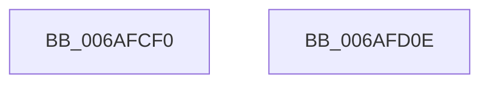

# ZwQueryLicenseValue

- RVA: `0x006AFCF0`–`0x006AFD0F` (길이 `31` bytes)
- VA: `0x00000001406AFCF0`
- 실행 섹션: `.text`
- PDB 이름 있음: `예`; PDB Function 태그: `아니요`
- unwind 정보 RVA: `0x000C0F1C`
- 디코드: `11`개 명령, `31/31` bytes 표시
- 미해석 바이트: `0` (있으면 어셈블리에 `.byte`로 보존)

> 이 문서는 커널 이미지의 기계어와 PDB 기호를 분석해 생성했습니다. 4번과 5번은 함수 원형과 자료형을 바이너리 사용 방식에서 추정한 C 해석이며 원본 소스 복구 결과는 아닙니다.

## 1. Dependencies

- 직접 호출 지점: **0**; 고유 호출 대상: **0**
- 직접 호출자로 확인된 함수: **16**
- RIP 상대 이미지 참조: **1**

### Outgoing calls
- 직접 디코드된 call 명령이 없습니다.

### Direct callers
- [SepDesktopAppxSubProcessToken](../45/SepDesktopAppxSubProcessToken_function_0045BD90.md) at `0x0045BFA9`
- [HalpQueryMaximumRegisteredProcessorCount](../54/HalpQueryMaximumRegisteredProcessorCount_function_00543BE8.md) at `0x00543C5F`
- [RtlGetProductInfo](../5E/RtlGetProductInfo_function_005EC870.md) at `0x005EC929`
- [RtlGetProductInfo](../5E/RtlGetProductInfo_function_005EC870.md) at `0x005EC96D`
- [RtlIsFeatureEnabledForEnterprise](../5E/RtlIsFeatureEnabledForEnterprise_function_005ED210.md) at `0x005ED2B3`
- [DifZwQueryLicenseValueWrapper](../64/DifZwQueryLicenseValueWrapper_function_00648080.md) at `0x0064818A`
- [RtlpGetWindowsPolicy](../../page/70/RtlpGetWindowsPolicy_function_00703DCC.md) at `0x00703E35`
- [RtlpGetWindowsPolicy](../../page/70/RtlpGetWindowsPolicy_function_00703DCC.md) at `0x00703E78`
- [SepIsLockedDown](../../page/79/SepIsLockedDown_function_0079BC28.md) at `0x0079BC87`
- [ExGetExpirationDate](../../page/7C/ExGetExpirationDate_function_007C78C8.md) at `0x007C7948`
- [ExpGenuinePolicyPostProcess](../../page/7C/ExpGenuinePolicyPostProcess_function_007C8380.md) at `0x007C844B`
- [MmCreateMirror](../../page/7F/MmCreateMirror_function_007FCB50.md) at `0x007FCB97`
- [RtlpGetPolicyValueForSystemCapability](../../page/A2/RtlpGetPolicyValueForSystemCapability_function_00A207F8.md) at `0x00A208CE`
- [sub_00B3788E](../../page/B3/Unknown_function_00B3788E.md) at `0x00B378C0`
- [InitializeDynamicPartitioningPolicy](../../init/C1/InitializeDynamicPartitioningPolicy_function_00C1C2E8.md) at `0x00C1C353`
- [Phase1InitializationDiscard](../../init/C1/Phase1InitializationDiscard_function_00C1C728.md) at `0x00C1CED6`
- [PpmInitIdlePolicy](../../init/C3/PpmInitIdlePolicy_function_00C3D8F4.md) at `0x00C3DA1B`
- [WheapLoadPolicy](../../init/C5/WheapLoadPolicy_function_00C5574C.md) at `0x00C557D9`

### Static image references
- `0x006AFCFC` → RVA `0x006B3460` (`KiServiceLinkage`; read)

## 2. Other-region calls and transfers

- 다른 실행 섹션으로 향하는 call: **0**
- call이 아닌 외부 분기/꼬리 이동: **1**
  - `0x006AFD09` → [KiServiceInternal](../6C/KiServiceInternal_function_006C49C0.md) (`tail-transfer`)

## 3. Assembly (complete function range)

```asm
006AFCF0  48 8B C4                        mov rax, rsp
006AFCF3  FA                              cli
006AFCF4  48 83 EC 10                     sub rsp, 0x10
006AFCF8  50                              push rax
006AFCF9  9C                              pushfq
006AFCFA  6A 10                           push 0x10
006AFCFC  48 8D 05 5D 37 00 00            lea rax, [rip + 0x375d]
006AFD03  50                              push rax
006AFD04  B8 61 01 00 00                  mov eax, 0x161
006AFD09  E9 B2 4C 01 00                  jmp 0x1406c49c0
006AFD0E  C3                              ret
```

## 4. C-style interpretation (structured pseudocode)

```c
__int64 __fastcall ZwQueryLicenseValue(void)
{
    __int64 v_rsp;

    v_rsp = (v_rsp) - (16);
}
```

## 5. (Beta) C Style

```c
void ZwQueryLicenseValue(void)
{
    int64_t local_rsp;

    local_rsp = (local_rsp) - (16);
}
```

## 6. Execution-region graph

[열기: 2D/3D 그래프와 함수 탐색 컨트롤 패널](../../../control-panel.html?section=text&rva=0x006AFCF0&view=graph)

- 2D 그래프는 위에서 아래로 흐르고, 3D 그래프는 빈 공간을 드래그해 회전합니다. Shift+드래그는 이동, 휠은 확대·축소, 함수 노드 선택은 대상 보고서 이동입니다.

### Static fallback


