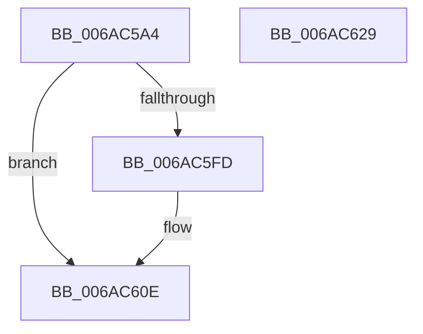

# _GSHandlerCheck_SEH

- RVA: `0x006AC5A4`–`0x006AC62A` (길이 `134` bytes)
- VA: `0x00000001406AC5A4`
- 실행 섹션: `.text`
- PDB 이름 있음: `예`; PDB Function 태그: `아니요`
- unwind 정보 RVA: `0x0005E6B4`
- 디코드: `41`개 명령, `134/134` bytes 표시
- 미해석 바이트: `0` (있으면 어셈블리에 `.byte`로 보존)

> 이 문서는 커널 이미지의 기계어와 PDB 기호를 분석해 생성했습니다. 4번과 5번은 함수 원형과 자료형을 바이너리 사용 방식에서 추정한 C 해석이며 원본 소스 복구 결과는 아닙니다.

## 1. Dependencies

- 직접 호출 지점: **2**; 고유 호출 대상: **2**
- 직접 호출자로 확인된 함수: **0**
- RIP 상대 이미지 참조: **0**

### Outgoing calls
- `0x006AC5E1` → [_GSHandlerCheckCommon](../50/_GSHandlerCheckCommon_function_00503E28.md) (function, `0x00503E28`)
- `0x006AC609` → [_C_specific_handler](../4F/_C_specific_handler_function_004FD410.md) (function, `0x004FD410`)

### Direct callers
- 이 함수 시작 RVA로 연결되는 직접 call은 확인되지 않았습니다. 간접 호출은 완전히 역산할 수 없습니다.

### Static image references
- 디코드된 RIP-relative 메모리 참조가 없습니다.

## 2. Other-region calls and transfers

- 다른 실행 섹션으로 향하는 call: **0**
- 별도 외부 분기/꼬리 이동을 확인하지 못했습니다.

## 3. Assembly (complete function range)

```asm
006AC5A4  48 8B C4                        mov rax, rsp
006AC5A7  48 89 58 08                     mov qword ptr [rax + 8], rbx
006AC5AB  48 89 68 10                     mov qword ptr [rax + 0x10], rbp
006AC5AF  48 89 70 18                     mov qword ptr [rax + 0x18], rsi
006AC5B3  48 89 78 20                     mov qword ptr [rax + 0x20], rdi
006AC5B7  41 56                           push r14
006AC5B9  48 83 EC 20                     sub rsp, 0x20
006AC5BD  4D 8B 51 38                     mov r10, qword ptr [r9 + 0x38]
006AC5C1  48 8B F2                        mov rsi, rdx
006AC5C4  4D 8B F0                        mov r14, r8
006AC5C7  48 8B E9                        mov rbp, rcx
006AC5CA  49 8B D1                        mov rdx, r9
006AC5CD  48 8B CE                        mov rcx, rsi
006AC5D0  49 8B F9                        mov rdi, r9
006AC5D3  41 8B 1A                        mov ebx, dword ptr [r10]
006AC5D6  48 C1 E3 04                     shl rbx, 4
006AC5DA  49 03 DA                        add rbx, r10
006AC5DD  4C 8D 43 04                     lea r8, [rbx + 4]
006AC5E1  E8 42 78 E5 FF                  call 0x140503e28
006AC5E6  8B 45 04                        mov eax, dword ptr [rbp + 4]
006AC5E9  24 66                           and al, 0x66
006AC5EB  F6 D8                           neg al
006AC5ED  B8 01 00 00 00                  mov eax, 1
006AC5F2  1B D2                           sbb edx, edx
006AC5F4  F7 DA                           neg edx
006AC5F6  03 D0                           add edx, eax
006AC5F8  85 53 04                        test dword ptr [rbx + 4], edx
006AC5FB  74 11                           je 0x1406ac60e
006AC5FD  4C 8B CF                        mov r9, rdi
006AC600  4D 8B C6                        mov r8, r14
006AC603  48 8B D6                        mov rdx, rsi
006AC606  48 8B CD                        mov rcx, rbp
006AC609  E8 02 0E E5 FF                  call 0x1404fd410
006AC60E  48 8B 5C 24 30                  mov rbx, qword ptr [rsp + 0x30]
006AC613  48 8B 6C 24 38                  mov rbp, qword ptr [rsp + 0x38]
006AC618  48 8B 74 24 40                  mov rsi, qword ptr [rsp + 0x40]
006AC61D  48 8B 7C 24 48                  mov rdi, qword ptr [rsp + 0x48]
006AC622  48 83 C4 20                     add rsp, 0x20
006AC626  41 5E                           pop r14
006AC628  C3                              ret
006AC629  CC                              int3
```

## 4. C-style interpretation (structured pseudocode)

```c
__int64 __fastcall _GSHandlerCheck_SEH(__int64 a1, __int64 a2, __int64 a3, __int64 a4)
{
    __int64 result;
    __int64 v_rbx;
    __int64 v_rsp;
    unsigned __int64 v_stack_p10;
    unsigned __int64 v_stack_p18;
    unsigned __int64 v_stack_p20;
    unsigned __int64 v_stack_p8;

    *(unsigned __int64 *)(v_rsp + 8) = v_rbx;
    *(unsigned __int64 *)(v_rsp + 16) = v_rbp;
    *(unsigned __int64 *)(v_rsp + 24) = v_rsi;
    *(unsigned __int64 *)(v_rsp + 32) = v_rdi;
    v_rsp = (v_rsp) - (32);
    v_rbx = ((unsigned int)(*(unsigned int *)(*(unsigned __int64 *)(a4 + 56)))) << (4);
    v_rbx = (v_rbx) + (*(unsigned __int64 *)(a4 + 56));
    result = _GSHandlerCheckCommon(a2, a4, v_rbx + 4, a4);
    result = (unsigned __int8)(((unsigned int)(*(unsigned int *)(a1 + 4))) & (102));
    result = (unsigned __int8)(-(result));
    a2 = (unsigned int)(-(a4));
    a2 = (unsigned int)((a2) + (1));
    result = 1;
    if (((*(unsigned int *)(v_rbx + 4)) & ((unsigned int)(a2))) != 0) {
        a4 = a4;
        a3 = a3;
        a2 = a2;
        a1 = a1;
        result = _C_specific_handler(a1, a2, a3, a4);
    }
    v_rsp = (v_rsp) + (32);
    return result;
}
```

## 5. (Beta) C Style

```c
int64_t _GSHandlerCheck_SEH(void *Arg1, int64_t Arg2, int64_t Arg3, void *Arg4)
{
    uint8_t *arg1 = (uint8_t *)Arg1;
    uint8_t *arg4 = (uint8_t *)Arg4;

    int64_t result;
    int64_t local_rbx;
    int64_t local_rsp;
    uint64_t v_stack_p10;
    uint64_t v_stack_p18;
    uint64_t v_stack_p20;
    uint64_t v_stack_p8;

    *(uint64_t *)(local_rsp + 0x8) = local_rbx;
    *(uint64_t *)(local_rsp + 0x10) = local_rbp;
    *(uint64_t *)(local_rsp + 0x18) = local_rsi;
    *(uint64_t *)(local_rsp + 0x20) = local_rdi;
    local_rsp = (local_rsp) - (32);
    local_rbx = ((uint32_t)(*(uint32_t *)(*(uint64_t *)(arg4 + 0x38)))) << (4);
    local_rbx = (local_rbx) + (*(uint64_t *)(arg4 + 0x38));
    result = _GSHandlerCheckCommon(Arg2, Arg4, local_rbx + 4, Arg4);
    result = (uint8_t)(((uint32_t)(*(uint32_t *)(arg1 + 0x4))) & (102));
    result = (uint8_t)(-(result));
    Arg2 = (uint32_t)(-(Arg4));
    Arg2 = (uint32_t)((Arg2) + (1));
    result = 1;
    if (((*(uint32_t *)(local_rbx + 0x4)) & ((uint32_t)(Arg2))) != 0) {
        Arg4 = Arg4;
        Arg3 = Arg3;
        Arg2 = Arg2;
        Arg1 = Arg1;
        result = _C_specific_handler(Arg1, Arg2, Arg3, Arg4);
    }
    local_rsp = (local_rsp) + (32);
    return result;
}
```

### 관측된 메모리 오프셋

구조체 형식이 확인되지 않은 접근은 인자 기준의 오프셋으로만 기록했습니다.

| 기준 인자 | 오프셋 표현 | 폭 (bit) | 접근 |
|---|---:|---:|---|
| `Arg1` | `+ 0x4` | `32` | `R` |
| `Arg4` | `+ 0x38` | `64` | `R` |

## 6. Execution-region graph

[열기: 2D/3D 그래프와 함수 탐색 컨트롤 패널](../../../control-panel.html?section=text&rva=0x006AC5A4&view=graph)

- 2D 그래프는 위에서 아래로 흐르고, 3D 그래프는 빈 공간을 드래그해 회전합니다. Shift+드래그는 이동, 휠은 확대·축소, 함수 노드 선택은 대상 보고서 이동입니다.

### Static fallback


