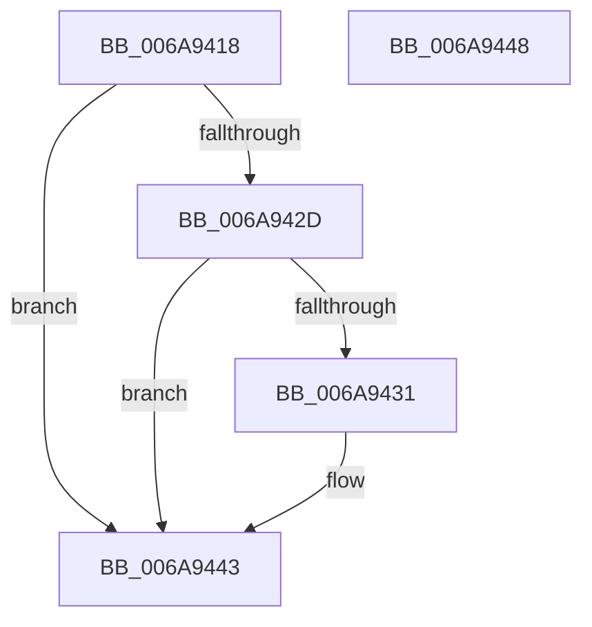

# _MuiRegAllocArray

- RVA: `0x006A9418`–`0x006A9449` (길이 `49` bytes)
- VA: `0x00000001406A9418`
- 실행 섹션: `.text`
- PDB 이름 있음: `예`; PDB Function 태그: `예`
- unwind 정보 RVA: `0x0005C788`
- 디코드: `16`개 명령, `49/49` bytes 표시
- 미해석 바이트: `0` (있으면 어셈블리에 `.byte`로 보존)

> 이 문서는 커널 이미지의 기계어와 PDB 기호를 분석해 생성했습니다. 4번과 5번은 함수 원형과 자료형을 바이너리 사용 방식에서 추정한 C 해석이며 원본 소스 복구 결과는 아닙니다.

## 1. Dependencies

- 직접 호출 지점: **1**; 고유 호출 대상: **1**
- 직접 호출자로 확인된 함수: **5**
- RIP 상대 이미지 참조: **0**

### Outgoing calls
- `0x006A943E` → [ExAllocatePool2](../../poolcode/B8/ExAllocatePool2_function_00B820F0.md) (function, `0x00B820F0`)

### Direct callers
- [RtlpLoadInstallLanguageFallback](../../page/83/RtlpLoadInstallLanguageFallback_function_0083D278.md) at `0x0083D2CC`
- [RtlpMuiRegConfigMatchesInstalled](../../page/83/RtlpMuiRegConfigMatchesInstalled_function_0083DA08.md) at `0x0083DBD9`
- [RtlpMuiRegGetInstalledLanguageIndexByLangId](../../page/83/RtlpMuiRegGetInstalledLanguageIndexByLangId_function_0083E31C.md) at `0x0083E3D7`
- [RtlpMuiRegLangInfoMatchesSpec](../../page/83/RtlpMuiRegLangInfoMatchesSpec_function_0083EBD0.md) at `0x0083ECF5`
- [RtlpMuiRegValidateInstalled](../../page/84/RtlpMuiRegValidateInstalled_function_008404D4.md) at `0x008405C8`

### Static image references
- 디코드된 RIP-relative 메모리 참조가 없습니다.

## 2. Other-region calls and transfers

- 다른 실행 섹션으로 향하는 call: **1**
  - `0x006A943E` → [ExAllocatePool2](../../poolcode/B8/ExAllocatePool2_function_00B820F0.md) (`.text` → `POOLCODE`)
- 별도 외부 분기/꼬리 이동을 확인하지 못했습니다.

## 3. Assembly (complete function range)

```asm
006A9418  48 83 EC 28                     sub rsp, 0x28
006A941C  8B CA                           mov ecx, edx
006A941E  33 C0                           xor eax, eax
006A9420  48 03 C9                        add rcx, rcx
006A9423  BA FF FF FF FF                  mov edx, 0xffffffff
006A9428  48 3B CA                        cmp rcx, rdx
006A942B  77 16                           ja 0x1406a9443
006A942D  85 C9                           test ecx, ecx
006A942F  74 12                           je 0x1406a9443
006A9431  8B D1                           mov edx, ecx
006A9433  41 B8 6D 6C 74 72               mov r8d, 0x72746c6d
006A9439  B9 00 01 00 00                  mov ecx, 0x100
006A943E  E8 AD 8C 4D 00                  call 0x140b820f0
006A9443  48 83 C4 28                     add rsp, 0x28
006A9447  C3                              ret
006A9448  CC                              int3
```

## 4. C-style interpretation (structured pseudocode)

```c
__int64 __fastcall _MuiRegAllocArray(__int64 a1, int a2)
{
    __int64 result;
    __int64 v_rsp;

    v_rsp = (v_rsp) - (40);
    result = 0;
    a1 = ((unsigned int)(a2)) + ((unsigned int)(a2));
    if (a1 > ((unsigned int)(0xFFFFFFFFULL))) goto loc_006A9443;
    if ((unsigned int)(a1) != 0) {
        a2 = (unsigned int)(a1);
        a3 = 0x72746C6DULL;
        a1 = 256;
        result = ExAllocatePool2(a1, a2, a3, a4);
    }
    v_rsp = (v_rsp) + (40);
    return result;
}
```

## 5. (Beta) C Style

```c
int64_t _MuiRegAllocArray(int64_t Arg1, int32_t Arg2)
{
    int64_t result;
    int64_t local_rsp;

    local_rsp = (local_rsp) - (40);
    result = 0;
    Arg1 = ((uint32_t)(Arg2)) + ((uint32_t)(Arg2));
    if (Arg1 > ((uint32_t)(0xFFFFFFFFULL))) goto loc_006A9443;
    if ((uint32_t)(Arg1) != 0) {
        Arg2 = (uint32_t)(Arg1);
        a3 = 0x72746C6DULL;
        Arg1 = 256;
        result = ExAllocatePool2(Arg1, Arg2, a3, a4);
    }
    local_rsp = (local_rsp) + (40);
    return result;
}
```

## 6. Execution-region graph

[열기: 2D/3D 그래프와 함수 탐색 컨트롤 패널](../../../control-panel.html?section=text&rva=0x006A9418&view=graph)

- 2D 그래프는 위에서 아래로 흐르고, 3D 그래프는 빈 공간을 드래그해 회전합니다. Shift+드래그는 이동, 휠은 확대·축소, 함수 노드 선택은 대상 보고서 이동입니다.

### Static fallback


