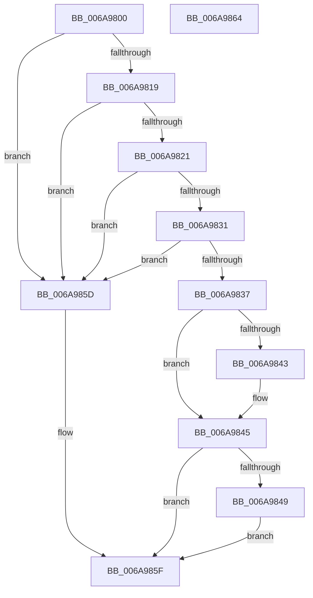

# _SafeAllocBlob

- RVA: `0x006A9800`–`0x006A9865` (길이 `101` bytes)
- VA: `0x00000001406A9800`
- 실행 섹션: `.text`
- PDB 이름 있음: `예`; PDB Function 태그: `예`
- unwind 정보 RVA: `0x0005C788`
- 디코드: `34`개 명령, `101/101` bytes 표시
- 미해석 바이트: `0` (있으면 어셈블리에 `.byte`로 보존)

> 이 문서는 커널 이미지의 기계어와 PDB 기호를 분석해 생성했습니다. 4번과 5번은 함수 원형과 자료형을 바이너리 사용 방식에서 추정한 C 해석이며 원본 소스 복구 결과는 아닙니다.

## 1. Dependencies

- 직접 호출 지점: **1**; 고유 호출 대상: **1**
- 직접 호출자로 확인된 함수: **3**
- RIP 상대 이미지 참조: **0**

### Outgoing calls
- `0x006A9856` → [ExAllocatePool2](../../poolcode/B8/ExAllocatePool2_function_00B820F0.md) (function, `0x00B820F0`)

### Direct callers
- [RtlpMuiRegCreateLanguageConfigList](../../page/83/RtlpMuiRegCreateLanguageConfigList_function_0083DCD4.md) at `0x0083DD07`
- [RtlpMuiRegCreateStringPool](../../page/83/RtlpMuiRegCreateStringPool_function_0083DD6C.md) at `0x0083DDB1`
- [RtlpMuiRegLoadInstalled](../../page/83/RtlpMuiRegLoadInstalled_function_0083FB1C.md) at `0x0083FBBE`

### Static image references
- 디코드된 RIP-relative 메모리 참조가 없습니다.

## 2. Other-region calls and transfers

- 다른 실행 섹션으로 향하는 call: **1**
  - `0x006A9856` → [ExAllocatePool2](../../poolcode/B8/ExAllocatePool2_function_00B820F0.md) (`.text` → `POOLCODE`)
- 별도 외부 분기/꼬리 이동을 확인하지 못했습니다.

## 3. Assembly (complete function range)

```asm
006A9800  48 83 EC 28                     sub rsp, 0x28
006A9804  41 8B C0                        mov eax, r8d
006A9807  41 B8 FF FF FF FF               mov r8d, 0xffffffff
006A980D  44 8B D2                        mov r10d, edx
006A9810  4C 0F AF D0                     imul r10, rax
006A9814  4D 3B D0                        cmp r10, r8
006A9817  77 44                           ja 0x1406a985d
006A9819  41 8D 14 0A                     lea edx, [r10 + rcx]
006A981D  3B D1                           cmp edx, ecx
006A981F  72 3C                           jb 0x1406a985d
006A9821  8B 44 24 50                     mov eax, dword ptr [rsp + 0x50]
006A9825  41 8B C9                        mov ecx, r9d
006A9828  48 0F AF C8                     imul rcx, rax
006A982C  49 3B C8                        cmp rcx, r8
006A982F  77 2C                           ja 0x1406a985d
006A9831  03 CA                           add ecx, edx
006A9833  3B CA                           cmp ecx, edx
006A9835  72 26                           jb 0x1406a985d
006A9837  48 8B 54 24 58                  mov rdx, qword ptr [rsp + 0x58]
006A983C  33 C0                           xor eax, eax
006A983E  48 85 D2                        test rdx, rdx
006A9841  74 02                           je 0x1406a9845
006A9843  89 0A                           mov dword ptr [rdx], ecx
006A9845  85 C9                           test ecx, ecx
006A9847  74 16                           je 0x1406a985f
006A9849  8B D1                           mov edx, ecx
006A984B  41 B8 6D 6C 74 72               mov r8d, 0x72746c6d
006A9851  B9 00 01 00 00                  mov ecx, 0x100
006A9856  E8 95 88 4D 00                  call 0x140b820f0
006A985B  EB 02                           jmp 0x1406a985f
006A985D  33 C0                           xor eax, eax
006A985F  48 83 C4 28                     add rsp, 0x28
006A9863  C3                              ret
006A9864  CC                              int3
```

## 4. C-style interpretation (structured pseudocode)

```c
__int64 __fastcall _SafeAllocBlob(__int64 a1, int a2, int a3, int a4, unsigned int a5, __int64 a6)
{
    __int64 result;
    __int64 v_r10;
    __int64 v_rsp;

    v_rsp = (v_rsp) - (40);
    v_r10 = ((unsigned int)(a2)) * ((unsigned int)(a3));
    if (v_r10 > ((unsigned int)(0xFFFFFFFFULL))) goto loc_006A985D;
    if (((unsigned int)(v_r10 + a1 * 1)) < ((unsigned int)(a1))) goto loc_006A985D;
    a1 = ((unsigned int)(a4)) * ((unsigned int)(a5));
    if (a1 > ((unsigned int)(0xFFFFFFFFULL))) goto loc_006A985D;
    a1 = (unsigned int)((a1) + ((unsigned int)(v_r10 + a1 * 1)));
    if (((unsigned int)(a1)) < ((unsigned int)(v_r10 + a1 * 1))) goto loc_006A985D;
    result = 0;
    if (a6 != 0) {
        *(unsigned int *)(a6) = (unsigned int)(a1);
    }
    if ((unsigned int)(a1) == 0) goto loc_006A985F;
    result = ExAllocatePool2(256, (unsigned int)((unsigned int)(a1)), (unsigned int)(0x72746C6DULL), a4);
    goto loc_006A985F;
loc_006A985D:
    result = 0;
loc_006A985F:
    v_rsp = (v_rsp) + (40);
    return result;
}
```

## 5. (Beta) C Style

```c
int64_t _SafeAllocBlob(int64_t Arg1, int32_t Arg2, int32_t Arg3, int32_t Arg4, uint32_t Arg5, int64_t Arg6)
{
    int64_t result;
    int64_t local_r10;
    int64_t local_rsp;

    local_rsp = (local_rsp) - (40);
    local_r10 = ((uint32_t)(Arg2)) * ((uint32_t)(Arg3));
    if (local_r10 > ((uint32_t)(0xFFFFFFFFULL))) goto loc_006A985D;
    if (((uint32_t)(local_r10 + Arg1 * 1)) < ((uint32_t)(Arg1))) goto loc_006A985D;
    Arg1 = ((uint32_t)(Arg4)) * ((uint32_t)(Arg5));
    if (Arg1 > ((uint32_t)(0xFFFFFFFFULL))) goto loc_006A985D;
    Arg1 = (uint32_t)((Arg1) + ((uint32_t)(local_r10 + Arg1 * 1)));
    if (((uint32_t)(Arg1)) < ((uint32_t)(local_r10 + Arg1 * 1))) goto loc_006A985D;
    result = 0;
    if (Arg6 != 0) {
        *(uint32_t *)(Arg6) = (uint32_t)(Arg1);
    }
    if ((uint32_t)(Arg1) == 0) goto loc_006A985F;
    result = ExAllocatePool2(256, (uint32_t)((uint32_t)(Arg1)), (uint32_t)(0x72746C6DULL), Arg4);
    goto loc_006A985F;
loc_006A985D:
    result = 0;
loc_006A985F:
    local_rsp = (local_rsp) + (40);
    return result;
}
```

## 6. Execution-region graph

[열기: 2D/3D 그래프와 함수 탐색 컨트롤 패널](../../../control-panel.html?section=text&rva=0x006A9800&view=graph)

- 2D 그래프는 위에서 아래로 흐르고, 3D 그래프는 빈 공간을 드래그해 회전합니다. Shift+드래그는 이동, 휠은 확대·축소, 함수 노드 선택은 대상 보고서 이동입니다.

### Static fallback


