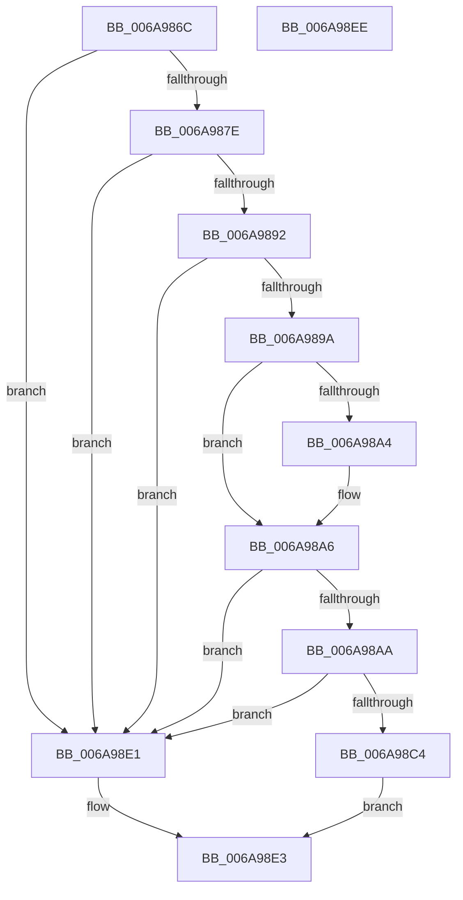

# _SafeReallocBlob

- RVA: `0x006A986C`–`0x006A98EF` (길이 `131` bytes)
- VA: `0x00000001406A986C`
- 실행 섹션: `.text`
- PDB 이름 있음: `예`; PDB Function 태그: `예`
- unwind 정보 RVA: `0x0005CAAC`
- 디코드: `43`개 명령, `131/131` bytes 표시
- 미해석 바이트: `0` (있으면 어셈블리에 `.byte`로 보존)

> 이 문서는 커널 이미지의 기계어와 PDB 기호를 분석해 생성했습니다. 4번과 5번은 함수 원형과 자료형을 바이너리 사용 방식에서 추정한 C 해석이며 원본 소스 복구 결과는 아닙니다.

## 1. Dependencies

- 직접 호출 지점: **3**; 고유 호출 대상: **3**
- 직접 호출자로 확인된 함수: **2**
- RIP 상대 이미지 참조: **0**

### Outgoing calls
- `0x006A98B7` → [ExAllocatePool2](../../poolcode/B8/ExAllocatePool2_function_00B820F0.md) (function, `0x00B820F0`)
- `0x006A98CD` → [memcpy](../6C/memcpy_function_006C6840.md) (function, `0x006C6840`)
- `0x006A98D7` → [ExFreePoolWithTag](../../poolcode/B8/ExFreePoolWithTag_function_00B82870.md) (function, `0x00B82870`)

### Direct callers
- [RtlpMuiRegGrowLanguageConfigList](../../page/83/RtlpMuiRegGrowLanguageConfigList_function_0083EAB4.md) at `0x0083EB01`
- [RtlpMuiRegGrowLanguages](../../page/83/RtlpMuiRegGrowLanguages_function_0083EB38.md) at `0x0083EB97`

### Static image references
- 디코드된 RIP-relative 메모리 참조가 없습니다.

## 2. Other-region calls and transfers

- 다른 실행 섹션으로 향하는 call: **2**
  - `0x006A98B7` → [ExAllocatePool2](../../poolcode/B8/ExAllocatePool2_function_00B820F0.md) (`.text` → `POOLCODE`)
  - `0x006A98D7` → [ExFreePoolWithTag](../../poolcode/B8/ExFreePoolWithTag_function_00B82870.md) (`.text` → `POOLCODE`)
- 별도 외부 분기/꼬리 이동을 확인하지 못했습니다.

## 3. Assembly (complete function range)

```asm
006A986C  48 89 5C 24 08                  mov qword ptr [rsp + 8], rbx
006A9871  57                              push rdi
006A9872  48 83 EC 20                     sub rsp, 0x20
006A9876  48 8B D9                        mov rbx, rcx
006A9879  48 85 C9                        test rcx, rcx
006A987C  74 63                           je 0x1406a98e1
006A987E  41 8B C1                        mov eax, r9d
006A9881  45 8B C0                        mov r8d, r8d
006A9884  4C 0F AF C0                     imul r8, rax
006A9888  B8 FF FF FF FF                  mov eax, 0xffffffff
006A988D  4C 3B C0                        cmp r8, rax
006A9890  77 4F                           ja 0x1406a98e1
006A9892  41 8D 04 10                     lea eax, [r8 + rdx]
006A9896  3B C2                           cmp eax, edx
006A9898  72 47                           jb 0x1406a98e1
006A989A  48 8B 4C 24 60                  mov rcx, qword ptr [rsp + 0x60]
006A989F  48 85 C9                        test rcx, rcx
006A98A2  74 02                           je 0x1406a98a6
006A98A4  89 01                           mov dword ptr [rcx], eax
006A98A6  85 C0                           test eax, eax
006A98A8  74 37                           je 0x1406a98e1
006A98AA  8B D0                           mov edx, eax
006A98AC  B9 00 01 00 00                  mov ecx, 0x100
006A98B1  41 B8 6D 6C 74 72               mov r8d, 0x72746c6d
006A98B7  E8 34 88 4D 00                  call 0x140b820f0
006A98BC  48 8B F8                        mov rdi, rax
006A98BF  48 85 C0                        test rax, rax
006A98C2  74 1D                           je 0x1406a98e1
006A98C4  44 8B 03                        mov r8d, dword ptr [rbx]
006A98C7  48 8B D3                        mov rdx, rbx
006A98CA  48 8B C8                        mov rcx, rax
006A98CD  E8 6E CF 01 00                  call 0x1406c6840
006A98D2  33 D2                           xor edx, edx
006A98D4  48 8B CB                        mov rcx, rbx
006A98D7  E8 94 8F 4D 00                  call 0x140b82870
006A98DC  48 8B C7                        mov rax, rdi
006A98DF  EB 02                           jmp 0x1406a98e3
006A98E1  33 C0                           xor eax, eax
006A98E3  48 8B 5C 24 30                  mov rbx, qword ptr [rsp + 0x30]
006A98E8  48 83 C4 20                     add rsp, 0x20
006A98EC  5F                              pop rdi
006A98ED  C3                              ret
006A98EE  CC                              int3
```

## 4. C-style interpretation (structured pseudocode)

```c
__int64 __fastcall _SafeReallocBlob(__int64 a1, __int64 a2, int a3, int a4, __int64 a5, __int64 a6, __int64 a7)
{
    __int64 result;
    __int64 v_rsp;
    unsigned __int64 v_stack_p8;

    v_stack_p8 = v_rbx;
    v_rsp = (v_rsp) - (32);
    if (a1 == 0) goto loc_006A98E1;
    a3 = ((unsigned int)(a3)) * ((unsigned int)(a4));
    if (a3 > ((unsigned int)(0xFFFFFFFFULL))) goto loc_006A98E1;
    if (((unsigned int)(a3 + a2 * 1)) < ((unsigned int)(a2))) goto loc_006A98E1;
    if (a7 != 0) {
        *(unsigned int *)(a7) = (unsigned int)(a3 + a2 * 1);
    }
    if ((unsigned int)(a3 + a2 * 1) == 0) goto loc_006A98E1;
    result = ExAllocatePool2(256, (unsigned int)((unsigned int)(a3 + a2 * 1)), (unsigned int)(0x72746C6DULL), a4);
    if (result == 0) goto loc_006A98E1;
    result = memcpy(result, a1, (unsigned int)(*(unsigned int *)(a1)), a4);
    a2 = 0;
    result = ExFreePoolWithTag(a1, a2, (unsigned int)(*(unsigned int *)(a1)), a4);
    goto loc_006A98E3;
loc_006A98E1:
    result = 0;
loc_006A98E3:
    v_rsp = (v_rsp) + (32);
    return result;
}
```

## 5. (Beta) C Style

```c
int64_t _SafeReallocBlob(void *Arg1, int64_t Arg2, int32_t Arg3, int32_t Arg4, uint64_t Arg5, uint64_t Arg6, int64_t Arg7)
{
    uint8_t *arg1 = (uint8_t *)Arg1;

    int64_t result;
    int64_t local_rsp;
    uint64_t v_stack_p8;

    v_stack_p8 = local_rbx;
    local_rsp = (local_rsp) - (32);
    if (Arg1 == NULL) goto loc_006A98E1;
    Arg3 = ((uint32_t)(Arg3)) * ((uint32_t)(Arg4));
    if (Arg3 > ((uint32_t)(0xFFFFFFFFULL))) goto loc_006A98E1;
    if (((uint32_t)(Arg3 + Arg2 * 1)) < ((uint32_t)(Arg2))) goto loc_006A98E1;
    if (Arg7 != 0) {
        *(uint32_t *)(Arg7) = (uint32_t)(Arg3 + Arg2 * 1);
    }
    if ((uint32_t)(Arg3 + Arg2 * 1) == 0) goto loc_006A98E1;
    result = ExAllocatePool2(256, (uint32_t)((uint32_t)(Arg3 + Arg2 * 1)), (uint32_t)(0x72746C6DULL), Arg4);
    if (result == 0) goto loc_006A98E1;
    result = memcpy(result, Arg1, (uint32_t)(*(uint32_t *)(arg1)), Arg4);
    Arg2 = 0;
    result = ExFreePoolWithTag(Arg1, Arg2, (uint32_t)(*(uint32_t *)(arg1)), Arg4);
    goto loc_006A98E3;
loc_006A98E1:
    result = 0;
loc_006A98E3:
    local_rsp = (local_rsp) + (32);
    return result;
}
```

### 관측된 메모리 오프셋

구조체 형식이 확인되지 않은 접근은 인자 기준의 오프셋으로만 기록했습니다.

| 기준 인자 | 오프셋 표현 | 폭 (bit) | 접근 |
|---|---:|---:|---|
| `Arg1` | `+ 0x0` | `32` | `R` |

## 6. Execution-region graph

[열기: 2D/3D 그래프와 함수 탐색 컨트롤 패널](../../../control-panel.html?section=text&rva=0x006A986C&view=graph)

- 2D 그래프는 위에서 아래로 흐르고, 3D 그래프는 빈 공간을 드래그해 회전합니다. Shift+드래그는 이동, 휠은 확대·축소, 함수 노드 선택은 대상 보고서 이동입니다.

### Static fallback


