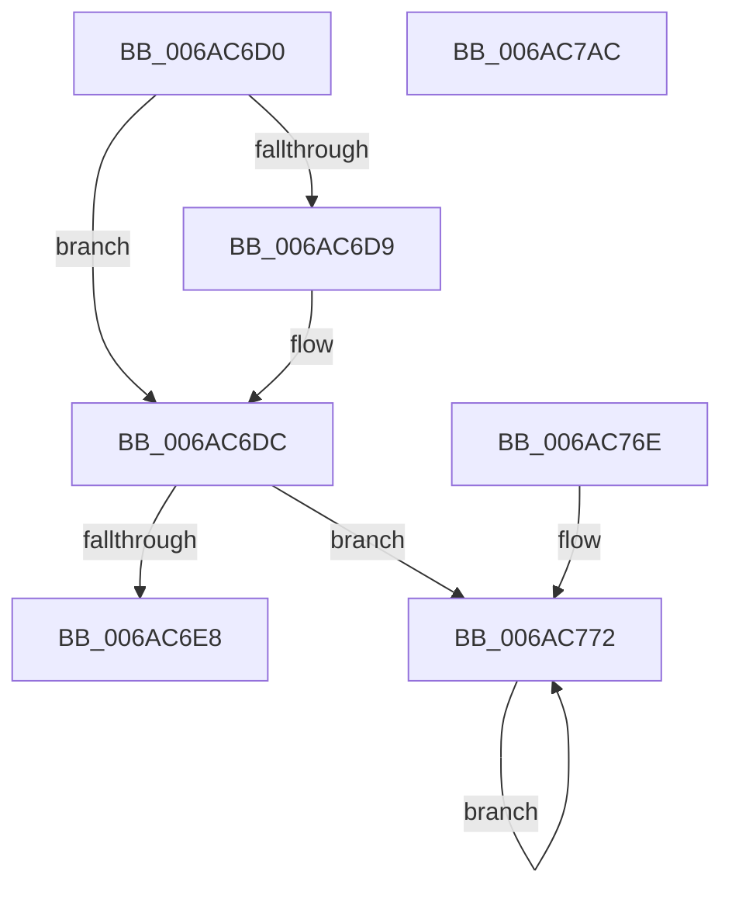

# _longjmp_internal

- RVA: `0x006AC6D0`–`0x006AC7AD` (길이 `221` bytes)
- VA: `0x00000001406AC6D0`
- 실행 섹션: `.text`
- PDB 이름 있음: `예`; PDB Function 태그: `아니요`
- unwind 정보 RVA: `0x000BFAD0`
- 디코드: `49`개 명령, `221/221` bytes 표시
- 미해석 바이트: `0` (있으면 어셈블리에 `.byte`로 보존)

> 이 문서는 커널 이미지의 기계어와 PDB 기호를 분석해 생성했습니다. 4번과 5번은 함수 원형과 자료형을 바이너리 사용 방식에서 추정한 C 해석이며 원본 소스 복구 결과는 아닙니다.

## 1. Dependencies

- 직접 호출 지점: **1**; 고유 호출 대상: **1**
- 직접 호출자로 확인된 함수: **1**
- RIP 상대 이미지 참조: **0**

### Outgoing calls
- `0x006AC7A5` → [RtlUnwind](../2F/RtlUnwind_function_002F1CB0.md) (function, `0x002F1CB0`)

### Direct callers
- [longjmp](../4F/longjmp_function_004FD5F0.md) at `0x004FD611`

### Static image references
- 디코드된 RIP-relative 메모리 참조가 없습니다.

## 2. Other-region calls and transfers

- 다른 실행 섹션으로 향하는 call: **0**
- 별도 외부 분기/꼬리 이동을 확인하지 못했습니다.

## 3. Assembly (complete function range)

```asm
006AC6D0  48 83 EC 48                     sub rsp, 0x48
006AC6D4  48 85 D2                        test rdx, rdx
006AC6D7  75 03                           jne 0x1406ac6dc
006AC6D9  48 FF C2                        inc rdx
006AC6DC  4D 33 D2                        xor r10, r10
006AC6DF  4C 39 11                        cmp qword ptr [rcx], r10
006AC6E2  0F 85 8A 00 00 00               jne 0x1406ac772
006AC6E8  0F AE E8                        lfence
006AC6EB  48 8B C2                        mov rax, rdx
006AC6EE  48 8B 59 08                     mov rbx, qword ptr [rcx + 8]
006AC6F2  48 8B 71 20                     mov rsi, qword ptr [rcx + 0x20]
006AC6F6  48 8B 79 28                     mov rdi, qword ptr [rcx + 0x28]
006AC6FA  4C 8B 61 30                     mov r12, qword ptr [rcx + 0x30]
006AC6FE  4C 8B 69 38                     mov r13, qword ptr [rcx + 0x38]
006AC702  4C 8B 71 40                     mov r14, qword ptr [rcx + 0x40]
006AC706  4C 8B 79 48                     mov r15, qword ptr [rcx + 0x48]
006AC70A  0F AE 51 58                     ldmxcsr dword ptr [rcx + 0x58]
006AC70E  66 0F 6F 71 60                  movdqa xmm6, xmmword ptr [rcx + 0x60]
006AC713  66 0F 6F 79 70                  movdqa xmm7, xmmword ptr [rcx + 0x70]
006AC718  66 44 0F 6F 81 80 00 00 00      movdqa xmm8, xmmword ptr [rcx + 0x80]
006AC721  66 44 0F 6F 89 90 00 00 00      movdqa xmm9, xmmword ptr [rcx + 0x90]
006AC72A  66 44 0F 6F 91 A0 00 00 00      movdqa xmm10, xmmword ptr [rcx + 0xa0]
006AC733  66 44 0F 6F 99 B0 00 00 00      movdqa xmm11, xmmword ptr [rcx + 0xb0]
006AC73C  66 44 0F 6F A1 C0 00 00 00      movdqa xmm12, xmmword ptr [rcx + 0xc0]
006AC745  66 44 0F 6F A9 D0 00 00 00      movdqa xmm13, xmmword ptr [rcx + 0xd0]
006AC74E  66 44 0F 6F B1 E0 00 00 00      movdqa xmm14, xmmword ptr [rcx + 0xe0]
006AC757  66 44 0F 6F B9 F0 00 00 00      movdqa xmm15, xmmword ptr [rcx + 0xf0]
006AC760  48 8B 51 50                     mov rdx, qword ptr [rcx + 0x50]
006AC764  48 8B 69 18                     mov rbp, qword ptr [rcx + 0x18]
006AC768  48 8B 61 10                     mov rsp, qword ptr [rcx + 0x10]
006AC76C  FF E2                           jmp rdx
006AC76E  CC                              int3
006AC76F  CC                              int3
006AC770  CC                              int3
006AC771  CC                              int3
006AC772  C7 44 24 20 26 00 00 80         mov dword ptr [rsp + 0x20], 0x80000026
006AC77A  44 89 54 24 24                  mov dword ptr [rsp + 0x24], r10d
006AC77F  4C 89 54 24 28                  mov qword ptr [rsp + 0x28], r10
006AC784  4C 89 54 24 30                  mov qword ptr [rsp + 0x30], r10
006AC789  41 FF C2                        inc r10d
006AC78C  44 89 54 24 38                  mov dword ptr [rsp + 0x38], r10d
006AC791  48 89 4C 24 40                  mov qword ptr [rsp + 0x40], rcx
006AC796  4C 8B CA                        mov r9, rdx
006AC799  4C 8D 44 24 20                  lea r8, [rsp + 0x20]
006AC79E  48 8B 51 50                     mov rdx, qword ptr [rcx + 0x50]
006AC7A2  48 8B 09                        mov rcx, qword ptr [rcx]
006AC7A5  E8 06 55 C4 FF                  call 0x1402f1cb0
006AC7AA  EB C6                           jmp 0x1406ac772
006AC7AC  C3                              ret
```

## 4. C-style interpretation (structured pseudocode)

```c
__int64 __fastcall _longjmp_internal(__int64 a1, __int64 a2)
{
    __int64 result;
    __int64 v_r10;
    __int64 v_rsp;
    unsigned int v_stack_m10;
    unsigned __int64 v_stack_m18;
    unsigned __int64 v_stack_m20;
    unsigned int v_stack_m24;
    unsigned int v_stack_m28;
    unsigned __int64 v_stack_m8;

    v_rsp = (v_rsp) - (72);
    if (a2 == 0) {
        a2 = (a2) + 1;
    }
    v_r10 = 0;
    if ((*(unsigned __int64 *)(a1)) != 0) goto loc_006AC772;
loc_006AC772:
    v_stack_m28 = 0x80000026ULL;
    v_stack_m24 = 0;
    v_stack_m20 = 0;
    v_stack_m18 = 0;
    v_r10 = (unsigned int)((v_r10) + 1);
    v_stack_m10 = (unsigned int)(v_r10);
    v_stack_m8 = a1;
    result = RtlUnwind(*(unsigned __int64 *)(a1), *(unsigned __int64 *)(a1 + 80), v_stack_m28, *(unsigned __int64 *)(a1 + 80));
    goto loc_006AC772;
}
```

## 5. (Beta) C Style

```c
int64_t _longjmp_internal(void *Arg1, int64_t Arg2)
{
    uint8_t *arg1 = (uint8_t *)Arg1;

    int64_t result;
    int64_t local_r10;
    int64_t local_rsp;
    uint32_t v_stack_m10;
    uint64_t v_stack_m18;
    uint64_t v_stack_m20;
    uint32_t v_stack_m24;
    uint32_t v_stack_m28;
    uint64_t v_stack_m8;

    local_rsp = (local_rsp) - (72);
    if (Arg2 == 0) {
        Arg2 = (Arg2) + 1;
    }
    local_r10 = 0;
    if ((*(uint64_t *)(arg1)) != 0) goto loc_006AC772;
loc_006AC772:
    v_stack_m28 = 0x80000026ULL;
    v_stack_m24 = 0;
    v_stack_m20 = 0;
    v_stack_m18 = 0;
    local_r10 = (uint32_t)((local_r10) + 1);
    v_stack_m10 = (uint32_t)(local_r10);
    v_stack_m8 = Arg1;
    result = RtlUnwind(*(uint64_t *)(arg1), *(uint64_t *)(arg1 + 0x50), v_stack_m28, *(uint64_t *)(arg1 + 0x50));
    goto loc_006AC772;
}
```

### 관측된 메모리 오프셋

구조체 형식이 확인되지 않은 접근은 인자 기준의 오프셋으로만 기록했습니다.

| 기준 인자 | 오프셋 표현 | 폭 (bit) | 접근 |
|---|---:|---:|---|
| `Arg1` | `+ 0x0` | `64` | `R` |
| `Arg1` | `+ 0x8` | `64` | `R` |
| `Arg1` | `+ 0x10` | `64` | `R` |
| `Arg1` | `+ 0x18` | `64` | `R` |
| `Arg1` | `+ 0x20` | `64` | `R` |
| `Arg1` | `+ 0x28` | `64` | `R` |
| `Arg1` | `+ 0x30` | `64` | `R` |
| `Arg1` | `+ 0x38` | `64` | `R` |
| `Arg1` | `+ 0x40` | `64` | `R` |
| `Arg1` | `+ 0x48` | `64` | `R` |
| `Arg1` | `+ 0x50` | `64` | `R` |
| `Arg1` | `+ 0x58` | `32` | `R` |
| `Arg1` | `+ 0x60` | `128` | `R` |
| `Arg1` | `+ 0x70` | `128` | `R` |
| `Arg1` | `+ 0x80` | `128` | `R` |
| `Arg1` | `+ 0x90` | `128` | `R` |
| `Arg1` | `+ 0xA0` | `128` | `R` |
| `Arg1` | `+ 0xB0` | `128` | `R` |
| `Arg1` | `+ 0xC0` | `128` | `R` |
| `Arg1` | `+ 0xD0` | `128` | `R` |
| `Arg1` | `+ 0xE0` | `128` | `R` |
| `Arg1` | `+ 0xF0` | `128` | `R` |

## 6. Execution-region graph

[열기: 2D/3D 그래프와 함수 탐색 컨트롤 패널](../../../control-panel.html?section=text&rva=0x006AC6D0&view=graph)

- 2D 그래프는 위에서 아래로 흐르고, 3D 그래프는 빈 공간을 드래그해 회전합니다. Shift+드래그는 이동, 휠은 확대·축소, 함수 노드 선택은 대상 보고서 이동입니다.

### Static fallback


