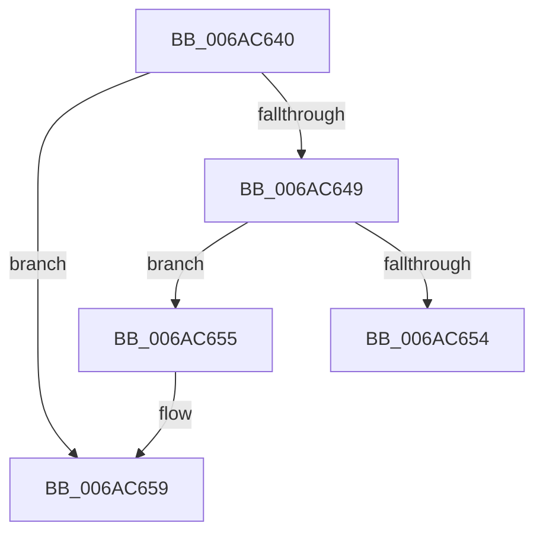

# _security_check_cookie

- RVA: `0x006AC640`–`0x006AC65E` (길이 `30` bytes)
- VA: `0x00000001406AC640`
- 실행 섹션: `.text`
- PDB 이름 있음: `예`; PDB Function 태그: `아니요`
- unwind 정보 RVA: `0x000BFAC0`
- 디코드: `8`개 명령, `30/30` bytes 표시
- 미해석 바이트: `0` (있으면 어셈블리에 `.byte`로 보존)

> 이 문서는 커널 이미지의 기계어와 PDB 기호를 분석해 생성했습니다. 4번과 5번은 함수 원형과 자료형을 바이너리 사용 방식에서 추정한 C 해석이며 원본 소스 복구 결과는 아닙니다.

## 1. Dependencies

- 직접 호출 지점: **0**; 고유 호출 대상: **0**
- 직접 호출자로 확인된 함수: **4210**
- RIP 상대 이미지 참조: **1**

### Outgoing calls
- 직접 디코드된 call 명령이 없습니다.

### Direct callers
- [_tlgWriteTemplate&lt;long __cdecl(_tlgProvider_t const * __ptr64,void const * __ptr64,_GUID const * __ptr64,_GUID const * __ptr64,unsigned int,_EVENT_DATA_DESCRIPTOR * __ptr64),&amp;_tlgWriteTransfer_EtwWriteTransfer,_GUID const * __ptr64,_GUID const * __ptr64&gt;::Write&lt;_tlgWrapperByVal&lt;8&gt;,_tlgWrapperByVal&lt;4&gt;,_tlgWrapperByVal&lt;4&gt;,_tlgWrapperByVal&lt;1&gt;,_tlgWrapperByRef&lt;16&gt;,_tlgWrapperBinary,_tlgWrapperByVal&lt;8&gt;,_tlgWrapperByVal&lt;1&gt;,_tlgWrapperBinary,_tlgWrapperByVal&lt;8&gt;,_tlgWrapperByVal&lt;1&gt;,_tlgWrapperBinary,_tlgWrapperByVal&lt;8&gt;,_tlgWrapperByVal&lt;1&gt;,_tlgWrapperBinary,_tlgWrapperByVal&lt;8&gt;,_tlgWrapperByVal&lt;1&gt;,_tlgWrapperBinary,_tlgWrapperByVal&lt;8&gt;,_tlgWrapperByVal&lt;1&gt;,_tlgWrapperBinary,_tlgWrapperByVal&lt;8&gt;,_tlgWrapperByVal&lt;1&gt;,_tlgWrapperBinary,_tlgWrapperByVal&lt;8&gt;,_tlgWrapperByVal&lt;1&gt;,_tlgWrapperBinary,_tlgWrapperByVal&lt;8&gt;,_tlgWrapperByVal&lt;1&gt;,_tlgWrapperBinary,_tlgWrapperByVal&lt;4&gt;,_tlgWrapperByVal&lt;1&gt; &gt;](../20/_tlgWriteTemplate_long___cdecl__tlgProvider_t_const___ptr64_void_const___ptr64__GUID_const___ptr64___function_00200008.md) at `0x00200426`
- [KiSchedulerApc](../20/KiSchedulerApc_function_00202BC0.md) at `0x00202C46`
- [ST_STORE&lt;SM_TRAITS&gt;::StDmPageRemove](../20/ST_STORE_SM_TRAITS_StDmPageRemove_function_002049A0.md) at `0x00204FA3`
- [ST_STORE&lt;SM_TRAITS&gt;::StDmpSinglePageAdd](../20/ST_STORE_SM_TRAITS_StDmpSinglePageAdd_function_0020502C.md) at `0x002053A9`
- [sub_00209285](../20/Unknown_function_00209285.md) at `0x0020929A`
- [IoRemoveIoCompletion](../20/IoRemoveIoCompletion_function_0020B580.md) at `0x0020B644`
- [sub_0020D18E](../20/Unknown_function_0020D18E.md) at `0x0020D1BC`
- [EtwTraceAutoBoostEntryExhaustion](../21/EtwTraceAutoBoostEntryExhaustion_function_00210B04.md) at `0x00210B92`
- [IoBoostThreadIoPriority](../21/IoBoostThreadIoPriority_function_00216110.md) at `0x002161D9`
- [KeForceAttachProcess](../21/KeForceAttachProcess_function_00216650.md) at `0x00216697`
- [KiHaltOnAddressWakeEntireList](../21/KiHaltOnAddressWakeEntireList_function_00217AF4.md) at `0x00217BB4`
- [sub_00217C95](../21/Unknown_function_00217C95.md) at `0x00217CA0`
- [KiRetireDpcList](../21/KiRetireDpcList_function_0021A0B0.md) at `0x0021A845`
- [EtwTraceAutoBoostProcessLockEntry](../22/EtwTraceAutoBoostProcessLockEntry_function_00221C7C.md) at `0x00221D14`
- [EtwTraceAutoBoostSetFloor](../22/EtwTraceAutoBoostSetFloor_function_00222EF0.md) at `0x00222FC7`
- [EtwTraceAutoBoostClearFloor](../22/EtwTraceAutoBoostClearFloor_function_0022302C.md) at `0x002230BB`
- [IoRaiseHardError](../22/IoRaiseHardError_function_002230D0.md) at `0x002232DA`
- [EtwTraceReadyQueueInsertion](../22/EtwTraceReadyQueueInsertion_function_00223444.md) at `0x002234FC`
- [SepRmCallLsa](../22/SepRmCallLsa_function_00223630.md) at `0x00223836`
- [SepRmDispatchDataToLsa](../22/SepRmDispatchDataToLsa_function_0022395C.md) at `0x00223A1F`
- [EtwpTraceIoInit](../22/EtwpTraceIoInit_function_002241C0.md) at `0x00224272`
- [EtwpTraceIo](../22/EtwpTraceIo_function_00224400.md) at `0x002245AA`
- [SeReportSecurityEventWithSubCategory](../22/SeReportSecurityEventWithSubCategory_function_002248B0.md) at `0x00224A78`
- [SepAdtLogAuditRecord](../22/SepAdtLogAuditRecord_function_00224B6C.md) at `0x00224CA7`
- [EtwpTraceFileName](../22/EtwpTraceFileName_function_002251F0.md) at `0x0022531D`
- [PerfInfoLogSysCallExit](../22/PerfInfoLogSysCallExit_function_00225470.md) at `0x0022552D`
- [PerfInfoLogSysCallEntry](../22/PerfInfoLogSysCallEntry_function_002255C0.md) at `0x0022567D`
- [EtwpDiskProvTraceDisk](../22/EtwpDiskProvTraceDisk_function_00225A1C.md) at `0x00225B58`
- [EtwpEventWriteFull](../22/EtwpEventWriteFull_function_00225C10.md) at `0x0022780D`
- [EtwpStackWalkApc](../22/EtwpStackWalkApc_function_00227870.md) at `0x00227902`
- [MmProtectMdlSystemAddress](../22/MmProtectMdlSystemAddress_function_00227B50.md) at `0x00227C7A`
- [MmCopyMemory](../22/MmCopyMemory_function_002285B0.md) at `0x00228698`
- [MiTranslatePageForCopy](../22/MiTranslatePageForCopy_function_00228960.md) at `0x00228BB7`
- [MiDemoteCombinedPte](../22/MiDemoteCombinedPte_function_0022ABAC.md) at `0x0022AC1E`
- [MiCombineWithExisting](../22/MiCombineWithExisting_function_0022B4B8.md) at `0x0022B825`
- [MiCombineInitialInstance](../22/MiCombineInitialInstance_function_0022BC0C.md) at `0x0022C392`
- [MiCloneVads](../22/MiCloneVads_function_0022DC1C.md) at `0x0022E201`
- [KiTraceSetTimer](../22/KiTraceSetTimer_function_0022FB08.md) at `0x0022FC18`
- [PopUmpoSendPowerMessage](../23/PopUmpoSendPowerMessage_function_00230730.md) at `0x0023082B`
- [ExpSetTimerObject](../23/ExpSetTimerObject_function_00231730.md) at `0x00231DDE`
- [sub_00232835](../23/Unknown_function_00232835.md) at `0x00232984`
- [KiSetTimerEx](../23/KiSetTimerEx_function_00232CB0.md) at `0x00232F4C`
- [KeSetTimer](../23/KeSetTimer_function_00233BE0.md) at `0x00233E5E`
- [KiProcessExpiredTimerList](../23/KiProcessExpiredTimerList_function_00234200.md) at `0x00234308`
- [KiSendClockInterruptToTargetProcessor](../23/KiSendClockInterruptToTargetProcessor_function_00234700.md) at `0x002347D7`
- [sub_00234B4E](../23/Unknown_function_00234B4E.md) at `0x00234B59`
- [EtwpTraceNetwork](../23/EtwpTraceNetwork_function_002356F0.md) at `0x00235763`
- [sub_00235B42](../23/Unknown_function_00235B42.md) at `0x00235B49`
- [sub_002360BE](../23/Unknown_function_002360BE.md) at `0x002360C6`
- [KiSetNextClockTickDueTime](../23/KiSetNextClockTickDueTime_function_002363F0.md) at `0x00236607`
- [KiSetClockTimerKTimerDeadlines](../23/KiSetClockTimerKTimerDeadlines_function_0023671C.md) at `0x002367CC`
- [HalpPciAccessMmConfigSpace](../23/HalpPciAccessMmConfigSpace_function_0023683C.md) at `0x0023697B`
- [MiLogPerfMemoryEvent](../23/MiLogPerfMemoryEvent_function_002369C8.md) at `0x00236A18`
- [CcFlushCacheOneRange](../23/CcFlushCacheOneRange_function_00236A30.md) at `0x00236D7F`
- [sub_00237DC5](../23/Unknown_function_00237DC5.md) at `0x00237DCC`
- [MiReferenceIoPages](../23/MiReferenceIoPages_function_0023C804.md) at `0x0023CABE`
- [sub_0023FAC2](../23/Unknown_function_0023FAC2.md) at `0x0023FACC`
- [MiDecommitInitializePacket](../24/MiDecommitInitializePacket_function_00242F30.md) at `0x002430F0`
- [MiReleasePtes](../24/MiReleasePtes_function_00247240.md) at `0x002473D1`
- [MiClearMappingAndDereferenceIoSpace](../24/MiClearMappingAndDereferenceIoSpace_function_00247DF0.md) at `0x00248024`
- [sub_00249EA6](../24/Unknown_function_00249EA6.md) at `0x00249EAE`
- [KiSetProcessConcurrencyCount](../24/KiSetProcessConcurrencyCount_function_00249F2C.md) at `0x00249FA6`
- [IoReuseIrp](../24/IoReuseIrp_function_0024DD70.md) at `0x0024DE95`
- [EtwTraceReadyThread](../25/EtwTraceReadyThread_function_00251F70.md) at `0x002520AB`
- [HalpInterruptSendIpi](../25/HalpInterruptSendIpi_function_00252310.md) at `0x002523B4`
- [sub_002546EC](../25/Unknown_function_002546EC.md) at `0x0025538A`
- [KiChooseTargetProcessor](../25/KiChooseTargetProcessor_function_002556D8.md) at `0x002557D9`
- [KiHeteroSelectProcessorToPreempt](../25/KiHeteroSelectProcessorToPreempt_function_002560D0.md) at `0x002563DA`
- [sub_00256931](../25/Unknown_function_00256931.md) at `0x00256939`
- [sub_002580F0](../25/Unknown_function_002580F0.md) at `0x002580FA`
- [KiSearchForNewThreadsForRescheduleContext](../25/KiSearchForNewThreadsForRescheduleContext_function_00258620.md) at `0x00258D14`
- [KiAttemptToScheduleThreadToBusyIsolationUnit](../25/KiAttemptToScheduleThreadToBusyIsolationUnit_function_00259B00.md) at `0x0025B699`
- [KiExecuteAllDpcs](../25/KiExecuteAllDpcs_function_0025B740.md) at `0x0025C231`
- [EtwpLogKernelEvent](../25/EtwpLogKernelEvent_function_0025CC00.md) at `0x0025CF03`
- [sub_0025D903](../25/Unknown_function_0025D903.md) at `0x0025E5E5`
- [sub_0025F1A8](../25/Unknown_function_0025F1A8.md) at `0x0025F1B3`
- [sub_0025F6BA](../25/Unknown_function_0025F6BA.md) at `0x0025F6C2`
- [sub_002613A8](../26/Unknown_function_002613A8.md) at `0x002613AF`
- [SMKM_STORE_MGR&lt;SM_TRAITS&gt;::SmFeAddInitiate](../26/SMKM_STORE_MGR_SM_TRAITS_SmFeAddInitiate_function_0026618C.md) at `0x0026636C`
- [SMKM_STORE_MGR&lt;SM_TRAITS&gt;::SmFeEvictComplete](../26/SMKM_STORE_MGR_SM_TRAITS_SmFeEvictComplete_function_00266854.md) at `0x00266A03`
- [B_TREE&lt;_SM_PAGE_KEY,SMKM_STORE_MGR&lt;SM_TRAITS&gt;::SMKM_FRONTEND_ENTRY,4096,B_TREE_DUMMY_NODE_POOL,B_TREE_KEY_COMPARATOR&lt;_SM_PAGE_KEY&gt; &gt;::BTreeSearchKey](../26/B_TREE__SM_PAGE_KEY_SMKM_STORE_MGR_SM_TRAITS_SMKM_FRONTEND_ENTRY_4096_B_TREE_DUMMY_NODE_POOL_B_TREE__function_00266E10.md) at `0x00266F7B`
- [SMKM_STORE_MGR&lt;SM_TRAITS&gt;::SmCompressCtxProcessReadyQueue](../26/SMKM_STORE_MGR_SM_TRAITS_SmCompressCtxProcessReadyQueue_function_002678F0.md) at `0x00267A59`
- [PopDiagTraceFxDevicePowerState](../26/PopDiagTraceFxDevicePowerState_function_0026DBC4.md) at `0x0026DC1A`
- [PnpDiagnosticTraceDeviceOperation](../26/PnpDiagnosticTraceDeviceOperation_function_0026E1B8.md) at `0x0026E27B`
- [PnpDiagnosticTraceDriverFullInfo](../26/PnpDiagnosticTraceDriverFullInfo_function_0026E29C.md) at `0x0026E365`
- [PnpDiagnosticTraceObject](../26/PnpDiagnosticTraceObject_function_0026E834.md) at `0x0026E8E2`
- [PopDiagTraceIrpFinish](../26/PopDiagTraceIrpFinish_function_0026F2A8.md) at `0x0026F3F4`
- [PopDiagTraceIrpFinishTelemetry](../26/PopDiagTraceIrpFinishTelemetry_function_0026F46C.md) at `0x0026F55A`
- [PopLogNotifyDevice](../27/PopLogNotifyDevice_function_00270400.md) at `0x002704D6`
- [PnpSendIrp](../27/PnpSendIrp_function_00271DF4.md) at `0x00271E68`
- [PnpSetDeviceAffinityThread](../27/PnpSetDeviceAffinityThread_function_00271EA4.md) at `0x00271EE3`
- [PnpGetRelatedTargetDevice](../27/PnpGetRelatedTargetDevice_function_00271F54.md) at `0x00272052`
- [CcSetVacbLargeOffset](../27/CcSetVacbLargeOffset_function_002733D0.md) at `0x0027351C`
- [sub_002746E8](../27/Unknown_function_002746E8.md) at `0x00274745`
- [EtwTraceShouldYieldProcessor](../27/EtwTraceShouldYieldProcessor_function_00279088.md) at `0x002790E9`
- [MiAddWorkingSetEntries](../27/MiAddWorkingSetEntries_function_0027DC00.md) at `0x0027E042`
- [sub_0027F19F](../27/Unknown_function_0027F19F.md) at `0x0027F1A6`
- [sub_00287A3A](../28/Unknown_function_00287A3A.md) at `0x00287A4D`
- [MiGetPage](../28/MiGetPage_function_002884C0.md) at `0x00288C2D`
- [MiGetPerfectColorHeadPage](../28/MiGetPerfectColorHeadPage_function_00289CA8.md) at `0x00289EF3`
- [MiFindContiguousPagesEx](../28/MiFindContiguousPagesEx_function_0028BDE0.md) at `0x0028C485`
- [MiFlushSingleTbEntry](../28/MiFlushSingleTbEntry_function_0028E730.md) at `0x0028EA1F`
- [sub_0028F111](../28/Unknown_function_0028F111.md) at `0x0028F119`
- [sub_0029271B](../29/Unknown_function_0029271B.md) at `0x00292726`
- [FsRtlReleaseFileForModWrite](../29/FsRtlReleaseFileForModWrite_function_00299100.md) at `0x00299318`
- [FsRtlAcquireFileForModWriteEx](../29/FsRtlAcquireFileForModWriteEx_function_00299E5C.md) at `0x0029A03A`
- [sub_0029B2B7](../29/Unknown_function_0029B2B7.md) at `0x0029B2FB`
- [VslValidateSecureImagePages](../29/VslValidateSecureImagePages_function_0029DFA0.md) at `0x0029E0D9`
- [MiGetWorkingSetInfoEx](../29/MiGetWorkingSetInfoEx_function_0029E640.md) at `0x0029E7F3`
- [MiZeroPageWrite](../29/MiZeroPageWrite_function_0029F280.md) at `0x0029F4B5`
- [KiOutSwapKernelStacks](../29/KiOutSwapKernelStacks_function_0029F628.md) at `0x0029F813`
- [MmOutPageKernelStack](../29/MmOutPageKernelStack_function_0029FB40.md) at `0x0029FC2E`
- [VslSetPlaceholderPages](../2A/VslSetPlaceholderPages_function_002A10C0.md) at `0x002A1138`
- [KeEnumerateKernelStackSegments](../2A/KeEnumerateKernelStackSegments_function_002A13B8.md) at `0x002A1487`
- [MiOutSwapKernelStackPage](../2A/MiOutSwapKernelStackPage_function_002A29BC.md) at `0x002A2A88`
- [EtwTracePageFault](../2A/EtwTracePageFault_function_002A2E74.md) at `0x002A2F93`
- [MiDeleteEmptyPageTables](../2A/MiDeleteEmptyPageTables_function_002A5220.md) at `0x002A54BE`
- [MmOutSwapWorkingSet](../2A/MmOutSwapWorkingSet_function_002A6BC8.md) at `0x002A6D17`
- [NtGetWriteWatch](../2A/NtGetWriteWatch_function_002A7CE0.md) at `0x002A80AD`
- [MmOutSwapVirtualAddresses](../2A/MmOutSwapVirtualAddresses_function_002A8C30.md) at `0x002A8DA4`
- [MiDeletePagablePteRange](../2A/MiDeletePagablePteRange_function_002A96B4.md) at `0x002A989A`
- [MiFreeLargePages](../2A/MiFreeLargePages_function_002A99D0.md) at `0x002A9EF5`
- [MiFreePhysicalPageChain](../2A/MiFreePhysicalPageChain_function_002A9F1C.md) at `0x002AA2A3`
- [MiTrimUnusedPageFileRegionsWorker](../2A/MiTrimUnusedPageFileRegionsWorker_function_002AA320.md) at `0x002AA49E`
- [MiUnlockOpportunisticPagesInPageTable](../2A/MiUnlockOpportunisticPagesInPageTable_function_002AA88C.md) at `0x002AA9E5`
- [MiLogTrimWs](../2A/MiLogTrimWs_function_002AC4B4.md) at `0x002AC57F`
- [MiTrimWorkingSet](../2A/MiTrimWorkingSet_function_002AD134.md) at `0x002AD374`
- [MiGetWorkingSetInfoList](../2A/MiGetWorkingSetInfoList_function_002AF770.md) at `0x002AFFBB`
- [MiReplaceTransitionPage](../2B/MiReplaceTransitionPage_function_002B1120.md) at `0x002B1870`
- [sub_002B21A1](../2B/Unknown_function_002B21A1.md) at `0x002B240F`
- [MiStealPage](../2B/MiStealPage_function_002B28D0.md) at `0x002B3189`
- [MiGetTopLevelPfn](../2B/MiGetTopLevelPfn_function_002B44E0.md) at `0x002B45CC`
- [sub_002B5BF4](../2B/Unknown_function_002B5BF4.md) at `0x002B5BFB`
- [MiMakePageAvoidRead](../2B/MiMakePageAvoidRead_function_002B7DE0.md) at `0x002B828A`
- [MiInsertPageInList](../2B/MiInsertPageInList_function_002BA000.md) at `0x002BA45B`
- [PopDiagTraceFxDefaultPepWorkerStart](../2B/PopDiagTraceFxDefaultPepWorkerStart_function_002BD168.md) at `0x002BD1BD`
- [sub_002BD41B](../2B/Unknown_function_002BD41B.md) at `0x002BD6D2`
- [PopPlNotifyDeviceFState](../2B/PopPlNotifyDeviceFState_function_002BE034.md) at `0x002BE08B`
- [PopDiagTraceFxComponentIdleState](../2B/PopDiagTraceFxComponentIdleState_function_002BE0C4.md) at `0x002BE1C1`
- [PopDiagTraceFxComponentLatency](../2B/PopDiagTraceFxComponentLatency_function_002BF5C4.md) at `0x002BF6BB`
- [PopPepUpdateIdleStateRefCount](../2B/PopPepUpdateIdleStateRefCount_function_002BF930.md) at `0x002BF9CE`
- [MiLogWsAging](../2C/MiLogWsAging_function_002C244C.md) at `0x002C24CC`
- [MiWalkPageTables](../2C/MiWalkPageTables_function_002C2710.md) at `0x002C2962`
- [MiZeroInParallelWorker](../2C/MiZeroInParallelWorker_function_002C6600.md) at `0x002C678C`
- [MiZeroLargePage](../2C/MiZeroLargePage_function_002C6914.md) at `0x002C6A11`
- [MiSetIdealProcessorThread](../2C/MiSetIdealProcessorThread_function_002C760C.md) at `0x002C76B7`
- [MiInitializeLargeMdlLeafPfns](../2C/MiInitializeLargeMdlLeafPfns_function_002C8EA4.md) at `0x002C8F6C`
- [MiInitializeMdlOneNodeBatchPages](../2C/MiInitializeMdlOneNodeBatchPages_function_002C9480.md) at `0x002C95B5`
- [MiAddZeroingThreads](../2C/MiAddZeroingThreads_function_002CBF78.md) at `0x002CC2DF`
- [MiFindBestZeroingProcessor](../2C/MiFindBestZeroingProcessor_function_002CC73C.md) at `0x002CC9FD`
- [MiGetNextAffinityWalker](../2C/MiGetNextAffinityWalker_function_002CCC28.md) at `0x002CCF26`
- [KeSetUserGroupAffinityThread](../2C/KeSetUserGroupAffinityThread_function_002CD1C4.md) at `0x002CD29B`
- [PpmPerfApplyDomainState](../2C/PpmPerfApplyDomainState_function_002CD470.md) at `0x002CD753`
- [KiSetLegacyAffinityThread](../2C/KiSetLegacyAffinityThread_function_002CDD94.md) at `0x002CDF0D`
- [KiSetAffinityThread](../2C/KiSetAffinityThread_function_002CE010.md) at `0x002CE20E`
- [KeAndGroupAffinityEx](../2C/KeAndGroupAffinityEx_function_002CF6B0.md) at `0x002CF706`
- [KiReselectIdealProcessorAfterAffinityChange](../2C/KiReselectIdealProcessorAfterAffinityChange_function_002CF894.md) at `0x002CF913`
- [PpmIdleSelectStates](../2C/PpmIdleSelectStates_function_002CFFE8.md) at `0x002D08FC`
- [PpmWakeClockOwnerIfNeeded](../2D/PpmWakeClockOwnerIfNeeded_function_002D0924.md) at `0x002D09F4`
- [PpmIdleExecuteTransition](../2D/PpmIdleExecuteTransition_function_002D0A1C.md) at `0x002D0CF5`
- [KiIntRedirectQueueRequestOnProcessor](../2D/KiIntRedirectQueueRequestOnProcessor_function_002D1240.md) at `0x002D1314`
- [PpmUnlockProcessors](../2D/PpmUnlockProcessors_function_002D15B0.md) at `0x002D16E1`
- [PpmBeginActiveTimeAccumulation](../2D/PpmBeginActiveTimeAccumulation_function_002D18D0.md) at `0x002D1973`
- [PpmEventExitIdleState](../2D/PpmEventExitIdleState_function_002D1AC4.md) at `0x002D1AEB`
- [PpmEventEnterIdleState](../2D/PpmEventEnterIdleState_function_002D1B40.md) at `0x002D1BB7`
- [IvtFlushTbInternal](../2D/IvtFlushTbInternal_function_002D2548.md) at `0x002D2811`
- [HalpHvRetargetDeviceMsiInterrupt](../2D/HalpHvRetargetDeviceMsiInterrupt_function_002D33A4.md) at `0x002D340C`
- [KiDisconnectInterruptCommon](../2D/KiDisconnectInterruptCommon_function_002D36A8.md) at `0x002D37F7`
- [HalpHvRetargetIoApicDeviceInterrupt](../2D/HalpHvRetargetIoApicDeviceInterrupt_function_002D3C48.md) at `0x002D3CD9`
- [KiConnectInterrupt](../2D/KiConnectInterrupt_function_002D3F58.md) at `0x002D4120`
- [KeMaskInterrupt](../2D/KeMaskInterrupt_function_002D42FC.md) at `0x002D43C6`
- [KiIntSteerLogState](../2D/KiIntSteerLogState_function_002D57BC.md) at `0x002D57FC`
- [PpmEventSoftParkRankListChanged](../2D/PpmEventSoftParkRankListChanged_function_002D58D8.md) at `0x002D591C`
- [KeUpdateSoftParkRankList](../2D/KeUpdateSoftParkRankList_function_002D5998.md) at `0x002D5A25`
- [PpmParkReportParkedCores](../2D/PpmParkReportParkedCores_function_002D5CB0.md) at `0x002D5F62`
- [sub_002D6A87](../2D/Unknown_function_002D6A87.md) at `0x002D6A93`
- [KeIntSteerPeriodic](../2D/KeIntSteerPeriodic_function_002D6D04.md) at `0x002D6E7E`
- [KiIntSteerLogMask](../2D/KiIntSteerLogMask_function_002D71B8.md) at `0x002D7204`
- [KiIntSteerLogProc](../2D/KiIntSteerLogProc_function_002D72D8.md) at `0x002D732E`
- [KeIntSteerSnapPerf](../2D/KeIntSteerSnapPerf_function_002D76C0.md) at `0x002D776F`
- [sub_002D7D27](../2D/Unknown_function_002D7D27.md) at `0x002D7DE0`
- [PpmCheckContinueExecution](../2D/PpmCheckContinueExecution_function_002D836C.md) at `0x002D8417`
- [sub_002D8954](../2D/Unknown_function_002D8954.md) at `0x002D895C`
- [PpmPerfApplyProcessorStates](../2D/PpmPerfApplyProcessorStates_function_002D8EF0.md) at `0x002D915B`
- [PpmIdleUpdateSystemLatencyLimit](../2D/PpmIdleUpdateSystemLatencyLimit_function_002D9204.md) at `0x002D9452`
- [PpmEventTraceProcessorLatencyLimitChange](../2D/PpmEventTraceProcessorLatencyLimitChange_function_002D974C.md) at `0x002D97A4`
- [PpmEventTracePerfCheckStop](../2D/PpmEventTracePerfCheckStop_function_002DA34C.md) at `0x002DA394`
- [PpmEventMediaBufferingNotify](../2D/PpmEventMediaBufferingNotify_function_002DA730.md) at `0x002DA76F`
- [MiWorkingSetManager](../2D/MiWorkingSetManager_function_002DA7E0.md) at `0x002DA9CB`
- [MiFreeUnusedSlabPages](../2D/MiFreeUnusedSlabPages_function_002DAE48.md) at `0x002DAF0F`
- [MiLogPeriodicTelemetry](../2D/MiLogPeriodicTelemetry_function_002DB750.md) at `0x002DBD32`
- [PoGetPerfStateAndParkingInfo](../2D/PoGetPerfStateAndParkingInfo_function_002DD484.md) at `0x002DD6AB`
- [PpmSnapPerformanceAccumulation](../2D/PpmSnapPerformanceAccumulation_function_002DE090.md) at `0x002DE3D1`
- [PpmUpdatePerformanceFeedback](../2D/PpmUpdatePerformanceFeedback_function_002DE580.md) at `0x002DEDB5`
- [PoGetIdleTimes](../2D/PoGetIdleTimes_function_002DF570.md) at `0x002DF736`
- [sub_002DFB26](../2D/Unknown_function_002DFB26.md) at `0x002DFB44`
- [SMKM_STORE_MGR&lt;SM_TRAITS&gt;::SmFeAddComplete](../2D/SMKM_STORE_MGR_SM_TRAITS_SmFeAddComplete_function_002DFEE0.md) at `0x002E01CF`
- [sub_002E062C](../2E/Unknown_function_002E062C.md) at `0x002E0664`
- [MiTrimSharedPageFromViews](../2E/MiTrimSharedPageFromViews_function_002E16F8.md) at `0x002E2284`
- [RtlpHpVsContextCompact](../2E/RtlpHpVsContextCompact_function_002E7524.md) at `0x002E75BD`
- [RtlpHpLfhOwnerCompact](../2E/RtlpHpLfhOwnerCompact_function_002E785C.md) at `0x002E79EB`
- [RtlpHpLfhOwnerMoveSubsegment](../2E/RtlpHpLfhOwnerMoveSubsegment_function_002E85CC.md) at `0x002E878B`
- [RtlpHpVsContextHandleContention](../2E/RtlpHpVsContextHandleContention_function_002EB9D4.md) at `0x002EBA2C`
- [EtwTracePool](../2E/EtwTracePool_function_002ECEEC.md) at `0x002ECF51`
- [MiLogBadMapper](../2F/MiLogBadMapper_function_002F1140.md) at `0x002F12F7`
- [sub_002F1B40](../2F/Unknown_function_002F1B40.md) at `0x002F1B4B`
- [RtlUnwind](../2F/RtlUnwind_function_002F1CB0.md) at `0x002F1D9D`
- [VslGetNestedPageProtectionFlags](../2F/VslGetNestedPageProtectionFlags_function_002F2164.md) at `0x002F21B2`
- [RtlDispatchException](../2F/RtlDispatchException_function_002F22A0.md) at `0x002F2626`
- [RtlUnwindEx](../2F/RtlUnwindEx_function_002F2830.md) at `0x002F2BBC`
- [RtlpWalkFrameChain](../2F/RtlpWalkFrameChain_function_002F3ED0.md) at `0x002F4DEB`
- [sub_002F6D74](../2F/Unknown_function_002F6D74.md) at `0x002F6D82`
- [EtwpTraceLastBranchRecord](../2F/EtwpTraceLastBranchRecord_function_002F7B00.md) at `0x002F7C09`
- [sub_002F9093](../2F/Unknown_function_002F9093.md) at `0x002F909A`
- [KiContinuePreviousModeUser](../2F/KiContinuePreviousModeUser_function_002F9B10.md) at `0x002F9DD5`
- [EtwpApcPoolThunk](../2F/EtwpApcPoolThunk_function_002FA090.md) at `0x002FA242`
- [NtTraceEvent](../2F/NtTraceEvent_function_002FA6C0.md) at `0x002FAA13`
- [EtwpTraceMessageVa](../2F/EtwpTraceMessageVa_function_002FB2B0.md) at `0x002FBAC6`
- [EtwpLogSystemEventUnsafe](../2F/EtwpLogSystemEventUnsafe_function_002FBF10.md) at `0x002FC3A5`
- [PoTraceSystemTimerResolutionKernel](../2F/PoTraceSystemTimerResolutionKernel_function_002FD154.md) at `0x002FD238`
- [EtwTraceEvent](../2F/EtwTraceEvent_function_002FD290.md) at `0x002FD7E5`
- [UpcaseUnicodeToUTF8NHelper](../2F/UpcaseUnicodeToUTF8NHelper_function_002FD8C4.md) at `0x002FD9D7`
- [RtlpIsNameInExpressionPrivate](../2F/RtlpIsNameInExpressionPrivate_function_002FDBAC.md) at `0x002FDE74`
- [AuthzBasepEvaluateAceCondition](../2F/AuthzBasepEvaluateAceCondition_function_002FEBD0.md) at `0x002FEE6B`
- [SepCanTokenMatchAllPackageSid](../2F/SepCanTokenMatchAllPackageSid_function_002FFE90.md) at `0x002FFF77`
- [SepGetProcUniqueLuidAndIndexFromAttributeInfo](../30/SepGetProcUniqueLuidAndIndexFromAttributeInfo_function_00300A78.md) at `0x00300B28`
- [AuthzBasepInitializeResourceClaimsFromSacl](../30/AuthzBasepInitializeResourceClaimsFromSacl_function_00302E84.md) at `0x00302F92`
- [HvlpSlowSendSyntheticClusterIpiEx](../30/HvlpSlowSendSyntheticClusterIpiEx_function_003034E0.md) at `0x003036BD`
- [PopDiagTraceNonAttributedCpuReferences](../30/PopDiagTraceNonAttributedCpuReferences_function_003036EC.md) at `0x00303779`
- [PpmUpdatePlatformIdleVeto](../30/PpmUpdatePlatformIdleVeto_function_003047E0.md) at `0x003048D7`
- [PpmEventPlatformVetoRequest](../30/PpmEventPlatformVetoRequest_function_00304B14.md) at `0x00304B69`
- [HvlSendSyntheticClusterIpi](../30/HvlSendSyntheticClusterIpi_function_00304E50.md) at `0x00304EF5`
- [HvlpFastSendSyntheticClusterIpiEx](../30/HvlpFastSendSyntheticClusterIpiEx_function_00304F78.md) at `0x0030500A`
- [KeCpuSetReportParkedProcessors](../30/KeCpuSetReportParkedProcessors_function_003052B0.md) at `0x00305467`
- [HvlParkedVirtualProcessors](../30/HvlParkedVirtualProcessors_function_00305724.md) at `0x003057F9`
- [HvlRetargetDeviceInterrupt](../30/HvlRetargetDeviceInterrupt_function_003062A0.md) at `0x003064B0`
- [HvlpFastFlushAddressSpaceTbEx](../30/HvlpFastFlushAddressSpaceTbEx_function_003065B4.md) at `0x0030665A`
- [HvlpFastFlushListTbEx](../30/HvlpFastFlushListTbEx_function_00306784.md) at `0x003068A6`
- [HvlDmaUnmapDeviceLogicalRange](../30/HvlDmaUnmapDeviceLogicalRange_function_00307390.md) at `0x00307480`
- [HvlDmaMapDeviceLogicalRange](../30/HvlDmaMapDeviceLogicalRange_function_003077D0.md) at `0x003079CC`
- [HalpBuddyAllocatorAllocateLogicalAddress](../30/HalpBuddyAllocatorAllocateLogicalAddress_function_00307EE0.md) at `0x003080B9`
- [HalpIommuMapLogical](../30/HalpIommuMapLogical_function_00308290.md) at `0x00308498`
- [HalpIommuUnmapLogicalRange](../30/HalpIommuUnmapLogicalRange_function_00308660.md) at `0x0030881C`
- [HvlFlushTbAllPartitions](../30/HvlFlushTbAllPartitions_function_00308D70.md) at `0x00308DDE`
- [EtwTraceScheduleThread](../30/EtwTraceScheduleThread_function_0030B74C.md) at `0x0030B804`
- [KiAttemptToStealStandbyThread](../30/KiAttemptToStealStandbyThread_function_0030D790.md) at `0x0030D8EF`
- [KiIpiSendRequest](../31/KiIpiSendRequest_function_003113C0.md) at `0x00311874`
- [KiFlushRangeWorker](../31/KiFlushRangeWorker_function_00311A70.md) at `0x00311B95`
- [sub_00312208](../31/Unknown_function_00312208.md) at `0x00312213`
- [sub_00312F3E](../31/Unknown_function_00312F3E.md) at `0x00312F45`
- [HvcallFastExtended](../31/HvcallFastExtended_function_003130E0.md) at `0x00313216`
- [KeFlushCurrentTbOnly](../31/KeFlushCurrentTbOnly_function_003134EC.md) at `0x00313609`
- [sub_003136B2](../31/Unknown_function_003136B2.md) at `0x003136BA`
- [MiFlushTbAsNeeded](../31/MiFlushTbAsNeeded_function_00313730.md) at `0x00313990`
- [HvlpFastFlushAddressSpaceTb](../31/HvlpFastFlushAddressSpaceTb_function_00314AF4.md) at `0x00314BD6`
- [VslSlowFlushSecureRangeList](../31/VslSlowFlushSecureRangeList_function_00314D44.md) at `0x00314DDF`
- [MiSharePages](../31/MiSharePages_function_00315110.md) at `0x00315A66`
- [MiReservePtes](../31/MiReservePtes_function_00318D20.md) at `0x003190A1`
- [MiGetBaseResidentPage](../31/MiGetBaseResidentPage_function_0031C750.md) at `0x0031C84E`
- [MmSetPfnListInfo](../31/MmSetPfnListInfo_function_0031D61C.md) at `0x0031D839`
- [MiGetLargePagesForChain](../31/MiGetLargePagesForChain_function_0031DF88.md) at `0x0031E107`
- [MiGetLargePage](../31/MiGetLargePage_function_0031E210.md) at `0x0031E48B`
- [MiBackgroundZeroLocalPages](../31/MiBackgroundZeroLocalPages_function_0031EF30.md) at `0x0031F586`
- [sub_0032000E](../32/Unknown_function_0032000E.md) at `0x00320019`
- [sub_00320214](../32/Unknown_function_00320214.md) at `0x0032021F`
- [sub_00320843](../32/Unknown_function_00320843.md) at `0x0032084A`
- [RtlpHpEnvCompactionSchedule](../32/RtlpHpEnvCompactionSchedule_function_003264A0.md) at `0x003264F7`
- [MiMapContiguousMemory](../32/MiMapContiguousMemory_function_0032787C.md) at `0x00327A26`
- [MiGetLargePoolPages](../32/MiGetLargePoolPages_function_00327FF8.md) at `0x00328099`
- [MiFindActualFaultingPte](../32/MiFindActualFaultingPte_function_0032899C.md) at `0x00328ADC`
- [MiCommitExistingVad](../32/MiCommitExistingVad_function_0032A860.md) at `0x0032AE71`
- [MiGetPageChain](../33/MiGetPageChain_function_00330130.md) at `0x00330470`
- [MiRemoveLowestPriorityStandbyPage](../33/MiRemoveLowestPriorityStandbyPage_function_00334600.md) at `0x0033493F`
- [MiCoalesceFreeSmallPages](../33/MiCoalesceFreeSmallPages_function_00336340.md) at `0x0033658B`
- [sub_0033E820](../33/Unknown_function_0033E820.md) at `0x0033E827`
- [CcGetBcbListHeadLargeOffset](../34/CcGetBcbListHeadLargeOffset_function_00341990.md) at `0x00341A72`
- [sub_003425CC](../34/Unknown_function_003425CC.md) at `0x003425D5`
- [MiDeleteClusterPage](../34/MiDeleteClusterPage_function_00346CB0.md) at `0x00346DD8`
- [sub_0034753C](../34/Unknown_function_0034753C.md) at `0x003475C0`
- [MiSystemFault](../34/MiSystemFault_function_0034AA64.md) at `0x0034AD16`
- [SMKM_STORE_MGR&lt;SM_TRAITS&gt;::SmHighMemPriorityWatchdogWorker](../34/SMKM_STORE_MGR_SM_TRAITS_SmHighMemPriorityWatchdogWorker_function_0034C080.md) at `0x0034C0F7`
- [SMKM_STORE_MGR&lt;SM_TRAITS&gt;::SmFeCheckPresent](../34/SMKM_STORE_MGR_SM_TRAITS_SmFeCheckPresent_function_0034C574.md) at `0x0034C6BA`
- [SMKM_STORE&lt;SM_TRAITS&gt;::SmStPrioritizeRegionsStore](../34/SMKM_STORE_SM_TRAITS_SmStPrioritizeRegionsStore_function_0034DE28.md) at `0x0034E15C`
- [MiLogPartitionState](../34/MiLogPartitionState_function_0034F330.md) at `0x0034F412`
- [MiLogProcessWorkingSetsStart](../34/MiLogProcessWorkingSetsStart_function_0034F468.md) at `0x0034F4D4`
- [MiLogProcessWorkingSetsStop](../34/MiLogProcessWorkingSetsStop_function_0034F60C.md) at `0x0034F66B`
- [NtSetInformationWorkerFactory](../35/NtSetInformationWorkerFactory_function_00350A30.md) at `0x00350D45`
- [PpmEventCoreParkingSoftParkedStateChange](../35/PpmEventCoreParkingSoftParkedStateChange_function_003525C4.md) at `0x003526B9`
- [MmNotifyProcessInSwapTrigger](../35/MmNotifyProcessInSwapTrigger_function_00354FAC.md) at `0x00354FE5`
- [CcPerfLogWorkItemEnqueue](../35/CcPerfLogWorkItemEnqueue_function_00357340.md) at `0x00357425`
- [CcPerfLogWorkItemComplete](../35/CcPerfLogWorkItemComplete_function_00358710.md) at `0x00358769`
- [CcPerfLogWorkItemDequeue](../35/CcPerfLogWorkItemDequeue_function_0035877C.md) at `0x003587D5`
- [vDbgPrintExWithPrefixInternalHelper](../35/vDbgPrintExWithPrefixInternalHelper_function_003593C0.md) at `0x00359630`
- [MiCopyOnWrite](../36/MiCopyOnWrite_function_00362A0C.md) at `0x00363071`
- [MiBuildMdlForMappedFileFault](../36/MiBuildMdlForMappedFileFault_function_0036380C.md) at `0x00363A06`
- [MiReplacePageOfProtoPool](../36/MiReplacePageOfProtoPool_function_00364BB8.md) at `0x0036518D`
- [MiSoftFaultMappedView](../36/MiSoftFaultMappedView_function_00365364.md) at `0x0036581D`
- [MiWalkEntireImage](../36/MiWalkEntireImage_function_00365D70.md) at `0x003665FD`
- [KeAddEnclavePage](../36/KeAddEnclavePage_function_003683F8.md) at `0x0036850D`
- [MiInPageSingleKernelStack](../36/MiInPageSingleKernelStack_function_0036A3E8.md) at `0x0036A706`
- [sub_0036CA48](../36/Unknown_function_0036CA48.md) at `0x0036CA52`
- [MmWaitMultipleForCacheManagerPrefetch](../36/MmWaitMultipleForCacheManagerPrefetch_function_0036D470.md) at `0x0036D56A`
- [MiPfCompleteInPageSupport](../36/MiPfCompleteInPageSupport_function_0036D738.md) at `0x0036D801`
- [MiDecommitPrivatePageTail](../36/MiDecommitPrivatePageTail_function_0036F564.md) at `0x0036F6DA`
- [MiZeroAndReleasePages](../37/MiZeroAndReleasePages_function_003748D0.md) at `0x00374BAE`
- [MiCreateSlabEntry](../37/MiCreateSlabEntry_function_00374DEC.md) at `0x00375230`
- [MiGetRepurposedSlabStandbyPage](../37/MiGetRepurposedSlabStandbyPage_function_003755A8.md) at `0x003756DE`
- [wil_details_FeatureReporting_ReportUsageToServiceDirect](../37/wil_details_FeatureReporting_ReportUsageToServiceDirect_function_003783A0.md) at `0x0037844A`
- [MiRebuildLargePagesThread](../37/MiRebuildLargePagesThread_function_00379AC0.md) at `0x00379CA9`
- [MiCoalesceFreeLargePages](../37/MiCoalesceFreeLargePages_function_0037A7B4.md) at `0x0037AA2A`
- [KeQueryTotalCycleTimeThread](../37/KeQueryTotalCycleTimeThread_function_0037EF20.md) at `0x0037F4AF`
- [MiIssueHardFault](../38/MiIssueHardFault_function_00380074.md) at `0x0038035E`
- [sub_00381800](../38/Unknown_function_00381800.md) at `0x0038180B`
- [MiWritePageFileHash](../38/MiWritePageFileHash_function_00381DC8.md) at `0x0038212E`
- [CcPerfLogScheduleReadAhead](../38/CcPerfLogScheduleReadAhead_function_00386A38.md) at `0x00386B47`
- [PopDiagTraceDeviceAcquireIrp](../39/PopDiagTraceDeviceAcquireIrp_function_00390498.md) at `0x0039059B`
- [PopDiagTraceSetDeepSleepConstraint](../39/PopDiagTraceSetDeepSleepConstraint_function_003909A4.md) at `0x00390A31`
- [PopDiagTraceClearDeepSleepConstraint](../39/PopDiagTraceClearDeepSleepConstraint_function_00390A44.md) at `0x00390AD1`
- [PopDiagTraceFxDevicePowered](../39/PopDiagTraceFxDevicePowered_function_00390AE4.md) at `0x00390B32`
- [PoTraceSystemTimerResolutionUpdate](../39/PoTraceSystemTimerResolutionUpdate_function_003916DC.md) at `0x0039176F`
- [PopDiagTraceFxDevicePowerRequirement](../39/PopDiagTraceFxDevicePowerRequirement_function_00391780.md) at `0x00391867`
- [PoDeviceReleaseIrp](../39/PoDeviceReleaseIrp_function_00391B7C.md) at `0x00391C4A`
- [PpmPerfArbitratorApplyProcessorState](../39/PpmPerfArbitratorApplyProcessorState_function_00391E00.md) at `0x00391F39`
- [KeUpdatePendingQosRequest](../39/KeUpdatePendingQosRequest_function_003924F4.md) at `0x00392622`
- [KeApplyWobBamQos](../39/KeApplyWobBamQos_function_003937AC.md) at `0x00393877`
- [EtwTraceThreadWorkOnBehalfUpdate](../39/EtwTraceThreadWorkOnBehalfUpdate_function_00393A50.md) at `0x00393A9D`
- [sub_00393C19](../39/Unknown_function_00393C19.md) at `0x00393D1A`
- [NtWaitForWorkViaWorkerFactory](../39/NtWaitForWorkViaWorkerFactory_function_00394270.md) at `0x00394693`
- [PspRevertContainerImpersonation](../39/PspRevertContainerImpersonation_function_00395070.md) at `0x003950AB`
- [EtwTraceEnqueueWork](../39/EtwTraceEnqueueWork_function_0039674C.md) at `0x003967BF`
- [ExpUpdateTimerConfiguration](../39/ExpUpdateTimerConfiguration_function_00398B2C.md) at `0x00398BFD`
- [KeGenericProcessorCallback](../39/KeGenericProcessorCallback_function_00398C2C.md) at `0x00398E47`
- [KiComputeThreadAffinity](../39/KiComputeThreadAffinity_function_00399DE0.md) at `0x0039A003`
- [KiComputeCpuSetAffinity](../39/KiComputeCpuSetAffinity_function_0039A1C0.md) at `0x0039A4E6`
- [KeClockInterruptNotify](../39/KeClockInterruptNotify_function_0039A970.md) at `0x0039AD1E`
- [HalpTimerWatchdogTriggerSystemReset](../39/HalpTimerWatchdogTriggerSystemReset_function_0039B410.md) at `0x0039B500`
- [KiUpdateTime](../39/KiUpdateTime_function_0039B530.md) at `0x0039B8CA`
- [KiUpdateRunTime](../39/KiUpdateRunTime_function_0039BB70.md) at `0x0039BE0E`
- [sub_0039C9EE](../39/Unknown_function_0039C9EE.md) at `0x0039C9F5`
- [PoExecuteIdleCheck](../39/PoExecuteIdleCheck_function_0039CF20.md) at `0x0039CFBD`
- [KiForwardTick](../39/KiForwardTick_function_0039D40C.md) at `0x0039D577`
- [KiCheckPreferredHeteroProcessor](../39/KiCheckPreferredHeteroProcessor_function_0039D72C.md) at `0x0039D932`
- [KiSetClockTimer](../39/KiSetClockTimer_function_0039DB2C.md) at `0x0039DBE1`
- [KiShouldRearmClockTimer](../39/KiShouldRearmClockTimer_function_0039E134.md) at `0x0039E1DE`
- [KiPerformHeteroSoftParkElection](../39/KiPerformHeteroSoftParkElection_function_0039E490.md) at `0x0039E58B`
- [KiHeteroComputeThreadWorkloadProperties](../39/KiHeteroComputeThreadWorkloadProperties_function_0039F030.md) at `0x0039F0F0`
- [KiInterruptDispatchCommon](../39/KiInterruptDispatchCommon_function_0039F3D0.md) at `0x0039F6CB`
- [KiInvokeInterruptServiceRoutine](../39/KiInvokeInterruptServiceRoutine_function_0039F8E0.md) at `0x0039FA3F`
- [PerfInfoLogInterrupt](../39/PerfInfoLogInterrupt_function_0039FB00.md) at `0x0039FBEA`
- [KeDisableTimer2](../39/KeDisableTimer2_function_0039FD58.md) at `0x0039FF2A`
- [ExpSetTimer2](../3A/ExpSetTimer2_function_003A0470.md) at `0x003A0609`
- [sub_003A19EE](../3A/Unknown_function_003A19EE.md) at `0x003A19F6`
- [KiTraceSetTimer2](../3A/KiTraceSetTimer2_function_003A1F28.md) at `0x003A20C9`
- [KiFinalizeTimer2Disablement](../3A/KiFinalizeTimer2Disablement_function_003A2198.md) at `0x003A2221`
- [KiExpireTimer2](../3A/KiExpireTimer2_function_003A24E0.md) at `0x003A2A07`
- [sub_003A352A](../3A/Unknown_function_003A352A.md) at `0x003A3532`
- [KiTraceCancelTimer2](../3A/KiTraceCancelTimer2_function_003A378C.md) at `0x003A3812`
- [IopTimerDispatch](../3A/IopTimerDispatch_function_003A3900.md) at `0x003A3996`
- [KiIpiProcessRequests](../3A/KiIpiProcessRequests_function_003A3A90.md) at `0x003A3AD7`
- [MiStoreEvictThread](../3A/MiStoreEvictThread_function_003A42D0.md) at `0x003A44D1`
- [RtlCheckTokenCapability](../3A/RtlCheckTokenCapability_function_003A5520.md) at `0x003A57D2`
- [RtlCheckTokenMembershipEx](../3A/RtlCheckTokenMembershipEx_function_003A5A30.md) at `0x003A5C62`
- [SeQuerySecurityAttributesTokenAccessInformation](../3A/SeQuerySecurityAttributesTokenAccessInformation_function_003A5F90.md) at `0x003A6023`
- [SeAccessCheckFromState](../3A/SeAccessCheckFromState_function_003A6650.md) at `0x003A6767`
- [SeAccessCheckWithHint](../3A/SeAccessCheckWithHint_function_003A6C30.md) at `0x003A777D`
- [SepVerifyDesktopAppxPackageName](../3A/SepVerifyDesktopAppxPackageName_function_003A9728.md) at `0x003A97D6`
- [sub_003AA913](../3A/Unknown_function_003AA913.md) at `0x003AA923`
- [B_TREE&lt;_SM_PAGE_KEY,ST_STORE&lt;SM_TRAITS&gt;::_ST_PAGE_ENTRY,4096,NP_CONTEXT,B_TREE_KEY_COMPARATOR&lt;_SM_PAGE_KEY&gt; &gt;::BTreeSearchResultDeref](../3A/B_TREE__SM_PAGE_KEY_ST_STORE_SM_TRAITS__ST_PAGE_ENTRY_4096_NP_CONTEXT_B_TREE_KEY_COMPARATOR__SM_PAGE_function_003AC5D0.md) at `0x003AC62A`
- [B_TREE&lt;unsigned long,ST_STORE&lt;SM_TRAITS&gt;::_ST_REGION_ENTRY,4096,NP_CONTEXT,ST_STORE&lt;SM_TRAITS&gt;::ST_REGION_ENTRY_COMPARATOR&gt;::BTreeSearchResultDeref](../3A/B_TREE_unsigned_long_ST_STORE_SM_TRAITS__ST_REGION_ENTRY_4096_NP_CONTEXT_ST_STORE_SM_TRAITS_ST_REGIO_function_003AD260.md) at `0x003AD2BA`
- [B_TREE&lt;unsigned long,ST_STORE&lt;SM_TRAITS&gt;::_ST_HASH_ENTRY,4096,NP_CONTEXT,ST_STORE&lt;SM_TRAITS&gt;::ST_HASH_ENTRY_COMPARATOR&gt;::BTreeSearchResultDeref](../3A/B_TREE_unsigned_long_ST_STORE_SM_TRAITS__ST_HASH_ENTRY_4096_NP_CONTEXT_ST_STORE_SM_TRAITS_ST_HASH_EN_function_003AE310.md) at `0x003AE36A`
- [SmEtwEnabled](../3A/SmEtwEnabled_function_003AF2D0.md) at `0x003AF324`
- [SMKM_STORE&lt;SM_TRAITS&gt;::SmStCleanup](../3B/SMKM_STORE_SM_TRAITS_SmStCleanup_function_003B00E0.md) at `0x003B0281`
- [SMKM_STORE_MGR&lt;SM_TRAITS&gt;::SmFeStoreDelete](../3B/SMKM_STORE_MGR_SM_TRAITS_SmFeStoreDelete_function_003B12F0.md) at `0x003B1454`
- [SMKM_STORE&lt;SM_TRAITS&gt;::SmStStart](../3B/SMKM_STORE_SM_TRAITS_SmStStart_function_003B14DC.md) at `0x003B157B`
- [ST_STORE&lt;SM_TRAITS&gt;::StDmStart](../3B/ST_STORE_SM_TRAITS_StDmStart_function_003B25C8.md) at `0x003B282A`
- [SmQuerySystemInformation](../3B/SmQuerySystemInformation_function_003B29F8.md) at `0x003B2A63`
- [ExpSaPageGroupDescriptorAllocate](../3B/ExpSaPageGroupDescriptorAllocate_function_003B4224.md) at `0x003B42BD`
- [MiMakeZeroedPageTablesEx](../3B/MiMakeZeroedPageTablesEx_function_003B59FC.md) at `0x003B5C99`
- [MiAllocateFastLargePagesForMdl](../3B/MiAllocateFastLargePagesForMdl_function_003B701C.md) at `0x003B71E9`
- [MiAllocateLargeZeroPages](../3B/MiAllocateLargeZeroPages_function_003B743C.md) at `0x003B74FA`
- [MiAllocateSkipPagesForMdl](../3B/MiAllocateSkipPagesForMdl_function_003B7C08.md) at `0x003B7D40`
- [MiGetLargePageChain](../3B/MiGetLargePageChain_function_003B82D0.md) at `0x003B83DF`
- [MiGetNodeChannelPageCounts](../3B/MiGetNodeChannelPageCounts_function_003B8888.md) at `0x003B8A08`
- [MiGetPartitionNodeInformation](../3B/MiGetPartitionNodeInformation_function_003B8D48.md) at `0x003B8EC4`
- [EtwTiLogInsertQueueUserApc](../3B/EtwTiLogInsertQueueUserApc_function_003B8FC4.md) at `0x003B90B1`
- [EtwpLogMemInfoTimerCallback](../3B/EtwpLogMemInfoTimerCallback_function_003B9850.md) at `0x003B98B5`
- [EtwpLogMemNodeInfo](../3B/EtwpLogMemNodeInfo_function_003B991C.md) at `0x003B9A6E`
- [EtwpLogMemInfo](../3B/EtwpLogMemInfo_function_003B9AC0.md) at `0x003B9BD8`
- [MmQueryMemoryListInformation](../3B/MmQueryMemoryListInformation_function_003B9EDC.md) at `0x003BA059`
- [PfpLogApplicationEvent](../3B/PfpLogApplicationEvent_function_003BA3A0.md) at `0x003BA425`
- [MiLogSlabEntryAllocateFailure](../3B/MiLogSlabEntryAllocateFailure_function_003BAA60.md) at `0x003BAB89`
- [MiFlushAllPages](../3B/MiFlushAllPages_function_003BD294.md) at `0x003BD364`
- [MiUnlinkPageFromBadList](../3B/MiUnlinkPageFromBadList_function_003BD620.md) at `0x003BD87A`
- [PpmEventTraceLatencySensitivityHint](../3B/PpmEventTraceLatencySensitivityHint_function_003BEAFC.md) at `0x003BEB3B`
- [PpmEventTracePerfCheckStart](../3B/PpmEventTracePerfCheckStart_function_003BEEE4.md) at `0x003BEF3E`
- [PpmEventTraceFailedPerfCheckStart](../3B/PpmEventTraceFailedPerfCheckStart_function_003BF06C.md) at `0x003BF0AC`
- [PpmEventHgsHardwareTable](../3B/PpmEventHgsHardwareTable_function_003BF110.md) at `0x003BF188`
- [PpmHeteroUpdateHgsConfiguration](../3B/PpmHeteroUpdateHgsConfiguration_function_003BF344.md) at `0x003BFCF5`
- [KeFlushQueuedDpcs](../3C/KeFlushQueuedDpcs_function_003C0300.md) at `0x003C0499`
- [PoCopyDeepIdleMask](../3C/PoCopyDeepIdleMask_function_003C04C8.md) at `0x003C059D`
- [EtwTraceIdealProcessor](../3C/EtwTraceIdealProcessor_function_003C0808.md) at `0x003C0876`
- [KeSetAffinityProcess](../3C/KeSetAffinityProcess_function_003C0A60.md) at `0x003C0C4B`
- [KiHeteroAttemptPreemptionSwapOnSubNode](../3C/KiHeteroAttemptPreemptionSwapOnSubNode_function_003C1144.md) at `0x003C1251`
- [KiHeteroScanQueueForPreemptionSwapTarget](../3C/KiHeteroScanQueueForPreemptionSwapTarget_function_003C133C.md) at `0x003C1483`
- [KiHeteroComputeThreadImportance](../3C/KiHeteroComputeThreadImportance_function_003C17A0.md) at `0x003C17EE`
- [KeStartThread](../3C/KeStartThread_function_003C21B8.md) at `0x003C25B3`
- [EtwTraceThreadAffinity](../3C/EtwTraceThreadAffinity_function_003C29A0.md) at `0x003C2B8C`
- [EtwpTraceThreadRundown](../3C/EtwpTraceThreadRundown_function_003C370C.md) at `0x003C399B`
- [EtwTracePriority](../3C/EtwTracePriority_function_003C41A4.md) at `0x003C425B`
- [EtwpPsProvTracePriority](../3C/EtwpPsProvTracePriority_function_003C4270.md) at `0x003C4325`
- [KiWaitForAllObjects](../3C/KiWaitForAllObjects_function_003C5800.md) at `0x003C5B83`
- [EtwTracePriQDequeueWork](../3C/EtwTracePriQDequeueWork_function_003C6608.md) at `0x003C6632`
- [sub_003C75CE](../3C/Unknown_function_003C75CE.md) at `0x003C75D6`
- [sub_003C7AA9](../3C/Unknown_function_003C7AA9.md) at `0x003C7AB1`
- [CcNotifyEnhancedExternalCaches](../3C/CcNotifyEnhancedExternalCaches_function_003C9294.md) at `0x003C936E`
- [CcQueueLazyWriteScanThreadForVolume](../3C/CcQueueLazyWriteScanThreadForVolume_function_003C9AF0.md) at `0x003C9BFD`
- [SepAccessCheckEx](../3C/SepAccessCheckEx_function_003CF7B0.md) at `0x003CFB04`
- [SepAccessCheck](../3D/SepAccessCheck_function_003D0E54.md) at `0x003D1258`
- [MiMapUserLargePages](../3D/MiMapUserLargePages_function_003D26F4.md) at `0x003D2A67`
- [MiCreateLargePfnList](../3D/MiCreateLargePfnList_function_003D2DA8.md) at `0x003D2FAF`
- [KiCancelTimer](../3D/KiCancelTimer_function_003D3A80.md) at `0x003D3BFF`
- [VslKernelShadowStackAssist](../3D/VslKernelShadowStackAssist_function_003D5BA0.md) at `0x003D5C33`
- [KiRaiseException](../3D/KiRaiseException_function_003D5CA0.md) at `0x003D5DC4`
- [KyRaiseException](../3D/KyRaiseException_function_003D5E20.md) at `0x003D5FDE`
- [KiInitializeContextThread](../3D/KiInitializeContextThread_function_003D6400.md) at `0x003D66E1`
- [KiUnwindUserSspForApcContextCopyBypass](../3D/KiUnwindUserSspForApcContextCopyBypass_function_003D6F0C.md) at `0x003D703C`
- [KiDispatchException](../3D/KiDispatchException_function_003D7650.md) at `0x003D7821`
- [KiInitializeUserApc](../3D/KiInitializeUserApc_function_003D8D38.md) at `0x003D9315`
- [KeFlushIoBuffers](../3D/KeFlushIoBuffers_function_003DA340.md) at `0x003DA380`
- [sub_003E66F2](../3E/Unknown_function_003E66F2.md) at `0x003E66FC`
- [MmFreeSecureKernelPages](../3E/MmFreeSecureKernelPages_function_003E7A98.md) at `0x003E7BB8`
- [MmFreeNonChargedSecurePages](../3E/MmFreeNonChargedSecurePages_function_003E9218.md) at `0x003E92F3`
- [EtwTraceMdlAllocationEvent](../3E/EtwTraceMdlAllocationEvent_function_003E95FC.md) at `0x003E9647`
- [MmAllocateContiguousMemoryEx](../3E/MmAllocateContiguousMemoryEx_function_003E9B80.md) at `0x003E9CAA`
- [MmAllocateContiguousNodeMemory](../3E/MmAllocateContiguousNodeMemory_function_003E9E40.md) at `0x003E9EDD`
- [MiAllocateContiguousMemory](../3E/MiAllocateContiguousMemory_function_003E9FDC.md) at `0x003EA3E4`
- [EtwTraceContAllocationEvent](../3E/EtwTraceContAllocationEvent_function_003EA680.md) at `0x003EA799`
- [MiAllocatePagesForMdl](../3E/MiAllocatePagesForMdl_function_003EABEC.md) at `0x003EAE84`
- [RtlIsValidProcessTrustLabelSid](../3E/RtlIsValidProcessTrustLabelSid_function_003EE070.md) at `0x003EE0C7`
- [RtlIsValidProcessTrustLabelSid](../3E/RtlIsValidProcessTrustLabelSid_function_003EE070.md) at `0x003EE0E1`
- [MiInPagePageTable](../3E/MiInPagePageTable_function_003EF8DC.md) at `0x003EFC09`
- [MiLargePageFault](../3F/MiLargePageFault_function_003F01C4.md) at `0x003F0474`
- [EtwpTraceLostEvent](../3F/EtwpTraceLostEvent_function_003F0D58.md) at `0x003F1017`
- [EtwpApplyEventNameFilter](../3F/EtwpApplyEventNameFilter_function_003F10B8.md) at `0x003F12B5`
- [FsRtlpAcknowledgeOplockBreakByCacheFlags](../3F/FsRtlpAcknowledgeOplockBreakByCacheFlags_function_003F1988.md) at `0x003F1AFA`
- [FsRtlCheckOplockEx2](../3F/FsRtlCheckOplockEx2_function_003F2BC0.md) at `0x003F35F4`
- [FsRtlpRequestExclusiveOplock](../3F/FsRtlpRequestExclusiveOplock_function_003F3800.md) at `0x003F405B`
- [EtwpApplyPayloadFilterInternal](../3F/EtwpApplyPayloadFilterInternal_function_003F43D0.md) at `0x003F48DA`
- [IopLiveDumpTraceEstimatedAndAllocatedPageCount](../3F/IopLiveDumpTraceEstimatedAndAllocatedPageCount_function_003F59B8.md) at `0x003F5AD2`
- [IopLiveDumpIsUnderMemoryPressure](../3F/IopLiveDumpIsUnderMemoryPressure_function_003F5EB8.md) at `0x003F5F62`
- [IopLiveDumpWriteDumpFile](../3F/IopLiveDumpWriteDumpFile_function_003F6360.md) at `0x003F6534`
- [HalMatchAcpiOemId](../3F/HalMatchAcpiOemId_function_003F6A90.md) at `0x003F6B0A`
- [EtwTraceContFreeEvent](../3F/EtwTraceContFreeEvent_function_003F7C0C.md) at `0x003F7C4C`
- [MiFreePagesFromMdl](../3F/MiFreePagesFromMdl_function_003F8300.md) at `0x003F8747`
- [RtlSidDominates](../3F/RtlSidDominates_function_003FBD50.md) at `0x003FBDC2`
- [EtwpTraceStackKey](../3F/EtwpTraceStackKey_function_003FC290.md) at `0x003FC4C7`
- [EtwpStackRundown](../3F/EtwpStackRundown_function_003FC8B4.md) at `0x003FC99D`
- [sub_003FCAC0](../3F/Unknown_function_003FCAC0.md) at `0x003FCACB`
- [EtwpTraceCachedStack](../3F/EtwpTraceCachedStack_function_003FCAF0.md) at `0x003FCBBE`
- [KiSelectIdleProcessor](../3F/KiSelectIdleProcessor_function_003FE160.md) at `0x003FE252`
- [EtwTraceObjectOperation](../3F/EtwTraceObjectOperation_function_003FFFD4.md) at `0x00400126`
- [SepAppendAceToTokenDefaultDacl](../40/SepAppendAceToTokenDefaultDacl_function_004002F8.md) at `0x00400485`
- [sub_00400A7A](../40/Unknown_function_00400A7A.md) at `0x00400A82`
- [KiFlushRangeTb](../40/KiFlushRangeTb_function_00401D40.md) at `0x00401E3E`
- [MiFlushWaitForReadInProgress](../40/MiFlushWaitForReadInProgress_function_004032E0.md) at `0x00403373`
- [MiFlushSection](../40/MiFlushSection_function_004036B0.md) at `0x00403ED0`
- [MiMappedPageWriter](../40/MiMappedPageWriter_function_00404AC0.md) at `0x00404DF2`
- [VslRemoveProtectedPage](../40/VslRemoveProtectedPage_function_004079D0.md) at `0x00407A37`
- [VslMakeProtectedPageExecutable](../40/VslMakeProtectedPageExecutable_function_00407A50.md) at `0x00407AC4`
- [VslSetPrivilegedPte](../40/VslSetPrivilegedPte_function_00407D0C.md) at `0x00407D7C`
- [NtLockVirtualMemory](../40/NtLockVirtualMemory_function_004088A0.md) at `0x00408EE1`
- [MiOrderTrimList](../40/MiOrderTrimList_function_00409F24.md) at `0x0040A14A`
- [MiComputeAgeDistribution](../40/MiComputeAgeDistribution_function_0040A360.md) at `0x0040A4C3`
- [sub_0040AB1A](../40/Unknown_function_0040AB1A.md) at `0x0040AB21`
- [PpmPerfRecordMostActiveWorkloadClass](../40/PpmPerfRecordMostActiveWorkloadClass_function_0040B1A4.md) at `0x0040B203`
- [sub_0040C9D0](../40/Unknown_function_0040C9D0.md) at `0x0040CAA0`
- [MiRebuildPageTableAges](../40/MiRebuildPageTableAges_function_0040D4E0.md) at `0x0040D5B5`
- [sub_0040D75D](../40/Unknown_function_0040D75D.md) at `0x0040D8EA`
- [AdtpBuildAccessReasonAuditString](../40/AdtpBuildAccessReasonAuditString_function_0040EE04.md) at `0x0040F31D`
- [AdtpBuildAccessReasonAuditStringInternal](../40/AdtpBuildAccessReasonAuditStringInternal_function_0040F344.md) at `0x0040F571`
- [AdtpFormatPrefix](../40/AdtpFormatPrefix_function_0040F8E0.md) at `0x0040F957`
- [RtlpDynamicLookasideRebalance](../41/RtlpDynamicLookasideRebalance_function_0041016C.md) at `0x004102AC`
- [IopAttachDeviceToDeviceStackSafe](../41/IopAttachDeviceToDeviceStackSafe_function_00410574.md) at `0x0041075F`
- [B_TREE&lt;_SM_PAGE_KEY,ST_STORE&lt;SM_TRAITS&gt;::_ST_PAGE_ENTRY,4096,NP_CONTEXT,B_TREE_KEY_COMPARATOR&lt;_SM_PAGE_KEY&gt; &gt;::BTreeFindLeafSibling](../41/B_TREE__SM_PAGE_KEY_ST_STORE_SM_TRAITS__ST_PAGE_ENTRY_4096_NP_CONTEXT_B_TREE_KEY_COMPARATOR__SM_PAGE_function_00410EF0.md) at `0x00410FEB`
- [B_TREE&lt;_SM_PAGE_KEY,ST_STORE&lt;SM_TRAITS&gt;::_ST_PAGE_ENTRY,4096,NP_CONTEXT,B_TREE_KEY_COMPARATOR&lt;_SM_PAGE_KEY&gt; &gt;::BTreeIteratorCleanup](../41/B_TREE__SM_PAGE_KEY_ST_STORE_SM_TRAITS__ST_PAGE_ENTRY_4096_NP_CONTEXT_B_TREE_KEY_COMPARATOR__SM_PAGE_function_00411010.md) at `0x00411059`
- [ST_STORE&lt;SM_TRAITS&gt;::StCompactionPerformInMem](../41/ST_STORE_SM_TRAITS_StCompactionPerformInMem_function_004111D8.md) at `0x00411445`
- [PpmHeteroComputeMultiClassUnparkCount](../41/PpmHeteroComputeMultiClassUnparkCount_function_00411F94.md) at `0x00412274`
- [PpmCheckComputeMultiClassHeteroResponse](../41/PpmCheckComputeMultiClassHeteroResponse_function_00412534.md) at `0x00412AB3`
- [PpmEventTraceHeteroResponse](../41/PpmEventTraceHeteroResponse_function_004133AC.md) at `0x0041340B`
- [PpmEventTraceMultiClassHeteroResponse](../41/PpmEventTraceMultiClassHeteroResponse_function_004135AC.md) at `0x0041371D`
- [PpmEventHgsCoresUnparkedCount](../41/PpmEventHgsCoresUnparkedCount_function_0041432C.md) at `0x0041436B`
- [PpmEventParkingCountSelection](../41/PpmEventParkingCountSelection_function_00414388.md) at `0x004143DC`
- [PpmEventHgsContainmentUnparkedCount](../41/PpmEventHgsContainmentUnparkedCount_function_00414808.md) at `0x004149FB`
- [KiHeteroIdleSetReduction](../41/KiHeteroIdleSetReduction_function_00414A90.md) at `0x00414C76`
- [KiSetProcessorIdle](../41/KiSetProcessorIdle_function_00416950.md) at `0x00416A8C`
- [EtwpCCSwapFlush](../41/EtwpCCSwapFlush_function_00417F50.md) at `0x00418037`
- [EtwpTraceProcessorTrace](../41/EtwpTraceProcessorTrace_function_00418130.md) at `0x0041817D`
- [KeQueryNodeActiveAffinity2](../41/KeQueryNodeActiveAffinity2_function_004189C0.md) at `0x00418AB3`
- [sub_0041DE32](../41/Unknown_function_0041DE32.md) at `0x0041DE3A`
- [sub_0041EA55](../41/Unknown_function_0041EA55.md) at `0x0041EA60`
- [CcPostVolumeTelemetry](../42/CcPostVolumeTelemetry_function_00420FF8.md) at `0x0042309E`
- [McTemplateK0zd_EtwWriteTransfer](../42/McTemplateK0zd_EtwWriteTransfer_function_004230CC.md) at `0x00423159`
- [McTemplateK0dz_EtwWriteTransfer](../42/McTemplateK0dz_EtwWriteTransfer_function_0042316C.md) at `0x00423205`
- [McTemplateK0zzjzitd_EtwWriteTransfer](../42/McTemplateK0zzjzitd_EtwWriteTransfer_function_00423218.md) at `0x00423332`
- [McTemplateK0d_EtwWriteTransfer](../42/McTemplateK0d_EtwWriteTransfer_function_00423380.md) at `0x004233D4`
- [McTemplateK0zzjzzzdd_EtwWriteTransfer](../42/McTemplateK0zzjzzzdd_EtwWriteTransfer_function_004233E8.md) at `0x0042355E`
- [McTemplateK0jxxxxxxxxxxxxxxxxxxxxxxxxxxxxxxxxxxxxxxxxxxxxxxxxxxxxxxxxxxxxxxxxxxxxxxxxx_EtwWriteTransfer](../42/McTemplateK0jxxxxxxxxxxxxxxxxxxxxxxxxxxxxxxxxxxxxxxxxxxxxxxxxxxxxxxxxxxxxxxxxxxxxxxxxx_EtwWriteTrans_function_004235B8.md) at `0x00423CCD`
- [McTemplateK0jxxxxxxxxxxxxxxxxxxxxxxxxxxxxxxxxxxxxxxxxxxxxxxxxx_EtwWriteTransfer](../42/McTemplateK0jxxxxxxxxxxxxxxxxxxxxxxxxxxxxxxxxxxxxxxxxxxxxxxxxx_EtwWriteTransfer_function_00423CE4.md) at `0x004241A1`
- [EtwpFileModeCompress](../42/EtwpFileModeCompress_function_004241B8.md) at `0x004242B0`
- [McTemplateK0jzt_EtwWriteTransfer](../42/McTemplateK0jzt_EtwWriteTransfer_function_00424358.md) at `0x004243E8`
- [McTemplateK0zzd_EtwWriteTransfer](../42/McTemplateK0zzd_EtwWriteTransfer_function_00424414.md) at `0x004244E6`
- [McTemplateK0jhzr1_EtwWriteTransfer](../42/McTemplateK0jhzr1_EtwWriteTransfer_function_00424504.md) at `0x00424570`
- [Pdcv2EventWrite_ACTIVATION_CLIENT_DEACTIVATE](../42/Pdcv2EventWrite_ACTIVATION_CLIENT_DEACTIVATE_function_00424588.md) at `0x004246C3`
- [McTemplateU0qqzr1qzr3qqxqpqqzr11q_EtwWriteTransfer](../42/McTemplateU0qqzr1qzr3qqxqpqqzr11q_EtwWriteTransfer_function_004247D8.md) at `0x00424940`
- [McTemplateK0zq_EtwWriteTransfer](../42/McTemplateK0zq_EtwWriteTransfer_function_00424958.md) at `0x004249DE`
- [McTemplateU0qqzr1qzr3qqqqpqqzr11_EtwWriteTransfer](../42/McTemplateU0qqzr1qzr3qqqqpqqzr11_EtwWriteTransfer_function_00424AEC.md) at `0x00424C3B`
- [McTemplateK0zzjzzztzdzztdzz_EtwWriteTransfer](../42/McTemplateK0zzjzzztzdzztdzz_EtwWriteTransfer_function_00424C50.md) at `0x00424F40`
- [FsRtlpOplockCleanup](../42/FsRtlpOplockCleanup_function_00425030.md) at `0x004256B6`
- [FsRtlpComputeShareableOplockState](../42/FsRtlpComputeShareableOplockState_function_004256EC.md) at `0x00425792`
- [FsRtlpRemoveAndCompleteRHIrp](../42/FsRtlpRemoveAndCompleteRHIrp_function_00425964.md) at `0x00425A8E`
- [FsRtlpReleaseIrpsWaitingForRH](../42/FsRtlpReleaseIrpsWaitingForRH_function_00425CBC.md) at `0x00425F11`
- [FsRtlpRemoveAndCompleteWaitingIrp](../42/FsRtlpRemoveAndCompleteWaitingIrp_function_00425FC0.md) at `0x00426079`
- [PopFxStopDeviceAccounting](../42/PopFxStopDeviceAccounting_function_004261D8.md) at `0x0042647C`
- [PopDiagTraceFxDeviceAccounting](../42/PopDiagTraceFxDeviceAccounting_function_00426614.md) at `0x00426955`
- [KiTraceLogHeteroRundown](../42/KiTraceLogHeteroRundown_function_004269B4.md) at `0x00426AD4`
- [PpmEventTraceHeteroSets](../42/PpmEventTraceHeteroSets_function_00426DB4.md) at `0x00426E44`
- [KeConfigureHeteroProcessors](../42/KeConfigureHeteroProcessors_function_00427338.md) at `0x004274D9`
- [KiGetNumberOfActiveSubNodes](../42/KiGetNumberOfActiveSubNodes_function_00427920.md) at `0x00427977`
- [KiUpdateProcessorClasses](../42/KiUpdateProcessorClasses_function_00427A30.md) at `0x00427ADF`
- [KiRemoveForceParkedProcessorsFromAffinity](../42/KiRemoveForceParkedProcessorsFromAffinity_function_00427F70.md) at `0x00427FFB`
- [IoStartIoRateControl](../42/IoStartIoRateControl_function_00428574.md) at `0x00428662`
- [IopIoRateStartRateControl](../42/IopIoRateStartRateControl_function_004286C0.md) at `0x004287E3`
- [MiQueryVpabAccessedState](../42/MiQueryVpabAccessedState_function_00428E70.md) at `0x00428F08`
- [VslQueryPrivilegedAccessedState](../42/VslQueryPrivilegedAccessedState_function_004292CC.md) at `0x0042931D`
- [VmpProcessUpdateSlat](../42/VmpProcessUpdateSlat_function_00429E54.md) at `0x00429FB5`
- [EtwTraceLongDpcDetectionEvent](../42/EtwTraceLongDpcDetectionEvent_function_0042A940.md) at `0x0042A9AD`
- [PopDiagTraceProcessorThrottlePerfTrack](../42/PopDiagTraceProcessorThrottlePerfTrack_function_0042B2B0.md) at `0x0042B364`
- [PpmEventBiosCapChange](../42/PpmEventBiosCapChange_function_0042B5EC.md) at `0x0042B666`
- [PpmEventThermalCapChange](../42/PpmEventThermalCapChange_function_0042B6E4.md) at `0x0042B849`
- [PpmPerfCalculateQosClassPolicies](../42/PpmPerfCalculateQosClassPolicies_function_0042BFC8.md) at `0x0042C4A1`
- [PpmEventPerfSelectProcessorState](../42/PpmEventPerfSelectProcessorState_function_0042CFA0.md) at `0x0042D03B`
- [HalSetRealTimeClock](../42/HalSetRealTimeClock_function_0042D310.md) at `0x0042D483`
- [HalQueryRealTimeClock](../42/HalQueryRealTimeClock_function_0042D810.md) at `0x0042D904`
- [KiSelectProcessorToPreempt](../42/KiSelectProcessorToPreempt_function_0042F9E0.md) at `0x0042FADA`
- [PopTraceThermalRequestPassiveHistogram](../42/PopTraceThermalRequestPassiveHistogram_function_0042FFB4.md) at `0x0043020E`
- [PopWriteBsdPoInfo](../43/PopWriteBsdPoInfo_function_00430768.md) at `0x00430873`
- [B_TREE&lt;_SM_PAGE_KEY,ST_STORE&lt;SM_TRAITS&gt;::_ST_PAGE_ENTRY,4096,NP_CONTEXT,B_TREE_KEY_COMPARATOR&lt;_SM_PAGE_KEY&gt; &gt;::BTreeIteratorFromSearchResult](../43/B_TREE__SM_PAGE_KEY_ST_STORE_SM_TRAITS__ST_PAGE_ENTRY_4096_NP_CONTEXT_B_TREE_KEY_COMPARATOR__SM_PAGE_function_00434250.md) at `0x004342BE`
- [SeCaptureObjectTypeList](../43/SeCaptureObjectTypeList_function_00434320.md) at `0x00434502`
- [sub_00436E05](../43/Unknown_function_00436E05.md) at `0x00436E18`
- [EtwpEnableMetaProviderGuid](../43/EtwpEnableMetaProviderGuid_function_00437AE0.md) at `0x00437B41`
- [RtlpAllowsLowBoxAccess](../43/RtlpAllowsLowBoxAccess_function_00438B9C.md) at `0x00438C72`
- [VslAccessPciDevice](../43/VslAccessPciDevice_function_004393E0.md) at `0x0043944C`
- [PopCaptureSleepStudyStatistics](../43/PopCaptureSleepStudyStatistics_function_004399F4.md) at `0x00439FFE`
- [PpmEventTraceProcessorIdleAccounting](../43/PpmEventTraceProcessorIdleAccounting_function_0043A6D0.md) at `0x0043A777`
- [PpmSnapDripsAccountingSnapshot](../43/PpmSnapDripsAccountingSnapshot_function_0043B11C.md) at `0x0043B1D6`
- [PpmEventTraceDeliveredPerfChange](../43/PpmEventTraceDeliveredPerfChange_function_0043B200.md) at `0x0043B2A1`
- [PopDiagTraceDripsHistogram](../43/PopDiagTraceDripsHistogram_function_0043B430.md) at `0x0043B656`
- [PpmIdleCaptureCsVetoAccounting](../43/PpmIdleCaptureCsVetoAccounting_function_0043B6CC.md) at `0x0043B72C`
- [B_TREE&lt;unsigned long,ST_STORE&lt;SM_TRAITS&gt;::_ST_HASH_ENTRY,4096,NP_CONTEXT,ST_STORE&lt;SM_TRAITS&gt;::ST_HASH_ENTRY_COMPARATOR&gt;::BTreeIteratorFromSearchResult](../43/B_TREE_unsigned_long_ST_STORE_SM_TRAITS__ST_HASH_ENTRY_4096_NP_CONTEXT_ST_STORE_SM_TRAITS_ST_HASH_EN_function_0043B840.md) at `0x0043B8AE`
- [PopDiagTraceFxComponentLogicalCondition](../43/PopDiagTraceFxComponentLogicalCondition_function_0043D3A0.md) at `0x0043D3F5`
- [sub_0043E30D](../43/Unknown_function_0043E30D.md) at `0x0043E315`
- [MiComputeIdealDpcGang](../43/MiComputeIdealDpcGang_function_0043EAAC.md) at `0x0043EEB8`
- [KeGetNodePrimarySubNode](../43/KeGetNodePrimarySubNode_function_0043EFF4.md) at `0x0043F047`
- [B_TREE&lt;unsigned long,ST_STORE&lt;SM_TRAITS&gt;::_ST_HASH_ENTRY,4096,NP_CONTEXT,ST_STORE&lt;SM_TRAITS&gt;::ST_HASH_ENTRY_COMPARATOR&gt;::BTreeFindLeafSibling](../43/B_TREE_unsigned_long_ST_STORE_SM_TRAITS__ST_HASH_ENTRY_4096_NP_CONTEXT_ST_STORE_SM_TRAITS_ST_HASH_EN_function_0043F728.md) at `0x0043F823`
- [KiSetClockTickRate](../43/KiSetClockTickRate_function_0043FEA0.md) at `0x00440011`
- [HvlpSlowFlushAddressSpaceTb](../44/HvlpSlowFlushAddressSpaceTb_function_004402C4.md) at `0x004404DF`
- [SeAccessCheckByType](../44/SeAccessCheckByType_function_00440BC8.md) at `0x0044277D`
- [MiAttachWorkingSet](../44/MiAttachWorkingSet_function_00443BBC.md) at `0x00443C4E`
- [KiProcessControlProtection](../44/KiProcessControlProtection_function_00444750.md) at `0x00444A50`
- [PopDiagTraceFxDefaultPepWorkerEnd](../44/PopDiagTraceFxDefaultPepWorkerEnd_function_004451E8.md) at `0x004452CD`
- [B_TREE&lt;unsigned long,ST_STORE&lt;SM_TRAITS&gt;::_ST_REGION_ENTRY,4096,NP_CONTEXT,ST_STORE&lt;SM_TRAITS&gt;::ST_REGION_ENTRY_COMPARATOR&gt;::BTreeIteratorCleanup](../44/B_TREE_unsigned_long_ST_STORE_SM_TRAITS__ST_REGION_ENTRY_4096_NP_CONTEXT_ST_STORE_SM_TRAITS_ST_REGIO_function_00445970.md) at `0x004459B9`
- [MiChangePageHeatImmediate](../44/MiChangePageHeatImmediate_function_00445F5C.md) at `0x00445FE0`
- [PpmInstallNewIdleStates](../44/PpmInstallNewIdleStates_function_00446E80.md) at `0x004472DE`
- [MiDecayPfnFullyInitialized](../44/MiDecayPfnFullyInitialized_function_00447748.md) at `0x004478D2`
- [B_TREE&lt;unsigned long,ST_STORE&lt;SM_TRAITS&gt;::_ST_REGION_ENTRY,4096,NP_CONTEXT,ST_STORE&lt;SM_TRAITS&gt;::ST_REGION_ENTRY_COMPARATOR&gt;::BTreeIteratorFromSearchResult](../44/B_TREE_unsigned_long_ST_STORE_SM_TRAITS__ST_REGION_ENTRY_4096_NP_CONTEXT_ST_STORE_SM_TRAITS_ST_REGIO_function_004483D0.md) at `0x0044844A`
- [SeLogAccessFailure](../44/SeLogAccessFailure_function_00448550.md) at `0x00448631`
- [HalQueryEnvironmentVariableInfoEx](../44/HalQueryEnvironmentVariableInfoEx_function_00448D50.md) at `0x00448E24`
- [HalSetEnvironmentVariableEx](../44/HalSetEnvironmentVariableEx_function_00448EB0.md) at `0x00448FF3`
- [HalGetEnvironmentVariableEx](../44/HalGetEnvironmentVariableEx_function_00449100.md) at `0x00449293`
- [HalpEnumerateEnvironmentVariablesWithFilter](../44/HalpEnumerateEnvironmentVariablesWithFilter_function_004492D0.md) at `0x00449655`
- [RtlApplyImportRelocationToPage](../44/RtlApplyImportRelocationToPage_function_0044A3C0.md) at `0x0044A486`
- [RtlApplyIndirectRelocationToPage](../44/RtlApplyIndirectRelocationToPage_function_0044A8A8.md) at `0x0044A964`
- [EtwpTraceImageUnload](../44/EtwpTraceImageUnload_function_0044C048.md) at `0x0044C1D0`
- [MiLogSlabEntryDemote](../44/MiLogSlabEntryDemote_function_0044CDF0.md) at `0x0044CEF3`
- [HvlUpdatePerformanceStateCountersForLp](../44/HvlUpdatePerformanceStateCountersForLp_function_0044D5B0.md) at `0x0044D624`
- [HsaUpdateDeviceTableEntry](../44/HsaUpdateDeviceTableEntry_function_0044E404.md) at `0x0044E68B`
- [EtwTraceDpcProfilingStack](../44/EtwTraceDpcProfilingStack_function_0044F1CC.md) at `0x0044F248`
- [EtwTraceDpcProfilingStackBegin](../44/EtwTraceDpcProfilingStackBegin_function_0044F25C.md) at `0x0044F317`
- [PpmHvSnapPerformanceAccumulation](../44/PpmHvSnapPerformanceAccumulation_function_0044FA34.md) at `0x0044FF76`
- [PerfInfoLogInterruptHv](../45/PerfInfoLogInterruptHv_function_00450110.md) at `0x004501DA`
- [B_TREE&lt;unsigned long,ST_STORE&lt;SM_TRAITS&gt;::_ST_REGION_ENTRY,4096,NP_CONTEXT,ST_STORE&lt;SM_TRAITS&gt;::ST_REGION_ENTRY_COMPARATOR&gt;::BTreeFindLeafSibling](../45/B_TREE_unsigned_long_ST_STORE_SM_TRAITS__ST_REGION_ENTRY_4096_NP_CONTEXT_ST_STORE_SM_TRAITS_ST_REGIO_function_00450FB8.md) at `0x004510B9`
- [PpmEventComputeEnergy](../45/PpmEventComputeEnergy_function_00452EC0.md) at `0x00452F17`
- [SshpTracingWriteBlockerStateChange](../45/SshpTracingWriteBlockerStateChange_function_00453B5C.md) at `0x00453BBE`
- [LdrpResSearchResourceMappedFile](../45/LdrpResSearchResourceMappedFile_function_00454C98.md) at `0x00455079`
- [LdrpGetRcConfig](../45/LdrpGetRcConfig_function_0045555C.md) at `0x0045560C`
- [LdrLoadAlternateResourceModuleEx](../45/LdrLoadAlternateResourceModuleEx_function_004557CC.md) at `0x00455870`
- [CmpDoQueryKeyName](../45/CmpDoQueryKeyName_function_00456664.md) at `0x004569B3`
- [MiFindLargeMapping](../45/MiFindLargeMapping_function_00457020.md) at `0x004570DB`
- [RtlVerifyVersionInfo](../45/RtlVerifyVersionInfo_function_00457670.md) at `0x004577B0`
- [RtlpVerCompare](../45/RtlpVerCompare_function_00457A5C.md) at `0x00457A9E`
- [ST_STORE&lt;SM_TRAITS&gt;::StCompactionPickPriority](../45/ST_STORE_SM_TRAITS_StCompactionPickPriority_function_004591A0.md) at `0x0045928E`
- [AdtpWriteToEtwEx](../45/AdtpWriteToEtwEx_function_004595EC.md) at `0x0045980E`
- [PpmEventParkNodeRecordedStats](../45/PpmEventParkNodeRecordedStats_function_0045AD74.md) at `0x0045ADD9`
- [IopInitActivityIdIrp](../45/IopInitActivityIdIrp_function_0045B014.md) at `0x0045B1E9`
- [EtwTraceMemoryAcg](../45/EtwTraceMemoryAcg_function_0045B3A8.md) at `0x0045B476`
- [EnableFlushTimer](../45/EnableFlushTimer_function_0045B5B8.md) at `0x0045B648`
- [MmInSwapWorkingSet](../45/MmInSwapWorkingSet_function_0045B6C4.md) at `0x0045B840`
- [SepDesktopAppxSubProcessToken](../45/SepDesktopAppxSubProcessToken_function_0045BD90.md) at `0x0045C1C6`
- [SepVerifyDesktopAppPolicyOverrideCaller](../45/SepVerifyDesktopAppPolicyOverrideCaller_function_0045C1F0.md) at `0x0045C2B6`
- [CcAsyncReadWorker](../45/CcAsyncReadWorker_function_0045DB10.md) at `0x0045DE6F`
- [IopPassiveInterruptWorker](../45/IopPassiveInterruptWorker_function_0045F3A0.md) at `0x0045F484`
- [EtwTelemetryCoverageReport](../46/EtwTelemetryCoverageReport_function_00460430.md) at `0x0046054C`
- [HalpSetPCIData](../46/HalpSetPCIData_function_004615B4.md) at `0x0046168C`
- [HalpGetPCIData](../46/HalpGetPCIData_function_00461858.md) at `0x00461937`
- [HalpValidPCISlot](../46/HalpValidPCISlot_function_00461A08.md) at `0x00461A40`
- [RtlpHpLfhSubsegmentReformatCheck](../46/RtlpHpLfhSubsegmentReformatCheck_function_00461EA4.md) at `0x00461F16`
- [VslFastFlushSecureRangeList](../46/VslFastFlushSecureRangeList_function_00462168.md) at `0x00462255`
- [KiEventClockStateChange](../46/KiEventClockStateChange_function_0046279C.md) at `0x004627C6`
- [MiStoreLogNotCandidate](../46/MiStoreLogNotCandidate_function_00463678.md) at `0x004636BA`
- [MiAdjustPteBins](../46/MiAdjustPteBins_function_0046410C.md) at `0x004641C5`
- [MiFillHyperPtes](../46/MiFillHyperPtes_function_004644AC.md) at `0x00464567`
- [MiDereferenceSegmentThread](../46/MiDereferenceSegmentThread_function_00464890.md) at `0x004649C5`
- [MiIssueSegmentDereferenceWork](../46/MiIssueSegmentDereferenceWork_function_00464AB0.md) at `0x00464CDE`
- [MiDeleteFinalPageTables](../46/MiDeleteFinalPageTables_function_004659AC.md) at `0x00465B36`
- [RtlIpv6AddressToStringExA](../46/RtlIpv6AddressToStringExA_function_00466800.md) at `0x004668D1`
- [RtlIpv4AddressToStringExW](../46/RtlIpv4AddressToStringExW_function_00467760.md) at `0x00467808`
- [PsQueryProcessCommandLine](../46/PsQueryProcessCommandLine_function_00469810.md) at `0x00469AFA`
- [PoFxSendSystemLatencyUpdate](../46/PoFxSendSystemLatencyUpdate_function_0046A008.md) at `0x0046A0F9`
- [PopDiagTraceIdleResiliencyStart](../46/PopDiagTraceIdleResiliencyStart_function_0046A264.md) at `0x0046A30D`
- [PopDiagTraceIdleResiliencyEnd](../46/PopDiagTraceIdleResiliencyEnd_function_0046A324.md) at `0x0046A354`
- [IvtInvalidateRemappingTableEntries](../46/IvtInvalidateRemappingTableEntries_function_0046A520.md) at `0x0046A580`
- [IvtIommuWaitCommand](../46/IvtIommuWaitCommand_function_0046A594.md) at `0x0046A69C`
- [CmQueryLayeredKey](../46/CmQueryLayeredKey_function_0046A930.md) at `0x0046AAF6`
- [CmpGetValueCountForKeyNodeStack](../46/CmpGetValueCountForKeyNodeStack_function_0046B118.md) at `0x0046B1AF`
- [KeRemoveQueueDpcEx](../46/KeRemoveQueueDpcEx_function_0046CDC0.md) at `0x0046CE8F`
- [ExpCheckThreadHistory](../46/ExpCheckThreadHistory_function_0046E874.md) at `0x0046E94B`
- [CmpLoadKeyCommon](../46/CmpLoadKeyCommon_function_0046E9F8.md) at `0x0046EC14`
- [SetFailureLocation](../46/SetFailureLocation_function_0046EF54.md) at `0x0046F0C3`
- [PpmParkComputeUnparkMask](../46/PpmParkComputeUnparkMask_function_0046F9C4.md) at `0x00470066`
- [PopDiagTraceDIrpAfterSx](../47/PopDiagTraceDIrpAfterSx_function_00470D88.md) at `0x00470DFA`
- [KiCancelClockTimer](../47/KiCancelClockTimer_function_004743CC.md) at `0x0047441D`
- [RtlDeriveCapabilitySidsFromName](../47/RtlDeriveCapabilitySidsFromName_function_00474DC0.md) at `0x00474F33`
- [IopIrpStackProfilerDpcRoutine](../47/IopIrpStackProfilerDpcRoutine_function_00475420.md) at `0x004755F7`
- [KeUpdateThreadTag](../47/KeUpdateThreadTag_function_00475770.md) at `0x0047596D`
- [SepCommonAccessCheckEx](../47/SepCommonAccessCheckEx_function_0047602C.md) at `0x0047733A`
- [PopDiagTracePowerRequestChange](../47/PopDiagTracePowerRequestChange_function_00477C9C.md) at `0x00477D9E`
- [PnpDeviceActionWorker](../47/PnpDeviceActionWorker_function_00478400.md) at `0x004788D4`
- [PpProcessClearProblem](../47/PpProcessClearProblem_function_00478E0C.md) at `0x00478E5E`
- [RtlpHpLfhSubsegmentDelayFreeListBatch](../47/RtlpHpLfhSubsegmentDelayFreeListBatch_function_004792F4.md) at `0x00479415`
- [CcPerfLogFlushCache](../47/CcPerfLogFlushCache_function_00479A54.md) at `0x00479B21`
- [HvlDmaMapDeviceSparsePages](../47/HvlDmaMapDeviceSparsePages_function_0047A390.md) at `0x0047A525`
- [PopDiagTraceSystemLatencyUpdate](../47/PopDiagTraceSystemLatencyUpdate_function_0047A78C.md) at `0x0047A830`
- [PpmEventHeteroFavoredCoreRotationChange](../47/PpmEventHeteroFavoredCoreRotationChange_function_0047ACB0.md) at `0x0047AD5B`
- [PpmEventTraceExpectedUtility](../47/PpmEventTraceExpectedUtility_function_0047B280.md) at `0x0047B30D`
- [PpmEventDomainPerfStateChange](../47/PpmEventDomainPerfStateChange_function_0047B720.md) at `0x0047B7AE`
- [KeRevertToUserAffinityThreadEx](../47/KeRevertToUserAffinityThreadEx_function_0047BA60.md) at `0x0047BAA1`
- [RtlIpv4AddressToStringExA](../47/RtlIpv4AddressToStringExA_function_0047C800.md) at `0x0047C8D8`
- [PopDiagTraceIrpStart](../47/PopDiagTraceIrpStart_function_0047CBBC.md) at `0x0047CD4A`
- [CcPerfLogFlushSection](../47/CcPerfLogFlushSection_function_0047CE0C.md) at `0x0047CECA`
- [PpmEventTraceSoftCoreParkingSelection](../47/PpmEventTraceSoftCoreParkingSelection_function_0047D4EC.md) at `0x0047D546`
- [CmSiAcquireProcessLockedPagesCharge](../47/CmSiAcquireProcessLockedPagesCharge_function_0047D714.md) at `0x0047D7C0`
- [CmSiReleaseProcessLockedPagesCharge](../47/CmSiReleaseProcessLockedPagesCharge_function_0047D81C.md) at `0x0047D8B8`
- [MiModifiedPageWriter](../47/MiModifiedPageWriter_function_0047E5F0.md) at `0x0047EAF3`
- [BgpRasPrintGlyph](../47/BgpRasPrintGlyph_function_0047F3B4.md) at `0x0047F7E8`
- [PpmEventLegacyProcessorPerfStateChange](../48/PpmEventLegacyProcessorPerfStateChange_function_004800AC.md) at `0x0048011B`
- [RtlIpv4StringToAddressW](../48/RtlIpv4StringToAddressW_function_00480600.md) at `0x004806A7`
- [RtlIpv6AddressToStringExW](../48/RtlIpv6AddressToStringExW_function_00480CF0.md) at `0x00480DD3`
- [MiAttemptPageFileReduction](../48/MiAttemptPageFileReduction_function_004813E4.md) at `0x00481538`
- [KiIsProcessTerminationRequested](../48/KiIsProcessTerminationRequested_function_00481984.md) at `0x004819C0`
- [HvpGenerateLogEntryHeader](../48/HvpGenerateLogEntryHeader_function_00481A60.md) at `0x00481C1E`
- [MiUpdatePageAttributeStamp](../48/MiUpdatePageAttributeStamp_function_00482364.md) at `0x00482481`
- [PopDiagTraceRegisterSystemState](../48/PopDiagTraceRegisterSystemState_function_0048280C.md) at `0x004828BF`
- [PoSetUserPresent](../48/PoSetUserPresent_function_004829A0.md) at `0x004829F0`
- [PopDiagTraceSetSystemState](../48/PopDiagTraceSetSystemState_function_00482AD4.md) at `0x00482B7F`
- [HvlDmaUnmapDeviceSparsePages](../48/HvlDmaUnmapDeviceSparsePages_function_004844C0.md) at `0x0048463B`
- [WheapGenerateETWErrorRecord](../48/WheapGenerateETWErrorRecord_function_00484B2C.md) at `0x00484B9B`
- [EtwTraceSiloTimedEvent](../48/EtwTraceSiloTimedEvent_function_00485260.md) at `0x00485327`
- [PspIsProcessReadyForRemoteThread](../48/PspIsProcessReadyForRemoteThread_function_00486494.md) at `0x004864D7`
- [HaliWheaInitProcessorGenericSection](../48/HaliWheaInitProcessorGenericSection_function_004871B8.md) at `0x00487274`
- [HalpCmcPollProcessor](../48/HalpCmcPollProcessor_function_0048772C.md) at `0x00487811`
- [MmQueryCommitReleaseState](../48/MmQueryCommitReleaseState_function_004880B8.md) at `0x0048819B`
- [MmEnforceWorkingSetLimit](../48/MmEnforceWorkingSetLimit_function_004881E0.md) at `0x00488313`
- [KiRundownMutants](../48/KiRundownMutants_function_00488504.md) at `0x00488568`
- [VslApplySecureImageFixups](../48/VslApplySecureImageFixups_function_00489500.md) at `0x0048956A`
- [PopPlNotifyDeviceDState](../48/PopPlNotifyDeviceDState_function_0048958C.md) at `0x004895D7`
- [PpmCapturePerformanceDistribution](../48/PpmCapturePerformanceDistribution_function_00489C88.md) at `0x00489EA5`
- [BgpGxDrawRectangle](../48/BgpGxDrawRectangle_function_0048C91C.md) at `0x0048C9D4`
- [GxpWriteFrameBufferPixels](../48/GxpWriteFrameBufferPixels_function_0048C9F4.md) at `0x0048CBD1`
- [KiForceIdleUpdateSchedulerParkState](../48/KiForceIdleUpdateSchedulerParkState_function_0048D874.md) at `0x0048DC90`
- [PoTraceForceIdleStateChange](../48/PoTraceForceIdleStateChange_function_0048DCEC.md) at `0x0048DD97`
- [VslpSecureKernelPeriodicTick](../48/VslpSecureKernelPeriodicTick_function_0048E2D0.md) at `0x0048E320`
- [MiStoreLogWriteIssueFailure](../48/MiStoreLogWriteIssueFailure_function_0048EE4C.md) at `0x0048EE95`
- [CcPerfLogReadAheadPrefetch](../48/CcPerfLogReadAheadPrefetch_function_0048FD38.md) at `0x0048FDA5`
- [IvtUpdateRemappingTableEntry](../49/IvtUpdateRemappingTableEntry_function_00490120.md) at `0x00490280`
- [PpmEventPlatformVetoRundown](../49/PpmEventPlatformVetoRundown_function_00490C38.md) at `0x00490C85`
- [PpmEventProcessorVetoRundown](../49/PpmEventProcessorVetoRundown_function_00490D88.md) at `0x00490E62`
- [PpmEventTracePreVetoAccounting](../49/PpmEventTracePreVetoAccounting_function_00490F88.md) at `0x00490FEC`
- [KeSelectGroupFromNode](../49/KeSelectGroupFromNode_function_00491270.md) at `0x004912C3`
- [DbgkPostModuleMessage](../49/DbgkPostModuleMessage_function_004913C4.md) at `0x004914F7`
- [SshpTracingWriteBlockerStateRundown](../49/SshpTracingWriteBlockerStateRundown_function_00491A20.md) at `0x00491A6C`
- [CcPerfLogReadAhead](../49/CcPerfLogReadAhead_function_00491F48.md) at `0x00491FB1`
- [PpmEventCoreParkingStateChangeEx](../49/PpmEventCoreParkingStateChangeEx_function_00496018.md) at `0x0049606A`
- [EtwTraceProcessTerminate](../49/EtwTraceProcessTerminate_function_0049612C.md) at `0x00496188`
- [SMKM_STORE&lt;SM_TRAITS&gt;::SmStSwapStore](../49/SMKM_STORE_SM_TRAITS_SmStSwapStore_function_00496A68.md) at `0x00496ACD`
- [VslCopyProtectedPage](../49/VslCopyProtectedPage_function_0049781C.md) at `0x004978AA`
- [RtlIpv4StringToAddressA](../49/RtlIpv4StringToAddressA_function_004978D0.md) at `0x00497A1F`
- [KeSynchronizeAddressPolicy](../49/KeSynchronizeAddressPolicy_function_00498358.md) at `0x004983B0`
- [PpmEventCoreParkingStateChange](../49/PpmEventCoreParkingStateChange_function_004995D8.md) at `0x00499620`
- [KsepLogEtwMessage](../49/KsepLogEtwMessage_function_00499AC8.md) at `0x00499BAF`
- [EtwpUpdateSelectedGroupMasks](../49/EtwpUpdateSelectedGroupMasks_function_0049B114.md) at `0x0049B3D8`
- [PopFxBuildDripsBlockingDeviceList](../49/PopFxBuildDripsBlockingDeviceList_function_0049B5B0.md) at `0x0049B8A0`
- [RtlIsUntrustedObject](../49/RtlIsUntrustedObject_function_0049BC50.md) at `0x0049BCDC`
- [VslIumEfiRuntimeService](../49/VslIumEfiRuntimeService_function_0049C0C0.md) at `0x0049C1E7`
- [SiValidateSystemPartition](../49/SiValidateSystemPartition_function_0049C280.md) at `0x0049C321`
- [MiReleaseLargePdeMappings](../49/MiReleaseLargePdeMappings_function_0049D0B0.md) at `0x0049D303`
- [ExtEnvSetVpptTarget](../49/ExtEnvSetVpptTarget_function_0049D8FC.md) at `0x0049DB42`
- [MiSetPagesModified](../49/MiSetPagesModified_function_0049DC2C.md) at `0x0049DCDA`
- [MiCreatePageChains](../49/MiCreatePageChains_function_0049ECD0.md) at `0x0049EDB1`
- [FsRtlSendModernAppTermination](../49/FsRtlSendModernAppTermination_function_0049F340.md) at `0x0049F3A5`
- [PpmEventQosClassPerfSelection](../49/PpmEventQosClassPerfSelection_function_0049F7AC.md) at `0x0049F820`
- [StEtaHelper::StartHelper](../4A/StEtaHelper_StartHelper_function_004A0194.md) at `0x004A0234`
- [HvlpFastFlushPasidAddressList](../4A/HvlpFastFlushPasidAddressList_function_004A1C6C.md) at `0x004A1D28`
- [PpmTracePerfIdleRundown](../4A/PpmTracePerfIdleRundown_function_004A22D0.md) at `0x004A23A4`
- [PpmEventIdleStateChange](../4A/PpmEventIdleStateChange_function_004A23C8.md) at `0x004A2445`
- [PsDispatchIumService](../4A/PsDispatchIumService_function_004A2F0C.md) at `0x004A2FE6`
- [HalpCpuID](../4A/HalpCpuID_function_004A3C80.md) at `0x004A3CB7`
- [MiStoreLogWriteCompleteFailure](../4A/MiStoreLogWriteCompleteFailure_function_004A4414.md) at `0x004A4453`
- [FsRtlGetVirtualDiskNestingLevel](../4A/FsRtlGetVirtualDiskNestingLevel_function_004A4530.md) at `0x004A466F`
- [ST_STORE&lt;SM_TRAITS&gt;::StCompactRegions](../4A/ST_STORE_SM_TRAITS_StCompactRegions_function_004A48E0.md) at `0x004A4F51`
- [FsRtlpCancelOplockRHIrp](../4A/FsRtlpCancelOplockRHIrp_function_004A55F0.md) at `0x004A585E`
- [EtwpTraceWdf](../4A/EtwpTraceWdf_function_004A5BB0.md) at `0x004A5BF9`
- [PopFxIsDevicePotentialDripsConstraint](../4A/PopFxIsDevicePotentialDripsConstraint_function_004A5D34.md) at `0x004A5DA7`
- [IopGetFileVolumeNameInformation](../4A/IopGetFileVolumeNameInformation_function_004A5EB4.md) at `0x004A5F42`
- [MiMapMemoryDumpMdl](../4A/MiMapMemoryDumpMdl_function_004A619C.md) at `0x004A6340`
- [KeCopyXfdMaskToTeb](../4A/KeCopyXfdMaskToTeb_function_004A6410.md) at `0x004A64DE`
- [IopPerfCompleteRequest](../4A/IopPerfCompleteRequest_function_004A69B8.md) at `0x004A6A64`
- [PopDirectedDripsDiagTraceNotifyDevices](../4A/PopDirectedDripsDiagTraceNotifyDevices_function_004A70AC.md) at `0x004A70F5`
- [IopPerfLogCallReturnEvent](../4A/IopPerfLogCallReturnEvent_function_004A9768.md) at `0x004A97C5`
- [IopPerfLogCallEvent](../4A/IopPerfLogCallEvent_function_004A97D8.md) at `0x004A9874`
- [PnpDiagnosticTraceObjectWithStatus](../4A/PnpDiagnosticTraceObjectWithStatus_function_004A9F58.md) at `0x004A9F9B`
- [PopSqmAddToStream](../4A/PopSqmAddToStream_function_004AA044.md) at `0x004AA1CB`
- [PopPlRegisterComponent](../4A/PopPlRegisterComponent_function_004AA1FC.md) at `0x004AA2FA`
- [VslFinalizeSecureImageHash](../4A/VslFinalizeSecureImageHash_function_004AA400.md) at `0x004AA4E2`
- [PopFxPlatformIdleVeto](../4A/PopFxPlatformIdleVeto_function_004AABC0.md) at `0x004AAC73`
- [PpmCheckComputeHeteroResponse](../4A/PpmCheckComputeHeteroResponse_function_004AACD0.md) at `0x004AAD31`
- [PopDiagTraceDeviceIdleCheck](../4A/PopDiagTraceDeviceIdleCheck_function_004AB30C.md) at `0x004AB38A`
- [EtwpTraceThreadRundownWithStack](../4A/EtwpTraceThreadRundownWithStack_function_004AB5A0.md) at `0x004AB6F4`
- [CcPerfLogLazyWriteScan](../4A/CcPerfLogLazyWriteScan_function_004ABD64.md) at `0x004ABE0B`
- [MiBuildForkPageTable](../4A/MiBuildForkPageTable_function_004ACF5C.md) at `0x004AD1A7`
- [HalpInterruptEnableNmi](../4A/HalpInterruptEnableNmi_function_004AD9E0.md) at `0x004ADAA3`
- [HviGetHardwareFeatures](../4A/HviGetHardwareFeatures_function_004ADBC0.md) at `0x004ADC1B`
- [HviIsAnyHypervisorPresent](../4A/HviIsAnyHypervisorPresent_function_004ADC50.md) at `0x004ADC9A`
- [EtwTraceEnterVtl1](../4A/EtwTraceEnterVtl1_function_004ADEEC.md) at `0x004ADF4B`
- [BapdWriteEtwEvents](../4A/BapdWriteEtwEvents_function_004AE884.md) at `0x004AE939`
- [PopDiagTraceThermalZoneRundown](../4A/PopDiagTraceThermalZoneRundown_function_004AF240.md) at `0x004AF2CC`
- [HalpIsHvPresent](../4A/HalpIsHvPresent_function_004AFA10.md) at `0x004AFA97`
- [HalpIsMicrosoftCompatibleHvLoaded](../4A/HalpIsMicrosoftCompatibleHvLoaded_function_004AFAAC.md) at `0x004AFAE7`
- [EtwpPmcInterrupt](../4A/EtwpPmcInterrupt_function_004AFB00.md) at `0x004AFB90`
- [HvlpSlowFlushListTbEx](../4A/HvlpSlowFlushListTbEx_function_004AFCF8.md) at `0x004AFE33`
- [EtwTraceExitVtl1](../4B/EtwTraceExitVtl1_function_004B0A30.md) at `0x004B0A8F`
- [KeSynchronizeSecurityDomain](../4B/KeSynchronizeSecurityDomain_function_004B0FE0.md) at `0x004B1112`
- [IopPerfCompletionRoutine](../4B/IopPerfCompletionRoutine_function_004B11E0.md) at `0x004B1253`
- [BiOpenStoreKeyFromObject](../4B/BiOpenStoreKeyFromObject_function_004B1D14.md) at `0x004B1DBC`
- [CcPerfLogVolumeLogHandleInfo](../4B/CcPerfLogVolumeLogHandleInfo_function_004B2494.md) at `0x004B252A`
- [MiFinishLastForkPageTable](../4B/MiFinishLastForkPageTable_function_004B2AD4.md) at `0x004B2BAA`
- [MiStoreLogWriteDisabled](../4B/MiStoreLogWriteDisabled_function_004B2D9C.md) at `0x004B2DE2`
- [EtwWriteString](../4B/EtwWriteString_function_004B3CA0.md) at `0x004B3D73`
- [KiSetClockTimerDeadlineNoWake](../4B/KiSetClockTimerDeadlineNoWake_function_004B3DA4.md) at `0x004B3DE3`
- [FsRtlpRemoveAndCompleteReadOnlyIrp](../4B/FsRtlpRemoveAndCompleteReadOnlyIrp_function_004B495C.md) at `0x004B4A54`
- [MiLogPeriodicTelemetryForSlabAllocator](../4B/MiLogPeriodicTelemetryForSlabAllocator_function_004B4AC0.md) at `0x004B4DED`
- [KeAndGroupMasks](../4B/KeAndGroupMasks_function_004B5A34.md) at `0x004B5A9E`
- [PpmEventVetoReasonRundown](../4B/PpmEventVetoReasonRundown_function_004B686C.md) at `0x004B68BA`
- [VslCreateSecureImageSection](../4B/VslCreateSecureImageSection_function_004B69D0.md) at `0x004B6AA3`
- [PerfInfoLogIpiSend](../4B/PerfInfoLogIpiSend_function_004B7AD0.md) at `0x004B7BC1`
- [PopDiagTraceSessionDisplayStateChange](../4B/PopDiagTraceSessionDisplayStateChange_function_004B7C00.md) at `0x004B7CC6`
- [PopPlRegisterDevice](../4B/PopPlRegisterDevice_function_004B820C.md) at `0x004B825A`
- [PoTraceSystemTimerResolutionIgnore](../4B/PoTraceSystemTimerResolutionIgnore_function_004B8A28.md) at `0x004B8A62`
- [MiLogWsEmptyControl](../4B/MiLogWsEmptyControl_function_004B96C0.md) at `0x004B9718`
- [PerfLogExecutiveResourceWait](../4B/PerfLogExecutiveResourceWait_function_004B9E90.md) at `0x004B9F44`
- [VslRelocateImage](../4B/VslRelocateImage_function_004BA470.md) at `0x004BA4CE`
- [VslFillSecureAllocation](../4B/VslFillSecureAllocation_function_004BA4F0.md) at `0x004BA5F8`
- [PpmEventCoordinatedIdleTransition](../4B/PpmEventCoordinatedIdleTransition_function_004BB304.md) at `0x004BB395`
- [VslCloseSecureHandle](../4B/VslCloseSecureHandle_function_004BBF40.md) at `0x004BBF92`
- [VslQueryVirtualMemory](../4B/VslQueryVirtualMemory_function_004BBFD8.md) at `0x004BC042`
- [MiLogAllocateWsleEvent](../4B/MiLogAllocateWsleEvent_function_004BC098.md) at `0x004BC121`
- [VslFlushSecureAddressSpace](../4B/VslFlushSecureAddressSpace_function_004BC6FC.md) at `0x004BC768`
- [PpmGetIdleConstrainedMask](../4B/PpmGetIdleConstrainedMask_function_004BCC5C.md) at `0x004BCD4D`
- [VslFreeSecureImageIat](../4B/VslFreeSecureImageIat_function_004BCD74.md) at `0x004BCDC6`
- [PopDiagTraceDeepSleepConstraintRundown](../4B/PopDiagTraceDeepSleepConstraintRundown_function_004BCDDC.md) at `0x004BCE19`
- [CmpAdjustFileCFSafety](../4B/CmpAdjustFileCFSafety_function_004BCEF8.md) at `0x004BCFCF`
- [VslCreateSecureAllocation](../4B/VslCreateSecureAllocation_function_004BD7D0.md) at `0x004BD82D`
- [PopWin32kPowerSettingCallback](../4B/PopWin32kPowerSettingCallback_function_004BD870.md) at `0x004BD8C4`
- [LdrpGetParentLangId](../4B/LdrpGetParentLangId_function_004BDAC0.md) at `0x004BDAF9`
- [EtwTraceDequeueWork](../4B/EtwTraceDequeueWork_function_004BDBFC.md) at `0x004BDC75`
- [VslIsTrustletRunning](../4B/VslIsTrustletRunning_function_004BDC88.md) at `0x004BDCE7`
- [RtlQueryFeatureConfiguration](../4B/RtlQueryFeatureConfiguration_function_004BDD10.md) at `0x004BDDDA`
- [PopDiagTraceDiskIdleCheck](../4B/PopDiagTraceDiskIdleCheck_function_004BDE08.md) at `0x004BDE47`
- [SMKM_STORE&lt;SM_TRAITS&gt;::SmStTrimWsStore](../4B/SMKM_STORE_SM_TRAITS_SmStTrimWsStore_function_004BEB4C.md) at `0x004BEEDC`
- [McTemplateK0pqzzzzzzz_EtwWriteTransfer](../4B/McTemplateK0pqzzzzzzz_EtwWriteTransfer_function_004BEFF4.md) at `0x004BF1F6`
- [PspJobDelete](../4B/PspJobDelete_function_004BF8F0.md) at `0x004BFC72`
- [HalpIommuTraceFault](../4C/HalpIommuTraceFault_function_004C031C.md) at `0x004C0457`
- [SepMandatorySubProcessToken](../4C/SepMandatorySubProcessToken_function_004C0B88.md) at `0x004C0F3A`
- [MiSwitchToTransition](../4C/MiSwitchToTransition_function_004C0F5C.md) at `0x004C16FA`
- [PopDiagTraceFxPerfRequestComplete](../4C/PopDiagTraceFxPerfRequestComplete_function_004C1854.md) at `0x004C191E`
- [PopDiagTraceFxPerfRequestProgress](../4C/PopDiagTraceFxPerfRequestProgress_function_004C1B78.md) at `0x004C1C3B`
- [PopDiagTraceFxPerfRequest](../4C/PopDiagTraceFxPerfRequest_function_004C1CD8.md) at `0x004C1DC0`
- [PpmEventProcessorPerfStateChange](../4C/PpmEventProcessorPerfStateChange_function_004C2470.md) at `0x004C2648`
- [MiWritePteHighLevelIsr](../4C/MiWritePteHighLevelIsr_function_004C2FC0.md) at `0x004C371B`
- [EtwpTraceLostSystemEvent](../4C/EtwpTraceLostSystemEvent_function_004C37E4.md) at `0x004C38A6`
- [VslTransferSecureImageVersionResource](../4C/VslTransferSecureImageVersionResource_function_004C3960.md) at `0x004C3A3A`
- [PopPowerSourceChangeCallback](../4C/PopPowerSourceChangeCallback_function_004C3A60.md) at `0x004C3C82`
- [MiLogContinueTrim](../4C/MiLogContinueTrim_function_004C3D34.md) at `0x004C3E35`
- [PopDiagTraceFxDeviceDirectedTransition](../4C/PopDiagTraceFxDeviceDirectedTransition_function_004C4130.md) at `0x004C41F3`
- [RtlpHpLfhContextMetadataAllocate](../4C/RtlpHpLfhContextMetadataAllocate_function_004C472C.md) at `0x004C47D1`
- [MiWriteAwePtes](../4C/MiWriteAwePtes_function_004C51E0.md) at `0x004C5A4E`
- [HalpAllocatePmcCounterSetEx](../4C/HalpAllocatePmcCounterSetEx_function_004C5E70.md) at `0x004C61EA`
- [PpmEventTraceLPIState](../4C/PpmEventTraceLPIState_function_004C6494.md) at `0x004C6549`
- [ExAllocateCacheAwarePushLock](../4C/ExAllocateCacheAwarePushLock_function_004C68C0.md) at `0x004C6A8A`
- [MmStoreLogConsumedPoison](../4C/MmStoreLogConsumedPoison_function_004C6B00.md) at `0x004C6C4A`
- [PpmEstimateIdleDuration](../4C/PpmEstimateIdleDuration_function_004C79DC.md) at `0x004C7CA5`
- [KeEstimateClockTickDuration](../4C/KeEstimateClockTickDuration_function_004C7CCC.md) at `0x004C7FF7`
- [VslMapKernelScpPages](../4C/VslMapKernelScpPages_function_004C8054.md) at `0x004C80A6`
- [PopPepInitializeVetoMasks](../4C/PopPepInitializeVetoMasks_function_004C9350.md) at `0x004C9891`
- [VslExecuteWorkItems](../4C/VslExecuteWorkItems_function_004C98D8.md) at `0x004C9920`
- [KeAdjustInterruptTime](../4C/KeAdjustInterruptTime_function_004C9EB0.md) at `0x004C9F2F`
- [CmpThreadInfoLogStack](../4C/CmpThreadInfoLogStack_function_004CA590.md) at `0x004CA6A5`
- [PopQueryPowerButtonConfiguration](../4C/PopQueryPowerButtonConfiguration_function_004CA6EC.md) at `0x004CAA37`
- [MiReadyReservedView](../4C/MiReadyReservedView_function_004CC0D8.md) at `0x004CC1B8`
- [PpmEventHgsNormalizedTable](../4C/PpmEventHgsNormalizedTable_function_004CC7BC.md) at `0x004CC95E`
- [RtlApplySwitchJumpRelocationToPage](../4C/RtlApplySwitchJumpRelocationToPage_function_004CC980.md) at `0x004CCA3C`
- [PerfLogSpinLockRelease](../4C/PerfLogSpinLockRelease_function_004CD094.md) at `0x004CD2A3`
- [CmFcpSendFeatureUsageReportAlpcMessage](../4C/CmFcpSendFeatureUsageReportAlpcMessage_function_004CD2CC.md) at `0x004CD3E4`
- [IvtUpdateScalableModePasidTablesForPasid](../4C/IvtUpdateScalableModePasidTablesForPasid_function_004CD628.md) at `0x004CD6FE`
- [IvtUpdateScalableModeContextEntry](../4C/IvtUpdateScalableModeContextEntry_function_004CD880.md) at `0x004CDA18`
- [PopOpenThermalLoggingKey](../4C/PopOpenThermalLoggingKey_function_004CDBFC.md) at `0x004CDD09`
- [PpmEventHgsHardwareTableResonMapTable](../4C/PpmEventHgsHardwareTableResonMapTable_function_004CDEEC.md) at `0x004CDFE8`
- [PopRecordPoIrpBlackboxInformation](../4C/PopRecordPoIrpBlackboxInformation_function_004CE14C.md) at `0x004CE3D8`
- [McTemplateK0jxxxxxxxxxxxxxxxxxxxxxxxxxxxxxxxxxxxx_EtwWriteTransfer](../4C/McTemplateK0jxxxxxxxxxxxxxxxxxxxxxxxxxxxxxxxxxxxx_EtwWriteTransfer_function_004CEF9C.md) at `0x004CF314`
- [SmFpPreAllocate](../4C/SmFpPreAllocate_function_004CF32C.md) at `0x004CF4FA`
- [RtlpHpLfhBucketUpdateAffinityMapping](../4D/RtlpHpLfhBucketUpdateAffinityMapping_function_004D0008.md) at `0x004D027A`
- [VslPrepareSecureImageRelocations](../4D/VslPrepareSecureImageRelocations_function_004D0510.md) at `0x004D071D`
- [PopTracePowerReconfig](../4D/PopTracePowerReconfig_function_004D09AC.md) at `0x004D0B04`
- [PpmEventTraceMultiClassHeteroResponseUpdate](../4D/PpmEventTraceMultiClassHeteroResponseUpdate_function_004D0B1C.md) at `0x004D0C28`
- [MiMapMdlWithLargePages](../4D/MiMapMdlWithLargePages_function_004D10B8.md) at `0x004D1552`
- [CcAsyncLazywriteWorkerMulti](../4D/CcAsyncLazywriteWorkerMulti_function_004D1574.md) at `0x004D17D1`
- [PnpDiagnosticTraceElamDecision](../4D/PnpDiagnosticTraceElamDecision_function_004D2258.md) at `0x004D2310`
- [EtwTraceXSchedulerPriorityUpdate](../4D/EtwTraceXSchedulerPriorityUpdate_function_004D2358.md) at `0x004D242F`
- [EtwTraceDebuggerEvent](../4D/EtwTraceDebuggerEvent_function_004D2700.md) at `0x004D276D`
- [McTemplateK0p_EtwWriteTransfer](../4D/McTemplateK0p_EtwWriteTransfer_function_004D2F24.md) at `0x004D2F75`
- [VslRegisterLogPages](../4D/VslRegisterLogPages_function_004D32F0.md) at `0x004D33F2`
- [EtwTracePriQEnqueueWork](../4D/EtwTracePriQEnqueueWork_function_004D3C4C.md) at `0x004D3CC8`
- [PpmInstallFeedbackCounters](../4D/PpmInstallFeedbackCounters_function_004D477C.md) at `0x004D492A`
- [MiLockDownWorkingSet](../4D/MiLockDownWorkingSet_function_004D4950.md) at `0x004D4A5A`
- [KeRestoreProcessorSpecificFeatures](../4D/KeRestoreProcessorSpecificFeatures_function_004D4C90.md) at `0x004D4CFF`
- [PpmEventHgsContainmentHwUpdate](../4D/PpmEventHgsContainmentHwUpdate_function_004D5FFC.md) at `0x004D60C2`
- [MiLogRemoveWsleEvent](../4D/MiLogRemoveWsleEvent_function_004D64BC.md) at `0x004D6525`
- [PpmEventParkNodeClassRecordedStats](../4D/PpmEventParkNodeClassRecordedStats_function_004D66AC.md) at `0x004D67D3`
- [MiLogKernelStackEvent](../4D/MiLogKernelStackEvent_function_004D6848.md) at `0x004D68BA`
- [PpmEventHgsHardwareTableResonChanged](../4D/PpmEventHgsHardwareTableResonChanged_function_004D6D5C.md) at `0x004D6EAA`
- [HalpTimerEnableHypervisorTimer](../4D/HalpTimerEnableHypervisorTimer_function_004D6ECC.md) at `0x004D7020`
- [CcPerfLogExtraWBThreadAction](../4D/CcPerfLogExtraWBThreadAction_function_004D7420.md) at `0x004D74AD`
- [PpmSetSimulatedIdle](../4D/PpmSetSimulatedIdle_function_004D74C0.md) at `0x004D75C9`
- [SepLogUnmatchedSessionFlagImpersonationAttempt](../4D/SepLogUnmatchedSessionFlagImpersonationAttempt_function_004D8574.md) at `0x004D86DD`
- [MiDemoteSlabEntries](../4D/MiDemoteSlabEntries_function_004D89A0.md) at `0x004D8A70`
- [PpmClearSimulatedIdle](../4D/PpmClearSimulatedIdle_function_004D8C9C.md) at `0x004D8D92`
- [HalpTimerQueryAndResetRtcErrors](../4D/HalpTimerQueryAndResetRtcErrors_function_004D9B30.md) at `0x004D9C6E`
- [MiLogPerfMemoryRangeEvent](../4D/MiLogPerfMemoryRangeEvent_function_004D9D7C.md) at `0x004D9E24`
- [EtwTraceAutoBoostConvertWaiterToOwner](../4D/EtwTraceAutoBoostConvertWaiterToOwner_function_004DAF98.md) at `0x004DB030`
- [HalpMcUpdateMicrocode](../4D/HalpMcUpdateMicrocode_function_004DB3FC.md) at `0x004DB4B1`
- [PopPlRegisterPowerPlane](../4D/PopPlRegisterPowerPlane_function_004DB504.md) at `0x004DB68B`
- [MiIdealClusterPage](../4D/MiIdealClusterPage_function_004DB964.md) at `0x004DBBEC`
- [EtwTraceThreadWorkItem](../4D/EtwTraceThreadWorkItem_function_004DC3D0.md) at `0x004DC442`
- [MiGetClusterPage](../4D/MiGetClusterPage_function_004DC57C.md) at `0x004DC905`
- [HvlSetDeviceDmaEnabled](../4D/HvlSetDeviceDmaEnabled_function_004DD300.md) at `0x004DD3B7`
- [PopTraceThermalZonePassiveHistogram](../4D/PopTraceThermalZonePassiveHistogram_function_004DDD10.md) at `0x004DDE73`
- [HvlpProcessIommu](../4D/HvlpProcessIommu_function_004DE458.md) at `0x004DE4E5`
- [PopDiagTraceRtcWakeInfo](../4D/PopDiagTraceRtcWakeInfo_function_004DEA14.md) at `0x004DEE2E`
- [McTemplateK0z_EtwWriteTransfer](../4D/McTemplateK0z_EtwWriteTransfer_function_004DEF6C.md) at `0x004DEFE3`
- [PpmEventTraceHeteroDistributeUtility](../4D/PpmEventTraceHeteroDistributeUtility_function_004DF094.md) at `0x004DF186`
- [PopDiagTraceIrpPended](../4D/PopDiagTraceIrpPended_function_004DF56C.md) at `0x004DF5FA`
- [PopFlushAndHold](../4D/PopFlushAndHold_function_004DF60C.md) at `0x004DF670`
- [MiLogNonPagedPoolReleaseEvent](../4D/MiLogNonPagedPoolReleaseEvent_function_004DF938.md) at `0x004DFA24`
- [KeFreezeExecution](../4D/KeFreezeExecution_function_004DFA40.md) at `0x004DFDCB`
- [PopDiagTraceFxDeviceDirectedCompletion](../4E/PopDiagTraceFxDeviceDirectedCompletion_function_004E04AC.md) at `0x004E0588`
- [PoDiagTraceIRTimerSleepStudyRundown](../4E/PoDiagTraceIRTimerSleepStudyRundown_function_004E05A8.md) at `0x004E0680`
- [HalpCmciLoadThresholdConfiguration](../4E/HalpCmciLoadThresholdConfiguration_function_004E06A0.md) at `0x004E083F`
- [IoCaptureLiveDump](../4E/IoCaptureLiveDump_function_004E085C.md) at `0x004E10EE`
- [KeStartProfile](../4E/KeStartProfile_function_004E1120.md) at `0x004E125F`
- [RtlpCreateHeap](../4E/RtlpCreateHeap_function_004E1904.md) at `0x004E2282`
- [KiSendThawExecution](../4E/KiSendThawExecution_function_004E2800.md) at `0x004E29B7`
- [RtlpInitializeNonVolatileFlush](../4E/RtlpInitializeNonVolatileFlush_function_004E2A38.md) at `0x004E2ABE`
- [IopDumpTraceLoadCrashDumpDriverFailure](../4E/IopDumpTraceLoadCrashDumpDriverFailure_function_004E2C18.md) at `0x004E2D11`
- [PpmEventParkNodeParkHintChanged](../4E/PpmEventParkNodeParkHintChanged_function_004E2D74.md) at `0x004E2E33`
- [KiDetectTsx](../4E/KiDetectTsx_function_004E34FC.md) at `0x004E3541`
- [AuthzBasepMemberOf](../4E/AuthzBasepMemberOf_function_004E3584.md) at `0x004E3669`
- [AuthzBasepDeviceMemberOf](../4E/AuthzBasepDeviceMemberOf_function_004E3694.md) at `0x004E37AC`
- [PopTraceEsSetting](../4E/PopTraceEsSetting_function_004E3A64.md) at `0x004E3B39`
- [ExLogTimeZoneInformation](../4E/ExLogTimeZoneInformation_function_004E3B50.md) at `0x004E3CEE`
- [PopPlUnregisterDevice](../4E/PopPlUnregisterDevice_function_004E3FF4.md) at `0x004E41AF`
- [FsRtlpCancelWaitingIrp](../4E/FsRtlpCancelWaitingIrp_function_004E4698.md) at `0x004E4968`
- [FsRtlpOplockBreakByCacheFlags](../4E/FsRtlpOplockBreakByCacheFlags_function_004E4990.md) at `0x004E6EA7`
- [FsRtlpRequestShareableOplock](../4E/FsRtlpRequestShareableOplock_function_004E6EC8.md) at `0x004E7978`
- [FsRtlpWaitOnIrp](../4E/FsRtlpWaitOnIrp_function_004E7998.md) at `0x004E7F71`
- [PopTraceThermalRequestActiveActivity](../4E/PopTraceThermalRequestActiveActivity_function_004E9104.md) at `0x004E93AB`
- [PopBatteryTraceSystemBatteryStatus](../4E/PopBatteryTraceSystemBatteryStatus_function_004E93D8.md) at `0x004E9609`
- [SepCreateTokenEx](../4E/SepCreateTokenEx_function_004E9CD0.md) at `0x004EA1CB`
- [SmFirstTimeInit](../4E/SmFirstTimeInit_function_004EA944.md) at `0x004EADFC`
- [ST_STORE&lt;SM_TRAITS&gt;::StDmCombineBufferAddEntry](../4E/ST_STORE_SM_TRAITS_StDmCombineBufferAddEntry_function_004EB420.md) at `0x004EB97C`
- [WmipReceiveNotifications](../4E/WmipReceiveNotifications_function_004EC280.md) at `0x004EC744`
- [ExpWorkerThread](../4E/ExpWorkerThread_function_004ECAF0.md) at `0x004ED088`
- [WheaReportHwError](../4E/WheaReportHwError_function_004ED200.md) at `0x004ED60B`
- [wil_details_RecordCachedUsage](../4E/wil_details_RecordCachedUsage_function_004ED6CC.md) at `0x004ED804`
- [MmUpdateOldWorkingSetPages](../4E/MmUpdateOldWorkingSetPages_function_004EDF18.md) at `0x004EE154`
- [MiQueryImageExtensionInformation](../4E/MiQueryImageExtensionInformation_function_004EE3C8.md) at `0x004EE640`
- [NtUnlockVirtualMemory](../4E/NtUnlockVirtualMemory_function_004EE890.md) at `0x004EEFAB`
- [PpmEventParkNodeRecordedStatsEx](../4E/PpmEventParkNodeRecordedStatsEx_function_004EF378.md) at `0x004EF607`
- [PpmHeteroRestrictToFavoredClassEx](../4E/PpmHeteroRestrictToFavoredClassEx_function_004EF940.md) at `0x004EFBD7`
- [PpmHeteroDistributeUtilityEx](../4E/PpmHeteroDistributeUtilityEx_function_004EFC00.md) at `0x004F01D7`
- [PpmParkDistributeUtilityEx](../4F/PpmParkDistributeUtilityEx_function_004F020C.md) at `0x004F081B`
- [PpmEventTraceCoreParkingSelectionEx](../4F/PpmEventTraceCoreParkingSelectionEx_function_004F09D0.md) at `0x004F1309`
- [PpmEventTraceHeteroResponseEx](../4F/PpmEventTraceHeteroResponseEx_function_004F1B6C.md) at `0x004F1E1A`
- [PpmEventTraceMultiClassHeteroResponseEx](../4F/PpmEventTraceMultiClassHeteroResponseEx_function_004F204C.md) at `0x004F2287`
- [PpmEventTraceSoftCoreParkingSelectionEx](../4F/PpmEventTraceSoftCoreParkingSelectionEx_function_004F2424.md) at `0x004F2D31`
- [PpmEventHgsCoresUnparkedCountEx](../4F/PpmEventHgsCoresUnparkedCountEx_function_004F2E48.md) at `0x004F2FF8`
- [PpmParkApplyPolicyEx](../4F/PpmParkApplyPolicyEx_function_004F3090.md) at `0x004F3922`
- [PpmEventSoftParkLatencyUpdate](../4F/PpmEventSoftParkLatencyUpdate_function_004F3950.md) at `0x004F3A1A`
- [PpmEventParkNodeParkHintChangedEx](../4F/PpmEventParkNodeParkHintChangedEx_function_004F3A34.md) at `0x004F3B3D`
- [PpmEventHgsActiveWorkloadClassEx](../4F/PpmEventHgsActiveWorkloadClassEx_function_004F3BB0.md) at `0x004F3DB0`
- [PpmEventTraceHeteroResponseExV1](../4F/PpmEventTraceHeteroResponseExV1_function_004F3DDC.md) at `0x004F40B6`
- [PpmEventParkingCountSelectionEx](../4F/PpmEventParkingCountSelectionEx_function_004F4188.md) at `0x004F42D4`
- [PpmEventHgsContainmentUnparkedCountEx](../4F/PpmEventHgsContainmentUnparkedCountEx_function_004F5010.md) at `0x004F521E`
- [PpmEventTraceMultiClassHeteroResponseUpdateEx](../4F/PpmEventTraceMultiClassHeteroResponseUpdateEx_function_004F57C0.md) at `0x004F58A5`
- [McTemplateK0xxxxxxxxxxxxxxxxxxq_EtwWriteTransfer](../4F/McTemplateK0xxxxxxxxxxxxxxxxxxq_EtwWriteTransfer_function_004F7528.md) at `0x004F76F5`
- [EtwTraceScbRankChange](../4F/EtwTraceScbRankChange_function_004F899C.md) at `0x004F8A13`
- [VslExemptSecurePteRange](../4F/VslExemptSecurePteRange_function_004F8AFC.md) at `0x004F8B68`
- [HalpIsPartitionCpuManager](../4F/HalpIsPartitionCpuManager_function_004F8DEC.md) at `0x004F8E4D`
- [HvlSetQpcBias](../4F/HvlSetQpcBias_function_004F8EF0.md) at `0x004F910D`
- [VslRegisterProtectedPage](../4F/VslRegisterProtectedPage_function_004F99F4.md) at `0x004F9A52`
- [PpmEventTraceHeteroDistributeUtilityEx](../4F/PpmEventTraceHeteroDistributeUtilityEx_function_004F9C24.md) at `0x004F9D3A`
- [RtlpLogHeapDecommit](../4F/RtlpLogHeapDecommit_function_004F9EF4.md) at `0x004F9F62`
- [RtlpLogHeapCommit](../4F/RtlpLogHeapCommit_function_004F9F74.md) at `0x004F9FDE`
- [EtwTraceXSchedulerPriorityKickSend](../4F/EtwTraceXSchedulerPriorityKickSend_function_004FB2C0.md) at `0x004FB31D`
- [EtwTraceDpcEnqueueEvent](../4F/EtwTraceDpcEnqueueEvent_function_004FBC30.md) at `0x004FBCC0`
- [MiStoreLogFullPagefile](../4F/MiStoreLogFullPagefile_function_004FC7C8.md) at `0x004FC827`
- [CmFcpManagerArmFeatureUsageProviderFlushTimer](../4F/CmFcpManagerArmFeatureUsageProviderFlushTimer_function_004FC838.md) at `0x004FC882`
- [sub_00500D9E](../50/Unknown_function_00500D9E.md) at `0x00500DA9`
- [sub_005011BE](../50/Unknown_function_005011BE.md) at `0x005011C9`
- [strspn](../50/strspn_function_00501790.md) at `0x00501810`
- [woutput_l](../50/woutput_l_function_0050293C.md) at `0x00503221`
- [output_l](../50/output_l_function_00503368.md) at `0x00503BB6`
- [_GSHandlerCheckCommon](../50/_GSHandlerCheckCommon_function_00503E28.md) at `0x00503E7D`
- [handle_error](../50/handle_error_function_00503FE0.md) at `0x0050413E`
- [handle_errorf](../50/handle_errorf_function_00504160.md) at `0x005042CA`
- [RaiseException](../50/RaiseException_function_00504510.md) at `0x005045C2`
- [raise_exc_ex](../50/raise_exc_ex_function_00504620.md) at `0x00504913`
- [strtok_s](../50/strtok_s_function_00506240.md) at `0x00506382`
- [output_s](../50/output_s_function_00506854.md) at `0x00507080`
- [woutput_s](../50/woutput_s_function_005073AC.md) at `0x00507CD0`
- [ReadStringDelimited](../50/ReadStringDelimited_function_00507F00.md) at `0x00508046`
- [ReadStringDelimited](../50/ReadStringDelimited_function_00508BF8.md) at `0x00508D7A`
- [SymCryptInitEnvWindowsKernelmodeWin8_1nLater](../51/SymCryptInitEnvWindowsKernelmodeWin8_1nLater_function_0051C948.md) at `0x0051C9EC`
- [SymCryptSha256](../51/SymCryptSha256_function_0051CA8C.md) at `0x0051CAFA`
- [SymCryptSha256Append](../51/SymCryptSha256Append_function_0051CB20.md) at `0x0051CBDD`
- [SymCryptSha256AppendBlocks](../51/SymCryptSha256AppendBlocks_function_0051CC00.md) at `0x0051CCB7`
- [SymCryptSha256Result](../51/SymCryptSha256Result_function_0051E2F0.md) at `0x0051E3DE`
- [SymCryptParallelSha256Append](../51/SymCryptParallelSha256Append_function_0051E450.md) at `0x0051E52E`
- [SymCryptParallelSha256AppendBytes_serial](../51/SymCryptParallelSha256AppendBytes_serial_function_0051EEA4.md) at `0x0051EF10`
- [SymCryptParallelSha256Process](../51/SymCryptParallelSha256Process_function_0051EF68.md) at `0x0051F0A8`
- [SymCryptDetectCpuFeaturesByCpuid](../51/SymCryptDetectCpuFeaturesByCpuid_function_0051F6E8.md) at `0x0051F83E`
- [SymCryptParallelHashSetNextWork](../52/SymCryptParallelHashSetNextWork_function_00522038.md) at `0x005221E7`
- [SymCryptRsakeyCalculatePrimesFromPrivateExponent](../52/SymCryptRsakeyCalculatePrimesFromPrivateExponent_function_00522D48.md) at `0x005230A9`
- [SymCryptRsakeyCalculatePrivateFields](../52/SymCryptRsakeyCalculatePrivateFields_function_0052326C.md) at `0x00523573`
- [SymCryptEcDsaVerify](../52/SymCryptEcDsaVerify_function_00526400.md) at `0x005269A4`
- [SymCryptRsaCoreDecCrt](../52/SymCryptRsaCoreDecCrt_function_005269C4.md) at `0x00526D54`
- [SymCryptRsaCoreEnc](../52/SymCryptRsaCoreEnc_function_00526F04.md) at `0x00527073`
- [SymCryptSha384Result](../52/SymCryptSha384Result_function_005274B0.md) at `0x00527527`
- [SymCryptSha512AppendBlocks_ull](../52/SymCryptSha512AppendBlocks_ull_function_00527624.md) at `0x00528ACA`
- [SymCryptEcDhSecretAgreementSelftest](../52/SymCryptEcDhSecretAgreementSelftest_function_0052B2C4.md) at `0x0052B436`
- [SymCryptEcDsaSelftest](../52/SymCryptEcDsaSelftest_function_0052B45C.md) at `0x0052B607`
- [SymCryptRsaSelftest](../52/SymCryptRsaSelftest_function_0052B638.md) at `0x0052B816`
- [SymCryptEcpointMultiScalarMulWnafWithInterleaving](../52/SymCryptEcpointMultiScalarMulWnafWithInterleaving_function_0052B920.md) at `0x0052BE06`
- [SymCryptEcpointScalarMulFixedWindow](../52/SymCryptEcpointScalarMulFixedWindow_function_0052BE30.md) at `0x0052C428`
- [SymCryptEcpointTransform](../52/SymCryptEcpointTransform_function_0052C9E8.md) at `0x0052CEAE`
- [SymCryptHashAppendInternal](../52/SymCryptHashAppendInternal_function_0052D1FC.md) at `0x0052D2D5`
- [SymCryptHashCommonPaddingMd4Style](../52/SymCryptHashCommonPaddingMd4Style_function_0052D2F0.md) at `0x0052D39B`
- [SymCryptFdefDecideModulusType](../53/SymCryptFdefDecideModulusType_function_00533F78.md) at `0x00534068`
- [SymCryptFdefModInvGeneric](../53/SymCryptFdefModInvGeneric_function_005348C0.md) at `0x00534ACC`
- [SymCryptModExpWindowed](../53/SymCryptModExpWindowed_function_00536188.md) at `0x0053643B`
- [SymCryptShortWeierstrassAddDiffNonZero](../53/SymCryptShortWeierstrassAddDiffNonZero_function_00537D80.md) at `0x00538165`
- [SymCryptShortWeierstrassAddSideChannelUnsafe](../53/SymCryptShortWeierstrassAddSideChannelUnsafe_function_00538188.md) at `0x00538939`
- [SymCryptShortWeierstrassDouble](../53/SymCryptShortWeierstrassDouble_function_00538960.md) at `0x00538C3F`
- [SymCryptShortWeierstrassDoubleSpecializedAm3](../53/SymCryptShortWeierstrassDoubleSpecializedAm3_function_00538C70.md) at `0x00538F2E`
- [SymCryptShortWeierstrassIsEqual](../53/SymCryptShortWeierstrassIsEqual_function_005390D0.md) at `0x00539326`
- [SymCryptShortWeierstrassOnCurve](../53/SymCryptShortWeierstrassOnCurve_function_00539420.md) at `0x005395E3`
- [SymCryptTwistedEdwardsAdd](../53/SymCryptTwistedEdwardsAdd_function_005396D0.md) at `0x00539A95`
- [SymCryptTwistedEdwardsDouble](../53/SymCryptTwistedEdwardsDouble_function_00539AF0.md) at `0x00539E15`
- [SymCryptTwistedEdwardsIsEqual](../53/SymCryptTwistedEdwardsIsEqual_function_00539FC0.md) at `0x0053A19E`
- [SymCryptTwistedEdwardsOnCurve](../53/SymCryptTwistedEdwardsOnCurve_function_0053A310.md) at `0x0053A4D2`
- [SymCryptMontgomeryIsEqual](../53/SymCryptMontgomeryIsEqual_function_0053AA10.md) at `0x0053AAFA`
- [MakeGdtReadOnly](../53/MakeGdtReadOnly_function_0053BA98.md) at `0x0053BB41`
- [HalpTimerInitSystem](../53/HalpTimerInitSystem_function_0053CB70.md) at `0x0053CF1F`
- [HalpBiosDisplayReset](../53/HalpBiosDisplayReset_function_0053DCC0.md) at `0x0053DCFF`
- [HalMatchAcpiOemTableId](../53/HalMatchAcpiOemTableId_function_0053EB80.md) at `0x0053EC35`
- [HalpCmcLogPollingTimeoutEvent](../54/HalpCmcLogPollingTimeoutEvent_function_00540A3C.md) at `0x00540AA8`
- [HalpCreateMachineCheckErrorRecord](../54/HalpCreateMachineCheckErrorRecord_function_00540B10.md) at `0x00540C34`
- [HalpMcaExtendedLogGetL1DirectoryBase](../54/HalpMcaExtendedLogGetL1DirectoryBase_function_00541520.md) at `0x0054160B`
- [HalpMcaReadError](../54/HalpMcaReadError_function_00541A2C.md) at `0x00541CD5`
- [HalpMcaReportError](../54/HalpMcaReportError_function_00541D04.md) at `0x00541DBD`
- [HalpInterruptConnect](../54/HalpInterruptConnect_function_005426F8.md) at `0x005428CE`
- [HalpInterruptGetX2ApicPolicy](../54/HalpInterruptGetX2ApicPolicy_function_005440B4.md) at `0x00544125`
- [HalpCmciHandler](../54/HalpCmciHandler_function_00545168.md) at `0x00545359`
- [HalpReadExtendedMcaRegistersAMD](../54/HalpReadExtendedMcaRegistersAMD_function_005455B8.md) at `0x00545722`
- [HalSendNMI](../54/HalSendNMI_function_00545E80.md) at `0x0054627F`
- [HalpSetShutdownResetHandler](../54/HalpSetShutdownResetHandler_function_00546948.md) at `0x0054699B`
- [HalpFreePmcCounterSet](../54/HalpFreePmcCounterSet_function_00547310.md) at `0x00547444`
- [HalpTimerConfigureInterrupt](../54/HalpTimerConfigureInterrupt_function_00548AB0.md) at `0x00548EF9`
- [HalpTimerInitPowerManagement](../54/HalpTimerInitPowerManagement_function_00549298.md) at `0x00549397`
- [HalpTimerUnmapInterrupt](../54/HalpTimerUnmapInterrupt_function_0054A140.md) at `0x0054A2A0`
- [HalpTscFallbackToPlatformSource](../54/HalpTscFallbackToPlatformSource_function_0054AD14.md) at `0x0054AD99`
- [HalpTscReserveResources](../54/HalpTscReserveResources_function_0054AE20.md) at `0x0054AF97`
- [HalpTscSynchronization](../54/HalpTscSynchronization_function_0054AFC0.md) at `0x0054B071`
- [HalpTscSynchronizationWorker](../54/HalpTscSynchronizationWorker_function_0054B090.md) at `0x0054B164`
- [HalpTscTraceProcessorDelta](../54/HalpTscTraceProcessorDelta_function_0054B184.md) at `0x0054B251`
- [HalpTscTraceProcessorSynchronization](../54/HalpTscTraceProcessorSynchronization_function_0054B268.md) at `0x0054B350`
- [HalpTscTraceStatus](../54/HalpTscTraceStatus_function_0054B368.md) at `0x0054B3F1`
- [HalpTscTraceSynchronizationSummary](../54/HalpTscTraceSynchronizationSummary_function_0054B404.md) at `0x0054B4E4`
- [HalpTimerInitializeProfiling](../54/HalpTimerInitializeProfiling_function_0054B4FC.md) at `0x0054B648`
- [HalpTimerInitializeHypervisorTimer](../54/HalpTimerInitializeHypervisorTimer_function_0054B8F4.md) at `0x0054BB92`
- [HalpHvCpuid](../54/HalpHvCpuid_function_0054C010.md) at `0x0054C045`
- [HalpHvEpCpuid](../54/HalpHvEpCpuid_function_0054C060.md) at `0x0054C0EF`
- [HalpHvIsFrequencyAvailable](../54/HalpHvIsFrequencyAvailable_function_0054C2B4.md) at `0x0054C2FB`
- [HalpHvMceConsumedMemoryErrorRecovery](../54/HalpHvMceConsumedMemoryErrorRecovery_function_0054C310.md) at `0x0054C3A4`
- [HalpIsXboxNanovisorPresent](../54/HalpIsXboxNanovisorPresent_function_0054C3C0.md) at `0x0054C447`
- [HalpHvStartVirtualProcessor](../54/HalpHvStartVirtualProcessor_function_0054CF98.md) at `0x0054D0D5`
- [HalEfiGetTime](../54/HalEfiGetTime_function_0054DC6C.md) at `0x0054DDC9`
- [HalEfiSetTime](../54/HalEfiSetTime_function_0054DE84.md) at `0x0054E0A2`
- [HalpExtBuildResourceIdString](../54/HalpExtBuildResourceIdString_function_0054E494.md) at `0x0054E582`
- [HalpExtRegisterResourceDescriptor](../54/HalpExtRegisterResourceDescriptor_function_0054E640.md) at `0x0054E84E`
- [HalpProcGetFeatureBits](../54/HalpProcGetFeatureBits_function_0054E890.md) at `0x0054E985`
- [HalpWheaNativeCpuid](../54/HalpWheaNativeCpuid_function_0054E9B0.md) at `0x0054E9E9`
- [HalpIommuDeviceGetDomainTypes](../54/HalpIommuDeviceGetDomainTypes_function_0054F538.md) at `0x0054F63A`
- [HalCreateCommonBufferFromMdl](../55/HalCreateCommonBufferFromMdl_function_00551680.md) at `0x00551A42`
- [HalpDmaInitializeObjectType](../55/HalpDmaInitializeObjectType_function_00552480.md) at `0x0055251C`
- [HalCreateCommonBufferFromMdlDmaThin](../55/HalCreateCommonBufferFromMdlDmaThin_function_00552800.md) at `0x00552A67`
- [HalCreateCommonBufferFromMdlDmarThin](../55/HalCreateCommonBufferFromMdlDmarThin_function_00552DA0.md) at `0x00552F79`
- [HalpDmaInitPowerManagement](../55/HalpDmaInitPowerManagement_function_005530E0.md) at `0x005531BC`
- [HalpIommuConfigureInterrupt](../55/HalpIommuConfigureInterrupt_function_00553464.md) at `0x005535E9`
- [HalpPciReadSecondaryBusNumber](../55/HalpPciReadSecondaryBusNumber_function_00553D1C.md) at `0x00553DCA`
- [HalpRegisterDmaController](../55/HalpRegisterDmaController_function_00554638.md) at `0x005548E0`
- [HalpIommuAllocateDmaDomain](../55/HalpIommuAllocateDmaDomain_function_00554904.md) at `0x00554C46`
- [HalpIommuLogEarlyFault](../55/HalpIommuLogEarlyFault_function_00555640.md) at `0x00555791`
- [HalpMceInitializeRecovery](../55/HalpMceInitializeRecovery_function_00555D14.md) at `0x00555D5E`
- [HalpInterruptInitPowerManagement](../55/HalpInterruptInitPowerManagement_function_005577F8.md) at `0x005578E8`
- [HalpCheckSratMemoryRanges](../55/HalpCheckSratMemoryRanges_function_00558CD0.md) at `0x00558E55`
- [HalpNumaAddRangeProximity](../55/HalpNumaAddRangeProximity_function_00558EC0.md) at `0x00559091`
- [HalpNumaGetHmatConfigSize](../55/HalpNumaGetHmatConfigSize_function_00559230.md) at `0x00559526`
- [HalpHvStartProcessor](../55/HalpHvStartProcessor_function_0055A23C.md) at `0x0055A3F8`
- [HalpInterruptCheckProcessorCacheDomainSharing](../55/HalpInterruptCheckProcessorCacheDomainSharing_function_0055A680.md) at `0x0055A7D5`
- [HalpMcEnumerateAndSetPatchConfig](../55/HalpMcEnumerateAndSetPatchConfig_function_0055AB38.md) at `0x0055AF0B`
- [HalpNmiReboot](../55/HalpNmiReboot_function_0055B2D4.md) at `0x0055B3D5`
- [EmonInitializeProfilingBSP](../55/EmonInitializeProfilingBSP_function_0055D0D8.md) at `0x0055D296`
- [EmonReleaseProfileResourcesInternal](../55/EmonReleaseProfileResourcesInternal_function_0055EF54.md) at `0x0055F01D`
- [HalpWdatDiscover](../56/HalpWdatDiscover_function_005609A8.md) at `0x00560C1B`
- [HalpTimerRegister](../56/HalpTimerRegister_function_005616BC.md) at `0x005619EA`
- [HalpPmTimerDiscover](../56/HalpPmTimerDiscover_function_00561AD0.md) at `0x00561BB6`
- [HalpHvWatchdogDiscover](../56/HalpHvWatchdogDiscover_function_00561C60.md) at `0x00561D56`
- [HalpArtDiscover](../56/HalpArtDiscover_function_00561DB4.md) at `0x00561E80`
- [HalpHpetDiscover](../56/HalpHpetDiscover_function_00561E98.md) at `0x005622D6`
- [HalSocRequestConfigurationData](../56/HalSocRequestConfigurationData_function_00562ADC.md) at `0x00562C72`
- [HalpTimerIsHypervisorReferenceAvailable](../56/HalpTimerIsHypervisorReferenceAvailable_function_00562CDC.md) at `0x00562D13`
- [HalpIumGetTime](../56/HalpIumGetTime_function_00562DB0.md) at `0x00562E1F`
- [HalpIumQueryVariableInfo](../56/HalpIumQueryVariableInfo_function_00562E60.md) at `0x00562ED1`
- [HalpIumResetSystem](../56/HalpIumResetSystem_function_00562EF0.md) at `0x00562F49`
- [HalpIumSetTime](../56/HalpIumSetTime_function_00562F60.md) at `0x00562FAE`
- [HalpUsbLegacyScanBusForHandoff](../56/HalpUsbLegacyScanBusForHandoff_function_0056395C.md) at `0x00563A77`
- [HalpUsbLegacyStopOhciInterrupt](../56/HalpUsbLegacyStopOhciInterrupt_function_00563AA0.md) at `0x00563BB1`
- [HalpUsbLegacyStopUhciInterrupt](../56/HalpUsbLegacyStopUhciInterrupt_function_00563BD4.md) at `0x00563CB2`
- [HalpQueryCapsuleCapabilities](../56/HalpQueryCapsuleCapabilities_function_00563CE0.md) at `0x00563E11`
- [HalpUpdateCapsule](../56/HalpUpdateCapsule_function_00563E30.md) at `0x00563EF3`
- [HalpInterruptRegisterController](../56/HalpInterruptRegisterController_function_005640F0.md) at `0x00564588`
- [IommuGetAtsSettings](../56/IommuGetAtsSettings_function_00565860.md) at `0x00565926`
- [IommupHvAttachPasidDevice](../56/IommupHvAttachPasidDevice_function_00566AEC.md) at `0x00566E14`
- [IommupHvAttachPasidDeviceDomain](../56/IommupHvAttachPasidDeviceDomain_function_00566E3C.md) at `0x00566FB2`
- [IommupHvDismissPageFault](../56/IommupHvDismissPageFault_function_00567288.md) at `0x0056739E`
- [IommupHvGetDeviceSvmCapabilities](../56/IommupHvGetDeviceSvmCapabilities_function_005673F0.md) at `0x0056747F`
- [IommupHvIsStage1DmarCompatible](../56/IommupHvIsStage1DmarCompatible_function_00567670.md) at `0x005676F1`
- [IommupHvValidatePageRequestGpa](../56/IommupHvValidatePageRequestGpa_function_00567894.md) at `0x00567926`
- [HalpIommuCleanupPageTable](../56/HalpIommuCleanupPageTable_function_00568AC8.md) at `0x00568C1D`
- [HalpIommuDmarPageTableMarkHiberPhase](../56/HalpIommuDmarPageTableMarkHiberPhase_function_00568D1C.md) at `0x00568EA1`
- [HalpIommuMapLogicalRange](../56/HalpIommuMapLogicalRange_function_005690DC.md) at `0x005693D9`
- [Amd64InitializeCacheStatusEnhanced](../56/Amd64InitializeCacheStatusEnhanced_function_0056C804.md) at `0x0056C9E9`
- [Amd64InitializeCacheStatusOriginal](../56/Amd64InitializeCacheStatusOriginal_function_0056CA40.md) at `0x0056CC10`
- [Amd64InitializeDataFabricStatusEnhanced](../56/Amd64InitializeDataFabricStatusEnhanced_function_0056CC3C.md) at `0x0056CD9E`
- [Amd64InitializeDataFabricStatusOriginal](../56/Amd64InitializeDataFabricStatusOriginal_function_0056CDCC.md) at `0x0056CF02`
- [Amd64InitializeUncoreProfilingEnhanced](../56/Amd64InitializeUncoreProfilingEnhanced_function_0056CF58.md) at `0x0056D045`
- [Amd64InitializeUncoreProfilingOriginal](../56/Amd64InitializeUncoreProfilingOriginal_function_0056D068.md) at `0x0056D155`
- [IvtDismissPageFault](../56/IvtDismissPageFault_function_0056F3E0.md) at `0x0056F49E`
- [IvtDrainSvmPageRequests](../56/IvtDrainSvmPageRequests_function_0056F4B0.md) at `0x0056F5E4`
- [IvtFlushDeviceTbOnly](../56/IvtFlushDeviceTbOnly_function_0056F7A0.md) at `0x0056F81B`
- [IvtInitializeScalableModePasidTables](../57/IvtInitializeScalableModePasidTables_function_00570728.md) at `0x00570840`
- [IvtInvalidateAllContextEntries](../57/IvtInvalidateAllContextEntries_function_00570858.md) at `0x005708A1`
- [IvtInvalidateContextEntry](../57/IvtInvalidateContextEntry_function_005708B4.md) at `0x0057092E`
- [IvtInvalidateScalableModePasidCache](../57/IvtInvalidateScalableModePasidCache_function_005709B8.md) at `0x00570B02`
- [IvtLegacyFlushTbInternal](../57/IvtLegacyFlushTbInternal_function_005714E8.md) at `0x00571BE6`
- [IvtLegacyInitializeScalableModePasidTables](../57/IvtLegacyInitializeScalableModePasidTables_function_00571DE4.md) at `0x00571EC1`
- [IvtLegacySetPasidAddressSpace](../57/IvtLegacySetPasidAddressSpace_function_00571FD0.md) at `0x0057214F`
- [IvtLegacyUpdateScalableModeContextEntry](../57/IvtLegacyUpdateScalableModeContextEntry_function_005721B8.md) at `0x00572353`
- [IvtSetPasidAddressSpace](../57/IvtSetPasidAddressSpace_function_00572630.md) at `0x005727ED`
- [HsaDismissPageFault](../57/HsaDismissPageFault_function_00573CD0.md) at `0x00573DA7`
- [HsaGetPageFault](../57/HsaGetPageFault_function_005742E0.md) at `0x005745B4`
- [HsaUpdateRemappingTableEntry](../57/HsaUpdateRemappingTableEntry_function_00575000.md) at `0x005751BB`
- [CcCheckContainerWaitForRestore](../57/CcCheckContainerWaitForRestore_function_0057AEE4.md) at `0x0057AFDF`
- [McTemplateK0j_EtwWriteTransfer](../57/McTemplateK0j_EtwWriteTransfer_function_0057B2AC.md) at `0x0057B2F1`
- [CcQueueLazyWriteScanThread](../57/CcQueueLazyWriteScanThread_function_0057BBD0.md) at `0x0057BE81`
- [CcUpdateDynamicRegistrySettings](../57/CcUpdateDynamicRegistrySettings_function_0057CFC0.md) at `0x0057D6A1`
- [CcGetDeviceGuidAsync](../57/CcGetDeviceGuidAsync_function_0057ED70.md) at `0x0057EE57`
- [CcPerfLogCanWriteFail](../57/CcPerfLogCanWriteFail_function_0057F21C.md) at `0x0057F298`
- [DbgkpLkmdSnapKernelStack](../57/DbgkpLkmdSnapKernelStack_function_0057FED8.md) at `0x00580001`
- [DbgkpLkmdSqmIncrementDword](../58/DbgkpLkmdSqmIncrementDword_function_005801D8.md) at `0x00580271`
- [FsRtlGetFileExtents](../58/FsRtlGetFileExtents_function_00580F40.md) at `0x00581036`
- [FsRtlpGrantAnyOplockFromExclusive](../58/FsRtlpGrantAnyOplockFromExclusive_function_00582540.md) at `0x005828FB`
- [FsRtlpOplockAckTimeoutWorker](../58/FsRtlpOplockAckTimeoutWorker_function_00582950.md) at `0x00582ACF`
- [McTemplateK0jjq_EtwWriteTransfer](../58/McTemplateK0jjq_EtwWriteTransfer_function_00582D3C.md) at `0x00582DAD`
- [McTemplateK0jjtq_EtwWriteTransfer](../58/McTemplateK0jjtq_EtwWriteTransfer_function_00582DC4.md) at `0x00582E3E`
- [McTemplateK0xxq_EtwWriteTransfer](../58/McTemplateK0xxq_EtwWriteTransfer_function_00582E54.md) at `0x00582EC7`
- [McTemplateK0xxxqq_EtwWriteTransfer](../58/McTemplateK0xxxqq_EtwWriteTransfer_function_00582EDC.md) at `0x00582F67`
- [FsRtlpGetMaxVirtualDiskNestingLevel](../58/FsRtlpGetMaxVirtualDiskNestingLevel_function_00582FDC.md) at `0x005830EF`
- [McTemplateK0jq_EtwWriteTransfer](../58/McTemplateK0jq_EtwWriteTransfer_function_00583238.md) at `0x00583296`
- [McTemplateK0xxxqqqq_EtwWriteTransfer](../58/McTemplateK0xxxqqqq_EtwWriteTransfer_function_005832A8.md) at `0x00583355`
- [HvlDebuggerSupportInitialize](../58/HvlDebuggerSupportInitialize_function_00583790.md) at `0x00583AD4`
- [HvlIsSingleGroupRequired](../58/HvlIsSingleGroupRequired_function_00583BA4.md) at `0x00583C63`
- [HvlPhase2Initialize](../58/HvlPhase2Initialize_function_00583EA0.md) at `0x0058421D`
- [HvlQueryHypervisorTscAdjustment](../58/HvlQueryHypervisorTscAdjustment_function_0058424C.md) at `0x00584345`
- [HvlpMapStatisticsPage](../58/HvlpMapStatisticsPage_function_00585B68.md) at `0x00585C36`
- [HvlpSelectLpSet](../58/HvlpSelectLpSet_function_00585D30.md) at `0x00586142`
- [HvlpSelectVpSet](../58/HvlpSelectVpSet_function_0058616C.md) at `0x0058679D`
- [HvlpWithdrawPages](../58/HvlpWithdrawPages_function_00586C90.md) at `0x00586EC0`
- [HvlpWritePerfRegister](../58/HvlpWritePerfRegister_function_00586EF0.md) at `0x00586F56`
- [HvlpQueryHypervisorSchedulerType](../58/HvlpQueryHypervisorSchedulerType_function_00586FB4.md) at `0x00587078`
- [HvlAttachPasidSpace](../58/HvlAttachPasidSpace_function_00587140.md) at `0x005871D2`
- [HvlAttachPrQueue](../58/HvlAttachPrQueue_function_005871F0.md) at `0x00587282`
- [HvlCreatePasidSpace](../58/HvlCreatePasidSpace_function_00587300.md) at `0x005873A5`
- [HvlCreatePrQueue](../58/HvlCreatePrQueue_function_005873C0.md) at `0x00587494`
- [HvlDisablePasid](../58/HvlDisablePasid_function_005875B0.md) at `0x00587613`
- [HvlDmaAllocateDeviceDomain](../58/HvlDmaAllocateDeviceDomain_function_00587630.md) at `0x005876EF`
- [HvlDmaAttachDeviceDomain](../58/HvlDmaAttachDeviceDomain_function_00587700.md) at `0x005877A9`
- [HvlDmaConfigureDeviceDomain](../58/HvlDmaConfigureDeviceDomain_function_005877C0.md) at `0x00587860`
- [HvlDmaDeleteDeviceDomain](../58/HvlDmaDeleteDeviceDomain_function_00587880.md) at `0x005878F7`
- [HvlDmaFlushDeviceDomain](../58/HvlDmaFlushDeviceDomain_function_00587970.md) at `0x005879E1`
- [HvlDmaGetDmaGuardEnabled](../58/HvlDmaGetDmaGuardEnabled_function_00587A50.md) at `0x00587B2A`
- [HvlDmaGetHybridPassthroughReservedRegions](../58/HvlDmaGetHybridPassthroughReservedRegions_function_00587B50.md) at `0x00587C69`
- [HvlDmaReserveDeviceDomainAttachment](../58/HvlDmaReserveDeviceDomainAttachment_function_00587C90.md) at `0x00587D32`
- [HvlEnablePasid](../58/HvlEnablePasid_function_00587DA0.md) at `0x00587E32`
- [HvlEnterSleepState](../58/HvlEnterSleepState_function_00587E50.md) at `0x00587ED0`
- [HvlGetDeviceCapabilities](../58/HvlGetDeviceCapabilities_function_00587EF0.md) at `0x00587FF2`
- [HvlGetSystemPasidCapabilities](../58/HvlGetSystemPasidCapabilities_function_00588520.md) at `0x005886B9`
- [HvlHvDebuggerPowerHandler](../58/HvlHvDebuggerPowerHandler_function_00588770.md) at `0x005887F0`
- [HvlMapDeviceInterrupt](../58/HvlMapDeviceInterrupt_function_00588A90.md) at `0x00588CCC`
- [HvlNotifyAllProcessorsStarted](../58/HvlNotifyAllProcessorsStarted_function_00588CF4.md) at `0x00588D67`
- [HvlNotifyDebugDeviceAvailable](../58/HvlNotifyDebugDeviceAvailable_function_00588D80.md) at `0x00588E3C`
- [HvlNotifyHpetEnabled](../58/HvlNotifyHpetEnabled_function_00588E60.md) at `0x00588EE1`
- [HvlNotifyRootCrashdump](../58/HvlNotifyRootCrashdump_function_00588EF8.md) at `0x00588F72`
- [HvlPrepareForRootCrashdump](../58/HvlPrepareForRootCrashdump_function_00588F84.md) at `0x00589047`
- [HvlRestoreTime](../58/HvlRestoreTime_function_00589350.md) at `0x005893CD`
- [HvlResumeFromRootCrashdump](../58/HvlResumeFromRootCrashdump_function_005893E0.md) at `0x00589485`
- [HvlSetDeviceCapabilities](../58/HvlSetDeviceCapabilities_function_005894C0.md) at `0x00589543`
- [HvlSetHpetConfig](../58/HvlSetHpetConfig_function_00589560.md) at `0x005896CF`
- [HvlSetPasidAddressSpace](../58/HvlSetPasidAddressSpace_function_00589790.md) at `0x00589821`
- [HvlSetRootFaultReportingReady](../58/HvlSetRootFaultReportingReady_function_00589840.md) at `0x005898AD`
- [HvlSetSystemMachineCheckProperty](../58/HvlSetSystemMachineCheckProperty_function_005898D0.md) at `0x00589957`
- [HvlSetSystemSleepProperty](../58/HvlSetSystemSleepProperty_function_00589970.md) at `0x00589A08`
- [HvlUnblockDefaultDma](../58/HvlUnblockDefaultDma_function_00589A50.md) at `0x00589ABD`
- [HvlUnmapDeviceInterrupt](../58/HvlUnmapDeviceInterrupt_function_00589AE0.md) at `0x00589B73`
- [HvlpDmaFastFlushDeviceDomainVaList](../58/HvlpDmaFastFlushDeviceDomainVaList_function_00589BE0.md) at `0x00589CA3`
- [HvlPrepareForSecureHibernate](../58/HvlPrepareForSecureHibernate_function_0058A7EC.md) at `0x0058A8A2`
- [HvlWakeVirtualProcessors](../58/HvlWakeVirtualProcessors_function_0058AA80.md) at `0x0058AC20`
- [HvlCollectLivedump](../58/HvlCollectLivedump_function_0058B460.md) at `0x0058B623`
- [HvlpCheckTscSync](../58/HvlpCheckTscSync_function_0058C300.md) at `0x0058C421`
- [HvlpLogGuestStateScrubbingStatus](../58/HvlpLogGuestStateScrubbingStatus_function_0058C48C.md) at `0x0058C6FB`
- [HvlpLogIommuInitStatus](../58/HvlpLogIommuInitStatus_function_0058C724.md) at `0x0058C8FA`
- [HvlpLogProcessorStartupFailure](../58/HvlpLogProcessorStartupFailure_function_0058C91C.md) at `0x0058C9CE`
- [HvlpTryConfigureInterface](../58/HvlpTryConfigureInterface_function_0058CABC.md) at `0x0058CC5D`
- [HvlpDetermineEnlightenments](../58/HvlpDetermineEnlightenments_function_0058CC9C.md) at `0x0058D18E`
- [HvlpQueryExtendedCapabilities](../58/HvlpQueryExtendedCapabilities_function_0058D2C8.md) at `0x0058D34A`
- [HvlpApplyIoCachePolicy](../58/HvlpApplyIoCachePolicy_function_0058D45C.md) at `0x0058D4ED`
- [HvlpGetVtlCallVa](../58/HvlpGetVtlCallVa_function_0058D560.md) at `0x0058D5F9`
- [HvlpEndSecurePageListIteration](../58/HvlpEndSecurePageListIteration_function_0058D610.md) at `0x0058D6BD`
- [HvlpInvokeGetPageListHypercall](../58/HvlpInvokeGetPageListHypercall_function_0058D7AC.md) at `0x0058D83D`
- [VslAbortLiveDump](../58/VslAbortLiveDump_function_0058DE64.md) at `0x0058DEAC`
- [VslApplyHotPatch](../58/VslApplyHotPatch_function_0058DEC0.md) at `0x0058DF86`
- [VslConfigureDynamicMemory](../58/VslConfigureDynamicMemory_function_0058DFA8.md) at `0x0058E022`
- [VslConfigureSecureAtsDevice](../58/VslConfigureSecureAtsDevice_function_0058E044.md) at `0x0058E0B1`
- [VslExchangeEntropy](../58/VslExchangeEntropy_function_0058E0D0.md) at `0x0058E14F`
- [VslFinalizeLiveDumpInSk](../58/VslFinalizeLiveDumpInSk_function_0058E16C.md) at `0x0058E241`
- [VslFinishStartSecureProcessor](../58/VslFinishStartSecureProcessor_function_0058E25C.md) at `0x0058E339`
- [VslFlushEntireTb](../58/VslFlushEntireTb_function_0058E358.md) at `0x0058E39D`
- [VslGetEtwDebugId](../58/VslGetEtwDebugId_function_0058E3B4.md) at `0x0058E4D4`
- [VslGetSecurePageList](../58/VslGetSecurePageList_function_0058E504.md) at `0x0058E581`
- [VslGetSecurePciDeviceAlternateFunctionNumberForVtl0Dma](../58/VslGetSecurePciDeviceAlternateFunctionNumberForVtl0Dma_function_0058E5B0.md) at `0x0058E638`
- [VslGetSecurePciDeviceBootConfiguration](../58/VslGetSecurePciDeviceBootConfiguration_function_0058E650.md) at `0x0058E743`
- [VslGetSecurePciEnabled](../58/VslGetSecurePciEnabled_function_0058E770.md) at `0x0058E7D9`
- [VslHandleKsrCall](../58/VslHandleKsrCall_function_0058E7F0.md) at `0x0058E88A`
- [VslInitializeSecureKernelCfg](../58/VslInitializeSecureKernelCfg_function_0058E8A8.md) at `0x0058E950`
- [VslInitializeSecurePool](../58/VslInitializeSecurePool_function_0058E970.md) at `0x0058E9E0`
- [VslInitializeSecureProcess](../58/VslInitializeSecureProcess_function_0058EA00.md) at `0x0058EAFD`
- [VslLiveDumpQuerySecondaryDataSize](../58/VslLiveDumpQuerySecondaryDataSize_function_0058EB20.md) at `0x0058EBA4`
- [VslNotifyShutdown](../58/VslNotifyShutdown_function_0058EBC8.md) at `0x0058EC1A`
- [VslPrepareDriverForPatch](../58/VslPrepareDriverForPatch_function_0058EC30.md) at `0x0058ECA0`
- [VslProvisionDumpEncryption](../58/VslProvisionDumpEncryption_function_0058ECB8.md) at `0x0058ED00`
- [VslQueryActiveSecurePatches](../58/VslQueryActiveSecurePatches_function_0058ED14.md) at `0x0058EEA7`
- [VslQuerySecureKernelProfileInformation](../58/VslQuerySecureKernelProfileInformation_function_0058EED8.md) at `0x0058EFCE`
- [VslQueryTscAdjustment](../58/VslQueryTscAdjustment_function_0058EFE8.md) at `0x0058F03F`
- [VslReclaimPartitionPages](../58/VslReclaimPartitionPages_function_0058F054.md) at `0x0058F0A6`
- [VslRegisterSecurePatch](../58/VslRegisterSecurePatch_function_0058F0BC.md) at `0x0058F16D`
- [VslRegisterSecureSystemProcess](../58/VslRegisterSecureSystemProcess_function_0058F190.md) at `0x0058F212`
- [VslReportBugCheckProgress](../58/VslReportBugCheckProgress_function_0058F230.md) at `0x0058F355`
- [VslRequestSecureKernelDebuggerBreakIn](../58/VslRequestSecureKernelDebuggerBreakIn_function_0058F380.md) at `0x0058F418`
- [VslRequestSecureThreadExit](../58/VslRequestSecureThreadExit_function_0058F438.md) at `0x0058F495`
- [VslRetrieveMailbox](../58/VslRetrieveMailbox_function_0058F4B0.md) at `0x0058F5B2`
- [VslStartSecurePageIteration](../58/VslStartSecurePageIteration_function_0058F5DC.md) at `0x0058F660`
- [VslSvcEnterIumSecureMode](../58/VslSvcEnterIumSecureMode_function_0058F688.md) at `0x0058F732`
- [VslSwapHiberShadowStacks](../58/VslSwapHiberShadowStacks_function_0058F750.md) at `0x0058F7AB`
- [VslSynchronizeXSave](../58/VslSynchronizeXSave_function_0058F7C0.md) at `0x0058F81D`
- [VslTerminateSecureServices](../58/VslTerminateSecureServices_function_0058F83C.md) at `0x0058F884`
- [VslTestRoutine](../58/VslTestRoutine_function_0058F8A0.md) at `0x0058F8E8`
- [VslVerifyPage](../58/VslVerifyPage_function_0058F900.md) at `0x0058F97D`
- [VslWriteProtectedPage](../58/VslWriteProtectedPage_function_0058F99C.md) at `0x0058FA17`
- [VslpAddLiveDumpBufferChunk](../58/VslpAddLiveDumpBufferChunk_function_0058FA30.md) at `0x0058FABD`
- [VslpIumPhase4Initialize](../58/VslpIumPhase4Initialize_function_0058FAE0.md) at `0x0058FB6D`
- [VslpKsrEnterIumSecureMode](../58/VslpKsrEnterIumSecureMode_function_0058FB90.md) at `0x0058FC3A`
- [VslpLiveDumpStart](../58/VslpLiveDumpStart_function_0058FC58.md) at `0x0058FCC1`
- [VslpSetupLiveDumpBuffer](../58/VslpSetupLiveDumpBuffer_function_0058FCE4.md) at `0x0058FD74`
- [VslCaptureImageHotPatchMetadata](../58/VslCaptureImageHotPatchMetadata_function_0058FD90.md) at `0x0058FE85`
- [VslFinishSecureImageValidation](../58/VslFinishSecureImageValidation_function_0058FEB0.md) at `0x0058FF88`
- [VslInitFunctionOverrideCapabilities](../58/VslInitFunctionOverrideCapabilities_function_0058FFA8.md) at `0x00590056`
- [VslMakeCodeCatalog](../59/VslMakeCodeCatalog_function_00590070.md) at `0x005900DD`
- [BgkAcquireDisplayOwnership](../59/BgkAcquireDisplayOwnership_function_00590AA0.md) at `0x00590B30`
- [BgkNotifyDisplayOwnershipChange](../59/BgkNotifyDisplayOwnershipChange_function_00590CC0.md) at `0x00590E67`
- [IoConfigureCrashDump](../59/IoConfigureCrashDump_function_00591CB4.md) at `0x00591E74`
- [IoSaveBugCheckProgress](../59/IoSaveBugCheckProgress_function_00592E10.md) at `0x00592ED8`
- [IoSaveBugCheckRecoveryStatus](../59/IoSaveBugCheckRecoveryStatus_function_00592EEC.md) at `0x0059300B`
- [IoWriteCapturedPristineTriageDumpToDedicatedDumpFile](../59/IoWriteCapturedPristineTriageDumpToDedicatedDumpFile_function_005934C0.md) at `0x005936B0`
- [IoWriteCrashDump](../59/IoWriteCrashDump_function_005936D8.md) at `0x00593E34`
- [IopCollectTriageDumpData](../59/IopCollectTriageDumpData_function_00594754.md) at `0x00594889`
- [IopDumpTraceCrashDumpDisabled](../59/IopDumpTraceCrashDumpDisabled_function_00594C8C.md) at `0x00594D51`
- [IopDumpTraceCrashDumpReconfiguration](../59/IopDumpTraceCrashDumpReconfiguration_function_00594D68.md) at `0x00594E61`
- [IopDumpTraceDisableCrashDumpFailure](../59/IopDumpTraceDisableCrashDumpFailure_function_00594E78.md) at `0x00594F71`
- [IopDumpTraceFreeDumpStackFailure](../59/IopDumpTraceFreeDumpStackFailure_function_00594F88.md) at `0x00595081`
- [IopDumpTraceInitializeCrashDumpFailure](../59/IopDumpTraceInitializeCrashDumpFailure_function_00595098.md) at `0x00595191`
- [IopDumpTraceInitializeDumpStackFailure](../59/IopDumpTraceInitializeDumpStackFailure_function_005951A8.md) at `0x005952A1`
- [IopDumpTraceLoadDumpStackFailure](../59/IopDumpTraceLoadDumpStackFailure_function_005952B8.md) at `0x005953B1`
- [IopInitializeInMemoryDumpData](../59/IopInitializeInMemoryDumpData_function_005957E0.md) at `0x005959FA`
- [IopInitializeOfflineCrashDump](../59/IopInitializeOfflineCrashDump_function_00595A24.md) at `0x00595C1C`
- [IopWheaSelLogError](../59/IopWheaSelLogError_function_00596760.md) at `0x00596799`
- [IopWriteCapsuleTriageDumpToFirmware](../59/IopWriteCapsuleTriageDumpToFirmware_function_005967AC.md) at `0x0059695A`
- [McTemplateK0_EtwWriteTransfer](../59/McTemplateK0_EtwWriteTransfer_function_00596B24.md) at `0x00596B57`
- [McTemplateK0q_EtwWriteTransfer](../59/McTemplateK0q_EtwWriteTransfer_function_00596B68.md) at `0x00596BB5`
- [McTemplateK0jhzr1d_EtwWriteTransfer](../59/McTemplateK0jhzr1d_EtwWriteTransfer_function_00597748.md) at `0x005977CD`
- [McTemplateK0hzr0_EtwWriteTransfer](../59/McTemplateK0hzr0_EtwWriteTransfer_function_00598024.md) at `0x00598098`
- [McTemplateK0hzr0hzr2_EtwWriteTransfer](../59/McTemplateK0hzr0hzr2_EtwWriteTransfer_function_005980AC.md) at `0x0059813A`
- [IopProcessIoTracking](../59/IopProcessIoTracking_function_005986C0.md) at `0x005987E9`
- [IoWriteDeferredLiveDumpData](../59/IoWriteDeferredLiveDumpData_function_00598CD0.md) at `0x00598E60`
- [IopLiveDumpAllocAndInitResources](../59/IopLiveDumpAllocAndInitResources_function_005993B0.md) at `0x00599A6F`
- [IopLiveDumpAllocateExtraBuffers](../59/IopLiveDumpAllocateExtraBuffers_function_00599A9C.md) at `0x00599DBE`
- [IopLiveDumpAllocateFromIOSpace](../59/IopLiveDumpAllocateFromIOSpace_function_00599DEC.md) at `0x0059A26B`
- [IopLiveDumpAllocateFromVMMemoryPartition](../59/IopLiveDumpAllocateFromVMMemoryPartition_function_0059A2D8.md) at `0x0059A4DE`
- [IopLiveDumpCallRemovePagesCallbacks](../59/IopLiveDumpCallRemovePagesCallbacks_function_0059AC28.md) at `0x0059AF5E`
- [IopLiveDumpCaptureDumpStart](../59/IopLiveDumpCaptureDumpStart_function_0059B02C.md) at `0x0059B08F`
- [IopLiveDumpCaptureMemoryPages](../59/IopLiveDumpCaptureMemoryPages_function_0059B0A0.md) at `0x0059B2FF`
- [IopLiveDumpEstimateMemoryPages](../59/IopLiveDumpEstimateMemoryPages_function_0059BA80.md) at `0x0059BEBB`
- [IopLiveDumpGetCapturePagesNoLock](../59/IopLiveDumpGetCapturePagesNoLock_function_0059C344.md) at `0x0059C522`
- [IopLiveDumpMarkImportantDumpData](../59/IopLiveDumpMarkImportantDumpData_function_0059CCA4.md) at `0x0059CDF2`
- [IopLiveDumpOpenVMMemoryPartition](../59/IopLiveDumpOpenVMMemoryPartition_function_0059D508.md) at `0x0059D6B9`
- [IopLiveDumpPolicyChangeWnfCallback](../59/IopLiveDumpPolicyChangeWnfCallback_function_0059D6E0.md) at `0x0059D98F`
- [IopLiveDumpRegisterWnfNotificationCallback](../59/IopLiveDumpRegisterWnfNotificationCallback_function_0059DE08.md) at `0x0059DEFD`
- [IopLiveDumpTraceBufferAllocation](../59/IopLiveDumpTraceBufferAllocation_function_0059E290.md) at `0x0059E385`
- [IopLiveDumpTraceBufferEstimation](../59/IopLiveDumpTraceBufferEstimation_function_0059E39C.md) at `0x0059E4F6`
- [IopLiveDumpTraceCaptureGenerateIptSecondaryDataDuration](../59/IopLiveDumpTraceCaptureGenerateIptSecondaryDataDuration_function_0059E50C.md) at `0x0059E61A`
- [IopLiveDumpTraceCaptureMemoryPages](../59/IopLiveDumpTraceCaptureMemoryPages_function_0059E638.md) at `0x0059E702`
- [IopLiveDumpTraceCaptureProcessorContextDuration](../59/IopLiveDumpTraceCaptureProcessorContextDuration_function_0059E718.md) at `0x0059E836`
- [IopLiveDumpTraceCorralProcessorsDuration](../59/IopLiveDumpTraceCorralProcessorsDuration_function_0059E854.md) at `0x0059E9F6`
- [IopLiveDumpTraceDumpDisabledOnBoot](../59/IopLiveDumpTraceDumpDisabledOnBoot_function_0059EA10.md) at `0x0059EAEB`
- [IopLiveDumpTraceDumpFileWriteEnd](../59/IopLiveDumpTraceDumpFileWriteEnd_function_0059EB00.md) at `0x0059EC0E`
- [IopLiveDumpTraceInterfaceEnd](../59/IopLiveDumpTraceInterfaceEnd_function_0059EC24.md) at `0x0059EDF4`
- [IopLiveDumpTraceMarkImportantDumpDataDuration](../59/IopLiveDumpTraceMarkImportantDumpDataDuration_function_0059EE44.md) at `0x0059EF62`
- [IopLiveDumpTraceMarkRequiredDumpDataDuration](../59/IopLiveDumpTraceMarkRequiredDumpDataDuration_function_0059EF80.md) at `0x0059F09E`
- [IopLiveDumpTraceMmDuplicateMemoryFailure](../59/IopLiveDumpTraceMmDuplicateMemoryFailure_function_0059F0BC.md) at `0x0059F144`
- [IopLiveDumpTracePopulateBitmapForDumpDuration](../59/IopLiveDumpTracePopulateBitmapForDumpDuration_function_0059F158.md) at `0x0059F295`
- [IopLiveDumpTraceRemovePagesCallbackFailure](../59/IopLiveDumpTraceRemovePagesCallbackFailure_function_0059F2AC.md) at `0x0059F310`
- [IopLiveDumpTraceUncorralProcessorsDuration](../59/IopLiveDumpTraceUncorralProcessorsDuration_function_0059F324.md) at `0x0059F4C6`
- [IopLiveDumpWriteDumpFileWithExtraPages](../59/IopLiveDumpWriteDumpFileWithExtraPages_function_0059F910.md) at `0x005A01AD`
- [IopLiveDumpWriteSecondaryData](../5A/IopLiveDumpWriteSecondaryData_function_005A01DC.md) at `0x005A02F2`
- [IopInitializeSystemVariableService](../5A/IopInitializeSystemVariableService_function_005A0310.md) at `0x005A0406`
- [IopIssueTrEERequest](../5A/IopIssueTrEERequest_function_005A041C.md) at `0x005A04F8`
- [SecureDump_ConvertBinaryToHexString](../5A/SecureDump_ConvertBinaryToHexString_function_005A2500.md) at `0x005A25D0`
- [SecureDump_ConvertToRsaBlob](../5A/SecureDump_ConvertToRsaBlob_function_005A26E0.md) at `0x005A2780`
- [SecureDump_Encrypt_DmpData](../5A/SecureDump_Encrypt_DmpData_function_005A2A10.md) at `0x005A2B32`
- [SecureDump_LoadCertAndProvisionKey](../5A/SecureDump_LoadCertAndProvisionKey_function_005A2E04.md) at `0x005A312C`
- [IopLiveDumpTraceChunkCRCMismatchWrite](../5A/IopLiveDumpTraceChunkCRCMismatchWrite_function_005A40B4.md) at `0x005A4154`
- [IopLiveDumpTraceEstimatedPageCountNotAvailable](../5A/IopLiveDumpTraceEstimatedPageCountNotAvailable_function_005A416C.md) at `0x005A41D0`
- [IopLiveDumpTraceEventGeneric](../5A/IopLiveDumpTraceEventGeneric_function_005A41E4.md) at `0x005A42FA`
- [IopLiveDumpTraceIoCaptureLiveDumpEntry](../5A/IopLiveDumpTraceIoCaptureLiveDumpEntry_function_005A4320.md) at `0x005A43AB`
- [IopLiveDumpTraceRunPageCountLoop](../5A/IopLiveDumpTraceRunPageCountLoop_function_005A43E4.md) at `0x005A4474`
- [IopLiveDumpTraceWriteBuffer](../5A/IopLiveDumpTraceWriteBuffer_function_005A448C.md) at `0x005A4505`
- [McTemplateK0dzd_EtwWriteTransfer](../5A/McTemplateK0dzd_EtwWriteTransfer_function_005A4538.md) at `0x005A45D8`
- [PipIs32bitKey](../5A/PipIs32bitKey_function_005A45F0.md) at `0x005A469E`
- [PipUpdateDeviceProducts](../5A/PipUpdateDeviceProducts_function_005A46C0.md) at `0x005A4D38`
- [IoEnumerateKsrPersistentMemoryEx](../5A/IoEnumerateKsrPersistentMemoryEx_function_005A5230.md) at `0x005A52DA`
- [PnpDiagnosticTraceElamStatus](../5A/PnpDiagnosticTraceElamStatus_function_005A581C.md) at `0x005A58A6`
- [McTemplateK0qhzr1jxjhzr6_EtwWriteTransfer](../5A/McTemplateK0qhzr1jxjhzr6_EtwWriteTransfer_function_005A58C0.md) at `0x005A5995`
- [McTemplateK0hzr0qqhzr4_EtwWriteTransfer](../5A/McTemplateK0hzr0qqhzr4_EtwWriteTransfer_function_005A5C08.md) at `0x005A5CC1`
- [IoTranslateBusAddress](../5A/IoTranslateBusAddress_function_005A5F60.md) at `0x005A6112`
- [McTemplateK0izzx_EtwWriteTransfer](../5A/McTemplateK0izzx_EtwWriteTransfer_function_005A6134.md) at `0x005A6218`
- [McTemplateK0izzxqjddjz_EtwWriteTransfer](../5A/McTemplateK0izzxqjddjz_EtwWriteTransfer_function_005A6238.md) at `0x005A63A6`
- [McTemplateK0zqdi_EtwWriteTransfer](../5A/McTemplateK0zqdi_EtwWriteTransfer_function_005A6944.md) at `0x005A69F7`
- [PnpGetCurrentlyActiveWorkerThread](../5A/PnpGetCurrentlyActiveWorkerThread_function_005A6AA0.md) at `0x005A6B7D`
- [McTemplateK0pzz_EtwWriteTransfer](../5A/McTemplateK0pzz_EtwWriteTransfer_function_005A6BF8.md) at `0x005A6CC6`
- [McTemplateK0qhzr1z_EtwWriteTransfer](../5A/McTemplateK0qhzr1z_EtwWriteTransfer_function_005A6CDC.md) at `0x005A6D9B`
- [McTemplateK0zzzzz_EtwWriteTransfer](../5A/McTemplateK0zzzzz_EtwWriteTransfer_function_005A6DB0.md) at `0x005A6F05`
- [McTemplateK0pzzqdqd_EtwWriteTransfer](../5A/McTemplateK0pzzqdqd_EtwWriteTransfer_function_005A6FD8.md) at `0x005A70E8`
- [McTemplateK0jqzjzx_EtwWriteTransfer](../5A/McTemplateK0jqzjzx_EtwWriteTransfer_function_005A7270.md) at `0x005A736B`
- [McTemplateK0qqzqqjqzjztd_EtwWriteTransfer](../5A/McTemplateK0qqzqqjqzjztd_EtwWriteTransfer_function_005A7388.md) at `0x005A7526`
- [McTemplateK0qqzqqjqzjztx_EtwWriteTransfer](../5A/McTemplateK0qqzqqjqzjztx_EtwWriteTransfer_function_005A7548.md) at `0x005A76E6`
- [McTemplateK0qqzqqtjqzjzttx_EtwWriteTransfer](../5A/McTemplateK0qqzqqtjqzjzttx_EtwWriteTransfer_function_005A7708.md) at `0x005A78D8`
- [McTemplateK0zjdd_EtwWriteTransfer](../5A/McTemplateK0zjdd_EtwWriteTransfer_function_005A7BDC.md) at `0x005A7C87`
- [PiDevCfgParsePropertyKeyName](../5A/PiDevCfgParsePropertyKeyName_function_005A7E70.md) at `0x005A7F8D`
- [PnpRegistryValueExists](../5A/PnpRegistryValueExists_function_005A81A0.md) at `0x005A8203`
- [McTemplateK0zdq_EtwWriteTransfer](../5A/McTemplateK0zdq_EtwWriteTransfer_function_005A8288.md) at `0x005A8319`
- [McTemplateK0zjqdtd_EtwWriteTransfer](../5A/McTemplateK0zjqdtd_EtwWriteTransfer_function_005A8528.md) at `0x005A85FB`
- [McTemplateK0zqz_EtwWriteTransfer](../5A/McTemplateK0zqz_EtwWriteTransfer_function_005A8610.md) at `0x005A86E7`
- [PnpDiagnosticTraceAppVeto](../5A/PnpDiagnosticTraceAppVeto_function_005A86FC.md) at `0x005A8834`
- [PnprCopyReservedMapping](../5A/PnprCopyReservedMapping_function_005A8864.md) at `0x005A8BA0`
- [McTemplateK0zz_EtwWriteTransfer](../5A/McTemplateK0zz_EtwWriteTransfer_function_005A9408.md) at `0x005A94C6`
- [McTemplateK0zzq_EtwWriteTransfer](../5A/McTemplateK0zzq_EtwWriteTransfer_function_005A94D8.md) at `0x005A95AA`
- [McTemplateK0zzqq_EtwWriteTransfer](../5A/McTemplateK0zzqq_EtwWriteTransfer_function_005A95C0.md) at `0x005A969D`
- [McTemplateK0zzz_EtwWriteTransfer](../5A/McTemplateK0zzz_EtwWriteTransfer_function_005A96BC.md) at `0x005A97B7`
- [McTemplateK0zzzd_EtwWriteTransfer](../5A/McTemplateK0zzzd_EtwWriteTransfer_function_005A97D4.md) at `0x005A98D5`
- [McTemplateK0zzzdzzq_EtwWriteTransfer](../5A/McTemplateK0zzzdzzq_EtwWriteTransfer_function_005A98F8.md) at `0x005A9A6D`
- [McTemplateK0zzzt_EtwWriteTransfer](../5A/McTemplateK0zzzt_EtwWriteTransfer_function_005A9A94.md) at `0x005A9B96`
- [McTemplateK0zzztdd_EtwWriteTransfer](../5A/McTemplateK0zzztdd_EtwWriteTransfer_function_005A9BB4.md) at `0x005A9CD6`
- [McTemplateK0zzzzdd_EtwWriteTransfer](../5A/McTemplateK0zzzzdd_EtwWriteTransfer_function_005A9CF4.md) at `0x005A9E39`
- [McTemplateK0zzqqzttquqqzxt_EtwWriteTransfer](../5A/McTemplateK0zzqqzttquqqzxt_EtwWriteTransfer_function_005A9F58.md) at `0x005AA13E`
- [McTemplateK0zzqqzttquxt_EtwWriteTransfer](../5A/McTemplateK0zzqqzttquxt_EtwWriteTransfer_function_005AA160.md) at `0x005AA2DD`
- [PnpTraceWatchdogViolation](../5A/PnpTraceWatchdogViolation_function_005AA2FC.md) at `0x005AA425`
- [PiRebalanceOptOut](../5A/PiRebalanceOptOut_function_005AA664.md) at `0x005AA7A3`
- [KasaniSendReport](../5A/KasaniSendReport_function_005AB2E0.md) at `0x005ABD1C`
- [KasaniSendTelemetryDriver](../5A/KasaniSendTelemetryDriver_function_005ABD40.md) at `0x005ABE9F`
- [sub_005AF44B](../5A/Unknown_function_005AF44B.md) at `0x005AF5C6`
- [sub_005AFA55](../5A/Unknown_function_005AFA55.md) at `0x005B03F2`
- [KiDeregisterNmiSxCallback](../5B/KiDeregisterNmiSxCallback_function_005B1D4C.md) at `0x005B1DBF`
- [KiBugCheckProgress](../5B/KiBugCheckProgress_function_005B3E90.md) at `0x005B3FBF`
- [KiBugCheckProgressCpusFrozen](../5B/KiBugCheckProgressCpusFrozen_function_005B3FE4.md) at `0x005B408D`
- [KiDisplayBlueScreen](../5B/KiDisplayBlueScreen_function_005B494C.md) at `0x005B4CB1`
- [KiDumpParameterImages](../5B/KiDumpParameterImages_function_005B4CE0.md) at `0x005B4F2B`
- [KeUpdateDpcWatchdogConfiguration](../5B/KeUpdateDpcWatchdogConfiguration_function_005B5A34.md) at `0x005B5C22`
- [KiLogSingleDpcSoftTimeoutEvent](../5B/KiLogSingleDpcSoftTimeoutEvent_function_005B5D50.md) at `0x005B5E01`
- [KeUpdateProcessorRestrictionsEx](../5B/KeUpdateProcessorRestrictionsEx_function_005B64E8.md) at `0x005B68F4`
- [KiAssignCooperativeIdleSearchContexts](../5B/KiAssignCooperativeIdleSearchContexts_function_005B7088.md) at `0x005B734E`
- [KiAssignSubNodeSharedReadyQueues](../5B/KiAssignSubNodeSharedReadyQueues_function_005B737C.md) at `0x005B7610`
- [KiConfigureCooperativeIdleSearchContextTargets](../5B/KiConfigureCooperativeIdleSearchContextTargets_function_005B78D8.md) at `0x005B79B1`
- [KiDynamicProcessorInitialization](../5B/KiDynamicProcessorInitialization_function_005B7C6C.md) at `0x005B7CFA`
- [KeRevertToUserAffinityThread](../5B/KeRevertToUserAffinityThread_function_005B8F90.md) at `0x005B8FBD`
- [KiStartPrcbThread](../5B/KiStartPrcbThread_function_005B941C.md) at `0x005B9571`
- [KeSecureProcess](../5B/KeSecureProcess_function_005B988C.md) at `0x005B9945`
- [KiGetIptInfo](../5B/KiGetIptInfo_function_005B9D38.md) at `0x005B9E29`
- [KeGetNextClockTickDuration](../5B/KeGetNextClockTickDuration_function_005BA350.md) at `0x005BA476`
- [KePrepareClockTimerForIdle](../5B/KePrepareClockTimerForIdle_function_005BA49C.md) at `0x005BA7F2`
- [KePrepareClockTimerForPlatformIdle](../5B/KePrepareClockTimerForPlatformIdle_function_005BA820.md) at `0x005BAA82`
- [KeResumeClockTimerFromIdle](../5B/KeResumeClockTimerFromIdle_function_005BACC4.md) at `0x005BB304`
- [KiGetNextClockOwner](../5B/KiGetNextClockOwner_function_005BB5D4.md) at `0x005BB822`
- [KeCanChangeEnclavePageProtection](../5B/KeCanChangeEnclavePageProtection_function_005BB9E0.md) at `0x005BBA81`
- [KeChangeEnclavePageProtection](../5B/KeChangeEnclavePageProtection_function_005BBAA0.md) at `0x005BBB7B`
- [KeOutPageEnclavePage](../5B/KeOutPageEnclavePage_function_005BBBDC.md) at `0x005BBC75`
- [KeQueryNodeActiveProcessorCount](../5B/KeQueryNodeActiveProcessorCount_function_005BBDF0.md) at `0x005BBE7A`
- [KiAdjustGroupConfiguration](../5B/KiAdjustGroupConfiguration_function_005BBF84.md) at `0x005BC2D2`
- [KiDynamicProcessorAddNotification](../5B/KiDynamicProcessorAddNotification_function_005BD928.md) at `0x005BD983`
- [KeFlushSingleCurrentTb](../5B/KeFlushSingleCurrentTb_function_005BDC9C.md) at `0x005BDE5B`
- [KeFlushSingleTb](../5B/KeFlushSingleTb_function_005BDE84.md) at `0x005BE054`
- [KeCommitSmtState](../5B/KeCommitSmtState_function_005BE7AC.md) at `0x005BE8CD`
- [KeQuerySecureSpeculationInformation](../5B/KeQuerySecureSpeculationInformation_function_005BEA14.md) at `0x005BEB4C`
- [KiDetectAmdNonArchSsbdSupport](../5B/KiDetectAmdNonArchSsbdSupport_function_005BEB64.md) at `0x005BEC2E`
- [KiDetectHardwareSpecControlFeatures](../5B/KiDetectHardwareSpecControlFeatures_function_005BEC4C.md) at `0x005BF150`
- [KeStopProfile](../5C/KeStopProfile_function_005C0640.md) at `0x005C06F3`
- [KeQueryCpuPartitionAffinity](../5C/KeQueryCpuPartitionAffinity_function_005C0EF8.md) at `0x005C1029`
- [KiGetProcessorInformation](../5C/KiGetProcessorInformation_function_005C1828.md) at `0x005C186E`
- [KiInitMachineDependent](../5C/KiInitMachineDependent_function_005C1880.md) at `0x005C1A97`
- [KeSetExpectedConcurrencyCountProcess](../5C/KeSetExpectedConcurrencyCountProcess_function_005C1AC0.md) at `0x005C1B82`
- [KiFreezeTargetExecution](../5C/KiFreezeTargetExecution_function_005C30A0.md) at `0x005C333F`
- [KiAdjustUserIsolationDomainThread](../5C/KiAdjustUserIsolationDomainThread_function_005C3B54.md) at `0x005C3F5E`
- [KiRequestApcInterruptSynchronously](../5C/KiRequestApcInterruptSynchronously_function_005C47CC.md) at `0x005C4890`
- [KiIntSteerCallbackRecordTriageCallback](../5C/KiIntSteerCallbackRecordTriageCallback_function_005C5810.md) at `0x005C58F4`
- [KiOpPatchCode](../5C/KiOpPatchCode_function_005C6900.md) at `0x005C6A8B`
- [KiBugCheckRecoveryFreezeOtherProcessors](../5C/KiBugCheckRecoveryFreezeOtherProcessors_function_005C7120.md) at `0x005C7325`
- [KiDeferredBugcheckRecoveryWorker](../5C/KiDeferredBugcheckRecoveryWorker_function_005C75A0.md) at `0x005C777B`
- [KiStallBugcheckThread](../5C/KiStallBugcheckThread_function_005C7C78.md) at `0x005C7DA9`
- [KeSetUserCetAppcompatOptions](../5C/KeSetUserCetAppcompatOptions_function_005C7F50.md) at `0x005C8013`
- [KiTimerExpirationDpc](../5C/KiTimerExpirationDpc_function_005C86D0.md) at `0x005C8841`
- [KiIpiTargetCall](../5C/KiIpiTargetCall_function_005C94B0.md) at `0x005C95AE`
- [KiComputePartialSharedReadyQueueAssignments](../5C/KiComputePartialSharedReadyQueueAssignments_function_005C9AE8.md) at `0x005C9B91`
- [KiComputeSharedReadyQueueAssignments](../5C/KiComputeSharedReadyQueueAssignments_function_005C9BB0.md) at `0x005C9C97`
- [KiComputeTopologyConstantsAmd](../5C/KiComputeTopologyConstantsAmd_function_005C9DCC.md) at `0x005CA07D`
- [KiComputeTopologyConstantsIntelCompatible](../5C/KiComputeTopologyConstantsIntelCompatible_function_005CA0A4.md) at `0x005CA439`
- [KiMergeSmallSharedReadyQueueAssignments](../5C/KiMergeSmallSharedReadyQueueAssignments_function_005CA460.md) at `0x005CA57F`
- [KiExtendProcessAffinity](../5C/KiExtendProcessAffinity_function_005CA600.md) at `0x005CA6EA`
- [KiTpWriteMemory](../5C/KiTpWriteMemory_function_005CAB94.md) at `0x005CAC97`
- [KiFlushSingleTbWorker](../5C/KiFlushSingleTbWorker_function_005CAD90.md) at `0x005CAE06`
- [KiMcheckAlternateReturn](../5C/KiMcheckAlternateReturn_function_005CB180.md) at `0x005CB518`
- [KsepEvntLogFlagsApplied](../5C/KsepEvntLogFlagsApplied_function_005CBAD0.md) at `0x005CBBC3`
- [KsepEvntLogShimsApplied](../5C/KsepEvntLogShimsApplied_function_005CBBE4.md) at `0x005CBDFE`
- [KseDsCallbackHookAddDevice](../5C/KseDsCallbackHookAddDevice_function_005CBEB0.md) at `0x005CBF7F`
- [KsepDsEventAddDevice](../5C/KsepDsEventAddDevice_function_005CC658.md) at `0x005CC76A`
- [KsepDsEventDataIrp](../5C/KsepDsEventDataIrp_function_005CC780.md) at `0x005CC863`
- [KsepDsEventDevicePowerCompleted](../5C/KsepDsEventDevicePowerCompleted_function_005CC878.md) at `0x005CC944`
- [KsepDsEventDevicePowerIrp](../5C/KsepDsEventDevicePowerIrp_function_005CC95C.md) at `0x005CCA5D`
- [KsepDsEventDriverLoad](../5C/KsepDsEventDriverLoad_function_005CCA74.md) at `0x005CCB5F`
- [KsepDsEventDriverStartIo](../5C/KsepDsEventDriverStartIo_function_005CCB7C.md) at `0x005CCC2F`
- [KsepDsEventDriverUnload](../5C/KsepDsEventDriverUnload_function_005CCC44.md) at `0x005CCCED`
- [KsepDsEventIoCreateDevice](../5C/KsepDsEventIoCreateDevice_function_005CCD00.md) at `0x005CCDF9`
- [KsepDsEventPnpIrp](../5C/KsepDsEventPnpIrp_function_005CCE10.md) at `0x005CCEF3`
- [KsepDsEventPnpStartDevice](../5C/KsepDsEventPnpStartDevice_function_005CCF08.md) at `0x005CCFD4`
- [KsepDsEventPnpStopDevice](../5C/KsepDsEventPnpStopDevice_function_005CCFEC.md) at `0x005CD0B8`
- [KsepDsEventPoolAllocate](../5C/KsepDsEventPoolAllocate_function_005CD0D0.md) at `0x005CD1B6`
- [KsepDsEventPoolFree](../5C/KsepDsEventPoolFree_function_005CD1CC.md) at `0x005CD283`
- [KsepDsEventRequestPowerIrp](../5C/KsepDsEventRequestPowerIrp_function_005CD298.md) at `0x005CD38A`
- [KsepDsEventSystemPowerIrp](../5C/KsepDsEventSystemPowerIrp_function_005CD3A0.md) at `0x005CD4A1`
- [KsepSkipDriverUnloadEventDriverLoad](../5C/KsepSkipDriverUnloadEventDriverLoad_function_005CD63C.md) at `0x005CD727`
- [KsepSkipDriverUnloadEventDriverUnload](../5C/KsepSkipDriverUnloadEventDriverUnload_function_005CD744.md) at `0x005CD7ED`
- [PfpPartitionCreate](../5C/PfpPartitionCreate_function_005CDE8C.md) at `0x005CE01B`
- [PpmInitIllegalThrottleLogging](../5C/PpmInitIllegalThrottleLogging_function_005CE39C.md) at `0x005CE453`
- [PopIrpWatchdogBugcheck](../5C/PopIrpWatchdogBugcheck_function_005CE868.md) at `0x005CE940`
- [PopReadShutdownPolicy](../5C/PopReadShutdownPolicy_function_005CEA64.md) at `0x005CEB46`
- [PoAllProcessorsDeepIdle](../5C/PoAllProcessorsDeepIdle_function_005CF1C4.md) at `0x005CF2A5`
- [PoInitiateProcessorWake](../5C/PoInitiateProcessorWake_function_005CF2D0.md) at `0x005CF451`
- [PpmIdleInstallNewVetoList](../5C/PpmIdleInstallNewVetoList_function_005CFE90.md) at `0x005CFF91`
- [PpmIdleRecheckCoordinatedIdleMask](../5D/PpmIdleRecheckCoordinatedIdleMask_function_005D00FC.md) at `0x005D01DA`
- [PpmRemoveIdleStates](../5D/PpmRemoveIdleStates_function_005D0730.md) at `0x005D07FC`
- [PpmTraceExitLatency](../5D/PpmTraceExitLatency_function_005D0A64.md) at `0x005D0B3E`
- [PpmUpdateProcessorIdleVeto](../5D/PpmUpdateProcessorIdleVeto_function_005D0C50.md) at `0x005D0CF0`
- [PopWnfAirplaneModeCallback](../5D/PopWnfAirplaneModeCallback_function_005D13D0.md) at `0x005D144B`
- [PopWnfMobileHotspotCallback](../5D/PopWnfMobileHotspotCallback_function_005D14F0.md) at `0x005D154A`
- [PopFxProcessorIdleVeto](../5D/PopFxProcessorIdleVeto_function_005D2FF0.md) at `0x005D30A3`
- [PopFxUpdatePlatformIdleState](../5D/PopFxUpdatePlatformIdleState_function_005D3880.md) at `0x005D393E`
- [PopFxUpdateProcessorIdleState](../5D/PopFxUpdateProcessorIdleState_function_005D3960.md) at `0x005D3A1E`
- [PopLidReliabilityInit](../5D/PopLidReliabilityInit_function_005D5308.md) at `0x005D53B2`
- [PoTraceDynamicTickDisabled](../5D/PoTraceDynamicTickDisabled_function_005D5BB8.md) at `0x005D5C48`
- [PoTraceForceIdleReset](../5D/PoTraceForceIdleReset_function_005D5C5C.md) at `0x005D5D6D`
- [PopDiagTraceAbnormalReset](../5D/PopDiagTraceAbnormalReset_function_005D5D84.md) at `0x005D5E11`
- [PopDiagTraceCsDeepSleepWatchdog](../5D/PopDiagTraceCsDeepSleepWatchdog_function_005D5E24.md) at `0x005D5F21`
- [PopDiagTraceCsDripsDivergence](../5D/PopDiagTraceCsDripsDivergence_function_005D5F40.md) at `0x005D6017`
- [PopDiagTraceCsDripsWatchdog](../5D/PopDiagTraceCsDripsWatchdog_function_005D602C.md) at `0x005D6204`
- [PopDiagTraceCsDripsWatchdogPerfTrack](../5D/PopDiagTraceCsDripsWatchdogPerfTrack_function_005D621C.md) at `0x005D634F`
- [PopDiagTraceCsFanPerfTrack](../5D/PopDiagTraceCsFanPerfTrack_function_005D6374.md) at `0x005D641F`
- [PopDiagTraceDebuggerTransitionRequirements](../5D/PopDiagTraceDebuggerTransitionRequirements_function_005D6430.md) at `0x005D64F0`
- [PopDiagTraceDeviceComplianceUpdate](../5D/PopDiagTraceDeviceComplianceUpdate_function_005D6510.md) at `0x005D65BB`
- [PopDiagTraceEsState](../5D/PopDiagTraceEsState_function_005D65CC.md) at `0x005D6677`
- [PopDiagTraceFxComponentIdleConstraints](../5D/PopDiagTraceFxComponentIdleConstraints_function_005D668C.md) at `0x005D675F`
- [PopDiagTraceFxComponentResidency](../5D/PopDiagTraceFxComponentResidency_function_005D677C.md) at `0x005D6848`
- [PopDiagTraceFxComponentWake](../5D/PopDiagTraceFxComponentWake_function_005D6860.md) at `0x005D6934`
- [PopDiagTraceFxDeviceIdleConstraints](../5D/PopDiagTraceFxDeviceIdleConstraints_function_005D6954.md) at `0x005D6A17`
- [PopDiagTraceFxPerfNominalChange](../5D/PopDiagTraceFxPerfNominalChange_function_005D6A34.md) at `0x005D6B4A`
- [PopDiagTraceIllegalProcessorThrottle](../5D/PopDiagTraceIllegalProcessorThrottle_function_005D6B6C.md) at `0x005D6CFE`
- [PopDiagTraceIoCoalescingDiskIdle](../5D/PopDiagTraceIoCoalescingDiskIdle_function_005D6D18.md) at `0x005D6DA6`
- [PopDiagTraceProcessorThrottleDurationPerfTrack](../5D/PopDiagTraceProcessorThrottleDurationPerfTrack_function_005D6DB8.md) at `0x005D6EE8`
- [PopDiagTraceShutdownAction](../5D/PopDiagTraceShutdownAction_function_005D6F08.md) at `0x005D6FDC`
- [PopDiagTraceThermalStateChange](../5D/PopDiagTraceThermalStateChange_function_005D702C.md) at `0x005D7135`
- [PopDiagTraceThermalZoneEnumeration](../5D/PopDiagTraceThermalZoneEnumeration_function_005D7154.md) at `0x005D74C4`
- [PopDiagTraceThermalZoneThrottleDurationPerfTrack](../5D/PopDiagTraceThermalZoneThrottleDurationPerfTrack_function_005D74F4.md) at `0x005D7605`
- [PopDiagTraceThermalZoneThrottlePerfTrack](../5D/PopDiagTraceThermalZoneThrottlePerfTrack_function_005D7628.md) at `0x005D7744`
- [PopTraceBootError](../5D/PopTraceBootError_function_005D775C.md) at `0x005D784A`
- [PopTraceCr3Mitigated](../5D/PopTraceCr3Mitigated_function_005D7860.md) at `0x005D78E8`
- [PopTraceCr3Tripped](../5D/PopTraceCr3Tripped_function_005D78FC.md) at `0x005D7984`
- [PopTraceEsState](../5D/PopTraceEsState_function_005D7998.md) at `0x005D7AF8`
- [PopTracePowerLimitHistogram](../5D/PopTracePowerLimitHistogram_function_005D7B10.md) at `0x005D7D59`
- [PopTraceSmbiosChange](../5D/PopTraceSmbiosChange_function_005D7D88.md) at `0x005D7E5E`
- [PopTraceThermalStandbyComplete](../5D/PopTraceThermalStandbyComplete_function_005D7E74.md) at `0x005D7F2D`
- [PopTraceThermalStandbyInitiated](../5D/PopTraceThermalStandbyInitiated_function_005D7F44.md) at `0x005D7FCD`
- [PopTraceThermalZoneActiveActivity](../5D/PopTraceThermalZoneActiveActivity_function_005D7FE0.md) at `0x005D818D`
- [PopTraceZoneCr3Mitigated](../5D/PopTraceZoneCr3Mitigated_function_005D81B4.md) at `0x005D82B4`
- [PopTraceZoneCr3Tripped](../5D/PopTraceZoneCr3Tripped_function_005D82DC.md) at `0x005D846D`
- [PpmCheckTimerCallback](../5D/PpmCheckTimerCallback_function_005D85B0.md) at `0x005D8604`
- [PpmHeteroHgsDetectContainmentPresence](../5D/PpmHeteroHgsDetectContainmentPresence_function_005D8768.md) at `0x005D8AFC`
- [PpmHeteroHgsProcessorInit](../5D/PpmHeteroHgsProcessorInit_function_005D8C08.md) at `0x005D8CFD`
- [PopBatterySetChargeLimitControl](../5D/PopBatterySetChargeLimitControl_function_005D94D8.md) at `0x005D9538`
- [PopPowerButtonWorkCallback](../5D/PopPowerButtonWorkCallback_function_005D9A70.md) at `0x005D9D3E`
- [PpmEventAffinityMask](../5D/PpmEventAffinityMask_function_005DA500.md) at `0x005DA660`
- [PpmEventAutonomousModeChange](../5D/PpmEventAutonomousModeChange_function_005DA684.md) at `0x005DA737`
- [PpmEventCoreParkingForceParkedStateChange](../5D/PpmEventCoreParkingForceParkedStateChange_function_005DA74C.md) at `0x005DA841`
- [PpmEventEnterPlatformIdleState](../5D/PpmEventEnterPlatformIdleState_function_005DA864.md) at `0x005DA8C9`
- [PpmEventHgsContainmentGroupInfo](../5D/PpmEventHgsContainmentGroupInfo_function_005DA8DC.md) at `0x005DAA6E`
- [PpmEventHgsContainmentPolicyChange](../5D/PpmEventHgsContainmentPolicyChange_function_005DAA94.md) at `0x005DABF1`
- [PpmEventHiddenProcessorBiosCapChange](../5D/PpmEventHiddenProcessorBiosCapChange_function_005DAC1C.md) at `0x005DACFF`
- [PpmEventHiddenProcessorThermalCapChange](../5D/PpmEventHiddenProcessorThermalCapChange_function_005DAD1C.md) at `0x005DADFF`
- [PpmEventLPICoreParking](../5D/PpmEventLPICoreParking_function_005DAE1C.md) at `0x005DAECA`
- [PpmEventParkNodeCapChange](../5D/PpmEventParkNodeCapChange_function_005DAEDC.md) at `0x005DAFB3`
- [PpmEventParkNodePreference](../5D/PpmEventParkNodePreference_function_005DAFC8.md) at `0x005DB0D0`
- [PpmEventParkNodeRestriction](../5D/PpmEventParkNodeRestriction_function_005DB0E8.md) at `0x005DB222`
- [PpmEventProcessorVetoRequest](../5D/PpmEventProcessorVetoRequest_function_005DB244.md) at `0x005DB338`
- [PpmEventVpQosChange](../5D/PpmEventVpQosChange_function_005DB35C.md) at `0x005DB4E4`
- [PpmParkRegisterParking](../5D/PpmParkRegisterParking_function_005DB508.md) at `0x005DBDB3`
- [PopAdaptivePersistSystemInitatedRebootState](../5D/PopAdaptivePersistSystemInitatedRebootState_function_005DC30C.md) at `0x005DC3FB`
- [PopAdaptiveStandbyActivatorCallback](../5D/PopAdaptiveStandbyActivatorCallback_function_005DC590.md) at `0x005DC79D`
- [PopPepInitializeDebuggerMasks](../5D/PopPepInitializeDebuggerMasks_function_005DCB94.md) at `0x005DCC69`
- [PopDirectedDripsDiagTraceDfxPowerStateFailure](../5D/PopDirectedDripsDiagTraceDfxPowerStateFailure_function_005DD2B4.md) at `0x005DD394`
- [PopPlPublishInitialPowerDraw](../5D/PopPlPublishInitialPowerDraw_function_005DDB90.md) at `0x005DDCE5`
- [PopPlPublishSystemPowerChange](../5D/PopPlPublishSystemPowerChange_function_005DDD0C.md) at `0x005DDDF5`
- [PopPlRegisterDeviceIterator](../5D/PopPlRegisterDeviceIterator_function_005DDE20.md) at `0x005DDF8E`
- [PopPlTraceLogPowerPlane](../5D/PopPlTraceLogPowerPlane_function_005DDFB4.md) at `0x005DE2B7`
- [PopPlUnregisterComponent](../5D/PopPlUnregisterComponent_function_005DE2E4.md) at `0x005DE379`
- [PpmEventAffinityMaskEx](../5D/PpmEventAffinityMaskEx_function_005DE490.md) at `0x005DE561`
- [PpmEventParkNodeCapChangeEx](../5D/PpmEventParkNodeCapChangeEx_function_005DE580.md) at `0x005DE72C`
- [PpmEventParkNodeClassRecordedStatsEx](../5D/PpmEventParkNodeClassRecordedStatsEx_function_005DE748.md) at `0x005DE8BE`
- [PpmEventParkNodePreferenceEx](../5D/PpmEventParkNodePreferenceEx_function_005DE8D8.md) at `0x005DEAE0`
- [PpmEventParkNodeRestrictionEx](../5D/PpmEventParkNodeRestrictionEx_function_005DEB00.md) at `0x005DEC7B`
- [PpmHeteroComputeMultiClassUnparkCountEx](../5D/PpmHeteroComputeMultiClassUnparkCountEx_function_005DF584.md) at `0x005DF8D6`
- [PpmParkCalculateCoreParkingMaskEx](../5D/PpmParkCalculateCoreParkingMaskEx_function_005DFBE0.md) at `0x005E05B0`
- [PpmParkComputeUnparkMaskEx](../5E/PpmParkComputeUnparkMaskEx_function_005E05E0.md) at `0x005E141C`
- [PpmParkRegisterParkingEx](../5E/PpmParkRegisterParkingEx_function_005E183C.md) at `0x005E1D94`
- [PspProcessQosChangeNotificationInsertList](../5E/PspProcessQosChangeNotificationInsertList_function_005E2FD4.md) at `0x005E30BC`
- [PspChangeProcessExecutionStateLegacy](../5E/PspChangeProcessExecutionStateLegacy_function_005E4098.md) at `0x005E42AD`
- [PspIumAlertMultipleThreadByThreadId](../5E/PspIumAlertMultipleThreadByThreadId_function_005E4324.md) at `0x005E4393`
- [PspIumAllocateSecurePool](../5E/PspIumAllocateSecurePool_function_005E4698.md) at `0x005E4898`
- [LdrpGetResourceFileName](../5E/LdrpGetResourceFileName_function_005E5B28.md) at `0x005E5C9D`
- [RtlRaiseException](../5E/RtlRaiseException_function_005E6B00.md) at `0x005E6C30`
- [RtlIsValidAntiTamperAppSid](../5E/RtlIsValidAntiTamperAppSid_function_005E7194.md) at `0x005E71FA`
- [RtlIsValidAntiTamperSid](../5E/RtlIsValidAntiTamperSid_function_005E720C.md) at `0x005E726C`
- [RtlQueryFeatureConfigurationFromBuffers](../5E/RtlQueryFeatureConfigurationFromBuffers_function_005E7414.md) at `0x005E74E1`
- [RtlAssert](../5E/RtlAssert_function_005E75E0.md) at `0x005E76F0`
- [RtlpFindRegTziForCurrentYear](../5E/RtlpFindRegTziForCurrentYear_function_005E7754.md) at `0x005E78D4`
- [RtlpAllocateHeapRaiseException](../5E/RtlpAllocateHeapRaiseException_function_005E94A4.md) at `0x005E9515`
- [RtlEthernetStringToAddressA](../5E/RtlEthernetStringToAddressA_function_005EBE50.md) at `0x005EBF2E`
- [RtlEthernetStringToAddressW](../5E/RtlEthernetStringToAddressW_function_005EC3F0.md) at `0x005EC4D6`
- [RtlGetProductInfo](../5E/RtlGetProductInfo_function_005EC870.md) at `0x005ECA23`
- [RtlpEtcIsValidFeatureId](../5E/RtlpEtcIsValidFeatureId_function_005ED4D4.md) at `0x005ED59B`
- [RtlQueryPackageClaimsEx](../5E/RtlQueryPackageClaimsEx_function_005EDFE8.md) at `0x005EE1FF`
- [RtlQueryValidationRunlevel](../5E/RtlQueryValidationRunlevel_function_005EE220.md) at `0x005EE2D4`
- [RtlRaiseCustomSystemEventTrigger](../5E/RtlRaiseCustomSystemEventTrigger_function_005EE300.md) at `0x005EE524`
- [RtlGetXSaveSupportedFeatures](../5E/RtlGetXSaveSupportedFeatures_function_005EED68.md) at `0x005EEF00`
- [RtlpLogHeapAllocateEvent](../5F/RtlpLogHeapAllocateEvent_function_005F1638.md) at `0x005F169D`
- [RtlpLogHeapCreateEvent](../5F/RtlpLogHeapCreateEvent_function_005F16B0.md) at `0x005F172E`
- [RtlpLogHeapFreeEvent](../5F/RtlpLogHeapFreeEvent_function_005F1740.md) at `0x005F17A1`
- [inflate_table](../60/inflate_table_function_00600664.md) at `0x006008C9`
- [gen_codes](../60/gen_codes_function_0060189C.md) at `0x00601927`
- [HviIsKernelApertureAvailable](../60/HviIsKernelApertureAvailable_function_006025CC.md) at `0x0060262C`
- [HvipApertureDetectParameters](../60/HvipApertureDetectParameters_function_0060268C.md) at `0x00602739`
- [RtlpHpCustomVaCallbacksRegistrarRegister](../60/RtlpHpCustomVaCallbacksRegistrarRegister_function_00602804.md) at `0x00602B7A`
- [RtlpHpLfhBucketCleanup](../60/RtlpHpLfhBucketCleanup_function_006046CC.md) at `0x0060473A`
- [RtlpHpVsContextCleanup](../60/RtlpHpVsContextCleanup_function_00605644.md) at `0x006056CB`
- [McTemplateU0qqqqzr3_EtwWriteTransfer](../60/McTemplateU0qqqqzr3_EtwWriteTransfer_function_00605914.md) at `0x006059BF`
- [McTemplateU0qqzr1qzr3qqqxqpqqqzr13q_EtwWriteTransfer](../60/McTemplateU0qqzr1qzr3qqqxqpqqqzr13q_EtwWriteTransfer_function_006059D4.md) at `0x00605B71`
- [McTemplateU0qqzr1qzr3qqqxqqqpqzr13q_EtwWriteTransfer](../60/McTemplateU0qqzr1qzr3qqqxqqqpqzr13q_EtwWriteTransfer_function_00605B88.md) at `0x00605D1B`
- [Pdcv2EventWrite_ACTIVATION_CLIENT_CALLBACK](../60/Pdcv2EventWrite_ACTIVATION_CLIENT_CALLBACK_function_00605D7C.md) at `0x00605FEE`
- [SepAppIdentityFromImageHash](../60/SepAppIdentityFromImageHash_function_00607AA4.md) at `0x00607D3E`
- [SepAppIdentityFromPackageInformation](../60/SepAppIdentityFromPackageInformation_function_00607D7C.md) at `0x00607F1F`
- [SepIsAppSuiteSid](../60/SepIsAppSuiteSid_function_006083A0.md) at `0x006083F6`
- [SepIsTrustLabelSid](../60/SepIsTrustLabelSid_function_00608408.md) at `0x0060846D`
- [SepVerifyDesktopAppxImage](../60/SepVerifyDesktopAppxImage_function_0060885C.md) at `0x00608A92`
- [SeReportLearningModeViolation](../60/SeReportLearningModeViolation_function_00608B50.md) at `0x00608DF4`
- [SMKM_STORE_MGR&lt;SM_TRAITS&gt;::SmFeSetEvictFailed](../60/SMKM_STORE_MGR_SM_TRAITS_SmFeSetEvictFailed_function_0060C7A4.md) at `0x0060C8A9`
- [ST_STORE&lt;SM_TRAITS&gt;::StDmRegionEvict](../60/ST_STORE_SM_TRAITS_StDmRegionEvict_function_0060DF9C.md) at `0x0060E111`
- [SmQueryStoreCommitUsage](../60/SmQueryStoreCommitUsage_function_0060EA80.md) at `0x0060EAFA`
- [SmEtwLogRegionOp](../60/SmEtwLogRegionOp_function_0060F38C.md) at `0x0060F442`
- [SmEtwLogStoreCorruption](../60/SmEtwLogStoreCorruption_function_0060F458.md) at `0x0060F56A`
- [SmEtwLogStoreOp](../60/SmEtwLogStoreOp_function_0060F584.md) at `0x0060F639`
- [SmEtwLogStoreStateChange](../60/SmEtwLogStoreStateChange_function_0060F650.md) at `0x0060F6C4`
- [SmKmEtwAppendObjectName](../60/SmKmEtwAppendObjectName_function_0060F6D8.md) at `0x0060F82D`
- [SmKmStoreTerminateWorker](../60/SmKmStoreTerminateWorker_function_0060FB30.md) at `0x0060FE67`
- [SMKM_STORE_MGR&lt;SM_TRAITS&gt;::SmFeStoreEvictKeys](../61/SMKM_STORE_MGR_SM_TRAITS_SmFeStoreEvictKeys_function_0061041C.md) at `0x00610563`
- [SmKmSqmAddToStream](../61/SmKmSqmAddToStream_function_00611B7C.md) at `0x00611CCE`
- [VfPoolTrackingEntry](../61/VfPoolTrackingEntry_function_00613380.md) at `0x0061386B`
- [ViErrorReport1](../61/ViErrorReport1_function_00614584.md) at `0x006145EF`
- [ViErrorReport10](../61/ViErrorReport10_function_00614608.md) at `0x00614682`
- [ViErrorReport4](../61/ViErrorReport4_function_0061469C.md) at `0x00614728`
- [ViErrorReport6](../61/ViErrorReport6_function_00614740.md) at `0x006147B9`
- [VfSecurityEntry](../61/VfSecurityEntry_function_006147E0.md) at `0x00615F02`
- [VfDmaPluginEntry](../61/VfDmaPluginEntry_function_00616590.md) at `0x0061665B`
- [VfBelow4gbPluginEntry](../61/VfBelow4gbPluginEntry_function_00616680.md) at `0x006167AC`
- [VfIrqlPluginEntry](../61/VfIrqlPluginEntry_function_00616DA0.md) at `0x00616FF8`
- [VfRlrsEntry](../61/VfRlrsEntry_function_00617090.md) at `0x006174A3`
- [CarEtwCrashEvent](../61/CarEtwCrashEvent_function_00617800.md) at `0x006179BD`
- [CarEtwRegister](../61/CarEtwRegister_function_006179D4.md) at `0x00617B49`
- [CarEtwWriteBugCheckEvent](../61/CarEtwWriteBugCheckEvent_function_00617B68.md) at `0x00617CB8`
- [CarEtwWriteLiveDumpEvent](../61/CarEtwWriteLiveDumpEvent_function_00617CD8.md) at `0x00617E2A`
- [CarLoadImageHandler](../61/CarLoadImageHandler_function_00618128.md) at `0x0061829B`
- [CarTipLogDriverLoad](../61/CarTipLogDriverLoad_function_006182C0.md) at `0x006183DF`
- [McTemplateK0dszud_EtwWriteTransfer](../61/McTemplateK0dszud_EtwWriteTransfer_function_006183FC.md) at `0x006184F4`
- [DifObjTrkInsertItem](../61/DifObjTrkInsertItem_function_00619D00.md) at `0x00619E50`
- [DifObjTrkQeuryInvokeDeleteRange](../61/DifObjTrkQeuryInvokeDeleteRange_function_00619EA0.md) at `0x0061A1AB`
- [DifObjTrkRemoveItem](../61/DifObjTrkRemoveItem_function_0061A1D0.md) at `0x0061A336`
- [DifCallPluginEntry](../61/DifCallPluginEntry_function_0061A5A0.md) at `0x0061A648`
- [DifRegisterKernelPlugins](../61/DifRegisterKernelPlugins_function_0061AA40.md) at `0x0061ABBA`
- [AppendUlongAsHexadecimalW](../61/AppendUlongAsHexadecimalW_function_0061B804.md) at `0x0061B8A9`
- [CarReadRegistry](../61/CarReadRegistry_function_0061B978.md) at `0x0061BA8E`
- [CarLiveDumpCallBack](../61/CarLiveDumpCallBack_function_0061BC20.md) at `0x0061BD0B`
- [VfLwSPEntry](../64/VfLwSPEntry_function_0064C0E0.md) at `0x0064C2F7`
- [VmpPinMemoryRange](../64/VmpPinMemoryRange_function_0064CCD0.md) at `0x0064D19D`
- [VmpLogColdHint](../64/VmpLogColdHint_function_0064D8E0.md) at `0x0064D9B0`
- [VmpLogLargeSlatFill](../64/VmpLogLargeSlatFill_function_0064D9C8.md) at `0x0064DAC8`
- [VmpLogQueryAccessedState](../64/VmpLogQueryAccessedState_function_0064DAE0.md) at `0x0064DC21`
- [VmpLogSparseSlatFill](../64/VmpLogSparseSlatFill_function_0064DC38.md) at `0x0064DD4E`
- [VmpLogTbFlushSlatFlushEntire](../64/VmpLogTbFlushSlatFlushEntire_function_0064DD64.md) at `0x0064DE24`
- [VmpLogTbFlushSlatInvalidate](../64/VmpLogTbFlushSlatInvalidate_function_0064DE38.md) at `0x0064DF38`
- [VmpLogTbFlushSlatInvalidateInsert](../64/VmpLogTbFlushSlatInvalidateInsert_function_0064DF50.md) at `0x0064E04E`
- [WdipAccessCheck](../64/WdipAccessCheck_function_0064E084.md) at `0x0064E2C3`
- [EtwpQueryPartitionRegistryInformation](../64/EtwpQueryPartitionRegistryInformation_function_0064ECCC.md) at `0x0064EF56`
- [EtwpTraceContextRegisters](../64/EtwpTraceContextRegisters_function_0064F108.md) at `0x0064F31A`
- [EtwTraceAntiStarvationBoost](../64/EtwTraceAntiStarvationBoost_function_0064F568.md) at `0x0064F5DB`
- [EtwTraceCpuPartitionDpcSchedulingViolation](../64/EtwTraceCpuPartitionDpcSchedulingViolation_function_0064F7E8.md) at `0x0064F893`
- [EtwTraceCpuPartitionGenericDpcViolation](../64/EtwTraceCpuPartitionGenericDpcViolation_function_0064F8A4.md) at `0x0064F92E`
- [EtwTraceCumulativeDpcSoftTimeout](../64/EtwTraceCumulativeDpcSoftTimeout_function_0064F940.md) at `0x0064F9E6`
- [EtwTraceForceParkTransition](../64/EtwTraceForceParkTransition_function_0064F9FC.md) at `0x0064FA65`
- [EtwTraceInswapProcess](../64/EtwTraceInswapProcess_function_0064FA78.md) at `0x0064FAEA`
- [EtwTraceIoTimerEvent](../64/EtwTraceIoTimerEvent_function_0064FAFC.md) at `0x0064FB57`
- [EtwTraceJobServerSiloMonitorCallback](../64/EtwTraceJobServerSiloMonitorCallback_function_0064FB68.md) at `0x0064FCBD`
- [EtwTraceLongDpcMitigationEvent](../64/EtwTraceLongDpcMitigationEvent_function_0064FCE4.md) at `0x0064FD68`
- [EtwTraceMdlFreeEvent](../64/EtwTraceMdlFreeEvent_function_0064FD7C.md) at `0x0064FE18`
- [EtwTraceParkTransition](../64/EtwTraceParkTransition_function_0064FE38.md) at `0x0064FEA1`
- [EtwTracePriQEnqueueFailed](../64/EtwTracePriQEnqueueFailed_function_0064FEB4.md) at `0x0064FF26`
- [EtwTraceProcessSetInPrivateMode](../64/EtwTraceProcessSetInPrivateMode_function_0064FF38.md) at `0x0064FFE0`
- [EtwTraceRetpolineExit](../65/EtwTraceRetpolineExit_function_00650000.md) at `0x00650059`
- [EtwTraceScbRundown](../65/EtwTraceScbRundown_function_0065006C.md) at `0x006500F4`
- [EtwTraceSchedulingGroup](../65/EtwTraceSchedulingGroup_function_00650108.md) at `0x0065017B`
- [EtwTraceSchedulingGroupRundown](../65/EtwTraceSchedulingGroupRundown_function_0065018C.md) at `0x00650205`
- [EtwTraceSingleDpcSoftTimeout](../65/EtwTraceSingleDpcSoftTimeout_function_00650218.md) at `0x0065031A`
- [EtwTraceThreadFeedbackRead](../65/EtwTraceThreadFeedbackRead_function_00650330.md) at `0x0065039A`
- [EtwTraceThreadSchedulingGroup](../65/EtwTraceThreadSchedulingGroup_function_006503AC.md) at `0x0065041D`
- [EtwTraceThreadSchedulingGroupRundown](../65/EtwTraceThreadSchedulingGroupRundown_function_00650430.md) at `0x006504C4`
- [EtwTraceWorkloadClassUpdate](../65/EtwTraceWorkloadClassUpdate_function_00650714.md) at `0x00650781`
- [EtwTraceXSchedulerPriorityKickReceive](../65/EtwTraceXSchedulerPriorityKickReceive_function_00650794.md) at `0x006507F7`
- [EtwpProfileInterrupt](../65/EtwpProfileInterrupt_function_00650A00.md) at `0x00650B21`
- [EtwpSystemTraceWdf](../65/EtwpSystemTraceWdf_function_00650B40.md) at `0x00650B89`
- [EtwpTraceALPC](../65/EtwpTraceALPC_function_00650BA0.md) at `0x00650C8A`
- [EtwpTraceDebugPrint](../65/EtwpTraceDebugPrint_function_00650CA0.md) at `0x00650D32`
- [EtwpTraceFltIo](../65/EtwpTraceFltIo_function_00650D50.md) at `0x00650D90`
- [EtwpTraceOpticalIo](../65/EtwpTraceOpticalIo_function_00650DF0.md) at `0x0065107B`
- [EtwpTraceOpticalIoInit](../65/EtwpTraceOpticalIoInit_function_006510A0.md) at `0x0065116F`
- [EtwpTraceRedirectedIo](../65/EtwpTraceRedirectedIo_function_00651190.md) at `0x0065121E`
- [EtwpTraceSplitIo](../65/EtwpTraceSplitIo_function_00651230.md) at `0x0065128B`
- [PerfInfoLogUnexpectedInterrupt](../65/PerfInfoLogUnexpectedInterrupt_function_006513E0.md) at `0x00651439`
- [SeEtwWriteKMCveEvent](../65/SeEtwWriteKMCveEvent_function_00651450.md) at `0x00651521`
- [EtwpCoverageRecordAtHighIrql](../65/EtwpCoverageRecordAtHighIrql_function_00651C70.md) at `0x00651D34`
- [EtwTimLogControlProtectionKernelModeReturnMismatch](../65/EtwTimLogControlProtectionKernelModeReturnMismatch_function_00651E84.md) at `0x00652362`
- [PerfLogExecutiveResourceInitialize](../65/PerfLogExecutiveResourceInitialize_function_006525E8.md) at `0x00652679`
- [PerfLogExecutiveResourceSetOwnerPointer](../65/PerfLogExecutiveResourceSetOwnerPointer_function_00652690.md) at `0x00652786`
- [EtwpCreateKeyTreeForPath](../65/EtwpCreateKeyTreeForPath_function_0065287C.md) at `0x00652916`
- [EtwpWriteProcessorTrace](../65/EtwpWriteProcessorTrace_function_00653AB0.md) at `0x00653B32`
- [BapdpMarshallBootDataToRegistry](../65/BapdpMarshallBootDataToRegistry_function_006548A8.md) at `0x00654C44`
- [BapdpProcessEtwEvents](../65/BapdpProcessEtwEvents_function_00654C74.md) at `0x00654D89`
- [BapdpProcessSpacesBootInformation](../65/BapdpProcessSpacesBootInformation_function_00654DB0.md) at `0x00654E72`
- [ExpSetSoftRebootFlags](../65/ExpSetSoftRebootFlags_function_006550DC.md) at `0x006554CB`
- [ExpTrackTableInsertLimit](../65/ExpTrackTableInsertLimit_function_006572D0.md) at `0x0065757F`
- [ExpSvmServicePageFault](../65/ExpSvmServicePageFault_function_0065BEC0.md) at `0x0065BFA5`
- [KitLogFeatureUsage](../65/KitLogFeatureUsage_function_0065C030.md) at `0x0065C1B2`
- [MigrateOOBELanguageToInstallationLanguage](../65/MigrateOOBELanguageToInstallationLanguage_function_0065CEA8.md) at `0x0065D060`
- [OpenGlobalizationUserSettingsKey_ForMua](../65/OpenGlobalizationUserSettingsKey_ForMua_function_0065D0C8.md) at `0x0065D33D`
- [WheaSelLogErrorPkt](../65/WheaSelLogErrorPkt_function_0065D988.md) at `0x0065DA61`
- [WheapInitErrorReportDeviceDriver](../65/WheapInitErrorReportDeviceDriver_function_0065ED88.md) at `0x0065F01C`
- [WheaAttemptRowOffline](../65/WheaAttemptRowOffline_function_0065F050.md) at `0x0065F22D`
- [WheaPersistBadPageToRegistry](../65/WheaPersistBadPageToRegistry_function_0065F58C.md) at `0x0065F7D4`
- [WheapCreateRecordFromGenericErrorData](../65/WheapCreateRecordFromGenericErrorData_function_0065FCE4.md) at `0x00660027`
- [WheaLogInternalEvent](../66/WheaLogInternalEvent_function_006605B0.md) at `0x0066076F`
- [WheapGenerateETWErrorRecordLarge](../66/WheapGenerateETWErrorRecordLarge_function_006607D0.md) at `0x006608BD`
- [WheapLogProcessTerminateEvent](../66/WheapLogProcessTerminateEvent_function_006609EC.md) at `0x00660A74`
- [WheapPrmTranslateDimmAddressIntel](../66/WheapPrmTranslateDimmAddressIntel_function_00660B50.md) at `0x00660D77`
- [WheapPrmTranslatePhysicalAddressIntel](../66/WheapPrmTranslatePhysicalAddressIntel_function_00660D98.md) at `0x00660EBF`
- [WheapWmiExecuteErrorSourceMethod](../66/WheapWmiExecuteErrorSourceMethod_function_00661470.md) at `0x0066185A`
- [WheapProcessOfflineList](../66/WheapProcessOfflineList_function_00661D70.md) at `0x00661E61`
- [ApiSetComposeSchema_V7](../66/ApiSetComposeSchema_V7_function_00663CCC.md) at `0x00663ED6`
- [HviGetImplementedPhysicalBits](../66/HviGetImplementedPhysicalBits_function_00666750.md) at `0x00666793`
- [HviGetIptFeatures](../66/HviGetIptFeatures_function_006667A8.md) at `0x0066682C`
- [HviGetSharedGpaBoundary](../66/HviGetSharedGpaBoundary_function_00666844.md) at `0x006668B6`
- [HviIsHypervisorMicrosoftCompatible](../66/HviIsHypervisorMicrosoftCompatible_function_006668C8.md) at `0x00666900`
- [HviIsHypervisorVendorMicrosoft](../66/HviIsHypervisorVendorMicrosoft_function_00666920.md) at `0x0066696C`
- [HviIsXboxNanovisorPresent](../66/HviIsXboxNanovisorPresent_function_00666980.md) at `0x00666A03`
- [MicrocodeLogRegistry](../66/MicrocodeLogRegistry_function_00667340.md) at `0x006673C0`
- [PrpWriteTraceLoggingEvent](../66/PrpWriteTraceLoggingEvent_function_0066774C.md) at `0x006678F0`
- [CmShutdownSystem1](../66/CmShutdownSystem1_function_0066A5B0.md) at `0x0066A7DD`
- [CmShutdownSystem2](../66/CmShutdownSystem2_function_0066A7FC.md) at `0x0066A96D`
- [CmFcpManagerArmFeatureUsageProviderPublishTimer](../66/CmFcpManagerArmFeatureUsageProviderPublishTimer_function_0066B280.md) at `0x0066B2CA`
- [CmFcpManagerArmFeatureUsageRetryTimer](../66/CmFcpManagerArmFeatureUsageRetryTimer_function_0066B2DC.md) at `0x0066B333`
- [CmSiProcessTupleStartFromHandle](../66/CmSiProcessTupleStartFromHandle_function_0066DC44.md) at `0x0066DD49`
- [CmSiSetProcessWorkingSetMaximum](../66/CmSiSetProcessWorkingSetMaximum_function_0066DD6C.md) at `0x0066DE11`
- [CmSiWaitForMultipleEvents](../66/CmSiWaitForMultipleEvents_function_0066DE98.md) at `0x0066DF22`
- [MiLogOutswappedProcessCommitReacquire](../66/MiLogOutswappedProcessCommitReacquire_function_0066F228.md) at `0x0066F369`
- [MiLogOutswappedProcessCommitRelease](../66/MiLogOutswappedProcessCommitRelease_function_0066F388.md) at `0x0066F458`
- [MiLogResetPagesCommitRelease](../66/MiLogResetPagesCommitRelease_function_0066F470.md) at `0x0066F543`
- [MiReadPagefilePage](../66/MiReadPagefilePage_function_0066F78C.md) at `0x0066FAC8`
- [MmReleaseCommitForMemResetPages](../66/MmReleaseCommitForMemResetPages_function_0066FDCC.md) at `0x0066FF5C`
- [MmSetCommitReleaseEligibility](../66/MmSetCommitReleaseEligibility_function_0066FF84.md) at `0x0067005C`
- [MiProtectDriverSectionPte](../67/MiProtectDriverSectionPte_function_006706C0.md) at `0x00670A55`
- [MmProtectDriverSection](../67/MmProtectDriverSection_function_00670A80.md) at `0x00670E5D`
- [MiZeroPageFile](../67/MiZeroPageFile_function_00671180.md) at `0x00671347`
- [MiInitializeDynamicPfns](../67/MiInitializeDynamicPfns_function_00672BD0.md) at `0x006730D5`
- [MiLogAddPhysicalMemory](../67/MiLogAddPhysicalMemory_function_006731A8.md) at `0x00673332`
- [MiPfnRangeIsZero](../67/MiPfnRangeIsZero_function_006735C0.md) at `0x00673929`
- [MiDeliverPicoExceptionForProbedPage](../67/MiDeliverPicoExceptionForProbedPage_function_00673DE4.md) at `0x00673E66`
- [MiGetBestHugeRangeFromNode](../67/MiGetBestHugeRangeFromNode_function_00675710.md) at `0x006757FC`
- [MiGetHugeRange](../67/MiGetHugeRange_function_00675954.md) at `0x00675AB9`
- [MiLogMdlRangeEvent](../67/MiLogMdlRangeEvent_function_006775E4.md) at `0x0067772B`
- [MiPartitionWorkingSetManager](../67/MiPartitionWorkingSetManager_function_006791E0.md) at `0x00679298`
- [MmMarkPhysicalMemoryAsBad](../67/MmMarkPhysicalMemoryAsBad_function_0067AA50.md) at `0x0067AFD6`
- [MiStackTheftFreezeProcessors](../67/MiStackTheftFreezeProcessors_function_0067B274.md) at `0x0067B43F`
- [MiFlushCachedIoPfnRange](../67/MiFlushCachedIoPfnRange_function_0067BC24.md) at `0x0067BC9B`
- [MiFlushStaleCacheMap](../67/MiFlushStaleCacheMap_function_0067BCB0.md) at `0x0067BD88`
- [MiIoPfnTreeExclusionCompatible](../67/MiIoPfnTreeExclusionCompatible_function_0067BE9C.md) at `0x0067C142`
- [MiLogUpdateOldPagesInWs](../67/MiLogUpdateOldPagesInWs_function_0067EB40.md) at `0x0067ECEC`
- [MmWriteSystemImageTracepoint](../68/MmWriteSystemImageTracepoint_function_00684150.md) at `0x00684272`
- [MiCopyFromUntrustedMemory](../68/MiCopyFromUntrustedMemory_function_00684744.md) at `0x00684879`
- [MiCopyToUntrustedMemory](../68/MiCopyToUntrustedMemory_function_00684894.md) at `0x006849FE`
- [MiDbgCopyMemory](../68/MiDbgCopyMemory_function_00684A18.md) at `0x00684E4A`
- [MiLogDelayFaultingThread](../68/MiLogDelayFaultingThread_function_006869A4.md) at `0x00686ABF`
- [MiDeleteAwePageTables](../68/MiDeleteAwePageTables_function_006884B0.md) at `0x00688782`
- [MiLogUnlockVmTrim](../68/MiLogUnlockVmTrim_function_00689C7C.md) at `0x00689DCD`
- [MiEmptyAccessLogs](../68/MiEmptyAccessLogs_function_00689FF0.md) at `0x0068A167`
- [MiDemoteValidLargePageOneLevel](../68/MiDemoteValidLargePageOneLevel_function_0068A3F4.md) at `0x0068A948`
- [MiWritePteHighLevel](../68/MiWritePteHighLevel_function_0068AA08.md) at `0x0068AB40`
- [MiLogCombinedPteDelete](../68/MiLogCombinedPteDelete_function_0068BF1C.md) at `0x0068BF83`
- [MiLogNotifyPageHeat](../68/MiLogNotifyPageHeat_function_0068C050.md) at `0x0068C2A1`
- [MiHugePageOperation](../68/MiHugePageOperation_function_0068C490.md) at `0x0068C661`
- [MiDefragmentAllSlabAllocators](../68/MiDefragmentAllSlabAllocators_function_0068D43C.md) at `0x0068D531`
- [MiDefragmentAllSlabsHelper](../68/MiDefragmentAllSlabsHelper_function_0068D550.md) at `0x0068D67E`
- [MiDefragmentSlabAllocator](../68/MiDefragmentSlabAllocator_function_0068D6A0.md) at `0x0068D710`
- [MiDefragmentSlabWorker](../68/MiDefragmentSlabWorker_function_0068D730.md) at `0x0068DA11`
- [MiLogSlabEntriesDemote](../68/MiLogSlabEntriesDemote_function_0068EE4C.md) at `0x0068F147`
- [MiStoreDiscardPoisonedPage](../69/MiStoreDiscardPoisonedPage_function_00692858.md) at `0x00692D68`
- [MiStoreLogDiscardPoisonedPage](../69/MiStoreLogDiscardPoisonedPage_function_00692D90.md) at `0x00692EAE`
- [MiStoreLogReadFailure](../69/MiStoreLogReadFailure_function_00692ED0.md) at `0x0069303F`
- [MmStoreLogDecompressionFailure](../69/MmStoreLogDecompressionFailure_function_00693208.md) at `0x00693425`
- [MmStoreLogRegionInPageError](../69/MmStoreLogRegionInPageError_function_00693450.md) at `0x0069352F`
- [MiProcessVaContiguityInformation](../69/MiProcessVaContiguityInformation_function_006939C0.md) at `0x00693CFB`
- [MiScrubLargePage](../69/MiScrubLargePage_function_006942E8.md) at `0x006948A5`
- [MiCalibrateTbFlush](../69/MiCalibrateTbFlush_function_006955EC.md) at `0x00695838`
- [MiInsertNewZeroThread](../69/MiInsertNewZeroThread_function_00696140.md) at `0x0069635B`
- [MiZeroNodeConductorWait](../69/MiZeroNodeConductorWait_function_006968E8.md) at `0x006969E0`
- [MiZeroPageMakeHot](../69/MiZeroPageMakeHot_function_00696C08.md) at `0x00696D56`
- [MiSignalNewAcceleratorsAvailable](../69/MiSignalNewAcceleratorsAvailable_function_006974E4.md) at `0x00697836`
- [MiAllocateLargeProcessPagesFromCache](../69/MiAllocateLargeProcessPagesFromCache_function_0069818C.md) at `0x00698799`
- [MiFreeLargeProcessPagesToCache](../69/MiFreeLargeProcessPagesToCache_function_00698F24.md) at `0x006991DD`
- [MiFreeProcessLargePageCache](../69/MiFreeProcessLargePageCache_function_00699204.md) at `0x00699359`
- [MiComputeCacheAttributeSpeeds](../69/MiComputeCacheAttributeSpeeds_function_006999E8.md) at `0x00699E14`
- [MiZeroPageCalibrate](../69/MiZeroPageCalibrate_function_0069A69C.md) at `0x0069AA59`
- [UcInitialize](../69/UcInitialize_function_0069AD9C.md) at `0x0069AEB2`
- [UcpFindOrCreateTelemetryRecord](../69/UcpFindOrCreateTelemetryRecord_function_0069B164.md) at `0x0069B2AC`
- [UcpLogUnexpectedCodePathEvent](../69/UcpLogUnexpectedCodePathEvent_function_0069B388.md) at `0x0069B46F`
- [UcpRetrieveCurrentConfigSettings](../69/UcpRetrieveCurrentConfigSettings_function_0069B484.md) at `0x0069B61A`
- [SdbpGetPathAppPatchPreRS3](../69/SdbpGetPathAppPatchPreRS3_function_0069CCF0.md) at `0x0069CE54`
- [SdbpGetPathCustomSdbPreRS3](../69/SdbpGetPathCustomSdbPreRS3_function_0069CE80.md) at `0x0069CFD1`
- [RtlFileMapMapView](../69/RtlFileMapMapView_function_0069D048.md) at `0x0069D1CD`
- [AdtpBuildStagingReasonAuditStringInternal](../69/AdtpBuildStagingReasonAuditStringInternal_function_0069DA44.md) at `0x0069DDCA`
- [BcpDisplayErrorInformation](../69/BcpDisplayErrorInformation_function_0069FE74.md) at `0x006A00B2`
- [BcpDisplayErrorInformationModernized](BcpDisplayErrorInformationModernized_function_006A00DC.md) at `0x006A0453`
- [BcpDisplayProgress](BcpDisplayProgress_function_006A047C.md) at `0x006A065E`
- [BcpDisplayProgressModernized](BcpDisplayProgressModernized_function_006A068C.md) at `0x006A07D9`
- [DrvDbGetConfigurationSubKeyCallback](DrvDbGetConfigurationSubKeyCallback_function_006A2E40.md) at `0x006A303F`
- [SC_GPT::CreatePartitionTable](SC_GPT_CreatePartitionTable_function_006A3238.md) at `0x006A32A8`
- [ScExtractDeviceStrings](ScExtractDeviceStrings_function_006A4068.md) at `0x006A4106`
- [SC_DISK::GenerateId](SC_DISK_GenerateId_function_006A446C.md) at `0x006A44E7`
- [SC_DISK::Initialize](SC_DISK_Initialize_function_006A46C0.md) at `0x006A482A`
- [SC_MBR::CreatePartitionTable](SC_MBR_CreatePartitionTable_function_006A4FEC.md) at `0x006A5079`
- [SC_MBR::WritePartitionTable](SC_MBR_WritePartitionTable_function_006A5440.md) at `0x006A5669`
- [SC_DEVICE::GetStorageProperty](SC_DEVICE_GetStorageProperty_function_006A57F8.md) at `0x006A5900`
- [SC_DEVICE::Initialize](SC_DEVICE_Initialize_function_006A5990.md) at `0x006A5A03`
- [MinCrypK_ParseRevocationList](MinCrypK_ParseRevocationList_function_006A602C.md) at `0x006A6135`
- [MinCryptCheckCertsAndKeys](MinCryptCheckCertsAndKeys_function_006A61F8.md) at `0x006A62F5`
- [MinCryptIsKeyPresent](MinCryptIsKeyPresent_function_006A638C.md) at `0x006A6441`
- [IpmiLibAddSelRecord](IpmiLibAddSelRecord_function_006A6C78.md) at `0x006A6CF6`
- [IpmiLibpAddSelRawData](IpmiLibpAddSelRawData_function_006A6D10.md) at `0x006A6DBC`
- [IpmiLibpKcsRequestAndReceive](IpmiLibpKcsRequestAndReceive_function_006A7210.md) at `0x006A729B`
- [SpcIsHyperVCr3RspErrataPresent](SpcIsHyperVCr3RspErrataPresent_function_006A788C.md) at `0x006A7926`
- [HvlpSlowFlushAddressSpaceTbEx](HvlpSlowFlushAddressSpaceTbEx_function_006A7D48.md) at `0x006A7E3D`
- [McTemplateK0hzr0d_EtwWriteTransfer](McTemplateK0hzr0d_EtwWriteTransfer_function_006A8418.md) at `0x006A8493`
- [RtlpMuiRegLoadInstalledFromKey](RtlpMuiRegLoadInstalledFromKey_function_006A9450.md) at `0x006A965E`
- [RtlpRemovePendingDeleteLanguages](RtlpRemovePendingDeleteLanguages_function_006A9684.md) at `0x006A97D7`
- [RtlApplyImportRelocationToImage](RtlApplyImportRelocationToImage_function_006A98F8.md) at `0x006A9987`
- [RtlApplyIndirectRelocationToImage](RtlApplyIndirectRelocationToImage_function_006A999C.md) at `0x006A9A21`
- [RtlApplySwitchJumpRelocationToImage](RtlApplySwitchJumpRelocationToImage_function_006A9A38.md) at `0x006A9ABD`
- [VfSpecialPoolEntry](VfSpecialPoolEntry_function_006AA4A0.md) at `0x006AA9AF`
- [VfIovPluginEntry](VfIovPluginEntry_function_006AAA80.md) at `0x006AACBB`
- [PopAdaptiveStandbyHandleBatteryUpdate](../../page/6F/PopAdaptiveStandbyHandleBatteryUpdate_function_006FD39C.md) at `0x006FD7DA`
- [FsRtlpOplockPerfSendData](../../page/6F/FsRtlpOplockPerfSendData_function_006FDB80.md) at `0x006FDF0A`
- [PopPowerAggregatorDiagTraceDozeTimerDisarmed](../../page/6F/PopPowerAggregatorDiagTraceDozeTimerDisarmed_function_006FE5E0.md) at `0x006FE65C`
- [KiTraceLogControlCallback](../../page/6F/KiTraceLogControlCallback_function_006FF9C0.md) at `0x006FFC6C`
- [ExpWatchProductTypeWork](../../page/6F/ExpWatchProductTypeWork_function_006FFCA0.md) at `0x00700391`
- [PsSessionCreate](../../page/70/PsSessionCreate_function_00700438.md) at `0x0070059B`
- [PnpTraceDeviceConfig](../../page/70/PnpTraceDeviceConfig_function_00700CC0.md) at `0x007010BD`
- [RtlpFcNotifyFeatureUsageTarget](../../page/70/RtlpFcNotifyFeatureUsageTarget_function_00702268.md) at `0x00702391`
- [PopDiagTraceSleepReliabilityDiagConfigUpdate](../../page/70/PopDiagTraceSleepReliabilityDiagConfigUpdate_function_007025D8.md) at `0x0070268D`
- [EtwTraceWakeEvent](../../page/70/EtwTraceWakeEvent_function_007042C8.md) at `0x00704325`
- [PiDqSameUserHive](../../page/70/PiDqSameUserHive_function_007055B0.md) at `0x00705653`
- [PopDiagTracePolicyChange](../../page/70/PopDiagTracePolicyChange_function_00705718.md) at `0x0070580A`
- [HalpSetAcpiRealTimeClock](../../page/70/HalpSetAcpiRealTimeClock_function_00705BFC.md) at `0x00705D48`
- [HalpTimerTraceTimingHardware](../../page/70/HalpTimerTraceTimingHardware_function_00706350.md) at `0x007065BB`
- [HalAllocateHardwareCounters](../../page/70/HalAllocateHardwareCounters_function_00707050.md) at `0x007071B6`
- [HalpTscReportSyncStatus](../../page/70/HalpTscReportSyncStatus_function_00707E44.md) at `0x00707F42`
- [HalpLoadMicrocodeSerialized](../../page/70/HalpLoadMicrocodeSerialized_function_0070B450.md) at `0x0070B508`
- [HaliAcpiMachineStateInit](../../page/70/HaliAcpiMachineStateInit_function_0070B730.md) at `0x0070BAA5`
- [ArbBootAllocation](../../page/70/ArbBootAllocation_function_0070E290.md) at `0x0070E415`
- [ArbBuildAssignmentOrdering](../../page/70/ArbBuildAssignmentOrdering_function_0070E43C.md) at `0x0070E941`
- [ArbQueryConflict](../../page/70/ArbQueryConflict_function_0070F410.md) at `0x0070F742`
- [ArbRetestAllocation](../../page/70/ArbRetestAllocation_function_0070F940.md) at `0x0070FAD6`
- [ArbShareDriverExclusive](../../page/70/ArbShareDriverExclusive_function_0070FB1C.md) at `0x0070FD12`
- [DbgkpCreateNotificationEvent](../../page/71/DbgkpCreateNotificationEvent_function_00710480.md) at `0x00710739`
- [DbgkCreateMinimalProcess](../../page/71/DbgkCreateMinimalProcess_function_007108F8.md) at `0x00710981`
- [DbgkExitProcess](../../page/71/DbgkExitProcess_function_00710998.md) at `0x00710A3E`
- [DbgkExitThread](../../page/71/DbgkExitThread_function_00710A54.md) at `0x00710AEC`
- [DbgkQueueUserExceptionReport](../../page/71/DbgkQueueUserExceptionReport_function_00710B04.md) at `0x00710CE9`
- [DbgkUserReportWorkRoutine](../../page/71/DbgkUserReportWorkRoutine_function_00710D10.md) at `0x00710FEF`
- [DbgkCaptureLiveDump](../../page/71/DbgkCaptureLiveDump_function_0071113C.md) at `0x00711543`
- [DbgkpLkmdSnapThreadInContext](../../page/71/DbgkpLkmdSnapThreadInContext_function_00711B3C.md) at `0x00711C2D`
- [DbgkpLkmdSqmIsOptedIn](../../page/71/DbgkpLkmdSqmIsOptedIn_function_00711C4C.md) at `0x00711DCF`
- [DbgkpWerCaptureLiveTriageDump](../../page/71/DbgkpWerCaptureLiveTriageDump_function_00712000.md) at `0x00712156`
- [DbgkpWerIsFullLiveDumpDisabled](../../page/71/DbgkpWerIsFullLiveDumpDisabled_function_00712470.md) at `0x00712560`
- [DbgkpWerWriteSecondaryData](../../page/71/DbgkpWerWriteSecondaryData_function_007126FC.md) at `0x0071283D`
- [FsRtlGetTunnelParameterValue](../../page/71/FsRtlGetTunnelParameterValue_function_00713FA8.md) at `0x007140EC`
- [FsRtlCheckUpperOplock](../../page/71/FsRtlCheckUpperOplock_function_007145F0.md) at `0x00714AAD`
- [FsRtlpOplockGetAckTimeoutOverride](../../page/71/FsRtlpOplockGetAckTimeoutOverride_function_00714F54.md) at `0x00715085`
- [FsRtlpOplockTryPrepForAckTimeout](../../page/71/FsRtlpOplockTryPrepForAckTimeout_function_007156C0.md) at `0x0071588C`
- [FsRtlOpenFileSystemRegistryKeyFromFsGuid](../../page/71/FsRtlOpenFileSystemRegistryKeyFromFsGuid_function_00715980.md) at `0x00715B47`
- [FsRtlDedupChangeInit](../../page/71/FsRtlDedupChangeInit_function_00715B80.md) at `0x00715C63`
- [FsRtlIssueFileNotificationFsctl](../../page/71/FsRtlIssueFileNotificationFsctl_function_007161D8.md) at `0x007162DE`
- [FsRtlHeatInit](../../page/71/FsRtlHeatInit_function_007166A0.md) at `0x007167B7`
- [FsRtlNotifyVolumeEvent](../../page/71/FsRtlNotifyVolumeEvent_function_00716EE0.md) at `0x00716F2C`
- [IoCreateDisk](../../page/71/IoCreateDisk_function_00717250.md) at `0x007172D7`
- [IoReadDiskSignature](../../page/71/IoReadDiskSignature_function_00717300.md) at `0x007173D1`
- [IoReadPartitionTable](../../page/71/IoReadPartitionTable_function_00717400.md) at `0x0071759A`
- [IoReadPartitionTableEx](../../page/71/IoReadPartitionTableEx_function_007175D0.md) at `0x00717657`
- [IoSetPartitionInformation](../../page/71/IoSetPartitionInformation_function_00717680.md) at `0x00717730`
- [IoSetPartitionInformationEx](../../page/71/IoSetPartitionInformationEx_function_00717760.md) at `0x007177E8`
- [IoVerifyPartitionTable](../../page/71/IoVerifyPartitionTable_function_00717810.md) at `0x00717897`
- [IoWritePartitionTable](../../page/71/IoWritePartitionTable_function_007178C0.md) at `0x007179F6`
- [IoWritePartitionTableEx](../../page/71/IoWritePartitionTableEx_function_00717A20.md) at `0x00717AA7`
- [HvlQueryDetailInfo](../../page/71/HvlQueryDetailInfo_function_00717BDC.md) at `0x00717C1E`
- [HvlGetMicrocodeLatency](../../page/71/HvlGetMicrocodeLatency_function_007184E0.md) at `0x007185A3`
- [HvlpDynamicUpdateMicrocode](../../page/71/HvlpDynamicUpdateMicrocode_function_007185E8.md) at `0x007186B7`
- [VslAllocateSecureHibernateResources](../../page/71/VslAllocateSecureHibernateResources_function_00718788.md) at `0x0071883F`
- [VslCapturePgoData](../../page/71/VslCapturePgoData_function_00718860.md) at `0x00718977`
- [VslDetermineHotPatchType](../../page/71/VslDetermineHotPatchType_function_0071899C.md) at `0x00718A25`
- [VslEnableOnDemandDebugWithResponse](../../page/71/VslEnableOnDemandDebugWithResponse_function_00718A48.md) at `0x00718AD2`
- [VslFreeSecureHibernateResources](../../page/71/VslFreeSecureHibernateResources_function_00718AF4.md) at `0x00718B43`
- [VslGetOnDemandDebugChallenge](../../page/71/VslGetOnDemandDebugChallenge_function_00718B58.md) at `0x00718C6B`
- [VslGetSetSecureContext](../../page/71/VslGetSetSecureContext_function_00718C8C.md) at `0x00718D44`
- [VslInitializeEnclave](../../page/71/VslInitializeEnclave_function_00718D64.md) at `0x00718E2F`
- [VslLoadEnclaveData](../../page/71/VslLoadEnclaveData_function_00718E54.md) at `0x00718F23`
- [VslObtainHotPatchUndoTable](../../page/71/VslObtainHotPatchUndoTable_function_00718F50.md) at `0x007190D5`
- [VslQueryRuntimeAttestationReport](../../page/71/VslQueryRuntimeAttestationReport_function_00719100.md) at `0x007192FD`
- [VslQuerySecureDevice](../../page/71/VslQuerySecureDevice_function_00719320.md) at `0x007193A5`
- [VslQueryTrustedAppRuntimeInformation](../../page/71/VslQueryTrustedAppRuntimeInformation_function_007193C4.md) at `0x00719439`
- [VslRegisterSyscallProviderServiceTableMetadata](../../page/71/VslRegisterSyscallProviderServiceTableMetadata_function_00719450.md) at `0x0071950C`
- [VslRelaxQuotas](../../page/71/VslRelaxQuotas_function_00719530.md) at `0x00719599`
- [VslRevokeSyscallProviderServiceTables](../../page/71/VslRevokeSyscallProviderServiceTables_function_007195B0.md) at `0x00719602`
- [VslRundownSecureProcess](../../page/71/VslRundownSecureProcess_function_00719618.md) at `0x0071966A`
- [VslSendDebugAttachNotifications](../../page/71/VslSendDebugAttachNotifications_function_00719680.md) at `0x007196F2`
- [VslStartSecureProcessor](../../page/71/VslStartSecureProcessor_function_00719714.md) at `0x0071994D`
- [VslTerminateSecureThread](../../page/71/VslTerminateSecureThread_function_00719974.md) at `0x007199E9`
- [VslTransformDumpKey](../../page/71/VslTransformDumpKey_function_00719A08.md) at `0x00719BB4`
- [VslReapplyImportOptimizationForDriverVerifier](../../page/71/VslReapplyImportOptimizationForDriverVerifier_function_00719BD4.md) at `0x00719CC8`
- [VslSetCodeIntegrityPolicy](../../page/71/VslSetCodeIntegrityPolicy_function_00719CF0.md) at `0x00719D4C`
- [IopCrashDumpPolicyChangeWnfCallback](../../page/71/IopCrashDumpPolicyChangeWnfCallback_function_00719E40.md) at `0x0071A117`
- [IopDumpTraceForceDumpDisabled](../../page/71/IopDumpTraceForceDumpDisabled_function_0071A138.md) at `0x0071A223`
- [IopInitializeDumpPolicySettings](../../page/71/IopInitializeDumpPolicySettings_function_0071A444.md) at `0x0071A713`
- [IopTraceCrashDumpDisabledOnBoot](../../page/71/IopTraceCrashDumpDisabledOnBoot_function_0071A81C.md) at `0x0071A907`
- [IoInitializeProcessor](../../page/71/IoInitializeProcessor_function_0071A91C.md) at `0x0071AB58`
- [IopConnectLinkTrackingPort](../../page/71/IopConnectLinkTrackingPort_function_0071B050.md) at `0x0071B17A`
- [IopCopyBootLogRegistryToFile](../../page/71/IopCopyBootLogRegistryToFile_function_0071B19C.md) at `0x0071B427`
- [IopIsNotNativeDriverImage](../../page/71/IopIsNotNativeDriverImage_function_0071B914.md) at `0x0071BAFC`
- [IopSetRemoteLink](../../page/71/IopSetRemoteLink_function_0071C690.md) at `0x0071C7DE`
- [IoSetSystemPartition](../../page/71/IoSetSystemPartition_function_0071DF90.md) at `0x0071E0E4`
- [IopLogAuditIoRegisterNotificationEvent](../../page/71/IopLogAuditIoRegisterNotificationEvent_function_0071E2E8.md) at `0x0071E39B`
- [IoIsValidNameGraftingBuffer](../../page/71/IoIsValidNameGraftingBuffer_function_0071EBA0.md) at `0x0071EC7F`
- [IopSymlinkQueryEnabledClasses](../../page/71/IopSymlinkQueryEnabledClasses_function_0071EF6C.md) at `0x0071F0B1`
- [pIoQueryDeviceDescription](../../page/71/pIoQueryDeviceDescription_function_0071F10C.md) at `0x0071F5BB`
- [NtCreateIoRing](../../page/72/NtCreateIoRing_function_00720530.md) at `0x00720CD2`
- [NtSetVolumeInformationFile](../../page/72/NtSetVolumeInformationFile_function_00721750.md) at `0x00721C88`
- [IoQueryEnvironmentVariableInfoEx](../../page/72/IoQueryEnvironmentVariableInfoEx_function_00721CA8.md) at `0x00721E11`
- [IopQueryEnvironmentVariableInfoSysEnv](../../page/72/IopQueryEnvironmentVariableInfoSysEnv_function_007229F0.md) at `0x00722A9E`
- [IopQueryEnvironmentVariableInfoTrEE](../../page/72/IopQueryEnvironmentVariableInfoTrEE_function_00722AC0.md) at `0x00722B6F`
- [PipCallbackHasDeviceOverrides](../../page/72/PipCallbackHasDeviceOverrides_function_007231D4.md) at `0x0072328C`
- [PipCheckComputerSupported](../../page/72/PipCheckComputerSupported_function_007232B0.md) at `0x007233A0`
- [PipHardwareConfigClearStartOverrideCallback](../../page/72/PipHardwareConfigClearStartOverrideCallback_function_007233D0.md) at `0x0072348C`
- [PipHardwareConfigClearStartOverrides](../../page/72/PipHardwareConfigClearStartOverrides_function_007234A4.md) at `0x00723592`
- [PnpHardwareConfigCreateBootDriverFlags](../../page/72/PnpHardwareConfigCreateBootDriverFlags_function_00723B88.md) at `0x00723EFA`
- [PnpShutdownDevices](../../page/72/PnpShutdownDevices_function_00723F20.md) at `0x00724146`
- [IoReserveKsrPersistentMemoryEx](../../page/72/IoReserveKsrPersistentMemoryEx_function_007248C0.md) at `0x00724C2D`
- [PipGetPersistentMemory](../../page/72/PipGetPersistentMemory_function_00725290.md) at `0x00725925`
- [IoReportDetectedDevice](../../page/72/IoReportDetectedDevice_function_00725CD0.md) at `0x007260C8`
- [IoReportRootDevice](../../page/72/IoReportRootDevice_function_00726780.md) at `0x00726B1B`
- [IopIsReportedAlready](../../page/72/IopIsReportedAlready_function_00726C6C.md) at `0x00726F36`
- [IopConnectInterruptFullySpecified](../../page/72/IopConnectInterruptFullySpecified_function_007273E8.md) at `0x00727553`
- [PiGetDeviceRegistryProperty](../../page/72/PiGetDeviceRegistryProperty_function_007280A8.md) at `0x0072833D`
- [IoGetDeviceDirectory](../../page/72/IoGetDeviceDirectory_function_00728370.md) at `0x007286F7`
- [IoGetDmaAdapter](../../page/72/IoGetDmaAdapter_function_00729450.md) at `0x00729577`
- [PnpNotifyHwProfileChange](../../page/72/PnpNotifyHwProfileChange_function_00729B04.md) at `0x00729D03`
- [PnpDiagRundownInterruptResourceForEachDevice](../../page/72/PnpDiagRundownInterruptResourceForEachDevice_function_0072B8F0.md) at `0x0072BA68`
- [IopQueryPassiveInterruptRegistryOptions](../../page/72/IopQueryPassiveInterruptRegistryOptions_function_0072BBB4.md) at `0x0072BCEC`
- [PipServiceInstanceToDeviceInstance](../../page/72/PipServiceInstanceToDeviceInstance_function_0072C150.md) at `0x0072C290`
- [PpSystemHiveLimitCallback](../../page/72/PpSystemHiveLimitCallback_function_0072C310.md) at `0x0072C3AF`
- [PiUEventBroadcastPortsChangedEvent](../../page/72/PiUEventBroadcastPortsChangedEvent_function_0072DDA8.md) at `0x0072DEE5`
- [PiPnpRtlGatherInterfaceDeleteInfo](../../page/72/PiPnpRtlGatherInterfaceDeleteInfo_function_0072FD48.md) at `0x0072FFCF`
- [PiDmListInitEnumCallback](../../page/73/PiDmListInitEnumCallback_function_007302E0.md) at `0x0073044F`
- [PipDmgGetDriversDmarPolicy](../../page/73/PipDmgGetDriversDmarPolicy_function_007308EC.md) at `0x00730991`
- [PiDcInitUpdateProperties](../../page/73/PiDcInitUpdateProperties_function_00730B3C.md) at `0x00730DAF`
- [PiDcResetChildDeviceContainerCallback](../../page/73/PiDcResetChildDeviceContainerCallback_function_00730DE0.md) at `0x00731009`
- [PiDcResetChildDeviceContainers](../../page/73/PiDcResetChildDeviceContainers_function_00731030.md) at `0x007311D9`
- [PiAuCheckTokenMembership](../../page/73/PiAuCheckTokenMembership_function_00731348.md) at `0x007314CD`
- [PiDevCfgCheckDeviceNeedsUpdate](../../page/73/PiDevCfgCheckDeviceNeedsUpdate_function_00731DDC.md) at `0x00732469`
- [PiDevCfgFindDeviceMigrationNode](../../page/73/PiDevCfgFindDeviceMigrationNode_function_00732920.md) at `0x0073332A`
- [PiDevCfgQueryDriverNode](../../page/73/PiDevCfgQueryDriverNode_function_0073435C.md) at `0x00734623`
- [PiDevCfgQueryPolicyStringList](../../page/73/PiDevCfgQueryPolicyStringList_function_00735358.md) at `0x0073560F`
- [PiDevCfgResolveVariableFormatString](../../page/73/PiDevCfgResolveVariableFormatString_function_00735AB0.md) at `0x00735F9F`
- [PiDevCfgResolveVariableGenerateGuid](../../page/73/PiDevCfgResolveVariableGenerateGuid_function_00735FD0.md) at `0x007360A3`
- [PiDevCfgResolveVariableSwitchCase](../../page/73/PiDevCfgResolveVariableSwitchCase_function_00736390.md) at `0x007364DC`
- [PiDevCfgSplitDriverConfigurationId](../../page/73/PiDevCfgSplitDriverConfigurationId_function_00736568.md) at `0x0073677E`
- [PpDevCfgProcessDeviceClass](../../page/73/PpDevCfgProcessDeviceClass_function_00736824.md) at `0x00736BFE`
- [PpDevCfgProcessDeviceExtensions](../../page/73/PpDevCfgProcessDeviceExtensions_function_00736C2C.md) at `0x00737393`
- [PnpReplacePartitionUnit](../../page/73/PnpReplacePartitionUnit_function_00738550.md) at `0x00739009`
- [PnprLogFailureEvent](../../page/73/PnprLogFailureEvent_function_0073A180.md) at `0x0073A297`
- [PnprLogStartEvent](../../page/73/PnprLogStartEvent_function_0073A2AC.md) at `0x0073A369`
- [PnprLogSuccessEvent](../../page/73/PnprLogSuccessEvent_function_0073A380.md) at `0x0073A611`
- [PnpTraceDeviceRemovalForResetComplete](../../page/73/PnpTraceDeviceRemovalForResetComplete_function_0073C804.md) at `0x0073C9A8`
- [PnpTraceDmaGuardSystemPolicy](../../page/73/PnpTraceDmaGuardSystemPolicy_function_0073C9C0.md) at `0x0073CA74`
- [PnpTraceDockDeviceEnumeration](../../page/73/PnpTraceDockDeviceEnumeration_function_0073CA88.md) at `0x0073CB73`
- [PnpTraceDriverBlocked](../../page/73/PnpTraceDriverBlocked_function_0073CB88.md) at `0x0073CC6A`
- [PnpTraceIommuDeviceProperties](../../page/73/PnpTraceIommuDeviceProperties_function_0073CC80.md) at `0x0073CD4B`
- [PnpTraceRebalanceResult](../../page/73/PnpTraceRebalanceResult_function_0073CD60.md) at `0x0073D0DA`
- [PnpTraceRequestDeviceRemovalForReset](../../page/73/PnpTraceRequestDeviceRemovalForReset_function_0073D108.md) at `0x0073D25E`
- [IopQueryDockRemovalInterface](../../page/73/IopQueryDockRemovalInterface_function_0073DED0.md) at `0x0073DFA9`
- [PipKsrNotifyDrivers](../../page/73/PipKsrNotifyDrivers_function_0073E48C.md) at `0x0073E662`
- [PnpRebalance](../../page/73/PnpRebalance_function_0073F508.md) at `0x0073F889`
- [IopFileUtilClearAttributes](../../page/73/IopFileUtilClearAttributes_function_0073FA1C.md) at `0x0073FB23`
- [IopFileUtilWalkDirectoryTreeBottomUp](../../page/73/IopFileUtilWalkDirectoryTreeBottomUp_function_0073FB40.md) at `0x0073FD15`
- [PipUnprotectDevice](../../page/74/PipUnprotectDevice_function_007409BC.md) at `0x00740A6C`
- [PiDrvDbOverlayCopyKeys](../../page/74/PiDrvDbOverlayCopyKeys_function_007413FC.md) at `0x0074196D`
- [PiDrvDbOverlayNodeHive](../../page/74/PiDrvDbOverlayNodeHive_function_00741990.md) at `0x00741DB5`
- [KiPrepareUpdateCoresHeteroMask](../../page/74/KiPrepareUpdateCoresHeteroMask_function_0074508C.md) at `0x007455DA`
- [KiStartDpcThread](../../page/74/KiStartDpcThread_function_00745628.md) at `0x007456B6`
- [KiStartDynamicProcessor](../../page/74/KiStartDynamicProcessor_function_007456C8.md) at `0x00745D11`
- [KeCreateEnclave](../../page/74/KeCreateEnclave_function_007461E4.md) at `0x007462EE`
- [KeRegisterProcessorChangeCallback](../../page/74/KeRegisterProcessorChangeCallback_function_00746520.md) at `0x00746703`
- [KeDeleteCpuPartition](../../page/74/KeDeleteCpuPartition_function_00747158.md) at `0x00747209`
- [KiLogUserCetSetContextIpValidationFailureWorker](../../page/74/KiLogUserCetSetContextIpValidationFailureWorker_function_00747760.md) at `0x007477ED`
- [KeSetTracepoint](../../page/74/KeSetTracepoint_function_00747F80.md) at `0x00748110`
- [KiTpReadImageData](../../page/74/KiTpReadImageData_function_007489B4.md) at `0x00748AAB`
- [KsepRegistryQueryDWORD](../../page/74/KsepRegistryQueryDWORD_function_0074B348.md) at `0x0074B480`
- [AlpcpForceUnlinkSecureView](../../page/74/AlpcpForceUnlinkSecureView_function_0074C604.md) at `0x0074C6AE`
- [AlpcpInitSystem](../../page/74/AlpcpInitSystem_function_0074CB9C.md) at `0x0074CE3E`
- [AlpcpLogClosePort](../../page/74/AlpcpLogClosePort_function_0074D068.md) at `0x0074D0C7`
- [AlpcpLogConnectFail](../../page/74/AlpcpLogConnectFail_function_0074D0D8.md) at `0x0074D138`
- [AlpcpLogConnectRequest](../../page/74/AlpcpLogConnectRequest_function_0074D14C.md) at `0x0074D1AB`
- [AlpcpLogConnectSuccess](../../page/74/AlpcpLogConnectSuccess_function_0074D1BC.md) at `0x0074D215`
- [AlpcpLogUnwait](../../page/74/AlpcpLogUnwait_function_0074D228.md) at `0x0074D281`
- [AlpcpLogWaitForReply](../../page/74/AlpcpLogWaitForReply_function_0074D390.md) at `0x0074D3EF`
- [ObpStartRuntimeStackTrace](../../page/75/ObpStartRuntimeStackTrace_function_00750134.md) at `0x0075054A`
- [PfpQueryFileExtentsRequest](../../page/75/PfpQueryFileExtentsRequest_function_007508E8.md) at `0x00750F6A`
- [PfTCleanup](../../page/75/PfTCleanup_function_00751208.md) at `0x0075149A`
- [PfTStart](../../page/75/PfTStart_function_007517AC.md) at `0x00751B8B`
- [PfDeletePartition](../../page/75/PfDeletePartition_function_00751EB4.md) at `0x00751FEC`
- [PfpPartitionFindOrCreate](../../page/75/PfpPartitionFindOrCreate_function_00752080.md) at `0x007521DB`
- [PfSnAppLaunchScenarioControl](../../page/75/PfSnAppLaunchScenarioControl_function_00752294.md) at `0x00752395`
- [PfSnSetAltPrefetchParam](../../page/75/PfSnSetAltPrefetchParam_function_00752424.md) at `0x0075288A`
- [PfSnParametersRead](../../page/75/PfSnParametersRead_function_00752970.md) at `0x00752D46`
- [PfpGetParameter](../../page/75/PfpGetParameter_function_00752E80.md) at `0x00752F50`
- [PfpParametersRead](../../page/75/PfpParametersRead_function_00752F70.md) at `0x0075311E`
- [PoClearTransitionMarker](../../page/75/PoClearTransitionMarker_function_00753C88.md) at `0x00753E0D`
- [PoGetLightestSystemStateForEject](../../page/75/PoGetLightestSystemStateForEject_function_00753E30.md) at `0x00753FB4`
- [PopLoadFileInMemory](../../page/75/PopLoadFileInMemory_function_007540E4.md) at `0x0075423C`
- [PopOpenPersistedRegistryKey](../../page/75/PopOpenPersistedRegistryKey_function_00754260.md) at `0x00754356`
- [PopUpdateDeviceFamily](../../page/75/PopUpdateDeviceFamily_function_007546D0.md) at `0x00754863`
- [PopUpdateUpgradeInProgress](../../page/75/PopUpdateUpgradeInProgress_function_00754880.md) at `0x00754A21`
- [PpmIdleInitializeConcurrency](../../page/75/PpmIdleInitializeConcurrency_function_00754F30.md) at `0x007550F5`
- [PopDirectedDripsQueryRegistryValues](../../page/75/PopDirectedDripsQueryRegistryValues_function_00757B40.md) at `0x00757CA8`
- [PopDirectedDripsSendSuspendResumeNotification](../../page/75/PopDirectedDripsSendSuspendResumeNotification_function_00757CCC.md) at `0x00757DD2`
- [PopLidSwitchReliabilityUpdateCallback](../../page/75/PopLidSwitchReliabilityUpdateCallback_function_007582A0.md) at `0x00758329`
- [PopPowerButtonSettingCallback](../../page/75/PopPowerButtonSettingCallback_function_00758340.md) at `0x007584FE`
- [PopWnfMixedRealityCallback](../../page/75/PopWnfMixedRealityCallback_function_007585B0.md) at `0x0075861F`
- [PoFxEnableDStateReporting](../../page/75/PoFxEnableDStateReporting_function_007586A0.md) at `0x00758753`
- [PopFxInitializeSocSubsystemStaticInfo](../../page/75/PopFxInitializeSocSubsystemStaticInfo_function_00758EC8.md) at `0x00759263`
- [PpmPerfTelemetryWorker](../../page/75/PpmPerfTelemetryWorker_function_0075AED0.md) at `0x0075B05A`
- [PpmRegisterPerfStates](../../page/75/PpmRegisterPerfStates_function_0075B084.md) at `0x0075BD5A`
- [PopCalculateHiberFileSize](../../page/75/PopCalculateHiberFileSize_function_0075CC98.md) at `0x0075CD74`
- [PopClearHiberFileSignature](../../page/75/PopClearHiberFileSignature_function_0075CD90.md) at `0x0075CE5A`
- [PopCreateHiberFile](../../page/75/PopCreateHiberFile_function_0075CE70.md) at `0x0075D3AD`
- [PopQueryHiberPersistedRegValue](../../page/75/PopQueryHiberPersistedRegValue_function_0075DDFC.md) at `0x0075DF46`
- [PopZeroHiberFile](../../page/75/PopZeroHiberFile_function_0075E47C.md) at `0x0075E534`
- [PopExecutePowerAction](../../page/75/PopExecutePowerAction_function_0075E6B4.md) at `0x0075EBDA`
- [PopSendSuspendResumeApplicationNotification](../../page/75/PopSendSuspendResumeApplicationNotification_function_0075EC74.md) at `0x0075ED79`
- [PopSendSuspendResumeServiceNotification](../../page/75/PopSendSuspendResumeServiceNotification_function_0075ED9C.md) at `0x0075EE65`
- [PopSetAwayModeStatus](../../page/75/PopSetAwayModeStatus_function_0075EE84.md) at `0x0075EEEC`
- [PopThermalHandlePreviousShutdown](../../page/75/PopThermalHandlePreviousShutdown_function_0075F400.md) at `0x0075F7EF`
- [PopDiagTraceAcDcStateChange](../../page/76/PopDiagTraceAcDcStateChange_function_0076035C.md) at `0x00760451`
- [PopDiagTraceAdaptiveBootOverridePrepared](../../page/76/PopDiagTraceAdaptiveBootOverridePrepared_function_00760470.md) at `0x007605D8`
- [PopDiagTraceAdaptiveOverrideClear](../../page/76/PopDiagTraceAdaptiveOverrideClear_function_007605FC.md) at `0x007606B6`
- [PopDiagTraceAdaptiveOverrideTriggered](../../page/76/PopDiagTraceAdaptiveOverrideTriggered_function_007606CC.md) at `0x007607EE`
- [PopDiagTraceBatteryAlarmStatus](../../page/76/PopDiagTraceBatteryAlarmStatus_function_00760804.md) at `0x00760B29`
- [PopDiagTraceBatteryCountChange](../../page/76/PopDiagTraceBatteryCountChange_function_00760B54.md) at `0x00760C42`
- [PopDiagTraceBatteryTriggerMet](../../page/76/PopDiagTraceBatteryTriggerMet_function_00760C60.md) at `0x00760FD6`
- [PopDiagTraceCoolingExtensionActiveUpdate](../../page/76/PopDiagTraceCoolingExtensionActiveUpdate_function_00760FFC.md) at `0x007610A1`
- [PopDiagTraceDirectedDripsInitialization](../../page/76/PopDiagTraceDirectedDripsInitialization_function_007610D0.md) at `0x007611D5`
- [PopDiagTraceDirectedDripsNotifyAppsAndServices](../../page/76/PopDiagTraceDirectedDripsNotifyAppsAndServices_function_007611EC.md) at `0x007612D2`
- [PopDiagTraceDozeDeferralDecision](../../page/76/PopDiagTraceDozeDeferralDecision_function_007612F0.md) at `0x0076151B`
- [PopDiagTraceExternalDisplayState](../../page/76/PopDiagTraceExternalDisplayState_function_00761540.md) at `0x007615FA`
- [PopDiagTraceFxDeviceStartPowerManagement](../../page/76/PopDiagTraceFxDeviceStartPowerManagement_function_00761610.md) at `0x0076169B`
- [PopDiagTraceFxDeviceUnregistration](../../page/76/PopDiagTraceFxDeviceUnregistration_function_007616AC.md) at `0x0076181D`
- [PopDiagTraceFxPerfRegistration](../../page/76/PopDiagTraceFxPerfRegistration_function_0076183C.md) at `0x007618B8`
- [PopDiagTraceFxPerfSetRegistration](../../page/76/PopDiagTraceFxPerfSetRegistration_function_007618CC.md) at `0x00761A03`
- [PopDiagTraceHibernateRevoked](../../page/76/PopDiagTraceHibernateRevoked_function_00761A18.md) at `0x00761A9F`
- [PopDiagTraceIoCoalescingOn](../../page/76/PopDiagTraceIoCoalescingOn_function_00761AB4.md) at `0x00761B9C`
- [PopDiagTraceModernStandbyStateNotification](../../page/76/PopDiagTraceModernStandbyStateNotification_function_00761BB4.md) at `0x00761C94`
- [PopDiagTracePassiveCooling](../../page/76/PopDiagTracePassiveCooling_function_00761CAC.md) at `0x00761EEE`
- [PopDiagTracePowerButtonBugcheck](../../page/76/PopDiagTracePowerButtonBugcheck_function_00761F14.md) at `0x00762325`
- [PopDiagTracePowerLimitExtension](../../page/76/PopDiagTracePowerLimitExtension_function_0076233C.md) at `0x00762557`
- [PopDiagTracePowerLimitExtensionValueUpdate](../../page/76/PopDiagTracePowerLimitExtensionValueUpdate_function_00762580.md) at `0x007626AF`
- [PopDiagTracePowerLimitRequest](../../page/76/PopDiagTracePowerLimitRequest_function_007626D0.md) at `0x007629BF`
- [PopDiagTracePowerLimitRequestValueUpdate](../../page/76/PopDiagTracePowerLimitRequestValueUpdate_function_007629E8.md) at `0x00762BBD`
- [PopDiagTracePreSleepNotification](../../page/76/PopDiagTracePreSleepNotification_function_00762BE4.md) at `0x00762D31`
- [PopDiagTraceSetHiberFileFailurePoint](../../page/76/PopDiagTraceSetHiberFileFailurePoint_function_00762D50.md) at `0x00762E8A`
- [PopDiagTraceSkipTick](../../page/76/PopDiagTraceSkipTick_function_00762EA8.md) at `0x00762F46`
- [PopDiagTraceSleepStudyStart](../../page/76/PopDiagTraceSleepStudyStart_function_00762FC0.md) at `0x0076310C`
- [PopDiagTraceSmartSuspendPrediction](../../page/76/PopDiagTraceSmartSuspendPrediction_function_00763124.md) at `0x0076344B`
- [PopDiagTraceStateTransitionFailurePoint](../../page/76/PopDiagTraceStateTransitionFailurePoint_function_00763468.md) at `0x007635FD`
- [PopDiagTraceThermalRequestActiveUpdate](../../page/76/PopDiagTraceThermalRequestActiveUpdate_function_00763684.md) at `0x00763729`
- [PopDiagTraceUmpoAlpcProcessingError](../../page/76/PopDiagTraceUmpoAlpcProcessingError_function_0076373C.md) at `0x007637C4`
- [PopTraceEsBgActivityPolicyUpdate](../../page/76/PopTraceEsBgActivityPolicyUpdate_function_007639E8.md) at `0x00763AF8`
- [PopTraceHibernatePolicyUpdate](../../page/76/PopTraceHibernatePolicyUpdate_function_00763B18.md) at `0x00763BD2`
- [PopTraceMonitorOnRequestUserInput](../../page/76/PopTraceMonitorOnRequestUserInput_function_00763BE8.md) at `0x00763CBE`
- [PopTraceNetRefreshTimerArmed](../../page/76/PopTraceNetRefreshTimerArmed_function_00763CD4.md) at `0x00763D67`
- [PopTraceSleepCheckpointInitFailure](../../page/76/PopTraceSleepCheckpointInitFailure_function_00763D7C.md) at `0x00763E04`
- [PopTraceSystemIdleS0LowPowerDoze](../../page/76/PopTraceSystemIdleS0LowPowerDoze_function_00763E18.md) at `0x00763E95`
- [PopTraceSystemIdleS0LowPowerDozeTimerArmed](../../page/76/PopTraceSystemIdleS0LowPowerDozeTimerArmed_function_00763EA8.md) at `0x00763F4D`
- [PopTraceSystemIdleS0LowPowerDozeTimerCancelled](../../page/76/PopTraceSystemIdleS0LowPowerDozeTimerCancelled_function_00763F68.md) at `0x00763FE4`
- [PpmPerfProcCapFloorSettingCallback](../../page/76/PpmPerfProcCapFloorSettingCallback_function_007641B0.md) at `0x00764273`
- [PopPowerAggregatorDozeTimerArm](../../page/76/PopPowerAggregatorDozeTimerArm_function_007643BC.md) at `0x00764472`
- [PopPowerAggregatorDozeTimerWorker](../../page/76/PopPowerAggregatorDozeTimerWorker_function_00764490.md) at `0x007645EE`
- [PopEvaluateInputSuppressionAction](../../page/76/PopEvaluateInputSuppressionAction_function_00765454.md) at `0x0076565C`
- [PopWnfUsb4DisplayPresenceCallback](../../page/76/PopWnfUsb4DisplayPresenceCallback_function_007656E0.md) at `0x0076592B`
- [PopPolicyDeviceHandleWakeAlarmNotification](../../page/76/PopPolicyDeviceHandleWakeAlarmNotification_function_007660A4.md) at `0x007663E8`
- [PopBatteryAdd](../../page/76/PopBatteryAdd_function_00766580.md) at `0x0076665C`
- [PopBatteryChargeLimitSettingWnfCallback](../../page/76/PopBatteryChargeLimitSettingWnfCallback_function_00766670.md) at `0x007667D8`
- [PopBatteryInitialize](../../page/76/PopBatteryInitialize_function_00766834.md) at `0x00766B99`
- [PopBatteryPublishChargeLimitStatus](../../page/76/PopBatteryPublishChargeLimitStatus_function_00766BBC.md) at `0x00766D0F`
- [PopBatteryTestExemptPolicyRegKeyAccess](../../page/76/PopBatteryTestExemptPolicyRegKeyAccess_function_00766E04.md) at `0x00766F36`
- [PopBatteryUpdateTestExempt](../../page/76/PopBatteryUpdateTestExempt_function_00766F54.md) at `0x00767263`
- [PopCheckCachedPowerSourceStateUpdates](../../page/76/PopCheckCachedPowerSourceStateUpdates_function_0076728C.md) at `0x00767412`
- [PopPowerAdapterAdd](../../page/76/PopPowerAdapterAdd_function_00767430.md) at `0x007679A5`
- [PopPowerAdapterPublishRecState](../../page/76/PopPowerAdapterPublishRecState_function_007679CC.md) at `0x00767C1A`
- [PopPowerAdapterRecOverrideWnfCallback](../../page/76/PopPowerAdapterRecOverrideWnfCallback_function_00767D30.md) at `0x00767E28`
- [PopPowerAdapterReinitialize](../../page/76/PopPowerAdapterReinitialize_function_00767E48.md) at `0x0076815C`
- [PopPowerAdapterRemove](../../page/76/PopPowerAdapterRemove_function_00768180.md) at `0x007682A2`
- [PopPowerAdapterTraceFailure](../../page/76/PopPowerAdapterTraceFailure_function_007682B8.md) at `0x007683E1`
- [PopUsbErrorWNFNotificationCallback](../../page/76/PopUsbErrorWNFNotificationCallback_function_00768470.md) at `0x007685E0`
- [PopEsUpdateSetting](../../page/76/PopEsUpdateSetting_function_00769A48.md) at `0x00769ADD`
- [PpmEventHiddenProcessorPerformance](../../page/76/PpmEventHiddenProcessorPerformance_function_0076A424.md) at `0x0076A50B`
- [PpmEventStaticPolicyRundown](../../page/76/PpmEventStaticPolicyRundown_function_0076A528.md) at `0x0076A6FB`
- [PpmEventTraceProcessorPerformanceRundownHv](../../page/76/PpmEventTraceProcessorPerformanceRundownHv_function_0076A718.md) at `0x0076A8E3`
- [PpmParkApplyForcedMask](../../page/76/PpmParkApplyForcedMask_function_0076A904.md) at `0x0076A9CC`
- [PopAdaptivePowerSettingCallback](../../page/76/PopAdaptivePowerSettingCallback_function_0076B7A0.md) at `0x0076B9C7`
- [PopAdaptiveWnfCallback](../../page/76/PopAdaptiveWnfCallback_function_0076BAB0.md) at `0x0076BBA6`
- [PopDripsWatchdogCheckHwDivergence](../../page/76/PopDripsWatchdogCheckHwDivergence_function_0076C534.md) at `0x0076C5EF`
- [PopDripsWatchdogDiagnosticWorker](../../page/76/PopDripsWatchdogDiagnosticWorker_function_0076C600.md) at `0x0076C7DE`
- [PopAdaptiveStandbyActionWorker](../../page/76/PopAdaptiveStandbyActionWorker_function_0076C9B0.md) at `0x0076CB08`
- [PopAdaptiveStandbyCheckHibernateBudgetAction](../../page/76/PopAdaptiveStandbyCheckHibernateBudgetAction_function_0076CB54.md) at `0x0076D15D`
- [PopAdaptiveStandbyCheckHibernateReserveAction](../../page/76/PopAdaptiveStandbyCheckHibernateReserveAction_function_0076D180.md) at `0x0076D3D0`
- [PopAdaptiveStandbyCheckRestrictedStandbyBudgetAction](../../page/76/PopAdaptiveStandbyCheckRestrictedStandbyBudgetAction_function_0076D5C4.md) at `0x0076DB4D`
- [PopAdaptiveStandbyHandlePowerMessage](../../page/76/PopAdaptiveStandbyHandlePowerMessage_function_0076DB70.md) at `0x0076DDD0`
- [PopAdaptiveStandbyInitialize](../../page/76/PopAdaptiveStandbyInitialize_function_0076DDF8.md) at `0x0076E14C`
- [PopAdaptiveStandbyInitializeActivator](../../page/76/PopAdaptiveStandbyInitializeActivator_function_0076E174.md) at `0x0076E2A8`
- [PopAdaptiveStandbyNotifyShellPhaseState](../../page/76/PopAdaptiveStandbyNotifyShellPhaseState_function_0076E2CC.md) at `0x0076E3E8`
- [PopAdaptiveStandbyPolicyTimerWorker](../../page/76/PopAdaptiveStandbyPolicyTimerWorker_function_0076E410.md) at `0x0076E510`
- [PopAdaptiveStandbyPowerSettingCallback](../../page/76/PopAdaptiveStandbyPowerSettingCallback_function_0076E530.md) at `0x0076E6B3`
- [PopAdaptiveStandbyQueryReserveConfiguration](../../page/76/PopAdaptiveStandbyQueryReserveConfiguration_function_0076E6D0.md) at `0x0076E8A0`
- [PopAdaptiveStandbySessionStart](../../page/76/PopAdaptiveStandbySessionStart_function_0076E8C8.md) at `0x0076EC6F`
- [PopAdaptiveStandbySessionStop](../../page/76/PopAdaptiveStandbySessionStop_function_0076EC94.md) at `0x0076EEF2`
- [PopAdaptiveStandbyTraceBatteryUpdate](../../page/76/PopAdaptiveStandbyTraceBatteryUpdate_function_0076EF7C.md) at `0x0076F272`
- [PopAdaptiveStandbyTraceSessionSettings](../../page/76/PopAdaptiveStandbyTraceSessionSettings_function_0076F428.md) at `0x0076F83C`
- [PopAdaptiveStandbyWnfCallback](../../page/76/PopAdaptiveStandbyWnfCallback_function_0076F910.md) at `0x0076FEBB`
- [PopBcdEstablishResumeObject](../../page/77/PopBcdEstablishResumeObject_function_007700E4.md) at `0x0077028B`
- [PopBcdGetApplicationPathFromResumeObject](../../page/77/PopBcdGetApplicationPathFromResumeObject_function_007702AC.md) at `0x00770496`
- [PopBcdRegenerateResumeObject](../../page/77/PopBcdRegenerateResumeObject_function_007704BC.md) at `0x007706D3`
- [PopBcdSetPendingResume](../../page/77/PopBcdSetPendingResume_function_007706F8.md) at `0x00770837`
- [PopDirectedDripsDiagTraceProblemDevice](../../page/77/PopDirectedDripsDiagTraceProblemDevice_function_0077135C.md) at `0x007714B0`
- [PopSqmFanEnumeration](../../page/77/PopSqmFanEnumeration_function_007725FC.md) at `0x00772665`
- [PopSqmThermalCriticalEvent](../../page/77/PopSqmThermalCriticalEvent_function_00772678.md) at `0x00772819`
- [PopSqmThermalZoneEnumeration](../../page/77/PopSqmThermalZoneEnumeration_function_00772884.md) at `0x00772A33`
- [PpmEventStaticPolicyRundownEx](../../page/77/PpmEventStaticPolicyRundownEx_function_00772C88.md) at `0x00772E3E`
- [PpmEventTraceParkNodeRundownEx](../../page/77/PpmEventTraceParkNodeRundownEx_function_00772E5C.md) at `0x007731B4`
- [SshSessionManagerTraceAcDcStateChange](../../page/77/SshSessionManagerTraceAcDcStateChange_function_0077392C.md) at `0x007739D3`
- [SshSessionManagerTraceBatteryCountChange](../../page/77/SshSessionManagerTraceBatteryCountChange_function_007739E8.md) at `0x00773A8F`
- [SshSessionManagerTraceCsEnterReason](../../page/77/SshSessionManagerTraceCsEnterReason_function_00773AA4.md) at `0x00773BC4`
- [SshSessionManagerTraceCsExitReason](../../page/77/SshSessionManagerTraceCsExitReason_function_00773BDC.md) at `0x00773E8D`
- [SshSessionManagerTraceDirtyTransition](../../page/77/SshSessionManagerTraceDirtyTransition_function_00773EB0.md) at `0x00774081`
- [SshSessionManagerTracePreSleepNotification](../../page/77/SshSessionManagerTracePreSleepNotification_function_00774098.md) at `0x00774216`
- [SshSessionManagerTraceShutdownAction](../../page/77/SshSessionManagerTraceShutdownAction_function_0077422C.md) at `0x0077429B`
- [SshSessionManagerTraceSystemStop](../../page/77/SshSessionManagerTraceSystemStop_function_007742B0.md) at `0x00774346`
- [SshpSessionManagerFlushControlEventBuffer](../../page/77/SshpSessionManagerFlushControlEventBuffer_function_007743C4.md) at `0x00774461`
- [SshpSessionManagerOpenControlTrace](../../page/77/SshpSessionManagerOpenControlTrace_function_007744C0.md) at `0x007746AA`
- [SshpAlpcProcessAlpcMessage](../../page/77/SshpAlpcProcessAlpcMessage_function_0077506C.md) at `0x007752A4`
- [SshpAlpcSendMessage](../../page/77/SshpAlpcSendMessage_function_007753E8.md) at `0x007754D6`
- [TtmpCommitTerminalDisplayStateUpdateWorker](../../page/77/TtmpCommitTerminalDisplayStateUpdateWorker_function_00776390.md) at `0x00776504`
- [TtmpGetConfigOverride](../../page/77/TtmpGetConfigOverride_function_007765F8.md) at `0x007766F4`
- [TtmiLogCalloutStart](../../page/77/TtmiLogCalloutStart_function_00778ED8.md) at `0x00778FEE`
- [TtmiLogCalloutStop](../../page/77/TtmiLogCalloutStop_function_00779014.md) at `0x00779224`
- [TtmiLogCalloutWatchdogCrashSkipped](../../page/77/TtmiLogCalloutWatchdogCrashSkipped_function_00779250.md) at `0x00779392`
- [TtmiLogDeviceArrivalNotified](../../page/77/TtmiLogDeviceArrivalNotified_function_007793BC.md) at `0x007794DD`
- [TtmiLogDeviceArrivedTerminalEvent](../../page/77/TtmiLogDeviceArrivedTerminalEvent_function_00779508.md) at `0x0077961C`
- [TtmiLogDeviceAssignedTerminalEvent](../../page/77/TtmiLogDeviceAssignedTerminalEvent_function_00779648.md) at `0x00779714`
- [TtmiLogDeviceDepartedTerminalEvent](../../page/77/TtmiLogDeviceDepartedTerminalEvent_function_00779738.md) at `0x007797F1`
- [TtmiLogDeviceDepartureNotified](../../page/77/TtmiLogDeviceDepartureNotified_function_00779808.md) at `0x007798FB`
- [TtmiLogDeviceEnumeratedTerminalEvent](../../page/77/TtmiLogDeviceEnumeratedTerminalEvent_function_00779920.md) at `0x00779A34`
- [TtmiLogDeviceFromTerminalRemoved](../../page/77/TtmiLogDeviceFromTerminalRemoved_function_00779A60.md) at `0x00779B69`
- [TtmiLogDeviceInputNotified](../../page/77/TtmiLogDeviceInputNotified_function_00779B94.md) at `0x00779CD4`
- [TtmiLogDeviceRundown](../../page/77/TtmiLogDeviceRundown_function_00779D00.md) at `0x00779E40`
- [TtmiLogDeviceSetInputWakeCapability](../../page/77/TtmiLogDeviceSetInputWakeCapability_function_00779E58.md) at `0x00779F41`
- [TtmiLogDeviceToTerminalAssigned](../../page/77/TtmiLogDeviceToTerminalAssigned_function_00779F68.md) at `0x0077A034`
- [TtmiLogDisplayPowerRequestSet](../../page/77/TtmiLogDisplayPowerRequestSet_function_0077A058.md) at `0x0077A15C`
- [TtmiLogEnterProximity](../../page/77/TtmiLogEnterProximity_function_0077A188.md) at `0x0077A241`
- [TtmiLogExitProximity](../../page/77/TtmiLogExitProximity_function_0077A258.md) at `0x0077A345`
- [TtmiLogInactivityTimerReset](../../page/77/TtmiLogInactivityTimerReset_function_0077A36C.md) at `0x0077A425`
- [TtmiLogInactivityTimoutUpdate](../../page/77/TtmiLogInactivityTimoutUpdate_function_0077A43C.md) at `0x0077A4F5`
- [TtmiLogInitiateModernStandbyTransitionStart](../../page/77/TtmiLogInitiateModernStandbyTransitionStart_function_0077A50C.md) at `0x0077A5DE`
- [TtmiLogInitiateModernStandbyTransitionStop](../../page/77/TtmiLogInitiateModernStandbyTransitionStop_function_0077A600.md) at `0x0077A6B9`
- [TtmiLogProximityBlockedRequest](../../page/77/TtmiLogProximityBlockedRequest_function_0077A6D0.md) at `0x0077A7CC`
- [TtmiLogProximityPowerPress](../../page/77/TtmiLogProximityPowerPress_function_0077A7F0.md) at `0x0077A914`
- [TtmiLogQueueCreated](../../page/77/TtmiLogQueueCreated_function_0077A940.md) at `0x0077A9FF`
- [TtmiLogQueueDequeueEvent](../../page/77/TtmiLogQueueDequeueEvent_function_0077AA14.md) at `0x0077AAC3`
- [TtmiLogQueueDestroyed](../../page/77/TtmiLogQueueDestroyed_function_0077AAD8.md) at `0x0077AB5B`
- [TtmiLogQueueEnqueueEvent](../../page/77/TtmiLogQueueEnqueueEvent_function_0077AB6C.md) at `0x0077AC1B`
- [TtmiLogQueueHandleClosed](../../page/77/TtmiLogQueueHandleClosed_function_0077AC30.md) at `0x0077ACDD`
- [TtmiLogQueueHandleOpened](../../page/77/TtmiLogQueueHandleOpened_function_0077ACF4.md) at `0x0077ADA1`
- [TtmiLogSessionActivate](../../page/77/TtmiLogSessionActivate_function_0077ADB8.md) at `0x0077AE4C`
- [TtmiLogSessionCsExitComplete](../../page/77/TtmiLogSessionCsExitComplete_function_0077AE60.md) at `0x0077AEE3`
- [TtmiLogSessionDeactivate](../../page/77/TtmiLogSessionDeactivate_function_0077AEF4.md) at `0x0077AF88`
- [TtmiLogSessionDeviceAssignmentPolicySet](../../page/77/TtmiLogSessionDeviceAssignmentPolicySet_function_0077AF9C.md) at `0x0077B059`
- [TtmiLogSessionDisplayRequiredPowerRequestUpdated](../../page/77/TtmiLogSessionDisplayRequiredPowerRequestUpdated_function_0077B070.md) at `0x0077B119`
- [TtmiLogSessionPowerControlStart](../../page/77/TtmiLogSessionPowerControlStart_function_0077B130.md) at `0x0077B202`
- [TtmiLogSessionPowerControlStop](../../page/77/TtmiLogSessionPowerControlStop_function_0077B224.md) at `0x0077B2B8`
- [TtmiLogSessionPowerRequestAcknowledged](../../page/77/TtmiLogSessionPowerRequestAcknowledged_function_0077B2CC.md) at `0x0077B406`
- [TtmiLogSessionPowerRequestCreated](../../page/77/TtmiLogSessionPowerRequestCreated_function_0077B41C.md) at `0x0077B4C5`
- [TtmiLogSessionPowerRequestDeleted](../../page/77/TtmiLogSessionPowerRequestDeleted_function_0077B4DC.md) at `0x0077B585`
- [TtmiLogSessionPowerStateChange](../../page/77/TtmiLogSessionPowerStateChange_function_0077B59C.md) at `0x0077B659`
- [TtmiLogSessionRundown](../../page/77/TtmiLogSessionRundown_function_0077B670.md) at `0x0077B7E0`
- [TtmiLogSessionWorkerPass](../../page/77/TtmiLogSessionWorkerPass_function_0077B7F8.md) at `0x0077B8A5`
- [TtmiLogSessionWorkerStart](../../page/77/TtmiLogSessionWorkerStart_function_0077B8BC.md) at `0x0077B93F`
- [TtmiLogSessionWorkerStop](../../page/77/TtmiLogSessionWorkerStop_function_0077B950.md) at `0x0077B9F4`
- [TtmiLogTerminalCleanup](../../page/77/TtmiLogTerminalCleanup_function_0077BA08.md) at `0x0077BAB5`
- [TtmiLogTerminalCreated](../../page/77/TtmiLogTerminalCreated_function_0077BACC.md) at `0x0077BB9E`
- [TtmiLogTerminalDestroyed](../../page/77/TtmiLogTerminalDestroyed_function_0077BBC0.md) at `0x0077BC43`
- [TtmiLogTerminalDisplayStateChangedEvent](../../page/77/TtmiLogTerminalDisplayStateChangedEvent_function_0077BC54.md) at `0x0077BD3D`
- [TtmiLogTerminalDisplayTimeouts](../../page/77/TtmiLogTerminalDisplayTimeouts_function_0077BD64.md) at `0x0077BE59`
- [TtmiLogTerminalHandleClosed](../../page/77/TtmiLogTerminalHandleClosed_function_0077BE70.md) at `0x0077BF37`
- [TtmiLogTerminalHandleOpened](../../page/77/TtmiLogTerminalHandleOpened_function_0077BF4C.md) at `0x0077C016`
- [TtmiLogTerminalOffRequest](../../page/77/TtmiLogTerminalOffRequest_function_0077C02C.md) at `0x0077C122`
- [TtmiLogTerminalOnRequest](../../page/77/TtmiLogTerminalOnRequest_function_0077C144.md) at `0x0077C23A`
- [TtmiLogTerminalRundown](../../page/77/TtmiLogTerminalRundown_function_0077C25C.md) at `0x0077C49D`
- [TtmiLogTerminalStateMachine](../../page/77/TtmiLogTerminalStateMachine_function_0077C4B4.md) at `0x0077C6EE`
- [TtmiInitTerminals](../../page/77/TtmiInitTerminals_function_0077CA40.md) at `0x0077CBFD`
- [TtmiInitQueues](../../page/77/TtmiInitQueues_function_0077DB68.md) at `0x0077DBA6`
- [PsRegisterSyscallProvider](../../page/77/PsRegisterSyscallProvider_function_0077E140.md) at `0x0077E301`
- [PspSyscallProviderServiceDispatchGeneric](../../page/77/PspSyscallProviderServiceDispatchGeneric_function_0077E914.md) at `0x0077EA01`
- [PsBootPhaseComplete](../../page/77/PsBootPhaseComplete_function_0077EA18.md) at `0x0077ED66`
- [PspShutdownCsrProcess](../../page/78/PspShutdownCsrProcess_function_00780214.md) at `0x00780405`
- [NtCreateThread](../../page/78/NtCreateThread_function_00780B40.md) at `0x00780E91`
- [PsQueryProcessExceptionFlags](../../page/78/PsQueryProcessExceptionFlags_function_007811E0.md) at `0x007813C5`
- [PspProcessQosChangeNotificationWorker](../../page/78/PspProcessQosChangeNotificationWorker_function_00781740.md) at `0x007819DF`
- [PspProcessDynamicEHContinuationTargets](../../page/78/PspProcessDynamicEHContinuationTargets_function_00782348.md) at `0x007825FD`
- [PspProcessDynamicEnforcedAddressRanges](../../page/78/PspProcessDynamicEnforcedAddressRanges_function_00782624.md) at `0x007828B0`
- [PspTrySetProcessPebThrottlingFlags](../../page/78/PspTrySetProcessPebThrottlingFlags_function_00782A50.md) at `0x00782AE7`
- [PspCheckCpuPartitionCreateAccess](../../page/78/PspCheckCpuPartitionCreateAccess_function_00784130.md) at `0x0078421E`
- [PspReadIFEOAntiTamperOptions](../../page/78/PspReadIFEOAntiTamperOptions_function_0078453C.md) at `0x007845B7`
- [PspReferenceCpuPartitionByHandle](../../page/78/PspReferenceCpuPartitionByHandle_function_007846F4.md) at `0x0078480F`
- [PspApplyWorkingSetLimits](../../page/78/PspApplyWorkingSetLimits_function_00784C00.md) at `0x00784D70`
- [PspSetNetRateControl](../../page/78/PspSetNetRateControl_function_00785944.md) at `0x00785BF0`
- [PsShutdownSystem](../../page/78/PsShutdownSystem_function_00785E94.md) at `0x0078616C`
- [PsTerminateMinimalProcess](../../page/78/PsTerminateMinimalProcess_function_007861A8.md) at `0x007862F7`
- [PspCatchCriticalBreak](../../page/78/PspCatchCriticalBreak_function_00786408.md) at `0x00786582`
- [PsStartSiloMonitor](../../page/78/PsStartSiloMonitor_function_007867C0.md) at `0x007869D4`
- [PsUnregisterSiloMonitor](../../page/78/PsUnregisterSiloMonitor_function_00786A00.md) at `0x00786B4B`
- [PsCreateMinimalProcess](../../page/78/PsCreateMinimalProcess_function_00786D14.md) at `0x007870EE`
- [PspAllocatePartition](../../page/78/PspAllocatePartition_function_0078802C.md) at `0x00788299`
- [PsRundownVsmEnclave](../../page/78/PsRundownVsmEnclave_function_007889F8.md) at `0x00788A4E`
- [PsTerminateVsmEnclave](../../page/78/PsTerminateVsmEnclave_function_00788A64.md) at `0x00788C80`
- [PsPerfLogSessionRundown](../../page/78/PsPerfLogSessionRundown_function_00788DB0.md) at `0x00788E50`
- [PspSessionObjectCreate](../../page/78/PspSessionObjectCreate_function_007892A8.md) at `0x007895AF`
- [NtAlertMultipleThreadByThreadId](../../page/78/NtAlertMultipleThreadByThreadId_function_00789650.md) at `0x0078989E`
- [PspQueryWobTicketPriority](../../page/78/PspQueryWobTicketPriority_function_007898C8.md) at `0x0078999A`
- [PspQueryWobTicketQos](../../page/78/PspQueryWobTicketQos_function_007899B0.md) at `0x00789A9F`
- [RawQueryFileSystemInformation](../../page/78/RawQueryFileSystemInformation_function_0078A350.md) at `0x0078A596`
- [RtlInitFunctionalityCache](../../page/78/RtlInitFunctionalityCache_function_0078A5F8.md) at `0x0078A719`
- [RtlLocalTimeToSystemTime](../../page/78/RtlLocalTimeToSystemTime_function_0078B2B0.md) at `0x0078B30F`
- [RtlpQueryNlsSystemCodePages](../../page/78/RtlpQueryNlsSystemCodePages_function_0078C33C.md) at `0x0078C4E3`
- [RtlLoadString](../../page/78/RtlLoadString_function_0078C570.md) at `0x0078C7A0`
- [RtlAddAccessFilterAce](../../page/78/RtlAddAccessFilterAce_function_0078D210.md) at `0x0078D3E9`
- [RtlAddResourceAttributeAce](../../page/78/RtlAddResourceAttributeAce_function_0078D7F0.md) at `0x0078DB3A`
- [RtlpGetTokenNamedObjectPath](../../page/78/RtlpGetTokenNamedObjectPath_function_0078ED40.md) at `0x0078F355`
- [RtlpIsAppContainer](../../page/78/RtlpIsAppContainer_function_0078F37C.md) at `0x0078F4C8`
- [RtlUnicodeStringToInt64](../../page/78/RtlUnicodeStringToInt64_function_0078F7E0.md) at `0x0078F8CE`
- [RtlpCheckDynamicTimeZoneInformation](../../page/78/RtlpCheckDynamicTimeZoneInformation_function_0078FB3C.md) at `0x0078FD59`
- [RtlpGetDynamicTimeZoneInfoHandle](../../page/78/RtlpGetDynamicTimeZoneInfoHandle_function_0078FD78.md) at `0x0078FE19`
- [RtlpUpdateDynamicTimeZones](../../page/79/RtlpUpdateDynamicTimeZones_function_0079019C.md) at `0x0079043D`
- [RtlInitializeBootStatusDataBlackBox](../../page/79/RtlInitializeBootStatusDataBlackBox_function_00790694.md) at `0x0079073B`
- [RtlRestoreBootStatusDefaults](../../page/79/RtlRestoreBootStatusDefaults_function_00790758.md) at `0x007908D5`
- [RtlpSysVolCheckOwnerAndSecurity](../../page/79/RtlpSysVolCheckOwnerAndSecurity_function_00791324.md) at `0x00791624`
- [RtlpSysVolCreateSecurityDescriptor](../../page/79/RtlpSysVolCreateSecurityDescriptor_function_00791654.md) at `0x007917A5`
- [RtlpSysVolTakeOwnership](../../page/79/RtlpSysVolTakeOwnership_function_007917C8.md) at `0x00791961`
- [RtlOsDeploymentState](../../page/79/RtlOsDeploymentState_function_00794770.md) at `0x0079489B`
- [RtlpFlsFree](../../page/79/RtlpFlsFree_function_0079521C.md) at `0x0079544F`
- [Xp10BuildAndWriteHuffmanTables](../../page/79/Xp10BuildAndWriteHuffmanTables_function_0079617C.md) at `0x00796BD6`
- [Xp10Compute2Crc32](../../page/79/Xp10Compute2Crc32_function_00797688.md) at `0x00797769`
- [Xp10Compute2Crc64](../../page/79/Xp10Compute2Crc64_function_00797790.md) at `0x0079787F`
- [RtlpFcApplyUpdateAndAddFeature](../../page/79/RtlpFcApplyUpdateAndAddFeature_function_0079A614.md) at `0x0079A674`
- [RtlpFcSectionTypeToBufferType](../../page/79/RtlpFcSectionTypeToBufferType_function_0079AA64.md) at `0x0079AA98`
- [RtlpInitFunctionOverrideCapabilities](../../page/79/RtlpInitFunctionOverrideCapabilities_function_0079AC60.md) at `0x0079AEC2`
- [SepInitializeCodeIntegrity](../../page/79/SepInitializeCodeIntegrity_function_0079BACC.md) at `0x0079BC0B`
- [SepLoadNgenLocations](../../page/79/SepLoadNgenLocations_function_0079BCCC.md) at `0x0079BFFB`
- [SepRmVerifyLsaProtectionLevel](../../page/79/SepRmVerifyLsaProtectionLevel_function_0079C2E8.md) at `0x0079C3D1`
- [SepInitializationPhase1](../../page/79/SepInitializationPhase1_function_0079C580.md) at `0x0079C7FD`
- [SepLogTokenSidManagement](../../page/79/SepLogTokenSidManagement_function_0079DA10.md) at `0x0079DDAC`
- [SeAdtRegistryValueChangedAuditAlarm](../../page/79/SeAdtRegistryValueChangedAuditAlarm_function_0079DDD4.md) at `0x0079E345`
- [SeAuditBootConfiguration](../../page/79/SeAuditBootConfiguration_function_0079E374.md) at `0x0079E7EC`
- [SeAuditFipsCryptoSelftests](../../page/79/SeAuditFipsCryptoSelftests_function_0079E820.md) at `0x0079E9C0`
- [SeAuditProcessExit](../../page/79/SeAuditProcessExit_function_0079EA08.md) at `0x0079EB67`
- [SeAuditSystemTimeChange](../../page/79/SeAuditSystemTimeChange_function_0079EB8C.md) at `0x0079ED1F`
- [SeAuditTransactionStateChange](../../page/79/SeAuditTransactionStateChange_function_0079ED50.md) at `0x0079EF5D`
- [SepAdtGenerateDiscardAudit](../../page/79/SepAdtGenerateDiscardAudit_function_0079EF90.md) at `0x0079F062`
- [SepAdtLogAuditFailureEvent](../../page/79/SepAdtLogAuditFailureEvent_function_0079F084.md) at `0x0079F25B`
- [SepAdtObjectReferenceAuditAlarm](../../page/79/SepAdtObjectReferenceAuditAlarm_function_0079F27C.md) at `0x0079F5BD`
- [SepAdtOpenObjectForDeleteAuditAlarm](../../page/79/SepAdtOpenObjectForDeleteAuditAlarm_function_0079F5EC.md) at `0x0079F800`
- [SepAuditAssignPrimaryToken](../../page/79/SepAuditAssignPrimaryToken_function_0079F828.md) at `0x0079FA23`
- [SepGetAgentIdClaimValue](../../page/7A/SepGetAgentIdClaimValue_function_007A0FDC.md) at `0x007A10A1`
- [NtFilterBootOption](../../page/7A/NtFilterBootOption_function_007A1BE0.md) at `0x007A1F81`
- [SepSecureBootCorrectBcd](../../page/7A/SepSecureBootCorrectBcd_function_007A2174.md) at `0x007A23ED`
- [SepReadAndInsertCaps](../../page/7A/SepReadAndInsertCaps_function_007A3960.md) at `0x007A3C8F`
- [SepReadAndPopulateCapes](../../page/7A/SepReadAndPopulateCapes_function_007A3CB8.md) at `0x007A43C1`
- [SepAdtInitializeBounds](../../page/7A/SepAdtInitializeBounds_function_007A493C.md) at `0x007A49AE`
- [SddlAddAccessFilterAce](../../page/7A/SddlAddAccessFilterAce_function_007A4D58.md) at `0x007A4F70`
- [SddlAddProcessTrustLabelAce](../../page/7A/SddlAddProcessTrustLabelAce_function_007A4F94.md) at `0x007A50D6`
- [SddlAddScopedPolicyIDAce](../../page/7A/SddlAddScopedPolicyIDAce_function_007A50F4.md) at `0x007A5236`
- [SddlpUuidFromString](../../page/7A/SddlpUuidFromString_function_007A5300.md) at `0x007A53D2`
- [SmProcessCompressionReadStatsRequest](../../page/7A/SmProcessCompressionReadStatsRequest_function_007A6090.md) at `0x007A62C1`
- [SmStoreCreate](../../page/7A/SmStoreCreate_function_007A7198.md) at `0x007A7286`
- [SmStorePhysicalRequestIssue](../../page/7A/SmStorePhysicalRequestIssue_function_007A732C.md) at `0x007A7467`
- [SmcProcessCreateRequest](../../page/7A/SmcProcessCreateRequest_function_007A764C.md) at `0x007A78D6`
- [SmcProcessListRequest](../../page/7A/SmcProcessListRequest_function_007A7988.md) at `0x007A7AF9`
- [SmcProcessStatsRequest](../../page/7A/SmcProcessStatsRequest_function_007A7BFC.md) at `0x007A7DF3`
- [SmKmEtwLogStoreChange](../../page/7A/SmKmEtwLogStoreChange_function_007A8194.md) at `0x007A8291`
- [SmKmEtwLogStoreStats](../../page/7A/SmKmEtwLogStoreStats_function_007A82AC.md) at `0x007A8388`
- [SmKmFileInfoGetPath](../../page/7A/SmKmFileInfoGetPath_function_007A83AC.md) at `0x007A8465`
- [SmKmKeyGenLoadKey](../../page/7A/SmKmKeyGenLoadKey_function_007A8814.md) at `0x007A8975`
- [SmKmRegParamsLoad](../../page/7A/SmKmRegParamsLoad_function_007A8C64.md) at `0x007A8D61`
- [SmKmStoreFileCreate](../../page/7A/SmKmStoreFileCreate_function_007A8F14.md) at `0x007A93A1`
- [SmKmStoreFileGetExtents](../../page/7A/SmKmStoreFileGetExtents_function_007A971C.md) at `0x007A9961`
- [SmKmStoreFileOpenVolume](../../page/7A/SmKmStoreFileOpenVolume_function_007A9C14.md) at `0x007A9D91`
- [SmKmStoreFileWriteHeader](../../page/7A/SmKmStoreFileWriteHeader_function_007A9DB4.md) at `0x007A9FBD`
- [SmHwAcceleratorMgrAcquireAccelerators](../../page/7A/SmHwAcceleratorMgrAcquireAccelerators_function_007AA628.md) at `0x007AAC2C`
- [SmHwAcceleratorPartitionMgrCleanup](../../page/7A/SmHwAcceleratorPartitionMgrCleanup_function_007AB34C.md) at `0x007AB408`
- [SmHwAcceleratorPartitionMgrStart](../../page/7A/SmHwAcceleratorPartitionMgrStart_function_007AB480.md) at `0x007AB565`
- [VmpPrefetchWorker](../../page/7A/VmpPrefetchWorker_function_007ADD20.md) at `0x007ADD97`
- [VmpLogAccessFault](../../page/7A/VmpLogAccessFault_function_007AE0C4.md) at `0x007AE260`
- [VmpLogAccessFaultRange](../../page/7A/VmpLogAccessFaultRange_function_007AE28C.md) at `0x007AE3FF`
- [VmpLogCreateDeleteMemoryRange](../../page/7A/VmpLogCreateDeleteMemoryRange_function_007AE428.md) at `0x007AE63E`
- [VmpLogCreateMemoryProcess](../../page/7A/VmpLogCreateMemoryProcess_function_007AE668.md) at `0x007AE87B`
- [VmpLogPin](../../page/7A/VmpLogPin_function_007AE8A0.md) at `0x007AEAB4`
- [VmpLogSplitMergeMemoryRange](../../page/7A/VmpLogSplitMergeMemoryRange_function_007AEAE0.md) at `0x007AEC42`
- [PerfDiagpUpdatePerfDiagLoggerEnableFlags](../../page/7A/PerfDiagpUpdatePerfDiagLoggerEnableFlags_function_007AF21C.md) at `0x007AF314`
- [WdipSemLoadNextContextProvider](../../page/7A/WdipSemLoadNextContextProvider_function_007AF820.md) at `0x007AFAAA`
- [WdipSemLoadNextEndEvent](../../page/7A/WdipSemLoadNextEndEvent_function_007AFAD0.md) at `0x007AFC42`
- [WdipSemLoadNextScenario](../../page/7A/WdipSemLoadNextScenario_function_007AFDE0.md) at `0x007AFF9F`
- [WdipSemLoadScenarioTable](../../page/7B/WdipSemLoadScenarioTable_function_007B02D8.md) at `0x007B07F6`
- [WdipSemUpdateProviderTableWithEvent](../../page/7B/WdipSemUpdateProviderTableWithEvent_function_007B09F8.md) at `0x007B0B15`
- [WdipSemLoadLocalGroupPolicy](../../page/7B/WdipSemLoadLocalGroupPolicy_function_007B11CC.md) at `0x007B138A`
- [WdipSemWriteInflightLimitExceededEvent](../../page/7B/WdipSemWriteInflightLimitExceededEvent_function_007B1434.md) at `0x007B1504`
- [WdipSemWriteMisconfigEvent](../../page/7B/WdipSemWriteMisconfigEvent_function_007B151C.md) at `0x007B1599`
- [WdipSemWriteScenarioLimitExceededEvent](../../page/7B/WdipSemWriteScenarioLimitExceededEvent_function_007B15AC.md) at `0x007B1622`
- [WdipSemWriteSemFailureEvent](../../page/7B/WdipSemWriteSemFailureEvent_function_007B1634.md) at `0x007B16B6`
- [WdipSemQueryValueFromRegistry](../../page/7B/WdipSemQueryValueFromRegistry_function_007B185C.md) at `0x007B1943`
- [WdipSemSqmAddToStream](../../page/7B/WdipSemSqmAddToStream_function_007B1C94.md) at `0x007B1DDA`
- [WdipSemSqmIncrementDword](../../page/7B/WdipSemSqmIncrementDword_function_007B1DF8.md) at `0x007B1E81`
- [WdipSemSqmInit](../../page/7B/WdipSemSqmInit_function_007B1E98.md) at `0x007B1F0B`
- [IoWMIQueryAllDataMultiple](../../page/7B/IoWMIQueryAllDataMultiple_function_007B20D0.md) at `0x007B219E`
- [IoWMIQuerySingleInstanceMultiple](../../page/7B/IoWMIQuerySingleInstanceMultiple_function_007B21C0.md) at `0x007B229C`
- [WmipQuerySingleMultiple](../../page/7B/WmipQuerySingleMultiple_function_007B36F0.md) at `0x007B3CC1`
- [EtwShutdown](../../page/7B/EtwShutdown_function_007B50B0.md) at `0x007B51F8`
- [EtwpAddMicroarchitecturalPmcToRegistry](../../page/7B/EtwpAddMicroarchitecturalPmcToRegistry_function_007B5558.md) at `0x007B57B3`
- [EtwpAllocatePhysicalPages](../../page/7B/EtwpAllocatePhysicalPages_function_007B57DC.md) at `0x007B591C`
- [EtwpEventWriteDebugLookupFailed](../../page/7B/EtwpEventWriteDebugLookupFailed_function_007B5AA8.md) at `0x007B5B74`
- [EtwpEventWriteEnableInfo](../../page/7B/EtwpEventWriteEnableInfo_function_007B5B8C.md) at `0x007B5C6E`
- [EtwpEventWriteGuidEntry](../../page/7B/EtwpEventWriteGuidEntry_function_007B5C84.md) at `0x007B5CF2`
- [EtwpEventWriteProviderAccessCheckStatus](../../page/7B/EtwpEventWriteProviderAccessCheckStatus_function_007B5D04.md) at `0x007B5DD0`
- [EtwpEventWriteRegEntry](../../page/7B/EtwpEventWriteRegEntry_function_007B5DE8.md) at `0x007B5EC8`
- [EtwpEventWriteRegistrationStatus](../../page/7B/EtwpEventWriteRegistrationStatus_function_007B5EE0.md) at `0x007B5F50`
- [EtwpEventWriteTemplateBackingFile](../../page/7B/EtwpEventWriteTemplateBackingFile_function_007B5F64.md) at `0x007B5FF0`
- [EtwpEventWriteTemplateInvalidGroupMask](../../page/7B/EtwpEventWriteTemplateInvalidGroupMask_function_007B6008.md) at `0x007B60D9`
- [EtwpEventWriteTemplateMaxFileSize](../../page/7B/EtwpEventWriteTemplateMaxFileSize_function_007B60F0.md) at `0x007B61BA`
- [EtwpEventWriteTemplateSessionAndHandle](../../page/7B/EtwpEventWriteTemplateSessionAndHandle_function_007B61D0.md) at `0x007B624C`
- [EtwpEventWriteTemplateSessionDesiredAccess](../../page/7B/EtwpEventWriteTemplateSessionDesiredAccess_function_007B6260.md) at `0x007B62E3`
- [EtwpEventWriteTemplateSessionFromCapturedData](../../page/7B/EtwpEventWriteTemplateSessionFromCapturedData_function_007B62F8.md) at `0x007B63AE`
- [EtwpEventWriteTemplateSessionMaxLoggers](../../page/7B/EtwpEventWriteTemplateSessionMaxLoggers_function_007B63C4.md) at `0x007B6439`
- [EtwpFindMatchingPmcRegistryGroup](../../page/7B/EtwpFindMatchingPmcRegistryGroup_function_007B644C.md) at `0x007B6678`
- [EtwpGetMicroarchitecturalPmcAffinity](../../page/7B/EtwpGetMicroarchitecturalPmcAffinity_function_007B67CC.md) at `0x007B685B`
- [EtwpGetPmcCpuHierarchyRegistry](../../page/7B/EtwpGetPmcCpuHierarchyRegistry_function_007B687C.md) at `0x007B6988`
- [EtwpInitializeActivityIdSeed](../../page/7B/EtwpInitializeActivityIdSeed_function_007B69A4.md) at `0x007B6A29`
- [EtwpLoadMicroarchitecturalPmcs](../../page/7B/EtwpLoadMicroarchitecturalPmcs_function_007B6D48.md) at `0x007B6F4A`
- [EtwpLoadMicroarchitecturalProfileGroup](../../page/7B/EtwpLoadMicroarchitecturalProfileGroup_function_007B6F74.md) at `0x007B725E`
- [EtwpLoadMicroarchitecturalProfileSource](../../page/7B/EtwpLoadMicroarchitecturalProfileSource_function_007B7288.md) at `0x007B7662`
- [EtwpRemoveMicroarchitecturalPmcFromPmcGroup](../../page/7B/EtwpRemoveMicroarchitecturalPmcFromPmcGroup_function_007B7844.md) at `0x007B7A8A`
- [EtwKernelMemoryRundown](../../page/7B/EtwKernelMemoryRundown_function_007B7DEC.md) at `0x007B7E77`
- [EtwTraceJobServerSiloStateChange](../../page/7B/EtwTraceJobServerSiloStateChange_function_007B7EB8.md) at `0x007B7F53`
- [EtwTraceLeapSecondDataParseFailure](../../page/7B/EtwTraceLeapSecondDataParseFailure_function_007B7F70.md) at `0x007B8038`
- [EtwTraceLeapSecondDataUpdate](../../page/7B/EtwTraceLeapSecondDataUpdate_function_007B8050.md) at `0x007B818E`
- [EtwTraceObject](../../page/7B/EtwTraceObject_function_007B81A4.md) at `0x007B82D9`
- [EtwTraceTimeZoneBiasChange](../../page/7B/EtwTraceTimeZoneBiasChange_function_007B8300.md) at `0x007B83F0`
- [EtwTraceWin32kFreezeChangeNotifyStart](../../page/7B/EtwTraceWin32kFreezeChangeNotifyStart_function_007B8410.md) at `0x007B84B5`
- [EtwTraceWin32kFreezeChangeNotifyStop](../../page/7B/EtwTraceWin32kFreezeChangeNotifyStop_function_007B84CC.md) at `0x007B85AA`
- [EtwpLogProcessPerfCtrs](../../page/7B/EtwpLogProcessPerfCtrs_function_007B85C0.md) at `0x007B8683`
- [EtwpLogTxREvent](../../page/7B/EtwpLogTxREvent_function_007B86A4.md) at `0x007B8774`
- [EtwpSetMark](../../page/7B/EtwpSetMark_function_007B878C.md) at `0x007B88D9`
- [EtwpTraceSystemShutdown](../../page/7B/EtwpTraceSystemShutdown_function_007B8A18.md) at `0x007B8B05`
- [EtwpQueryPsmKey](../../page/7B/EtwpQueryPsmKey_function_007B8C40.md) at `0x007B8D40`
- [EtwpUMGLEnabled](../../page/7B/EtwpUMGLEnabled_function_007B8E44.md) at `0x007B8F1A`
- [EtwpUpdateProcessTracingCallback](../../page/7B/EtwpUpdateProcessTracingCallback_function_007B8F40.md) at `0x007B904D`
- [EtwTimLogBlockNonCetBinaries](../../page/7B/EtwTimLogBlockNonCetBinaries_function_007BA5B8.md) at `0x007BA9AC`
- [EtwTimLogControlProtectionUserModeReturnMismatch](../../page/7B/EtwTimLogControlProtectionUserModeReturnMismatch_function_007BA9D4.md) at `0x007BB1CD`
- [EtwTimLogProhibitLowILImageMap](../../page/7B/EtwTimLogProhibitLowILImageMap_function_007BB1F4.md) at `0x007BB521`
- [EtwTimLogProhibitNonMicrosoftBinaries](../../page/7B/EtwTimLogProhibitNonMicrosoftBinaries_function_007BB550.md) at `0x007BB8F8`
- [EtwTimLogUserCetSetContextIpValidationFailure](../../page/7B/EtwTimLogUserCetSetContextIpValidationFailure_function_007BB920.md) at `0x007BBD12`
- [EtwWmitraceWorker](../../page/7B/EtwWmitraceWorker_function_007BBD3C.md) at `0x007BC042`
- [EtwpInitializePrivateSessionDemuxObject](../../page/7B/EtwpInitializePrivateSessionDemuxObject_function_007BC7E4.md) at `0x007BC893`
- [EtwpUpdatePeriodicCaptureState](../../page/7B/EtwpUpdatePeriodicCaptureState_function_007BCC4C.md) at `0x007BCE92`
- [SendCaptureStateNotificationsWorker](../../page/7B/SendCaptureStateNotificationsWorker_function_007BCF30.md) at `0x007BD2C9`
- [EtwStartAutoLogger](../../page/7B/EtwStartAutoLogger_function_007BD2F8.md) at `0x007BE265`
- [EtwpEnableKeyProviders](../../page/7B/EtwpEnableKeyProviders_function_007BE28C.md) at `0x007BE37B`
- [EtwpEnumerateAutologgerPath](../../page/7B/EtwpEnumerateAutologgerPath_function_007BE398.md) at `0x007BE637`
- [EtwpInitializeAutoLoggers](../../page/7B/EtwpInitializeAutoLoggers_function_007BE694.md) at `0x007BE945`
- [EtwpSavePersistedLogger](../../page/7B/EtwpSavePersistedLogger_function_007BF374.md) at `0x007BF8E6`
- [EtwpTraceSavePersistedLoggerStop](../../page/7B/EtwpTraceSavePersistedLoggerStop_function_007BFA54.md) at `0x007BFB4C`
- [EtwLogPfnInfoRundown](../../page/7B/EtwLogPfnInfoRundown_function_007BFDF0.md) at `0x007BFEBE`
- [EtwpClockSourceRunDown](../../page/7B/EtwpClockSourceRunDown_function_007BFEE0.md) at `0x007BFF85`
- [EtwpExecutiveResourceConfigRunDown](../../page/7C/EtwpExecutiveResourceConfigRunDown_function_007C005C.md) at `0x007C00DC`
- [EtwpLogMemInfoRundown](../../page/7C/EtwpLogMemInfoRundown_function_007C0144.md) at `0x007C0195`
- [EtwpLogRefSetAutoMark](../../page/7C/EtwpLogRefSetAutoMark_function_007C01A8.md) at `0x007C0228`
- [EtwpObjectHandleEnumCallback](../../page/7C/EtwpObjectHandleEnumCallback_function_007C0240.md) at `0x007C0452`
- [EtwpObjectTypeRundown](../../page/7C/EtwpObjectTypeRundown_function_007C04F4.md) at `0x007C062A`
- [EtwpPoolRunDown](../../page/7C/EtwpPoolRunDown_function_007C0650.md) at `0x007C083E`
- [EtwpProcessorRundown](../../page/7C/EtwpProcessorRundown_function_007C0868.md) at `0x007C0AAF`
- [EtwpPsProvCaptureState](../../page/7C/EtwpPsProvCaptureState_function_007C0AD4.md) at `0x007C0B3F`
- [EtwpSpinLockConfigRunDown](../../page/7C/EtwpSpinLockConfigRunDown_function_007C0B54.md) at `0x007C0BDE`
- [EtwpCovSampCaptureContextStart](../../page/7C/EtwpCovSampCaptureContextStart_function_007C14AC.md) at `0x007C1976`
- [EtwpSetCoverageSamplerInformation](../../page/7C/EtwpSetCoverageSamplerInformation_function_007C288C.md) at `0x007C3051`
- [ExpGetSystemPlatformBinary](../../page/7C/ExpGetSystemPlatformBinary_function_007C3C18.md) at `0x007C40A3`
- [ExpInitFullProcessSecurityInfo](../../page/7C/ExpInitFullProcessSecurityInfo_function_007C43D0.md) at `0x007C453F`
- [ExpQueryRuntimeAttestationReport](../../page/7C/ExpQueryRuntimeAttestationReport_function_007C4EE0.md) at `0x007C4F8E`
- [ExpSetTimeZoneInformation](../../page/7C/ExpSetTimeZoneInformation_function_007C5240.md) at `0x007C5558`
- [ExInitializeUtcTimeZoneBias](../../page/7C/ExInitializeUtcTimeZoneBias_function_007C5818.md) at `0x007C59CD`
- [ExpLogRefreshTimeZoneInformationCutoverFail](../../page/7C/ExpLogRefreshTimeZoneInformationCutoverFail_function_007C5BE0.md) at `0x007C5D93`
- [ExpReadLeapSecondData](../../page/7C/ExpReadLeapSecondData_function_007C5EAC.md) at `0x007C6178`
- [NtSetSystemTime](../../page/7C/NtSetSystemTime_function_007C65F0.md) at `0x007C68AC`
- [ExpWatchLicenseInfoWork](../../page/7C/ExpWatchLicenseInfoWork_function_007C6DB0.md) at `0x007C723B`
- [ExGetExpirationDate](../../page/7C/ExGetExpirationDate_function_007C78C8.md) at `0x007C7A0C`
- [ExpCloudbookHardwareIDProvider](../../page/7C/ExpCloudbookHardwareIDProvider_function_007C7D20.md) at `0x007C7DFE`
- [ExpCloudbookHardwareLockedProvider](../../page/7C/ExpCloudbookHardwareLockedProvider_function_007C7E20.md) at `0x007C7F10`
- [ExpGenuinePolicyPostProcess](../../page/7C/ExpGenuinePolicyPostProcess_function_007C8380.md) at `0x007C85A1`
- [ExpKernelExpirationDateCacheProvider](../../page/7C/ExpKernelExpirationDateCacheProvider_function_007C8630.md) at `0x007C870D`
- [SLQueryLicenseValueInternal](../../page/7C/SLQueryLicenseValueInternal_function_007C93EC.md) at `0x007C97C5`
- [ExpConvertSignatureName](../../page/7C/ExpConvertSignatureName_function_007CB0C8.md) at `0x007CB2EB`
- [ExpParseArcPathName](../../page/7C/ExpParseArcPathName_function_007CB908.md) at `0x007CBA11`
- [ExpSetBootEntry](../../page/7C/ExpSetBootEntry_function_007CBD2C.md) at `0x007CC3F8`
- [ExpSetDriverEntry](../../page/7C/ExpSetDriverEntry_function_007CC424.md) at `0x007CC97F`
- [ExpTranslateHexStringToGUID](../../page/7C/ExpTranslateHexStringToGUID_function_007CCC34.md) at `0x007CCD8E`
- [NtDeleteBootEntry](../../page/7C/NtDeleteBootEntry_function_007CD2B0.md) at `0x007CD426`
- [NtDeleteDriverEntry](../../page/7C/NtDeleteDriverEntry_function_007CD440.md) at `0x007CD5B6`
- [NtSetSystemEnvironmentValueEx](../../page/7C/NtSetSystemEnvironmentValueEx_function_007CE990.md) at `0x007CEC08`
- [ExpNtDeleteWnfStateData](../../page/7C/ExpNtDeleteWnfStateData_function_007CF1A8.md) at `0x007CF54F`
- [ExpUuidLoadSequenceNumber](../../page/7D/ExpUuidLoadSequenceNumber_function_007D0B18.md) at `0x007D0C64`
- [ExpUuidSaveSequenceNumber](../../page/7D/ExpUuidSaveSequenceNumber_function_007D0C84.md) at `0x007D0DAE`
- [NtSetUuidSeed](../../page/7D/NtSetUuidSeed_function_007D0DD0.md) at `0x007D1152`
- [KitpReadUlongFromKey](../../page/7D/KitpReadUlongFromKey_function_007D11D0.md) at `0x007D124F`
- [ExpKdPullRemoteFileForUser](../../page/7D/ExpKdPullRemoteFileForUser_function_007D15AC.md) at `0x007D1A8F`
- [ExpProfileCreate](../../page/7D/ExpProfileCreate_function_007D1AB8.md) at `0x007D1FB4`
- [NtCreateProfile](../../page/7D/NtCreateProfile_function_007D2040.md) at `0x007D2105`
- [CMFCheckAccess](../../page/7D/CMFCheckAccess_function_007D28B4.md) at `0x007D2AE8`
- [CMFFlushHitsFile](../../page/7D/CMFFlushHitsFile_function_007D3140.md) at `0x007D3428`
- [CMFGetFileSizeEx](../../page/7D/CMFGetFileSizeEx_function_007D3450.md) at `0x007D34B6`
- [CMFRegisterEventTime](../../page/7D/CMFRegisterEventTime_function_007D382C.md) at `0x007D3A4F`
- [CMFSystemThreadRoutine](../../page/7D/CMFSystemThreadRoutine_function_007D3A70.md) at `0x007D4060`
- [NtPssCaptureVaSpaceBulk](../../page/7D/NtPssCaptureVaSpaceBulk_function_007D4EA0.md) at `0x007D52ED`
- [ExpGetOriginalImageVersionRegistryValue](../../page/7D/ExpGetOriginalImageVersionRegistryValue_function_007D58B8.md) at `0x007D59BB`
- [ExpWnfDeletePermanentStateData](../../page/7D/ExpWnfDeletePermanentStateData_function_007D6254.md) at `0x007D6365`
- [WheaAddErrorSource](../../page/7D/WheaAddErrorSource_function_007D69D0.md) at `0x007D6C44`
- [WheaRemoveErrorSource](../../page/7D/WheaRemoveErrorSource_function_007D6C70.md) at `0x007D6E44`
- [WheaRemoveErrorSourceDeviceDriver](../../page/7D/WheaRemoveErrorSourceDeviceDriver_function_007D7060.md) at `0x007D7171`
- [WheaAddressTranslateAndAddToDefectList](../../page/7D/WheaAddressTranslateAndAddToDefectList_function_007D71EC.md) at `0x007D7281`
- [WheaPageOfflineAndPersist](../../page/7D/WheaPageOfflineAndPersist_function_007D7594.md) at `0x007D76C3`
- [WheapAttemptPhysicalPageOffline](../../page/7D/WheapAttemptPhysicalPageOffline_function_007D79AC.md) at `0x007D7B9D`
- [WheapCallInUsePageNotificationCallbacks](../../page/7D/WheapCallInUsePageNotificationCallbacks_function_007D7C28.md) at `0x007D7DD2`
- [WheapClearPoison](../../page/7D/WheapClearPoison_function_007D7DFC.md) at `0x007D7EE7`
- [WheapOfflinePage](../../page/7D/WheapOfflinePage_function_007D7FB0.md) at `0x007D80E4`
- [WheapOfflineRow](../../page/7D/WheapOfflineRow_function_007D8108.md) at `0x007D83A5`
- [WheapLogInitEvent](../../page/7D/WheapLogInitEvent_function_007D83F8.md) at `0x007D8558`
- [WheapLogPageOfflineAttemptEvent](../../page/7D/WheapLogPageOfflineAttemptEvent_function_007D857C.md) at `0x007D8652`
- [WheaRegChangeNotifyCallback](../../page/7D/WheaRegChangeNotifyCallback_function_007D8A50.md) at `0x007D8C00`
- [WheapScanRegistryForPolicyChanges](../../page/7D/WheapScanRegistryForPolicyChanges_function_007D8D58.md) at `0x007D8E1C`
- [WheapExecuteRowFailureCheck](../../page/7D/WheapExecuteRowFailureCheck_function_007D8ED8.md) at `0x007D90DC`
- [WheapPfaLogPageMonitorRemoval](../../page/7D/WheapPfaLogPageMonitorRemoval_function_007D917C.md) at `0x007D9200`
- [WheapTrackPendingPage](../../page/7D/WheapTrackPendingPage_function_007D9624.md) at `0x007D96E1`
- [ApiSetpLoadSchemaExtension](../../page/7D/ApiSetpLoadSchemaExtension_function_007D9A0C.md) at `0x007D9B0E`
- [ApiSetpLoadSchemaExtensions](../../page/7D/ApiSetpLoadSchemaExtensions_function_007D9B28.md) at `0x007D9C36`
- [CmpCreatePerfKeys](../../page/7D/CmpCreatePerfKeys_function_007D9F70.md) at `0x007DA0B7`
- [CmpCreatePredefined](../../page/7D/CmpCreatePredefined_function_007DA0CC.md) at `0x007DA1F1`
- [CmpFinishSystemHivesLoad](../../page/7D/CmpFinishSystemHivesLoad_function_007DA210.md) at `0x007DAC4D`
- [CmpInterlockedFunction](../../page/7D/CmpInterlockedFunction_function_007DAD70.md) at `0x007DAF0C`
- [CmpLoadHiveThread](../../page/7D/CmpLoadHiveThread_function_007DB040.md) at `0x007DB414`
- [CmpMountPreloadedHives](../../page/7D/CmpMountPreloadedHives_function_007DBE18.md) at `0x007DC583`
- [CmpOpenDevicesControlSet](../../page/7D/CmpOpenDevicesControlSet_function_007DC5B0.md) at `0x007DC71F`
- [CmpSaveBootControlSet](../../page/7D/CmpSaveBootControlSet_function_007DC744.md) at `0x007DCC79`
- [CmRestoreKey](../../page/7D/CmRestoreKey_function_007DCF04.md) at `0x007DDBB5`
- [CmSaveKey](../../page/7D/CmSaveKey_function_007DDBDC.md) at `0x007DE016`
- [CmSaveMergedKeys](../../page/7D/CmSaveMergedKeys_function_007DE040.md) at `0x007DE500`
- [CmpCreateTemporaryHive](../../page/7D/CmpCreateTemporaryHive_function_007DE528.md) at `0x007DE5CF`
- [CmpLoadHiveVolatile](../../page/7D/CmpLoadHiveVolatile_function_007DE5F0.md) at `0x007DEAA7`
- [CmpHandlePageFileOpenNotification](../../page/7D/CmpHandlePageFileOpenNotification_function_007DF640.md) at `0x007DF709`
- [NtCompressKey](../../page/7D/NtCompressKey_function_007DF9D0.md) at `0x007DFBA0`
- [NtFreezeRegistry](../../page/7D/NtFreezeRegistry_function_007DFBD0.md) at `0x007DFC78`
- [NtQueryOpenSubKeys](../../page/7D/NtQueryOpenSubKeys_function_007DFF80.md) at `0x007E0165`
- [NtQueryOpenSubKeysEx](../../page/7E/NtQueryOpenSubKeysEx_function_007E0190.md) at `0x007E048F`
- [NtRenameKey](../../page/7E/NtRenameKey_function_007E04B0.md) at `0x007E093A`
- [NtReplaceKey](../../page/7E/NtReplaceKey_function_007E0970.md) at `0x007E0C98`
- [NtRestoreKey](../../page/7E/NtRestoreKey_function_007E0CC0.md) at `0x007E0F02`
- [NtRollbackRegistryTransaction](../../page/7E/NtRollbackRegistryTransaction_function_007E0F30.md) at `0x007E1025`
- [NtSaveMergedKeys](../../page/7E/NtSaveMergedKeys_function_007E1070.md) at `0x007E119B`
- [NtThawRegistry](../../page/7E/NtThawRegistry_function_007E1320.md) at `0x007E13B5`
- [CmpFindMachineHiveByMountPoint](../../page/7E/CmpFindMachineHiveByMountPoint_function_007E1DF8.md) at `0x007E1E7E`
- [CmpLogReorganizeEvent](../../page/7E/CmpLogReorganizeEvent_function_007E22A4.md) at `0x007E2342`
- [CmSetAcpiHwProfile](../../page/7E/CmSetAcpiHwProfile_function_007E2584.md) at `0x007E2C20`
- [CmpCloneHwProfile](../../page/7E/CmpCloneHwProfile_function_007E303C.md) at `0x007E3819`
- [CmpCreateHwProfileFriendlyName](../../page/7E/CmpCreateHwProfileFriendlyName_function_007E3840.md) at `0x007E3AFE`
- [CmpGetAcpiProfileInformation](../../page/7E/CmpGetAcpiProfileInformation_function_007E3D7C.md) at `0x007E4551`
- [CmpMoveBiosAliasTable](../../page/7E/CmpMoveBiosAliasTable_function_007E4578.md) at `0x007E4B82`
- [CmInitializeProcessor](../../page/7E/CmInitializeProcessor_function_007E4BAC.md) at `0x007E4CD6`
- [CmpAddProcessorConfigurationEntry](../../page/7E/CmpAddProcessorConfigurationEntry_function_007E4CF8.md) at `0x007E514A`
- [CmpFreeAllMemory](../../page/7E/CmpFreeAllMemory_function_007E51D0.md) at `0x007E52CA`
- [CmpReadBuildVersion](../../page/7E/CmpReadBuildVersion_function_007E52F4.md) at `0x007E54F4`
- [CmpLogHiveDestroyEvent](../../page/7E/CmpLogHiveDestroyEvent_function_007E615C.md) at `0x007E6238`
- [CmpLogHiveInitializeEvent](../../page/7E/CmpLogHiveInitializeEvent_function_007E6250.md) at `0x007E6320`
- [CmpLogHiveLinkEvent](../../page/7E/CmpLogHiveLinkEvent_function_007E6338.md) at `0x007E63C9`
- [CmpLogHiveRundownEvent](../../page/7E/CmpLogHiveRundownEvent_function_007E63DC.md) at `0x007E64E4`
- [CmpLogNotificationRegister](../../page/7E/CmpLogNotificationRegister_function_007E6504.md) at `0x007E6574`
- [CmpTraceHiveMountLogEntryApplied](../../page/7E/CmpTraceHiveMountLogEntryApplied_function_007E6588.md) at `0x007E6610`
- [CmpTraceHiveRestoreStart](../../page/7E/CmpTraceHiveRestoreStart_function_007E6624.md) at `0x007E6715`
- [CmpTraceHiveRestoreStop](../../page/7E/CmpTraceHiveRestoreStop_function_007E6738.md) at `0x007E67B4`
- [CmpTraceHiveSaveStop](../../page/7E/CmpTraceHiveSaveStop_function_007E67C8.md) at `0x007E6844`
- [CmpTraceShutdownFlushStart](../../page/7E/CmpTraceShutdownFlushStart_function_007E6858.md) at `0x007E68B2`
- [CmpTraceShutdownFlushStop](../../page/7E/CmpTraceShutdownFlushStop_function_007E68C4.md) at `0x007E691E`
- [CmpTraceShutdownRundownComplete](../../page/7E/CmpTraceShutdownRundownComplete_function_007E6930.md) at `0x007E698A`
- [CmpTraceShutdownStart](../../page/7E/CmpTraceShutdownStart_function_007E699C.md) at `0x007E69F6`
- [CmpTraceShutdownStop](../../page/7E/CmpTraceShutdownStop_function_007E6A08.md) at `0x007E6A62`
- [CmpLoadLayerVersions](../../page/7E/CmpLoadLayerVersions_function_007E6EC4.md) at `0x007E709E`
- [CmpLoadSystemVersionData](../../page/7E/CmpLoadSystemVersionData_function_007E70BC.md) at `0x007E72F7`
- [CmpQueryLayerVersionString](../../page/7E/CmpQueryLayerVersionString_function_007E7480.md) at `0x007E7594`
- [CmpQueryLayerVersionUlong](../../page/7E/CmpQueryLayerVersionUlong_function_007E75B4.md) at `0x007E767D`
- [CmpRestampVersion](../../page/7E/CmpRestampVersion_function_007E769C.md) at `0x007E782D`
- [CmpSetVersionData](../../page/7E/CmpSetVersionData_function_007E7854.md) at `0x007E7D67`
- [CmReconcileAndValidateAllHives](../../page/7E/CmReconcileAndValidateAllHives_function_007E7D90.md) at `0x007E7E0E`
- [CmRenameKey](../../page/7E/CmRenameKey_function_007E8F48.md) at `0x007EA1A0`
- [CmReplaceKey](../../page/7E/CmReplaceKey_function_007EA1C8.md) at `0x007EA460`
- [CmpUpdateReorganizeRegistryValues](../../page/7E/CmpUpdateReorganizeRegistryValues_function_007EA7D4.md) at `0x007EA986`
- [CmpDoAccessCheckOnKCB](../../page/7E/CmpDoAccessCheckOnKCB_function_007EB348.md) at `0x007EB49B`
- [CmpDoBuildVirtualStack](../../page/7E/CmpDoBuildVirtualStack_function_007EB4C4.md) at `0x007EB953`
- [CmpReplicateKeyToVirtual](../../page/7E/CmpReplicateKeyToVirtual_function_007EBAEC.md) at `0x007EBD23`
- [CmpFlushBackupHive](../../page/7E/CmpFlushBackupHive_function_007EC1A8.md) at `0x007EC512`
- [CmpInitBackupHive](../../page/7E/CmpInitBackupHive_function_007EC594.md) at `0x007EC6A1`
- [CmpGenerateAppHiveSecurityDescriptor](../../page/7E/CmpGenerateAppHiveSecurityDescriptor_function_007ECEAC.md) at `0x007ED0E2`
- [CmpHiveRootSecurityDescriptor](../../page/7E/CmpHiveRootSecurityDescriptor_function_007ED104.md) at `0x007ED626`
- [CmpReportAuditVirtualizationEvent](../../page/7E/CmpReportAuditVirtualizationEvent_function_007ED758.md) at `0x007EDA0C`
- [CmpInitializeLightWeightTransactionType](../../page/7E/CmpInitializeLightWeightTransactionType_function_007EE204.md) at `0x007EE2C3`
- [CmpInitializeRegistryNode](../../page/7E/CmpInitializeRegistryNode_function_007EE81C.md) at `0x007EEB7C`
- [HvRecoverFlushProtocolStateFromFiles](../../page/7E/HvRecoverFlushProtocolStateFromFiles_function_007EF224.md) at `0x007EF4FE`
- [HvpSwapDual](../../page/7E/HvpSwapDual_function_007EFAE8.md) at `0x007EFDC6`
- [CmpLogTransactionAbortedByName](../../page/7E/CmpLogTransactionAbortedByName_function_007EFF20.md) at `0x007EFFEE`
- [CmpAddRemoveRMLogContainer](../../page/7F/CmpAddRemoveRMLogContainer_function_007F01A0.md) at `0x007F030C`
- [CmpRmUnDoPhase](../../page/7F/CmpRmUnDoPhase_function_007F0968.md) at `0x007F0AD7`
- [CmpSendUnsupportedOperationTelemetryEvent](../../page/7F/CmpSendUnsupportedOperationTelemetryEvent_function_007F180C.md) at `0x007F18C6`
- [CmpFindControlSet](../../page/7F/CmpFindControlSet_function_007F1A34.md) at `0x007F1EF3`
- [CmpFullPromoteHiveRootFromKcbStack](../../page/7F/CmpFullPromoteHiveRootFromKcbStack_function_007F3F90.md) at `0x007F404D`
- [CmpPartialPromoteSubkeys](../../page/7F/CmpPartialPromoteSubkeys_function_007F4070.md) at `0x007F4242`
- [CmpPromoteSingleKeyFromParentKcbAndChildKeyNode](../../page/7F/CmpPromoteSingleKeyFromParentKcbAndChildKeyNode_function_007F426C.md) at `0x007F4373`
- [CmFcManagerOverwriteFeatureConfigurationSection](../../page/7F/CmFcManagerOverwriteFeatureConfigurationSection_function_007F4450.md) at `0x007F4674`
- [CmFcManagerUpdateFeatureConfigurations](../../page/7F/CmFcManagerUpdateFeatureConfigurations_function_007F4CF4.md) at `0x007F52BB`
- [CmpHiveCacheAcknowledgeOplockBreak](../../page/7F/CmpHiveCacheAcknowledgeOplockBreak_function_007F585C.md) at `0x007F5953`
- [CmpHiveCachePnpNotificationCallback](../../page/7F/CmpHiveCachePnpNotificationCallback_function_007F5D80.md) at `0x007F5E93`
- [HvpApplyLegacyLogFile](../../page/7F/HvpApplyLegacyLogFile_function_007F66D0.md) at `0x007F68DB`
- [HvpLogIneligibleLogHeader](../../page/7F/HvpLogIneligibleLogHeader_function_007F6938.md) at `0x007F69E5`
- [CmpAddRemoveContainerToCLFSLog](../../page/7F/CmpAddRemoveContainerToCLFSLog_function_007F69FC.md) at `0x007F6C60`
- [CmpDeleteCorruptedLogfile](../../page/7F/CmpDeleteCorruptedLogfile_function_007F6C80.md) at `0x007F6FF3`
- [CmpStartCLFSLog](../../page/7F/CmpStartCLFSLog_function_007F7228.md) at `0x007F74FF`
- [CmpDoReOpenTransKey](../../page/7F/CmpDoReOpenTransKey_function_007F78E8.md) at `0x007F7AEB`
- [MiActOnLargeKernelHalPages](../../page/7F/MiActOnLargeKernelHalPages_function_007F852C.md) at `0x007F863D`
- [MmZeroPageFileAtShutdown](../../page/7F/MmZeroPageFileAtShutdown_function_007F9164.md) at `0x007F9246`
- [MiAddPhysicalMemory](../../page/7F/MiAddPhysicalMemory_function_007F95FC.md) at `0x007F98B8`
- [MiRemovePhysicalMemory](../../page/7F/MiRemovePhysicalMemory_function_007FAD3C.md) at `0x007FB034`
- [MiZeroHotAddMemory](../../page/7F/MiZeroHotAddMemory_function_007FB324.md) at `0x007FB42F`
- [MmUnlockPhysicalPagesByVa](../../page/7F/MmUnlockPhysicalPagesByVa_function_007FBA3C.md) at `0x007FBB40`
- [MiLogCreateImageFileMapFailure](../../page/7F/MiLogCreateImageFileMapFailure_function_007FCCDC.md) at `0x007FCDD4`
- [MiLogSectionCreate](../../page/7F/MiLogSectionCreate_function_007FCDEC.md) at `0x007FCF00`
- [MiInitializePartitionThreads](../../page/7F/MiInitializePartitionThreads_function_007FDD1C.md) at `0x007FDE02`
- [MiAttemptPageFileExtension](../../page/7F/MiAttemptPageFileExtension_function_007FEA2C.md) at `0x007FEB92`
- [MiCreatePagefile](../../page/7F/MiCreatePagefile_function_007FEC30.md) at `0x007FEFC5`
- [MiZeroPageFileFirstPage](../../page/80/MiZeroPageFileFirstPage_function_00800678.md) at `0x00800750`
- [MiApplyDriverHotPatch](../../page/80/MiApplyDriverHotPatch_function_008018EC.md) at `0x00801E3C`
- [MiHotPatchAllProcesses](../../page/80/MiHotPatchAllProcesses_function_00803AC4.md) at `0x00803B59`
- [MiInvokePatchCallback](../../page/80/MiInvokePatchCallback_function_00804538.md) at `0x008045BC`
- [MiLogHotPatchManagement](../../page/80/MiLogHotPatchManagement_function_008046B8.md) at `0x008049D4`
- [MiLogHotPatchOperation](../../page/80/MiLogHotPatchOperation_function_00804A04.md) at `0x00804E54`
- [MiLogHotPatchOperationStatus](../../page/80/MiLogHotPatchOperationStatus_function_00804E84.md) at `0x008055CE`
- [MiLogHotPatchPagesLocked](../../page/80/MiLogHotPatchPagesLocked_function_008055FC.md) at `0x00805774`
- [MiLogHotPatchRundown](../../page/80/MiLogHotPatchRundown_function_008057A4.md) at `0x008062D3`
- [MiLogInsertSecureImageActivePatch](../../page/80/MiLogInsertSecureImageActivePatch_function_00806300.md) at `0x0080641A`
- [MmCreateShadowMapping](../../page/80/MmCreateShadowMapping_function_00807AB0.md) at `0x00807CD0`
- [MmDeleteShadowMapping](../../page/80/MmDeleteShadowMapping_function_00807D00.md) at `0x00807EA3`
- [NtCreateEnclave](../../page/80/NtCreateEnclave_function_00808CC0.md) at `0x00809083`
- [NtInitializeEnclave](../../page/80/NtInitializeEnclave_function_008090B0.md) at `0x008092F2`
- [MiAllocateFastAwePages](../../page/80/MiAllocateFastAwePages_function_0080969C.md) at `0x008097FE`
- [MiAllocateUserPhysicalPages](../../page/80/MiAllocateUserPhysicalPages_function_00809828.md) at `0x0080A644`
- [NtFreeUserPhysicalPages](../../page/80/NtFreeUserPhysicalPages_function_0080AF30.md) at `0x0080B432`
- [NtMapUserPhysicalPages](../../page/80/NtMapUserPhysicalPages_function_0080B460.md) at `0x0080B71D`
- [NtMapUserPhysicalPagesScatter](../../page/80/NtMapUserPhysicalPagesScatter_function_0080B750.md) at `0x0080BAD0`
- [MiInSwapSharedWorkingSetWorker](../../page/80/MiInSwapSharedWorkingSetWorker_function_0080C510.md) at `0x0080C5EB`
- [MiAllocatePartitionPhysicalPages](../../page/80/MiAllocatePartitionPhysicalPages_function_0080C9D4.md) at `0x0080D054`
- [MiReferenceNonPagedMemoryProcessList](../../page/80/MiReferenceNonPagedMemoryProcessList_function_0080EAF8.md) at `0x0080ECFB`
- [MiScrubActiveLargePage](../../page/80/MiScrubActiveLargePage_function_0080ED58.md) at `0x0080EDE6`
- [MiCreatePerNodeZeroingConductor](../../page/81/MiCreatePerNodeZeroingConductor_function_00810480.md) at `0x00810592`
- [MiInitializeZeroEngines](../../page/81/MiInitializeZeroEngines_function_008106F4.md) at `0x0081085A`
- [MiDeleteInsertedCloneVads](../../page/81/MiDeleteInsertedCloneVads_function_00811564.md) at `0x008116C0`
- [MiCopyLargeVad](../../page/81/MiCopyLargeVad_function_008118A4.md) at `0x00811B11`
- [sub_00811BD0](../../page/81/Unknown_function_00811BD0.md) at `0x00811D48`
- [SdbpGetFileTimestamp](../../page/81/SdbpGetFileTimestamp_function_00812558.md) at `0x00812736`
- [SdbpGetMergeRedirectPathInternal](../../page/81/SdbpGetMergeRedirectPathInternal_function_00812B00.md) at `0x00812E70`
- [SdbReadEntryInformation](../../page/81/SdbReadEntryInformation_function_00813AEC.md) at `0x00813C64`
- [SdbpCheckMatchingRegistryEntry](../../page/81/SdbpCheckMatchingRegistryEntry_function_0081444C.md) at `0x0081460C`
- [SdbpCheckMatchingWildcardFiles](../../page/81/SdbpCheckMatchingWildcardFiles_function_00814E30.md) at `0x008150DF`
- [SdbpGetExeEntryFlags](../../page/81/SdbpGetExeEntryFlags_function_00815A00.md) at `0x00815B1F`
- [SdbTagRefToTagID](../../page/81/SdbTagRefToTagID_function_0081717C.md) at `0x00817239`
- [SdbpOpenLocalDatabaseEx](../../page/81/SdbpOpenLocalDatabaseEx_function_0081770C.md) at `0x00817932`
- [SdbGetPathCustomSdb](../../page/81/SdbGetPathCustomSdb_function_0081795C.md) at `0x00817A14`
- [SdbpGetPathAppPatch](../../page/81/SdbpGetPathAppPatch_function_00817E30.md) at `0x00817F07`
- [SdbpGetPathAppraiser](../../page/81/SdbpGetPathAppraiser_function_00817F30.md) at `0x00818058`
- [SdbpGetPathCustomSdb](../../page/81/SdbpGetPathCustomSdb_function_00818080.md) at `0x00818153`
- [SdbpGetPathMergeSource](../../page/81/SdbpGetPathMergeSource_function_00818180.md) at `0x00818263`
- [AslRegistryEnumKey](../../page/81/AslRegistryEnumKey_function_00819EB0.md) at `0x00819F45`
- [AslRegistryGetUInt32_UStr](../../page/81/AslRegistryGetUInt32_UStr_function_0081A2A8.md) at `0x0081A37B`
- [AslPathToSystemPath](../../page/81/AslPathToSystemPath_function_0081B370.md) at `0x0081B40E`
- [AslEnvGetProcessWowInfo](../../page/81/AslEnvGetProcessWowInfo_function_0081D0A8.md) at `0x0081D165`
- [AslEnvGetSysNativeDirPathForGuestBuf](../../page/81/AslEnvGetSysNativeDirPathForGuestBuf_function_0081D184.md) at `0x0081D29F`
- [AslEnvGetSystem32DirPathBuf](../../page/81/AslEnvGetSystem32DirPathBuf_function_0081D2BC.md) at `0x0081D3F6`
- [AslpFileGet16BitDescription](../../page/81/AslpFileGet16BitDescription_function_0081DE94.md) at `0x0081DF5A`
- [AslpFileGet16BitModuleName](../../page/81/AslpFileGet16BitModuleName_function_0081DF78.md) at `0x0081E03E`
- [AslpFileGetClrVersionAttribute](../../page/81/AslpFileGetClrVersionAttribute_function_0081E54C.md) at `0x0081E6BB`
- [AslpFileGetExportName](../../page/81/AslpFileGetExportName_function_0081ED30.md) at `0x0081EDDD`
- [AslpFileQueryVersionString](../../page/82/AslpFileQueryVersionString_function_0082113C.md) at `0x00821350`
- [AdtpBuildSidListString](../../page/82/AdtpBuildSidListString_function_00822440.md) at `0x0082264F`
- [AdtpBuildReplacementString](../../page/82/AdtpBuildReplacementString_function_00822884.md) at `0x00822904`
- [AdtpBuildUserAccountControlString](../../page/82/AdtpBuildUserAccountControlString_function_00822920.md) at `0x00822B0B`
- [AdtpInitializeDriveLetters](../../page/82/AdtpInitializeDriveLetters_function_00823058.md) at `0x008231B6`
- [BiGetAliasedIdentifier](../../page/82/BiGetAliasedIdentifier_function_00823900.md) at `0x0082396A`
- [BiGetDefaultBootEntryIdentifier](../../page/82/BiGetDefaultBootEntryIdentifier_function_0082397C.md) at `0x00823A06`
- [BiResolveLocateDevice](../../page/82/BiResolveLocateDevice_function_00823AB4.md) at `0x00823C84`
- [BiCreatePartitionDevice](../../page/82/BiCreatePartitionDevice_function_00824D10.md) at `0x0082515F`
- [BiGetNtPartitionPath](../../page/82/BiGetNtPartitionPath_function_0082546C.md) at `0x008259D4`
- [BiUpdateObjectReferenceInEfiEntry](../../page/82/BiUpdateObjectReferenceInEfiEntry_function_0082745C.md) at `0x008275A1`
- [SiFindSystemPartition](../../page/82/SiFindSystemPartition_function_00827754.md) at `0x0082783B`
- [SiGetDeviceNumberInformation](../../page/82/SiGetDeviceNumberInformation_function_00827858.md) at `0x00827913`
- [SiGetEfiSystemDevice](../../page/82/SiGetEfiSystemDevice_function_00827C68.md) at `0x00828092`
- [SiIsWinPeHardDiskZeroUfdBoot](../../page/82/SiIsWinPeHardDiskZeroUfdBoot_function_00828808.md) at `0x00828934`
- [CmCreateInstallerClass](../../page/82/CmCreateInstallerClass_function_00829594.md) at `0x008296E2`
- [CmDeleteCommonClassRegKey](../../page/82/CmDeleteCommonClassRegKey_function_008297AC.md) at `0x008298D4`
- [CmDeleteDevice](../../page/82/CmDeleteDevice_function_00829BB8.md) at `0x00829CA9`
- [CmDeleteDeviceInterfaceRegKey](../../page/82/CmDeleteDeviceInterfaceRegKey_function_00829CE4.md) at `0x00829DE4`
- [CmDeleteDeviceInterfaceWorker](../../page/82/CmDeleteDeviceInterfaceWorker_function_0082A0B8.md) at `0x0082A311`
- [CmDeleteInstallerClass](../../page/82/CmDeleteInstallerClass_function_0082A338.md) at `0x0082A429`
- [CmDeleteInstallerClassWorker](../../page/82/CmDeleteInstallerClassWorker_function_0082A490.md) at `0x0082A6BF`
- [CmDeleteInterfaceClass](../../page/82/CmDeleteInterfaceClass_function_0082A6E0.md) at `0x0082A7D1`
- [CmDeleteInterfaceClassWorker](../../page/82/CmDeleteInterfaceClassWorker_function_0082A838.md) at `0x0082AA6D`
- [CmSetInstallerClassRegProp](../../page/82/CmSetInstallerClassRegProp_function_0082AA90.md) at `0x0082ABBC`
- [CmDeleteDeviceContainer](../../page/82/CmDeleteDeviceContainer_function_0082AEF4.md) at `0x0082AFDE`
- [CmDeleteDeviceContainerRegKey](../../page/82/CmDeleteDeviceContainerRegKey_function_0082B01C.md) at `0x0082B11F`
- [CmEnumDevicesInContainerWithCallback](../../page/82/CmEnumDevicesInContainerWithCallback_function_0082B538.md) at `0x0082B64F`
- [CmGetMatchingDeviceContainerList](../../page/82/CmGetMatchingDeviceContainerList_function_0082BCC4.md) at `0x0082BE1F`
- [CmRemoveDeviceFromContainer](../../page/82/CmRemoveDeviceFromContainer_function_0082BF40.md) at `0x0082C04B`
- [CmClassFilterCallback](../../page/82/CmClassFilterCallback_function_0082C6F0.md) at `0x0082C809`
- [CmGetMatchingCommonClassList](../../page/82/CmGetMatchingCommonClassList_function_0082D120.md) at `0x0082D251`
- [CmGetMatchingDeviceInterfaceList](../../page/82/CmGetMatchingDeviceInterfaceList_function_0082D41C.md) at `0x0082D580`
- [CmServiceFilterCallback](../../page/82/CmServiceFilterCallback_function_0082D7A0.md) at `0x0082DBBE`
- [CmAddPanelDevice](../../page/82/CmAddPanelDevice_function_0082DDEC.md) at `0x0082DEF4`
- [CmCreateDevicePanel](../../page/82/CmCreateDevicePanel_function_0082E0E0.md) at `0x0082E220`
- [CmDeleteDevicePanel](../../page/82/CmDeleteDevicePanel_function_0082E2EC.md) at `0x0082E3D6`
- [CmDeleteDevicePanelRegKey](../../page/82/CmDeleteDevicePanelRegKey_function_0082E414.md) at `0x0082E517`
- [CmDevicePanelEnumSubkeyCallback](../../page/82/CmDevicePanelEnumSubkeyCallback_function_0082E9B0.md) at `0x0082ECB2`
- [CmGetMatchingDevicePanelList](../../page/82/CmGetMatchingDevicePanelList_function_0082EF30.md) at `0x0082F059`
- [CmOpenDevicePanelRegKey](../../page/82/CmOpenDevicePanelRegKey_function_0082F1C0.md) at `0x0082F2EB`
- [CmRemovePanelDevice](../../page/82/CmRemovePanelDevice_function_0082F32C.md) at `0x0082F434`
- [CmValidateDevicePanelName](../../page/82/CmValidateDevicePanelName_function_0082F65C.md) at `0x0082F6AA`
- [SysCtxOpenControlSet](../../page/83/SysCtxOpenControlSet_function_00831B00.md) at `0x00831D06`
- [SysCtxOpenMachine](../../page/83/SysCtxOpenMachine_function_00831D24.md) at `0x00831DFE`
- [PnpGetEnumSecurityDescriptor](../../page/83/PnpGetEnumSecurityDescriptor_function_00831FCC.md) at `0x008322C3`
- [RegRtlCopyTreeInternal](../../page/83/RegRtlCopyTreeInternal_function_008324C0.md) at `0x008329C7`
- [ComputeFlushPeriod](../../page/83/ComputeFlushPeriod_function_00835F58.md) at `0x00835FEA`
- [MinCryptDecodeHashAlgorithmIdentifier](../../page/83/MinCryptDecodeHashAlgorithmIdentifier_function_008361A0.md) at `0x008361E3`
- [MinCryptVerifySignedHash2](../../page/83/MinCryptVerifySignedHash2_function_008362A0.md) at `0x0083636B`
- [MincryptValidateBasicConstraints](../../page/83/MincryptValidateBasicConstraints_function_00837B84.md) at `0x00837C95`
- [I_MinCryptVerifyAuthenticodeTimeStamp](../../page/83/I_MinCryptVerifyAuthenticodeTimeStamp_function_00838090.md) at `0x0083827C`
- [I_MinCryptVerifyRFC3161TimeStamp](../../page/83/I_MinCryptVerifyRFC3161TimeStamp_function_008382A4.md) at `0x0083840C`
- [I_MinAsn1ParseSingleAttribute](../../page/83/I_MinAsn1ParseSingleAttribute_function_00838A10.md) at `0x00838B62`
- [MinAsn1ParseAndDecodeRDNComponent](../../page/83/MinAsn1ParseAndDecodeRDNComponent_function_00838BD4.md) at `0x00838CD6`
- [MinAsn1ParseSingleExtensionValue](../../page/83/MinAsn1ParseSingleExtensionValue_function_00839058.md) at `0x008391B2`
- [I_MinCryptCheckEKURequirements](../../page/83/I_MinCryptCheckEKURequirements_function_00839218.md) at `0x008392EA`
- [MinAsn1DecodeGeneralizedTime](../../page/83/MinAsn1DecodeGeneralizedTime_function_00839C20.md) at `0x00839DAF`
- [MinAsn1ExtractParsedCertificatesFromSignedData](../../page/83/MinAsn1ExtractParsedCertificatesFromSignedData_function_0083A0F4.md) at `0x0083A156`
- [MinAsn1ExtractValues](../../page/83/MinAsn1ExtractValues_function_0083A170.md) at `0x0083A3CB`
- [MinAsn1StringToOid](../../page/83/MinAsn1StringToOid_function_0083A494.md) at `0x0083A6B0`
- [VRegSetup](../../page/83/VRegSetup_function_0083AE90.md) at `0x0083B0C1`
- [VrpRegistryUnload](../../page/83/VrpRegistryUnload_function_0083B0E0.md) at `0x0083B169`
- [VrpPreRenameKey](../../page/83/VrpPreRenameKey_function_0083B9B8.md) at `0x0083BA80`
- [VhdiAutoAttachOneVhd](../../page/83/VhdiAutoAttachOneVhd_function_0083BCD4.md) at `0x0083BEB1`
- [VhdiMountVhdFile](../../page/83/VhdiMountVhdFile_function_0083BED0.md) at `0x0083C4EC`
- [ObCreateSiloRootDirectory](../../page/83/ObCreateSiloRootDirectory_function_0083CA34.md) at `0x0083CD4B`
- [ObGetSiloRootDirectoryPath](../../page/83/ObGetSiloRootDirectoryPath_function_0083CD74.md) at `0x0083CE9A`
- [RtlpMuiRegAddLanguageByName](../../page/83/RtlpMuiRegAddLanguageByName_function_0083D748.md) at `0x0083D8A8`
- [RtlpPopulateLanguageConfigList](../../page/83/RtlpPopulateLanguageConfigList_function_0083EF20.md) at `0x0083F230`
- [RtlpMuiRegAddBaseLanguage](../../page/83/RtlpMuiRegAddBaseLanguage_function_0083F494.md) at `0x0083F7B2`
- [RtlpMuiRegInitLIPLanguage](../../page/83/RtlpMuiRegInitLIPLanguage_function_0083F8D8.md) at `0x0083FAF3`
- [RtlpMuiRegPopulateBaseLanguages](../../page/83/RtlpMuiRegPopulateBaseLanguages_function_0083FC4C.md) at `0x00840065`
- [RtlpMuiRegValidateInstalled](../../page/84/RtlpMuiRegValidateInstalled_function_008404D4.md) at `0x00840865`
- [LkmdTelCreateReport](../../page/84/LkmdTelCreateReport_function_008414CC.md) at `0x0084163E`
- [HashpVerifyPkcs1Signature](../../page/84/HashpVerifyPkcs1Signature_function_00841C68.md) at `0x00841F0A`
- [CmpStartRMLogs](../../page/84/CmpStartRMLogs_function_008424D4.md) at `0x0084251D`
- [CmpCleanupTransactionState](../../page/84/CmpCleanupTransactionState_function_008428E0.md) at `0x008429D3`
- [CmpTransWriteLog](../../page/84/CmpTransWriteLog_function_00842A7C.md) at `0x00842B30`
- [CmpComputeLogFillLevel](../../page/84/CmpComputeLogFillLevel_function_00842BB8.md) at `0x00842CE0`
- [CmpLogCheckpoint](../../page/84/CmpLogCheckpoint_function_00842F04.md) at `0x00843078`
- [CmSetLastWriteTimeKey](../../page/84/CmSetLastWriteTimeKey_function_00843368.md) at `0x008436F1`
- [NtSetInformationKey](../../page/84/NtSetInformationKey_function_00843720.md) at `0x00843BB5`
- [CmKeyBodyReplicateToVirtual](../../page/84/CmKeyBodyReplicateToVirtual_function_00843FE4.md) at `0x0084435E`
- [NtSetValueKey](../../page/84/NtSetValueKey_function_00844EA0.md) at `0x0084561B`
- [CmSetValueKey](../../page/84/CmSetValueKey_function_008457C0.md) at `0x00845FD9`
- [CmDeleteValueKey](../../page/84/CmDeleteValueKey_function_008476E8.md) at `0x00847CF3`
- [NtDeleteValueKey](../../page/84/NtDeleteValueKey_function_00848770.md) at `0x00848C24`
- [CmDeleteKey](../../page/84/CmDeleteKey_function_00848E5C.md) at `0x008493A4`
- [NtDeleteKey](../../page/84/NtDeleteKey_function_00849920.md) at `0x00849C58`
- [sub_0084D378](../../page/84/Unknown_function_0084D378.md) at `0x0084D390`
- [sub_0084E7AE](../../page/84/Unknown_function_0084E7AE.md) at `0x0084E7C5`
- [sub_00851966](../../page/85/Unknown_function_00851966.md) at `0x008519F1`
- [CmpCreateKeyControlBlock](../../page/85/CmpCreateKeyControlBlock_function_00851DB0.md) at `0x008523CF`
- [sub_00855451](../../page/85/Unknown_function_00855451.md) at `0x00855462`
- [CmpGetSymbolicLinkTarget](../../page/85/CmpGetSymbolicLinkTarget_function_008570A0.md) at `0x008575C4`
- [CmQueryKey](../../page/85/CmQueryKey_function_00858240.md) at `0x00858C3E`
- [CmpDoParseKey](../../page/85/CmpDoParseKey_function_0085F750.md) at `0x00861E7C`
- [sub_008621A3](../../page/86/Unknown_function_008621A3.md) at `0x008621AE`
- [CmpCommitDiscardReplacePost](../../page/86/CmpCommitDiscardReplacePost_function_008624D4.md) at `0x0086268C`
- [sub_00862AF3](../../page/86/Unknown_function_00862AF3.md) at `0x00862AFE`
- [sub_0086301E](../../page/86/Unknown_function_0086301E.md) at `0x00863029`
- [ObpDecrementHandleCount](../../page/86/ObpDecrementHandleCount_function_008632E0.md) at `0x0086342E`
- [CmpCloseKeyObject](../../page/86/CmpCloseKeyObject_function_00863AD0.md) at `0x00863B7C`
- [EtwpEventWriteTemplateSessAndProv](../../page/86/EtwpEventWriteTemplateSessAndProv_function_00863D18.md) at `0x00863D8D`
- [VrpRegistryCallback](../../page/86/VrpRegistryCallback_function_00867450.md) at `0x008674A8`
- [NtQueryKey](../../page/86/NtQueryKey_function_008676E0.md) at `0x00867BC6`
- [ObWaitForMultipleObjects](../../page/86/ObWaitForMultipleObjects_function_00868DF0.md) at `0x008691A3`
- [ObCloseHandleTableEntry](../../page/86/ObCloseHandleTableEntry_function_00869E20.md) at `0x0086A1DA`
- [EtwpTraceHandle](../../page/86/EtwpTraceHandle_function_0086AA44.md) at `0x0086AB46`
- [SepAdtCloseObjectAuditAlarm](../../page/86/SepAdtCloseObjectAuditAlarm_function_0086B4E8.md) at `0x0086B57B`
- [ObpCreateHandle](../../page/86/ObpCreateHandle_function_0086B950.md) at `0x0086D9EC`
- [ObpIncrementHandleCountEx](../../page/86/ObpIncrementHandleCountEx_function_0086DA10.md) at `0x0086DD75`
- [SepAdtPrivilegeObjectAuditAlarm](../../page/86/SepAdtPrivilegeObjectAuditAlarm_function_0086E3F0.md) at `0x0086E4A7`
- [ObpGrantAccess](../../page/86/ObpGrantAccess_function_0086F250.md) at `0x0086F514`
- [CmpSecurityMethod](../../page/87/CmpSecurityMethod_function_00870CC0.md) at `0x00871090`
- [SepAdtPrivilegedServiceAuditAlarm](../../page/87/SepAdtPrivilegedServiceAuditAlarm_function_008714F0.md) at `0x008715BB`
- [sub_00871B6C](../../page/87/Unknown_function_00871B6C.md) at `0x00871B74`
- [sub_00871FE2](../../page/87/Unknown_function_00871FE2.md) at `0x00871FEC`
- [ObCreateObject](../../page/87/ObCreateObject_function_00872CB0.md) at `0x00872E97`
- [ObpAdjustCreatorAccessState](../../page/87/ObpAdjustCreatorAccessState_function_00874650.md) at `0x00874774`
- [CmCreateKey](../../page/87/CmCreateKey_function_00875020.md) at `0x00875491`
- [CmLoadDifferencingKey](../../page/87/CmLoadDifferencingKey_function_00875670.md) at `0x00875F66`
- [CmOpenKey](../../page/87/CmOpenKey_function_00876350.md) at `0x00876640`
- [CmpTraceHiveLoadStop](../../page/87/CmpTraceHiveLoadStop_function_008769F0.md) at `0x00876A31`
- [CmpNameFromAttributes](../../page/87/CmpNameFromAttributes_function_00876AC8.md) at `0x00876DB5`
- [CmpTraceHiveLoadStart](../../page/87/CmpTraceHiveLoadStart_function_00876F38.md) at `0x00876F86`
- [CmLoadAppKey](../../page/87/CmLoadAppKey_function_00876FFC.md) at `0x00877495`
- [CmpLinkHiveToMaster](../../page/87/CmpLinkHiveToMaster_function_00877D6C.md) at `0x00878129`
- [sub_008783D6](../../page/87/Unknown_function_008783D6.md) at `0x008783E1`
- [CmpCmdHiveOpen](../../page/87/CmpCmdHiveOpen_function_00878404.md) at `0x00878507`
- [CmLoadKey](../../page/87/CmLoadKey_function_008787CC.md) at `0x00878A6F`
- [CmpQueryHiveRedirectionFileList](../../page/87/CmpQueryHiveRedirectionFileList_function_00879094.md) at `0x008790FC`
- [RtlImpersonateSelfEx](../../page/87/RtlImpersonateSelfEx_function_008793A0.md) at `0x0087949E`
- [CmpInitHiveFromFile](../../page/87/CmpInitHiveFromFile_function_008794D4.md) at `0x008797BC`
- [CmpCreateHive](../../page/87/CmpCreateHive_function_00879DF0.md) at `0x0087A29F`
- [CmpLogEvent](../../page/87/CmpLogEvent_function_0087A664.md) at `0x0087A704`
- [CmpOpenHiveFile](../../page/87/CmpOpenHiveFile_function_0087A71C.md) at `0x0087AB27`
- [CmpLogHiveFileInaccessible](../../page/87/CmpLogHiveFileInaccessible_function_0087AEAC.md) at `0x0087B190`
- [CmpGetVolumeClusterSize](../../page/87/CmpGetVolumeClusterSize_function_0087B3D4.md) at `0x0087B5B8`
- [CmpGetVolumeLogFileSizeCap](../../page/87/CmpGetVolumeLogFileSizeCap_function_0087B718.md) at `0x0087B785`
- [CmpReorganizeHive](../../page/87/CmpReorganizeHive_function_0087B92C.md) at `0x0087BA55`
- [CmpLogClearAccessBitsEvent](../../page/87/CmpLogClearAccessBitsEvent_function_0087C64C.md) at `0x0087C6EA`
- [CmpInitCmRM](../../page/87/CmpInitCmRM_function_0087C700.md) at `0x0087D132`
- [CmpLogTxrInitEvent](../../page/87/CmpLogTxrInitEvent_function_0087D27C.md) at `0x0087D371`
- [PspApplyWorkingSetLimitsToProcess](../../page/87/PspApplyWorkingSetLimitsToProcess_function_0087DE9C.md) at `0x0087E070`
- [PspSetEffectiveJobLimits](../../page/87/PspSetEffectiveJobLimits_function_0087E738.md) at `0x0087E856`
- [MmAssignProcessToJob](../../page/87/MmAssignProcessToJob_function_0087EEF8.md) at `0x0087EFF1`
- [PspFreeUserFiberShadowStack](../../page/87/PspFreeUserFiberShadowStack_function_0087F9A0.md) at `0x0087FA6E`
- [MmDeleteTeb](../../page/87/MmDeleteTeb_function_0087FAC0.md) at `0x0087FB42`
- [sub_008800F2](../../page/88/Unknown_function_008800F2.md) at `0x008800F9`
- [PerfInfoLogVirtualFree](../../page/88/PerfInfoLogVirtualFree_function_00880B98.md) at `0x00880C13`
- [NtProtectVirtualMemory](../../page/88/NtProtectVirtualMemory_function_00880CA0.md) at `0x00880EF7`
- [EtwTiLogProtectExecVm](../../page/88/EtwTiLogProtectExecVm_function_00881A48.md) at `0x00881DA7`
- [PspSetupUserShadowStack](../../page/88/PspSetupUserShadowStack_function_008825D4.md) at `0x00882746`
- [EtwTiLogAllocExecVm](../../page/88/EtwTiLogAllocExecVm_function_00882944.md) at `0x00882B0C`
- [MiAllocateVirtualMemory](../../page/88/MiAllocateVirtualMemory_function_00883B40.md) at `0x00883E3D`
- [AlpcpRestoreWriteAccess](../../page/88/AlpcpRestoreWriteAccess_function_00889990.md) at `0x00889A26`
- [AlpcpPrepareViewForDelivery](../../page/88/AlpcpPrepareViewForDelivery_function_00889A44.md) at `0x00889AE4`
- [MiUnmapViewOfSection](../../page/88/MiUnmapViewOfSection_function_0088A4C4.md) at `0x0088A634`
- [AlpcViewDestroyProcedure](../../page/88/AlpcViewDestroyProcedure_function_0088B080.md) at `0x0088B2BB`
- [EtwTraceWakeCounter](../../page/88/EtwTraceWakeCounter_function_0088B73C.md) at `0x0088B7EE`
- [AlpcpSendMessage](../../page/88/AlpcpSendMessage_function_0088BD40.md) at `0x0088C5DE`
- [AlpcpExposeViewAttributeInSenderContext](../../page/88/AlpcpExposeViewAttributeInSenderContext_function_0088F600.md) at `0x0088F736`
- [AlpcpLogReceiveMessage](../../page/88/AlpcpLogReceiveMessage_function_0088F80C.md) at `0x0088F86B`
- [MmSecureVirtualMemoryAgainstWrites](../../page/89/MmSecureVirtualMemoryAgainstWrites_function_00890164.md) at `0x00890325`
- [AlpcpLogSendMessage](../../page/89/AlpcpLogSendMessage_function_008903B4.md) at `0x00890413`
- [AlpcpCaptureSecurityAttribute](../../page/89/AlpcpCaptureSecurityAttribute_function_00890540.md) at `0x008907DF`
- [NtAlpcCreateSecurityContext](../../page/89/NtAlpcCreateSecurityContext_function_00890B50.md) at `0x00890CF3`
- [PsOpenProcess](../../page/89/PsOpenProcess_function_00894A30.md) at `0x00895089`
- [NtAlpcOpenSenderProcess](../../page/89/NtAlpcOpenSenderProcess_function_008953B0.md) at `0x00895657`
- [sub_00896977](../../page/89/Unknown_function_00896977.md) at `0x00896982`
- [DbgkMapViewOfSection](../../page/89/DbgkMapViewOfSection_function_00897460.md) at `0x008974DC`
- [NtMapViewOfSection](../../page/89/NtMapViewOfSection_function_008986E0.md) at `0x0089897D`
- [MiMapViewOfSection](../../page/89/MiMapViewOfSection_function_00898F10.md) at `0x0089920E`
- [IopAllocRealFileObject](../../page/89/IopAllocRealFileObject_function_00899720.md) at `0x00899ACE`
- [ObCreateObjectEx](../../page/89/ObCreateObjectEx_function_0089B1E0.md) at `0x0089B3CE`
- [IopParseDevice](../../page/89/IopParseDevice_function_0089E510.md) at `0x008A089A`
- [sub_008A0A68](../../page/8A/Unknown_function_008A0A68.md) at `0x008A0A70`
- [NtQueryFullAttributesFile](../../page/8A/NtQueryFullAttributesFile_function_008A0D10.md) at `0x008A0F14`
- [NtQueryAttributesFile](../../page/8A/NtQueryAttributesFile_function_008A0FA0.md) at `0x008A1198`
- [PspCombineSecurityDomains](../../page/8A/PspCombineSecurityDomains_function_008A18C0.md) at `0x008A1A6B`
- [PspOneDirectionSecurityDomainCombine](../../page/8A/PspOneDirectionSecurityDomainCombine_function_008A23BC.md) at `0x008A2552`
- [DbgkForwardException](../../page/8A/DbgkForwardException_function_008A2D60.md) at `0x008A2FA6`
- [DbgkpQueueMessage](../../page/8A/DbgkpQueueMessage_function_008A31C0.md) at `0x008A336E`
- [EtwpWriteAppStateChange](../../page/8A/EtwpWriteAppStateChange_function_008A3840.md) at `0x008A3921`
- [EtwpPsProvTraceProcess](../../page/8A/EtwpPsProvTraceProcess_function_008A3954.md) at `0x008A3D08`
- [EtwTraceProcess](../../page/8A/EtwTraceProcess_function_008A4004.md) at `0x008A416B`
- [EtwpWriteProcessEvent](../../page/8A/EtwpWriteProcessEvent_function_008A420C.md) at `0x008A4374`
- [EtwpSysModuleRunDown](../../page/8A/EtwpSysModuleRunDown_function_008A43C0.md) at `0x008A447C`
- [EtwTraceAppStateChange](../../page/8A/EtwTraceAppStateChange_function_008A452C.md) at `0x008A4790`
- [EtwpWriteAppStateChangeSummary](../../page/8A/EtwpWriteAppStateChangeSummary_function_008A4990.md) at `0x008A4F3F`
- [EtwpTraceProcessRundown](../../page/8A/EtwpTraceProcessRundown_function_008A5024.md) at `0x008A5179`
- [EtwQueryProcessTelemetryInfo](../../page/8A/EtwQueryProcessTelemetryInfo_function_008A51A0.md) at `0x008A5506`
- [EtwpProcessPerfCtrsRundown](../../page/8A/EtwpProcessPerfCtrsRundown_function_008A5E08.md) at `0x008A5F1C`
- [EtwpProcessEnumCallback](../../page/8A/EtwpProcessEnumCallback_function_008A5F40.md) at `0x008A60BB`
- [IoVolumeDeviceToDosName](../../page/8A/IoVolumeDeviceToDosName_function_008A63F0.md) at `0x008A66A7`
- [EtwpEnumerateAddressSpace](../../page/8A/EtwpEnumerateAddressSpace_function_008A7590.md) at `0x008A7C43`
- [sub_008A9240](../../page/8A/Unknown_function_008A9240.md) at `0x008A9274`
- [PfSnGetSectionObject](../../page/8A/PfSnGetSectionObject_function_008A9448.md) at `0x008A984E`
- [IopOpenLinkOrRenameTarget](../../page/8A/IopOpenLinkOrRenameTarget_function_008AAC04.md) at `0x008AAE95`
- [PfSnQueryVolumeInfo](../../page/8A/PfSnQueryVolumeInfo_function_008AD38C.md) at `0x008AD497`
- [NtQueryInformationFile](../../page/8A/NtQueryInformationFile_function_008AD630.md) at `0x008ADBC9`
- [IoQueryInformationByName](../../page/8A/IoQueryInformationByName_function_008AE840.md) at `0x008AEAD4`
- [PfSnGetPrefetchInstructions](../../page/8A/PfSnGetPrefetchInstructions_function_008AEBE4.md) at `0x008AEEA1`
- [PfVerifyScenarioBuffer](../../page/8A/PfVerifyScenarioBuffer_function_008AF9A0.md) at `0x008AFD73`
- [PfSnEndTrace](../../page/8B/PfSnEndTrace_function_008B04A8.md) at `0x008B0729`
- [PfSnLogEndTrace](../../page/8B/PfSnLogEndTrace_function_008B0A70.md) at `0x008B0B5A`
- [NtQueryMultipleValueKey](../../page/8B/NtQueryMultipleValueKey_function_008B13B0.md) at `0x008B193B`
- [CmpFullPromoteSingleKeyFromKeyNodeStacks](../../page/8B/CmpFullPromoteSingleKeyFromKeyNodeStacks_function_008B1A40.md) at `0x008B1DE8`
- [NtEnumerateKey](../../page/8B/NtEnumerateKey_function_008B1F70.md) at `0x008B2382`
- [sub_008B2872](../../page/8B/Unknown_function_008B2872.md) at `0x008B287D`
- [NtQueryValueKey](../../page/8B/NtQueryValueKey_function_008B2A00.md) at `0x008B2FA4`
- [CmEnumerateValueFromLayeredKey](../../page/8B/CmEnumerateValueFromLayeredKey_function_008B31FC.md) at `0x008B349B`
- [ObpParseSymbolicLinkEx](../../page/8B/ObpParseSymbolicLinkEx_function_008B35C0.md) at `0x008B377F`
- [NtEnumerateValueKey](../../page/8B/NtEnumerateValueKey_function_008B3B50.md) at `0x008B4248`
- [sub_008B49BA](../../page/8B/Unknown_function_008B49BA.md) at `0x008B4A14`
- [sub_008B756E](../../page/8B/Unknown_function_008B756E.md) at `0x008B7699`
- [NtCreateEvent](../../page/8B/NtCreateEvent_function_008B9140.md) at `0x008B93CE`
- [ObInsertObjectEx](../../page/8B/ObInsertObjectEx_function_008B97A0.md) at `0x008B9946`
- [sub_008BB987](../../page/8B/Unknown_function_008BB987.md) at `0x008BB99C`
- [sub_008BC997](../../page/8B/Unknown_function_008BC997.md) at `0x008BCB0F`
- [RtlpValidFilterAclSubjectContext](../../page/8B/RtlpValidFilterAclSubjectContext_function_008BCE60.md) at `0x008BCEC0`
- [ExpWnfLookupPermanentName](../../page/8B/ExpWnfLookupPermanentName_function_008BD914.md) at `0x008BDA6E`
- [RtlInt64ToUnicodeString](../../page/8B/RtlInt64ToUnicodeString_function_008BDDE0.md) at `0x008BDE67`
- [ExpWnfAllocateNextPersistentNameSequence](../../page/8B/ExpWnfAllocateNextPersistentNameSequence_function_008BDE84.md) at `0x008BE0EA`
- [ExpWnfRegisterPermanentName](../../page/8B/ExpWnfRegisterPermanentName_function_008BE17C.md) at `0x008BE1ED`
- [NtCreateWnfStateName](../../page/8B/NtCreateWnfStateName_function_008BE2B0.md) at `0x008BE606`
- [EtwpGetLoggerInfoFromContext](../../page/8B/EtwpGetLoggerInfoFromContext_function_008BEF90.md) at `0x008BF15F`
- [ExpWnfPopulateStateData](../../page/8B/ExpWnfPopulateStateData_function_008BF354.md) at `0x008BF3C0`
- [EtwpAccessCheckFromState](../../page/8C/EtwpAccessCheckFromState_function_008C0350.md) at `0x008C049A`
- [EtwpGetSecurityDescriptorByGuid](../../page/8C/EtwpGetSecurityDescriptorByGuid_function_008C04C0.md) at `0x008C05A9`
- [sub_008C0C36](../../page/8C/Unknown_function_008C0C36.md) at `0x008C0DD4`
- [EtwpClearSessionAndUnreferenceEntry](../../page/8C/EtwpClearSessionAndUnreferenceEntry_function_008C1438.md) at `0x008C159A`
- [sub_008C2895](../../page/8C/Unknown_function_008C2895.md) at `0x008C289C`
- [ObReferenceObjectByName](../../page/8C/ObReferenceObjectByName_function_008C4A00.md) at `0x008C4BFF`
- [ObDuplicateObject](../../page/8C/ObDuplicateObject_function_008C4FA0.md) at `0x008C56A7`
- [WmipCreateGuidObject](../../page/8C/WmipCreateGuidObject_function_008C7930.md) at `0x008C7B02`
- [WmipGetGuidSecurityDescriptor](../../page/8C/WmipGetGuidSecurityDescriptor_function_008C7B4C.md) at `0x008C7C7E`
- [NtGetNextThread](../../page/8C/NtGetNextThread_function_008C7D40.md) at `0x008C801F`
- [EtwpSendDataBlock](../../page/8C/EtwpSendDataBlock_function_008C8530.md) at `0x008C8592`
- [NtSetInformationThread](../../page/8C/NtSetInformationThread_function_008C9F60.md) at `0x008CB97E`
- [PsImpersonateClient](../../page/8C/PsImpersonateClient_function_008CBE10.md) at `0x008CBFCB`
- [PspWriteTebImpersonationInfo](../../page/8C/PspWriteTebImpersonationInfo_function_008CC7F0.md) at `0x008CC978`
- [EtwTiLogImpersonateClient](../../page/8C/EtwTiLogImpersonateClient_function_008CC9D0.md) at `0x008CCBF7`
- [PspWow64SetContextThread](../../page/8C/PspWow64SetContextThread_function_008CCC88.md) at `0x008CCFB2`
- [PspWow64ReadOrWriteThreadCpuArea](../../page/8C/PspWow64ReadOrWriteThreadCpuArea_function_008CD404.md) at `0x008CD75B`
- [PspSetupUserStack](../../page/8C/PspSetupUserStack_function_008CD794.md) at `0x008CD890`
- [PspWow64InitThread](../../page/8C/PspWow64InitThread_function_008CDC98.md) at `0x008CDDCC`
- [PspGetScpCfgFunctions](../../page/8C/PspGetScpCfgFunctions_function_008CE498.md) at `0x008CE4FF`
- [MiUpdateCfgSystemWideBitmapWorker](../../page/8C/MiUpdateCfgSystemWideBitmapWorker_function_008CE650.md) at `0x008CE965`
- [MiEliminateZeroPages](../../page/8C/MiEliminateZeroPages_function_008CF1A0.md) at `0x008CF2EA`
- [MmInitializeProcessAddressSpace](../../page/8C/MmInitializeProcessAddressSpace_function_008CF6B0.md) at `0x008CF8A1`
- [PsMapSystemDlls](../../page/8C/PsMapSystemDlls_function_008CFFA0.md) at `0x008D0080`
- [MiInitializeProcessBottomUpEntropy](../../page/8D/MiInitializeProcessBottomUpEntropy_function_008D01B4.md) at `0x008D0314`
- [MiMarkSharedImageCfgBits](../../page/8D/MiMarkSharedImageCfgBits_function_008D0CC4.md) at `0x008D0ED1`
- [MiPopulateCfgBitMap](../../page/8D/MiPopulateCfgBitMap_function_008D0FA4.md) at `0x008D10D1`
- [MiCopyToCfgBitMap](../../page/8D/MiCopyToCfgBitMap_function_008D1140.md) at `0x008D1309`
- [MiImageCfgEnumNextImageExtensionRva](../../page/8D/MiImageCfgEnumNextImageExtensionRva_function_008D1860.md) at `0x008D18BE`
- [sub_008D28EA](../../page/8D/Unknown_function_008D28EA.md) at `0x008D2917`
- [PspSetContextThreadInternal](../../page/8D/PspSetContextThreadInternal_function_008D4420.md) at `0x008D4593`
- [PspGetContextThreadInternal](../../page/8D/PspGetContextThreadInternal_function_008D4770.md) at `0x008D48EB`
- [WbCreateHeapExecutedBlock](../../page/8D/WbCreateHeapExecutedBlock_function_008D4BE8.md) at `0x008D5344`
- [PspInitializeThunkContext](../../page/8D/PspInitializeThunkContext_function_008D5418.md) at `0x008D5720`
- [DbgkCreateThread](../../page/8D/DbgkCreateThread_function_008D5E34.md) at `0x008D5EE9`
- [RtlpReadExtendedContext](../../page/8D/RtlpReadExtendedContext_function_008D61D0.md) at `0x008D64BA`
- [DbgkCreateMinimalThread](../../page/8D/DbgkCreateMinimalThread_function_008D6748.md) at `0x008D67DA`
- [PspMapSystemDll](../../page/8D/PspMapSystemDll_function_008D6908.md) at `0x008D6A4F`
- [PerfLogImageLoad](../../page/8D/PerfLogImageLoad_function_008D6DE0.md) at `0x008D7073`
- [EtwpCovSampCaptureBufferProcess](../../page/8D/EtwpCovSampCaptureBufferProcess_function_008D71C0.md) at `0x008D7269`
- [EtwpCovSampContextAddAddresses](../../page/8D/EtwpCovSampContextAddAddresses_function_008D7930.md) at `0x008D79F5`
- [EtwpCovSampContextPruneModules](../../page/8D/EtwpCovSampContextPruneModules_function_008DA03C.md) at `0x008DA1A5`
- [PiSwCompleteCreate](../../page/8D/PiSwCompleteCreate_function_008DAB90.md) at `0x008DAE04`
- [ValidFilter](../../page/8D/ValidFilter_function_008DBDC8.md) at `0x008DBE6C`
- [ConstraintEval](../../page/8D/ConstraintEval_function_008DC1D0.md) at `0x008DC2FA`
- [PiDqIrpQueryCreate](../../page/8D/PiDqIrpQueryCreate_function_008DCC04.md) at `0x008DCE8A`
- [PiDqObjectManagerEnumerateAndRegisterQuery](../../page/8D/PiDqObjectManagerEnumerateAndRegisterQuery_function_008DCF74.md) at `0x008DD0C5`
- [PiDqObjectManagerServiceActionQueue](../../page/8D/PiDqObjectManagerServiceActionQueue_function_008DD640.md) at `0x008DD84B`
- [PiPnpRtlGetFilteredDeviceInterfaceList](../../page/8D/PiPnpRtlGetFilteredDeviceInterfaceList_function_008DE9D0.md) at `0x008DEA90`
- [PiPnpRtlObjectEventCreate](../../page/8D/PiPnpRtlObjectEventCreate_function_008DF7E0.md) at `0x008DF94D`
- [sub_008DFC46](../../page/8D/Unknown_function_008DFC46.md) at `0x008DFC98`
- [sub_008E0753](../../page/8E/Unknown_function_008E0753.md) at `0x008E075A`
- [PnpGetObjectPropertyWorker](../../page/8E/PnpGetObjectPropertyWorker_function_008E1810.md) at `0x008E1943`
- [PnpGetObjectProperty](../../page/8E/PnpGetObjectProperty_function_008E2180.md) at `0x008E227F`
- [sub_008E2A93](../../page/8E/Unknown_function_008E2A93.md) at `0x008E2A9C`
- [PiDmEnumObjectsWithCallback](../../page/8E/PiDmEnumObjectsWithCallback_function_008E3920.md) at `0x008E3B30`
- [sub_008E4477](../../page/8E/Unknown_function_008E4477.md) at `0x008E4482`
- [sub_008E4A2F](../../page/8E/Unknown_function_008E4A2F.md) at `0x008E4A36`
- [PiPnpRtlInterfaceFilterCallback](../../page/8E/PiPnpRtlInterfaceFilterCallback_function_008E4FC0.md) at `0x008E507F`
- [PiPnpRtlApplyMandatoryDeviceFilters](../../page/8E/PiPnpRtlApplyMandatoryDeviceFilters_function_008E5E90.md) at `0x008E60B9`
- [sub_008E69C9](../../page/8E/Unknown_function_008E69C9.md) at `0x008E69D7`
- [NtRemoveIoCompletionEx](../../page/8E/NtRemoveIoCompletionEx_function_008E8760.md) at `0x008E88C8`
- [IopXxxControlFile](../../page/8E/IopXxxControlFile_function_008E9AD0.md) at `0x008EA47E`
- [PiCMHandleIoctl](../../page/8E/PiCMHandleIoctl_function_008EB880.md) at `0x008EBB90`
- [CmGetDeviceRegProp](../../page/8E/CmGetDeviceRegProp_function_008ED870.md) at `0x008ED9E0`
- [sub_008EDC3F](../../page/8E/Unknown_function_008EDC3F.md) at `0x008EDC46`
- [PnpRegQueryValueIndirect](../../page/8E/PnpRegQueryValueIndirect_function_008EE210.md) at `0x008EE2B7`
- [PiPnpRtlCmActionCallback](../../page/8E/PiPnpRtlCmActionCallback_function_008EF110.md) at `0x008EF25C`
- [sub_008EFDE5](../../page/8E/Unknown_function_008EFDE5.md) at `0x008EFDF6`
- [CmOpenCommonClassRegKey](../../page/8E/CmOpenCommonClassRegKey_function_008EFF5C.md) at `0x008F007D`
- [IopGetDeviceInterfaces](../../page/8F/IopGetDeviceInterfaces_function_008F0120.md) at `0x008F05E4`
- [CmGetDeviceInterfaceSubkeyPath](../../page/8F/CmGetDeviceInterfaceSubkeyPath_function_008F1010.md) at `0x008F1126`
- [PiDmCacheDataDecode](../../page/8F/PiDmCacheDataDecode_function_008F17A0.md) at `0x008F182C`
- [CmValidateDeviceInterfaceName](../../page/8F/CmValidateDeviceInterfaceName_function_008F1A40.md) at `0x008F1B22`
- [sub_008F1DEA](../../page/8F/Unknown_function_008F1DEA.md) at `0x008F1DF4`
- [RtlGUIDFromString](../../page/8F/RtlGUIDFromString_function_008F1EF0.md) at `0x008F1FE7`
- [sub_008F2205](../../page/8F/Unknown_function_008F2205.md) at `0x008F220F`
- [_CmOpenDeviceInterfaceRegKey](../../page/8F/_CmOpenDeviceInterfaceRegKey_function_008F31F4.md) at `0x008F32F4`
- [CmGetDeviceInterfaceClassGuid](../../page/8F/CmGetDeviceInterfaceClassGuid_function_008F3380.md) at `0x008F3406`
- [PnpIsValidGuidString](../../page/8F/PnpIsValidGuidString_function_008F37F8.md) at `0x008F385B`
- [SysCtxRegOpenCurrentUserKey](../../page/8F/SysCtxRegOpenCurrentUserKey_function_008F455C.md) at `0x008F47DB`
- [SepValidateReferencedCachedHandles](../../page/8F/SepValidateReferencedCachedHandles_function_008F4BB0.md) at `0x008F4D93`
- [PnpSetDeviceInterfacePropertyData](../../page/8F/PnpSetDeviceInterfacePropertyData_function_008F5328.md) at `0x008F54AF`
- [IoGetDeviceInterfaceAlias](../../page/8F/IoGetDeviceInterfaceAlias_function_008F5570.md) at `0x008F5910`
- [_CmOpenDeviceContainerRegKey](../../page/8F/_CmOpenDeviceContainerRegKey_function_008F5C80.md) at `0x008F5D69`
- [PnpSetDevicePropertyData](../../page/8F/PnpSetDevicePropertyData_function_008F6114.md) at `0x008F6207`
- [PiPnpRtlSetObjectProperty](../../page/8F/PiPnpRtlSetObjectProperty_function_008F62A0.md) at `0x008F642A`
- [PnpGetDeviceInterfacePropertyData](../../page/8F/PnpGetDeviceInterfacePropertyData_function_008F6BD4.md) at `0x008F6D72`
- [PnpDeviceRaisePropertyChangeEventWorker](../../page/8F/PnpDeviceRaisePropertyChangeEventWorker_function_008F80E0.md) at `0x008F8303`
- [PiPnpRtlObjectEventWorker](../../page/8F/PiPnpRtlObjectEventWorker_function_008F8630.md) at `0x008F8808`
- [IoGetDeviceProperty](../../page/8F/IoGetDeviceProperty_function_008FA720.md) at `0x008FA820`
- [PiGetDeviceRegProperty](../../page/8F/PiGetDeviceRegProperty_function_008FAC6C.md) at `0x008FADD8`
- [PiDmCacheDataEncode](../../page/8F/PiDmCacheDataEncode_function_008FB79C.md) at `0x008FB822`
- [PnpQueryAndSaveDeviceNodeCapabilities](../../page/8F/PnpQueryAndSaveDeviceNodeCapabilities_function_008FBCE8.md) at `0x008FBD3A`
- [PnpCallAddDevice](../../page/8F/PnpCallAddDevice_function_008FC164.md) at `0x008FC21F`
- [PiDcUpdateDeviceContainerMembership](../../page/8F/PiDcUpdateDeviceContainerMembership_function_008FD0A8.md) at `0x008FD1D0`
- [_CmGetDeviceContainerIdFromBase](../../page/8F/_CmGetDeviceContainerIdFromBase_function_008FD2B4.md) at `0x008FD377`
- [CmSetDeviceRegProp](../../page/8F/CmSetDeviceRegProp_function_008FD68C.md) at `0x008FD740`
- [PnpTraceSetDevNodeProblem](../../page/8F/PnpTraceSetDevNodeProblem_function_008FE08C.md) at `0x008FE1E0`
- [PnpDeletePropertyWorker](../../page/8F/PnpDeletePropertyWorker_function_008FE754.md) at `0x008FE8CF`
- [PiDmObjectGetCachedCmProperty](../../page/8F/PiDmObjectGetCachedCmProperty_function_008FEE70.md) at `0x008FEECE`
- [CmAddDeviceToContainer](../../page/8F/CmAddDeviceToContainer_function_008FF190.md) at `0x008FF294`
- [CmCreateDeviceContainer](../../page/8F/CmCreateDeviceContainer_function_008FF718.md) at `0x008FF818`
- [CmCreateDevice](../../page/8F/CmCreateDevice_function_008FFABC.md) at `0x008FFBE5`
- [PiDmObjectUpdateCachedCmProperty](../../page/8F/PiDmObjectUpdateCachedCmProperty_function_008FFCF0.md) at `0x008FFD32`
- [PnpGetDevicePropertyData](../../page/90/PnpGetDevicePropertyData_function_009006D0.md) at `0x009007C5`
- [PnpTraceInterruptConnection](../../page/90/PnpTraceInterruptConnection_function_00900A60.md) at `0x00900B0A`
- [IopConnectMessageBasedInterrupt](../../page/90/IopConnectMessageBasedInterrupt_function_0090124C.md) at `0x009012FE`
- [PnpCompareInterruptInformation](../../page/90/PnpCompareInterruptInformation_function_009013F0.md) at `0x00901452`
- [CmCreateDeviceInterface](../../page/90/CmCreateDeviceInterface_function_00901578.md) at `0x009016C6`
- [CmCreateDeviceInterfaceWorker](../../page/90/CmCreateDeviceInterfaceWorker_function_009016E4.md) at `0x009017EC`
- [CmCreateInterfaceClass](../../page/90/CmCreateInterfaceClass_function_00901838.md) at `0x0090192A`
- [MmLogQueryCombineStats](../../page/90/MmLogQueryCombineStats_function_00901D04.md) at `0x00901E11`
- [MmRelocatePfnList](../../page/90/MmRelocatePfnList_function_00901E70.md) at `0x009020E4`
- [PfQuerySuperfetchInformation](../../page/90/PfQuerySuperfetchInformation_function_0090210C.md) at `0x00902202`
- [PfGetCompletedTrace](../../page/90/PfGetCompletedTrace_function_00902950.md) at `0x00902C99`
- [PfpPartitionFindByHandle](../../page/90/PfpPartitionFindByHandle_function_00902E48.md) at `0x00902F1C`
- [NtManagePartition](../../page/90/NtManagePartition_function_00902FC0.md) at `0x009031D9`
- [MmManagePartitionMemoryInformation](../../page/90/MmManagePartitionMemoryInformation_function_0090343C.md) at `0x00903709`
- [EtwTiLogSyscallUsage](../../page/90/EtwTiLogSyscallUsage_function_00903890.md) at `0x009038FE`
- [PfSnEndProcessTrace](../../page/90/PfSnEndProcessTrace_function_00903E04.md) at `0x00903EAA`
- [SepAdtTokenRightAdjusted](../../page/90/SepAdtTokenRightAdjusted_function_0090445C.md) at `0x00904511`
- [ExSweepHandleTable](../../page/90/ExSweepHandleTable_function_00904D3C.md) at `0x00904EB6`
- [EtwTraceThread](../../page/90/EtwTraceThread_function_00905700.md) at `0x00905977`
- [PspRundownSingleProcess](../../page/90/PspRundownSingleProcess_function_00906D50.md) at `0x00906F71`
- [PspProcessDelete](../../page/90/PspProcessDelete_function_00907B90.md) at `0x00907FE5`
- [NtGetCompleteWnfStateSubscription](../../page/90/NtGetCompleteWnfStateSubscription_function_00909450.md) at `0x00909570`
- [NtQueryWnfStateData](../../page/90/NtQueryWnfStateData_function_00909DF0.md) at `0x0090A4FC`
- [ExpNtUpdateWnfStateData](../../page/90/ExpNtUpdateWnfStateData_function_0090A7A0.md) at `0x0090AF30`
- [ExpWnfWriteStateData](../../page/90/ExpWnfWriteStateData_function_0090B7B0.md) at `0x0090BAD7`
- [RtlLargeIntegerToChar](../../page/90/RtlLargeIntegerToChar_function_0090BD30.md) at `0x0090BDF1`
- [ExpWnfDispatchKernelSubscription](../../page/90/ExpWnfDispatchKernelSubscription_function_0090C520.md) at `0x0090C616`
- [PopWnfSprActiveSessionChangeCallback](../../page/90/PopWnfSprActiveSessionChangeCallback_function_0090C930.md) at `0x0090C9F4`
- [RtlIsNameLegalDOS8Dot3](../../page/90/RtlIsNameLegalDOS8Dot3_function_0090CF30.md) at `0x0090D04C`
- [RtlGenerate8dot3Name](../../page/90/RtlGenerate8dot3Name_function_0090E950.md) at `0x0090ECB5`
- [PopEnableHiberFile](../../page/90/PopEnableHiberFile_function_0090F850.md) at `0x0090FDA2`
- [PopResetCurrentPolicies](../../page/90/PopResetCurrentPolicies_function_0090FF64.md) at `0x00910039`
- [PopBatteryUpdateAlarms](../../page/91/PopBatteryUpdateAlarms_function_00910058.md) at `0x00910239`
- [PopApplyPolicy](../../page/91/PopApplyPolicy_function_009107B0.md) at `0x009109D9`
- [PopDiagTraceSystemIdleContextUpdate](../../page/91/PopDiagTraceSystemIdleContextUpdate_function_00911D8C.md) at `0x00911E55`
- [PopPowerAggregatorDiagTraceHandlerInvoke](../../page/91/PopPowerAggregatorDiagTraceHandlerInvoke_function_009120F0.md) at `0x00912172`
- [PopCreateNotificationName](../../page/91/PopCreateNotificationName_function_009121E8.md) at `0x00912365`
- [PopDispatchStateCallout](../../page/91/PopDispatchStateCallout_function_0091248C.md) at `0x00912579`
- [PopDiagTraceWin32kCalloutEnd](../../page/91/PopDiagTraceWin32kCalloutEnd_function_009127C4.md) at `0x0091288C`
- [PopDiagTraceSessionState](../../page/91/PopDiagTraceSessionState_function_00912C5C.md) at `0x00912CEE`
- [PopDiagTracePowerRequestClose](../../page/91/PopDiagTracePowerRequestClose_function_009131A0.md) at `0x0091321D`
- [PopGetSettingNotificationName](../../page/91/PopGetSettingNotificationName_function_0091346C.md) at `0x009135C1`
- [PopReleaseAdaptiveLock](../../page/91/PopReleaseAdaptiveLock_function_009137DC.md) at `0x0091382B`
- [PopDiagTraceAdaptiveSessionState](../../page/91/PopDiagTraceAdaptiveSessionState_function_00913AF8.md) at `0x00913C32`
- [PopNotifyConsoleUserPresent](../../page/91/PopNotifyConsoleUserPresent_function_00913C50.md) at `0x00913E84`
- [PopDiagTraceNotifyConsoleUserPresent](../../page/91/PopDiagTraceNotifyConsoleUserPresent_function_00913ED0.md) at `0x00913F95`
- [PopDiagTracePowerStateEvent](../../page/91/PopDiagTracePowerStateEvent_function_009145CC.md) at `0x0091465E`
- [PopPowerAggregatorDiagTraceHandleIntent](../../page/91/PopPowerAggregatorDiagTraceHandleIntent_function_00914A04.md) at `0x00914B47`
- [PpmSetProfilePolicySetting](../../page/91/PpmSetProfilePolicySetting_function_00915A44.md) at `0x00915C46`
- [PpmInfoApplySettingUpdate](../../page/91/PpmInfoApplySettingUpdate_function_009160A8.md) at `0x009160EA`
- [PopDiagTracePowerSettingStop](../../page/91/PopDiagTracePowerSettingStop_function_009163FC.md) at `0x0091648F`
- [PopDiagTracePowerSettingStart](../../page/91/PopDiagTracePowerSettingStart_function_009164C4.md) at `0x0091651D`
- [PopMarshalSettingValues](../../page/91/PopMarshalSettingValues_function_009165A8.md) at `0x009166E3`
- [PiUEventInitClientRegistrationContext](../../page/91/PiUEventInitClientRegistrationContext_function_00916A54.md) at `0x00916D3F`
- [EtwTraceJobSendNotification](../../page/91/EtwTraceJobSendNotification_function_0091713C.md) at `0x009171BA`
- [EtwTraceJob](../../page/91/EtwTraceJob_function_00917C38.md) at `0x00917CE9`
- [PspAllocateAndQueryNotificationChannel](../../page/91/PspAllocateAndQueryNotificationChannel_function_00917EE4.md) at `0x00918052`
- [PspQueryJobHierarchyAccountingInformation](../../page/91/PspQueryJobHierarchyAccountingInformation_function_0091864C.md) at `0x0091894D`
- [PspQueryRateControlHistory](../../page/91/PspQueryRateControlHistory_function_00918D1C.md) at `0x00918DA2`
- [PspEnforceLimitsJobPostCallback](../../page/91/PspEnforceLimitsJobPostCallback_function_00919720.md) at `0x00919A36`
- [PspQueryProcessAccountingInformationCallback](../../page/91/PspQueryProcessAccountingInformationCallback_function_00919E50.md) at `0x00919E9E`
- [PspEnforceLimits](../../page/91/PspEnforceLimits_function_00919FC0.md) at `0x0091A082`
- [ExpGetProcessInformation](../../page/91/ExpGetProcessInformation_function_0091A878.md) at `0x0091BB7D`
- [PfpPrivSourceEnum](../../page/91/PfpPrivSourceEnum_function_0091BF00.md) at `0x0091C4D1`
- [EtwpLogMemInfoWs](../../page/91/EtwpLogMemInfoWs_function_0091C594.md) at `0x0091C7F2`
- [PopEtProcessEnumSnapshotCallback](../../page/91/PopEtProcessEnumSnapshotCallback_function_0091CCA0.md) at `0x0091CD04`
- [ExProcessCounterSetCallback](../../page/91/ExProcessCounterSetCallback_function_0091CDF0.md) at `0x0091D23A`
- [SmProcessQueryStoreStats](../../page/91/SmProcessQueryStoreStats_function_0091D324.md) at `0x0091D37E`
- [RtlIntegerToUnicodeString](../../page/91/RtlIntegerToUnicodeString_function_0091D3E0.md) at `0x0091D455`
- [RtlIntegerToChar](../../page/91/RtlIntegerToChar_function_0091D470.md) at `0x0091D538`
- [MmIsFileMapped](../../page/91/MmIsFileMapped_function_0091D8D4.md) at `0x0091DA36`
- [NtGetNextProcess](../../page/91/NtGetNextProcess_function_0091DF50.md) at `0x0091E199`
- [EtwpLogMemInfoWsHelper](../../page/91/EtwpLogMemInfoWsHelper_function_0091E304.md) at `0x0091E3AA`
- [SepAdtSecurityDescriptorChangedAuditAlarm](../../page/91/SepAdtSecurityDescriptorChangedAuditAlarm_function_0091E3E8.md) at `0x0091E616`
- [SepAdtDeleteObjectAuditAlarm](../../page/91/SepAdtDeleteObjectAuditAlarm_function_0091E824.md) at `0x0091EA29`
- [SeOperationAuditAlarm](../../page/91/SeOperationAuditAlarm_function_0091EA78.md) at `0x0091EE4E`
- [SepAdtOpenObjectAuditAlarm](../../page/91/SepAdtOpenObjectAuditAlarm_function_0091F23C.md) at `0x0091F345`
- [SepAdtStagingEvent](../../page/91/SepAdtStagingEvent_function_0091F948.md) at `0x0091F9E6`
- [TraceLoggingRegisterEx_EtwRegister_EtwSetInformation](../../page/92/TraceLoggingRegisterEx_EtwRegister_EtwSetInformation_function_009208A0.md) at `0x00920942`
- [EtwpRegisterKMProvider](../../page/92/EtwpRegisterKMProvider_function_009209A4.md) at `0x00920B2C`
- [DbgkpSendApiMessageLpc](../../page/92/DbgkpSendApiMessageLpc_function_00920E4C.md) at `0x00920F56`
- [DbgkpStartSystemErrorHandler](../../page/92/DbgkpStartSystemErrorHandler_function_00920F78.md) at `0x00921088`
- [DbgkpSendErrorMessage](../../page/92/DbgkpSendErrorMessage_function_009210A8.md) at `0x00921560`
- [NtSecureConnectPort](../../page/92/NtSecureConnectPort_function_00922F20.md) at `0x00923430`
- [AlpcpSendLegacySynchronousRequest](../../page/92/AlpcpSendLegacySynchronousRequest_function_0092376C.md) at `0x00923C21`
- [AlpcpConnectPort](../../page/92/AlpcpConnectPort_function_00926C8C.md) at `0x00926F19`
- [RtlLargeIntegerToUnicode](../../page/92/RtlLargeIntegerToUnicode_function_009275E4.md) at `0x009276AD`
- [RtlFormatCurrentUserKeyPath](../../page/92/RtlFormatCurrentUserKeyPath_function_00927820.md) at `0x0092792D`
- [sub_00927CF1](../../page/92/Unknown_function_00927CF1.md) at `0x00927CFC`
- [RtlIntegerToUnicode](../../page/92/RtlIntegerToUnicode_function_00927DB0.md) at `0x00927E67`
- [LocalGetAclForString](../../page/92/LocalGetAclForString_function_00927F30.md) at `0x009280AA`
- [RtlAddMandatoryAce](../../page/92/RtlAddMandatoryAce_function_00929BA0.md) at `0x00929D06`
- [RtlpNewSecurityObject](../../page/92/RtlpNewSecurityObject_function_0092AB50.md) at `0x0092CD46`
- [sub_0092E24E](../../page/92/Unknown_function_0092E24E.md) at `0x0092E255`
- [RtlpCopyEffectiveAce](../../page/92/RtlpCopyEffectiveAce_function_0092E530.md) at `0x0092E667`
- [RtlEqualPrefixSid](../../page/92/RtlEqualPrefixSid_function_0092EBF4.md) at `0x0092EC47`
- [DrvDbGetObjectSubKeyList](../../page/92/DrvDbGetObjectSubKeyList_function_0092F0C8.md) at `0x0092F1E1`
- [DrvDbGetRegValueMappedProperty](../../page/92/DrvDbGetRegValueMappedProperty_function_0092FB80.md) at `0x0092FCBD`
- [CmGetDeviceParent](../../page/93/CmGetDeviceParent_function_00932368.md) at `0x009324D9`
- [VrpPreOpenOrCreate](../../page/93/VrpPreOpenOrCreate_function_00932B84.md) at `0x00932E7B`
- [VrpPostQueryKey](../../page/93/VrpPostQueryKey_function_009338F0.md) at `0x009339B0`
- [VrpPostEnumerateKey](../../page/93/VrpPostEnumerateKey_function_00933EA8.md) at `0x0093421B`
- [VrpIoctlDeviceDispatch](../../page/93/VrpIoctlDeviceDispatch_function_00934C50.md) at `0x00934D23`
- [VrpPostOpenOrCreate](../../page/93/VrpPostOpenOrCreate_function_00936510.md) at `0x00936793`
- [PfpVolumeOpenAndVerify](../../page/93/PfpVolumeOpenAndVerify_function_009381F4.md) at `0x009384B5`
- [PfpPrefetchRequestPerform](../../page/93/PfpPrefetchRequestPerform_function_00938F74.md) at `0x0093918B`
- [PfSnAsyncPrefetchWorker](../../page/93/PfSnAsyncPrefetchWorker_function_009394B0.md) at `0x0093971A`
- [PfSnLogAsyncWorker](../../page/93/PfSnLogAsyncWorker_function_00939B0C.md) at `0x00939B5E`
- [MmPrefetchVirtualMemory](../../page/93/MmPrefetchVirtualMemory_function_0093A698.md) at `0x0093A709`
- [PfSnLogPrefetchMetadata](../../page/93/PfSnLogPrefetchMetadata_function_0093B3E4.md) at `0x0093B4DF`
- [PfSnLogPrefetchSectionsStop](../../page/93/PfSnLogPrefetchSectionsStop_function_0093BF54.md) at `0x0093C08E`
- [PfSnLogPrefetchSectionsStart](../../page/93/PfSnLogPrefetchSectionsStart_function_0093C1BC.md) at `0x0093C2CE`
- [PfSnLogGetReadListsStart](../../page/93/PfSnLogGetReadListsStart_function_0093C2F0.md) at `0x0093C3DA`
- [PfSnLogGetReadListsStop](../../page/93/PfSnLogGetReadListsStop_function_0093C3FC.md) at `0x0093C4C7`
- [PfpUpdateRepurposedByPrefetch](../../page/93/PfpUpdateRepurposedByPrefetch_function_0093C838.md) at `0x0093C963`
- [MiPfPrepareSequentialReadList](../../page/93/MiPfPrepareSequentialReadList_function_0093D8E8.md) at `0x0093DB17`
- [MiValidateSectionCreate](../../page/94/MiValidateSectionCreate_function_00940190.md) at `0x00940930`
- [MiParseImageLoadConfig](../../page/94/MiParseImageLoadConfig_function_00940D18.md) at `0x0094133D`
- [MiParseComAndCetHeaders](../../page/94/MiParseComAndCetHeaders_function_00941974.md) at `0x00941BF0`
- [RtlpFindFunctionOverrideDvrtRecord](../../page/94/RtlpFindFunctionOverrideDvrtRecord_function_009431C0.md) at `0x00943381`
- [CmpGetSubKeyCountForKcbStack](../../page/94/CmpGetSubKeyCountForKcbStack_function_00944628.md) at `0x009446C7`
- [CmpPromoteSingleKeyFromKcbStacks](../../page/94/CmpPromoteSingleKeyFromKcbStacks_function_009446E8.md) at `0x00944927`
- [CmpValueEnumStackStartFromKcbStack](../../page/94/CmpValueEnumStackStartFromKcbStack_function_00944AA4.md) at `0x00944B4E`
- [CmpPromoteSubtree](../../page/94/CmpPromoteSubtree_function_00944D60.md) at `0x00944E7D`
- [CmpKeyEnumStackStartFromKcbStack](../../page/94/CmpKeyEnumStackStartFromKcbStack_function_00944F18.md) at `0x0094506A`
- [CmpDoAccessCheckOnLayeredSubtree](../../page/94/CmpDoAccessCheckOnLayeredSubtree_function_00945488.md) at `0x0094552C`
- [CmpGetSubKeyCountForKeyNodeStack](../../page/94/CmpGetSubKeyCountForKeyNodeStack_function_00945624.md) at `0x009456F8`
- [CmpEnumerateLayeredKey](../../page/94/CmpEnumerateLayeredKey_function_00945E58.md) at `0x00946271`
- [CmpCheckKeySecurityDescriptorAccess](../../page/94/CmpCheckKeySecurityDescriptorAccess_function_0094715C.md) at `0x009472A1`
- [SeAuditProcessCreation](../../page/94/SeAuditProcessCreation_function_00947624.md) at `0x009477A7`
- [DbgkCopyProcessDebugPort](../../page/94/DbgkCopyProcessDebugPort_function_00947BE8.md) at `0x00947C3D`
- [CmpTraceSecurityChanging](../../page/94/CmpTraceSecurityChanging_function_00949EEC.md) at `0x00949F76`
- [CmpSetKeySecurity](../../page/94/CmpSetKeySecurity_function_0094A124.md) at `0x0094A49F`
- [IopRegisterDeviceInterface](../../page/95/IopRegisterDeviceInterface_function_009501B0.md) at `0x00950574`
- [IopProcessSetInterfaceState](../../page/95/IopProcessSetInterfaceState_function_00950964.md) at `0x00950BB1`
- [PiDmAddCacheReferenceForObject](../../page/95/PiDmAddCacheReferenceForObject_function_00950FB4.md) at `0x00951082`
- [sub_0095149E](../../page/95/Unknown_function_0095149E.md) at `0x009514B1`
- [NtQuerySystemEnvironmentValueEx](../../page/95/NtQuerySystemEnvironmentValueEx_function_00952180.md) at `0x0095245D`
- [CmpVolumeManagerGetContextForFile](../../page/95/CmpVolumeManagerGetContextForFile_function_009525A8.md) at `0x009526D7`
- [IoGetEnvironmentVariableEx](../../page/95/IoGetEnvironmentVariableEx_function_00952760.md) at `0x0095281C`
- [IoVolumeDeviceToGuidPath](../../page/95/IoVolumeDeviceToGuidPath_function_00952B20.md) at `0x00952C64`
- [IoVolumeDeviceNameToGuidPath](../../page/95/IoVolumeDeviceNameToGuidPath_function_00952CC0.md) at `0x00952FA5`
- [IoRegisterPlugPlayNotification](../../page/95/IoRegisterPlugPlayNotification_function_009535A0.md) at `0x0095371F`
- [PnpNotifyUserModeDeviceRemoval](../../page/95/PnpNotifyUserModeDeviceRemoval_function_00954258.md) at `0x009543DF`
- [PnpNotifyDeviceClassChange](../../page/95/PnpNotifyDeviceClassChange_function_0095441C.md) at `0x00954584`
- [PnpProcessDeferredRegistrations](../../page/95/PnpProcessDeferredRegistrations_function_009545BC.md) at `0x0095464D`
- [PnpNotifyTargetDeviceChange](../../page/95/PnpNotifyTargetDeviceChange_function_00954790.md) at `0x00954947`
- [PiDcHandleCustomDeviceEvent](../../page/95/PiDcHandleCustomDeviceEvent_function_00954C14.md) at `0x00954C8D`
- [PnpDeviceEventWorker](../../page/95/PnpDeviceEventWorker_function_009556B0.md) at `0x00955884`
- [NtPowerInformation](../../page/95/NtPowerInformation_function_00955D80.md) at `0x00957F32`
- [SdbGetDatabaseMatch](../../page/95/SdbGetDatabaseMatch_function_00958240.md) at `0x0095842E`
- [AslFileMappingCreate](../../page/95/AslFileMappingCreate_function_00958448.md) at `0x009584B0`
- [SdbpFindNextIndexedWildCardTag](../../page/95/SdbpFindNextIndexedWildCardTag_function_0095A078.md) at `0x0095A194`
- [EtwpCoverageSamplerQuery](../../page/95/EtwpCoverageSamplerQuery_function_0095C4A0.md) at `0x0095D12A`
- [SdbpFindFirstIndexedWildCardTag](../../page/95/SdbpFindFirstIndexedWildCardTag_function_0095DE58.md) at `0x0095E010`
- [SdbMakeIndexKeyFromStringEx](../../page/95/SdbMakeIndexKeyFromStringEx_function_0095E9F4.md) at `0x0095EAD2`
- [PfSnBeginAppLaunch](../../page/95/PfSnBeginAppLaunch_function_0095EC44.md) at `0x0095EEC1`
- [PfSnLogScenarioDecision](../../page/95/PfSnLogScenarioDecision_function_0095F2BC.md) at `0x0095F3B9`
- [PfSnCheckActionsNeeded](../../page/95/PfSnCheckActionsNeeded_function_0095F538.md) at `0x0095F793`
- [PfSnCheckModernApp](../../page/95/PfSnCheckModernApp_function_0095FFF8.md) at `0x009600B2`
- [PfSnParsePrefetchParam](../../page/96/PfSnParsePrefetchParam_function_0096092C.md) at `0x00960A43`
- [PfSnSetPrefetcherInformation](../../page/96/PfSnSetPrefetcherInformation_function_0096139C.md) at `0x009613DB`
- [PfSnOperationProcess](../../page/96/PfSnOperationProcess_function_009615A4.md) at `0x0096170C`
- [PiCMSetObjectProperty](../../page/96/PiCMSetObjectProperty_function_00962564.md) at `0x0096271F`
- [PiCMRegisterDeviceInterface](../../page/96/PiCMRegisterDeviceInterface_function_00962A94.md) at `0x00962C2C`
- [PiAuDoesClientHavePrivilege](../../page/96/PiAuDoesClientHavePrivilege_function_00964ADC.md) at `0x00964B85`
- [PiDevCfgEnumDeviceKeys](../../page/96/PiDevCfgEnumDeviceKeys_function_00964EE8.md) at `0x009650C6`
- [PpDevCfgProcessDeviceReset](../../page/96/PpDevCfgProcessDeviceReset_function_00965498.md) at `0x00965756`
- [PiDevCfgClearDeviceMigrationNode](../../page/96/PiDevCfgClearDeviceMigrationNode_function_00965780.md) at `0x009659FE`
- [PiDevCfgResetDeviceDriverSettings](../../page/96/PiDevCfgResetDeviceDriverSettings_function_00966168.md) at `0x009664BD`
- [sub_009669C4](../../page/96/Unknown_function_009669C4.md) at `0x00966DBE`
- [sub_009675F8](../../page/96/Unknown_function_009675F8.md) at `0x009677B9`
- [sub_0096AF00](../../page/96/Unknown_function_0096AF00.md) at `0x0096AF0A`
- [SPCallServerHandleQueryPolicy](../../page/96/SPCallServerHandleQueryPolicy_function_0096AF24.md) at `0x0096AFD6`
- [SeGetTokenDeviceMap](../../page/96/SeGetTokenDeviceMap_function_0096CE8C.md) at `0x0096CF30`
- [SshpCacheDatabaseCompare](../../page/97/SshpCacheDatabaseCompare_function_009725D0.md) at `0x00972733`
- [SeCheckAuditPrivilege](../../page/97/SeCheckAuditPrivilege_function_00974E48.md) at `0x00974EE7`
- [PiDevCfgQueryDriverConfiguration](../../page/97/PiDevCfgQueryDriverConfiguration_function_0097584C.md) at `0x00975E71`
- [PiDevCfgFindDeviceDriver](../../page/97/PiDevCfgFindDeviceDriver_function_0097602C.md) at `0x00976D0D`
- [PiDevCfgInitDeviceContext](../../page/97/PiDevCfgInitDeviceContext_function_00977518.md) at `0x0097766E`
- [PiDevCfgConfigureDevice](../../page/97/PiDevCfgConfigureDevice_function_00977BB4.md) at `0x0097A06B`
- [PopFxLogSocSubsystemBlockingTimes](../../page/97/PopFxLogSocSubsystemBlockingTimes_function_0097A4EC.md) at `0x0097A675`
- [PfTLoggingWorker](../../page/97/PfTLoggingWorker_function_0097B140.md) at `0x0097B301`
- [sub_0097C2C3](../../page/97/Unknown_function_0097C2C3.md) at `0x0097C2D0`
- [sub_0097D0AD](../../page/97/Unknown_function_0097D0AD.md) at `0x0097D0B8`
- [EtwpCovSampEnumerateProcess](../../page/97/EtwpCovSampEnumerateProcess_function_0097D9B0.md) at `0x0097DA22`
- [MiInsertChildVads](../../page/97/MiInsertChildVads_function_0097DBB0.md) at `0x0097DD0F`
- [MmEnumerateAddressSpaceAndReferenceImages](../../page/97/MmEnumerateAddressSpaceAndReferenceImages_function_0097DD50.md) at `0x0097E065`
- [MiAllocateChildVads](../../page/97/MiAllocateChildVads_function_0097E380.md) at `0x0097E615`
- [MmCreatePeb](../../page/98/MmCreatePeb_function_00980FB4.md) at `0x00981581`
- [MmCreateTeb](../../page/98/MmCreateTeb_function_009818E4.md) at `0x00981B90`
- [EtwpCoverageRecord](../../page/98/EtwpCoverageRecord_function_009821BC.md) at `0x009822F3`
- [FsRtlGetFileSize](../../page/98/FsRtlGetFileSize_function_00985150.md) at `0x009851E6`
- [MiCreatePagingFileMap](../../page/98/MiCreatePagingFileMap_function_009852F8.md) at `0x00985763`
- [FsRtlReleaseFile](../../page/98/FsRtlReleaseFile_function_00985B70.md) at `0x00985CFD`
- [MiCreateNewSection](../../page/98/MiCreateNewSection_function_00985DB0.md) at `0x00985F3F`
- [MiCreateImageFileMap](../../page/98/MiCreateImageFileMap_function_00986830.md) at `0x00986CAD`
- [MiRelocateImage](../../page/98/MiRelocateImage_function_00988E14.md) at `0x0098909F`
- [PopPowerAggregatorDisengageModernStandby](../../page/98/PopPowerAggregatorDisengageModernStandby_function_00989DD8.md) at `0x00989EAC`
- [PopPowerAggregatorNotifyCsStateExited](../../page/98/PopPowerAggregatorNotifyCsStateExited_function_0098A434.md) at `0x0098A694`
- [PopPowerAggregatorDiagTraceInternalStateChange](../../page/98/PopPowerAggregatorDiagTraceInternalStateChange_function_0098A6C4.md) at `0x0098A746`
- [TtmiLogInitCurrentSessionStart](../../page/98/TtmiLogInitCurrentSessionStart_function_0098AC60.md) at `0x0098ACF4`
- [TtmiLogDispatchApiStart](../../page/98/TtmiLogDispatchApiStart_function_0098AFB4.md) at `0x0098B06D`
- [TtmiLogDispatchApiStop](../../page/98/TtmiLogDispatchApiStop_function_0098B084.md) at `0x0098B150`
- [TtmiLogSessionMonitorControl](../../page/98/TtmiLogSessionMonitorControl_function_0098B224.md) at `0x0098B2EA`
- [TtmiLogError](../../page/98/TtmiLogError_function_0098B39C.md) at `0x0098B4CD`
- [TtmiLogInitCurrentSessionStop](../../page/98/TtmiLogInitCurrentSessionStop_function_0098B598.md) at `0x0098B651`
- [PoEnergyContextUpdateComponentPower](../../page/98/PoEnergyContextUpdateComponentPower_function_0098CA08.md) at `0x0098CB24`
- [PopEtEnergyTrackerUpdateAggregate](../../page/98/PopEtEnergyTrackerUpdateAggregate_function_0098D724.md) at `0x0098D8BA`
- [PopEtEnergyContextProcessStateUpdate](../../page/98/PopEtEnergyContextProcessStateUpdate_function_0098E418.md) at `0x0098E4A8`
- [PoEnergyContextStart](../../page/98/PoEnergyContextStart_function_0098EAD4.md) at `0x0098EB96`
- [PopEtGetProcessAppId](../../page/98/PopEtGetProcessAppId_function_0098EBDC.md) at `0x0098ED39`
- [PopEtAppIdIntern](../../page/98/PopEtAppIdIntern_function_0098ED74.md) at `0x0098EE86`
- [LdrResSearchResource](../../page/98/LdrResSearchResource_function_0098F7A0.md) at `0x0098F8AD`
- [CmpGetVirtualizationID](../../page/99/CmpGetVirtualizationID_function_00990338.md) at `0x0099040F`
- [PiDqOpenUserObjectRegKey](../../page/99/PiDqOpenUserObjectRegKey_function_00990444.md) at `0x009906B2`
- [_CmGetDeviceSoftwareKeyPath](../../page/99/_CmGetDeviceSoftwareKeyPath_function_00991090.md) at `0x00991196`
- [PnpSetPropertyWorker](../../page/99/PnpSetPropertyWorker_function_00991C08.md) at `0x00991EBC`
- [PnpGetGenericStorePropertyKeys](../../page/99/PnpGetGenericStorePropertyKeys_function_00992378.md) at `0x00992426`
- [_RegRtlEnumKeyWithCallback](../../page/99/_RegRtlEnumKeyWithCallback_function_009929EC.md) at `0x00992ABC`
- [RegRtlEnumKey](../../page/99/RegRtlEnumKey_function_00992C00.md) at `0x00992CBF`
- [_PnpOpenPropertiesKey](../../page/99/_PnpOpenPropertiesKey_function_009938A0.md) at `0x009939E8`
- [PnpCtxRegQueryValue](../../page/99/PnpCtxRegQueryValue_function_009940FC.md) at `0x00994213`
- [RegRtlQueryInfoKey](../../page/99/RegRtlQueryInfoKey_function_0099463C.md) at `0x009946DD`
- [CmGetInstallerClassRegProp](../../page/99/CmGetInstallerClassRegProp_function_00994940.md) at `0x00994AA6`
- [PnpGetGenericStorePropertyLocales](../../page/99/PnpGetGenericStorePropertyLocales_function_00994DBC.md) at `0x00994F69`
- [PipChangeDeviceObjectFromRegistryProperties](../../page/99/PipChangeDeviceObjectFromRegistryProperties_function_00994FD0.md) at `0x00995251`
- [PiDevCfgGetKeySecurityDescriptor](../../page/99/PiDevCfgGetKeySecurityDescriptor_function_00996240.md) at `0x009965DA`
- [PnpPrepareDriverLoading](../../page/99/PnpPrepareDriverLoading_function_00996CC8.md) at `0x00996DDE`
- [pIoQueryBusDescription](../../page/99/pIoQueryBusDescription_function_00996F58.md) at `0x009971AD`
- [PiDevCfgCopyDeviceKey](../../page/99/PiDevCfgCopyDeviceKey_function_00997374.md) at `0x0099769B`
- [IopLoadDriver](../../page/99/IopLoadDriver_function_00997B54.md) at `0x00997FC5`
- [PiProcessDriverInstance](../../page/99/PiProcessDriverInstance_function_00998530.md) at `0x00998729`
- [PiLookupInDDBCache](../../page/99/PiLookupInDDBCache_function_0099AB78.md) at `0x0099AC44`
- [PiRearrangeDeviceInstances](../../page/99/PiRearrangeDeviceInstances_function_0099AF9C.md) at `0x0099B082`
- [RtlFindMessage](../../page/99/RtlFindMessage_function_0099B220.md) at `0x0099B2BF`
- [LdrpSearchResourceSection_U](../../page/99/LdrpSearchResourceSection_U_function_0099B2DC.md) at `0x0099BDD7`
- [PiIsDriverBlocked](../../page/99/PiIsDriverBlocked_function_0099C254.md) at `0x0099C4D2`
- [EtwpRegTraceCallback](../../page/99/EtwpRegTraceCallback_function_0099CA70.md) at `0x0099CB06`
- [NtWaitForMultipleObjects](../../page/99/NtWaitForMultipleObjects_function_0099E400.md) at `0x0099E525`
- [ObpInsertOrLocateNamedObject](../../page/99/ObpInsertOrLocateNamedObject_function_0099F2C0.md) at `0x0099F529`
- [sub_0099FC70](../../page/99/Unknown_function_0099FC70.md) at `0x0099FE52`
- [sub_009A051C](../../page/9A/Unknown_function_009A051C.md) at `0x009A05C9`
- [sub_009A0EC4](../../page/9A/Unknown_function_009A0EC4.md) at `0x009A110A`
- [sub_009A11E0](../../page/9A/Unknown_function_009A11E0.md) at `0x009A136D`
- [AstLogDeviceSDDLUpdated](../../page/9A/AstLogDeviceSDDLUpdated_function_009A36A8.md) at `0x009A37BB`
- [RawMountVolume](../../page/9A/RawMountVolume_function_009A4844.md) at `0x009A4AA8`
- [IoCreateDevice](../../page/9A/IoCreateDevice_function_009A4B00.md) at `0x009A4ECD`
- [EtwTiLogDeviceObjectLoadUnload](../../page/9A/EtwTiLogDeviceObjectLoadUnload_function_009A5234.md) at `0x009A534E`
- [AstLogDeviceCreated](../../page/9A/AstLogDeviceCreated_function_009A5398.md) at `0x009A540C`
- [sub_009A64EA](../../page/9A/Unknown_function_009A64EA.md) at `0x009A64FB`
- [WmipSecurityMethod](../../page/9A/WmipSecurityMethod_function_009A71F0.md) at `0x009A725E`
- [sub_009A8E8D](../../page/9A/Unknown_function_009A8E8D.md) at `0x009A8F1D`
- [SddlAddMandatoryAce](../../page/9A/SddlAddMandatoryAce_function_009A98AC.md) at `0x009A99E7`
- [NtQueryInformationProcess](../../page/9A/NtQueryInformationProcess_function_009AA250.md) at `0x009AE74B`
- [CmpTransMgrCommit](../../page/9A/CmpTransMgrCommit_function_009AE8AC.md) at `0x009AE95D`
- [CmpLogUnsupportedOperation](../../page/9A/CmpLogUnsupportedOperation_function_009AEA40.md) at `0x009AEAD9`
- [NtCommitRegistryTransaction](../../page/9A/NtCommitRegistryTransaction_function_009AEAF0.md) at `0x009AEBBC`
- [CmSetKeyFlags](../../page/9A/CmSetKeyFlags_function_009AEEA4.md) at `0x009AEFC6`
- [CmUnloadKey](../../page/9A/CmUnloadKey_function_009AF2FC.md) at `0x009AF80F`
- [CmpPerformUnloadKey](../../page/9A/CmpPerformUnloadKey_function_009AFA28.md) at `0x009AFD4A`
- [CmpCleanUpKCBCacheTable](../../page/9B/CmpCleanUpKCBCacheTable_function_009B0478.md) at `0x009B04FF`
- [CmpCommitPreparedLightWeightTransaction](../../page/9B/CmpCommitPreparedLightWeightTransaction_function_009B0B88.md) at `0x009B0C35`
- [CmpPrepareLightWeightTransaction](../../page/9B/CmpPrepareLightWeightTransaction_function_009B0D24.md) at `0x009B0D8D`
- [CmpAbortLightWeightTransaction](../../page/9B/CmpAbortLightWeightTransaction_function_009B11F0.md) at `0x009B1273`
- [CmpCleanupLightWeightTransaction](../../page/9B/CmpCleanupLightWeightTransaction_function_009B1340.md) at `0x009B13E6`
- [CmLogTmRmAction](../../page/9B/CmLogTmRmAction_function_009B1598.md) at `0x009B1630`
- [CmpTraceHiveFlushWrotePrimaryFile](../../page/9B/CmpTraceHiveFlushWrotePrimaryFile_function_009B166C.md) at `0x009B16B1`
- [CmpTransMgrPrepare](../../page/9B/CmpTransMgrPrepare_function_009B175C.md) at `0x009B18A6`
- [CmKtmNotification](../../page/9B/CmKtmNotification_function_009B1950.md) at `0x009B1B86`
- [HvSwapLogFiles](../../page/9B/HvSwapLogFiles_function_009B1EF8.md) at `0x009B20A2`
- [CmpLateUnloadHiveWorker](../../page/9B/CmpLateUnloadHiveWorker_function_009B20D0.md) at `0x009B2263`
- [CmpTraceHiveFlushWroteLogFile](../../page/9B/CmpTraceHiveFlushWroteLogFile_function_009B2D5C.md) at `0x009B2DA4`
- [CmpTraceHiveUnloadStop](../../page/9B/CmpTraceHiveUnloadStop_function_009B38B8.md) at `0x009B38F9`
- [CmpCmdHiveClose](../../page/9B/CmpCmdHiveClose_function_009B3948.md) at `0x009B3A80`
- [CmpTraceHiveUnloadStart](../../page/9B/CmpTraceHiveUnloadStart_function_009B3AC8.md) at `0x009B3B1C`
- [CmpFlushHive](../../page/9B/CmpFlushHive_function_009B3DC0.md) at `0x009B4096`
- [CmpTraceHiveFlushStop](../../page/9B/CmpTraceHiveFlushStop_function_009B4920.md) at `0x009B4961`
- [CmpTraceHiveFlushStart](../../page/9B/CmpTraceHiveFlushStart_function_009B49B0.md) at `0x009B4A08`
- [HvpGenerateLogEntryChecksums](../../page/9B/HvpGenerateLogEntryChecksums_function_009B6A5C.md) at `0x009B6B16`
- [CmpTraceHiveMountStop](../../page/9B/CmpTraceHiveMountStop_function_009B8038.md) at `0x009B8079`
- [CmpTraceHiveMountStart](../../page/9B/CmpTraceHiveMountStart_function_009B80C8.md) at `0x009B8105`
- [HvLoadHive](../../page/9B/HvLoadHive_function_009B8138.md) at `0x009B8406`
- [CmpTraceHiveMountBaseFileMounted](../../page/9B/CmpTraceHiveMountBaseFileMounted_function_009B8D0C.md) at `0x009B8D63`
- [CmpGetFileSize](../../page/9B/CmpGetFileSize_function_009B9994.md) at `0x009B99F1`
- [HvAnalyzeLogFiles](../../page/9B/HvAnalyzeLogFiles_function_009B9A9C.md) at `0x009B9BDF`
- [CmpLogFailureToGetFileSize](../../page/9B/CmpLogFailureToGetFileSize_function_009B9F5C.md) at `0x009BA013`
- [HvpIsReadErrorTransient](../../page/9B/HvpIsReadErrorTransient_function_009BA0D8.md) at `0x009BA133`
- [HvpLogUnreadableLog](../../page/9B/HvpLogUnreadableLog_function_009BA1E0.md) at `0x009BA27A`
- [HvpLogInvalidLogHeader](../../page/9B/HvpLogInvalidLogHeader_function_009BA3E8.md) at `0x009BA55B`
- [HvpDetermineLogFileApplicationOrder](../../page/9B/HvpDetermineLogFileApplicationOrder_function_009BA694.md) at `0x009BA7CA`
- [PspSetQuotaLimits](../../page/9B/PspSetQuotaLimits_function_009BA8A8.md) at `0x009BACA4`
- [EtwTiLogReadWriteVm](../../page/9B/EtwTiLogReadWriteVm_function_009BB7C8.md) at `0x009BBA83`
- [MiCopyVirtualMemory](../../page/9B/MiCopyVirtualMemory_function_009BBB50.md) at `0x009BC2B2`
- [VslDebugReadWriteSecureProcess](../../page/9B/VslDebugReadWriteSecureProcess_function_009BC670.md) at `0x009BC7A4`
- [EtwpRealtimeSaveState](../../page/9B/EtwpRealtimeSaveState_function_009BCBD4.md) at `0x009BCD31`
- [EtwpEventWriteTemplateSession](../../page/9B/EtwpEventWriteTemplateSession_function_009BD120.md) at `0x009BD291`
- [PiDevCfgQueryDeviceMigrationNode](../../page/9B/PiDevCfgQueryDeviceMigrationNode_function_009BD328.md) at `0x009BD698`
- [EtwpBufferingModeFlush](../../page/9B/EtwpBufferingModeFlush_function_009BD8F4.md) at `0x009BDAB6`
- [EtwpFlushActiveBuffers](../../page/9B/EtwpFlushActiveBuffers_function_009BDEF4.md) at `0x009BDF73`
- [EtwpLogger](../../page/9B/EtwpLogger_function_009BE310.md) at `0x009BE766`
- [EtwpStopLoggerInstance](../../page/9B/EtwpStopLoggerInstance_function_009BEB94.md) at `0x009BEF53`
- [EtwpRealtimeInjectEtwBuffer](../../page/9B/EtwpRealtimeInjectEtwBuffer_function_009BF910.md) at `0x009BFACE`
- [EtwpSendSessionNotification](../../page/9B/EtwpSendSessionNotification_function_009BFE28.md) at `0x009BFEC6`
- [EtwpCreateLogFile](../../page/9C/EtwpCreateLogFile_function_009C035C.md) at `0x009C0692`
- [EtwpUpdateFileHeader](../../page/9C/EtwpUpdateFileHeader_function_009C082C.md) at `0x009C0997`
- [EtwpAddLogHeader](../../page/9C/EtwpAddLogHeader_function_009C0BD0.md) at `0x009C1164`
- [EtwpFinalizeHeader](../../page/9C/EtwpFinalizeHeader_function_009C1EF0.md) at `0x009C213B`
- [NtWaitForMultipleObjects32](../../page/9C/NtWaitForMultipleObjects32_function_009C4290.md) at `0x009C43B5`
- [RtlQueryAtomInAtomTable](../../page/9C/RtlQueryAtomInAtomTable_function_009C4690.md) at `0x009C49D3`
- [ObpInsertHandleCount](../../page/9C/ObpInsertHandleCount_function_009C4FA0.md) at `0x009C5075`
- [PoTraceSystemTimerResolution](../../page/9C/PoTraceSystemTimerResolution_function_009C5480.md) at `0x009C5676`
- [AlpcpProbeAndCaptureMessageHeader](../../page/9C/AlpcpProbeAndCaptureMessageHeader_function_009C5BB0.md) at `0x009C5C0C`
- [AlpcpProbeAndCaptureMessageHeader](../../page/9C/AlpcpProbeAndCaptureMessageHeader_function_009C5BB0.md) at `0x009C5C70`
- [PsOpenThread](../../page/9C/PsOpenThread_function_009C5CC0.md) at `0x009C631A`
- [NtCreateTokenEx](../../page/9C/NtCreateTokenEx_function_009C7C80.md) at `0x009C84E9`
- [SepAdjustPrivileges](../../page/9C/SepAdjustPrivileges_function_009C8DFC.md) at `0x009C93D9`
- [ObpCaptureBoundaryDescriptor](../../page/9C/ObpCaptureBoundaryDescriptor_function_009C9738.md) at `0x009C9985`
- [ObpVerifyCreatorAccessCheck](../../page/9C/ObpVerifyCreatorAccessCheck_function_009CA524.md) at `0x009CA65C`
- [AlpcpPortQueryConnectedSidInfo](../../page/9C/AlpcpPortQueryConnectedSidInfo_function_009CAC3C.md) at `0x009CADC7`
- [PspAllocateAndQueryProcessNotificationChannel](../../page/9D/PspAllocateAndQueryProcessNotificationChannel_function_009D0140.md) at `0x009D0330`
- [CmGetDeviceSiblings](../../page/9D/CmGetDeviceSiblings_function_009D0734.md) at `0x009D07F5`
- [CmGetDeviceChildren](../../page/9D/CmGetDeviceChildren_function_009D08DC.md) at `0x009D0B92`
- [CmIsDeviceSafeRemovalRequired](../../page/9D/CmIsDeviceSafeRemovalRequired_function_009D1040.md) at `0x009D12FD`
- [_CmGetDeviceMappedPropertyFromComposite](../../page/9D/_CmGetDeviceMappedPropertyFromComposite_function_009D1684.md) at `0x009D2A33`
- [sub_009D2B3A](../../page/9D/Unknown_function_009D2B3A.md) at `0x009D2B43`
- [_CmGetInstallerClassMappedPropertyFromRegValue](../../page/9D/_CmGetInstallerClassMappedPropertyFromRegValue_function_009D4058.md) at `0x009D42C0`
- [PspQueryQuotaLimits](../../page/9D/PspQueryQuotaLimits_function_009D6280.md) at `0x009D642F`
- [MmFlushVirtualMemory](../../page/9D/MmFlushVirtualMemory_function_009D6F5C.md) at `0x009D7203`
- [FsRtlAcquireFileForCcFlushEx](../../page/9D/FsRtlAcquireFileForCcFlushEx_function_009D72F0.md) at `0x009D74C0`
- [FsRtlReleaseFileForCcFlush](../../page/9D/FsRtlReleaseFileForCcFlush_function_009D75A0.md) at `0x009D7759`
- [FsRtlQueryOpen](../../page/9D/FsRtlQueryOpen_function_009D85A4.md) at `0x009D86A5`
- [FsRtlAcquireToCreateMappedSection](../../page/9D/FsRtlAcquireToCreateMappedSection_function_009D8D48.md) at `0x009D8DDE`
- [FsRtlAcquireFileExclusiveCommon](../../page/9D/FsRtlAcquireFileExclusiveCommon_function_009D8E50.md) at `0x009D8FDE`
- [MmQueryVirtualMemory](../../page/9D/MmQueryVirtualMemory_function_009D9280.md) at `0x009DA251`
- [CmpDelayCloseWorker](../../page/9D/CmpDelayCloseWorker_function_009DB8E0.md) at `0x009DBC62`
- [sub_009DC508](../../page/9D/Unknown_function_009DC508.md) at `0x009DC520`
- [NtNotifyChangeMultipleKeys](../../page/9D/NtNotifyChangeMultipleKeys_function_009DC6B0.md) at `0x009DD2E9`
- [sub_009DD42F](../../page/9D/Unknown_function_009DD42F.md) at `0x009DD43A`
- [WmipDisableCollectionForRemovedGuid](../../page/9D/WmipDisableCollectionForRemovedGuid_function_009DE88C.md) at `0x009DE923`
- [WmipIoControl](../../page/9D/WmipIoControl_function_009DEBD0.md) at `0x009DED0B`
- [WmipQueryAllDataMultiple](../../page/9D/WmipQueryAllDataMultiple_function_009DF11C.md) at `0x009DF4AA`
- [WmipIncludeStaticNames](../../page/9D/WmipIncludeStaticNames_function_009DF754.md) at `0x009DF948`
- [WmipEnableCollectionForNewGuid](../../page/9D/WmipEnableCollectionForNewGuid_function_009DFC0C.md) at `0x009DFCA3`
- [IoWMIOpenBlock](../../page/9D/IoWMIOpenBlock_function_009DFF20.md) at `0x009E0093`
- [WmipOpenGuidObject](../../page/9E/WmipOpenGuidObject_function_009E02EC.md) at `0x009E0386`
- [WmipQuerySetExecuteSI](../../page/9E/WmipQuerySetExecuteSI_function_009E0574.md) at `0x009E075C`
- [WmipQueryAllData](../../page/9E/WmipQueryAllData_function_009E086C.md) at `0x009E0B5F`
- [WmipInsertStaticNames](../../page/9E/WmipInsertStaticNames_function_009E1064.md) at `0x009E1106`
- [WmipPrepareWnodeSI](../../page/9E/WmipPrepareWnodeSI_function_009E1740.md) at `0x009E191D`
- [WmipSendEnableDisableRequest](../../page/9E/WmipSendEnableDisableRequest_function_009E3800.md) at `0x009E3980`
- [EtwpCheckGuidAccessAndDoRundown](../../page/9E/EtwpCheckGuidAccessAndDoRundown_function_009E3E18.md) at `0x009E3EB5`
- [EtwpLogGroupMask](../../page/9E/EtwpLogGroupMask_function_009E44E0.md) at `0x009E4554`
- [ExProcessorCounterSetCallback](../../page/9E/ExProcessorCounterSetCallback_function_009E4880.md) at `0x009E4A5F`
- [ExpQueryProcessorInformationCounters](../../page/9E/ExpQueryProcessorInformationCounters_function_009E52B0.md) at `0x009E5485`
- [AlpcpCreateConnectionPort](../../page/9E/AlpcpCreateConnectionPort_function_009E70B0.md) at `0x009E728E`
- [AlpcpValidateAndSetPortAttributes](../../page/9E/AlpcpValidateAndSetPortAttributes_function_009E73BC.md) at `0x009E74DA`
- [CmpStartSiloRegistryNamespace](../../page/9E/CmpStartSiloRegistryNamespace_function_009E85D0.md) at `0x009E8683`
- [SepCopyTokenAccessInformation](../../page/9E/SepCopyTokenAccessInformation_function_009E9C0C.md) at `0x009EA234`
- [ExpNodeCreateSystemThread](../../page/9E/ExpNodeCreateSystemThread_function_009ECFF0.md) at `0x009ED0A5`
- [PsCreateSystemThreadEx](../../page/9E/PsCreateSystemThreadEx_function_009ED120.md) at `0x009ED36D`
- [NtCreateThreadEx](../../page/9E/NtCreateThreadEx_function_009ED3D0.md) at `0x009ED6B9`
- [PspBuildCreateProcessContext](../../page/9E/PspBuildCreateProcessContext_function_009ED6E0.md) at `0x009EEF80`
- [PspCreateThread](../../page/9E/PspCreateThread_function_009EF034.md) at `0x009EF346`
- [PspAllocateThread](../../page/9E/PspAllocateThread_function_009EF72C.md) at `0x009EFE63`
- [PspCreatePicoThread](../../page/9F/PspCreatePicoThread_function_009F0D70.md) at `0x009F1152`
- [PspWow64SetupUserStack](../../page/9F/PspWow64SetupUserStack_function_009F1250.md) at `0x009F12D7`
- [EtwpSetProviderTraitsCommon](../../page/9F/EtwpSetProviderTraitsCommon_function_009F36EC.md) at `0x009F3864`
- [EtwpAddRegEntryToGroup](../../page/9F/EtwpAddRegEntryToGroup_function_009F39D4.md) at `0x009F4284`
- [NtSetInformationVirtualMemory](../../page/9F/NtSetInformationVirtualMemory_function_009F4580.md) at `0x009F4AA8`
- [PspFoldProcessAccountingIntoJob](../../page/9F/PspFoldProcessAccountingIntoJob_function_009F59F8.md) at `0x009F5B54`
- [AlpcpReplyLegacySynchronousRequest](../../page/9F/AlpcpReplyLegacySynchronousRequest_function_009F5CF0.md) at `0x009F61BA`
- [SeCheckPrivilegedObject](../../page/9F/SeCheckPrivilegedObject_function_009F62CC.md) at `0x009F6377`
- [FsRtlCheckOplockForFsFilterCallback](../../page/9F/FsRtlCheckOplockForFsFilterCallback_function_009F67A0.md) at `0x009F6A29`
- [EtwTracePsIoAttribution](../../page/9F/EtwTracePsIoAttribution_function_009F7E44.md) at `0x009F7E9A`
- [EtwTracePsIoRateControl](../../page/9F/EtwTracePsIoRateControl_function_009F81B0.md) at `0x009F8378`
- [NtSetInformationJobObject](../../page/9F/NtSetInformationJobObject_function_009F84C0.md) at `0x009FB053`
- [PspFreezeJobTree](../../page/9F/PspFreezeJobTree_function_009FB074.md) at `0x009FB18A`
- [EtwTraceJobSetQuery](../../page/9F/EtwTraceJobSetQuery_function_009FB480.md) at `0x009FB69D`
- [NtQueryInformationJobObject](../../page/9F/NtQueryInformationJobObject_function_009FB860.md) at `0x009FBC53`
- [EtwpUpdateGuidEnableInfo](../../page/9F/EtwpUpdateGuidEnableInfo_function_009FCF48.md) at `0x009FD194`
- [EtwpCreatePerfectHashFunction](../../page/9F/EtwpCreatePerfectHashFunction_function_009FD6CC.md) at `0x009FD8A8`
- [MiIsUserQueryVmCallerTrusted](../../page/9F/MiIsUserQueryVmCallerTrusted_function_009FE378.md) at `0x009FE48F`
- [MmProbeAndLockProcessPages](../../page/9F/MmProbeAndLockProcessPages_function_009FE840.md) at `0x009FE8D5`
- [EtwTraceLpacAccessFailure](../../page/9F/EtwTraceLpacAccessFailure_function_009FEF40.md) at `0x009FEFC4`
- [PspIumResolveVirtualFault](../../page/9F/PspIumResolveVirtualFault_function_009FF5E4.md) at `0x009FF6BA`
- [VmpAccessFaultBatchResolve](../../page/9F/VmpAccessFaultBatchResolve_function_009FF710.md) at `0x009FF8E8`
- [VmpLogFaultResolveFailure](../../page/9F/VmpLogFaultResolveFailure_function_009FFBCC.md) at `0x009FFD0D`
- [EtwpPsProvTraceThread](../../page/9F/EtwpPsProvTraceThread_function_009FFE5C.md) at `0x00A0017A`
- [LocalpGetStringForCondition](../../page/A0/LocalpGetStringForCondition_function_00A0122C.md) at `0x00A01520`
- [GetPrintableOperandValue](../../page/A0/GetPrintableOperandValue_function_00A01764.md) at `0x00A01896`
- [LocalGetConditionForString](../../page/A0/LocalGetConditionForString_function_00A01C20.md) at `0x00A01D29`
- [GetOperatorIndexByName](../../page/A0/GetOperatorIndexByName_function_00A029E0.md) at `0x00A02A8D`
- [LocalGetStringForRelativeAttribute](../../page/A0/LocalGetStringForRelativeAttribute_function_00A02C38.md) at `0x00A03438`
- [ObSetHandleAttributes](../../page/A0/ObSetHandleAttributes_function_00A03730.md) at `0x00A03888`
- [EtwpTiQueryVad](../../page/A0/EtwpTiQueryVad_function_00A03A70.md) at `0x00A03B9D`
- [EtwpTrackGuidEntryRegistrations](../../page/A0/EtwpTrackGuidEntryRegistrations_function_00A03CC0.md) at `0x00A03F3C`
- [EtwpProviderArrivalCallback](../../page/A0/EtwpProviderArrivalCallback_function_00A03F94.md) at `0x00A04138`
- [PpForEachDeviceInstanceDriver](../../page/A0/PpForEachDeviceInstanceDriver_function_00A07D2C.md) at `0x00A07F5D`
- [_CmDeleteDeviceWorker](../../page/A0/_CmDeleteDeviceWorker_function_00A08F48.md) at `0x00A092C5`
- [_CmGetMatchingDeviceList](../../page/A0/_CmGetMatchingDeviceList_function_00A0951C.md) at `0x00A095CD`
- [_CmGetMatchingFilteredDeviceInterfaceList](../../page/A0/_CmGetMatchingFilteredDeviceInterfaceList_function_00A09610.md) at `0x00A0970A`
- [CmDeleteDeviceInterface](../../page/A0/CmDeleteDeviceInterface_function_00A09E98.md) at `0x00A09F87`
- [_CmUpdateDevicePanelInterface](../../page/A0/_CmUpdateDevicePanelInterface_function_00A09FC4.md) at `0x00A0A088`
- [_CmUpdateDevicePanel](../../page/A0/_CmUpdateDevicePanel_function_00A0A16C.md) at `0x00A0A488`
- [CmBuildDevicePanelId](../../page/A0/CmBuildDevicePanelId_function_00A0B008.md) at `0x00A0B07E`
- [_CmSetDeviceMappedPropertyFromRegProp](../../page/A0/_CmSetDeviceMappedPropertyFromRegProp_function_00A0B2E8.md) at `0x00A0B3F0`
- [_CmSetDeviceMappedPropertyFromDriverKeyRegValue](../../page/A0/_CmSetDeviceMappedPropertyFromDriverKeyRegValue_function_00A0B488.md) at `0x00A0B58A`
- [EtwpCloseRegistrationObject](../../page/A0/EtwpCloseRegistrationObject_function_00A0CEB0.md) at `0x00A0CF3D`
- [VslCallEnclave](../../page/A0/VslCallEnclave_function_00A0D838.md) at `0x00A0DA25`
- [PiPnpRtlServiceFilterCallback](../../page/A0/PiPnpRtlServiceFilterCallback_function_00A0DB80.md) at `0x00A0DDE8`
- [EtwpEventTracingCounterSetCallback](../../page/A0/EtwpEventTracingCounterSetCallback_function_00A0E0C0.md) at `0x00A0E1CD`
- [PoThermalCounterSetCallback](../../page/A0/PoThermalCounterSetCallback_function_00A0E350.md) at `0x00A0E3C0`
- [SmProcessCompressionInfoRequest](../../page/A0/SmProcessCompressionInfoRequest_function_00A0E980.md) at `0x00A0EC76`
- [NtRemoveProcessDebug](../../page/A0/NtRemoveProcessDebug_function_00A0FAF0.md) at `0x00A0FC39`
- [NtDebugActiveProcess](../../page/A0/NtDebugActiveProcess_function_00A0FC60.md) at `0x00A0FDF5`
- [DbgkpPostFakeProcessCreateMessages](../../page/A1/DbgkpPostFakeProcessCreateMessages_function_00A10780.md) at `0x00A10829`
- [DbgkpPostFakeThreadMessages](../../page/A1/DbgkpPostFakeThreadMessages_function_00A108CC.md) at `0x00A10B2E`
- [DbgkSendSystemDllMessages](../../page/A1/DbgkSendSystemDllMessages_function_00A10C04.md) at `0x00A10E87`
- [DrvDbGetObjectSubKeyCallback](../../page/A1/DrvDbGetObjectSubKeyCallback_function_00A11300.md) at `0x00A11463`
- [PspWow64GetContextThread](../../page/A1/PspWow64GetContextThread_function_00A11E90.md) at `0x00A12186`
- [PspCreateProcess](../../page/A1/PspCreateProcess_function_00A12758.md) at `0x00A12D36`
- [PspAllocateProcess](../../page/A1/PspAllocateProcess_function_00A13B3C.md) at `0x00A1638F`
- [PiCMGetDeviceInterfaceList](../../page/A1/PiCMGetDeviceInterfaceList_function_00A163D0.md) at `0x00A164F1`
- [EtwpPsProvTraceImage](../../page/A1/EtwpPsProvTraceImage_function_00A167E8.md) at `0x00A168FC`
- [PspInheritMitigationAuditOptions](../../page/A1/PspInheritMitigationAuditOptions_function_00A16C84.md) at `0x00A16D86`
- [VrpPreQueryKeyName](../../page/A1/VrpPreQueryKeyName_function_00A16DB8.md) at `0x00A16ED8`
- [PspInheritMitigationOptions](../../page/A1/PspInheritMitigationOptions_function_00A16F64.md) at `0x00A17033`
- [LocalpConvertStringSidToSid](../../page/A1/LocalpConvertStringSidToSid_function_00A17490.md) at `0x00A177B0`
- [MmInSwapVirtualAddresses](../../page/A1/MmInSwapVirtualAddresses_function_00A17CCC.md) at `0x00A17D63`
- [EtwTraceWorkingSetSwap](../../page/A1/EtwTraceWorkingSetSwap_function_00A17D80.md) at `0x00A17DD0`
- [VmAccessFault](../../page/A1/VmAccessFault_function_00A18BF0.md) at `0x00A18DF4`
- [SdbpMatchOsVersion](../../page/A1/SdbpMatchOsVersion_function_00A18FC0.md) at `0x00A190E7`
- [NtGetNlsSectionPtr](../../page/A1/NtGetNlsSectionPtr_function_00A195B0.md) at `0x00A198EF`
- [RtlpInitNlsFileName](../../page/A1/RtlpInitNlsFileName_function_00A19B9C.md) at `0x00A19D11`
- [NtAlpcSetInformation](../../page/A1/NtAlpcSetInformation_function_00A19DC0.md) at `0x00A19F1E`
- [SepAccessCheckAndAuditAlarm](../../page/A1/SepAccessCheckAndAuditAlarm_function_00A1AF4C.md) at `0x00A1D840`
- [EtwTraceThreadSetName](../../page/A1/EtwTraceThreadSetName_function_00A1DBD8.md) at `0x00A1DCA8`
- [RtlpCreateUserThreadEx](../../page/A1/RtlpCreateUserThreadEx_function_00A1E5D4.md) at `0x00A1E74C`
- [RtlCapabilityCheck](../../page/A2/RtlCapabilityCheck_function_00A20340.md) at `0x00A205DF`
- [RtlpCapabilityCheckSystemCapability](../../page/A2/RtlpCapabilityCheckSystemCapability_function_00A20768.md) at `0x00A207DE`
- [AlpcpCaptureSecurityAttribute32](../../page/A2/AlpcpCaptureSecurityAttribute32_function_00A20924.md) at `0x00A209C5`
- [AlpcpQuerySidToken](../../page/A2/AlpcpQuerySidToken_function_00A20FE0.md) at `0x00A210A1`
- [AlpcpCheckConnectionSecurity](../../page/A2/AlpcpCheckConnectionSecurity_function_00A227A0.md) at `0x00A2294F`
- [EtwTraceJobAssignProcess](../../page/A2/EtwTraceJobAssignProcess_function_00A230E8.md) at `0x00A23174`
- [PspAssignProcessToJob](../../page/A2/PspAssignProcessToJob_function_00A23370.md) at `0x00A238FB`
- [MiCreateSectionForDriver](../../page/A2/MiCreateSectionForDriver_function_00A2477C.md) at `0x00A24A58`
- [MiLogFailedDriverLoad](../../page/A2/MiLogFailedDriverLoad_function_00A24ACC.md) at `0x00A24CB0`
- [IoEnumerateEnvironmentVariablesEx](../../page/A2/IoEnumerateEnvironmentVariablesEx_function_00A2592C.md) at `0x00A259C5`
- [PipCallDriverAddDevice](../../page/A2/PipCallDriverAddDevice_function_00A272E0.md) at `0x00A27831`
- [PnpGetStableSystemBootTime](../../page/A2/PnpGetStableSystemBootTime_function_00A27C10.md) at `0x00A27C7A`
- [PnpTraceClearDevNodeProblem](../../page/A2/PnpTraceClearDevNodeProblem_function_00A27E58.md) at `0x00A27F61`
- [PnpTraceSecureDeviceEnumeration](../../page/A2/PnpTraceSecureDeviceEnumeration_function_00A282CC.md) at `0x00A283B1`
- [PiProcessNewDeviceNode](../../page/A2/PiProcessNewDeviceNode_function_00A28F20.md) at `0x00A2A446`
- [PiQueryRemovableDeviceOverride](../../page/A2/PiQueryRemovableDeviceOverride_function_00A2A474.md) at `0x00A2A638`
- [CmGetMatchingFilteredDeviceList](../../page/A2/CmGetMatchingFilteredDeviceList_function_00A2C11C.md) at `0x00A2C1F4`
- [PspReadIFEOMitigationAuditOptions](../../page/A2/PspReadIFEOMitigationAuditOptions_function_00A2CF64.md) at `0x00A2CFAC`
- [PspReadIFEOMitigationOptions](../../page/A2/PspReadIFEOMitigationOptions_function_00A2CFEC.md) at `0x00A2D034`
- [RtlQueryImageFileKeyOption](../../page/A2/RtlQueryImageFileKeyOption_function_00A2D110.md) at `0x00A2D1B8`
- [PspValidateMitigationOptions](../../page/A2/PspValidateMitigationOptions_function_00A2D34C.md) at `0x00A2D488`
- [SleepstudyHelperBuildBlocker](../../page/A2/SleepstudyHelperBuildBlocker_function_00A2DAD0.md) at `0x00A2DD0C`
- [SshpCacheLookupBlocker](../../page/A2/SshpCacheLookupBlocker_function_00A2DF1C.md) at `0x00A2DF97`
- [SshpGenerateDeviceFriendlyName](../../page/A2/SshpGenerateDeviceFriendlyName_function_00A2E184.md) at `0x00A2E328`
- [PopUmpoProcessMessages](../../page/A2/PopUmpoProcessMessages_function_00A2E790.md) at `0x00A2E88E`
- [PopUmpoProcessMessage](../../page/A2/PopUmpoProcessMessage_function_00A2E8C8.md) at `0x00A2E933`
- [EtwTiLogSetContextThread](../../page/A2/EtwTiLogSetContextThread_function_00A2FC70.md) at `0x00A2FCEE`
- [CmQueryFeatureConfigurationSections](../../page/A3/CmQueryFeatureConfigurationSections_function_00A300C4.md) at `0x00A301FA`
- [CmFcManagerQueryFeatureConfigurationSectionInformation](../../page/A3/CmFcManagerQueryFeatureConfigurationSectionInformation_function_00A30240.md) at `0x00A30450`
- [PopSpoilBatteryEstimate](../../page/A3/PopSpoilBatteryEstimate_function_00A313EC.md) at `0x00A31484`
- [PopDiagTraceConsoleDisplayState](../../page/A3/PopDiagTraceConsoleDisplayState_function_00A31978.md) at `0x00A319F4`
- [PopDiagTraceSystemIdleEventAssessment](../../page/A3/PopDiagTraceSystemIdleEventAssessment_function_00A31D34.md) at `0x00A31E04`
- [PopDiagTraceSystemIdleAction](../../page/A3/PopDiagTraceSystemIdleAction_function_00A31F34.md) at `0x00A31FDA`
- [PopDiagTraceSystemIdleAssessment](../../page/A3/PopDiagTraceSystemIdleAssessment_function_00A31FF4.md) at `0x00A3209A`
- [IopMountVolume](../../page/A3/IopMountVolume_function_00A329D0.md) at `0x00A32D95`
- [NtCreateSymbolicLinkObject](../../page/A3/NtCreateSymbolicLinkObject_function_00A33870.md) at `0x00A33B3C`
- [ObCreateSymbolicLink](../../page/A3/ObCreateSymbolicLink_function_00A33B98.md) at `0x00A33D97`
- [AlpcpAcceptConnectPort](../../page/A3/AlpcpAcceptConnectPort_function_00A34290.md) at `0x00A34D69`
- [EtwTiLogSuspendResumeThread](../../page/A3/EtwTiLogSuspendResumeThread_function_00A34DE0.md) at `0x00A34F29`
- [sub_00A34F4C](../../page/A3/Unknown_function_00A34F4C.md) at `0x00A35025`
- [RtlQueryModuleInformation](../../page/A3/RtlQueryModuleInformation_function_00A35040.md) at `0x00A35134`
- [PopConfigureHeteroPolicies](../../page/A3/PopConfigureHeteroPolicies_function_00A35B30.md) at `0x00A35E7A`
- [IopTrackLink](../../page/A3/IopTrackLink_function_00A36764.md) at `0x00A37091`
- [IopGetVolumeId](../../page/A3/IopGetVolumeId_function_00A372CC.md) at `0x00A373FA`
- [ExpGetSystemFirmwareTableInformation](../../page/A3/ExpGetSystemFirmwareTableInformation_function_00A38A2C.md) at `0x00A38B12`
- [PopDiagTraceControlCallback](../../page/A3/PopDiagTraceControlCallback_function_00A38CB0.md) at `0x00A38E67`
- [PopDiagTracePowerRequestCreate](../../page/A3/PopDiagTracePowerRequestCreate_function_00A38EEC.md) at `0x00A39289`
- [PopDiagTracePlatformRoleRundown](../../page/A3/PopDiagTracePlatformRoleRundown_function_00A392B0.md) at `0x00A392D4`
- [PopDiagTracePowerSetting](../../page/A3/PopDiagTracePowerSetting_function_00A393E0.md) at `0x00A394AC`
- [PopDiagTracePowerStateEventRundown](../../page/A3/PopDiagTracePowerStateEventRundown_function_00A394D4.md) at `0x00A394FE`
- [PopDiagTraceDeviceComplianceRundown](../../page/A3/PopDiagTraceDeviceComplianceRundown_function_00A3976C.md) at `0x00A39790`
- [PopDiagTraceDynamicTickStatusRundown](../../page/A3/PopDiagTraceDynamicTickStatusRundown_function_00A39830.md) at `0x00A39854`
- [PopDiagTraceSystemIdleRundown](../../page/A3/PopDiagTraceSystemIdleRundown_function_00A3997C.md) at `0x00A399F6`
- [PopTraceStandbyConnectivityRundown](../../page/A3/PopTraceStandbyConnectivityRundown_function_00A39A08.md) at `0x00A39A2C`
- [PopDiagTraceCoolingExtension](../../page/A3/PopDiagTraceCoolingExtension_function_00A39C28.md) at `0x00A39DD3`
- [SepCopyAnonymousTokenAndSetSilo](../../page/A3/SepCopyAnonymousTokenAndSetSilo_function_00A3A510.md) at `0x00A3A690`
- [SepRegQueryValue](../../page/A3/SepRegQueryValue_function_00A3A730.md) at `0x00A3A7B7`
- [PopEtIsrDpcQuery](../../page/A3/PopEtIsrDpcQuery_function_00A3AA3C.md) at `0x00A3AB7A`
- [PopDispatchNotificationsToList](../../page/A3/PopDispatchNotificationsToList_function_00A3ADA8.md) at `0x00A3AE58`
- [NtCreateNamedPipeFile](../../page/A3/NtCreateNamedPipeFile_function_00A3AF30.md) at `0x00A3B08C`
- [DbgkUnMapViewOfSection](../../page/A3/DbgkUnMapViewOfSection_function_00A3B18C.md) at `0x00A3B1FD`
- [RtlpProcessIFEOKeyFilter](../../page/A3/RtlpProcessIFEOKeyFilter_function_00A3BA78.md) at `0x00A3BB39`
- [BiDeleteEfiVariable](../../page/A3/BiDeleteEfiVariable_function_00A3D2A8.md) at `0x00A3D36D`
- [BiAdjustPrivilege](../../page/A3/BiAdjustPrivilege_function_00A3D708.md) at `0x00A3D7D9`
- [BiCreateObject](../../page/A3/BiCreateObject_function_00A3D92C.md) at `0x00A3D9FF`
- [BiBindEfiBootManager](../../page/A3/BiBindEfiBootManager_function_00A3DCB0.md) at `0x00A3DE91`
- [BiDeleteElement](../../page/A3/BiDeleteElement_function_00A3E0F8.md) at `0x00A3E1FE`
- [BiBuildIdentifierList](../../page/A3/BiBuildIdentifierList_function_00A3E584.md) at `0x00A3E96E`
- [BcdGetElementDataWithFlags](../../page/A3/BcdGetElementDataWithFlags_function_00A3EBE4.md) at `0x00A3EDDA`
- [BcdSetElementDataWithFlags](../../page/A3/BcdSetElementDataWithFlags_function_00A3F080.md) at `0x00A3F247`
- [BiGetFirmwareType](../../page/A3/BiGetFirmwareType_function_00A3FA5C.md) at `0x00A3FAA4`
- [BiGetObjectReferenceFromEfiEntry](../../page/A3/BiGetObjectReferenceFromEfiEntry_function_00A3FB4C.md) at `0x00A3FB99`
- [BiEnumerateSubKeys](../../page/A3/BiEnumerateSubKeys_function_00A3FD24.md) at `0x00A3FFE0`
- [BiAddStoreFromFile](../../page/A4/BiAddStoreFromFile_function_00A40C54.md) at `0x00A40D9B`
- [BiDoesHiveExist](../../page/A4/BiDoesHiveExist_function_00A415DC.md) at `0x00A4166C`
- [MiFindProcessImageHotPatchRecord](../../page/A4/MiFindProcessImageHotPatchRecord_function_00A4206C.md) at `0x00A421F2`
- [NtGetCachedSigningLevel](../../page/A4/NtGetCachedSigningLevel_function_00A42820.md) at `0x00A42940`
- [sub_00A42ACC](../../page/A4/Unknown_function_00A42ACC.md) at `0x00A42B5F`
- [PspInitializeFullProcessImageName](../../page/A4/PspInitializeFullProcessImageName_function_00A4345C.md) at `0x00A43581`
- [EtwTimLogProhibitChildProcessCreation](../../page/A4/EtwTimLogProhibitChildProcessCreation_function_00A43694.md) at `0x00A43963`
- [MiLogPinDriverAddressesWorker](../../page/A4/MiLogPinDriverAddressesWorker_function_00A441B0.md) at `0x00A44252`
- [MiLogPinDriverAddress](../../page/A4/MiLogPinDriverAddress_function_00A442B4.md) at `0x00A444E6`
- [CmFcManagerUpdateFeatureUsageSubscriptions](../../page/A4/CmFcManagerUpdateFeatureUsageSubscriptions_function_00A4490C.md) at `0x00A44B45`
- [RtlUpdateSwapReference](../../page/A4/RtlUpdateSwapReference_function_00A45260.md) at `0x00A452B0`
- [FsRtlQueryCachedVdl](../../page/A4/FsRtlQueryCachedVdl_function_00A45570.md) at `0x00A456AA`
- [PerfInfoLogVirtualAlloc](../../page/A4/PerfInfoLogVirtualAlloc_function_00A45754.md) at `0x00A457F1`
- [VslEnableKernelCfgTarget](../../page/A4/VslEnableKernelCfgTarget_function_00A4585C.md) at `0x00A458AE`
- [PspSetProcessForegroundBackgroundRequest](../../page/A4/PspSetProcessForegroundBackgroundRequest_function_00A45DCC.md) at `0x00A45EC6`
- [MiCopyPagesIntoEnclave](../../page/A4/MiCopyPagesIntoEnclave_function_00A472AC.md) at `0x00A47692`
- [PiCMGetDeviceInterfaceAlias](../../page/A4/PiCMGetDeviceInterfaceAlias_function_00A47904.md) at `0x00A47A75`
- [EtwpWriteProcessStarted](../../page/A4/EtwpWriteProcessStarted_function_00A487A4.md) at `0x00A48A1D`
- [NtResetWriteWatch](../../page/A4/NtResetWriteWatch_function_00A48F60.md) at `0x00A49088`
- [NtLockProductActivationKeys](../../page/A4/NtLockProductActivationKeys_function_00A492E0.md) at `0x00A494E4`
- [sub_00A4991C](../../page/A4/Unknown_function_00A4991C.md) at `0x00A499A9`
- [VslpConnectedStandbyWnfCallback](../../page/A4/VslpConnectedStandbyWnfCallback_function_00A49D90.md) at `0x00A49E8F`
- [PopWnfFullscreenVideoCallback](../../page/A4/PopWnfFullscreenVideoCallback_function_00A49EB0.md) at `0x00A49F92`
- [PopNetWnfLowPowerEpochCallback](../../page/A4/PopNetWnfLowPowerEpochCallback_function_00A49FB0.md) at `0x00A4A0C3`
- [PopWnfAudioCallback](../../page/A4/PopWnfAudioCallback_function_00A4A0E0.md) at `0x00A4A1D1`
- [MiSnapDriverRange](../../page/A4/MiSnapDriverRange_function_00A4B328.md) at `0x00A4B610`
- [VslUnloadSecureDriver](../../page/A4/VslUnloadSecureDriver_function_00A4BA04.md) at `0x00A4BA56`
- [VslCompleteSecureDriverLoad](../../page/A4/VslCompleteSecureDriverLoad_function_00A4BB18.md) at `0x00A4BB89`
- [SmCreatePartition](../../page/A4/SmCreatePartition_function_00A4BC90.md) at `0x00A4BCD8`
- [PopBootStatGet](../../page/A4/PopBootStatGet_function_00A4C398.md) at `0x00A4C46B`
- [RtlGetSetBootStatusData](../../page/A4/RtlGetSetBootStatusData_function_00A4CBE0.md) at `0x00A4CD23`
- [CmpLogFlushPhaseEnd](../../page/A4/CmpLogFlushPhaseEnd_function_00A4D268.md) at `0x00A4D33F`
- [PopDirectedDripsDiagTraceDisengageReasonChange](../../page/A4/PopDirectedDripsDiagTraceDisengageReasonChange_function_00A4DA34.md) at `0x00A4DAFB`
- [PopThermalWorker](../../page/A4/PopThermalWorker_function_00A4E200.md) at `0x00A4E3B1`
- [PopDiagTraceThermalCoolingMode](../../page/A4/PopDiagTraceThermalCoolingMode_function_00A4E96C.md) at `0x00A4E9EB`
- [WmipQueryWmiDataBlock](../../page/A4/WmipQueryWmiDataBlock_function_00A4EDA0.md) at `0x00A4EE5B`
- [CmpLogFlushPhaseStart](../../page/A4/CmpLogFlushPhaseStart_function_00A4F450.md) at `0x00A4F515`
- [EtwpUpdateGlobalGroupMasks](../../page/A4/EtwpUpdateGlobalGroupMasks_function_00A4F55C.md) at `0x00A4F759`
- [EtwpEnableKernelTrace](../../page/A4/EtwpEnableKernelTrace_function_00A4FBCC.md) at `0x00A4FE98`
- [PiDcHandleDeviceEvent](../../page/A5/PiDcHandleDeviceEvent_function_00A503B8.md) at `0x00A504B4`
- [PiDcHandleInterfaceEvent](../../page/A5/PiDcHandleInterfaceEvent_function_00A50588.md) at `0x00A505C7`
- [PspUpdatePebForAffinityChange](../../page/A5/PspUpdatePebForAffinityChange_function_00A50790.md) at `0x00A50801`
- [CmpLogHiveDirtyEvent](../../page/A5/CmpLogHiveDirtyEvent_function_00A50A6C.md) at `0x00A50A9F`
- [SmpKeyedStoreCreate](../../page/A5/SmpKeyedStoreCreate_function_00A50B64.md) at `0x00A50C6B`
- [SmpDirtyStoreCreate](../../page/A5/SmpDirtyStoreCreate_function_00A50CB8.md) at `0x00A50DB2`
- [SmProcessCreateRequest](../../page/A5/SmProcessCreateRequest_function_00A50DD0.md) at `0x00A5117D`
- [PpmEventTraceControlCallback](../../page/A5/PpmEventTraceControlCallback_function_00A51F60.md) at `0x00A5234F`
- [PpmEventTraceProcessorPerformance](../../page/A5/PpmEventTraceProcessorPerformance_function_00A5237C.md) at `0x00A526F3`
- [PpmEventTracePpmProfileStatusRundown](../../page/A5/PpmEventTracePpmProfileStatusRundown_function_00A5277C.md) at `0x00A527A0`
- [PpmProfileAcDcUpdate](../../page/A5/PpmProfileAcDcUpdate_function_00A5280C.md) at `0x00A5288D`
- [PpmEventTraceProfiles](../../page/A5/PpmEventTraceProfiles_function_00A528A0.md) at `0x00A5290F`
- [PpmApplyProfile](../../page/A5/PpmApplyProfile_function_00A52B08.md) at `0x00A52B99`
- [PpmCompareAndApplyPolicySettings](../../page/A5/PpmCompareAndApplyPolicySettings_function_00A52CEC.md) at `0x00A52EDC`
- [PpmEventTraceProfileChange](../../page/A5/PpmEventTraceProfileChange_function_00A52F08.md) at `0x00A52F4F`
- [PpmPostProcessMediaBuffering](../../page/A5/PpmPostProcessMediaBuffering_function_00A53004.md) at `0x00A530E2`
- [PpmUpdateProcessorPolicy](../../page/A5/PpmUpdateProcessorPolicy_function_00A53324.md) at `0x00A533C3`
- [EtwSetPerformanceTraceInformation](../../page/A5/EtwSetPerformanceTraceInformation_function_00A53928.md) at `0x00A53ABB`
- [ExpGetSystemFlushInformation](../../page/A5/ExpGetSystemFlushInformation_function_00A540A4.md) at `0x00A5414D`
- [VslAllocateKernelShadowStack](../../page/A5/VslAllocateKernelShadowStack_function_00A54174.md) at `0x00A54213`
- [CmpLightWeightCommitDeleteKeyUoW](../../page/A5/CmpLightWeightCommitDeleteKeyUoW_function_00A54610.md) at `0x00A5474D`
- [PoDiagTraceDeviceRundown](../../page/A5/PoDiagTraceDeviceRundown_function_00A55538.md) at `0x00A5560E`
- [LocalGetStringForControl](../../page/A5/LocalGetStringForControl_function_00A55674.md) at `0x00A55771`
- [SiGetFirmwareType](../../page/A5/SiGetFirmwareType_function_00A5597C.md) at `0x00A559D1`
- [PopDiagTraceDeviceVerboseRundown](../../page/A5/PopDiagTraceDeviceVerboseRundown_function_00A559E4.md) at `0x00A55BC4`
- [EtwpWriteAppStateChangeWithStats](../../page/A5/EtwpWriteAppStateChangeWithStats_function_00A55F7C.md) at `0x00A56124`
- [VslValidateDynamicCodePages](../../page/A5/VslValidateDynamicCodePages_function_00A5687C.md) at `0x00A56A09`
- [PpmHeteroComputeMinRelativePerformane](../../page/A5/PpmHeteroComputeMinRelativePerformane_function_00A56A90.md) at `0x00A56B5D`
- [EtwTraceDuplicateHandle](../../page/A5/EtwTraceDuplicateHandle_function_00A56C5C.md) at `0x00A56D42`
- [EtwTiLogMapExecView](../../page/A5/EtwTiLogMapExecView_function_00A573E0.md) at `0x00A5756C`
- [ExpQuerySystemInformation](../../page/A5/ExpQuerySystemInformation_function_00A57858.md) at `0x00A5B7C9`
- [EtwWriteEndScenario](../../page/A5/EtwWriteEndScenario_function_00A5B7F0.md) at `0x00A5B87D`
- [WdipSemSqmLogInflightLimitExceededDataPoints](../../page/A5/WdipSemSqmLogInflightLimitExceededDataPoints_function_00A5BA80.md) at `0x00A5BB4D`
- [WdipSemWriteTimeoutEvent](../../page/A5/WdipSemWriteTimeoutEvent_function_00A5C0C4.md) at `0x00A5C15F`
- [WdiDispatchControl](../../page/A5/WdiDispatchControl_function_00A5C308.md) at `0x00A5C35D`
- [EtwpEnableGuid](../../page/A5/EtwpEnableGuid_function_00A5CD28.md) at `0x00A5D9DF`
- [IopErrorLogThread](../../page/A5/IopErrorLogThread_function_00A5DC80.md) at `0x00A5DF36`
- [EtwWriteErrorLogEntry](../../page/A5/EtwWriteErrorLogEntry_function_00A5E030.md) at `0x00A5E362`
- [ObpVerifyAccessToBoundaryEntry](../../page/A5/ObpVerifyAccessToBoundaryEntry_function_00A5E500.md) at `0x00A5E6A5`
- [KiSynchCounterSetCallback](../../page/A5/KiSynchCounterSetCallback_function_00A5F5B0.md) at `0x00A5F6B3`
- [SshNotifySystemSessionChange](../../page/A6/SshNotifySystemSessionChange_function_00A602BC.md) at `0x00A60408`
- [SshpFlushBlockerDataCache](../../page/A6/SshpFlushBlockerDataCache_function_00A606F4.md) at `0x00A60766`
- [PspSetProcessAffinitySafe](../../page/A6/PspSetProcessAffinitySafe_function_00A60904.md) at `0x00A60A27`
- [FsRtlAddDiskIOCounterInstance](../../page/A6/FsRtlAddDiskIOCounterInstance_function_00A615C0.md) at `0x00A61697`
- [MmProcessWorkingSetControl](../../page/A6/MmProcessWorkingSetControl_function_00A616C4.md) at `0x00A618A1`
- [MiInSwapStoreWorker](../../page/A6/MiInSwapStoreWorker_function_00A61C60.md) at `0x00A61CFA`
- [EtwTraceWorkingSetInSwapStoreFail](../../page/A6/EtwTraceWorkingSetInSwapStoreFail_function_00A61DBC.md) at `0x00A61DF7`
- [PiDqActionDataGetChangedProperties](../../page/A6/PiDqActionDataGetChangedProperties_function_00A61F10.md) at `0x00A62102`
- [PfSnLogOpenVolumesForPrefetch](../../page/A6/PfSnLogOpenVolumesForPrefetch_function_00A629EC.md) at `0x00A62AC3`
- [FsRtlVolumeDeviceToCorrelationId](../../page/A6/FsRtlVolumeDeviceToCorrelationId_function_00A62E20.md) at `0x00A62E88`
- [FsRtlGetSectorSizeInformation](../../page/A6/FsRtlGetSectorSizeInformation_function_00A62EB0.md) at `0x00A632D5`
- [VslFreeKernelShadowStack](../../page/A6/VslFreeKernelShadowStack_function_00A6373C.md) at `0x00A6378E`
- [HalpCmcWorkerRoutine](../../page/A6/HalpCmcWorkerRoutine_function_00A637B0.md) at `0x00A638DE`
- [KeInitializeProcess](../../page/A6/KeInitializeProcess_function_00A63CF4.md) at `0x00A640C3`
- [IopRaiseHardError](../../page/A6/IopRaiseHardError_function_00A64260.md) at `0x00A643F3`
- [ExRaiseHardError](../../page/A6/ExRaiseHardError_function_00A64520.md) at `0x00A64838`
- [NtRaiseHardError](../../page/A6/NtRaiseHardError_function_00A64860.md) at `0x00A64A77`
- [ExpRaiseHardError](../../page/A6/ExpRaiseHardError_function_00A64AD4.md) at `0x00A64C31`
- [CmpSearchKeyControlBlockTreeEx](../../page/A6/CmpSearchKeyControlBlockTreeEx_function_00A65548.md) at `0x00A65699`
- [VslResetKernelShadowStack](../../page/A6/VslResetKernelShadowStack_function_00A6577C.md) at `0x00A657E7`
- [AdtpBuildSecurityDescriptorUnicodeString](../../page/A6/AdtpBuildSecurityDescriptorUnicodeString_function_00A663C0.md) at `0x00A664B4`
- [CmpPublishEventForPcaResolver](../../page/A6/CmpPublishEventForPcaResolver_function_00A66AC0.md) at `0x00A66BCF`
- [EtwpUpdateLoggerGroupMasks](../../page/A6/EtwpUpdateLoggerGroupMasks_function_00A67490.md) at `0x00A674D2`
- [EtwpUpdateGroupMasks](../../page/A6/EtwpUpdateGroupMasks_function_00A67530.md) at `0x00A675CE`
- [PspReadUserQuotaLimits](../../page/A6/PspReadUserQuotaLimits_function_00A68108.md) at `0x00A68202`
- [SiQueryProperty](../../page/A6/SiQueryProperty_function_00A6896C.md) at `0x00A68A64`
- [KGetUnlockSetting](../../page/A6/KGetUnlockSetting_function_00A691BC.md) at `0x00A6927B`
- [LookUpTableFlushComplete](../../page/A6/LookUpTableFlushComplete_function_00A6957C.md) at `0x00A695C4`
- [PspApplyMitigationOptions](../../page/A6/PspApplyMitigationOptions_function_00A699AC.md) at `0x00A69FAE`
- [SepRmCommandServerThread](../../page/A6/SepRmCommandServerThread_function_00A6A8D0.md) at `0x00A6A985`
- [SepRmLsaConnectRequest](../../page/A6/SepRmLsaConnectRequest_function_00A6AB54.md) at `0x00A6AC52`
- [PfSnVolumeCheckIsSdBus](../../page/A6/PfSnVolumeCheckIsSdBus_function_00A6AF38.md) at `0x00A6B000`
- [CmpForceFlushWorker](../../page/A6/CmpForceFlushWorker_function_00A6B030.md) at `0x00A6B093`
- [ExpRefreshTimeZoneInformation](../../page/A6/ExpRefreshTimeZoneInformation_function_00A6B46C.md) at `0x00A6BB1F`
- [RtlpQueryTimeZoneInformationWorker](../../page/A6/RtlpQueryTimeZoneInformationWorker_function_00A6BB6C.md) at `0x00A6BD4E`
- [RtlpGetTimeZoneInfoHandle](../../page/A6/RtlpGetTimeZoneInfoHandle_function_00A6BD8C.md) at `0x00A6BDE6`
- [ExpLogRefreshTimeZoneInformationQueryFail](../../page/A6/ExpLogRefreshTimeZoneInformationQueryFail_function_00A6BE6C.md) at `0x00A6BF63`
- [EtwTraceTimeZoneInformationRefresh](../../page/A6/EtwTraceTimeZoneInformationRefresh_function_00A6C078.md) at `0x00A6C1EB`
- [ExpLogRefreshTimeZoneInformationSuccess](../../page/A6/ExpLogRefreshTimeZoneInformationSuccess_function_00A6C204.md) at `0x00A6C3EF`
- [PpmEventTraceProfileSetting](../../page/A6/PpmEventTraceProfileSetting_function_00A6E1FC.md) at `0x00A6E31C`
- [PpmInfoTraceProfileSettings](../../page/A6/PpmInfoTraceProfileSettings_function_00A6E854.md) at `0x00A6EB7F`
- [PfSnVolumeCheckSeekPenalty](../../page/A6/PfSnVolumeCheckSeekPenalty_function_00A6ECB4.md) at `0x00A6ED76`
- [PipMakeGloballyUniqueId](../../page/A6/PipMakeGloballyUniqueId_function_00A6F428.md) at `0x00A6F65F`
- [PopFxTraceDeviceRegistration](../../page/A6/PopFxTraceDeviceRegistration_function_00A6F888.md) at `0x00A6F9B6`
- [PopDiagTraceFxDeviceRegistration](../../page/A6/PopDiagTraceFxDeviceRegistration_function_00A6FB28.md) at `0x00A6FC0A`
- [PopDiagTraceFxComponentRegistration](../../page/A6/PopDiagTraceFxComponentRegistration_function_00A6FC20.md) at `0x00A6FCDA`
- [PopDiagTraceAppPowerMessage](../../page/A7/PopDiagTraceAppPowerMessage_function_00A7080C.md) at `0x00A70905`
- [MmGetChannelInformation](../../page/A7/MmGetChannelInformation_function_00A71000.md) at `0x00A71091`
- [VslGetSecurePebAddress](../../page/A7/VslGetSecurePebAddress_function_00A71B64.md) at `0x00A71BD0`
- [PopDiagTraceDirectedDripsWorker](../../page/A7/PopDiagTraceDirectedDripsWorker_function_00A71BF0.md) at `0x00A71C97`
- [VslCreateSecureSection](../../page/A7/VslCreateSecureSection_function_00A722A0.md) at `0x00A7238F`
- [EtwUnregister](../../page/A7/EtwUnregister_function_00A723D0.md) at `0x00A725CC`
- [MmAllocateMappingAddressEx](../../page/A7/MmAllocateMappingAddressEx_function_00A726B0.md) at `0x00A727CA`
- [PopDiagTraceHiberStats](../../page/A7/PopDiagTraceHiberStats_function_00A72FB4.md) at `0x00A73202`
- [PopDiagTracePerfTrackData](../../page/A7/PopDiagTracePerfTrackData_function_00A733CC.md) at `0x00A73733`
- [PopPotsLogHibernatePerformance](../../page/A7/PopPotsLogHibernatePerformance_function_00A73834.md) at `0x00A73E4A`
- [EtwTraceJobRemoveProcess](../../page/A7/EtwTraceJobRemoveProcess_function_00A74650.md) at `0x00A746DA`
- [MiGetSystemAddressForImage](../../page/A7/MiGetSystemAddressForImage_function_00A74EEC.md) at `0x00A75005`
- [PopDiagTraceFxComponentAccounting](../../page/A7/PopDiagTraceFxComponentAccounting_function_00A758D4.md) at `0x00A75A13`
- [PpmEventQosClassPolicy](../../page/A7/PpmEventQosClassPolicy_function_00A76108.md) at `0x00A76154`
- [EtwpPsProvProcessEnumCallback](../../page/A7/EtwpPsProvProcessEnumCallback_function_00A76690.md) at `0x00A76709`
- [SshpSessionManagerFlushControlEventBufferWorker](../../page/A7/SshpSessionManagerFlushControlEventBufferWorker_function_00A76CC0.md) at `0x00A76ED4`
- [PpmEventHeteroConfigUpdate](../../page/A7/PpmEventHeteroConfigUpdate_function_00A77430.md) at `0x00A7747F`
- [PiDmGetReferencedObjectFromProperty](../../page/A7/PiDmGetReferencedObjectFromProperty_function_00A776F0.md) at `0x00A77763`
- [KiSynchNumaCounterSetCallback](../../page/A7/KiSynchNumaCounterSetCallback_function_00A77BE0.md) at `0x00A77C86`
- [SmProcessStoreMemoryPriorityRequest](../../page/A7/SmProcessStoreMemoryPriorityRequest_function_00A7830C.md) at `0x00A78446`
- [PspHardenMitigationOptions](../../page/A7/PspHardenMitigationOptions_function_00A78BC0.md) at `0x00A78D03`
- [PspDeleteUserStack](../../page/A7/PspDeleteUserStack_function_00A78D18.md) at `0x00A78DC4`
- [EtwTiLogSuspendResumeProcess](../../page/A7/EtwTiLogSuspendResumeProcess_function_00A7956C.md) at `0x00A795BB`
- [KsepShimDatabaseTime](../../page/A7/KsepShimDatabaseTime_function_00A79684.md) at `0x00A79777`
- [PiControlGetDevicePowerData](../../page/A7/PiControlGetDevicePowerData_function_00A7A808.md) at `0x00A7A9D9`
- [ExpTranslateEfiPath](../../page/A7/ExpTranslateEfiPath_function_00A7AF84.md) at `0x00A7B116`
- [ExpFindDiskSignature](../../page/A7/ExpFindDiskSignature_function_00A7B608.md) at `0x00A7B77C`
- [PnpDiagRundownConnectionResourceForEachDevice](../../page/A7/PnpDiagRundownConnectionResourceForEachDevice_function_00A7B920.md) at `0x00A7B96E`
- [PopDiagTraceServiceNotification](../../page/A7/PopDiagTraceServiceNotification_function_00A7BBB0.md) at `0x00A7BC64`
- [ExpCreateOutputEFI](../../page/A7/ExpCreateOutputEFI_function_00A7BE84.md) at `0x00A7BF09`
- [MiReplaceRotateWithDemandZero](../../page/A7/MiReplaceRotateWithDemandZero_function_00A7C010.md) at `0x00A7C251`
- [PfpRpControlRequest](../../page/A7/PfpRpControlRequest_function_00A7CF24.md) at `0x00A7CFB5`
- [PfpRpControlRequestCopy](../../page/A7/PfpRpControlRequestCopy_function_00A7CFF8.md) at `0x00A7D182`
- [PopDiagTraceAppPowerMessageEnd](../../page/A7/PopDiagTraceAppPowerMessageEnd_function_00A7DFA0.md) at `0x00A7E023`
- [PpmUpdateIdleStates](../../page/A7/PpmUpdateIdleStates_function_00A7E370.md) at `0x00A7E40D`
- [NtNotifyChangeSession](../../page/A7/NtNotifyChangeSession_function_00A7E630.md) at `0x00A7E830`
- [EtwpPsProvTraceJob](../../page/A7/EtwpPsProvTraceJob_function_00A7F548.md) at `0x00A7F5F6`
- [EtwpSampledProfileRunDown](../../page/A7/EtwpSampledProfileRunDown_function_00A7F60C.md) at `0x00A7F77A`
- [PnpDiagRundownParentDevNodeForEachDevice](../../page/A7/PnpDiagRundownParentDevNodeForEachDevice_function_00A7F920.md) at `0x00A7F9BF`
- [PnpDiagRundownParentPdoForEachDevice](../../page/A7/PnpDiagRundownParentPdoForEachDevice_function_00A7FA90.md) at `0x00A7FB12`
- [LdrResGetRCConfig](../../page/A8/LdrResGetRCConfig_function_00A8035C.md) at `0x00A80410`
- [EtwpCrimsonProvEnableCallback](../../page/A8/EtwpCrimsonProvEnableCallback_function_00A80540.md) at `0x00A8065E`
- [PopDirectedDripsDiagNotifySessionStop](../../page/A8/PopDirectedDripsDiagNotifySessionStop_function_00A80ACC.md) at `0x00A80BF0`
- [PopDirectedDripsDiagRundownBroadcastTrees](../../page/A8/PopDirectedDripsDiagRundownBroadcastTrees_function_00A80D2C.md) at `0x00A80DD1`
- [PopDirectedDripsDiagRundownDevices](../../page/A8/PopDirectedDripsDiagRundownDevices_function_00A80E08.md) at `0x00A8155F`
- [EtwpTimLogMitigationForProcess](../../page/A8/EtwpTimLogMitigationForProcess_function_00A81E6C.md) at `0x00A820F6`
- [PoRegisterPowerSettingCallback](../../page/A8/PoRegisterPowerSettingCallback_function_00A82150.md) at `0x00A823AA`
- [IopQueryResourceHandlerInterface](../../page/A8/IopQueryResourceHandlerInterface_function_00A830E4.md) at `0x00A83185`
- [PopIdleWakeTraceWakeSourceDiagnostic](../../page/A8/PopIdleWakeTraceWakeSourceDiagnostic_function_00A8357C.md) at `0x00A83624`
- [PopIdleWakeSendDripsWakeSourceTelemetry](../../page/A8/PopIdleWakeSendDripsWakeSourceTelemetry_function_00A83644.md) at `0x00A83A60`
- [_CmGetRegKeySecurityDescriptor](../../page/A8/_CmGetRegKeySecurityDescriptor_function_00A83F34.md) at `0x00A84192`
- [PopSetBatteryDischargingState](../../page/A8/PopSetBatteryDischargingState_function_00A8450C.md) at `0x00A84A2A`
- [PopDiagTraceBatteryTriggerFlags](../../page/A8/PopDiagTraceBatteryTriggerFlags_function_00A84A50.md) at `0x00A84AAF`
- [PpmCheckInitProcessors](../../page/A8/PpmCheckInitProcessors_function_00A84AE8.md) at `0x00A84CD5`
- [PpmParkUpdateConcurrencyTracking](../../page/A8/PpmParkUpdateConcurrencyTracking_function_00A850B8.md) at `0x00A85269`
- [NtSaveKeyEx](../../page/A8/NtSaveKeyEx_function_00A853C0.md) at `0x00A854DE`
- [CmEtwRunDown](../../page/A8/CmEtwRunDown_function_00A85AC0.md) at `0x00A85D15`
- [EtwpEventWriteProviderEnabled](../../page/A8/EtwpEventWriteProviderEnabled_function_00A85D74.md) at `0x00A85E29`
- [RtlFormatMessageEx](../../page/A8/RtlFormatMessageEx_function_00A860E0.md) at `0x00A8622C`
- [EtwTraceFreezeThawProcess](../../page/A8/EtwTraceFreezeThawProcess_function_00A862A4.md) at `0x00A8636D`
- [PiAuditDeviceOperation](../../page/A8/PiAuditDeviceOperation_function_00A864DC.md) at `0x00A86599`
- [SeAuditPlugAndPlay](../../page/A8/SeAuditPlugAndPlay_function_00A86BA0.md) at `0x00A86F3F`
- [PopBootBatteryStatusWorker](../../page/A8/PopBootBatteryStatusWorker_function_00A86FA0.md) at `0x00A8703D`
- [SshSessionManagerTracePostSleepNotification](../../page/A8/SshSessionManagerTracePostSleepNotification_function_00A87054.md) at `0x00A871A9`
- [PipGenerateContainerID](../../page/A8/PipGenerateContainerID_function_00A87694.md) at `0x00A8774E`
- [ExpSetPendingUILanguage](../../page/A8/ExpSetPendingUILanguage_function_00A87E70.md) at `0x00A881D2`
- [PspLogAuditSetContextThreadEvent](../../page/A8/PspLogAuditSetContextThreadEvent_function_00A88528.md) at `0x00A88583`
- [AdtpBuildAccessesString](../../page/A8/AdtpBuildAccessesString_function_00A8898C.md) at `0x00A88AED`
- [PoFxSetTargetDripsDevicePowerState](../../page/A8/PoFxSetTargetDripsDevicePowerState_function_00A88EB0.md) at `0x00A88FFE`
- [PspCreateSecureThread](../../page/A8/PspCreateSecureThread_function_00A89160.md) at `0x00A89268`
- [PiUpdateDriverDBCache](../../page/A8/PiUpdateDriverDBCache_function_00A895CC.md) at `0x00A8970A`
- [PspIdentityBasedJobBreakaway](../../page/A8/PspIdentityBasedJobBreakaway_function_00A899CC.md) at `0x00A89A98`
- [CmMatchLastKnownParentCallback](../../page/A8/CmMatchLastKnownParentCallback_function_00A89E50.md) at `0x00A89ED4`
- [NtFlushKey](../../page/A8/NtFlushKey_function_00A8A030.md) at `0x00A8A229`
- [VrpPreLoadKey](../../page/A8/VrpPreLoadKey_function_00A8A43C.md) at `0x00A8A757`
- [PpmEventTraceParkNodeRundown](../../page/A8/PpmEventTraceParkNodeRundown_function_00A8A8D0.md) at `0x00A8A903`
- [VslDeleteSecureSection](../../page/A8/VslDeleteSecureSection_function_00A8AA20.md) at `0x00A8AA72`
- [PopDiagTraceFxDevicePreparation](../../page/A8/PopDiagTraceFxDevicePreparation_function_00A8AD78.md) at `0x00A8ADD3`
- [PopPowerInformationInternal](../../page/A8/PopPowerInformationInternal_function_00A8B7C0.md) at `0x00A8D44F`
- [IoWMIQueryAllData](../../page/A8/IoWMIQueryAllData_function_00A8D480.md) at `0x00A8D51B`
- [IopCreateArcName](../../page/A8/IopCreateArcName_function_00A8D580.md) at `0x00A8D671`
- [SshpTracingRundownCollectionState](../../page/A8/SshpTracingRundownCollectionState_function_00A8E534.md) at `0x00A8E671`
- [CmIsLocalMachineContainer](../../page/A8/CmIsLocalMachineContainer_function_00A8EA34.md) at `0x00A8EAA9`
- [PpmEventTraceProcessorPerformanceDomainRundown](../../page/A8/PpmEventTraceProcessorPerformanceDomainRundown_function_00A8FCC4.md) at `0x00A8FE40`
- [PiDevCfgConfigureDeviceInterfaces](../../page/A9/PiDevCfgConfigureDeviceInterfaces_function_00A90060.md) at `0x00A90147`
- [PopValidateHiberFileSize](../../page/A9/PopValidateHiberFileSize_function_00A90678.md) at `0x00A90817`
- [IopBootLog](../../page/A9/IopBootLog_function_00A90998.md) at `0x00A90A18`
- [VslReserveProtectedPages](../../page/A9/VslReserveProtectedPages_function_00A90ACC.md) at `0x00A90B44`
- [SeAuditHardLinkCreationWithTransaction](../../page/A9/SeAuditHardLinkCreationWithTransaction_function_00A90E40.md) at `0x00A90FCA`
- [PopFanReadFanNoiseInfo](../../page/A9/PopFanReadFanNoiseInfo_function_00A91138.md) at `0x00A911DF`
- [IoSetEnvironmentVariableEx](../../page/A9/IoSetEnvironmentVariableEx_function_00A91A84.md) at `0x00A91AF3`
- [_PnpGetPropertiesSecurityDescriptor](../../page/A9/_PnpGetPropertiesSecurityDescriptor_function_00A91B8C.md) at `0x00A91CD3`
- [_CmDeleteDeviceRegKeyWorker](../../page/A9/_CmDeleteDeviceRegKeyWorker_function_00A9200C.md) at `0x00A920DC`
- [PopSleepstudySendSessionChangeEvent](../../page/A9/PopSleepstudySendSessionChangeEvent_function_00A92720.md) at `0x00A92871`
- [PopSleepstudySendSessionChangeWnf](../../page/A9/PopSleepstudySendSessionChangeWnf_function_00A928E8.md) at `0x00A92937`
- [EtwpEnableAutoLoggerProvider](../../page/A9/EtwpEnableAutoLoggerProvider_function_00A92B00.md) at `0x00A93225`
- [EtwpGetAutoLoggerProviderFilter](../../page/A9/EtwpGetAutoLoggerProviderFilter_function_00A93248.md) at `0x00A934B9`
- [EtwpGetAutoLoggerLevelKwFilter](../../page/A9/EtwpGetAutoLoggerLevelKwFilter_function_00A93AA8.md) at `0x00A93E4E`
- [EtwpGetAutoLoggerEventNameFilter](../../page/A9/EtwpGetAutoLoggerEventNameFilter_function_00A93E78.md) at `0x00A943A0`
- [NtCreateMailslotFile](../../page/A9/NtCreateMailslotFile_function_00A945C0.md) at `0x00A946D2`
- [PspPostFreezeOperationWorker](../../page/A9/PspPostFreezeOperationWorker_function_00A94CB0.md) at `0x00A94DB4`
- [PopReadHiberbootPolicy](../../page/A9/PopReadHiberbootPolicy_function_00A9517C.md) at `0x00A951D9`
- [PopReadHiberbootGroupPolicy](../../page/A9/PopReadHiberbootGroupPolicy_function_00A95204.md) at `0x00A952A1`
- [EtwpApplyPackageIdFilter](../../page/A9/EtwpApplyPackageIdFilter_function_00A961F4.md) at `0x00A96269`
- [CmFcpConnectToAlpcServer](../../page/A9/CmFcpConnectToAlpcServer_function_00A969A8.md) at `0x00A96B1E`
- [PfpProcessScenarioPhase](../../page/A9/PfpProcessScenarioPhase_function_00A96D44.md) at `0x00A96DF4`
- [HvlQueryVsmProtectionInfo](../../page/A9/HvlQueryVsmProtectionInfo_function_00A96E30.md) at `0x00A96EF1`
- [PopMonitorProcessLoop](../../page/A9/PopMonitorProcessLoop_function_00A97228.md) at `0x00A972DD`
- [PpmEventHeteroPolicy](../../page/A9/PpmEventHeteroPolicy_function_00A97794.md) at `0x00A977E3`
- [NtDeleteFile](../../page/A9/NtDeleteFile_function_00A97B20.md) at `0x00A97C58`
- [PopDirectedDripsDiagTraceMarkDevice](../../page/A9/PopDirectedDripsDiagTraceMarkDevice_function_00A97DE0.md) at `0x00A97E73`
- [HalpQueryAcpiRealTimeClock](../../page/A9/HalpQueryAcpiRealTimeClock_function_00A98230.md) at `0x00A9838E`
- [EtwTiLogDriverObjectLoad](../../page/A9/EtwTiLogDriverObjectLoad_function_00A985E0.md) at `0x00A986C8`
- [PopIdleWakeGenerateInterruptDescriptionString](../../page/A9/PopIdleWakeGenerateInterruptDescriptionString_function_00A98748.md) at `0x00A98942`
- [PopBatteryQueryEstimatedTime](../../page/A9/PopBatteryQueryEstimatedTime_function_00A98E80.md) at `0x00A98F0C`
- [SepCleanupLUIDDeviceMapDirectory](../../page/A9/SepCleanupLUIDDeviceMapDirectory_function_00A98F24.md) at `0x00A99129`
- [PopEstimateChargeTime](../../page/A9/PopEstimateChargeTime_function_00A99264.md) at `0x00A992F4`
- [ExpWnfDeletePermanentName](../../page/A9/ExpWnfDeletePermanentName_function_00A99434.md) at `0x00A994A4`
- [MiLogNonRetpolineImageLoadEvent](../../page/A9/MiLogNonRetpolineImageLoadEvent_function_00A9975C.md) at `0x00A99852`
- [EtwpStartLogger](../../page/A9/EtwpStartLogger_function_00A99D80.md) at `0x00A9A09C`
- [PopFanWorker](../../page/A9/PopFanWorker_function_00A9B050.md) at `0x00A9B26F`
- [PopFanSetupRpmBuckets](../../page/A9/PopFanSetupRpmBuckets_function_00A9B314.md) at `0x00A9B5A4`
- [PopDiagTracePowerTransitionTime](../../page/A9/PopDiagTracePowerTransitionTime_function_00A9B84C.md) at `0x00A9B97E`
- [VmpTracingEnabledCallback](../../page/A9/VmpTracingEnabledCallback_function_00A9BB90.md) at `0x00A9BBE0`
- [VslCreateEnclave](../../page/A9/VslCreateEnclave_function_00A9C18C.md) at `0x00A9C279`
- [VslCreateSecureProcess](../../page/A9/VslCreateSecureProcess_function_00A9C308.md) at `0x00A9C37A`
- [DbgkRegisterErrorPort](../../page/A9/DbgkRegisterErrorPort_function_00A9C39C.md) at `0x00A9C437`
- [PiSwFindSwDevice](../../page/A9/PiSwFindSwDevice_function_00A9CA84.md) at `0x00A9CB04`
- [VslCreateSecureThread](../../page/A9/VslCreateSecureThread_function_00A9CB70.md) at `0x00A9CC1C`
- [PopPolicyWorkerAction](../../page/A9/PopPolicyWorkerAction_function_00A9CC40.md) at `0x00A9CD57`
- [PopReadSystemAwayModePolicy](../../page/A9/PopReadSystemAwayModePolicy_function_00A9D368.md) at `0x00A9D43B`
- [SdbpCreateSearchDBContext](../../page/A9/SdbpCreateSearchDBContext_function_00A9D544.md) at `0x00A9D5FD`
- [RtlpLogCapabilityCheckLatency](../../page/A9/RtlpLogCapabilityCheckLatency_function_00A9D678.md) at `0x00A9D708`
- [PopInitializePowerPolicySimulate](../../page/A9/PopInitializePowerPolicySimulate_function_00A9DA28.md) at `0x00A9DB31`
- [VslpConnectedStandbyPoCallback](../../page/A9/VslpConnectedStandbyPoCallback_function_00A9DC70.md) at `0x00A9DCF3`
- [PopTransitionTelemetryOsState](../../page/A9/PopTransitionTelemetryOsState_function_00A9DD40.md) at `0x00A9DDA0`
- [PspReleaseReferenceToSession](../../page/A9/PspReleaseReferenceToSession_function_00A9E444.md) at `0x00A9E479`
- [CmpResolveHiveLoadConflict](../../page/A9/CmpResolveHiveLoadConflict_function_00A9E78C.md) at `0x00A9E872`
- [PopEtEnergyTrackerQueryDxgProcessEnergyValues](../../page/A9/PopEtEnergyTrackerQueryDxgProcessEnergyValues_function_00A9FBD4.md) at `0x00A9FCA5`
- [CmpTraceHiveFlushStartWaitForActive](../../page/AA/CmpTraceHiveFlushStartWaitForActive_function_00AA01DC.md) at `0x00AA0236`
- [CmpTraceHiveFlushFinishWaitForActive](../../page/AA/CmpTraceHiveFlushFinishWaitForActive_function_00AA0248.md) at `0x00AA0285`
- [HvpIncrementalLogFileEnumeratorAdvance](../../page/AA/HvpIncrementalLogFileEnumeratorAdvance_function_00AA07B0.md) at `0x00AA0809`
- [PopDiagTraceThermalRequestPassiveUpdate](../../page/AA/PopDiagTraceThermalRequestPassiveUpdate_function_00AA1640.md) at `0x00AA1669`
- [VslIsEncryptionKeyAvailable](../../page/AA/VslIsEncryptionKeyAvailable_function_00AA1924.md) at `0x00AA1972`
- [PspLogAuditSetLoadImageNotifyRoutineEvent](../../page/AA/PspLogAuditSetLoadImageNotifyRoutineEvent_function_00AA1A54.md) at `0x00AA1ACD`
- [RawQueryFsSizeInfo](../../page/AA/RawQueryFsSizeInfo_function_00AA1DC8.md) at `0x00AA1F0C`
- [EtwpEventWriteCaptureState](../../page/AA/EtwpEventWriteCaptureState_function_00AA23F8.md) at `0x00AA249C`
- [RtlpGetNtProductTypeFromRegistry](../../page/AA/RtlpGetNtProductTypeFromRegistry_function_00AA26D8.md) at `0x00AA2862`
- [PopDiagTracePowerSettingRegistration](../../page/AA/PopDiagTracePowerSettingRegistration_function_00AA2968.md) at `0x00AA2A95`
- [PopDiagTraceSessionStateCounted](../../page/AA/PopDiagTraceSessionStateCounted_function_00AA2C2C.md) at `0x00AA2C67`
- [PopDiagTraceMonitorOnWithLidClosed](../../page/AA/PopDiagTraceMonitorOnWithLidClosed_function_00AA366C.md) at `0x00AA36BE`
- [MmUnmapProtectedKernelPageRange](../../page/AA/MmUnmapProtectedKernelPageRange_function_00AA36DC.md) at `0x00AA37A9`
- [PpmEventQosSupport](../../page/AA/PpmEventQosSupport_function_00AA3B50.md) at `0x00AA3BA2`
- [PopDiagTraceDevicesSuspend](../../page/AA/PopDiagTraceDevicesSuspend_function_00AA4950.md) at `0x00AA49F6`
- [VslLiveDumpCaptureProcess](../../page/AA/VslLiveDumpCaptureProcess_function_00AA4C48.md) at `0x00AA4CA1`
- [PspLogAuditTerminateRemoteProcessEvent](../../page/AA/PspLogAuditTerminateRemoteProcessEvent_function_00AA5004.md) at `0x00AA5092`
- [PopIdleWakeNotifyModernStandbyExitWorker](../../page/AA/PopIdleWakeNotifyModernStandbyExitWorker_function_00AA55E0.md) at `0x00AA57F7`
- [EtwpEventWriteTemplateAdmin](../../page/AA/EtwpEventWriteTemplateAdmin_function_00AA5880.md) at `0x00AA592A`
- [WmipProcessLegacyEtwCallback](../../page/AA/WmipProcessLegacyEtwCallback_function_00AA59E8.md) at `0x00AA5AB1`
- [PiDevCfgResolveVariableDeviceProperty](../../page/AA/PiDevCfgResolveVariableDeviceProperty_function_00AA63A0.md) at `0x00AA67B5`
- [PopDiagTraceSmartSuspendValidation](../../page/AA/PopDiagTraceSmartSuspendValidation_function_00AA7254.md) at `0x00AA74FB`
- [MiLogReserveVaFailed](../../page/AA/MiLogReserveVaFailed_function_00AA774C.md) at `0x00AA7796`
- [KiConfigureHeteroMultiCoreProcessors](../../page/AA/KiConfigureHeteroMultiCoreProcessors_function_00AA7938.md) at `0x00AA7C37`
- [EtwTiLogDriverObjectUnLoad](../../page/AA/EtwTiLogDriverObjectUnLoad_function_00AA7C60.md) at `0x00AA7C9D`
- [VslUpdateFreezeTimeBias](../../page/AA/VslUpdateFreezeTimeBias_function_00AA7CF0.md) at `0x00AA7D55`
- [MiProtectSystemImage](../../page/AA/MiProtectSystemImage_function_00AA7D74.md) at `0x00AA807B`
- [PopDiagTraceCsEnterReason](../../page/AA/PopDiagTraceCsEnterReason_function_00AA81AC.md) at `0x00AA822D`
- [MiFindLargePageMemory](../../page/AA/MiFindLargePageMemory_function_00AA8334.md) at `0x00AA86D5`
- [PiDevCfgConfigureDeviceLocation](../../page/AA/PiDevCfgConfigureDeviceLocation_function_00AA88C0.md) at `0x00AA8BDA`
- [PiDevCfgResolveVariableExpression](../../page/AA/PiDevCfgResolveVariableExpression_function_00AA8C00.md) at `0x00AA9E3B`
- [PnpBuildCmResourceList](../../page/AA/PnpBuildCmResourceList_function_00AAB034.md) at `0x00AAB49D`
- [VslStartSecureThread](../../page/AA/VslStartSecureThread_function_00AABE64.md) at `0x00AABEB6`
- [PopFanUpdateSpeed](../../page/AA/PopFanUpdateSpeed_function_00AABF40.md) at `0x00AAC212`
- [PopFanUpdateStatistics](../../page/AA/PopFanUpdateStatistics_function_00AAC23C.md) at `0x00AAC361`
- [RtlSystemTimeToLocalTime](../../page/AA/RtlSystemTimeToLocalTime_function_00AAC390.md) at `0x00AAC3EF`
- [SepParseElamCertResources](../../page/AA/SepParseElamCertResources_function_00AAC43C.md) at `0x00AAC838`
- [PoRundownSystemTimer](../../page/AA/PoRundownSystemTimer_function_00AACB3C.md) at `0x00AACB8E`
- [RtlCultureNameToLCID](../../page/AA/RtlCultureNameToLCID_function_00AACEF0.md) at `0x00AACF86`
- [MmIdentifyPhysicalMemory](../../page/AA/MmIdentifyPhysicalMemory_function_00AAD05C.md) at `0x00AAD33F`
- [SeSubProcessToken](../../page/AA/SeSubProcessToken_function_00AAD570.md) at `0x00AADE2C`
- [SshpTracingWriteCollectionStateChange](../../page/AA/SshpTracingWriteCollectionStateChange_function_00AADE8C.md) at `0x00AADED9`
- [PopDiagTraceFxPluginRegistration](../../page/AA/PopDiagTraceFxPluginRegistration_function_00AAE10C.md) at `0x00AAE163`
- [PopPotsLogPowerTransitionReliability](../../page/AA/PopPotsLogPowerTransitionReliability_function_00AAE1C4.md) at `0x00AAE433`
- [PopDiagTraceCoolingExtensionPassiveUpdate](../../page/AA/PopDiagTraceCoolingExtensionPassiveUpdate_function_00AAE490.md) at `0x00AAE4D0`
- [NtSetDefaultLocale](../../page/AA/NtSetDefaultLocale_function_00AAE850.md) at `0x00AAEBA0`
- [RtlpFcCalculateRequiredSizeForNewFeatureTable](../../page/AA/RtlpFcCalculateRequiredSizeForNewFeatureTable_function_00AAF250.md) at `0x00AAF38E`
- [PopPowerAggregatorDiagTracePdcSleepTransition](../../page/AB/PopPowerAggregatorDiagTracePdcSleepTransition_function_00AB12AC.md) at `0x00AB1365`
- [PpmEventTraceAccountingBucketIntervalsRundown](../../page/AB/PpmEventTraceAccountingBucketIntervalsRundown_function_00AB137C.md) at `0x00AB13A9`
- [PopDiagTraceExecutePowerAction](../../page/AB/PopDiagTraceExecutePowerAction_function_00AB173C.md) at `0x00AB1B63`
- [VslLoadEnclaveModule](../../page/AB/VslLoadEnclaveModule_function_00AB200C.md) at `0x00AB210C`
- [MiMapImageForEnclaveUse](../../page/AB/MiMapImageForEnclaveUse_function_00AB213C.md) at `0x00AB22FE`
- [MiCombineIdenticalPages](../../page/AB/MiCombineIdenticalPages_function_00AB2324.md) at `0x00AB2673`
- [PspValidateMitigationAuditOptions](../../page/AB/PspValidateMitigationAuditOptions_function_00AB2694.md) at `0x00AB27DC`
- [PiDevCfgResolveVariableKeyHandle](../../page/AB/PiDevCfgResolveVariableKeyHandle_function_00AB2A24.md) at `0x00AB2EE3`
- [PopEsOverrideSetByGroupPolicy](../../page/AB/PopEsOverrideSetByGroupPolicy_function_00AB4284.md) at `0x00AB435C`
- [ObCreateObjectTypeEx](../../page/AB/ObCreateObjectTypeEx_function_00AB46D0.md) at `0x00AB4CFE`
- [MiLoadHotPatchForUserSid](../../page/AB/MiLoadHotPatchForUserSid_function_00AB4F08.md) at `0x00AB51EF`
- [MiLoadHotPatch](../../page/AB/MiLoadHotPatch_function_00AB521C.md) at `0x00AB5654`
- [MiOpenHotPatchFile](../../page/AB/MiOpenHotPatchFile_function_00AB5684.md) at `0x00AB5B73`
- [PopDiagTraceKernelQueriesAllowed](../../page/AB/PopDiagTraceKernelQueriesAllowed_function_00AB5C04.md) at `0x00AB5C31`
- [PpmEventTracePlatformIdleAccounting](../../page/AB/PpmEventTracePlatformIdleAccounting_function_00AB6128.md) at `0x00AB6356`
- [EtwpCoverageFlushPending](../../page/AB/EtwpCoverageFlushPending_function_00AB6700.md) at `0x00AB686D`
- [PopDiagTracePowerTransitionStart](../../page/AB/PopDiagTracePowerTransitionStart_function_00AB74F8.md) at `0x00AB7591`
- [EtwWriteStartScenario](../../page/AB/EtwWriteStartScenario_function_00AB75B0.md) at `0x00AB76D5`
- [ExpReadComPlusPackage](../../page/AB/ExpReadComPlusPackage_function_00AB78D4.md) at `0x00AB7999`
- [VslCaptureSecureImageIat](../../page/AB/VslCaptureSecureImageIat_function_00AB79F4.md) at `0x00AB7ADB`
- [ExpFirmwareAccessAppContainerCheck](../../page/AB/ExpFirmwareAccessAppContainerCheck_function_00AB7AFC.md) at `0x00AB7D42`
- [PopDiagTraceTripPointExceeded](../../page/AB/PopDiagTraceTripPointExceeded_function_00AB7EEC.md) at `0x00AB7FB9`
- [PopSqmThermalUsermodeEvent](../../page/AB/PopSqmThermalUsermodeEvent_function_00AB7FD0.md) at `0x00AB80B3`
- [PopDiagTraceUsermodeThermalEvent](../../page/AB/PopDiagTraceUsermodeThermalEvent_function_00AB80C8.md) at `0x00AB818E`
- [HalpSecondaryInterruptQueryPrimaryInformation](../../page/AB/HalpSecondaryInterruptQueryPrimaryInformation_function_00AB8830.md) at `0x00AB8878`
- [PnpDriverLoadingFailed](../../page/AB/PnpDriverLoadingFailed_function_00AB8928.md) at `0x00AB8DC1`
- [VslIumEtwEnableCallback](../../page/AB/VslIumEtwEnableCallback_function_00AB8E20.md) at `0x00AB8EB6`
- [PopLidSwitchChangeCallback](../../page/AB/PopLidSwitchChangeCallback_function_00AB8FF0.md) at `0x00AB90AF`
- [MiUnmapImageForEnclaveUse](../../page/AB/MiUnmapImageForEnclaveUse_function_00AB90C4.md) at `0x00AB912A`
- [RtlIncrementCorrelationVector](../../page/AB/RtlIncrementCorrelationVector_function_00AB9430.md) at `0x00AB94F4`
- [PiDqDeleteUserObjectFromLoadedHives](../../page/AB/PiDqDeleteUserObjectFromLoadedHives_function_00AB957C.md) at `0x00AB96B6`
- [PopPowerAggregatorDiagTraceSuspendResume](../../page/AB/PopPowerAggregatorDiagTraceSuspendResume_function_00AB97D0.md) at `0x00AB9866`
- [EtwTimLogRedirectionTrustPolicy](../../page/AB/EtwTimLogRedirectionTrustPolicy_function_00ABA7E0.md) at `0x00ABB310`
- [PiCreateDriverSwDeviceCallback](../../page/AB/PiCreateDriverSwDeviceCallback_function_00ABB420.md) at `0x00ABBACA`
- [WdipSemWriteSemActionsEvent](../../page/AB/WdipSemWriteSemActionsEvent_function_00ABC618.md) at `0x00ABC7D8`
- [wil_details_UpdateFeatureConfiguredStates](../../page/AB/wil_details_UpdateFeatureConfiguredStates_function_00ABD258.md) at `0x00ABD334`
- [PpmEventTraceProfileEnable](../../page/AB/PpmEventTraceProfileEnable_function_00ABD348.md) at `0x00ABD3CE`
- [SdbGetEntryFlags](../../page/AB/SdbGetEntryFlags_function_00ABD3E0.md) at `0x00ABD495`
- [IopFastQueryNetworkAttributes](../../page/AB/IopFastQueryNetworkAttributes_function_00ABDDD0.md) at `0x00ABDF2D`
- [AslPathSplit](../../page/AB/AslPathSplit_function_00ABE87C.md) at `0x00ABE9FA`
- [HvpLogEntryCheckHeaderChecksum](../../page/AB/HvpLogEntryCheckHeaderChecksum_function_00ABEA18.md) at `0x00ABEA6C`
- [CmRmFinalizeRecovery](../../page/AB/CmRmFinalizeRecovery_function_00ABEB68.md) at `0x00ABEC72`
- [PiDevCfgLogDeviceStarted](../../page/AB/PiDevCfgLogDeviceStarted_function_00ABEC8C.md) at `0x00ABF0BC`
- [PsPicoWalkUserStack](../../page/AB/PsPicoWalkUserStack_function_00ABF288.md) at `0x00ABF376`
- [PpmEventEnergyEstimationRundown](../../page/AB/PpmEventEnergyEstimationRundown_function_00ABF478.md) at `0x00ABF553`
- [PopDiagTraceCsConsumption](../../page/AB/PopDiagTraceCsConsumption_function_00ABFECC.md) at `0x00ABFFFA`
- [PpmEventTraceDripsAccountingSnapshot](../../page/AC/PpmEventTraceDripsAccountingSnapshot_function_00AC0010.md) at `0x00AC00DD`
- [wil_RtlStagingConfig_QueryFeatureState](../../page/AC/wil_RtlStagingConfig_QueryFeatureState_function_00AC069C.md) at `0x00AC075F`
- [IopSendMessageToTrackService](../../page/AC/IopSendMessageToTrackService_function_00AC0E5C.md) at `0x00AC1108`
- [MmInitializeHandBuiltProcess2](../../page/AC/MmInitializeHandBuiltProcess2_function_00AC1138.md) at `0x00AC11EE`
- [PopDiagTracePolicyInitiatePowerActionApiCall](../../page/AC/PopDiagTracePolicyInitiatePowerActionApiCall_function_00AC139C.md) at `0x00AC1442`
- [SeAuditHandleDuplication](../../page/AC/SeAuditHandleDuplication_function_00AC1458.md) at `0x00AC15CE`
- [PopTracePowerButtonSuppressionActionUpdate](../../page/AC/PopTracePowerButtonSuppressionActionUpdate_function_00AC15FC.md) at `0x00AC16FC`
- [PopSqmBatteryUpdate](../../page/AC/PopSqmBatteryUpdate_function_00AC1794.md) at `0x00AC1802`
- [PopDiagTraceDisplayBurstWin32kCallout](../../page/AC/PopDiagTraceDisplayBurstWin32kCallout_function_00AC1CF8.md) at `0x00AC1D94`
- [MiLogStrongCodeDriverLoadFailure](../../page/AC/MiLogStrongCodeDriverLoadFailure_function_00AC2E6C.md) at `0x00AC3033`
- [MiLogCommitRequestFailed](../../page/AC/MiLogCommitRequestFailed_function_00AC4240.md) at `0x00AC44DD`
- [RtlGenerateClass5Guid](../../page/AC/RtlGenerateClass5Guid_function_00AC4510.md) at `0x00AC4702`
- [PopSleepstudyStartNextSession](../../page/AC/PopSleepstudyStartNextSession_function_00AC4720.md) at `0x00AC4C9E`
- [MiGetLargePagesForSystemMapping](../../page/AC/MiGetLargePagesForSystemMapping_function_00AC5094.md) at `0x00AC5257`
- [TtmiLogCleanupCurrentSessionStart](../../page/AC/TtmiLogCleanupCurrentSessionStart_function_00AC55D4.md) at `0x00AC5668`
- [TtmiLogCleanupCurrentSessionStop](../../page/AC/TtmiLogCleanupCurrentSessionStop_function_00AC567C.md) at `0x00AC5710`
- [HvpLogEntryCheckDataChecksum](../../page/AC/HvpLogEntryCheckDataChecksum_function_00AC5BD8.md) at `0x00AC5C1F`
- [PopSleepstudySendWnfNotification](../../page/AC/PopSleepstudySendWnfNotification_function_00AC6038.md) at `0x00AC6081`
- [MiQueryProcessActivePatches](../../page/AC/MiQueryProcessActivePatches_function_00AC6164.md) at `0x00AC6883`
- [EtwpRealtimeRestoreState](../../page/AC/EtwpRealtimeRestoreState_function_00AC6A74.md) at `0x00AC6CDE`
- [CmQuerySingleFeatureConfiguration](../../page/AC/CmQuerySingleFeatureConfiguration_function_00AC70A8.md) at `0x00AC719E`
- [IopGetNetworkOpenInformation](../../page/AC/IopGetNetworkOpenInformation_function_00AC8264.md) at `0x00AC8361`
- [DbgkpMarkProcessPeb](../../page/AC/DbgkpMarkProcessPeb_function_00AC8D0C.md) at `0x00AC8E08`
- [CmKeyBodyRemapToVirtual](../../page/AC/CmKeyBodyRemapToVirtual_function_00AC9494.md) at `0x00AC9616`
- [PnpGetDeviceInstancePropertyData](../../page/AC/PnpGetDeviceInstancePropertyData_function_00AC9730.md) at `0x00AC9869`
- [IoCreateDriver](../../page/AC/IoCreateDriver_function_00AC9D70.md) at `0x00ACA08F`
- [PopDirectedDripsDiagTraceBroadcastVisit](../../page/AC/PopDirectedDripsDiagTraceBroadcastVisit_function_00ACA95C.md) at `0x00ACAB0E`
- [BiExportEfiBootManager](../../page/AC/BiExportEfiBootManager_function_00ACB13C.md) at `0x00ACB48E`
- [PopDiagTraceSetThreadExecutionState](../../page/AC/PopDiagTraceSetThreadExecutionState_function_00ACC418.md) at `0x00ACC5AD`
- [MiLoadDataIntoVsmEnclave](../../page/AC/MiLoadDataIntoVsmEnclave_function_00ACD114.md) at `0x00ACD4AD`
- [BiGetPartitionInformation](../../page/AC/BiGetPartitionInformation_function_00ACE1C8.md) at `0x00ACE34B`
- [CmSplitDevicePanelId](../../page/AC/CmSplitDevicePanelId_function_00ACEA18.md) at `0x00ACEBAC`
- [EtwpEventWriteTemplateSessionEnd](../../page/AC/EtwpEventWriteTemplateSessionEnd_function_00ACEC4C.md) at `0x00ACED0F`
- [PopDiagTraceCsExitReason](../../page/AC/PopDiagTraceCsExitReason_function_00ACFB24.md) at `0x00AD0695`
- [PerfDiagpIsTracingAllowed](../../page/AD/PerfDiagpIsTracingAllowed_function_00AD06C0.md) at `0x00AD07B9`
- [PopDiagTraceCsResiliencyStats](../../page/AD/PopDiagTraceCsResiliencyStats_function_00AD07DC.md) at `0x00AD0B16`
- [PnpTraceDmaGuardDevicePolicy](../../page/AD/PnpTraceDmaGuardDevicePolicy_function_00AD1A38.md) at `0x00AD1B1E`
- [PopApplyAdminPolicy](../../page/AD/PopApplyAdminPolicy_function_00AD1B34.md) at `0x00AD1BFA`
- [PopDiagTracePowerTransitionEnd](../../page/AD/PopDiagTracePowerTransitionEnd_function_00AD24DC.md) at `0x00AD26D7`
- [PiPnpRtlGatherInstallerClassChangeInfo](../../page/AD/PiPnpRtlGatherInstallerClassChangeInfo_function_00AD26FC.md) at `0x00AD2866`
- [sub_00AD3088](../../page/AD/Unknown_function_00AD3088.md) at `0x00AD341B`
- [CmpMachineHiveListInitialize](../../page/AD/CmpMachineHiveListInitialize_function_00AD4B98.md) at `0x00AD4CCE`
- [BiBindEfiEntryToBcdObject](../../page/AD/BiBindEfiEntryToBcdObject_function_00AD502C.md) at `0x00AD5110`
- [PopUpdateBackgroundCoolingStatus](../../page/AD/PopUpdateBackgroundCoolingStatus_function_00AD5890.md) at `0x00AD58E6`
- [MiQueryMemoryPhysicalContiguity](../../page/AD/MiQueryMemoryPhysicalContiguity_function_00AD5B98.md) at `0x00AD60BA`
- [VrpPostUnloadKey](../../page/AD/VrpPostUnloadKey_function_00AD60DC.md) at `0x00AD613B`
- [VrpPreFlushKey](../../page/AD/VrpPreFlushKey_function_00AD6154.md) at `0x00AD6207`
- [PiCMDeleteDeviceKey](../../page/AD/PiCMDeleteDeviceKey_function_00AD6780.md) at `0x00AD699D`
- [PopSleepstudyCaptureResiliencyStatistics](../../page/AD/PopSleepstudyCaptureResiliencyStatistics_function_00AD6B74.md) at `0x00AD6CEA`
- [PopIsRemoteDesktopEnabled](../../page/AD/PopIsRemoteDesktopEnabled_function_00AD6E64.md) at `0x00AD6F5D`
- [MiCloneProcessAddressSpace](../../page/AD/MiCloneProcessAddressSpace_function_00AD6F7C.md) at `0x00AD70EA`
- [PopDiagTraceActiveCooling](../../page/AD/PopDiagTraceActiveCooling_function_00AD72A8.md) at `0x00AD74B0`
- [sub_00AD7D60](../../page/AD/Unknown_function_00AD7D60.md) at `0x00AD8185`
- [CmpTraceHiveSaveStart](../../page/AD/CmpTraceHiveSaveStart_function_00AD8A5C.md) at `0x00AD8B06`
- [PopBatteryTracePercentageRemaining](../../page/AD/PopBatteryTracePercentageRemaining_function_00AD8B24.md) at `0x00AD8CE4`
- [PspFindFirstThreadByTebValue](../../page/AD/PspFindFirstThreadByTebValue_function_00AD8E2C.md) at `0x00AD8FFB`
- [PopTraceStandbyConnectivityUpdate](../../page/AD/PopTraceStandbyConnectivityUpdate_function_00AD901C.md) at `0x00AD9151`
- [PopSmartSuspendMakePredictions](../../page/AD/PopSmartSuspendMakePredictions_function_00AD9168.md) at `0x00AD93CF`
- [VslDebugProtectSecureProcessMemory](../../page/AD/VslDebugProtectSecureProcessMemory_function_00AD9580.md) at `0x00AD9633`
- [PiCMSetDeviceProblem](../../page/AD/PiCMSetDeviceProblem_function_00ADA9E0.md) at `0x00ADAAD6`
- [TtmiLogSessionDisplayRequiredDereference](../../page/AD/TtmiLogSessionDisplayRequiredDereference_function_00ADAED8.md) at `0x00ADAF85`
- [TtmiLogConsoleUserPresent](../../page/AD/TtmiLogConsoleUserPresent_function_00ADAF9C.md) at `0x00ADB049`
- [TtmiLogSessionDisplayRequiredReference](../../page/AD/TtmiLogSessionDisplayRequiredReference_function_00ADB060.md) at `0x00ADB10D`
- [KeSetIntervalProfile](../../page/AD/KeSetIntervalProfile_function_00ADB5A8.md) at `0x00ADB687`
- [sub_00ADBBE8](../../page/AD/Unknown_function_00ADBBE8.md) at `0x00ADBFD0`
- [IopFreeBandwidthContract](../../page/AD/IopFreeBandwidthContract_function_00ADC7B4.md) at `0x00ADC928`
- [PiDevCfgLogDeviceConfigured](../../page/AD/PiDevCfgLogDeviceConfigured_function_00ADCDD4.md) at `0x00ADE105`
- [PopDiagTraceThermalRequest](../../page/AD/PopDiagTraceThermalRequest_function_00ADF828.md) at `0x00ADFAE5`
- [PopTraceInputSuppressionActionUpdate](../../page/AD/PopTraceInputSuppressionActionUpdate_function_00ADFB0C.md) at `0x00ADFC90`
- [PopAccountBatteryEnergyChange](../../page/AD/PopAccountBatteryEnergyChange_function_00ADFE50.md) at `0x00AE0650`
- [PopAccountCbEnergyChange](../../page/AE/PopAccountCbEnergyChange_function_00AE0680.md) at `0x00AE0CA5`
- [PopBatteryApplyCompositeState](../../page/AE/PopBatteryApplyCompositeState_function_00AE0CD0.md) at `0x00AE1427`
- [PopBatteryWorker](../../page/AE/PopBatteryWorker_function_00AE1650.md) at `0x00AE2CFD`
- [PopEvaluateWeakChargerState](../../page/AE/PopEvaluateWeakChargerState_function_00AE2DA0.md) at `0x00AE2FED`
- [PspAssignProcessQuotaBlock](../../page/AE/PspAssignProcessQuotaBlock_function_00AE3124.md) at `0x00AE3316`
- [NtQueryInformationThread](../../page/AE/NtQueryInformationThread_function_00AE3760.md) at `0x00AE5246`
- [NtSetInformationProcess](../../page/AE/NtSetInformationProcess_function_00AE5370.md) at `0x00AE9FCE`
- [NtChangeThreadState](../../page/AE/NtChangeThreadState_function_00AEA210.md) at `0x00AEA64D`
- [NtCreateUserProcess](../../page/AE/NtCreateUserProcess_function_00AEA680.md) at `0x00AEB84E`
- [PspSetupUserProcessAddressSpace](../../page/AE/PspSetupUserProcessAddressSpace_function_00AEBDC8.md) at `0x00AEC041`
- [PspChangeProcessExecutionState](../../page/AE/PspChangeProcessExecutionState_function_00AEC594.md) at `0x00AEC7BF`
- [EtwpWriteUserEvent](../../page/AF/EtwpWriteUserEvent_function_00AF2FEC.md) at `0x00AF4787`
- [NtSetSystemInformation](../../page/AF/NtSetSystemInformation_function_00AF4A60.md) at `0x00AF6874`
- [ExpWorkQueueManagerThread](../../page/AF/ExpWorkQueueManagerThread_function_00AF6D60.md) at `0x00AF72D7`
- [NtAddAtomEx](../../page/AF/NtAddAtomEx_function_00AF7320.md) at `0x00AF74B1`
- [NtFindAtom](../../page/AF/NtFindAtom_function_00AF7560.md) at `0x00AF76F1`
- [NtManageHotPatch](../../page/AF/NtManageHotPatch_function_00AF8660.md) at `0x00AF8DBF`
- [NtLoadEnclaveData](../../page/AF/NtLoadEnclaveData_function_00AF8DF0.md) at `0x00AF93B9`
- [AdtpWriteToEtw](../../page/AF/AdtpWriteToEtw_function_00AF98B0.md) at `0x00AF9CBE`
- [ConvertDevpropcompkeyToString](../../page/AF/ConvertDevpropcompkeyToString_function_00AFA604.md) at `0x00AFA795`
- [sub_00B34AC2](../../page/B3/Unknown_function_00B34AC2.md) at `0x00B34B47`
- [PopTransitionSystemPowerState](../../pagelk/B5/PopTransitionSystemPowerState_function_00B5B0A0.md) at `0x00B5B0F7`
- [HalpHandlePreviousMcaErrors](../../pagelk/B5/HalpHandlePreviousMcaErrors_function_00B5B8E4.md) at `0x00B5BA04`
- [HalpInitializeMce](../../pagelk/B5/HalpInitializeMce_function_00B5BC04.md) at `0x00B5BDAE`
- [HalpHvMapDeviceMsiRange](../../pagelk/B5/HalpHvMapDeviceMsiRange_function_00B5C728.md) at `0x00B5C82F`
- [HalpHvMapIoApicDeviceInterrupt](../../pagelk/B5/HalpHvMapIoApicDeviceInterrupt_function_00B5C858.md) at `0x00B5C913`
- [HalpHvUnmapDeviceMsiRange](../../pagelk/B5/HalpHvUnmapDeviceMsiRange_function_00B5C930.md) at `0x00B5C9BA`
- [HalpHvUnmapIoApicDeviceInterrupt](../../pagelk/B5/HalpHvUnmapIoApicDeviceInterrupt_function_00B5C9D4.md) at `0x00B5CA2E`
- [HalpGenInitialRead](../../pagelk/B5/HalpGenInitialRead_function_00B5DED4.md) at `0x00B5DF57`
- [HalpInitGenericErrorSourceEntry](../../pagelk/B5/HalpInitGenericErrorSourceEntry_function_00B5DF68.md) at `0x00B5E1AC`
- [HalpInitGenericErrorSourceEntryV2](../../pagelk/B5/HalpInitGenericErrorSourceEntryV2_function_00B5E1D0.md) at `0x00B5E471`
- [HalpInitializeProfiling](../../pagelk/B5/HalpInitializeProfiling_function_00B5EF00.md) at `0x00B5F0A7`
- [EmonInitializePebs](../../pagelk/B5/EmonInitializePebs_function_00B5F230.md) at `0x00B5F300`
- [EmonInitializeProfilingEnhanced](../../pagelk/B5/EmonInitializeProfilingEnhanced_function_00B5F320.md) at `0x00B5F5FC`
- [EmonInitializeProfilingOriginal](../../pagelk/B5/EmonInitializeProfilingOriginal_function_00B5F630.md) at `0x00B5FA25`
- [HalpStopLegacyUsbInterruptsInternal](../../pagelk/B6/HalpStopLegacyUsbInterruptsInternal_function_00B60A40.md) at `0x00B60B12`
- [HalpLbrInitialize](../../pagelk/B6/HalpLbrInitialize_function_00B60F78.md) at `0x00B610D2`
- [HalpLbrInitializeIntel](../../pagelk/B6/HalpLbrInitializeIntel_function_00B610EC.md) at `0x00B612D8`
- [Amd64InitializeProfilingEnhanced](../../pagelk/B6/Amd64InitializeProfilingEnhanced_function_00B61318.md) at `0x00B618A4`
- [Amd64InitializeProfilingOriginal](../../pagelk/B6/Amd64InitializeProfilingOriginal_function_00B618D8.md) at `0x00B61D94`
- [IvtInitializeIommu](../../pagelk/B6/IvtInitializeIommu_function_00B61FE0.md) at `0x00B62914`
- [HsaInitializeIommu](../../pagelk/B6/HsaInitializeIommu_function_00B63140.md) at `0x00B63673`
- [PnprQuiesceProcessorDpc](../../pagelk/B6/PnprQuiesceProcessorDpc_function_00B64B50.md) at `0x00B64F82`
- [PnprQuiesceProcessors](../../pagelk/B6/PnprQuiesceProcessors_function_00B64FB4.md) at `0x00B654B0`
- [PnprQuiesceWorker](../../pagelk/B6/PnprQuiesceWorker_function_00B654E0.md) at `0x00B655F4`
- [KiCompleteKernelInit](../../pagelk/B6/KiCompleteKernelInit_function_00B66090.md) at `0x00B663C0`
- [KiIsNXSupported](../../pagelk/B6/KiIsNXSupported_function_00B66C98.md) at `0x00B66CD8`
- [KiInitializeXSaveConfiguration](../../pagelk/B6/KiInitializeXSaveConfiguration_function_00B66F10.md) at `0x00B67302`
- [KiIntersectFeaturesWithPolicy](../../pagelk/B6/KiIntersectFeaturesWithPolicy_function_00B67324.md) at `0x00B674A3`
- [KiInitializeDynamicProcessorDpc](../../pagelk/B6/KiInitializeDynamicProcessorDpc_function_00B67A30.md) at `0x00B67BEB`
- [KiCheckEnqueueStoreFeaturePresence](../../pagelk/B6/KiCheckEnqueueStoreFeaturePresence_function_00B682E8.md) at `0x00B68360`
- [KiInitializeHresetSupport](../../pagelk/B6/KiInitializeHresetSupport_function_00B68A18.md) at `0x00B68AC5`
- [KiInitializeKernel](../../pagelk/B6/KiInitializeKernel_function_00B68D20.md) at `0x00B69612`
- [KiInitializeTopologyStructures](../../pagelk/B6/KiInitializeTopologyStructures_function_00B69708.md) at `0x00B69B4A`
- [KiSetCacheInformation](../../pagelk/B6/KiSetCacheInformation_function_00B69B78.md) at `0x00B69C9D`
- [KiSetCacheInformationAmd](../../pagelk/B6/KiSetCacheInformationAmd_function_00B69CBC.md) at `0x00B69F3E`
- [KiSetControlEnforcement](../../pagelk/B6/KiSetControlEnforcement_function_00B69F68.md) at `0x00B6A02A`
- [KiSetFeatureBits](../../pagelk/B6/KiSetFeatureBits_function_00B6A03C.md) at `0x00B6A8DD`
- [KiSetStandardizedCacheInformation](../../pagelk/B6/KiSetStandardizedCacheInformation_function_00B6A940.md) at `0x00B6AB3E`
- [KeWriteProtectPAT](../../pagelk/B6/KeWriteProtectPAT_function_00B6ABD0.md) at `0x00B6ACA9`
- [PopGetBitlockerKeyLocation](../../pagelk/B6/PopGetBitlockerKeyLocation_function_00B6BBFC.md) at `0x00B6BDEA`
- [PopSetMemoryOverwriteRequestAction](../../pagelk/B6/PopSetMemoryOverwriteRequestAction_function_00B6BE14.md) at `0x00B6BEB6`
- [PopCompressHiberBlocks](../../pagelk/B6/PopCompressHiberBlocks_function_00B6CD74.md) at `0x00B6CE3C`
- [PopDecompressHiberBlocks](../../pagelk/B6/PopDecompressHiberBlocks_function_00B6D074.md) at `0x00B6D57B`
- [PopGetHwConfigurationSignature](../../pagelk/B6/PopGetHwConfigurationSignature_function_00B6D5A4.md) at `0x00B6D6EB`
- [PopHiberCheckResume](../../pagelk/B6/PopHiberCheckResume_function_00B6D840.md) at `0x00B6DAE8`
- [PopIsMktmeEnabled](../../pagelk/B6/PopIsMktmeEnabled_function_00B6E054.md) at `0x00B6E0CA`
- [PopSaveHiberContext](../../pagelk/B6/PopSaveHiberContext_function_00B6F050.md) at `0x00B6FA9F`
- [PopWriteHiberImage](../../pagelk/B6/PopWriteHiberImage_function_00B6FE30.md) at `0x00B6FF4C`
- [PopWriteHiberPages](../../pagelk/B6/PopWriteHiberPages_function_00B6FF78.md) at `0x00B70266`
- [PopSystemIrpCompletion](../../pagelk/B7/PopSystemIrpCompletion_function_00B70CC0.md) at `0x00B70EB2`
- [PopDiagTraceDriverVeto](../../pagelk/B7/PopDiagTraceDriverVeto_function_00B70F48.md) at `0x00B71092`
- [PopDiagTraceFirmwareS3Stats](../../pagelk/B7/PopDiagTraceFirmwareS3Stats_function_00B710B8.md) at `0x00B7130A`
- [PopDiagTraceHibernateErrorStatus](../../pagelk/B7/PopDiagTraceHibernateErrorStatus_function_00B713B4.md) at `0x00B71430`
- [PopDiagTraceMtrrError](../../pagelk/B7/PopDiagTraceMtrrError_function_00B71444.md) at `0x00B714BE`
- [PoGetWorkloadClassCount](../../pagelk/B7/PoGetWorkloadClassCount_function_00B71508.md) at `0x00B715CA`
- [PpmHeteroAmdProcessorInit](../../pagelk/B7/PpmHeteroAmdProcessorInit_function_00B71848.md) at `0x00B718BF`
- [PpmHeteroIntelProcessorInit](../../pagelk/B7/PpmHeteroIntelProcessorInit_function_00B718D4.md) at `0x00B71937`
- [RtlDetectProcessorFeatures](../../pagelk/B7/RtlDetectProcessorFeatures_function_00B719B0.md) at `0x00B7209B`
- [RtlGetCpuMaxPhysicalBits](../../pagelk/B7/RtlGetCpuMaxPhysicalBits_function_00B720BC.md) at `0x00B72166`
- [RtlGetCpuVendor](../../pagelk/B7/RtlGetCpuVendor_function_00B72180.md) at `0x00B72248`
- [RtlGetProcessorSignature](../../pagelk/B7/RtlGetProcessorSignature_function_00B7225C.md) at `0x00B7231D`
- [BapdRecordFirmwareBootStats](../../pagelk/B7/BapdRecordFirmwareBootStats_function_00B72474.md) at `0x00B728DC`
- [ExpSystemErrorHandler2](../../pagelk/B7/ExpSystemErrorHandler2_function_00B72C30.md) at `0x00B73279`
- [MiZeroAllPageFiles](../../pagelk/B7/MiZeroAllPageFiles_function_00B73B2C.md) at `0x00B73D4D`
- [MiDeleteAllHardwareEnclaves](../../pagelk/B7/MiDeleteAllHardwareEnclaves_function_00B74CAC.md) at `0x00B74EBB`
- [SpcDetectKvaLeakage](../../pagelk/B7/SpcDetectKvaLeakage_function_00B75098.md) at `0x00B75270`
- [PopSetDevicesSystemState](../../pagelk/B7/PopSetDevicesSystemState_function_00B76110.md) at `0x00B7619F`
- [PoBroadcastSystemState](../../pagelk/B7/PoBroadcastSystemState_function_00B761B0.md) at `0x00B763B4`
- [PopDiagTraceDevicesLevel](../../pagelk/B7/PopDiagTraceDevicesLevel_function_00B76778.md) at `0x00B76829`
- [PopInvokeSystemStateHandler](../../pagelk/B7/PopInvokeSystemStateHandler_function_00B76A6C.md) at `0x00B77249`
- [PopInvokeStateHandlerTargetProcessor](../../pagelk/B7/PopInvokeStateHandlerTargetProcessor_function_00B77270.md) at `0x00B772D5`
- [IopCaptureObjectName](../../pagelk/B7/IopCaptureObjectName_function_00B791A0.md) at `0x00B79233`
- [KiCalibrateTimeAdjustment](../../pagelk/B7/KiCalibrateTimeAdjustment_function_00B797E0.md) at `0x00B798AC`
- [HalpAcpiPostSleep](../../pagelk/B7/HalpAcpiPostSleep_function_00B79990.md) at `0x00B79B50`
- [HalpPiix4Detect](../../pagelk/B7/HalpPiix4Detect_function_00B79E00.md) at `0x00B7A42B`
- [HalpIommuInitializeAll](../../pagelk/B7/HalpIommuInitializeAll_function_00B7A684.md) at `0x00B7A95E`
- [HaliQuerySystemInformation](../../pagelk/B7/HaliQuerySystemInformation_function_00B7A990.md) at `0x00B7AA3F`
- [PfPowerActionNotify](../../pagelk/B7/PfPowerActionNotify_function_00B7AC98.md) at `0x00B7ADB2`
- [PopFlushVolumeWorker](../../pagelk/B7/PopFlushVolumeWorker_function_00B7AEB0.md) at `0x00B7B0C4`
- [HalpMceInit](../../pagelk/B7/HalpMceInit_function_00B7B144.md) at `0x00B7B277`
- [HalpMcaResumeProcessorConfig](../../pagelk/B7/HalpMcaResumeProcessorConfig_function_00B7B31C.md) at `0x00B7B3F6`
- [ExUpdateSystemTimeFromCmos](../../pagelk/B7/ExUpdateSystemTimeFromCmos_function_00B7BD98.md) at `0x00B7BDF2`
- [HalpCmciInit](../../pagelk/B7/HalpCmciInit_function_00B7C348.md) at `0x00B7C45B`
- [EtwTraceSystemTimeChange](../../pagelk/B7/EtwTraceSystemTimeChange_function_00B7C93C.md) at `0x00B7CC62`
- [KiGetCpuVendor](../../pagelk/B7/KiGetCpuVendor_function_00B7D5B4.md) at `0x00B7D6B0`
- [KiSetPageAttributesTable](../../pagelk/B7/KiSetPageAttributesTable_function_00B7D7FC.md) at `0x00B7D8E6`
- [PopDiagTracePostSleepNotification](../../pagelk/B7/PopDiagTracePostSleepNotification_function_00B7DC3C.md) at `0x00B7DD7D`
- [KeLoadMTRR](../../pagelk/B7/KeLoadMTRR_function_00B7DDA0.md) at `0x00B7DF75`
- [KiCheckMicrocode](../../pagelk/B7/KiCheckMicrocode_function_00B7E648.md) at `0x00B7E761`
- [KdInitSystem](../../pagekd/B8/KdInitSystem_function_00B85E30.md) at `0x00B8654E`
- [KdpCloseRemoteFile](../../pagekd/B8/KdpCloseRemoteFile_function_00B866D0.md) at `0x00B86805`
- [KdpCreateRemoteFile](../../pagekd/B8/KdpCreateRemoteFile_function_00B86920.md) at `0x00B86B21`
- [KdpReadRemoteFile](../../pagekd/B8/KdpReadRemoteFile_function_00B86D18.md) at `0x00B86E9B`
- [KdSendTraceData](../../pagekd/B8/KdSendTraceData_function_00B86F48.md) at `0x00B8706A`
- [KdpReportCommandStringStateChange](../../pagekd/B8/KdpReportCommandStringStateChange_function_00B87AAC.md) at `0x00B87C26`
- [KdpReportLoadSymbolsStateChange](../../pagekd/B8/KdpReportLoadSymbolsStateChange_function_00B87C44.md) at `0x00B87D62`
- [KdpRestoreBreakPointEx](../../pagekd/B8/KdpRestoreBreakPointEx_function_00B87D80.md) at `0x00B87E6F`
- [KdpSearchMemory](../../pagekd/B8/KdpSearchMemory_function_00B87EF4.md) at `0x00B880BE`
- [KdpWriteBreakPointEx](../../pagekd/B8/KdpWriteBreakPointEx_function_00B886D4.md) at `0x00B88870`
- [KdpPrint](../../pagekd/B8/KdpPrint_function_00B88F08.md) at `0x00B8908B`
- [KdpPrompt](../../pagekd/B8/KdpPrompt_function_00B890AC.md) at `0x00B891FE`
- [KdpPrintString](../../pagekd/B8/KdpPrintString_function_00B89CE8.md) at `0x00B89DC6`
- [KdpPromptString](../../pagekd/B8/KdpPromptString_function_00B89DE0.md) at `0x00B89F44`
- [ExpDebuggerWorker](../../pagekd/B8/ExpDebuggerWorker_function_00B89F70.md) at `0x00B8A102`
- [KdpReportExceptionStateChange](../../pagekd/B8/KdpReportExceptionStateChange_function_00B8A1E0.md) at `0x00B8A300`
- [KdpSendWaitContinue](../../pagekd/B8/KdpSendWaitContinue_function_00B8A32C.md) at `0x00B8A6A6`
- [IovpCallDriverWithStackBuffer](../../pagevrfy/B9/IovpCallDriverWithStackBuffer_function_00B92940.md) at `0x00B92AC7`
- [VfUtilPrintCheckinString](../../pagevrfy/B9/VfUtilPrintCheckinString_function_00B934D4.md) at `0x00B93664`
- [ViGenericVerifyIrpStackDownward](../../pagevrfy/B9/ViGenericVerifyIrpStackDownward_function_00B93F90.md) at `0x00B94168`
- [ViGenericVerifyNewIrp](../../pagevrfy/B9/ViGenericVerifyNewIrp_function_00B94260.md) at `0x00B94343`
- [VfIsPCIBus](../../pagevrfy/B9/VfIsPCIBus_function_00B97274.md) at `0x00B972E4`
- [VfIoDeleteDevice](../../pagevrfy/BA/VfIoDeleteDevice_function_00BA221C.md) at `0x00BA2330`
- [VfIoDetachDevice](../../pagevrfy/BA/VfIoDetachDevice_function_00BA234C.md) at `0x00BA23D4`
- [VfErrorReport7](../../pagevrfy/BA/VfErrorReport7_function_00BA34B0.md) at `0x00BA352F`
- [VfErrorReport8](../../pagevrfy/BA/VfErrorReport8_function_00BA3548.md) at `0x00BA35B9`
- [ViIsBTSSupported](../../pagevrfy/BA/ViIsBTSSupported_function_00BA3A44.md) at `0x00BA3B53`
- [ViSetupBTSPerProcNoEnable](../../pagevrfy/BA/ViSetupBTSPerProcNoEnable_function_00BA3B70.md) at `0x00BA3C1F`
- [VfDeadlockInitializeResource](../../pagevrfy/BA/VfDeadlockInitializeResource_function_00BA80A0.md) at `0x00BA8206`
- [VfDeadlockPluginEntry](../../pagevrfy/BA/VfDeadlockPluginEntry_function_00BA8230.md) at `0x00BA881A`
- [VfIrpLogRecordEvent](../../pagevrfy/BA/VfIrpLogRecordEvent_function_00BAB674.md) at `0x00BAB842`
- [VfMiscPluginEntry](../../pagevrfy/BA/VfMiscPluginEntry_function_00BAE660.md) at `0x00BAF30B`
- [VerifierNtCreateFile](../../pagevrfy/BB/VerifierNtCreateFile_function_00BB10A0.md) at `0x00BB11A8`
- [VerifierNtReadFile](../../pagevrfy/BB/VerifierNtReadFile_function_00BB1250.md) at `0x00BB134E`
- [VerifierNtWriteFile](../../pagevrfy/BB/VerifierNtWriteFile_function_00BB13A0.md) at `0x00BB149E`
- [IovCompleteRequest](../../pagevrfy/BB/IovCompleteRequest_function_00BB6758.md) at `0x00BB6859`
- [ViPtCaptureStackTraceCallout](../../pagevrfy/BB/ViPtCaptureStackTraceCallout_function_00BB7370.md) at `0x00BB7446`
- [VfDeadlockReleaseResource](../../pagevrfy/BB/VfDeadlockReleaseResource_function_00BB759C.md) at `0x00BB7A45`
- [VfDeadlockAcquireResource](../../pagevrfy/BB/VfDeadlockAcquireResource_function_00BB83B4.md) at `0x00BB8A60`
- [VfCheckUserHandle](../../pagevrfy/BB/VfCheckUserHandle_function_00BB9218.md) at `0x00BB93BC`
- [HdlspAddLogEntry](../../pagehdls/BB/HdlspAddLogEntry_function_00BBD008.md) at `0x00BBD1CC`
- [HdlspBugCheckProcessing](../../pagehdls/BB/HdlspBugCheckProcessing_function_00BBD1F8.md) at `0x00BBD309`
- [HdlspDispatch](../../pagehdls/BB/HdlspDispatch_function_00BBD320.md) at `0x00BBD9B3`
- [HdlspKernelAddLogEntry](../../pagehdls/BB/HdlspKernelAddLogEntry_function_00BBDD70.md) at `0x00BBDFAF`
- [HdlspPutMore](../../pagehdls/BB/HdlspPutMore_function_00BBE214.md) at `0x00BBE2D3`
- [HdlspSendBlueScreenInfo](../../pagehdls/BB/HdlspSendBlueScreenInfo_function_00BBE528.md) at `0x00BBE5B6`
- [AnFwDisplayFade](../../pagebgfx/BC/AnFwDisplayFade_function_00BC36EC.md) at `0x00BC3AE7`
- [CmSaveKeyToBuffer](../../pagecmrc/BC/CmSaveKeyToBuffer_function_00BC9010.md) at `0x00BC910E`
- [MxGetPhase0Mapping](../../init/BE/MxGetPhase0Mapping_function_00BEF000.md) at `0x00BEF04C`
- [CreateSystemRootLink](../../init/C1/CreateSystemRootLink_function_00C1AA18.md) at `0x00C1AE56`
- [InitBootProcessor](../../init/C1/InitBootProcessor_function_00C1B1C8.md) at `0x00C1BE1D`
- [InitLoadDebuggerSymbols](../../init/C1/InitLoadDebuggerSymbols_function_00C1BEB0.md) at `0x00C1BF53`
- [InitSafeBoot](../../init/C1/InitSafeBoot_function_00C1BFE0.md) at `0x00C1C1A9`
- [MfgInitSystem](../../init/C1/MfgInitSystem_function_00C1C390.md) at `0x00C1C6FE`
- [Phase1InitializationDiscard](../../init/C1/Phase1InitializationDiscard_function_00C1C728.md) at `0x00C1DB08`
- [RegistryOverwriteCentralProcessor](../../init/C1/RegistryOverwriteCentralProcessor_function_00C1DB4C.md) at `0x00C1DD66`
- [HalpDmaFinalizeDoubleBufferingDisposition](../../init/C1/HalpDmaFinalizeDoubleBufferingDisposition_function_00C1E354.md) at `0x00C1E4D5`
- [HalpReportResourceUsage](../../init/C1/HalpReportResourceUsage_function_00C1F034.md) at `0x00C1F5EE`
- [HalpMiscGetParameters](../../init/C1/HalpMiscGetParameters_function_00C1FD30.md) at `0x00C200E5`
- [HalpInterruptInitDiscard](../../init/C2/HalpInterruptInitDiscard_function_00C20194.md) at `0x00C202A2`
- [HalpIommuInitDiscard](../../init/C2/HalpIommuInitDiscard_function_00C203F8.md) at `0x00C2064D`
- [HalpDmaCvmQueryRegistryKeys](../../init/C2/HalpDmaCvmQueryRegistryKeys_function_00C20BD0.md) at `0x00C20CF7`
- [HalpDmaInitializeCvmSupport](../../init/C2/HalpDmaInitializeCvmSupport_function_00C211C4.md) at `0x00C21265`
- [ExtEnvRegisterIommu](../../init/C2/ExtEnvRegisterIommu_function_00C213EC.md) at `0x00C217ED`
- [HalpGetNumaProcMemoryCount](../../init/C2/HalpGetNumaProcMemoryCount_function_00C21B40.md) at `0x00C21D32`
- [HalpInitChipHacks](../../init/C2/HalpInitChipHacks_function_00C24274.md) at `0x00C244A5`
- [IommupHvInitializeLibrary](../../init/C2/IommupHvInitializeLibrary_function_00C25024.md) at `0x00C25293`
- [ArbInitializeOsInaccessibleRange](../../init/C2/ArbInitializeOsInaccessibleRange_function_00C25F9C.md) at `0x00C2613F`
- [DbgkpInitializePhase0](../../init/C2/DbgkpInitializePhase0_function_00C26268.md) at `0x00C26397`
- [EmpInfParseGetGuidFromName](../../init/C2/EmpInfParseGetGuidFromName_function_00C263B4.md) at `0x00C26448`
- [EmpParseCallbacks](../../init/C2/EmpParseCallbacks_function_00C2657C.md) at `0x00C2678C`
- [EmpParseEntryTypes](../../init/C2/EmpParseEntryTypes_function_00C267B4.md) at `0x00C2690D`
- [EmpParseRuleTerm](../../init/C2/EmpParseRuleTerm_function_00C26FC0.md) at `0x00C27120`
- [EmpParseRules](../../init/C2/EmpParseRules_function_00C2745C.md) at `0x00C277B3`
- [EmpParseTargetRules](../../init/C2/EmpParseTargetRules_function_00C27C78.md) at `0x00C27EA7`
- [FsRtlGetCompatibilityModeValue](../../init/C2/FsRtlGetCompatibilityModeValue_function_00C28D84.md) at `0x00C28EC8`
- [HvlpDiscoverTopologyAmd](../../init/C2/HvlpDiscoverTopologyAmd_function_00C2972C.md) at `0x00C29826`
- [HvlpDiscoverTopologyIntel](../../init/C2/HvlpDiscoverTopologyIntel_function_00C29938.md) at `0x00C29A8C`
- [VslApplyDynamicRelocations](../../init/C2/VslApplyDynamicRelocations_function_00C29AE8.md) at `0x00C29B53`
- [VslBindNtIum](../../init/C2/VslBindNtIum_function_00C29B74.md) at `0x00C29CDD`
- [VslInitializeSyscallProviders](../../init/C2/VslInitializeSyscallProviders_function_00C29CF4.md) at `0x00C29D51`
- [VslReapplyBootIndirectPatches](../../init/C2/VslReapplyBootIndirectPatches_function_00C29D68.md) at `0x00C29DD8`
- [VslpIumInitializeTelemetry](../../init/C2/VslpIumInitializeTelemetry_function_00C29EA0.md) at `0x00C2A084`
- [VslpIumPhase0Initialize](../../init/C2/VslpIumPhase0Initialize_function_00C2A0A4.md) at `0x00C2A3EB`
- [FindBitmapResource](../../init/C2/FindBitmapResource_function_00C2A6FC.md) at `0x00C2A77D`
- [IopCachePreviousBootData](../../init/C2/IopCachePreviousBootData_function_00C2A790.md) at `0x00C2A838`
- [IoCreateObjectTypes](../../init/C2/IoCreateObjectTypes_function_00C2A854.md) at `0x00C2AB8E`
- [IoInitSystemPreDrivers](../../init/C2/IoInitSystemPreDrivers_function_00C2AC3C.md) at `0x00C2BEEC`
- [IopCreateArcNames](../../init/C2/IopCreateArcNames_function_00C2BF1C.md) at `0x00C2C041`
- [IopCreateArcNamesCd](../../init/C2/IopCreateArcNamesCd_function_00C2C060.md) at `0x00C2C523`
- [IopCreateArcNamesDisk](../../init/C2/IopCreateArcNamesDisk_function_00C2C594.md) at `0x00C2C6F9`
- [IopInitCrashDumpDuringSysInit](../../init/C2/IopInitCrashDumpDuringSysInit_function_00C2CAE4.md) at `0x00C2CC4C`
- [IopMarkBootPartition](../../init/C2/IopMarkBootPartition_function_00C2CFA0.md) at `0x00C2D1AC`
- [IopReassignSystemRoot](../../init/C2/IopReassignSystemRoot_function_00C2D1D0.md) at `0x00C2D2D2`
- [IopStoreSystemPartitionInformation](../../init/C2/IopStoreSystemPartitionInformation_function_00C2D780.md) at `0x00C2D9C9`
- [IopGetBootDiskInformation](../../init/C2/IopGetBootDiskInformation_function_00C2DAAC.md) at `0x00C2DF36`
- [IopGetBootDiskInformationLite](../../init/C2/IopGetBootDiskInformationLite_function_00C2DF64.md) at `0x00C2E218`
- [IopCreateIoRingObjectType](../../init/C2/IopCreateIoRingObjectType_function_00C2E2D4.md) at `0x00C2E37A`
- [IopApplySystemPartitionProt](../../init/C2/IopApplySystemPartitionProt_function_00C2E398.md) at `0x00C2E5C7`
- [IopProtectSystemPartition](../../init/C2/IopProtectSystemPartition_function_00C2E5EC.md) at `0x00C2E6D5`
- [IopInitializeBootDrivers](../../init/C2/IopInitializeBootDrivers_function_00C2E6F4.md) at `0x00C2F05F`
- [IopInitializePlugPlayServices](../../init/C2/IopInitializePlugPlayServices_function_00C2F298.md) at `0x00C300B8`
- [PipCreateComputerId](../../init/C3/PipCreateComputerId_function_00C305F4.md) at `0x00C307FA`
- [PipCriticalDeviceWaitCallback](../../init/C3/PipCriticalDeviceWaitCallback_function_00C30890.md) at `0x00C309A0`
- [PipHardwareConfigExists](../../init/C3/PipHardwareConfigExists_function_00C30BE4.md) at `0x00C30CFA`
- [PipHardwareConfigInit](../../init/C3/PipHardwareConfigInit_function_00C30D24.md) at `0x00C3129A`
- [PipInitDeviceOverrideCache](../../init/C3/PipInitDeviceOverrideCache_function_00C312C8.md) at `0x00C3142A`
- [PipResetDevice](../../init/C3/PipResetDevice_function_00C31F90.md) at `0x00C32170`
- [IopInitializeResourceMap](../../init/C3/IopInitializeResourceMap_function_00C33198.md) at `0x00C3354E`
- [PiLastGoodRevertLastKnownDirectory](../../init/C3/PiLastGoodRevertLastKnownDirectory_function_00C33980.md) at `0x00C33BA1`
- [PiAuCreateStandardSecurityObject](../../init/C3/PiAuCreateStandardSecurityObject_function_00C34710.md) at `0x00C34917`
- [PpDevCfgInit](../../init/C3/PpDevCfgInit_function_00C351A4.md) at `0x00C35502`
- [PipProcessPendingObjects](../../init/C3/PipProcessPendingObjects_function_00C35F00.md) at `0x00C3613D`
- [IopFileUtilWalkDirectoryTreeTopDown](../../init/C3/IopFileUtilWalkDirectoryTreeTopDown_function_00C36760.md) at `0x00C36891`
- [sub_00C36AE9](../../init/C3/Unknown_function_00C36AE9.md) at `0x00C36CFB`
- [KeSupportedPhysicalAddressBits](../../init/C3/KeSupportedPhysicalAddressBits_function_00C36D90.md) at `0x00C36DDC`
- [KeStartAllProcessors](../../init/C3/KeStartAllProcessors_function_00C36F78.md) at `0x00C37778`
- [KiComputeDispatchInterruptCost](../../init/C3/KiComputeDispatchInterruptCost_function_00C377C0.md) at `0x00C37AA6`
- [KiComputeNumaCosts](../../init/C3/KiComputeNumaCosts_function_00C37AD4.md) at `0x00C380A1`
- [KiConfigureAllSchedulingInformation](../../init/C3/KiConfigureAllSchedulingInformation_function_00C380D0.md) at `0x00C381B9`
- [KiInitializeIdleProcess](../../init/C3/KiInitializeIdleProcess_function_00C38900.md) at `0x00C389CF`
- [KiPerformAutomaticGroupConfiguration](../../init/C3/KiPerformAutomaticGroupConfiguration_function_00C38BDC.md) at `0x00C38D8F`
- [KiPerformExplicitGroupAssignment](../../init/C3/KiPerformExplicitGroupAssignment_function_00C38DBC.md) at `0x00C38F84`
- [KeGetTbSize](../../init/C3/KeGetTbSize_function_00C3964C.md) at `0x00C397B7`
- [KiGetTbLeafInfo](../../init/C3/KiGetTbLeafInfo_function_00C397D4.md) at `0x00C3986C`
- [KiInitializeNxSupportDiscard](../../init/C3/KiInitializeNxSupportDiscard_function_00C39888.md) at `0x00C39A07`
- [KiInitializeReservedCpuSets](../../init/C3/KiInitializeReservedCpuSets_function_00C39DAC.md) at `0x00C39F18`
- [KsepMatchInitBiosInfo](../../init/C3/KsepMatchInitBiosInfo_function_00C3BCB0.md) at `0x00C3BEFF`
- [PopInitPlatformSettings](../../init/C3/PopInitPlatformSettings_function_00C3D40C.md) at `0x00C3D65E`
- [PopCheckAndClearBootError](../../init/C3/PopCheckAndClearBootError_function_00C3DA4C.md) at `0x00C3DAC0`
- [PopCheckShutdownMarker](../../init/C3/PopCheckShutdownMarker_function_00C3DAD4.md) at `0x00C3E19D`
- [PopPowerRequestInitialize](../../init/C3/PopPowerRequestInitialize_function_00C3E2AC.md) at `0x00C3E49F`
- [PopUserShutdownInitializeSleepstudyDiagnostics](../../init/C3/PopUserShutdownInitializeSleepstudyDiagnostics_function_00C3EF88.md) at `0x00C3F0AA`
- [PopDiagInitialize](../../init/C3/PopDiagInitialize_function_00C3F2C0.md) at `0x00C3F555`
- [PopDiagTraceAdaptiveBootOverride](../../init/C3/PopDiagTraceAdaptiveBootOverride_function_00C3F580.md) at `0x00C3F6D2`
- [PopDiagTraceDirtyTransition](../../init/C3/PopDiagTraceDirtyTransition_function_00C3F6F0.md) at `0x00C40268`
- [PopDiagTraceInvalidBootStat](../../init/C4/PopDiagTraceInvalidBootStat_function_00C40294.md) at `0x00C403A5`
- [PopTracePowerButtonSuppressionOptedIn](../../init/C4/PopTracePowerButtonSuppressionOptedIn_function_00C403C4.md) at `0x00C404BF`
- [PopTriggerDiagTraceAoAcCapability](../../init/C4/PopTriggerDiagTraceAoAcCapability_function_00C404D4.md) at `0x00C40566`
- [PpmInfoRegisterCallbacks](../../init/C4/PpmInfoRegisterCallbacks_function_00C40664.md) at `0x00C406F3`
- [PpmInitPolicyConfiguration](../../init/C4/PpmInitPolicyConfiguration_function_00C40708.md) at `0x00C408CF`
- [PopReadLegacySimulatedArchitecturalClasses](../../init/C4/PopReadLegacySimulatedArchitecturalClasses_function_00C41138.md) at `0x00C41265`
- [PopReadSimulatedArchitecturalClasses](../../init/C4/PopReadSimulatedArchitecturalClasses_function_00C41284.md) at `0x00C41445`
- [PopReadSimulatedHGSClasses](../../init/C4/PopReadSimulatedHGSClasses_function_00C41470.md) at `0x00C41956`
- [PopReadSimulatedProcessorClass](../../init/C4/PopReadSimulatedProcessorClass_function_00C41978.md) at `0x00C41ACF`
- [PopInitializePowerButtonHold](../../init/C4/PopInitializePowerButtonHold_function_00C425A8.md) at `0x00C427FA`
- [PopUmpoInitializeChannel](../../init/C4/PopUmpoInitializeChannel_function_00C428F0.md) at `0x00C42B41`
- [PopUmpoInitializeMonitorChannel](../../init/C4/PopUmpoInitializeMonitorChannel_function_00C42B6C.md) at `0x00C42CFB`
- [PopPdcCsCheckSystemVolumeDevice](../../init/C4/PopPdcCsCheckSystemVolumeDevice_function_00C42D9C.md) at `0x00C42F05`
- [PopEtInit](../../init/C4/PopEtInit_function_00C43018.md) at `0x00C4330F`
- [PoFxRegisterDebugger](../../init/C4/PoFxRegisterDebugger_function_00C434E0.md) at `0x00C43770`
- [PopPowerRequestStatsInitialize](../../init/C4/PopPowerRequestStatsInitialize_function_00C43D34.md) at `0x00C43E0F`
- [PopPotsLogDirtyPowerTransition](../../init/C4/PopPotsLogDirtyPowerTransition_function_00C43EE8.md) at `0x00C44019`
- [PpmHeteroInitializeIntelWpsSupport](../../init/C4/PpmHeteroInitializeIntelWpsSupport_function_00C440C8.md) at `0x00C4445F`
- [PpmHeteroInitializeAmdWpsSupport](../../init/C4/PpmHeteroInitializeAmdWpsSupport_function_00C4448C.md) at `0x00C445B2`
- [SshpAlpcInitialize](../../init/C4/SshpAlpcInitialize_function_00C448B4.md) at `0x00C44B7F`
- [PspCopyNodeRelativeMaskToAffinityEx](../../init/C4/PspCopyNodeRelativeMaskToAffinityEx_function_00C451AC.md) at `0x00C452C1`
- [PspInitPhase3](../../init/C4/PspInitPhase3_function_00C455F8.md) at `0x00C45743`
- [PspSetProcessObjectTypePolicy](../../init/C4/PspSetProcessObjectTypePolicy_function_00C45EE4.md) at `0x00C46029`
- [PspSetThreadObjectTypePolicy](../../init/C4/PspSetThreadObjectTypePolicy_function_00C4604C.md) at `0x00C4618C`
- [PspInitializeSiloStructures](../../init/C4/PspInitializeSiloStructures_function_00C461B0.md) at `0x00C46231`
- [PspLocateNtdllAddressesForScpCfg](../../init/C4/PspLocateNtdllAddressesForScpCfg_function_00C46CB0.md) at `0x00C46EC6`
- [PsInitializeScpCfgPages](../../init/C4/PsInitializeScpCfgPages_function_00C46EEC.md) at `0x00C47059`
- [RtlpCreateUserProcess](../../init/C4/RtlpCreateUserProcess_function_00C473EC.md) at `0x00C47616`
- [RtlInitializeKscpCfgFunctions](../../init/C4/RtlInitializeKscpCfgFunctions_function_00C477E8.md) at `0x00C478C8`
- [SepInitializeDebugOptions](../../init/C4/SepInitializeDebugOptions_function_00C4A69C.md) at `0x00C4A73B`
- [SeMakeAnonymousLogonToken](../../init/C4/SeMakeAnonymousLogonToken_function_00C4A8D8.md) at `0x00C4AB2E`
- [SeMakeAnonymousLogonTokenNoEveryone](../../init/C4/SeMakeAnonymousLogonTokenNoEveryone_function_00C4AB5C.md) at `0x00C4AD8C`
- [SeMakeSystemToken](../../init/C4/SeMakeSystemToken_function_00C4ADBC.md) at `0x00C4B31E`
- [SepSecureBootCheckForUpdates](../../init/C4/SepSecureBootCheckForUpdates_function_00C4B688.md) at `0x00C4B77A`
- [PerfDiagInitialize](../../init/C4/PerfDiagInitialize_function_00C4D150.md) at `0x00C4D251`
- [WmipInitializeDataStructs](../../init/C4/WmipInitializeDataStructs_function_00C4D6BC.md) at `0x00C4D81C`
- [WmipInitializeSecurity](../../init/C4/WmipInitializeSecurity_function_00C4D840.md) at `0x00C4DACE`
- [EtwpReadConfigParameters](../../init/C4/EtwpReadConfigParameters_function_00C4E32C.md) at `0x00C4E4B0`
- [EtwpTraceBootSystemTime](../../init/C4/EtwpTraceBootSystemTime_function_00C4E4C8.md) at `0x00C4E6FB`
- [EtwpTraceSystemInitialization](../../init/C4/EtwpTraceSystemInitialization_function_00C4E720.md) at `0x00C4ECC4`
- [EtwpInitializeRegistration](../../init/C4/EtwpInitializeRegistration_function_00C4ECEC.md) at `0x00C4EDD2`
- [EtwpInitializeSecurity](../../init/C4/EtwpInitializeSecurity_function_00C4EDF0.md) at `0x00C4EF6E`
- [EtwpFixBootLoggers](../../init/C4/EtwpFixBootLoggers_function_00C4F09C.md) at `0x00C4F24C`
- [EtwpInitializeRealTimeConnection](../../init/C4/EtwpInitializeRealTimeConnection_function_00C4F4FC.md) at `0x00C4F5B5`
- [EtwpInitializeCoverageSampler](../../init/C4/EtwpInitializeCoverageSampler_function_00C4F5D4.md) at `0x00C4F6CB`
- [BapdpProcessBitlockerStatus](../../init/C4/BapdpProcessBitlockerStatus_function_00C4F7BC.md) at `0x00C4F882`
- [BapdpProcessBootMetadata](../../init/C4/BapdpProcessBootMetadata_function_00C4F89C.md) at `0x00C4F9C2`
- [BapdpProcessEDrvHintInfo](../../init/C4/BapdpProcessEDrvHintInfo_function_00C4F9DC.md) at `0x00C4FAA5`
- [BapdpProcessFwUpdateResults](../../init/C4/BapdpProcessFwUpdateResults_function_00C4FABC.md) at `0x00C4FB82`
- [BapdpProcessHSTIResults](../../init/C4/BapdpProcessHSTIResults_function_00C4FB9C.md) at `0x00C4FC69`
- [BapdpProcessResumeInformation](../../init/C4/BapdpProcessResumeInformation_function_00C4FC80.md) at `0x00C4FD46`
- [BapdpProcessWmdResults](../../init/C5/BapdpProcessWmdResults_function_00C5015C.md) at `0x00C50314`
- [BapdpRecordIumStatus](../../init/C5/BapdpRecordIumStatus_function_00C50424.md) at `0x00C50512`
- [BapdpRegisterWbclData](../../init/C5/BapdpRegisterWbclData_function_00C50B3C.md) at `0x00C50C3A`
- [ExpStringCheck](../../init/C5/ExpStringCheck_function_00C518D4.md) at `0x00C51B9D`
- [ExpUpdateProductSuiteTypeInRegistry](../../init/C5/ExpUpdateProductSuiteTypeInRegistry_function_00C51BC0.md) at `0x00C52141`
- [ExpWatchProductTypeInitialization](../../init/C5/ExpWatchProductTypeInitialization_function_00C52170.md) at `0x00C52389`
- [HeadlessInit](../../init/C5/HeadlessInit_function_00C52C28.md) at `0x00C52EEA`
- [ExpSeedHotTags](../../init/C5/ExpSeedHotTags_function_00C5302C.md) at `0x00C532A4`
- [ExpInitializeCallbacks](../../init/C5/ExpInitializeCallbacks_function_00C532CC.md) at `0x00C5349B`
- [ExpWin32Initialization](../../init/C5/ExpWin32Initialization_function_00C534C0.md) at `0x00C5370D`
- [ExpTimerInitialization](../../init/C5/ExpTimerInitialization_function_00C5372C.md) at `0x00C538C2`
- [ExpEventInitialization](../../init/C5/ExpEventInitialization_function_00C538E4.md) at `0x00C53984`
- [ExpSemaphoreInitialization](../../init/C5/ExpSemaphoreInitialization_function_00C53DBC.md) at `0x00C53E5C`
- [ExRngInitializeSystem](../../init/C5/ExRngInitializeSystem_function_00C54050.md) at `0x00C54238`
- [ExpWorkerFactoryInitialization](../../init/C5/ExpWorkerFactoryInitialization_function_00C54250.md) at `0x00C54426`
- [ExpProfileInitialization](../../init/C5/ExpProfileInitialization_function_00C54448.md) at `0x00C54500`
- [ExpMutantInitialization](../../init/C5/ExpMutantInitialization_function_00C54520.md) at `0x00C545ED`
- [ExpKeyedEventInitialization](../../init/C5/ExpKeyedEventInitialization_function_00C5460C.md) at `0x00C5493B`
- [ExpAeThresholdInitialization](../../init/C5/ExpAeThresholdInitialization_function_00C54A0C.md) at `0x00C54B56`
- [WheapOpenPolicyRegistryKey](../../init/C5/WheapOpenPolicyRegistryKey_function_00C55840.md) at `0x00C55991`
- [CmInitSystem1](../../init/C5/CmInitSystem1_function_00C559CC.md) at `0x00C563B4`
- [CmIsLastKnownGoodBoot](../../init/C5/CmIsLastKnownGoodBoot_function_00C563E4.md) at `0x00C564F6`
- [CmpAddAliasEntry](../../init/C5/CmpAddAliasEntry_function_00C56584.md) at `0x00C5678E`
- [CmpCreateControlSet](../../init/C5/CmpCreateControlSet_function_00C56910.md) at `0x00C56CA2`
- [CmpCreateControlSetOverride](../../init/C5/CmpCreateControlSetOverride_function_00C56CC8.md) at `0x00C56E14`
- [CmpCreateHardwareProfiles](../../init/C5/CmpCreateHardwareProfiles_function_00C56EF4.md) at `0x00C57753`
- [CmpCreateObjectTypes](../../init/C5/CmpCreateObjectTypes_function_00C57780.md) at `0x00C57863`
- [CmpInitializePreloadedHive](../../init/C5/CmpInitializePreloadedHive_function_00C58070.md) at `0x00C5848D`
- [CmpMigrateOOBELanguageToInstallationLanguage](../../init/C5/CmpMigrateOOBELanguageToInstallationLanguage_function_00C589A0.md) at `0x00C58A9C`
- [CmpSetSystemValues](../../init/C5/CmpSetSystemValues_function_00C58BB0.md) at `0x00C58E61`
- [CmSelectQualifiedInstallLanguage](../../init/C5/CmSelectQualifiedInstallLanguage_function_00C58F58.md) at `0x00C5950F`
- [CmpGetSystemControlValues](../../init/C5/CmpGetSystemControlValues_function_00C5959C.md) at `0x00C59A9D`
- [CmpGetBiosDate](../../init/C5/CmpGetBiosDate_function_00C59C80.md) at `0x00C59E6B`
- [CmpGetBiosVersion](../../init/C5/CmpGetBiosVersion_function_00C59E90.md) at `0x00C5A002`
- [CmpInitializeMachineDependentConfiguration](../../init/C5/CmpInitializeMachineDependentConfiguration_function_00C5A02C.md) at `0x00C5A5A5`
- [CmpSetSystemBiosInformation](../../init/C5/CmpSetSystemBiosInformation_function_00C5A5D0.md) at `0x00C5A949`
- [CmpSetVideoBiosInformation](../../init/C5/CmpSetVideoBiosInformation_function_00C5A970.md) at `0x00C5AC37`
- [wil_details_PopulateInitialConfiguredFeatureStatesFromBuffers](../../init/C5/wil_details_PopulateInitialConfiguredFeatureStatesFromBuffers_function_00C5ADC8.md) at `0x00C5AE47`
- [CmpSetupConfigurationTree](../../init/C5/CmpSetupConfigurationTree_function_00C5B624.md) at `0x00C5B739`
- [CmFcManagerStartBootPhase](../../init/C5/CmFcManagerStartBootPhase_function_00C5DB98.md) at `0x00C5DC52`
- [CmFcManagerStartRuntimePhase](../../init/C5/CmFcManagerStartRuntimePhase_function_00C5DC70.md) at `0x00C5E22B`
- [MiInitializeNumaGraph](../../init/C5/MiInitializeNumaGraph_function_00C5E310.md) at `0x00C5E4AC`
- [MiInitSystem](../../init/C5/MiInitSystem_function_00C5E6C0.md) at `0x00C5ED4C`
- [MiExamineHalVa](../../init/C5/MiExamineHalVa_function_00C5FAA4.md) at `0x00C5FB8D`
- [MiInitializePhysicalMemoryBlocks](../../init/C6/MiInitializePhysicalMemoryBlocks_function_00C60920.md) at `0x00C60A3A`
- [MiFlushStrongCodeDriverLoadFailures](../../init/C6/MiFlushStrongCodeDriverLoadFailures_function_00C61680.md) at `0x00C617F3`
- [MiInitializeLoaderDescriptors](../../init/C6/MiInitializeLoaderDescriptors_function_00C625B4.md) at `0x00C62664`
- [MiSectionInitialization](../../init/C6/MiSectionInitialization_function_00C644A4.md) at `0x00C64678`
- [MmInitializeImageViewExtensionCfg](../../init/C6/MmInitializeImageViewExtensionCfg_function_00C64FC4.md) at `0x00C65272`
- [MiAssignHalEntropy](../../init/C6/MiAssignHalEntropy_function_00C65344.md) at `0x00C6545A`
- [MiAssignTopLevelRanges](../../init/C6/MiAssignTopLevelRanges_function_00C65560.md) at `0x00C65860`
- [MiApplyDynamicFixupsToKernelAndHal](../../init/C6/MiApplyDynamicFixupsToKernelAndHal_function_00C65EBC.md) at `0x00C660DD`
- [MiApplyImportOptimizationToBootDriver](../../init/C6/MiApplyImportOptimizationToBootDriver_function_00C66108.md) at `0x00C66242`
- [MiApplyRetpolineToBootDriver](../../init/C6/MiApplyRetpolineToBootDriver_function_00C66264.md) at `0x00C663F4`
- [MiVerifyLargeSectionLayout](../../init/C6/MiVerifyLargeSectionLayout_function_00C66F9C.md) at `0x00C6712E`
- [MiInitializeChannelRangesTemporary](../../init/C6/MiInitializeChannelRangesTemporary_function_00C68424.md) at `0x00C687B8`
- [MiCreateSlabAllocationsFromLoaderBlock](../../init/C6/MiCreateSlabAllocationsFromLoaderBlock_function_00C69E3C.md) at `0x00C6A050`
- [MiMeasureDemandCoalesceTimeBounds](../../init/C6/MiMeasureDemandCoalesceTimeBounds_function_00C6A4FC.md) at `0x00C6A70D`
- [MiQueryHardwareCacheInformation](../../init/C6/MiQueryHardwareCacheInformation_function_00C6AB54.md) at `0x00C6ACCD`
- [MiInitializeCacheFlushing](../../init/C6/MiInitializeCacheFlushing_function_00C6ACF8.md) at `0x00C6AFEF`
- [MiApplyFunctionOverrideToBootDriver](../../init/C6/MiApplyFunctionOverrideToBootDriver_function_00C6B19C.md) at `0x00C6B2C6`
- [MiInitializeLoadedModuleList](../../init/C6/MiInitializeLoadedModuleList_function_00C6BCDC.md) at `0x00C6C02E`
- [MiInitializeSystemImageRegion](../../init/C6/MiInitializeSystemImageRegion_function_00C6C05C.md) at `0x00C6C277`
- [VhdAutoAttachVirtualDisks](../../init/C6/VhdAutoAttachVirtualDisks_function_00C6D934.md) at `0x00C6DB88`
- [VhdiGetVolumeNumber](../../init/C6/VhdiGetVolumeNumber_function_00C6E014.md) at `0x00C6E170`
- [VhdiInitializeBootDisk](../../init/C6/VhdiInitializeBootDisk_function_00C6E190.md) at `0x00C6E48D`
- [CimfsInitialize](../../init/C6/CimfsInitialize_function_00C6E64C.md) at `0x00C6E99F`
- [CimfsInitializeBootDisk](../../init/C6/CimfsInitializeBootDisk_function_00C6E9D0.md) at `0x00C6ED91`
- [RamdiskCreateSymbolicLink](../../init/C6/RamdiskCreateSymbolicLink_function_00C6EDB8.md) at `0x00C6EEE5`
- [RamdiskStart](../../init/C6/RamdiskStart_function_00C6EF68.md) at `0x00C6F225`
- [SbpStartLanman](../../init/C6/SbpStartLanman_function_00C6F500.md) at `0x00C6F8A8`
- [CmFcInitSystem3](../../init/C6/CmFcInitSystem3_function_00C6FAF0.md) at `0x00C6FC6D`
- [SaveNodeDistanceInformation](../../init/C6/SaveNodeDistanceInformation_function_00C6FE60.md) at `0x00C70428`
- [SeRmInitPhase1](../../init/C7/SeRmInitPhase1_function_00C70B2C.md) at `0x00C70C1B`
- [KeInitializeClock](../../init/C7/KeInitializeClock_function_00C70C30.md) at `0x00C71129`
- [EmInitSystem](../../init/C7/EmInitSystem_function_00C71150.md) at `0x00C7133C`
- [KeInitSystem](../../init/C7/KeInitSystem_function_00C71660.md) at `0x00C71C4C`
- [ObInitSystem](../../init/C7/ObInitSystem_function_00C71C7C.md) at `0x00C72328`
- [EmpCacheBiosDate](../../init/C7/EmpCacheBiosDate_function_00C73258.md) at `0x00C73388`
- [CmGetSystemDriverList](../../init/C7/CmGetSystemDriverList_function_00C7380C.md) at `0x00C73D61`
- [VslRegisterBootDrivers](../../init/C7/VslRegisterBootDrivers_function_00C7453C.md) at `0x00C7470F`
- [PipInitComputerIds](../../init/C7/PipInitComputerIds_function_00C74734.md) at `0x00C75C42`
- [VslConnectSwInterrupt](../../init/C7/VslConnectSwInterrupt_function_00C75C70.md) at `0x00C75FE9`
- [PopSleepstudyInitialize](../../init/C7/PopSleepstudyInitialize_function_00C76C60.md) at `0x00C76EDB`
- [PspInitPhase0](../../init/C7/PspInitPhase0_function_00C77E2C.md) at `0x00C78A1E`
- [FopReadCmapTable](../../init/C8/FopReadCmapTable_function_00C80A54.md) at `0x00C80B7F`
- [FopReadNamingTable](../../init/C8/FopReadNamingTable_function_00C80D90.md) at `0x00C80EF0`

### Static image references
- `0x006AC640` → RVA `0x00E0A740` (`.data`; read)

## 2. Other-region calls and transfers

- 다른 실행 섹션으로 향하는 call: **0**
- call이 아닌 외부 분기/꼬리 이동: **1**
  - `0x006AC659` → [_report_gsfailure](../53/_report_gsfailure_function_0053BFE0.md) (`tail-transfer`)

## 3. Assembly (complete function range)

```asm
006AC640  48 3B 0D F9 E0 75 00            cmp rcx, qword ptr [rip + 0x75e0f9]
006AC647  75 10                           jne 0x1406ac659
006AC649  48 C1 C1 10                     rol rcx, 0x10
006AC64D  66 F7 C1 FF FF                  test cx, 0xffff
006AC652  75 01                           jne 0x1406ac655
006AC654  C3                              ret
006AC655  48 C1 C9 10                     ror rcx, 0x10
006AC659  E9 82 F9 E8 FF                  jmp 0x14053bfe0
```

## 4. C-style interpretation (structured pseudocode)

```c
void __fastcall _security_check_cookie(__int64 a1)
{
    if (a1 != (*(unsigned __int64 *)(v_rip + 7725305))) goto loc_006AC659;
    if ((((unsigned __int16)(a1)) & (0xFFFFULL)) != 0) goto loc_006AC655;
    return;
loc_006AC655:
loc_006AC659:
}
```

## 5. (Beta) C Style

```c
void _security_check_cookie(int64_t Arg1)
{
    if (Arg1 != (*(uint64_t *)(v_rip + 0x75E0F9))) goto loc_006AC659;
    if ((((uint16_t)(Arg1)) & (0xFFFFULL)) != 0) goto loc_006AC655;
    return;
loc_006AC655:
loc_006AC659:
}
```

## 6. Execution-region graph

[열기: 2D/3D 그래프와 함수 탐색 컨트롤 패널](../../../control-panel.html?section=text&rva=0x006AC640&view=graph)

- 2D 그래프는 위에서 아래로 흐르고, 3D 그래프는 빈 공간을 드래그해 회전합니다. Shift+드래그는 이동, 휠은 확대·축소, 함수 노드 선택은 대상 보고서 이동입니다.

### Static fallback


