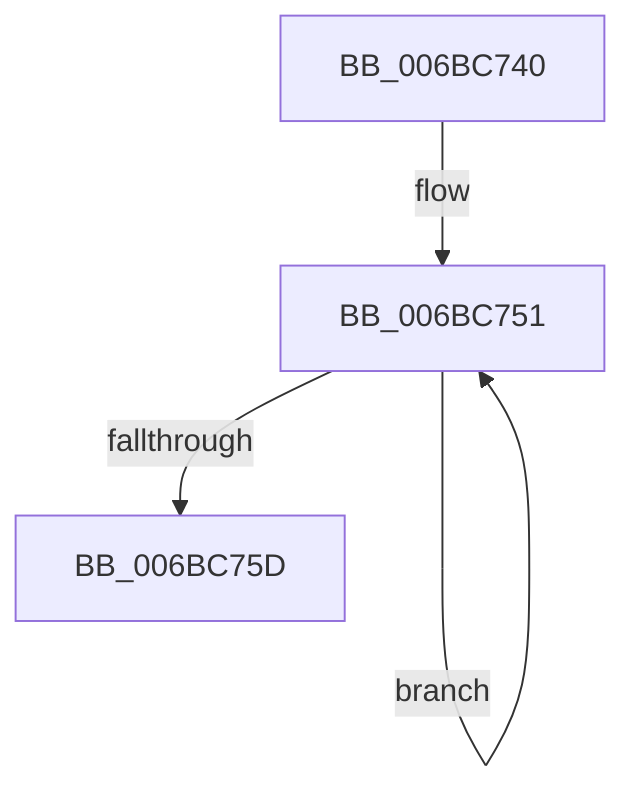

# CcAdjustBcbDepth

- RVA: `0x006BC740`–`0x006BC77F` (길이 `63` bytes)
- VA: `0x00000001406BC740`
- 실행 섹션: `.text`
- PDB 이름 있음: `예`; PDB Function 태그: `아니요`
- unwind 정보 RVA: `0x000C2F70`
- 디코드: `20`개 명령, `63/63` bytes 표시
- 미해석 바이트: `0` (있으면 어셈블리에 `.byte`로 보존)

> 이 문서는 커널 이미지의 기계어와 PDB 기호를 분석해 생성했습니다. 4번과 5번은 함수 원형과 자료형을 바이너리 사용 방식에서 추정한 C 해석이며 원본 소스 복구 결과는 아닙니다.

## 1. Dependencies

- 직접 호출 지점: **0**; 고유 호출 대상: **0**
- 직접 호출자로 확인된 함수: **2**
- RIP 상대 이미지 참조: **0**

### Outgoing calls
- 직접 디코드된 call 명령이 없습니다.

### Direct callers
- [CcBcbProfiler](../50/CcBcbProfiler_function_005099B0.md) at `0x00509D8B`
- [sub_00705ED0](../../page/70/Unknown_function_00705ED0.md) at `0x00706282`

### Static image references
- 디코드된 RIP-relative 메모리 참조가 없습니다.

## 2. Other-region calls and transfers

- 다른 실행 섹션으로 향하는 call: **0**
- 별도 외부 분기/꼬리 이동을 확인하지 못했습니다.

## 3. Assembly (complete function range)

```asm
006BC740  48 8B 74 24 30                  mov rsi, qword ptr [rsp + 0x30]
006BC745  48 8B 7C 24 28                  mov rdi, qword ptr [rsp + 0x28]
006BC74A  4C 8B 54 24 38                  mov r10, qword ptr [rsp + 0x38]
006BC74F  33 C0                           xor eax, eax
006BC751  49 89 02                        mov qword ptr [r10], rax
006BC754  49 83 EA 08                     sub r10, 8
006BC758  4C 3B D4                        cmp r10, rsp
006BC75B  73 F4                           jae 0x1406bc751
006BC75D  48 89 7C 24 28                  mov qword ptr [rsp + 0x28], rdi
006BC762  8B D8                           mov ebx, eax
006BC764  8B F8                           mov edi, eax
006BC766  8B E8                           mov ebp, eax
006BC768  4C 8B D0                        mov r10, rax
006BC76B  4C 8B D8                        mov r11, rax
006BC76E  4C 8B E0                        mov r12, rax
006BC771  4C 8B E8                        mov r13, rax
006BC774  4C 8B F0                        mov r14, rax
006BC777  4C 8B F8                        mov r15, rax
006BC77A  0F AE E8                        lfence
006BC77D  FF E6                           jmp rsi
```

## 4. C-style interpretation (structured pseudocode)

```c
__int64 __fastcall CcAdjustBcbDepth(__int64 a1, __int64 a2, __int64 a3, __int64 a4, __int64 a5, __int64 a6, __int64 a7)
{
    __int64 result;
    __int64 v_r10;
    unsigned __int64 v_stack_p28;

    result = 0;
loc_006BC751:
    *(unsigned __int64 *)(a7) = 0;
    v_r10 = (a7) - (8);
    if (v_r10 >= v_rsp) goto loc_006BC751;
    v_stack_p28 = a5;
}
```

## 5. (Beta) C Style

```c
int64_t CcAdjustBcbDepth(int64_t Arg1, int64_t Arg2, int64_t Arg3, int64_t Arg4, int64_t Arg5, int64_t Arg6, int64_t Arg7)
{
    int64_t result;
    int64_t local_r10;
    uint64_t v_stack_p28;

    result = 0;
loc_006BC751:
    *(uint64_t *)(Arg7) = 0;
    local_r10 = (Arg7) - (8);
    if (local_r10 >= local_rsp) goto loc_006BC751;
    v_stack_p28 = Arg5;
}
```

## 6. Execution-region graph

[열기: 2D/3D 그래프와 함수 탐색 컨트롤 패널](../../../control-panel.html?section=text&rva=0x006BC740&view=graph)

- 2D 그래프는 위에서 아래로 흐르고, 3D 그래프는 빈 공간을 드래그해 회전합니다. Shift+드래그는 이동, 휠은 확대·축소, 함수 노드 선택은 대상 보고서 이동입니다.

### Static fallback


