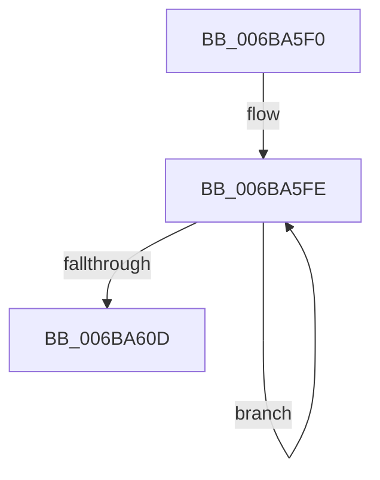

# ExpInterlockedFlushSList

- RVA: `0x006BA5F0`–`0x006BA614` (길이 `36` bytes)
- VA: `0x00000001406BA5F0`
- 실행 섹션: `.text`
- PDB 이름 있음: `예`; PDB Function 태그: `아니요`
- unwind 정보 RVA: `0x000C246C`
- 디코드: `14`개 명령, `36/36` bytes 표시
- 미해석 바이트: `0` (있으면 어셈블리에 `.byte`로 보존)

> 이 문서는 커널 이미지의 기계어와 PDB 기호를 분석해 생성했습니다. 4번과 5번은 함수 원형과 자료형을 바이너리 사용 방식에서 추정한 C 해석이며 원본 소스 복구 결과는 아닙니다.

## 1. Dependencies

- 직접 호출 지점: **0**; 고유 호출 대상: **0**
- 직접 호출자로 확인된 함수: **35**
- RIP 상대 이미지 참조: **0**

### Outgoing calls
- 직접 디코드된 call 명령이 없습니다.

### Direct callers
- [MiUnlockWorkingSetExclusive](../27/MiUnlockWorkingSetExclusive_function_0027EC70.md) at `0x0027ECE5`
- [MiFreePageFileHashPfns](../2D/MiFreePageFileHashPfns_function_002DBEF8.md) at `0x002DBF20`
- [RtlpHpVsContextCompact](../2E/RtlpHpVsContextCompact_function_002E7524.md) at `0x002E7571`
- [RtlpDynamicLookasideFlush](../2E/RtlpDynamicLookasideFlush_function_002E7C30.md) at `0x002E7C61`
- [RtlpHpVsContextFree](../36/RtlpHpVsContextFree_function_00361630.md) at `0x0036176B`
- [ST_STORE&lt;SM_TRAITS&gt;::StDrainReadContextList](../3B/ST_STORE_SM_TRAITS_StDrainReadContextList_function_003B08B0.md) at `0x003B08BD`
- [MiDrainZeroLookasides](../44/MiDrainZeroLookasides_function_0044D818.md) at `0x0044D95F`
- [EtwpCovSampCaptureQueueDpc](../46/EtwpCovSampCaptureQueueDpc_function_00462370.md) at `0x00462380`
- [SMKM_STORE_MGR&lt;SM_TRAITS&gt;::SmDrainSList](../47/SMKM_STORE_MGR_SM_TRAITS_SmDrainSList_function_0047204C.md) at `0x0047206D`
- [MiStoreCheckCompleteWriteBatch](../47/MiStoreCheckCompleteWriteBatch_function_0047EC80.md) at `0x0047ED39`
- [MiStoreDrainWriteSupports](../47/MiStoreDrainWriteSupports_function_0047EE3C.md) at `0x0047EE49`
- [ExpFlushGeneralLookaside](../48/ExpFlushGeneralLookaside_function_00481D80.md) at `0x00481D8D`
- [ExFlushLookasideListEx](../48/ExFlushLookasideListEx_function_00481E80.md) at `0x00481E9B`
- [PfFbBufferListFlushStandby](../48/PfFbBufferListFlushStandby_function_00484174.md) at `0x0048419E`
- [EtwpCancelPendingApcs](../49/EtwpCancelPendingApcs_function_00497D88.md) at `0x00497DAD`
- [ExpWorkerFactoryDeferredThreadCreation](../49/ExpWorkerFactoryDeferredThreadCreation_function_0049F1A8.md) at `0x0049F1CE`
- [EtwpFreeApcPool](../4A/EtwpFreeApcPool_function_004A5998.md) at `0x004A59B3`
- [MiDeleteDeferredCloneDescriptors](../4D/MiDeleteDeferredCloneDescriptors_function_004D8DAC.md) at `0x004D8DD3`
- [KiFreeTemporaryStacks](../5B/KiFreeTemporaryStacks_function_005BD820.md) at `0x005BD848`
- [EtwpCovSampLookasideFlushFreeListToCleanupList](../65/EtwpCovSampLookasideFlushFreeListToCleanupList_function_006540BC.md) at `0x006540D0`
- [ExpPlProcessNotifications](../65/ExpPlProcessNotifications_function_00657170.md) at `0x00657187`
- [MiRemoveNonIdealCachedStacks](../68/MiRemoveNonIdealCachedStacks_function_00686620.md) at `0x0068663A`
- [MiInsertPteTracker](../69/MiInsertPteTracker_function_00697BE4.md) at `0x00697C61`
- [ObpInitStackAndObjectTables](../../page/74/ObpInitStackAndObjectTables_function_0074FCF4.md) at `0x0074FDE0`
- [ObpStopRuntimeStackTrace](../../page/75/ObpStopRuntimeStackTrace_function_00750574.md) at `0x00750701`
- [PfTCleanup](../../page/75/PfTCleanup_function_00751208.md) at `0x0075134F`
- [SmHwAcceleratorPartitionCtxCleanup](../../page/7A/SmHwAcceleratorPartitionCtxCleanup_function_007AB2D8.md) at `0x007AB2E9`
- [EtwpCovSampCaptureWorkerThread](../../page/7C/EtwpCovSampCaptureWorkerThread_function_007C19B0.md) at `0x007C1A3B`
- [CmUnRegisterCallback](../../page/7E/CmUnRegisterCallback_function_007E1510.md) at `0x007E17C1`
- [PfpFlushEventBuffers](../../page/97/PfpFlushEventBuffers_function_0097BD4C.md) at `0x0097BD81`
- [sub_0097C0F8](../../page/97/Unknown_function_0097C0F8.md) at `0x0097C10F`
- [EtwpFreeStackCache](../../page/A5/EtwpFreeStackCache_function_00A53FF4.md) at `0x00A54011`
- [EtwpCovSampCaptureFreeLookasides](../../page/AC/EtwpCovSampCaptureFreeLookasides_function_00ACEDF0.md) at `0x00ACEE34`
- [PfTAccessTracingCleanup](../../pagelk/B6/PfTAccessTracingCleanup_function_00B6B8AC.md) at `0x00B6B918`
- [ViPoolDelayFreeTrimThreadRoutine](../../pagevrfy/BA/ViPoolDelayFreeTrimThreadRoutine_function_00BAA500.md) at `0x00BAA52F`

### Static image references
- 디코드된 RIP-relative 메모리 참조가 없습니다.

## 2. Other-region calls and transfers

- 다른 실행 섹션으로 향하는 call: **0**
- 별도 외부 분기/꼬리 이동을 확인하지 못했습니다.

## 3. Assembly (complete function range)

```asm
006BA5F0  0F 0D 09                        prefetchw byte ptr [rcx]
006BA5F3  53                              push rbx
006BA5F4  4C 8B D1                        mov r10, rcx
006BA5F7  48 8B 01                        mov rax, qword ptr [rcx]
006BA5FA  48 8B 51 08                     mov rdx, qword ptr [rcx + 8]
006BA5FE  33 C9                           xor ecx, ecx
006BA600  48 8B D8                        mov rbx, rax
006BA603  66 33 DB                        xor bx, bx
006BA606  F0 49 0F C7 0A                  lock cmpxchg16b xmmword ptr [r10]
006BA60B  75 F1                           jne 0x1406ba5fe
006BA60D  48 8B C2                        mov rax, rdx
006BA610  24 F0                           and al, 0xf0
006BA612  5B                              pop rbx
006BA613  C3                              ret
```

## 4. C-style interpretation (structured pseudocode)

```c
__int64 __fastcall ExpInterlockedFlushSList(__int64 a1)
{
    __int64 result;
    __int64 v_rbx;

loc_006BA5FE:
    a1 = 0;
    v_rbx = 0;
    if (condition_is_not_equal) goto loc_006BA5FE;
    result = (unsigned __int8)((*(unsigned __int64 *)(a1 + 8)) & (240));
    return result;
}
```

## 5. (Beta) C Style

```c
int64_t ExpInterlockedFlushSList(void *Arg1)
{
    uint8_t *arg1 = (uint8_t *)Arg1;

    int64_t result;
    int64_t local_rbx;

loc_006BA5FE:
    Arg1 = 0;
    local_rbx = 0;
    if (condition_is_not_equal) goto loc_006BA5FE;
    result = (uint8_t)((*(uint64_t *)(arg1 + 0x8)) & (240));
    return result;
}
```

### 관측된 메모리 오프셋

구조체 형식이 확인되지 않은 접근은 인자 기준의 오프셋으로만 기록했습니다.

| 기준 인자 | 오프셋 표현 | 폭 (bit) | 접근 |
|---|---:|---:|---|
| `Arg1` | `+ 0x0` | `8` | `R` |
| `Arg1` | `+ 0x0` | `64` | `R` |
| `Arg1` | `+ 0x0` | `128` | `R` |
| `Arg1` | `+ 0x8` | `64` | `R` |

## 6. Execution-region graph

[열기: 2D/3D 그래프와 함수 탐색 컨트롤 패널](../../../control-panel.html?section=text&rva=0x006BA5F0&view=graph)

- 2D 그래프는 위에서 아래로 흐르고, 3D 그래프는 빈 공간을 드래그해 회전합니다. Shift+드래그는 이동, 휠은 확대·축소, 함수 노드 선택은 대상 보고서 이동입니다.

### Static fallback


