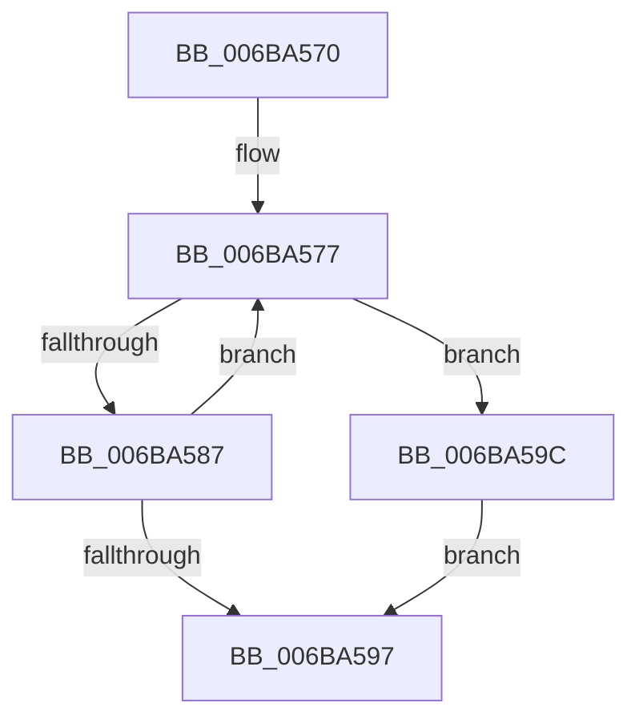

# ExpInterlockedPopEntrySList

- RVA: `0x006BA570`–`0x006BA5A4` (길이 `52` bytes)
- VA: `0x00000001406BA570`
- 실행 섹션: `.text`
- PDB 이름 있음: `예`; PDB Function 태그: `아니요`
- unwind 정보 RVA: `0x000C2454`
- 디코드: `18`개 명령, `52/52` bytes 표시
- 미해석 바이트: `0` (있으면 어셈블리에 `.byte`로 보존)

> 이 문서는 커널 이미지의 기계어와 PDB 기호를 분석해 생성했습니다. 4번과 5번은 함수 원형과 자료형을 바이너리 사용 방식에서 추정한 C 해석이며 원본 소스 복구 결과는 아닙니다.

## 1. Dependencies

- 직접 호출 지점: **0**; 고유 호출 대상: **0**
- 직접 호출자로 확인된 함수: **96**
- RIP 상대 이미지 참조: **0**

### Outgoing calls
- 직접 디코드된 call 명령이 없습니다.

### Direct callers
- [EtwpPopFreeApcEntry](../20/EtwpPopFreeApcEntry_function_00203DF8.md) at `0x00203E11`
- [IopAllocateIrpPrivate](../20/IopAllocateIrpPrivate_function_00207770.md) at `0x002078A1`
- [IopAllocateIrpPrivate](../20/IopAllocateIrpPrivate_function_00207770.md) at `0x00207AF1`
- [EtwpEventWriteFull](../22/EtwpEventWriteFull_function_00225C10.md) at `0x0022635D`
- [EtwpEventWriteFull](../22/EtwpEventWriteFull_function_00225C10.md) at `0x00226384`
- [EtwpLogKernelEvent](../25/EtwpLogKernelEvent_function_0025CC00.md) at `0x0025D7F2`
- [MiGetPage](../28/MiGetPage_function_002884C0.md) at `0x0028886B`
- [MiGetPage](../28/MiGetPage_function_002884C0.md) at `0x00288FB7`
- [MiGetPerfectFreeOrZeroPage](../28/MiGetPerfectFreeOrZeroPage_function_002898E0.md) at `0x00289994`
- [MiGetPerfectFreeOrZeroPage](../28/MiGetPerfectFreeOrZeroPage_function_002898E0.md) at `0x00289A64`
- [MiSlistGetFreePage](../28/MiSlistGetFreePage_function_0028A170.md) at `0x0028A1DB`
- [MiSlistGetFreePage](../28/MiSlistGetFreePage_function_0028A170.md) at `0x0028A28C`
- [IoMakeAssociatedIrpPriv](../29/IoMakeAssociatedIrpPriv_function_0029D818.md) at `0x0029D918`
- [IoMakeAssociatedIrpPriv](../29/IoMakeAssociatedIrpPriv_function_0029D818.md) at `0x0029DB24`
- [IoAllocateMdl](../29/IoAllocateMdl_function_0029EBF0.md) at `0x0029EC77`
- [IoAllocateMdl](../29/IoAllocateMdl_function_0029EBF0.md) at `0x0029EC94`
- [IoAllocateMdl](../29/IoAllocateMdl_function_0029EBF0.md) at `0x0029EDB9`
- [IoAllocateMdl](../29/IoAllocateMdl_function_0029EBF0.md) at `0x0029EDDB`
- [MiCreateDecayPfn](../2B/MiCreateDecayPfn_function_002B8764.md) at `0x002B8787`
- [MiReclaimUnusedUltraMdlMaps](../2D/MiReclaimUnusedUltraMdlMaps_function_002DC4C0.md) at `0x002DC557`
- [EtwpTraceLastBranchRecord](../2F/EtwpTraceLastBranchRecord_function_002F7B00.md) at `0x002F7BCD`
- [sub_002F8DF2](../2F/Unknown_function_002F8DF2.md) at `0x002F8E08`
- [sub_002F926B](../2F/Unknown_function_002F926B.md) at `0x002F9272`
- [EtwpLogSystemEventUnsafe](../2F/EtwpLogSystemEventUnsafe_function_002FBF10.md) at `0x002FC7EF`
- [HvlpSlowSendSyntheticClusterIpiEx](../30/HvlpSlowSendSyntheticClusterIpiEx_function_003034E0.md) at `0x00303588`
- [HvlRetargetDeviceInterrupt](../30/HvlRetargetDeviceInterrupt_function_003062A0.md) at `0x00306344`
- [HvlRetargetDeviceInterrupt](../30/HvlRetargetDeviceInterrupt_function_003062A0.md) at `0x003064F5`
- [HvlGetSparseGpaPagesAccessState](../30/HvlGetSparseGpaPagesAccessState_function_00306A78.md) at `0x00306AE0`
- [HvlGetSparseGpaPagesAccessState](../30/HvlGetSparseGpaPagesAccessState_function_00306A78.md) at `0x00306B26`
- [HvlDmaMapDeviceLogicalRange](../30/HvlDmaMapDeviceLogicalRange_function_003077D0.md) at `0x00307A24`
- [sub_00312CF6](../31/Unknown_function_00312CF6.md) at `0x00312D33`
- [sub_0033800D](../33/Unknown_function_0033800D.md) at `0x00338081`
- [MmDeleteKernelStack](../33/MmDeleteKernelStack_function_0033A960.md) at `0x0033AEBC`
- [PfLogEvent](../34/PfLogEvent_function_00349BA8.md) at `0x00349BFD`
- [PfLogEvent](../34/PfLogEvent_function_00349BA8.md) at `0x00349CE5`
- [SMKM_STORE_MGR&lt;SM_TRAITS&gt;::SmPageWrite](../34/SMKM_STORE_MGR_SM_TRAITS_SmPageWrite_function_0034BA54.md) at `0x0034BB2D`
- [SMKM_STORE_MGR&lt;SM_TRAITS&gt;::SmPageRead](../34/SMKM_STORE_MGR_SM_TRAITS_SmPageRead_function_0034C1D0.md) at `0x0034C295`
- [CcWriteBehind](../35/CcWriteBehind_function_00356EAC.md) at `0x00356F32`
- [CcWriteBehind](../35/CcWriteBehind_function_00356EAC.md) at `0x00356F51`
- [CcAllocateWorkQueueEntry](../35/CcAllocateWorkQueueEntry_function_0035710C.md) at `0x00357146`
- [CcAllocateWorkQueueEntry](../35/CcAllocateWorkQueueEntry_function_0035710C.md) at `0x00357163`
- [ExAllocateHeapPool](../35/ExAllocateHeapPool_function_0035BA30.md) at `0x0035E5A7`
- [MiGetInPageSupportBlock](../36/MiGetInPageSupportBlock_function_00362500.md) at `0x00362549`
- [MiGetInPageSupportBlock](../36/MiGetInPageSupportBlock_function_00362500.md) at `0x00362561`
- [ExAllocateFromNPagedLookasideList](../38/ExAllocateFromNPagedLookasideList_function_0038E6C0.md) at `0x0038E6D0`
- [ST_STORE&lt;SM_TRAITS&gt;::StAcquireReadContext](../3A/ST_STORE_SM_TRAITS_StAcquireReadContext_function_003AA980.md) at `0x003AA994`
- [ExAllocateFromLookasideListEx](../3C/ExAllocateFromLookasideListEx_function_003CD390.md) at `0x003CD3A0`
- [KeAllocateXStateContext](../3D/KeAllocateXStateContext_function_003D9D60.md) at `0x003D9DAF`
- [KeAllocateXStateContext](../3D/KeAllocateXStateContext_function_003D9D60.md) at `0x003D9DCC`
- [EtwpAdjustStackLookasideBuffers](../3E/EtwpAdjustStackLookasideBuffers_function_003EB6A4.md) at `0x003EB6D3`
- [EtwpAdjustLastBranchLookasideBuffers](../3E/EtwpAdjustLastBranchLookasideBuffers_function_003EB838.md) at `0x003EB864`
- [ExAllocateFromPagedLookasideList](../3F/ExAllocateFromPagedLookasideList_function_003FB730.md) at `0x003FB740`
- [EtwpTraceStackKey](../3F/EtwpTraceStackKey_function_003FC290.md) at `0x003FC563`
- [IopAllocateMdl](../3F/IopAllocateMdl_function_003FF0B0.md) at `0x003FF140`
- [IopAllocateMdl](../3F/IopAllocateMdl_function_003FF0B0.md) at `0x003FF15D`
- [IopAllocateMdl](../3F/IopAllocateMdl_function_003FF0B0.md) at `0x003FF27A`
- [IopAllocateMdl](../3F/IopAllocateMdl_function_003FF0B0.md) at `0x003FF29C`
- [HvlMapSparseGpaPages](../42/HvlMapSparseGpaPages_function_0042A160.md) at `0x0042A1BC`
- [HvlGetGpaPagesAccessState](../42/HvlGetGpaPagesAccessState_function_0042A3D4.md) at `0x0042A43B`
- [HvlGetGpaPagesAccessState](../42/HvlGetGpaPagesAccessState_function_0042A3D4.md) at `0x0042A4A2`
- [EtwpCovSampLookasidePop](../43/EtwpCovSampLookasidePop_function_0043C528.md) at `0x0043C547`
- [HvlpSlowFlushAddressSpaceTb](../44/HvlpSlowFlushAddressSpaceTb_function_004402C4.md) at `0x0044036A`
- [EtwpGetStackLookasideListEntry](../44/EtwpGetStackLookasideListEntry_function_004468F0.md) at `0x0044690B`
- [EtwpGetStackLookasideListEntry](../44/EtwpGetStackLookasideListEntry_function_004468F0.md) at `0x00446922`
- [MiStoreGetWriteSupport](../45/MiStoreGetWriteSupport_function_00456DF0.md) at `0x00456DFB`
- [PfFbLogEntryReserve](../45/PfFbLogEntryReserve_function_0045F164.md) at `0x0045F1A4`
- [PfFbLogEntryReserve](../45/PfFbLogEntryReserve_function_0045F164.md) at `0x0045F1EF`
- [HvlMapGpaPages](../46/HvlMapGpaPages_function_00462934.md) at `0x004629A1`
- [EtwpFreePlaceholderList](../46/EtwpFreePlaceholderList_function_0046CF3C.md) at `0x0046CF7F`
- [HvlpAcquireHypercallPage](../47/HvlpAcquireHypercallPage_function_00471410.md) at `0x00471458`
- [HvlDmaMapDeviceSparsePages](../47/HvlDmaMapDeviceSparsePages_function_0047A390.md) at `0x0047A5A3`
- [HvlDmaUnmapDeviceSparsePages](../48/HvlDmaUnmapDeviceSparsePages_function_004844C0.md) at `0x0048469E`
- [MiFreeClonePool](../49/MiFreeClonePool_function_00492EE0.md) at `0x00492EFE`
- [KeAllocateInterrupt](../49/KeAllocateInterrupt_function_00493F50.md) at `0x00493F85`
- [PfTFullEventListAdd](../49/PfTFullEventListAdd_function_00494B50.md) at `0x00494B86`
- [MiPruneCachedStackList](../49/MiPruneCachedStackList_function_00495638.md) at `0x00495684`
- [HvlLpWriteMultipleMsr](../4A/HvlLpWriteMultipleMsr_function_004A35E0.md) at `0x004A3664`
- [MiGetUltraMdlContext](../4A/MiGetUltraMdlContext_function_004A3AAC.md) at `0x004A3B0C`
- [HvlpSlowFlushListTbEx](../4A/HvlpSlowFlushListTbEx_function_004AFCF8.md) at `0x004AFD84`
- [HvlLpReadMultipleMsr](../4B/HvlLpReadMultipleMsr_function_004BC3B0.md) at `0x004BC453`
- [HvlLpReadMultipleMsr](../4B/HvlLpReadMultipleMsr_function_004BC3B0.md) at `0x004BC49F`
- [HvlpSetPowerProperty](../4C/HvlpSetPowerProperty_function_004C9124.md) at `0x004C916C`
- [EtwpGetCrimsonStackKey](../4D/EtwpGetCrimsonStackKey_function_004D68CC.md) at `0x004D6AFE`
- [HvlSetQpcBias](../4F/HvlSetQpcBias_function_004F8EF0.md) at `0x004F8F8F`
- [ObpDeferPushRefDerefInfo](../5C/ObpDeferPushRefDerefInfo_function_005CD9E0.md) at `0x005CDA08`
- [RtlpStdGetSpaceForTrace](../5E/RtlpStdGetSpaceForTrace_function_005E6834.md) at `0x005E686E`
- [ViGrowPoolAllocation](../61/ViGrowPoolAllocation_function_00614290.md) at `0x006142C6`
- [EtwpStackDeleteProcessor](../65/EtwpStackDeleteProcessor_function_00651D90.md) at `0x00651DB9`
- [EtwpGetPlaceholderBuffer](../65/EtwpGetPlaceholderBuffer_function_00653694.md) at `0x006536AD`
- [MiGetTransitionPageHeatList](../68/MiGetTransitionPageHeatList_function_0068BFF4.md) at `0x0068BFFF`
- [MiInsertPteTracker](../69/MiInsertPteTracker_function_00697BE4.md) at `0x00697C2D`
- [MiWakeOnlyParticipatingProcessorsFromAssignedNode](../69/MiWakeOnlyParticipatingProcessorsFromAssignedNode_function_0069A314.md) at `0x0069A3AC`
- [MiZeroPageCalibrate](../69/MiZeroPageCalibrate_function_0069A69C.md) at `0x0069AA39`
- [sub_006D969C](../6D/Unknown_function_006D969C.md) at `0x006D9726`
- [sub_006EA56C](../6E/Unknown_function_006EA56C.md) at `0x006EA5BD`
- [PfFbBufferListCleanup](../../page/75/PfFbBufferListCleanup_function_00753680.md) at `0x007536B2`
- [PfFbBufferListCleanup](../../page/75/PfFbBufferListCleanup_function_00753680.md) at `0x007536DD`
- [PfFbBufferListCleanup](../../page/75/PfFbBufferListCleanup_function_00753680.md) at `0x007536FE`
- [CmpExpandPathInfo](../../page/85/CmpExpandPathInfo_function_0085D4DC.md) at `0x0085D50E`
- [CmpExpandPathInfo](../../page/85/CmpExpandPathInfo_function_0085D4DC.md) at `0x0085D52D`
- [sub_0085F45E](../../page/85/Unknown_function_0085F45E.md) at `0x0085F602`
- [sub_0085F45E](../../page/85/Unknown_function_0085F45E.md) at `0x0085F61F`
- [CmpCallCallBacksEx](../../page/86/CmpCallCallBacksEx_function_00865F40.md) at `0x00866101`
- [CmpCallCallBacksEx](../../page/86/CmpCallCallBacksEx_function_00865F40.md) at `0x0086611E`
- [CmpCallCallBacksEx](../../page/86/CmpCallCallBacksEx_function_00865F40.md) at `0x00866898`
- [ObCreateObject](../../page/87/ObCreateObject_function_00872CB0.md) at `0x00872D18`
- [ObCreateObject](../../page/87/ObCreateObject_function_00872CB0.md) at `0x00872D35`
- [IopAllocRealFileObject](../../page/89/IopAllocRealFileObject_function_00899720.md) at `0x008997BA`
- [IopAllocRealFileObject](../../page/89/IopAllocRealFileObject_function_00899720.md) at `0x008997D7`
- [sub_0089A903](../../page/89/Unknown_function_0089A903.md) at `0x0089A925`
- [sub_0089A903](../../page/89/Unknown_function_0089A903.md) at `0x0089A942`
- [ObCreateObjectEx](../../page/89/ObCreateObjectEx_function_0089B1E0.md) at `0x0089B24C`
- [ObCreateObjectEx](../../page/89/ObCreateObjectEx_function_0089B1E0.md) at `0x0089B269`
- [ObpCaptureObjectName](../../page/89/ObpCaptureObjectName_function_0089BC40.md) at `0x0089BD69`
- [ObpCaptureObjectName](../../page/89/ObpCaptureObjectName_function_0089BC40.md) at `0x0089BD90`
- [IopCreateFile](../../page/8A/IopCreateFile_function_008AB298.md) at `0x008AB32E`
- [IopCreateFile](../../page/8A/IopCreateFile_function_008AB298.md) at `0x008AB352`
- [NtCreateEvent](../../page/8B/NtCreateEvent_function_008B9140.md) at `0x008B91ED`
- [NtCreateEvent](../../page/8B/NtCreateEvent_function_008B9140.md) at `0x008B920A`
- [ObReferenceObjectByNameEx](../../page/8B/ObReferenceObjectByNameEx_function_008BD524.md) at `0x008BD599`
- [ObReferenceObjectByNameEx](../../page/8B/ObReferenceObjectByNameEx_function_008BD524.md) at `0x008BD5B6`
- [sub_008C2328](../../page/8C/Unknown_function_008C2328.md) at `0x008C25AC`
- [sub_008C2328](../../page/8C/Unknown_function_008C2328.md) at `0x008C25C9`
- [NtCreateSemaphore](../../page/8C/NtCreateSemaphore_function_008C38D0.md) at `0x008C3980`
- [NtCreateSemaphore](../../page/8C/NtCreateSemaphore_function_008C38D0.md) at `0x008C399D`
- [sub_008C3C89](../../page/8C/Unknown_function_008C3C89.md) at `0x008C3CD6`
- [sub_008C3C89](../../page/8C/Unknown_function_008C3C89.md) at `0x008C3CF3`
- [NtCreateMutant](../../page/8C/NtCreateMutant_function_008C43D0.md) at `0x008C4458`
- [NtCreateMutant](../../page/8C/NtCreateMutant_function_008C43D0.md) at `0x008C4475`
- [NtCreateWaitCompletionPacket](../../page/8C/NtCreateWaitCompletionPacket_function_008C4700.md) at `0x008C4785`
- [NtCreateWaitCompletionPacket](../../page/8C/NtCreateWaitCompletionPacket_function_008C4700.md) at `0x008C47A2`
- [RtlpGetRegistryHandle](../../page/8C/RtlpGetRegistryHandle_function_008C955C.md) at `0x008C95DB`
- [RtlpGetRegistryHandle](../../page/8C/RtlpGetRegistryHandle_function_008C955C.md) at `0x008C95F8`
- [IopAllocateMiniCompletionPacket](../../page/9D/IopAllocateMiniCompletionPacket_function_009DA2E0.md) at `0x009DA31D`
- [IopAllocateMiniCompletionPacket](../../page/9D/IopAllocateMiniCompletionPacket_function_009DA2E0.md) at `0x009DA337`
- [WdipSemFastAllocate](../../page/A5/WdipSemFastAllocate_function_00A5DC04.md) at `0x00A5DC1D`
- [NtQueryInformationThread](../../page/AE/NtQueryInformationThread_function_00AE3760.md) at `0x00AE51AA`
- [sub_00B20E5A](../../page/B2/Unknown_function_00B20E5A.md) at `0x00B20E77`
- [VfPoolCheckForLeaks](../../pagevrfy/BA/VfPoolCheckForLeaks_function_00BAA340.md) at `0x00BAA3B0`
- [VfHandlePoolAlloc](../../pagevrfy/BB/VfHandlePoolAlloc_function_00BB8A90.md) at `0x00BB8CAC`

### Static image references
- 디코드된 RIP-relative 메모리 참조가 없습니다.

## 2. Other-region calls and transfers

- 다른 실행 섹션으로 향하는 call: **0**
- 별도 외부 분기/꼬리 이동을 확인하지 못했습니다.

## 3. Assembly (complete function range)

```asm
006BA570  0F 0D 09                        prefetchw byte ptr [rcx]
006BA573  53                              push rbx
006BA574  4C 8B D1                        mov r10, rcx
006BA577  49 8B 02                        mov rax, qword ptr [r10]
006BA57A  49 8B 52 08                     mov rdx, qword ptr [r10 + 8]
006BA57E  4C 8B C2                        mov r8, rdx
006BA581  49 83 E0 F0                     and r8, 0xfffffffffffffff0
006BA585  74 15                           je 0x1406ba59c
006BA587  49 8B 08                        mov rcx, qword ptr [r8]
006BA58A  48 8B D8                        mov rbx, rax
006BA58D  66 FF CB                        dec bx
006BA590  F0 49 0F C7 0A                  lock cmpxchg16b xmmword ptr [r10]
006BA595  75 E0                           jne 0x1406ba577
006BA597  49 8B C0                        mov rax, r8
006BA59A  5B                              pop rbx
006BA59B  C3                              ret
006BA59C  F0 83 4C 24 10 00               lock or dword ptr [rsp + 0x10], 0
006BA5A2  EB F3                           jmp 0x1406ba597
```

## 4. C-style interpretation (structured pseudocode)

```c
__int64 __fastcall ExpInterlockedPopEntrySList(__int64 a1)
{
    __int64 v_rbx;
    unsigned int v_stack_p10;

loc_006BA577:
    a3 = (*(unsigned __int64 *)(a1 + 8)) & (-16);
    if (condition_is_equal) goto loc_006BA59C;
    v_rbx = (unsigned __int16)((*(unsigned __int64 *)(a1)) - 1);
    if (condition_is_not_equal) goto loc_006BA577;
loc_006BA597:
    return a3;
loc_006BA59C:
    goto loc_006BA597;
}
```

## 5. (Beta) C Style

```c
int64_t ExpInterlockedPopEntrySList(void *Arg1)
{
    uint8_t *arg1 = (uint8_t *)Arg1;

    int64_t local_rbx;
    uint32_t v_stack_p10;

loc_006BA577:
    a3 = (*(uint64_t *)(arg1 + 0x8)) & (-16);
    if (condition_is_equal) goto loc_006BA59C;
    local_rbx = (uint16_t)((*(uint64_t *)(arg1)) - 1);
    if (condition_is_not_equal) goto loc_006BA577;
loc_006BA597:
    return a3;
loc_006BA59C:
    goto loc_006BA597;
}
```

### 관측된 메모리 오프셋

구조체 형식이 확인되지 않은 접근은 인자 기준의 오프셋으로만 기록했습니다.

| 기준 인자 | 오프셋 표현 | 폭 (bit) | 접근 |
|---|---:|---:|---|
| `Arg1` | `+ 0x0` | `8` | `R` |
| `Arg1` | `+ 0x0` | `64` | `R` |
| `Arg1` | `+ 0x0` | `128` | `R` |
| `Arg1` | `+ 0x8` | `64` | `R` |

## 6. Execution-region graph

[열기: 2D/3D 그래프와 함수 탐색 컨트롤 패널](../../../control-panel.html?section=text&rva=0x006BA570&view=graph)

- 2D 그래프는 위에서 아래로 흐르고, 3D 그래프는 빈 공간을 드래그해 회전합니다. Shift+드래그는 이동, 휠은 확대·축소, 함수 노드 선택은 대상 보고서 이동입니다.

### Static fallback


