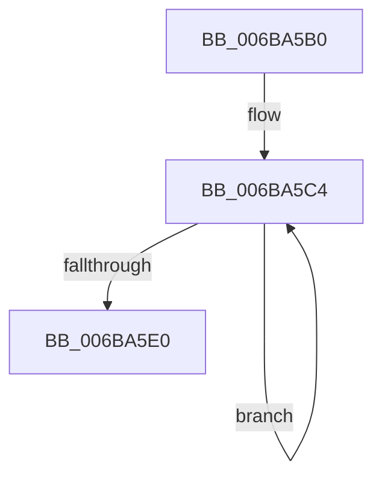

# ExpInterlockedPushEntrySList

- RVA: `0x006BA5B0`–`0x006BA5E5` (길이 `53` bytes)
- VA: `0x00000001406BA5B0`
- 실행 섹션: `.text`
- PDB 이름 있음: `예`; PDB Function 태그: `아니요`
- unwind 정보 RVA: `0x000C2460`
- 디코드: `17`개 명령, `53/53` bytes 표시
- 미해석 바이트: `0` (있으면 어셈블리에 `.byte`로 보존)

> 이 문서는 커널 이미지의 기계어와 PDB 기호를 분석해 생성했습니다. 4번과 5번은 함수 원형과 자료형을 바이너리 사용 방식에서 추정한 C 해석이며 원본 소스 복구 결과는 아닙니다.

## 1. Dependencies

- 직접 호출 지점: **0**; 고유 호출 대상: **0**
- 직접 호출자로 확인된 함수: **133**
- RIP 상대 이미지 참조: **0**

### Outgoing calls
- 직접 디코드된 call 명령이 없습니다.

### Direct callers
- [MiStoreFreeWriteSupport](../20/MiStoreFreeWriteSupport_function_00203A48.md) at `0x00203A7A`
- [EtwpQueueApc](../20/EtwpQueueApc_function_00203B7C.md) at `0x00203DBA`
- [EtwpPopFreeApcEntry](../20/EtwpPopFreeApcEntry_function_00203DF8.md) at `0x00203E7B`
- [sub_002055DD](../20/Unknown_function_002055DD.md) at `0x00205638`
- [sub_002055DD](../20/Unknown_function_002055DD.md) at `0x00205781`
- [EtwpEventWriteFull](../22/EtwpEventWriteFull_function_00225C10.md) at `0x002277FA`
- [sub_002471FA](../24/Unknown_function_002471FA.md) at `0x0024722C`
- [sub_0024E0D5](../24/Unknown_function_0024E0D5.md) at `0x0024E2E1`
- [sub_0024E7EF](../24/Unknown_function_0024E7EF.md) at `0x0024E9FE`
- [EtwpLogKernelEvent](../25/EtwpLogKernelEvent_function_0025CC00.md) at `0x0025D838`
- [MiReleasePageFileInfo](../28/MiReleasePageFileInfo_function_00283FD0.md) at `0x00284424`
- [IoFreeMdl](../29/IoFreeMdl_function_0029EA80.md) at `0x0029EAEA`
- [sub_0029EBBD](../29/Unknown_function_0029EBBD.md) at `0x0029EBD9`
- [MiInsertInPageBlock](../2B/MiInsertInPageBlock_function_002B59C0.md) at `0x002B5A26`
- [EtwpTraceLastBranchRecord](../2F/EtwpTraceLastBranchRecord_function_002F7B00.md) at `0x002F7C65`
- [sub_002F8BF2](../2F/Unknown_function_002F8BF2.md) at `0x002F8D1C`
- [sub_002F8E26](../2F/Unknown_function_002F8E26.md) at `0x002F906E`
- [EtwpApcPoolThunk](../2F/EtwpApcPoolThunk_function_002FA090.md) at `0x002FA210`
- [SMKM_STORE&lt;SM_TRAITS&gt;::SmStDirectReadCallout](../2F/SMKM_STORE_SM_TRAITS_SmStDirectReadCallout_function_002FA3E0.md) at `0x002FA447`
- [EtwpLogSystemEventUnsafe](../2F/EtwpLogSystemEventUnsafe_function_002FBF10.md) at `0x002FC833`
- [HvlDmaMapDeviceLogicalRange](../30/HvlDmaMapDeviceLogicalRange_function_003077D0.md) at `0x00307AE8`
- [HvlpReleaseHypercallPage](../31/HvlpReleaseHypercallPage_function_00313480.md) at `0x003134A5`
- [sub_0033535B](../33/Unknown_function_0033535B.md) at `0x00335487`
- [sub_0033827F](../33/Unknown_function_0033827F.md) at `0x003383CA`
- [MmDeleteKernelStack](../33/MmDeleteKernelStack_function_0033A960.md) at `0x0033AD27`
- [MmDeleteKernelStack](../33/MmDeleteKernelStack_function_0033A960.md) at `0x0033ADF1`
- [MmDeleteKernelStack](../33/MmDeleteKernelStack_function_0033A960.md) at `0x0033AF1B`
- [sub_0034466C](../34/Unknown_function_0034466C.md) at `0x003446DF`
- [MiQueuePageAccessLog](../34/MiQueuePageAccessLog_function_00348EB0.md) at `0x00348F4A`
- [PfFbLogEntryComplete](../34/PfFbLogEntryComplete_function_00349B40.md) at `0x00349B6E`
- [PfLogEvent](../34/PfLogEvent_function_00349BA8.md) at `0x00349C99`
- [PfLogEvent](../34/PfLogEvent_function_00349BA8.md) at `0x00349D4E`
- [CcFreeWorkQueueEntry](../35/CcFreeWorkQueueEntry_function_0035723C.md) at `0x00357273`
- [ExAllocateHeapPool](../35/ExAllocateHeapPool_function_0035BA30.md) at `0x0035DDF6`
- [sub_00360968](../36/Unknown_function_00360968.md) at `0x00360C79`
- [RtlpHpVsContextFree](../36/RtlpHpVsContextFree_function_00361630.md) at `0x003616FF`
- [ExFreeToPagedLookasideList](../38/ExFreeToPagedLookasideList_function_00387D30.md) at `0x00387D77`
- [ExFreeToLookasideListEx](../38/ExFreeToLookasideListEx_function_0038ACC0.md) at `0x0038AD07`
- [sub_0038D2A1](../38/Unknown_function_0038D2A1.md) at `0x0038D3B5`
- [sub_0038D2A1](../38/Unknown_function_0038D2A1.md) at `0x0038D503`
- [ExFreeToNPagedLookasideList](../38/ExFreeToNPagedLookasideList_function_0038D9D0.md) at `0x0038DA17`
- [ST_STORE&lt;SM_TRAITS&gt;::StReleaseReadContext](../3A/ST_STORE_SM_TRAITS_StReleaseReadContext_function_003ABF84.md) at `0x003ABFC7`
- [MiReplenishPageSlist](../3B/MiReplenishPageSlist_function_003BADE0.md) at `0x003BAFE5`
- [MiRepurposeDecayNode](../3D/MiRepurposeDecayNode_function_003D5774.md) at `0x003D5819`
- [KeFreeXStateContext](../3D/KeFreeXStateContext_function_003D6324.md) at `0x003D635F`
- [EtwpTraceStackKey](../3F/EtwpTraceStackKey_function_003FC290.md) at `0x003FC4AB`
- [EtwpTraceStackKey](../3F/EtwpTraceStackKey_function_003FC290.md) at `0x003FC70B`
- [EtwpTraceStackKey](../3F/EtwpTraceStackKey_function_003FC290.md) at `0x003FC89B`
- [sub_003FCA13](../3F/Unknown_function_003FCA13.md) at `0x003FCAAB`
- [EtwpReleaseStackLookasideListEntry](../41/EtwpReleaseStackLookasideListEntry_function_0041D770.md) at `0x0041D7B9`
- [EtwpCovSampCaptureBufferQueue](../43/EtwpCovSampCaptureBufferQueue_function_0043C234.md) at `0x0043C294`
- [EtwpCovSampCaptureBufferQueue](../43/EtwpCovSampCaptureBufferQueue_function_0043C234.md) at `0x0043C322`
- [EtwpCovSampCaptureBufferRelease](../43/EtwpCovSampCaptureBufferRelease_function_0043C4B4.md) at `0x0043C4D8`
- [EtwpCovSampCaptureBufferRelease](../43/EtwpCovSampCaptureBufferRelease_function_0043C4B4.md) at `0x0043C509`
- [EtwpCovSampCaptureReleaseToLookaside](../43/EtwpCovSampCaptureReleaseToLookaside_function_0043C630.md) at `0x0043C656`
- [EtwpCovSampCaptureReleaseToLookaside](../43/EtwpCovSampCaptureReleaseToLookaside_function_0043C630.md) at `0x0043C687`
- [HvlpSlowFlushAddressSpaceTb](../44/HvlpSlowFlushAddressSpaceTb_function_004402C4.md) at `0x00440434`
- [EtwpCovSampCaptureApcRelease](../44/EtwpCovSampCaptureApcRelease_function_00444214.md) at `0x0044425D`
- [EtwpCovSampCaptureApcRelease](../44/EtwpCovSampCaptureApcRelease_function_00444214.md) at `0x00444293`
- [FsRtlUninitializeBaseMcb](../44/FsRtlUninitializeBaseMcb_function_00446CB0.md) at `0x00446D25`
- [MiDecayPfnFullyInitialized](../44/MiDecayPfnFullyInitialized_function_00447748.md) at `0x004478C2`
- [EtwpFinalizePendingApc](../44/EtwpFinalizePendingApc_function_004486A4.md) at `0x004486BC`
- [LZNT1DecompressChunkWorkItem](../44/LZNT1DecompressChunkWorkItem_function_00448A20.md) at `0x00448AB6`
- [PfFbLogEntryReserve](../45/PfFbLogEntryReserve_function_0045F164.md) at `0x0045F243`
- [EtwpCovSampCaptureQueueBuffer](../46/EtwpCovSampCaptureQueueBuffer_function_004620D0.md) at `0x004620E8`
- [EtwpCovSampCaptureQueueBuffer](../46/EtwpCovSampCaptureQueueBuffer_function_004620D0.md) at `0x00462115`
- [HvlDmaMapDeviceSparsePages](../47/HvlDmaMapDeviceSparsePages_function_0047A390.md) at `0x0047A57F`
- [PfFbBufferListInsertInFree](../48/PfFbBufferListInsertInFree_function_00484210.md) at `0x0048425C`
- [HvlDmaUnmapDeviceSparsePages](../48/HvlDmaUnmapDeviceSparsePages_function_004844C0.md) at `0x00484606`
- [PfpReturnAccessBuffer](../48/PfpReturnAccessBuffer_function_00488A80.md) at `0x00488B07`
- [MiAllocatePfnRepurposeLogDispatch](../48/MiAllocatePfnRepurposeLogDispatch_function_00488BD0.md) at `0x00488D30`
- [PfTFullEventListAdd](../49/PfTFullEventListAdd_function_00494B50.md) at `0x00494B67`
- [MiPruneCachedStackList](../49/MiPruneCachedStackList_function_00495638.md) at `0x004956BD`
- [RtlStdReleaseStackTrace](../49/RtlStdReleaseStackTrace_function_00495D58.md) at `0x00495E55`
- [EtwpCancelPendingApcs](../49/EtwpCancelPendingApcs_function_00497D88.md) at `0x00497DEA`
- [MiFreeUltraMdlContext](../4A/MiFreeUltraMdlContext_function_004A32E0.md) at `0x004A3362`
- [HvlLpWriteMultipleMsr](../4A/HvlLpWriteMultipleMsr_function_004A35E0.md) at `0x004A36FF`
- [KeFreeInterrupt](../4A/KeFreeInterrupt_function_004A3BAC.md) at `0x004A3BC1`
- [HvlLpReadMultipleMsr](../4B/HvlLpReadMultipleMsr_function_004BC3B0.md) at `0x004BC551`
- [HvlLpReadMultipleMsr](../4B/HvlLpReadMultipleMsr_function_004BC3B0.md) at `0x004BC57A`
- [VfPoolDelayFreeIfPossible](../4C/VfPoolDelayFreeIfPossible_function_004C65F0.md) at `0x004C664B`
- [HvlpSetPowerProperty](../4C/HvlpSetPowerProperty_function_004C9124.md) at `0x004C925F`
- [EtwpGetCrimsonStackKey](../4D/EtwpGetCrimsonStackKey_function_004D68CC.md) at `0x004D6B97`
- [SmHwAcceleratorPartitionMgrFreeDescriptor](../4D/SmHwAcceleratorPartitionMgrFreeDescriptor_function_004D7918.md) at `0x004D79AB`
- [MiRemovePteTracker](../4D/MiRemovePteTracker_function_004D8200.md) at `0x004D83CC`
- [MiReplenishTransitionPageHeatList](../4E/MiReplenishTransitionPageHeatList_function_004E131C.md) at `0x004E1352`
- [MiFreeTransitionPageHeatList](../4E/MiFreeTransitionPageHeatList_function_004E2B08.md) at `0x004E2B20`
- [HvlSetQpcBias](../4F/HvlSetQpcBias_function_004F8EF0.md) at `0x004F9055`
- [MiDeleteCloneDescriptor](../4F/MiDeleteCloneDescriptor_function_004F9E28.md) at `0x004F9E8B`
- [MiDeleteCloneDescriptor](../4F/MiDeleteCloneDescriptor_function_004F9E28.md) at `0x004F9ED1`
- [PfFbBufferListAllocate](../5C/PfFbBufferListAllocate_function_005CE1EC.md) at `0x005CE2A3`
- [ViGrowPoolAllocation](../61/ViGrowPoolAllocation_function_00614290.md) at `0x006142E8`
- [ViGrowPoolAllocation](../61/ViGrowPoolAllocation_function_00614290.md) at `0x00614304`
- [EtwpStackInitializeProcessor](../65/EtwpStackInitializeProcessor_function_00651DD8.md) at `0x00651E41`
- [EtwpInsertPlaceholderBuffer](../65/EtwpInsertPlaceholderBuffer_function_00653718.md) at `0x0065374F`
- [EtwpCovSampLookasideGrow](../65/EtwpCovSampLookasideGrow_function_0065410C.md) at `0x006541B0`
- [ExpTrackRaiseLimitNotification](../65/ExpTrackRaiseLimitNotification_function_00657264.md) at `0x00657283`
- [MiPopulateFreeKernelShadowStackCacheEntries](../68/MiPopulateFreeKernelShadowStackCacheEntries_function_006865BC.md) at `0x006865FB`
- [MiRemoveNonIdealCachedStacks](../68/MiRemoveNonIdealCachedStacks_function_00686620.md) at `0x006866A9`
- [MiZeroPageCalibrate](../69/MiZeroPageCalibrate_function_0069A69C.md) at `0x0069A7E3`
- [MiZeroPageCalibrateDpc](../69/MiZeroPageCalibrateDpc_function_0069AA90.md) at `0x0069AC67`
- [sub_006EA4E8](../6E/Unknown_function_006EA4E8.md) at `0x006EA53B`
- [sub_006EA71E](../6E/Unknown_function_006EA71E.md) at `0x006EA75E`
- [sub_006F2BBA](../6F/Unknown_function_006F2BBA.md) at `0x006F2BF6`
- [sub_006F731E](../6F/Unknown_function_006F731E.md) at `0x006F7324`
- [WdipSemFastFree](../../page/70/WdipSemFastFree_function_0070303C.md) at `0x00703056`
- [ObpFreeWorkItemBlock](../../page/74/ObpFreeWorkItemBlock_function_0074F940.md) at `0x0074F9C5`
- [ObpInitStackAndObjectTables](../../page/74/ObpInitStackAndObjectTables_function_0074FCF4.md) at `0x0074FDD7`
- [ObpPushRefDerefInfo](../../page/74/ObpPushRefDerefInfo_function_0074FEC4.md) at `0x00750050`
- [EtwpReferenceLastBranchLookasideList](../../page/7C/EtwpReferenceLastBranchLookasideList_function_007C0E7C.md) at `0x007C0ED2`
- [CmpGetSymbolicLinkTarget](../../page/85/CmpGetSymbolicLinkTarget_function_008570A0.md) at `0x008575B3`
- [CmpCleanupPathInfo](../../page/85/CmpCleanupPathInfo_function_0085F6D0.md) at `0x0085F6FC`
- [sub_00864E32](../../page/86/Unknown_function_00864E32.md) at `0x00864EA6`
- [CmpCallCallBacksEx](../../page/86/CmpCallCallBacksEx_function_00865F40.md) at `0x0086620D`
- [CmpCallCallBacksEx](../../page/86/CmpCallCallBacksEx_function_00865F40.md) at `0x00866415`
- [CmpCallCallBacksEx](../../page/86/CmpCallCallBacksEx_function_00865F40.md) at `0x00866887`
- [CmpCallCallBacksEx](../../page/86/CmpCallCallBacksEx_function_00865F40.md) at `0x008668B8`
- [ObCreateObject](../../page/87/ObCreateObject_function_00872CB0.md) at `0x00872E43`
- [ObCreateObject](../../page/87/ObCreateObject_function_00872CB0.md) at `0x00872E89`
- [ObDeleteCapturedInsertInfo](../../page/87/ObDeleteCapturedInsertInfo_function_00876E90.md) at `0x00876ED1`
- [IopAllocRealFileObject](../../page/89/IopAllocRealFileObject_function_00899720.md) at `0x008998DD`
- [IopAllocRealFileObject](../../page/89/IopAllocRealFileObject_function_00899720.md) at `0x00899923`
- [IopAllocRealFileObject](../../page/89/IopAllocRealFileObject_function_00899720.md) at `0x00899CCA`
- [sub_0089A903](../../page/89/Unknown_function_0089A903.md) at `0x0089ABE4`
- [sub_0089A903](../../page/89/Unknown_function_0089A903.md) at `0x0089ADF6`
- [sub_0089A903](../../page/89/Unknown_function_0089A903.md) at `0x0089AE2A`
- [sub_0089AEE3](../../page/89/Unknown_function_0089AEE3.md) at `0x0089AF1B`
- [ObCreateObjectEx](../../page/89/ObCreateObjectEx_function_0089B1E0.md) at `0x0089B37A`
- [ObCreateObjectEx](../../page/89/ObCreateObjectEx_function_0089B1E0.md) at `0x0089B3C0`
- [ObCreateObjectEx](../../page/89/ObCreateObjectEx_function_0089B1E0.md) at `0x0089B58E`
- [IopCreateFile](../../page/8A/IopCreateFile_function_008AB298.md) at `0x008AB615`
- [IopCreateFile](../../page/8A/IopCreateFile_function_008AB298.md) at `0x008AB86E`
- [IopCreateFile](../../page/8A/IopCreateFile_function_008AB298.md) at `0x008ABB03`
- [IopCreateFile](../../page/8A/IopCreateFile_function_008AB298.md) at `0x008ABBAD`
- [IopCreateFile](../../page/8A/IopCreateFile_function_008AB298.md) at `0x008ABC94`
- [IopCreateFile](../../page/8A/IopCreateFile_function_008AB298.md) at `0x008ABD4F`
- [IopCreateFile](../../page/8A/IopCreateFile_function_008AB298.md) at `0x008ABE71`
- [NtCreateEvent](../../page/8B/NtCreateEvent_function_008B9140.md) at `0x008B9305`
- [NtCreateEvent](../../page/8B/NtCreateEvent_function_008B9140.md) at `0x008B9352`
- [ObInsertObjectEx](../../page/8B/ObInsertObjectEx_function_008B97A0.md) at `0x008B992D`
- [ObInsertObjectEx](../../page/8B/ObInsertObjectEx_function_008B97A0.md) at `0x008B9C35`
- [ObReferenceObjectByNameEx](../../page/8B/ObReferenceObjectByNameEx_function_008BD524.md) at `0x008BD78A`
- [sub_008C2328](../../page/8C/Unknown_function_008C2328.md) at `0x008C26CB`
- [sub_008C28B0](../../page/8C/Unknown_function_008C28B0.md) at `0x008C28F3`
- [NtCreateSemaphore](../../page/8C/NtCreateSemaphore_function_008C38D0.md) at `0x008C3AA9`
- [sub_008C3C89](../../page/8C/Unknown_function_008C3C89.md) at `0x008C3E01`
- [sub_008C3F6B](../../page/8C/Unknown_function_008C3F6B.md) at `0x008C3FF9`
- [ObpFreeObjectNameBuffer](../../page/8C/ObpFreeObjectNameBuffer_function_008C4250.md) at `0x008C4282`
- [NtCreateMutant](../../page/8C/NtCreateMutant_function_008C43D0.md) at `0x008C4582`
- [NtCreateWaitCompletionPacket](../../page/8C/NtCreateWaitCompletionPacket_function_008C4700.md) at `0x008C48AD`
- [RtlpGetRegistryHandle](../../page/8C/RtlpGetRegistryHandle_function_008C955C.md) at `0x008C96B8`
- [PspThreadIndexCleanup](../../page/90/PspThreadIndexCleanup_function_009067D4.md) at `0x0090681C`
- [sub_009A5974](../../page/9A/Unknown_function_009A5974.md) at `0x009A5AC2`
- [sub_009A831A](../../page/9A/Unknown_function_009A831A.md) at `0x009A8346`
- [EtwpEnableStackCaching](../../page/A5/EtwpEnableStackCaching_function_00A53C6C.md) at `0x00A53D64`
- [EtwpPreallocateApcPool](../../page/A6/EtwpPreallocateApcPool_function_00A67908.md) at `0x00A67964`
- [EtwpPreallocateApcPool](../../page/A6/EtwpPreallocateApcPool_function_00A67908.md) at `0x00A67971`
- [EtwpReferenceStackLookasideList](../../page/A7/EtwpReferenceStackLookasideList_function_00A7EF68.md) at `0x00A7EFEA`
- [sub_00B19FF6](../../page/B1/Unknown_function_00B19FF6.md) at `0x00B1A052`
- [sub_00B19FF6](../../page/B1/Unknown_function_00B19FF6.md) at `0x00B1A1ED`
- [sub_00B19FF6](../../page/B1/Unknown_function_00B19FF6.md) at `0x00B1A3F4`
- [PopInvokeSystemStateHandler](../../pagelk/B7/PopInvokeSystemStateHandler_function_00B76A6C.md) at `0x00B76CFD`
- [PopInvokeStateHandlerTargetProcessor](../../pagelk/B7/PopInvokeStateHandlerTargetProcessor_function_00B77270.md) at `0x00B772B1`
- [sub_00B8371E](../../poolcode/B8/Unknown_function_00B8371E.md) at `0x00B83A32`
- [VfHandlePoolAlloc](../../pagevrfy/BB/VfHandlePoolAlloc_function_00BB8A90.md) at `0x00BB8DAE`
- [ViFreeTrackedPool](../../pagevrfy/BB/ViFreeTrackedPool_function_00BB8FC0.md) at `0x00BB9168`
- [HalpDmaAllocateReservedMappingArray](../../init/C2/HalpDmaAllocateReservedMappingArray_function_00C20A74.md) at `0x00C20AF1`
- [WheapInitializeEventing](../../init/C5/WheapInitializeEventing_function_00C55610.md) at `0x00C55726`
- [MiInitializeDecayPfns](../../init/C6/MiInitializeDecayPfns_function_00C6CC04.md) at `0x00C6CC87`

### Static image references
- 디코드된 RIP-relative 메모리 참조가 없습니다.

## 2. Other-region calls and transfers

- 다른 실행 섹션으로 향하는 call: **0**
- 별도 외부 분기/꼬리 이동을 확인하지 못했습니다.

## 3. Assembly (complete function range)

```asm
006BA5B0  0F 0D 09                        prefetchw byte ptr [rcx]
006BA5B3  53                              push rbx
006BA5B4  4C 8B D1                        mov r10, rcx
006BA5B7  48 8B CA                        mov rcx, rdx
006BA5BA  4C 8B DA                        mov r11, rdx
006BA5BD  49 8B 02                        mov rax, qword ptr [r10]
006BA5C0  49 8B 52 08                     mov rdx, qword ptr [r10 + 8]
006BA5C4  4C 8B C2                        mov r8, rdx
006BA5C7  41 80 E0 F0                     and r8b, 0xf0
006BA5CB  4D 89 03                        mov qword ptr [r11], r8
006BA5CE  48 8D 98 00 00 02 00            lea rbx, [rax + 0x20000]
006BA5D5  66 8D 58 01                     lea bx, [rax + 1]
006BA5D9  F0 49 0F C7 0A                  lock cmpxchg16b xmmword ptr [r10]
006BA5DE  75 E4                           jne 0x1406ba5c4
006BA5E0  49 8B C0                        mov rax, r8
006BA5E3  5B                              pop rbx
006BA5E4  C3                              ret
```

## 4. C-style interpretation (structured pseudocode)

```c
__int64 __fastcall ExpInterlockedPushEntrySList(__int64 a1, __int64 a2)
{
loc_006BA5C4:
    a3 = (unsigned __int8)((*(unsigned __int64 *)(a1 + 8)) & (240));
    *(unsigned __int64 *)(a2) = a3;
    if (condition_is_not_equal) goto loc_006BA5C4;
    return a3;
}
```

## 5. (Beta) C Style

```c
int64_t ExpInterlockedPushEntrySList(void *Arg1, void *Arg2)
{
    uint8_t *arg1 = (uint8_t *)Arg1;
    uint8_t *arg2 = (uint8_t *)Arg2;

loc_006BA5C4:
    a3 = (uint8_t)((*(uint64_t *)(arg1 + 0x8)) & (240));
    *(uint64_t *)(arg2) = a3;
    if (condition_is_not_equal) goto loc_006BA5C4;
    return a3;
}
```

### 관측된 메모리 오프셋

구조체 형식이 확인되지 않은 접근은 인자 기준의 오프셋으로만 기록했습니다.

| 기준 인자 | 오프셋 표현 | 폭 (bit) | 접근 |
|---|---:|---:|---|
| `Arg1` | `+ 0x0` | `8` | `R` |
| `Arg1` | `+ 0x0` | `64` | `R` |
| `Arg1` | `+ 0x0` | `128` | `R` |
| `Arg1` | `+ 0x8` | `64` | `R` |
| `Arg2` | `+ 0x0` | `64` | `W` |

## 6. Execution-region graph

[열기: 2D/3D 그래프와 함수 탐색 컨트롤 패널](../../../control-panel.html?section=text&rva=0x006BA5B0&view=graph)

- 2D 그래프는 위에서 아래로 흐르고, 3D 그래프는 빈 공간을 드래그해 회전합니다. Shift+드래그는 이동, 휠은 확대·축소, 함수 노드 선택은 대상 보고서 이동입니다.

### Static fallback


