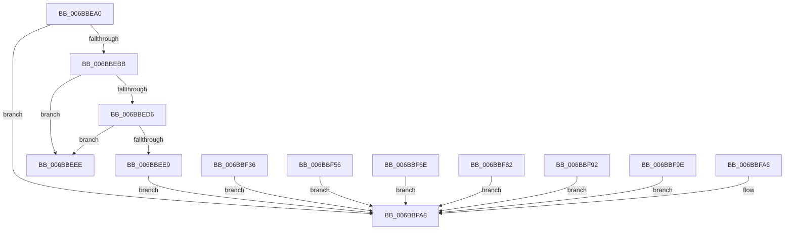

# HvcallpExtendedFastHypercallWithOutput

- RVA: `0x006BBEA0`–`0x006BBFAD` (길이 `269` bytes)
- VA: `0x00000001406BBEA0`
- 실행 섹션: `.text`
- PDB 이름 있음: `예`; PDB Function 태그: `아니요`
- unwind 정보 RVA: `0x000C2A34`
- 디코드: `83`개 명령, `269/269` bytes 표시
- 미해석 바이트: `0` (있으면 어셈블리에 `.byte`로 보존)

> 이 문서는 커널 이미지의 기계어와 PDB 기호를 분석해 생성했습니다. 4번과 5번은 함수 원형과 자료형을 바이너리 사용 방식에서 추정한 C 해석이며 원본 소스 복구 결과는 아닙니다.

## 1. Dependencies

- 직접 호출 지점: **1**; 고유 호출 대상: **1**
- 직접 호출자로 확인된 함수: **1**
- RIP 상대 이미지 참조: **1**

### Outgoing calls
- `0x006BBEAD` → [HvcallpExtendedFastHypercall](HvcallpExtendedFastHypercall_function_006BBE40.md) (function, `0x006BBE40`)

### Direct callers
- [HvcallFastExtended](../31/HvcallFastExtended_function_003130E0.md) at `0x0031323F`

### Static image references
- `0x006BBF29` → RVA `0x006BBF3C` (`.text`; read)

## 2. Other-region calls and transfers

- 다른 실행 섹션으로 향하는 call: **0**
- 별도 외부 분기/꼬리 이동을 확인하지 못했습니다.

## 3. Assembly (complete function range)

```asm
006BBEA0  48 83 EC 28                     sub rsp, 0x28
006BBEA4  4C 89 44 24 40                  mov qword ptr [rsp + 0x40], r8
006BBEA9  49 C1 E0 04                     shl r8, 4
006BBEAD  E8 8E FF FF FF                  call 0x1406bbe40
006BBEB2  66 85 C0                        test ax, ax
006BBEB5  0F 85 ED 00 00 00               jne 0x1406bbfa8
006BBEBB  4C 8B 4C 24 50                  mov r9, qword ptr [rsp + 0x50]
006BBEC0  4C 8B 54 24 40                  mov r10, qword ptr [rsp + 0x40]
006BBEC5  4C 8B 5C 24 58                  mov r11, qword ptr [rsp + 0x58]
006BBECA  49 81 E3 FF FF 00 00            and r11, 0xffff
006BBED1  4D 85 D2                        test r10, r10
006BBED4  75 18                           jne 0x1406bbeee
006BBED6  49 89 11                        mov qword ptr [r9], rdx
006BBED9  4D 89 41 08                     mov qword ptr [r9 + 8], r8
006BBEDD  49 83 C1 10                     add r9, 0x10
006BBEE1  49 FF CB                        dec r11
006BBEE4  4D 85 DB                        test r11, r11
006BBEE7  75 05                           jne 0x1406bbeee
006BBEE9  E9 BA 00 00 00                  jmp 0x1406bbfa8
006BBEEE  49 FF CA                        dec r10
006BBEF1  48 8B C8                        mov rcx, rax
006BBEF4  49 C7 C0 06 00 00 00            mov r8, 6
006BBEFB  4D 2B C2                        sub r8, r10
006BBEFE  4D 8B D0                        mov r10, r8
006BBF01  49 8B C2                        mov rax, r10
006BBF04  49 83 C2 01                     add r10, 1
006BBF08  49 F7 E2                        mul r10
006BBF0B  48 D1 E8                        shr rax, 1
006BBF0E  49 C7 C0 1B 00 00 00            mov r8, 0x1b
006BBF15  4C 2B C0                        sub r8, rax
006BBF18  4D 2B C3                        sub r8, r11
006BBF1B  49 C1 E0 02                     shl r8, 2
006BBF1F  48 8B C1                        mov rax, rcx
006BBF22  49 8B D1                        mov rdx, r9
006BBF25  48 83 EA 10                     sub rdx, 0x10
006BBF29  4C 8D 0D 0C 00 00 00            lea r9, [rip + 0xc]
006BBF30  4D 03 C8                        add r9, r8
006BBF33  41 FF E1                        jmp r9
006BBF36  CC                              int3
006BBF37  CC                              int3
006BBF38  CC                              int3
006BBF39  0F 1F 00                        nop dword ptr [rax]
006BBF3C  0F 11 6A 60                     movups xmmword ptr [rdx + 0x60], xmm5
006BBF40  0F 11 62 50                     movups xmmword ptr [rdx + 0x50], xmm4
006BBF44  0F 11 5A 40                     movups xmmword ptr [rdx + 0x40], xmm3
006BBF48  0F 11 52 30                     movups xmmword ptr [rdx + 0x30], xmm2
006BBF4C  0F 11 4A 20                     movups xmmword ptr [rdx + 0x20], xmm1
006BBF50  0F 11 42 10                     movups xmmword ptr [rdx + 0x10], xmm0
006BBF54  EB 52                           jmp 0x1406bbfa8
006BBF56  90                              nop
006BBF57  90                              nop
006BBF58  0F 11 6A 50                     movups xmmword ptr [rdx + 0x50], xmm5
006BBF5C  0F 11 62 40                     movups xmmword ptr [rdx + 0x40], xmm4
006BBF60  0F 11 5A 30                     movups xmmword ptr [rdx + 0x30], xmm3
006BBF64  0F 11 52 20                     movups xmmword ptr [rdx + 0x20], xmm2
006BBF68  0F 11 4A 10                     movups xmmword ptr [rdx + 0x10], xmm1
006BBF6C  EB 3A                           jmp 0x1406bbfa8
006BBF6E  90                              nop
006BBF6F  90                              nop
006BBF70  0F 11 6A 40                     movups xmmword ptr [rdx + 0x40], xmm5
006BBF74  0F 11 62 30                     movups xmmword ptr [rdx + 0x30], xmm4
006BBF78  0F 11 5A 20                     movups xmmword ptr [rdx + 0x20], xmm3
006BBF7C  0F 11 52 10                     movups xmmword ptr [rdx + 0x10], xmm2
006BBF80  EB 26                           jmp 0x1406bbfa8
006BBF82  90                              nop
006BBF83  90                              nop
006BBF84  0F 11 6A 30                     movups xmmword ptr [rdx + 0x30], xmm5
006BBF88  0F 11 62 20                     movups xmmword ptr [rdx + 0x20], xmm4
006BBF8C  0F 11 5A 10                     movups xmmword ptr [rdx + 0x10], xmm3
006BBF90  EB 16                           jmp 0x1406bbfa8
006BBF92  90                              nop
006BBF93  90                              nop
006BBF94  0F 11 6A 20                     movups xmmword ptr [rdx + 0x20], xmm5
006BBF98  0F 11 62 10                     movups xmmword ptr [rdx + 0x10], xmm4
006BBF9C  EB 0A                           jmp 0x1406bbfa8
006BBF9E  90                              nop
006BBF9F  90                              nop
006BBFA0  0F 11 6A 10                     movups xmmword ptr [rdx + 0x10], xmm5
006BBFA4  EB 02                           jmp 0x1406bbfa8
006BBFA6  90                              nop
006BBFA7  90                              nop
006BBFA8  48 83 C4 28                     add rsp, 0x28
006BBFAC  C3                              ret
```

## 4. C-style interpretation (structured pseudocode)

```c
__int64 __fastcall HvcallpExtendedFastHypercallWithOutput(__int64 a1, __int64 a2, __int64 a3, __int64 a4, __int64 a5, __int64 a6)
{
    __int64 result;
    __int64 v_r10;
    __int64 v_r11;
    __int64 v_rsp;
    unsigned __int64 v_stack_p18;

    v_rsp = (v_rsp) - (40);
    v_stack_p18 = a3;
    a3 = (a3) << (4);
    result = HvcallpExtendedFastHypercall(a1, a2, a3, a4);
    if ((unsigned __int16)(result) != 0) goto loc_006BBFA8;
    v_r11 = (a6) & (0xFFFFULL);
    if (v_stack_p18 != 0) goto loc_006BBEEE;
    *(unsigned __int64 *)(a5) = a2;
    *(unsigned __int64 *)(a5 + 8) = a3;
    a4 = (a5) + (16);
    v_r11 = (v_r11) - 1;
    if (v_r11 != 0) goto loc_006BBEEE;
    goto loc_006BBFA8;
loc_006BBEEE:
    v_r10 = (v_stack_p18) - 1;
    a3 = (6) - (v_r10);
    v_r10 = (a3) + (1);
    result = (a3) >> (1);
    a3 = (27) - (result);
    a3 = (a3) - (v_r11);
    a3 = (a3) << (2);
    a2 = (a4) - (16);
    a4 = (v_rip + 12) + (a3);
loc_006BBFA8:
    v_rsp = (v_rsp) + (40);
    return result;
}
```

## 5. (Beta) C Style

```c
int64_t HvcallpExtendedFastHypercallWithOutput(int64_t Arg1, int64_t Arg2, int64_t Arg3, int64_t Arg4, void *Arg5, int64_t Arg6)
{
    uint8_t *arg5 = (uint8_t *)Arg5;

    int64_t result;
    int64_t local_r10;
    int64_t local_r11;
    int64_t local_rsp;
    uint64_t v_stack_p18;

    local_rsp = (local_rsp) - (40);
    v_stack_p18 = Arg3;
    Arg3 = (Arg3) << (4);
    result = HvcallpExtendedFastHypercall(Arg1, Arg2, Arg3, Arg4);
    if ((uint16_t)(result) != 0) goto loc_006BBFA8;
    local_r11 = (Arg6) & (0xFFFFULL);
    if (v_stack_p18 != 0) goto loc_006BBEEE;
    *(uint64_t *)(arg5) = Arg2;
    *(uint64_t *)(arg5 + 0x8) = Arg3;
    Arg4 = (Arg5) + (16);
    local_r11 = (local_r11) - 1;
    if (local_r11 != 0) goto loc_006BBEEE;
    goto loc_006BBFA8;
loc_006BBEEE:
    local_r10 = (v_stack_p18) - 1;
    Arg3 = (6) - (local_r10);
    local_r10 = (Arg3) + (1);
    result = (Arg3) >> (1);
    Arg3 = (27) - (result);
    Arg3 = (Arg3) - (local_r11);
    Arg3 = (Arg3) << (2);
    Arg2 = (Arg4) - (16);
    Arg4 = (v_rip + 12) + (Arg3);
loc_006BBFA8:
    local_rsp = (local_rsp) + (40);
    return result;
}
```

### 관측된 메모리 오프셋

구조체 형식이 확인되지 않은 접근은 인자 기준의 오프셋으로만 기록했습니다.

| 기준 인자 | 오프셋 표현 | 폭 (bit) | 접근 |
|---|---:|---:|---|
| `Arg5` | `+ 0x0` | `64` | `W` |
| `Arg5` | `+ 0x8` | `64` | `W` |

## 6. Execution-region graph

[열기: 2D/3D 그래프와 함수 탐색 컨트롤 패널](../../../control-panel.html?section=text&rva=0x006BBEA0&view=graph)

- 2D 그래프는 위에서 아래로 흐르고, 3D 그래프는 빈 공간을 드래그해 회전합니다. Shift+드래그는 이동, 휠은 확대·축소, 함수 노드 선택은 대상 보고서 이동입니다.

### Static fallback


