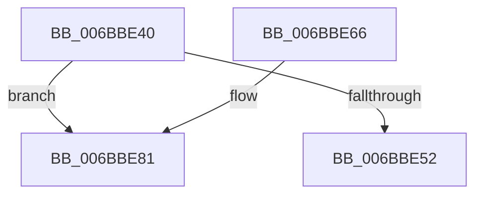

# HvcallpExtendedFastHypercall

- RVA: `0x006BBE40`–`0x006BBE99` (길이 `89` bytes)
- VA: `0x00000001406BBE40`
- 실행 섹션: `.text`
- PDB 이름 있음: `예`; PDB Function 태그: `아니요`
- unwind 정보 RVA: `0x000C2A28`
- 디코드: `26`개 명령, `89/89` bytes 표시
- 미해석 바이트: `0` (있으면 어셈블리에 `.byte`로 보존)

> 이 문서는 커널 이미지의 기계어와 PDB 기호를 분석해 생성했습니다. 4번과 5번은 함수 원형과 자료형을 바이너리 사용 방식에서 추정한 C 해석이며 원본 소스 복구 결과는 아닙니다.

## 1. Dependencies

- 직접 호출 지점: **1**; 고유 호출 대상: **1**
- 직접 호출자로 확인된 함수: **3**
- RIP 상대 이미지 참조: **2**

### Outgoing calls
- `0x006BBE8F` → `indirect target` (indirect, 간접 대상)

### Direct callers
- [HvcallFastExtended](../31/HvcallFastExtended_function_003130E0.md) at `0x0031314E`
- [HvlpFastFlushAddressSpaceTb](../31/HvlpFastFlushAddressSpaceTb_function_00314AF4.md) at `0x00314B89`
- [HvcallpExtendedFastHypercallWithOutput](HvcallpExtendedFastHypercallWithOutput_function_006BBEA0.md) at `0x006BBEAD`

### Static image references
- `0x006BBE59` → RVA `0x006BBE81` (`.text`; read)
- `0x006BBE88` → RVA `0x01201858` (`CFGRO`; read)

## 2. Other-region calls and transfers

- 다른 실행 섹션으로 향하는 call: **0**
- 별도 외부 분기/꼬리 이동을 확인하지 못했습니다.

## 3. Assembly (complete function range)

```asm
006BBE40  48 83 EC 08                     sub rsp, 8
006BBE44  49 83 C0 0F                     add r8, 0xf
006BBE48  49 C1 E8 04                     shr r8, 4
006BBE4C  49 83 F8 01                     cmp r8, 1
006BBE50  7E 2F                           jle 0x1406bbe81
006BBE52  49 FF C8                        dec r8
006BBE55  49 C1 E0 02                     shl r8, 2
006BBE59  4C 8D 0D 21 00 00 00            lea r9, [rip + 0x21]
006BBE60  4D 2B C8                        sub r9, r8
006BBE63  41 FF E1                        jmp r9
006BBE66  CC                              int3
006BBE67  CC                              int3
006BBE68  CC                              int3
006BBE69  0F 10 6A 60                     movups xmm5, xmmword ptr [rdx + 0x60]
006BBE6D  0F 10 62 50                     movups xmm4, xmmword ptr [rdx + 0x50]
006BBE71  0F 10 5A 40                     movups xmm3, xmmword ptr [rdx + 0x40]
006BBE75  0F 10 52 30                     movups xmm2, xmmword ptr [rdx + 0x30]
006BBE79  0F 10 4A 20                     movups xmm1, xmmword ptr [rdx + 0x20]
006BBE7D  0F 10 42 10                     movups xmm0, xmmword ptr [rdx + 0x10]
006BBE81  4C 8B 42 08                     mov r8, qword ptr [rdx + 8]
006BBE85  48 8B 12                        mov rdx, qword ptr [rdx]
006BBE88  48 8B 05 C9 59 B4 00            mov rax, qword ptr [rip + 0xb459c9]
006BBE8F  FF D0                           call rax
006BBE91  0F 1F 00                        nop dword ptr [rax]
006BBE94  48 83 C4 08                     add rsp, 8
006BBE98  C3                              ret
```

## 4. C-style interpretation (structured pseudocode)

```c
__int64 __fastcall HvcallpExtendedFastHypercall(__int64 a1, __int64 a2, __int64 a3)
{
    __int64 result;
    __int64 v_rsp;

    v_rsp = (v_rsp) - (8);
    a3 = (a3) + (15);
    a3 = (a3) >> (4);
    if (a3 <= 1) goto loc_006BBE81;
    a3 = (a3) - 1;
    a3 = (a3) << (2);
    a4 = (v_rip + 33) - (a3);
loc_006BBE81:
    result = kernel_indirect_call(a1, *(unsigned __int64 *)(a2), *(unsigned __int64 *)(a2 + 8), a4);
    v_rsp = (v_rsp) + (8);
    return result;
}
```

## 5. (Beta) C Style

```c
int64_t HvcallpExtendedFastHypercall(int64_t Arg1, void *Arg2, int64_t Arg3)
{
    uint8_t *arg2 = (uint8_t *)Arg2;

    int64_t result;
    int64_t local_rsp;

    local_rsp = (local_rsp) - (8);
    Arg3 = (Arg3) + (15);
    Arg3 = (Arg3) >> (4);
    if (Arg3 <= 1) goto loc_006BBE81;
    Arg3 = (Arg3) - 1;
    Arg3 = (Arg3) << (2);
    a4 = (v_rip + 33) - (Arg3);
loc_006BBE81:
    result = kernel_indirect_call(Arg1, *(uint64_t *)(arg2), *(uint64_t *)(arg2 + 0x8), a4);
    local_rsp = (local_rsp) + (8);
    return result;
}
```

### 관측된 메모리 오프셋

구조체 형식이 확인되지 않은 접근은 인자 기준의 오프셋으로만 기록했습니다.

| 기준 인자 | 오프셋 표현 | 폭 (bit) | 접근 |
|---|---:|---:|---|
| `Arg2` | `+ 0x0` | `64` | `R` |
| `Arg2` | `+ 0x8` | `64` | `R` |

## 6. Execution-region graph

[열기: 2D/3D 그래프와 함수 탐색 컨트롤 패널](../../../control-panel.html?section=text&rva=0x006BBE40&view=graph)

- 2D 그래프는 위에서 아래로 흐르고, 3D 그래프는 빈 공간을 드래그해 회전합니다. Shift+드래그는 이동, 휠은 확대·축소, 함수 노드 선택은 대상 보고서 이동입니다.

### Static fallback


