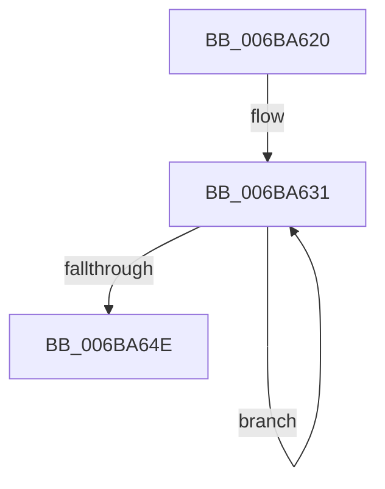

# InterlockedPushListSList

- RVA: `0x006BA620`–`0x006BA653` (길이 `51` bytes)
- VA: `0x00000001406BA620`
- 실행 섹션: `.text`
- PDB 이름 있음: `예`; PDB Function 태그: `아니요`
- unwind 정보 RVA: `0x000C2478`
- 디코드: `16`개 명령, `51/51` bytes 표시
- 미해석 바이트: `0` (있으면 어셈블리에 `.byte`로 보존)

> 이 문서는 커널 이미지의 기계어와 PDB 기호를 분석해 생성했습니다. 4번과 5번은 함수 원형과 자료형을 바이너리 사용 방식에서 추정한 C 해석이며 원본 소스 복구 결과는 아닙니다.

## 1. Dependencies

- 직접 호출 지점: **0**; 고유 호출 대상: **0**
- 직접 호출자로 확인된 함수: **6**
- RIP 상대 이미지 참조: **0**

### Outgoing calls
- 직접 디코드된 call 명령이 없습니다.

### Direct callers
- [ExAllocateHeapPool](../35/ExAllocateHeapPool_function_0035BA30.md) at `0x0035F139`
- [MiReplenishPageSlist](../3B/MiReplenishPageSlist_function_003BADE0.md) at `0x003BB107`
- [EtwpCovSampCaptureQueueDpc](../46/EtwpCovSampCaptureQueueDpc_function_00462370.md) at `0x004623A5`
- [EtwpCovSampPushListSList](../46/EtwpCovSampPushListSList_function_004667A8.md) at `0x004667C8`
- [HvlpSetupCachedHypercallPages](../58/HvlpSetupCachedHypercallPages_function_00586844.md) at `0x005868CE`
- [SmHwAcceleratorParitionCtxCreate](../../page/7A/SmHwAcceleratorParitionCtxCreate_function_007AB0A8.md) at `0x007AB258`

### Static image references
- 디코드된 RIP-relative 메모리 참조가 없습니다.

## 2. Other-region calls and transfers

- 다른 실행 섹션으로 향하는 call: **0**
- 별도 외부 분기/꼬리 이동을 확인하지 못했습니다.

## 3. Assembly (complete function range)

```asm
006BA620  0F 0D 09                        prefetchw byte ptr [rcx]
006BA623  53                              push rbx
006BA624  48 8B 01                        mov rax, qword ptr [rcx]
006BA627  4C 8B D9                        mov r11, rcx
006BA62A  48 8B CA                        mov rcx, rdx
006BA62D  49 8B 53 08                     mov rdx, qword ptr [r11 + 8]
006BA631  4C 8B D2                        mov r10, rdx
006BA634  41 80 E2 F0                     and r10b, 0xf0
006BA638  4D 89 10                        mov qword ptr [r8], r10
006BA63B  48 8D 98 00 00 02 00            lea rbx, [rax + 0x20000]
006BA642  66 42 8D 1C 08                  lea bx, [rax + r9]
006BA647  F0 49 0F C7 0B                  lock cmpxchg16b xmmword ptr [r11]
006BA64C  75 E3                           jne 0x1406ba631
006BA64E  49 8B C2                        mov rax, r10
006BA651  5B                              pop rbx
006BA652  C3                              ret
```

## 4. C-style interpretation (structured pseudocode)

```c
__int64 __fastcall InterlockedPushListSList(__int64 a1, __int64 a2, __int64 a3, __int64 a4)
{
    __int64 v_r10;

loc_006BA631:
    v_r10 = (unsigned __int8)((*(unsigned __int64 *)(a1 + 8)) & (240));
    *(unsigned __int64 *)(a3) = v_r10;
    if (condition_is_not_equal) goto loc_006BA631;
    return v_r10;
}
```

## 5. (Beta) C Style

```c
int64_t InterlockedPushListSList(void *Arg1, int64_t Arg2, void *Arg3, int64_t Arg4)
{
    uint8_t *arg1 = (uint8_t *)Arg1;
    uint8_t *arg3 = (uint8_t *)Arg3;

    int64_t local_r10;

loc_006BA631:
    local_r10 = (uint8_t)((*(uint64_t *)(arg1 + 0x8)) & (240));
    *(uint64_t *)(arg3) = local_r10;
    if (condition_is_not_equal) goto loc_006BA631;
    return local_r10;
}
```

### 관측된 메모리 오프셋

구조체 형식이 확인되지 않은 접근은 인자 기준의 오프셋으로만 기록했습니다.

| 기준 인자 | 오프셋 표현 | 폭 (bit) | 접근 |
|---|---:|---:|---|
| `Arg1` | `+ 0x0` | `8` | `R` |
| `Arg1` | `+ 0x0` | `64` | `R` |
| `Arg1` | `+ 0x0` | `128` | `R` |
| `Arg1` | `+ 0x8` | `64` | `R` |
| `Arg3` | `+ 0x0` | `64` | `W` |

## 6. Execution-region graph

[열기: 2D/3D 그래프와 함수 탐색 컨트롤 패널](../../../control-panel.html?section=text&rva=0x006BA620&view=graph)

- 2D 그래프는 위에서 아래로 흐르고, 3D 그래프는 빈 공간을 드래그해 회전합니다. Shift+드래그는 이동, 휠은 확대·축소, 함수 노드 선택은 대상 보고서 이동입니다.

### Static fallback


