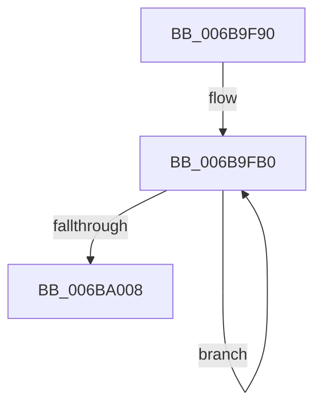

# KeCheckForZeroPage

- RVA: `0x006B9F90`–`0x006BA025` (길이 `149` bytes)
- VA: `0x00000001406B9F90`
- 실행 섹션: `.text`
- PDB 이름 있음: `예`; PDB Function 태그: `아니요`
- unwind 정보 RVA: `0x000BFAC8`
- 디코드: `33`개 명령, `149/149` bytes 표시
- 미해석 바이트: `0` (있으면 어셈블리에 `.byte`로 보존)

> 이 문서는 커널 이미지의 기계어와 PDB 기호를 분석해 생성했습니다. 4번과 5번은 함수 원형과 자료형을 바이너리 사용 방식에서 추정한 C 해석이며 원본 소스 복구 결과는 아닙니다.

## 1. Dependencies

- 직접 호출 지점: **0**; 고유 호출 대상: **0**
- 직접 호출자로 확인된 함수: **1**
- RIP 상대 이미지 참조: **0**

### Outgoing calls
- 직접 디코드된 call 명령이 없습니다.

### Direct callers
- [MiArePageContentsZero](../4D/MiArePageContentsZero_function_004D4278.md) at `0x004D4340`

### Static image references
- 디코드된 RIP-relative 메모리 참조가 없습니다.

## 2. Other-region calls and transfers

- 다른 실행 섹션으로 향하는 call: **0**
- 별도 외부 분기/꼬리 이동을 확인하지 못했습니다.

## 3. Assembly (complete function range)

```asm
006B9F90  48 C7 C2 00 F0 FF FF            mov rdx, 0xfffffffffffff000
006B9F97  48 2B CA                        sub rcx, rdx
006B9F9A  0F 57 C0                        xorps xmm0, xmm0
006B9F9D  0F 57 C9                        xorps xmm1, xmm1
006B9FA0  0F 57 D2                        xorps xmm2, xmm2
006B9FA3  0F 57 DB                        xorps xmm3, xmm3
006B9FA6  66 66 0F 1F 84 00 00 00 00 00   nop word ptr [rax + rax]
006B9FB0  66 0F 6F 24 11                  movdqa xmm4, xmmword ptr [rcx + rdx]
006B9FB5  66 0F EB C4                     por xmm0, xmm4
006B9FB9  66 0F 6F 64 11 10               movdqa xmm4, xmmword ptr [rcx + rdx + 0x10]
006B9FBF  66 0F EB CC                     por xmm1, xmm4
006B9FC3  66 0F 6F 64 11 20               movdqa xmm4, xmmword ptr [rcx + rdx + 0x20]
006B9FC9  66 0F EB D4                     por xmm2, xmm4
006B9FCD  66 0F 6F 64 11 30               movdqa xmm4, xmmword ptr [rcx + rdx + 0x30]
006B9FD3  66 0F EB DC                     por xmm3, xmm4
006B9FD7  66 0F 6F 64 11 40               movdqa xmm4, xmmword ptr [rcx + rdx + 0x40]
006B9FDD  66 0F EB C4                     por xmm0, xmm4
006B9FE1  66 0F 6F 64 11 50               movdqa xmm4, xmmword ptr [rcx + rdx + 0x50]
006B9FE7  66 0F EB CC                     por xmm1, xmm4
006B9FEB  66 0F 6F 64 11 60               movdqa xmm4, xmmword ptr [rcx + rdx + 0x60]
006B9FF1  66 0F EB D4                     por xmm2, xmm4
006B9FF5  66 0F 6F 64 11 70               movdqa xmm4, xmmword ptr [rcx + rdx + 0x70]
006B9FFB  66 0F EB DC                     por xmm3, xmm4
006B9FFF  48 81 C2 80 00 00 00            add rdx, 0x80
006BA006  75 A8                           jne 0x1406b9fb0
006BA008  66 0F EB C1                     por xmm0, xmm1
006BA00C  66 0F EB D3                     por xmm2, xmm3
006BA010  66 0F EB C2                     por xmm0, xmm2
006BA014  66 48 0F 7E C0                  movq rax, xmm0
006BA019  0F 12 C0                        movhlps xmm0, xmm0
006BA01C  66 48 0F 7E C1                  movq rcx, xmm0
006BA021  48 0B C1                        or rax, rcx
006BA024  C3                              ret
```

## 4. C-style interpretation (structured pseudocode)

```c
__int64 __fastcall KeCheckForZeroPage(__int64 a1)
{
    __int64 result;

    a1 = (a1) - (0xFFFFFFFFFFFFF000ULL);
loc_006B9FB0:
    a2 = (0xFFFFFFFFFFFFF000ULL) + (128);
    if (condition_is_not_equal) goto loc_006B9FB0;
    result = (result) | (a1);
    return result;
}
```

## 5. (Beta) C Style

```c
int64_t KeCheckForZeroPage(void *Arg1)
{
    uint8_t *arg1 = (uint8_t *)Arg1;

    int64_t result;

    Arg1 = (Arg1) - (0xFFFFFFFFFFFFF000ULL);
loc_006B9FB0:
    a2 = (0xFFFFFFFFFFFFF000ULL) + (128);
    if (condition_is_not_equal) goto loc_006B9FB0;
    result = (result) | (Arg1);
    return result;
}
```

### 관측된 메모리 오프셋

구조체 형식이 확인되지 않은 접근은 인자 기준의 오프셋으로만 기록했습니다.

| 기준 인자 | 오프셋 표현 | 폭 (bit) | 접근 |
|---|---:|---:|---|
| `Arg1` | `+ 0x0 + rdx*1` | `128` | `R` |
| `Arg1` | `+ 0x10 + rdx*1` | `128` | `R` |
| `Arg1` | `+ 0x20 + rdx*1` | `128` | `R` |
| `Arg1` | `+ 0x30 + rdx*1` | `128` | `R` |
| `Arg1` | `+ 0x40 + rdx*1` | `128` | `R` |
| `Arg1` | `+ 0x50 + rdx*1` | `128` | `R` |
| `Arg1` | `+ 0x60 + rdx*1` | `128` | `R` |
| `Arg1` | `+ 0x70 + rdx*1` | `128` | `R` |

## 6. Execution-region graph

[열기: 2D/3D 그래프와 함수 탐색 컨트롤 패널](../../../control-panel.html?section=text&rva=0x006B9F90&view=graph)

- 2D 그래프는 위에서 아래로 흐르고, 3D 그래프는 빈 공간을 드래그해 회전합니다. Shift+드래그는 이동, 휠은 확대·축소, 함수 노드 선택은 대상 보고서 이동입니다.

### Static fallback


