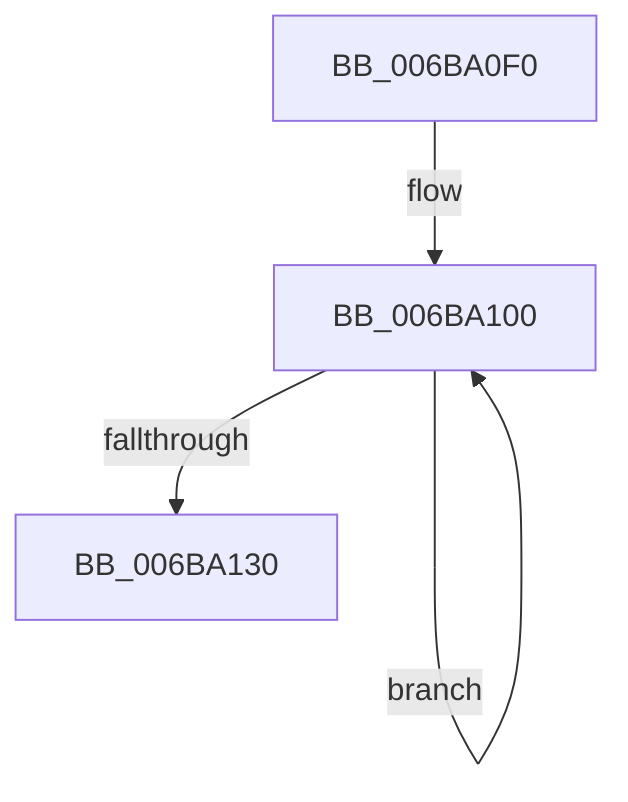

# KeCopyPage

- RVA: `0x006BA0F0`–`0x006BA134` (길이 `68` bytes)
- VA: `0x00000001406BA0F0`
- 실행 섹션: `.text`
- PDB 이름 있음: `예`; PDB Function 태그: `아니요`
- unwind 정보 RVA: `0x000BFAC8`
- 디코드: `16`개 명령, `68/68` bytes 표시
- 미해석 바이트: `0` (있으면 어셈블리에 `.byte`로 보존)

> 이 문서는 커널 이미지의 기계어와 PDB 기호를 분석해 생성했습니다. 4번과 5번은 함수 원형과 자료형을 바이너리 사용 방식에서 추정한 C 해석이며 원본 소스 복구 결과는 아닙니다.

## 1. Dependencies

- 직접 호출 지점: **0**; 고유 호출 대상: **0**
- 직접 호출자로 확인된 함수: **12**
- RIP 상대 이미지 참조: **0**

### Outgoing calls
- 직접 디코드된 call 명령이 없습니다.

### Direct callers
- [MiCombineInitialInstance](../22/MiCombineInitialInstance_function_0022BC0C.md) at `0x0022BEF8`
- [MiCombineInitialInstance](../22/MiCombineInitialInstance_function_0022BC0C.md) at `0x0022C7BB`
- [MiInitializeImageProtos](../2A/MiInitializeImageProtos_function_002ABDAC.md) at `0x002ABF3A`
- [MiCopyDataPageToImagePage](../2A/MiCopyDataPageToImagePage_function_002AE818.md) at `0x002AEB60`
- [sub_002B1BCF](../2B/Unknown_function_002B1BCF.md) at `0x002B1CED`
- [MiScrubPage](../3F/MiScrubPage_function_003F954C.md) at `0x003F9675`
- [MiScrubPage](../3F/MiScrubPage_function_003F954C.md) at `0x003F9697`
- [MiCopyKstack](../67/MiCopyKstack_function_0067B058.md) at `0x0067B0E0`
- [MiSlowRotateCopy](../67/MiSlowRotateCopy_function_0067E2B0.md) at `0x0067E3A0`
- [MiCopyFilePage](../68/MiCopyFilePage_function_00680790.md) at `0x00680804`
- [MiCopyMemoryPagefileData](../69/MiCopyMemoryPagefileData_function_00694C04.md) at `0x00694F08`
- [MiValidateImagePfn](../../page/93/MiValidateImagePfn_function_0093EA08.md) at `0x0093ED57`
- [MiRevertRelocatedImagePfn](../../page/93/MiRevertRelocatedImagePfn_function_0093EDD8.md) at `0x0093EE4C`
- [MiValidateSectionCreate](../../page/94/MiValidateSectionCreate_function_00940190.md) at `0x009405F5`

### Static image references
- 디코드된 RIP-relative 메모리 참조가 없습니다.

## 2. Other-region calls and transfers

- 다른 실행 섹션으로 향하는 call: **0**
- 별도 외부 분기/꼬리 이동을 확인하지 못했습니다.

## 3. Assembly (complete function range)

```asm
006BA0F0  48 C7 C0 00 F0 FF FF            mov rax, 0xfffffffffffff000
006BA0F7  48 2B D0                        sub rdx, rax
006BA0FA  48 2B C8                        sub rcx, rax
006BA0FD  0F 1F 00                        nop dword ptr [rax]
006BA100  0F 28 04 02                     movaps xmm0, xmmword ptr [rdx + rax]
006BA104  0F 28 4C 02 10                  movaps xmm1, xmmword ptr [rdx + rax + 0x10]
006BA109  0F 28 54 02 20                  movaps xmm2, xmmword ptr [rdx + rax + 0x20]
006BA10E  0F 28 5C 02 30                  movaps xmm3, xmmword ptr [rdx + rax + 0x30]
006BA113  66 0F E7 04 01                  movntdq xmmword ptr [rcx + rax], xmm0
006BA118  66 0F E7 4C 01 10               movntdq xmmword ptr [rcx + rax + 0x10], xmm1
006BA11E  66 0F E7 54 01 20               movntdq xmmword ptr [rcx + rax + 0x20], xmm2
006BA124  66 0F E7 5C 01 30               movntdq xmmword ptr [rcx + rax + 0x30], xmm3
006BA12A  48 83 C0 40                     add rax, 0x40
006BA12E  75 D0                           jne 0x1406ba100
006BA130  0F AE F8                        sfence
006BA133  C3                              ret
```

## 4. C-style interpretation (structured pseudocode)

```c
__int64 __fastcall KeCopyPage(__int64 a1, __int64 a2)
{
    __int64 result;

    a2 = (a2) - (0xFFFFFFFFFFFFF000ULL);
    a1 = (a1) - (0xFFFFFFFFFFFFF000ULL);
loc_006BA100:
    *(unsigned __int64 *)(a1 + 0xFFFFFFFFFFFFF000ULL * 1) = v_xmm0;
    *(unsigned __int64 *)(a1 + 0xFFFFFFFFFFFFF000ULL * 1 + 16) = v_xmm1;
    *(unsigned __int64 *)(a1 + 0xFFFFFFFFFFFFF000ULL * 1 + 32) = v_xmm2;
    *(unsigned __int64 *)(a1 + 0xFFFFFFFFFFFFF000ULL * 1 + 48) = v_xmm3;
    result = (0xFFFFFFFFFFFFF000ULL) + (64);
    if (condition_is_not_equal) goto loc_006BA100;
    return result;
}
```

## 5. (Beta) C Style

```c
int64_t KeCopyPage(void *Arg1, void *Arg2)
{
    uint8_t *arg1 = (uint8_t *)Arg1;
    uint8_t *arg2 = (uint8_t *)Arg2;

    int64_t result;

    Arg2 = (Arg2) - (0xFFFFFFFFFFFFF000ULL);
    Arg1 = (Arg1) - (0xFFFFFFFFFFFFF000ULL);
loc_006BA100:
    *(uint64_t *)(arg1 + 0xFFFFFFFFFFFFF000ULL * 1) = v_xmm0;
    *(uint64_t *)(arg1 + 0xFFFFFFFFFFFFF000ULL * 1 + 0x10) = v_xmm1;
    *(uint64_t *)(arg1 + 0xFFFFFFFFFFFFF000ULL * 1 + 0x20) = v_xmm2;
    *(uint64_t *)(arg1 + 0xFFFFFFFFFFFFF000ULL * 1 + 0x30) = v_xmm3;
    result = (0xFFFFFFFFFFFFF000ULL) + (64);
    if (condition_is_not_equal) goto loc_006BA100;
    return result;
}
```

### 관측된 메모리 오프셋

구조체 형식이 확인되지 않은 접근은 인자 기준의 오프셋으로만 기록했습니다.

| 기준 인자 | 오프셋 표현 | 폭 (bit) | 접근 |
|---|---:|---:|---|
| `Arg1` | `+ 0x0 + rax*1` | `128` | `R` |
| `Arg1` | `+ 0x10 + rax*1` | `128` | `R` |
| `Arg1` | `+ 0x20 + rax*1` | `128` | `R` |
| `Arg1` | `+ 0x30 + rax*1` | `128` | `R` |
| `Arg2` | `+ 0x0 + rax*1` | `128` | `R` |
| `Arg2` | `+ 0x10 + rax*1` | `128` | `R` |
| `Arg2` | `+ 0x20 + rax*1` | `128` | `R` |
| `Arg2` | `+ 0x30 + rax*1` | `128` | `R` |

## 6. Execution-region graph

[열기: 2D/3D 그래프와 함수 탐색 컨트롤 패널](../../../control-panel.html?section=text&rva=0x006BA0F0&view=graph)

- 2D 그래프는 위에서 아래로 흐르고, 3D 그래프는 빈 공간을 드래그해 회전합니다. Shift+드래그는 이동, 휠은 확대·축소, 함수 노드 선택은 대상 보고서 이동입니다.

### Static fallback


