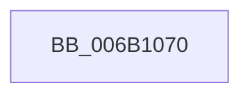

# KeGetCurrentStackPointer

- RVA: `0x006B1070`–`0x006B1076` (길이 `6` bytes)
- VA: `0x00000001406B1070`
- 실행 섹션: `.text`
- PDB 이름 있음: `예`; PDB Function 태그: `아니요`
- unwind 정보 RVA: `0x000C15EC`
- 디코드: `2`개 명령, `6/6` bytes 표시
- 미해석 바이트: `0` (있으면 어셈블리에 `.byte`로 보존)

> 이 문서는 커널 이미지의 기계어와 PDB 기호를 분석해 생성했습니다. 4번과 5번은 함수 원형과 자료형을 바이너리 사용 방식에서 추정한 C 해석이며 원본 소스 복구 결과는 아닙니다.

## 1. Dependencies

- 직접 호출 지점: **0**; 고유 호출 대상: **0**
- 직접 호출자로 확인된 함수: **20**
- RIP 상대 이미지 참조: **0**

### Outgoing calls
- 직접 디코드된 call 명령이 없습니다.

### Direct callers
- [EtwpLogKernelEvent](../25/EtwpLogKernelEvent_function_0025CC00.md) at `0x0025D7A2`
- [EtwpLogKernelEvent](../25/EtwpLogKernelEvent_function_0025CC00.md) at `0x0025D845`
- [RtlUnwindEx](../2F/RtlUnwindEx_function_002F2830.md) at `0x002F28D2`
- [RtlpWalkFrameChain](../2F/RtlpWalkFrameChain_function_002F3ED0.md) at `0x002F460D`
- [RtlpGetStackLimits](../2F/RtlpGetStackLimits_function_002F5F50.md) at `0x002F5F60`
- [EtwpTraceLastBranchRecord](../2F/EtwpTraceLastBranchRecord_function_002F7B00.md) at `0x002F7B88`
- [EtwpTraceLastBranchRecord](../2F/EtwpTraceLastBranchRecord_function_002F7B00.md) at `0x002F7C29`
- [KeQueryCurrentStackInformation](../2F/KeQueryCurrentStackInformation_function_002F7C80.md) at `0x002F7C98`
- [sub_002F80EA](../2F/Unknown_function_002F80EA.md) at `0x002F8105`
- [sub_002F819C](../2F/Unknown_function_002F819C.md) at `0x002F81A6`
- [RtlWalkFrameChain](../2F/RtlWalkFrameChain_function_002F85E0.md) at `0x002F8652`
- [sub_002F8911](../2F/Unknown_function_002F8911.md) at `0x002F8AC0`
- [EtwpTraceStackWalk](../2F/EtwpTraceStackWalk_function_002F8D60.md) at `0x002F8DAE`
- [EtwpLogSystemEventUnsafe](../2F/EtwpLogSystemEventUnsafe_function_002FBF10.md) at `0x002FC79F`
- [EtwpLogSystemEventUnsafe](../2F/EtwpLogSystemEventUnsafe_function_002FBF10.md) at `0x002FC840`
- [RtlpIsFrameInBoundsEx](../41/RtlpIsFrameInBoundsEx_function_00415510.md) at `0x00415589`
- [RtlEnoughStackSpaceForStackCapture](../43/RtlEnoughStackSpaceForStackCapture_function_004341D0.md) at `0x004341F5`
- [MiDoStackCopy](../48/MiDoStackCopy_function_0048BA30.md) at `0x0048BB55`
- [PnprGetStackLimits](../5A/PnprGetStackLimits_function_005A8C4C.md) at `0x005A8C62`
- [KasanHibernationGetStackLow](../5A/KasanHibernationGetStackLow_function_005AAC30.md) at `0x005AAC57`
- [sub_006F13AA](../6F/Unknown_function_006F13AA.md) at `0x006F14C1`
- [ViDeadlockAnalyze](../../pagevrfy/BA/ViDeadlockAnalyze_function_00BA8BD4.md) at `0x00BA8CB8`
- [MmVerifierTrimMemory](../../pagevrfy/BB/MmVerifierTrimMemory_function_00BB47E8.md) at `0x00BB4901`

### Static image references
- 디코드된 RIP-relative 메모리 참조가 없습니다.

## 2. Other-region calls and transfers

- 다른 실행 섹션으로 향하는 call: **0**
- 별도 외부 분기/꼬리 이동을 확인하지 못했습니다.

## 3. Assembly (complete function range)

```asm
006B1070  48 8D 44 24 08                  lea rax, [rsp + 8]
006B1075  C3                              ret
```

## 4. C-style interpretation (structured pseudocode)

```c
__int64 __fastcall KeGetCurrentStackPointer(void)
{
    unsigned __int64 v_stack_p8;

    return v_stack_p8;
}
```

## 5. (Beta) C Style

```c
void KeGetCurrentStackPointer(void)
{
    uint64_t v_stack_p8;

    return v_stack_p8;
}
```

## 6. Execution-region graph

[열기: 2D/3D 그래프와 함수 탐색 컨트롤 패널](../../../control-panel.html?section=text&rva=0x006B1070&view=graph)

- 2D 그래프는 위에서 아래로 흐르고, 3D 그래프는 빈 공간을 드래그해 회전합니다. Shift+드래그는 이동, 휠은 확대·축소, 함수 노드 선택은 대상 보고서 이동입니다.

### Static fallback


