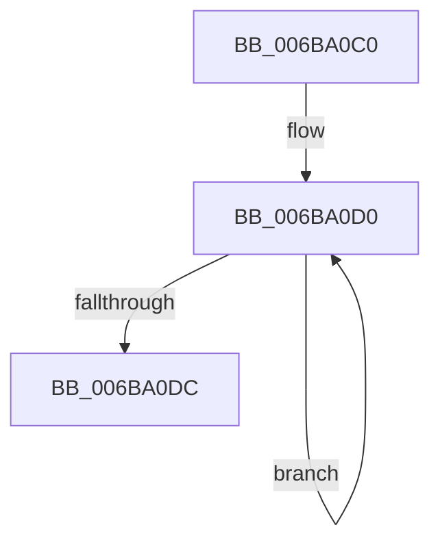

# KePersistMemory

- RVA: `0x006BA0C0`–`0x006BA0E0` (길이 `32` bytes)
- VA: `0x00000001406BA0C0`
- 실행 섹션: `.text`
- PDB 이름 있음: `예`; PDB Function 태그: `아니요`
- unwind 정보 RVA: `0x000BFAC8`
- 디코드: `8`개 명령, `32/32` bytes 표시
- 미해석 바이트: `0` (있으면 어셈블리에 `.byte`로 보존)

> 이 문서는 커널 이미지의 기계어와 PDB 기호를 분석해 생성했습니다. 4번과 5번은 함수 원형과 자료형을 바이너리 사용 방식에서 추정한 C 해석이며 원본 소스 복구 결과는 아닙니다.

## 1. Dependencies

- 직접 호출 지점: **0**; 고유 호출 대상: **0**
- 직접 호출자로 확인된 함수: **1**
- RIP 상대 이미지 참조: **0**

### Outgoing calls
- 직접 디코드된 call 명령이 없습니다.

### Direct callers
- [MiPersistMemory](../68/MiPersistMemory_function_00681A40.md) at `0x00681A4F`

### Static image references
- 디코드된 RIP-relative 메모리 참조가 없습니다.

## 2. Other-region calls and transfers

- 다른 실행 섹션으로 향하는 call: **0**
- 별도 외부 분기/꼬리 이동을 확인하지 못했습니다.

## 3. Assembly (complete function range)

```asm
006BA0C0  65 8B 04 25 68 02 00 00         mov eax, dword ptr gs:[0x268]
006BA0C8  0F 1F 84 00 00 00 00 00         nop dword ptr [rax + rax]
006BA0D0  66 0F AE 31                     clwb byte ptr [rcx]
006BA0D4  48 03 C8                        add rcx, rax
006BA0D7  48 2B D0                        sub rdx, rax
006BA0DA  75 F4                           jne 0x1406ba0d0
006BA0DC  0F AE F8                        sfence
006BA0DF  C3                              ret
```

## 4. C-style interpretation (structured pseudocode)

```c
__int64 __fastcall KePersistMemory(__int64 a1, __int64 a2)
{
loc_006BA0D0:
    a1 = (a1) + ((unsigned int)(*(unsigned int *)(gs_base + (0 + 616))));
    a2 = (a2) - ((unsigned int)(*(unsigned int *)(gs_base + (0 + 616))));
    if (condition_is_not_equal) goto loc_006BA0D0;
    return (unsigned int)(*(unsigned int *)(gs_base + (0 + 616)));
}
```

## 5. (Beta) C Style

```c
int64_t KePersistMemory(void *Arg1, int64_t Arg2)
{
    uint8_t *arg1 = (uint8_t *)Arg1;

loc_006BA0D0:
    Arg1 = (Arg1) + ((uint32_t)(*(uint32_t *)(gs_base + (0 + 0x268))));
    Arg2 = (Arg2) - ((uint32_t)(*(uint32_t *)(gs_base + (0 + 0x268))));
    if (condition_is_not_equal) goto loc_006BA0D0;
    return (uint32_t)(*(uint32_t *)(gs_base + (0 + 0x268)));
}
```

### 관측된 메모리 오프셋

구조체 형식이 확인되지 않은 접근은 인자 기준의 오프셋으로만 기록했습니다.

| 기준 인자 | 오프셋 표현 | 폭 (bit) | 접근 |
|---|---:|---:|---|
| `Arg1` | `+ 0x0` | `8` | `R` |

## 6. Execution-region graph

[열기: 2D/3D 그래프와 함수 탐색 컨트롤 패널](../../../control-panel.html?section=text&rva=0x006BA0C0&view=graph)

- 2D 그래프는 위에서 아래로 흐르고, 3D 그래프는 빈 공간을 드래그해 회전합니다. Shift+드래그는 이동, 휠은 확대·축소, 함수 노드 선택은 대상 보고서 이동입니다.

### Static fallback


